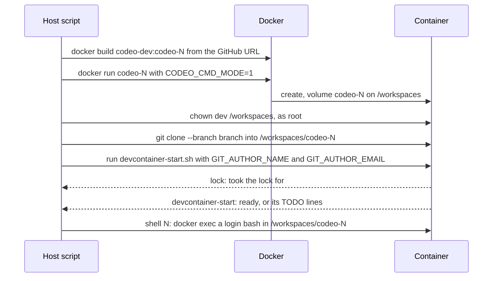

# Dev container

The dev container comes in two kinds. Each is its own clone in its own Docker volume.

| | Home container | Issue container |
|---|---|---|
| Clone of | `main` | the branch `/codeo:init` pushed |
| Clone folder and volume | `codeo-home` | `codeo-<N>` |
| Docker name (`docker ps`) | `codeo-home` | `codeo-<N>` |
| VS Code window title, and the terminal title in cmd mode | `codeo [home]` | `codeo [#<N>]` |
| Workflow lock | none | taken at start |
| Where these run | `/codeo:issue`, `/codeo:init`, `/codeo:triage`, `/codeo:cleanup` | `/codeo:plan` through `/codeo:close` |

`/codeo:doctor` and `/codeo:setup` run in either.

`/codeo:init` runs in the home container and hands off to the issue's container. The home container and one or more issue containers can run at the same time, as can two issue containers: each has its own name, clone and volume.

## Opening a container

In VS Code, run **Dev Containers: Clone Repository in Named Container Volume…** (the unnamed variant never asks for a name).

- Home container: repository URL `https://github.com/kbajpai/codeo`, volume `codeo-home`, folder `codeo-home`.
- Issue container: repository URL `https://github.com/kbajpai/codeo/tree/<branch>`, volume `codeo-<N>`, folder `codeo-<N>`. `/codeo:init` prints these with the branch and number filled in.

## Opening a container from the command line

A container also opens from a terminal on the host, with no VS Code. One script does it: `.devcontainer/codeo-container.sh`.

The host needs Docker with BuildKit (Docker 23 or later builds from a Git URL in the daemon) and `curl` once, to download the script. It needs nothing else. `git` on the host is used only to seed the container's git identity.

Download the script once:

```bash
curl -fsSL -o codeo-container.sh https://raw.githubusercontent.com/kbajpai/codeo/main/.devcontainer/codeo-container.sh
```

Run the commands from the directory that holds the downloaded file.

| Command | What it does |
|---|---|
| `bash codeo-container.sh home` | Opens the home container `codeo-home`, a clone of `main`. |
| `bash codeo-container.sh issue <N> <branch>` | Opens the issue container `codeo-<N>`, a clone of `<branch>`. `/codeo:init` prints the number and the branch. |
| `bash codeo-container.sh shell home` or `shell <N>` | Opens a shell in an existing container, in its clone folder. |

`home` and `issue` build the image the first time, run the container, clone the repository into it and run the start script. They print what `docker` prints, then the start script's lines: for an issue container `lock: took the lock for #<N> on <branch>`, and for both `devcontainer-start: ready`, or `devcontainer-start: TODO` lines for what is left. The usual first TODO is `Claude Code is not logged in: run claude auth login`: run `bash codeo-container.sh shell <home|N>`, then `claude auth login` in the shell. Run the command again on a running container and it creates nothing: it runs the start script again. On a stopped container it starts it first.

`shell` starts a stopped container, sets the terminal's title to `codeo [home]` or `codeo [#<N>]`, and opens a login `bash` in `/workspaces/codeo-home` or `/workspaces/codeo-<N>`. Start `claude` there. With no such container it prints `codeo-container: no container codeo-<N>: create it with '...'` and exits 1. A bad argument prints the usage and exits 2.



The container is the same as the VS Code route's: the same name, hostname, 4 GB memory cap, and the `codeo-gh` and `codeo-git` volumes. These differ:

- The script sets `CODEO_CMD_MODE`. The start script then writes no `.vscode/settings.json`, because no VS Code is there to name, and does not wait for a host `~/.gitconfig`, because none is copied in.
- The git identity comes from the host's `git config user.name` and `user.email`, else from `GIT_AUTHOR_NAME` and `GIT_AUTHOR_EMAIL` in the host's environment, each on its own. They are passed to the start script's run only, as `GIT_AUTHOR_NAME` and `GIT_AUTHOR_EMAIL`, so the start script's seeding applies: it fills a key the `codeo-git` volume lacks and never overwrites one it has.
- Claude Code's login and sessions live on the container's own volume, at `/workspaces/.claude` (`CLAUDE_CONFIG_DIR`). A rebuild keeps them. `docker volume rm codeo-<N>` removes them.
- The terminal's title is set by `shell`, and the session title by the same hook as in VS Code.

Two variables change where the script reads from:

| Variable | Meaning |
|---|---|
| `CODEO_REPO_URL` | The repository to build from and clone. Default `https://github.com/kbajpai/codeo.git`. |
| `CODEO_CONTEXT` | A local directory to build the image from instead of the Git URL, for a developer's own clone. |

## What the start script does

`.devcontainer/scripts/devcontainer-start.sh` runs when the container is created.

- On `main` (the base branch) it takes no lock. On an issue's branch it takes the workflow lock with codeo's `lock.sh`, from the `init.md` on that branch, and prints `lock: took the lock for #<N> on <branch>`.
- An empty `.codeo/active` holds no lock, so the script removes it, says so (`.codeo/active was empty and held no lock: removed it`) and goes on to take the lock on an issue branch.
- A `.codeo/active` that has content but names no issue holds no usable lock. A file names an issue when a line starts with `issue:` followed by a number (`issue:   87` or `issue: #87`); a file holding only a newline, or other text, does not. The script leaves such a file exactly as it is, takes no lock, and lists one TODO: `.codeo/active names no issue, so it holds no usable lock: look at it, remove it if it is not yours, then re-run this script`. This is the same on `main` and on an issue's branch. A file that names an issue is a held lock and is left alone.
- A `.codeo/active` that is empty but cannot be removed, or has content the script cannot read, is one TODO each (the second says the file may hold a lock) and takes no lock; a non-empty file it cannot read is never reported as naming no issue.
- When `core.fileMode` is false and the clone is on a Docker volume, the script restores the tracked files to the index's modes, turns `core.fileMode` on for this clone, and names the tracked files that are executable on disk but recorded `100644` and left as they are; when the `false` came from a wider scope than the clone's own config, it says which scope the clone's `true` overrides. When the `false` comes from a scope that outranks the clone's config (the `GIT_CONFIG_COUNT` or `GIT_CONFIG_PARAMETERS` variables, or a worktree config), the local `true` changes nothing, so it lists one TODO naming the scope instead and does not print `ready`. A mode listing that fails puts its reason in the TODO, and an interrupted run leaves no temporary `modes.*` file.
- It checks the clone folder against what the lock says. A folder that does not match is reported as a `todo:` line naming the folder to open the container with, and the container is left running.
- It fills a `user.name` or `user.email` that the `codeo-git` volume's git config lacks, each on its own, from the `~/.gitconfig` VS Code copies in from the host, else from `GIT_AUTHOR_NAME` / `GIT_AUTHOR_EMAIL`, and prints which key it set and from where (never the value). Only values written directly in ~/.gitconfig count: an identity kept in a file it [include]s or [includeIf]s is not followed, because VS Code copies only ~/.gitconfig into the container. It never changes a value already in the volume and copies nothing else from the host file. VS Code's copy can arrive after the script starts, so when a value is missing the script waits for the file to be there, not empty, and to stop growing (size and modification time unchanged over 0.2 seconds) for up to 10 seconds (`CODEO_GITCONFIG_WAIT`, where a value that is not a whole number counts as 10); a container whose volume already has the identity never waits. When no source has a value, it lists a TODO that names the sources it tried.

## Roles and the guard

`.devcontainer/scripts/role.sh` says what role a container plays, from the clone folder (the container's Docker name), the workflow lock and the branch. It runs no container-engine command.

| Role | Means | What the guard does |
|---|---|---|
| `home` | no lock, on the base branch, in the folder `codeo-home` | Lets `/codeo:issue`, `/codeo:init`, `/codeo:triage` and `/codeo:cleanup` run. `/codeo:plan` through `/codeo:close` also pass the guard, and their own step 0 stops them because there is no lock. |
| `issue:<N>` | locked for `<N>`, in the folder `codeo-<N>` | Lets `/codeo:plan`, `/codeo:implement`, `/codeo:qc` and `/codeo:close` run. Refuses the home-only skills and names the home container. |
| `stale:<N>`, `stale:?` | no lock, and not the home container on the base branch: `stale:<N>` in the folder `codeo-<N>`, `stale:?` in `codeo-home` on another branch | Refuses every guarded skill in one line that names the role and, from the clone's own dossier, what happened to the workflow: finished (the base branch, as this clone last saw it, carries the archived dossier; nothing more runs here, and `/codeo:cleanup` in the home container prints how to remove it), stashed (a stash not yet resumed; `/codeo:init #<N>` in the home container is the way back, never the start script, and this container is removed first), abandoned (an abandon not taken up again; nothing more runs here, and the container may hold the only copy of the work), a live dossier with no lock (a resumed stash and an archived dossier whose pull request is still open included; re-run `bash .devcontainer/scripts/devcontainer-start.sh` to take the lock), or nothing the dossier says. In `codeo-home` off the base branch (`stale:?`) the refusal tells a home-only skill to switch back to the base branch, and sends any other skill to the container of the issue it is for. Otherwise a home-only skill is sent to the home container. |
| `mismatch:<N>:<folder>` | locked for `<N>`, in a folder other than `codeo-<N>` | Refuses every guarded skill. |
| `unguarded` | not a guarded container (see below) | Lets everything run, as it does without a guard. |

The guard applies only when all of these hold: `/.dockerenv` exists, `CLAUDE_CODE_REMOTE` is not `true`, and the clone folder is named `codeo-home` or `codeo-<digits>`. A hosted web session, a plain local checkout, and a container in any other folder are `unguarded` and run every skill as before.

Each guarded skill (`/codeo:issue`, `/codeo:init`, `/codeo:triage`, `/codeo:cleanup`, `/codeo:plan`, `/codeo:implement`, `/codeo:qc`, `/codeo:close`) has a `role-guard` section in its overlay, `.codeo/overlays/<skill>.md`, that runs `bash .devcontainer/scripts/role.sh --check <skill>` as the skill's first step. `--check` exits 0 and prints nothing when the skill may run, and exits 1 with one line naming where the skill runs and this container's role when it may not; any other exit (the script is missing, or failed) is reported by the overlay text, which then goes on. A refusal ends the step; nothing the engineer says lifts it, and the way forward is the container the message names. `role.sh` with no arguments prints the role.

A container whose clone lacks the role script and the guard overlays, such as one created from a branch cut before the guard existed, is not guarded: it runs every skill as before until it is removed.

## Removing a finished container

Nothing inside a container removes a container. After a finished close, `/codeo:close` prints the commands that remove the issue's container and its volume, and only when the lock's `volume:` is the container of the lock's own issue. `/codeo:cleanup`, which runs in the home container, lists the other finished issues' containers the same way: it proves five things for each issue (the issue is closed, its pull request is merged, its branch is gone from origin, no branch still carries its dossier, and the issue holds no lease and waits for none on the intake branch) and prints a removal command only for an issue that passes all five, built from this project's overlay; a pull request whose head branch name is missing fails the branch proof. Origin cannot show whether a clone holds unpushed work or whether the workflow ended in that container, so a lease the issue still holds is the one trace of an unfinished close, and it lists the issue as not proven.

After `/codeo:close` finishes, the container holds no lock and is `stale`, so `/codeo:triage` and `/codeo:cleanup` run in the home container, and the finished close's closing block names it. The removal commands are printed only for a workflow hosted in a container.

After a stash `/codeo:close` prints no removal command. The resume, `/codeo:init #<N>` in the home container, opens a new `codeo-<N>` container, and two containers cannot share a name (Docker reports `name already in use`), so remove the old one first, by hand on the host, once `git status` in it shows nothing unpushed: `docker rm -f codeo-<N>; docker volume rm codeo-<N>`.

After an abandon it prints none either. With the branch kept, the container holds nothing the branch lacks and may be removed with the same commands. With the branch deleted, the container holds the only copy of the work: do not remove it. `/codeo:triage` runs in the home container in both cases.

`/codeo:cleanup` lists finished issues only, those with a `.codeo/done/<N>` entry on the base branch, so it never lists a stashed or abandoned one.

Both only print. The printed `docker rm -f codeo-<N>; docker volume rm codeo-<N>` serves a container opened from the command line too; removing its volume also removes its Claude Code login. Run the commands in a shell on the host, and run `git status` in that clone first: unpushed work is lost with the volume. The home container has no container engine on purpose and no Docker socket is mounted into it, so it cannot run the commands for you.

## The folder rule

The clone folder is the container's Docker name (`runArgs` `--name=${containerWorkspaceFolderBasename}`). Docker accepts names that match `[a-zA-Z0-9][a-zA-Z0-9_.-]+` and refuses anything else before any script runs, so a container cannot start with another folder and the start script never gets to report it. Use the folders above; if you typed another, remove the container and clone again with the right folder.

A container opened from the command line is named by the script, not by a folder, so this rule cannot be broken there.

The Docker name is the folder's name, so two containers whose folders share a name cannot both exist, also while the first is stopped. This happens when a host folder is opened with **Reopen in Container** from two paths with the same last name (`~/a/codeo` and `~/b/codeo`): Docker reports `name already in use`. Give one of them another folder name, or use the named-volume flow above, whose folders `codeo-home` and `codeo-<N>` never clash.

## Rebuilding

A container created before the name was the clone folder alone has a different Docker name. Rebuild it once to get the new name. If Docker reports that the name is already in use, a container with that name is left over: remove it with `docker rm <name>` and open the container again. The same message also means a second container with the same folder name: see *The folder rule*.

A container created before the move to Ubuntu 26.04 is still on the older image. Rebuild it once (**Dev Containers: Rebuild Container**) to get the new one. The clone and the `codeo-gh` and `codeo-git` volumes are kept. Expect all of `~/.claude` to be lost on a rebuild (the Claude Code login, past sessions and user settings), because it is not on a volume: run `claude auth login` again, and the start script reinstalls the plugins.

A container opened from the command line is rebuilt with `bash codeo-container.sh home --rebuild` or `bash codeo-container.sh issue <N> <branch> --rebuild`. It removes the container, builds the image again and starts a new container. The volumes are kept: the clone, `/workspaces/.claude` (the Claude Code login and sessions), `codeo-gh` and `codeo-git`.
