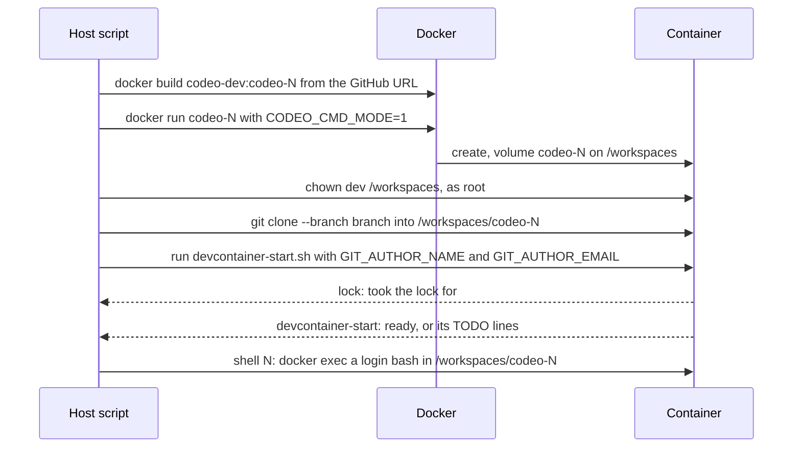
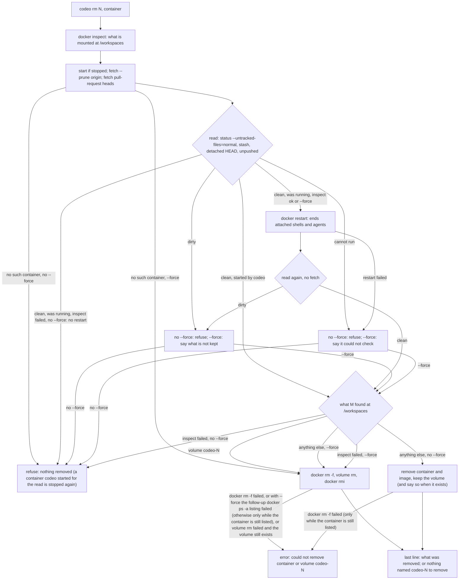

# Dev container

The dev container comes in two kinds. Each is its own clone in its own Docker volume.

An issue can also run in a Docker Sandboxes (sbx) sandbox instead of an issue container; `.sbx/README.md` describes that route.

| | Home container | Issue container |
|---|---|---|
| Clone of | `main` | the branch `/codeo:init` pushed |
| Clone folder and volume | `codeo-home` | `codeo-<N>` |
| Docker name (`docker ps`) | `codeo-home` | `codeo-<N>` |
| VS Code window title, and the terminal title in cmd mode (`shell` sets it once; the prompt `dev@codeo-<N>` names the terminal after that) | `codeo [home]` | `codeo [#<N>]` |
| Workflow lock | none | taken at start |
| Where these run | `/codeo:issue`, `/codeo:init`, `/codeo:triage`, `/codeo:cleanup` | `/codeo:plan` through `/codeo:close` |

`/codeo:doctor` and `/codeo:setup` run in either.

`/codeo:init` runs in the home container, or in a host clone named `<codename>-home` (see *The home checkout* in the top-level `README.md`), and hands off to the issue's container. The home container and one or more issue containers can run at the same time, as can two issue containers: each has its own name, clone and volume.

## Opening a container

In VS Code, run **Dev Containers: Clone Repository in Named Container Volume…** (the unnamed variant never asks for a name).

- Home container: repository URL `https://github.com/kbajpai/codeo`, volume `codeo-home`, folder `codeo-home`.
- Issue container: repository URL `https://github.com/kbajpai/codeo/tree/<branch>`, volume `codeo-<N>`, folder `codeo-<N>`. `/codeo:init` prints these with the branch and number filled in.

## Opening a container from the command line

A container also opens from a terminal on the host, with no VS Code. One script does it: `.devcontainer/codeo-container.sh`.

The host needs Docker with BuildKit (Docker 23 or later builds from a Git URL in the daemon) and `curl` once, to download the script. It needs nothing else. `git` on the host is used only to seed the container's git identity.

Download the script once:

```bash
curl -fsSL -o codeo-container.sh https://raw.githubusercontent.com/kbajpai/codeo/main/.devcontainer/codeo-container.sh
```

To record the container on the issue, fetch the tracker beside it:

```bash
curl -fsSL -o codeo-track.sh https://raw.githubusercontent.com/kbajpai/codeo/main/.devcontainer/codeo-track.sh
```

Without `codeo-track.sh` beside `codeo-container.sh`, nothing is recorded on the issue. A container opened through VS Code's **Clone Repository in Named Container Volume…** records the branch row alone (`/codeo:init` adds it); the container, image and volume are not recorded.

Run the commands from the directory that holds the downloaded files.

The `codeo` command runs the same script for you; see *Installing the `codeo` command* below. Its form is shown beside each long form.

| Command | `codeo` form | What it does |
|---|---|---|
| `bash codeo-container.sh home` | `codeo home` | Opens the home container `codeo-home`, a clone of `main`. |
| `bash codeo-container.sh issue <N> <branch>` | `codeo issue <N> [<branch>]` | Opens the issue container `codeo-<N>`, a clone of `<branch>`. `/codeo:init` prints the number and the branch. `codeo issue <N> --container` forces a container when the saved default is a sandbox. |
| `bash codeo-container.sh shell home` or `shell <N>` | `codeo shell home` or `codeo shell <N> [--container\|--sandbox]` | Opens a shell in an existing container, in its clone folder. |

`home` and `issue` build the image the first time, run the container, clone the repository into it and run the start script. They print what `docker` prints, then the start script's lines: for an issue container `lock: took the lock for #<N> on <branch>`, and for both `devcontainer-start: ready`, or `devcontainer-start: TODO` lines for what is left. The first run usually lists the logins (GitHub, then Claude Code) as TODO lines: open `bash codeo-container.sh shell <home|N>` and run what each TODO says (for example `claude auth login`). Run `home` again on a running container and it creates nothing: it runs the start script again; on a stopped container it starts it first. `issue` on an existing `codeo-<N>` refuses with `codeo-<N> already exists`, and names the three ways on: `bash codeo-container.sh shell <N>` to enter it, `issue <N> <branch> --rebuild` to rebuild it, or removal (`docker rm -f codeo-<N>; docker volume rm codeo-<N>`, once `git status` in it shows nothing unpushed) to start from a fresh clone. It also refuses a clone that is on another branch than `<branch>`. To see the TODO list again, open `shell <N>` and run `bash .devcontainer/scripts/devcontainer-start.sh`.

`shell` starts a stopped container, sets the terminal's title once to `codeo [home]` or `codeo [#<N>]`, and opens a login `bash` in `/workspaces/codeo-home` or `/workspaces/codeo-<N>`. Start `claude` there. With no such container it prints `codeo-container: no container codeo-<N>: create it with '...'` and exits 1. A bad argument prints the usage and exits 2.



The container is the same as the VS Code route's: the same name, 4 GB memory cap, and the `codeo-gh` and `codeo-git` volumes. These differ:

- The hostname is the container's name, so the prompt reads `dev@codeo-<N>`. The VS Code route sets none.
- The container runs with `--init`, which the VS Code route does not set.
- The script sets `CODEO_CMD_MODE`. The start script then writes no `.vscode/settings.json`, because no VS Code is there to name, and does not wait for a host `~/.gitconfig`, because none is copied in.
- The git identity comes from the host's `git config --global user.name` and `--global user.email` (read only where git is usable: on a Mac, once `xcode-select -p` succeeds, so the Command Line Tools install dialog never opens; a repository's own setting is never used), else from `GIT_AUTHOR_NAME` and `GIT_AUTHOR_EMAIL` in the host's environment, each on its own. They are passed to the start script's run only, as `GIT_AUTHOR_NAME` and `GIT_AUTHOR_EMAIL`, so the start script's seeding applies: it fills a key the `codeo-git` volume lacks and never overwrites one it has.
- Claude Code's login and sessions live on the container's own volume, at `/workspaces/.claude` (`CLAUDE_CONFIG_DIR`). A rebuild keeps them. `docker volume rm codeo-<N>` removes them.
- The terminal's title is set once by `shell`, and the prompt `dev@codeo-<N>` names the terminal after that. The session title is set by the same hook as in VS Code.

Two variables change where the script reads from, and `CODEO_SBX` picks the sbx program:

| Variable | Meaning |
|---|---|
| `CODEO_REPO_URL` | The repository to build from and clone. Default `https://github.com/kbajpai/codeo.git`. |
| `CODEO_CONTEXT` | The `.devcontainer` directory of a local clone, used only to build the image; the repository is still cloned from `CODEO_REPO_URL`. With the `codeo` command a relative path is read against the directory `codeo` was started in. |
| `CODEO_SBX` | The sbx program `codeo list`, `codeo shell`, `codeo open` and `codeo rm` ask whether a sandbox exists, and `codeo-sandbox.sh` runs; else `sbx`, else `sbx.exe`. |

## Installing the `codeo` command

`codeo` is a host command that wraps `codeo-container.sh` and `codeo-sandbox.sh`, so `codeo issue 133` replaces `bash codeo-container.sh issue 133 <branch>` and finds the branch itself. It is one bash script, `.devcontainer/codeo`. The host is Linux with bash 4.3 or later, `curl`, `git` and `flock` (util-linux); `docker` and `sbx` are each optional, and a missing one counts as none of that kind.

Install it once:

```bash
mkdir -p ~/.local/bin && curl -fsSL -o ~/.local/bin/codeo https://raw.githubusercontent.com/kbajpai/codeo/main/.devcontainer/codeo && chmod +x ~/.local/bin/codeo
```

When `~/.local/bin` is not on `PATH`, `codeo help` ends with the one line to add to the shell profile: `export PATH="$HOME/.local/bin:$PATH"`. `codeo` never edits a shell profile.

`~/codeo` (`CODEO_HOME`) holds what `codeo` keeps: the three scripts `codeo-container.sh`, `codeo-sandbox.sh` and `codeo-track.sh`, the sandbox clones `codeo-<N>`, the saved default kind in `default`, and a blob-less bare clone `.lookup.git` used to find branches. `codeo` makes `~/codeo` and downloads a missing script the first time a command needs it, then runs the scripts from there, so the commands need no particular working directory. Each download goes to a temporary file of its own in `~/codeo` and is renamed into place, and the scripts it installs are made executable. The lookup clone `.lookup.git` is made in a temporary directory and renamed into place, and every branch lookup runs under an exclusive `flock` on `~/codeo/.lookup.lock`, so two first-use commands started together are safe: the scripts and the lookup clone are complete whichever finishes first, and the clone is made once. When `CODEO_HOME` is unset and `~/codeo` is a git checkout (what `git clone` of this repository makes there), `codeo` stops with one line that asks for `CODEO_HOME` to name the directory it should keep its files in, and writes nothing. That covers every command that reads the home directory: `home`, `issue`, `shell`, `list`, `default`, `update`, and `rm` or `open` of a sandbox. `help` and a usage error never read it, so they go ahead. `rm` of a container reads `~/codeo` only to fetch a missing `codeo-track.sh` and never stops over it, and so does `open` of a container, which fails with "is a container" before it reads it. The one usage error that needs the kind (`--rebuild` for a sandbox) reads the home directory only for the saved default, so the stop comes first only when neither `--container` nor `--sandbox` is given. A relative `CODEO_HOME`, `CODEO_CONTEXT` or `CODEO_SBX_IMAGE`, and a `CODEO_SBX` that holds a `/`, are read against the directory `codeo` was started in, so a later `cd` inside `codeo` cannot change what it names; a `CODEO_SBX` with no `/` is a program name and stays one. `CODEO_RAW_URL` names another base URL to download from (default `https://raw.githubusercontent.com/kbajpai/codeo/main`), and `CODEO_REPO_URL` another repository (default `https://github.com/kbajpai/codeo.git`).

`codeo help` lists the commands, and the kind flag `[--container|--sandbox]` on the four that take it:

```text
  codeo issue <N> [<branch>] [--rebuild] [--container|--sandbox] [--yes]  start work on issue N
  codeo shell home|<N> [--container|--sandbox]                    open a shell in the home or issue environment
  codeo open <N> [--container|--sandbox]                          open the issue's sandbox in VS Code
  codeo rm <N> [--force] [--container|--sandbox]                  remove the issue's container or sandbox
```

`codeo update` downloads the newest `codeo` and its three scripts (`codeo-container.sh`, `codeo-sandbox.sh` and `codeo-track.sh`) into a temporary directory inside `~/codeo`, checks that each file is non-empty and starts with `#!`, and only then moves them over the installed ones, `codeo` last. A failed download or check removes the temporary directory and changes nothing installed; a failure while moving the files names which are new and which are still old, and running `codeo update` again finishes it. `codeo update` overwrites the installed `codeo` and its three scripts in `~/codeo`, including any hand edits made to them, and prints `updated codeo and its three scripts` when it is done.

| Command | Long form | What it does |
|---|---|---|
| `codeo home [--rebuild]` | `bash codeo-container.sh home [--rebuild]` | Opens the home container. |
| `codeo issue <N> [<branch>] [--rebuild] [--container\|--sandbox] [--yes]` | `bash codeo-container.sh issue <N> <branch> [--rebuild] [--yes]` | Opens the issue container `codeo-<N>`, or the issue's sandbox with `--sandbox` or when the saved default is a sandbox. |
| `codeo shell home` or `codeo shell <N> [--container\|--sandbox]` | `bash codeo-container.sh shell home` or `shell <N>` | Opens a shell in the home container, or in the issue's container or sandbox. |
| `codeo open <N> [--container\|--sandbox]` | `bash codeo-sandbox.sh open <N>` | Opens the issue's sandbox in VS Code; sandbox only. |
| `codeo list` | none | Lists the issue containers and sandboxes. |
| `codeo rm <N> [--force] [--container\|--sandbox]` | `docker rm -f codeo-<N>; docker volume rm codeo-<N>` | Removes the issue's container after a safe check (see *Removing a finished container*). |
| `codeo default [container\|sandbox]` | none | Shows the saved default kind for `codeo issue`, or saves one. |
| `codeo update`, `codeo help` | none | Update the command and the scripts; print the commands. |

With no `<branch>`, `codeo issue <N>` looks for the branch that holds `.codeo/<N>/init.md` on origin: it fetches `.lookup.git` on every lookup and tests each origin branch. One match is the branch. With none, or with several, it prints one line naming what it found, asks for `codeo issue <N> <branch>` and starts nothing. `issue` starts a container or a sandbox: the flag `[--container|--sandbox]` says which, else the saved default in `~/codeo/default` (`codeo default container` or `codeo default sandbox` saves it, `codeo default` shows it, and a container is the default when none is saved; when `codeo default <kind>` cannot create the directory it keeps the file in, it prints one line, `codeo: could not create <dir>`, and exits 1). `--rebuild` is a usage error when the kind is a sandbox, whether by flag or by the saved default; the usage message says why. `shell`, `open` and `rm` look at the host instead: a Docker container `codeo-<N>` and an sbx sandbox `codeo-<N>`. When only one exists it is used. When `docker` or `sbx` fails to list, `codeo` warns on stderr and, unless `--container` or `--sandbox` names the kind, stops with one line asking for the flag, because the other kind may hold `codeo-<N>`; nothing runs. With neither, `codeo` prints one line naming `codeo issue <N>` and exits 1; with both, it prints one line and `--container` or `--sandbox` picks. `.sbx/README.md` describes the sandbox side.

`codeo list` prints one row per issue container or sandbox, containers first, each kind by number: `#<N>  <kind>  <state>  <branch>`. The state of a container is `running`, `paused`, `restarting` or `stopped`, and of a sandbox `running`, `detached` or `stopped`. The branch is read from the running container or from the sandbox's clone in `~/codeo`, and is `-` for a stopped container or a sandbox with no clone. `list` starts nothing. When an installed program fails to list, `codeo list` prints a warning on stderr, still prints what the other program shows, withholds `no issue containers or sandboxes` and exits 1. With nothing to list it prints `no issue containers or sandboxes`; with neither `docker` nor `sbx` installed it says so and exits 1.

A bad or missing argument, or an unknown command, prints the usage on stderr and exits 2 without running `docker`, `sbx`, `git`, `curl` or a script. Otherwise, for the commands that run a script (`home`, `issue`, `shell`, `open`, and `rm` of a sandbox), the exit status is the called script's.

## What the start script does

`.devcontainer/scripts/devcontainer-start.sh` runs when the container is created.

- On `main` (the base branch) it takes no lock. On an issue's branch it takes the workflow lock with codeo's `lock.sh`, from the `init.md` on that branch, and prints `lock: took the lock for #<N> on <branch>`.
- An empty `.codeo/active` holds no lock, so the script removes it, says so (`.codeo/active was empty and held no lock: removed it`) and goes on to take the lock on an issue branch.
- A `.codeo/active` that has content but names no issue holds no usable lock. A file names an issue when a line starts with `issue:` followed by a number (`issue:   87` or `issue: #87`); a file holding only a newline, or other text, does not. The script leaves such a file exactly as it is, takes no lock, and lists one TODO: `.codeo/active names no issue, so it holds no usable lock: look at it, remove it if it is not yours, then re-run this script`. This is the same on `main` and on an issue's branch. A file that names an issue is a held lock and is left alone.
- A `.codeo/active` that is empty but cannot be removed, or has content the script cannot read, is one TODO each (the second says the file may hold a lock) and takes no lock; a non-empty file it cannot read is never reported as naming no issue.
- When `core.fileMode` is false and the clone is on a Docker volume, the script restores the tracked files to the index's modes, turns `core.fileMode` on for this clone, and names the tracked files that are executable on disk but recorded `100644` and left as they are; when the `false` came from a wider scope than the clone's own config, it says which scope the clone's `true` overrides. When the `false` comes from a scope that outranks the clone's config (the `GIT_CONFIG_COUNT` or `GIT_CONFIG_PARAMETERS` variables, or a worktree config), the local `true` changes nothing, so it lists one TODO naming the scope instead and does not print `ready`. A mode listing that fails puts its reason in the TODO, and an interrupted run leaves no temporary `modes.*` file.
- It checks the clone folder against what the lock says. A folder that does not match is reported as a `todo:` line naming the folder to open the container with, and the container is left running.
- It fills a `user.name` or `user.email` that the `codeo-git` volume's git config lacks, each on its own, from the `~/.gitconfig` VS Code copies in from the host, else from `GIT_AUTHOR_NAME` / `GIT_AUTHOR_EMAIL`, and prints which key it set and from where (never the value). Only values written directly in ~/.gitconfig count: an identity kept in a file it [include]s or [includeIf]s is not followed, because VS Code copies only ~/.gitconfig into the container. It never changes a value already in the volume and copies nothing else from the host file. VS Code's copy can arrive after the script starts, so when a value is missing the script waits for the file to be there, not empty, and to stop growing (size and modification time unchanged over 0.2 seconds) for up to 10 seconds (`CODEO_GITCONFIG_WAIT`, where a value that is not a whole number counts as 10); a container whose volume already has the identity never waits. When no source has a value, it lists a TODO that names the sources it tried.
- It records the clone folder, and only that folder, as trusted in Claude Code: it sets `projects["<clone>"].hasTrustDialogAccepted` to `true` in `$CLAUDE_CONFIG_DIR/.claude.json` (else `~/.claude.json`), so the "Trust this folder in Claude Code?" dialog does not appear and the folder's `.claude/settings.json` is in effect in the first session. It keeps every other key, and creates a missing file with mode 600. A file that is not valid JSON or not an object, or whose `projects` is not an object, is left alone and listed as a TODO. It runs on every create and rebuild because `~/.claude` is not on a volume.

## Roles and the guard

`.devcontainer/scripts/role.sh` says what role a checkout plays, from the clone folder (a container's Docker name), the workflow lock and the branch. It runs no container-engine command. A container is told from the host by `/.dockerenv` or `/run/.containerenv` (Podman). A clone on the host counts too: the home role also runs in a host clone named `<codename>-home` (see *The home checkout* in the top-level `README.md`).

| Role | Means | What the guard does |
|---|---|---|
| `home` | no lock, on the base branch, in the folder `<codename>-home`: a host clone, or the home container `codeo-home` | Lets `/codeo:issue`, `/codeo:init`, `/codeo:triage` and `/codeo:cleanup` run. Refuses `/codeo:plan`, `/codeo:implement`, `/codeo:qc` and `/codeo:close` in one line naming the role and where they run, an issue's checkout. |
| `issue:<N>` | locked for `<N>`; in a container also in the folder `codeo-<N>`, on the host in any folder | Lets `/codeo:plan`, `/codeo:implement`, `/codeo:qc` and `/codeo:close` run. Refuses the home-only skills and names a home checkout. |
| `stale:<N>`, `stale:?` | no lock, and not home: `stale:<N>` in a container's folder `codeo-<N>`, `stale:?` in a `<codename>-home` (container or host clone) off the base branch | Refuses every guarded skill in one line that names the role and, from the clone's own dossier, what happened to the workflow: finished (the base branch, as this clone last saw it, carries the archived dossier; nothing more runs here, and `/codeo:cleanup` in the home container prints how to remove it), stashed (a stash not yet resumed; `/codeo:init #<N>` in the home container is the way back, never the start script, and this container is removed first), abandoned (an abandon not taken up again; nothing more runs here, and the container may hold the only copy of the work), a live dossier with no lock (a resumed stash and an archived dossier whose pull request is still open included; re-run `bash .devcontainer/scripts/devcontainer-start.sh` to take the lock), or nothing the dossier says. In a `codeo-home` clone off the base branch (`stale:?`) the refusal tells a home-only skill to switch back to the base branch, and sends any other skill to the container of the issue it is for. Otherwise a home-only skill is sent to a home checkout. |
| `mismatch:<N>:<folder>` | in a container, locked for `<N>`, in a folder other than `codeo-<N>` | Refuses every guarded skill. |
| `stray` | on the host, no lock, and a folder that is not `<codename>-home` | Refuses every guarded skill in one line: the checkout is neither the home clone nor an issue's; a home-only skill is sent to a home checkout, any other to an issue's. |
| `unguarded` | `CLAUDE_CODE_REMOTE=true`, or a container in a folder that is neither `<codename>-home` nor `<codename>-<digits>` | Lets everything run, as it does without a guard. |

A host checkout is never `unguarded`: it is `home`, `issue:<N>` or `stray`. A hosted web session is exempt, and so is a container in any other folder (a toolbox or distrobox container also has `/run/.containerenv`, so a clone there in a folder named `<codename>-home` or `<codename>-<digits>` is guarded). `/codeo:doctor` and `/codeo:setup` are outside the guard: `role.sh --check` exits 2 for them. `<codename>` is `.codeo/config.json`'s `codename`, else the clone's folder name.

Each guarded skill (`/codeo:issue`, `/codeo:init`, `/codeo:triage`, `/codeo:cleanup`, `/codeo:plan`, `/codeo:implement`, `/codeo:qc`, `/codeo:close`) has a `role-guard` section in its overlay, `.codeo/overlays/<skill>.md`, that runs `bash .devcontainer/scripts/role.sh --check <skill>` as the skill's first step. `--check` exits 0 and prints nothing when the skill may run, and exits 1 with one line naming where the skill runs and this container's role when it may not; any other exit (the script is missing, or failed) is reported by the overlay text, which then goes on. A refusal ends the step; nothing the engineer says lifts it, and the way forward is the checkout the message names. `role.sh` with no arguments prints the role.

A container whose clone lacks the role script and the guard overlays, such as one created from a branch cut before the guard existed, is not guarded: it runs every skill as before until it is removed.

## Removing a finished container

Nothing inside a container removes a container. After a finished close, `/codeo:close` prints `codeo rm <N>`, which removes the issue's container, its volume and its image, and only when the lock's `volume:` is the container of the lock's own issue; the command is one line that runs in a bash shell on the host (Linux, macOS, or WSL2 on Windows). Both commands also print a sentence with the `docker` commands to run by hand when `codeo` is not installed. `/codeo:cleanup`, which runs in a home checkout, lists the other finished issues' containers the same way: it proves five things for each issue (the issue is closed, its pull request is merged, its branch is gone from origin, no branch still carries its dossier, and the issue holds no lease and waits for none on the intake branch) and prints `codeo rm <N>` only for an issue that passes all five, built from this project's overlay; a pull request whose head branch name is missing fails the branch proof. Origin cannot show whether a clone holds unpushed work or whether the workflow ended in that container, so a lease the issue still holds is the one trace of an unfinished close, and it lists the issue as not proven.

After `/codeo:close` finishes, the container holds no lock and is `stale`, so `/codeo:triage` and `/codeo:cleanup` run in a home checkout (the host clone named `codeo-home`, or the `codeo-home` container), and the finished close's closing block names it. The removal command is printed only for a workflow hosted in a container or an sbx sandbox. For a sandbox (a lock with `sandbox:`) `/codeo:close` prints the same `codeo rm <N>`, which runs `bash codeo-sandbox.sh end <N>`; `.sbx/README.md` describes that route.

After a stash `/codeo:close` prints no removal command. The resume, `/codeo:init #<N>` in a home checkout, opens a new `codeo-<N>` container, and two containers cannot share a name (Docker reports `name already in use`), so remove the old one first, on the host, with `codeo rm <N>`, once `git status` in it shows nothing unpushed (by hand: `docker rm -f codeo-<N>; docker volume rm codeo-<N>`). The command-line route needs the same removal before `bash codeo-container.sh issue <N> <branch>` opens the resumed workflow; without it `issue` refuses the existing container.

After an abandon it prints none either. With the branch kept, the container holds nothing the branch lacks and may be removed on the host with `codeo rm <N>` (by hand, the same `docker rm -f` and `docker volume rm` commands). With the branch deleted, the container holds the only copy of the work: do not remove it. `/codeo:triage` runs in a home checkout in both cases.

`/codeo:cleanup` lists finished issues only, those with a `.codeo/done/<N>` entry on the base branch, so it never lists a stashed or abandoned one.

`codeo rm <N>` removes a container from the host, so the commands below need not be typed. It starts a stopped container, runs `git fetch --prune origin` in `/workspaces/codeo-<N>` through `docker exec` (so a branch deleted on origin is not still counted as pushed), then looks for work that exists only in the container and refuses when it finds any of these, listing up to 10 lines of each:

- uncommitted or untracked files (`git status --porcelain --untracked-files=normal`, so an untracked file counts whatever `status.showUntrackedFiles` says; a file the repository ignores does not);
- stashes (`git stash list`);
- a detached HEAD that no `origin` branch contains;
- commits on a local branch that are on no `origin` branch and under no pull-request head (`git rev-list --branches --not --remotes=origin`, after `git fetch origin '+refs/pull/*/head:refs/remotes/origin/pr/*'`). A squash-merged issue, whose branch `/codeo:close` deleted on origin, is therefore clean: its commits are under the pull-request head, and a detached HEAD under one counts as delivered too.

A container that was running is read a second time, except when `docker inspect` failed and `--force` was not given (see below). When the first read finds nothing, `codeo` runs `docker restart` on it, which ends any shell or agent attached to the container, and reads it again without fetching; a change found then refuses the removal and the container is left running. A container that `codeo` started itself is read once. The restart narrows the window in which a write lands between the check and the removal; it does not close it, because a `docker exec` started in the second after the restart can still slip through. A restart that fails is a check that could not run, and the container may then be left stopped.

A refusal removes nothing and names `codeo rm <N> --force`. When the check cannot run (the container will not start, either fetch fails, the restart fails, or an `exec` fails) it also removes nothing, and says how to remove the container by hand. `--force` skips the refusal, prints what it did not keep, and removes also when the check cannot run, saying so. A clean container is removed without it.

Before the check above reads or restarts anything, `codeo` asks `docker inspect` what is mounted at `/workspaces` in the container (it works on a stopped container), then reads the repository. When `docker inspect` fails and `--force` is not given, the container is read once, not restarted, and nothing is removed, so no shell or agent is ended for a refusal. A container `codeo` knows it started for that read is stopped again, so the refusal leaves it as it found it (if `docker ps -a` itself fails, `codeo` cannot tell, and a stopped container it started is left running). A refusal after the restart can still come from the second read, a failed restart, a failed `docker rm` or a failed `docker volume rm`. The check above speaks for the volume only when that is the named volume `codeo-<N>`. When `/workspaces` is anything else (a bind mount, another volume, none), the container and the image are removed, the volume `codeo-<N>` stays, and one line says so and names `docker volume rm codeo-<N>`; with `--force` the volume is removed too, and a line says that what `/workspaces` mounts was not checked as the volume. When `docker inspect` fails, `codeo` removes nothing and says how to remove the container by hand; with `--force` the container is restarted and read twice as usual, and it says it could not check what `/workspaces` mounts and removes the volume anyway.

The removal is `docker rm -f codeo-<N>`, `docker volume rm codeo-<N>` and `docker rmi codeo-dev:codeo-<N>`. A failed container or volume removal stops with an error (a volume failure says the container is already removed), and a failed image removal is only a warning, `codeo: warning: could not remove image codeo-dev:codeo-<N>`, given when the container or the volume was removed. With `--force`, a container that is already gone is not an error: its volume and image are still removed. The last line reports only what was removed. When the container and the volume both went it is `removed codeo-<N> (the Claude Code login on its volume is gone with it)`; otherwise it lists what did go, for example `removed container codeo-<N>, image codeo-dev:codeo-<N>`. When none of the three existed it is the error `nothing named codeo-<N> to remove`.



For a sandbox `codeo rm <N> [--force]` runs `bash codeo-sandbox.sh end <N> [--force]` (see `.sbx/README.md`). When that exits non-zero, `codeo` adds one line to stderr after the script's own output. Without `--force` it is `codeo rm <N> --force removes it anyway; its unpushed commits are kept in <CODEO_HOME>/codeo-<N>, its uncommitted work is not`, and only when the script refused over unpushed or uncommitted work, not when it could not read or reach the sandbox (the script's own `codeo-sandbox: ` line says what went wrong and, where a command applies, names it: `sbx rm --force codeo-<N>` when nothing in the sandbox could be read,
`end <N> --force` when the fetch left no branches, after which `codeo` adds `codeo: codeo rm <N> --force removes it anyway`, because `end <N> --force` is not a command a `codeo` user can type).
The refusals for a sandbox that does not exist (`no sandbox codeo-<N>`), a failed `sbx ls` (`could not list sandboxes with <sbx>`), a missing clone, a failed `git fetch origin`, the pull-request heads, reading the refs of the clone (`could not read the refs of <dir>, nothing removed`), listing the commits, checking for uncommitted work or the final `sbx rm` (`could not remove codeo-<N>`) name no command. Fixing what failed and running it again is the remedy, except for the first and the third. After `no sandbox codeo-<N>` nothing is left to remove. For a missing clone, running it again fails the same way, because the script refuses at the missing clone with or without `--force`, and the way out is `sbx rm --force codeo-<N>` (it discards whatever the sandbox holds); `codeo rm <N> --force` prints that command after the script's line when `sbx ls` still lists the sandbox. With `--force` it is `to remove it anyway, discarding whatever it holds: sbx rm --force codeo-<N>`, added only when `sbx ls` still lists `codeo-<N>` (or cannot list, or no `sbx` program is installed) and the script's own message does not already name `sbx rm --force codeo-<N>`; after `no sandbox codeo-<N>` or `removed codeo-<N>, but could not … its refs` it adds nothing.

The two `/codeo:` commands above only print, and what they print is `codeo rm <N>`. That command serves a container opened from the command line too; removing its volume also removes its Claude Code login. Without the `codeo` command the same removal, by hand, is `docker rm -f codeo-<N>; docker volume rm codeo-<N>; docker image rm codeo-dev:codeo-<N>`. Run the commands in a shell on the host, and run `git status` in that clone first: unpushed work is lost with the volume. The home container has no container engine on purpose and no Docker socket is mounted into it, so it cannot run the commands for you.

## The tracking comment

Each issue carries one comment, found by its marker `<!-- codeo:tracking -->` anywhere in a comment body, that records its branch, containers, images, volumes and sandboxes and when each was removed; the top-level `README.md` shows the table. `.devcontainer/codeo-track.sh` writes it with `gh api` (it needs `gh`, `hostname` and `date`, runs on bash 3.2 and never needs `jq`):

- `codeo-track.sh add <N> <kind> <name>` records a row `active`; a second identical `add` changes nothing. `<kind>` is `branch`, `container`, `image`, `volume` or `sandbox`.
- `codeo-track.sh mark <N> <kind> <name> removed|deleted` sets the `active` row's status and its removal time; `deleted` is for a `branch` only. For a kind other than `branch` it changes only the rows of this host. When no row matches, it prints one `track:` note and changes nothing.
- `codeo-track.sh confirm <N> [--yes] [--local <text>]` lists the `active` container and sandbox rows, and the text given by `--local` (`codeo-sandbox.sh` passes it when `docker` lists a container `codeo-<N>` here), and asks `Create another? [y/N]`. It exits 0 to go on and 1 to stop; without a terminal it stops unless `--yes` is given.

`add` and `mark` exit 0 when the row was recorded or there was nothing to do, 3 when it could not be recorded (one `track:` line names the row to add by hand) and 2 on bad usage. A failed record never fails a creation or a removal: the scripts ignore the status. When `codeo-track.sh` is not beside a script, the script prints one `note:` line and records nothing. The environment variables `CODEO_REPO_URL`, `CODEO_TRACK_HOST` and `CODEO_TRACK_NOW` replace the repository, host name and clock; `CODEO_TRACK` names the tracker for the three scripts that call it. The repository is `CODEO_REPO_URL`, else the `origin` of the checkout the tracker runs in, else the upstream default. The three host scripts run the tracker with `CODEO_REPO_URL` set to the repository they clone from (the variable, else the upstream default), so they record against it whatever directory they run in; the checkout's `origin` is read only when the tracker is run directly inside a checkout. A table with a malformed row (not exactly six cells, an unknown kind or an unknown status) is reported in one `track:` line and left untouched.

`codeo issue <N>`, `bash codeo-container.sh issue <N> <branch>` and `bash codeo-sandbox.sh issue <N> <branch>` take `--yes`. A missing `codeo-<N>` container and a new sandbox are created only after `confirm`. With an `active` container or sandbox row on record for the issue (or a local container of the name), the warning lists it and asks; `--yes` answers yes, and a non-interactive run without `--yes` stops. A rebuild of an existing container asks nothing and leaves the image row alone. A container that already exists on this host is refused with a warning line first.

```mermaid
sequenceDiagram
    participant Init as /codeo:init (home)
    participant Host as codeo / codeo-container.sh / codeo-sandbox.sh (host)
    participant Trk as codeo-track.sh
    participant GH as issue #N comment
    Init->>Trk: add N branch <branch>
    Trk->>GH: find marker, else POST; else PATCH the table
    Host->>Trk: confirm N [--yes] [--local ...]
    Trk->>GH: read active rows
    Trk-->>Host: warn and ask (stop when non-interactive without --yes)
    Host->>Trk: add N container / image / volume / sandbox
    Note over Host,Trk: codeo rm N, or codeo-sandbox.sh end N, then
    Host->>Trk: mark N <kind> <name> removed
    Init->>Trk: (at /codeo:close) mark N branch <branch> deleted
```

`codeo rm <N>` marks the container, its volume and its image `removed` as each goes (and `codeo-sandbox.sh end <N>` the sandbox), on the host where it runs. A removal done by hand with `docker` leaves the rows `active`. `/codeo:close` marks the branch `deleted` after it deletes the remote branch; a kept branch stays `active`.

## The folder rule

The clone folder is the container's Docker name (`runArgs` `--name=${containerWorkspaceFolderBasename}`). Docker accepts names that match `[a-zA-Z0-9][a-zA-Z0-9_.-]+` and refuses anything else before any script runs, so a container cannot start with another folder and the start script never gets to report it. Use the folders above; if you typed another, remove the container and clone again with the right folder.

A container opened from the command line is named by the script, not by a folder, so this rule cannot be broken there.

The Docker name is the folder's name, so two containers whose folders share a name cannot both exist, also while the first is stopped. This happens when a host folder is opened with **Reopen in Container** from two paths with the same last name (`~/a/codeo` and `~/b/codeo`): Docker reports `name already in use`. Give one of them another folder name, or use the named-volume flow above, whose folders `codeo-home` and `codeo-<N>` never clash.

## Rebuilding

A container created before the name was the clone folder alone has a different Docker name. Rebuild it once to get the new name. If Docker reports that the name is already in use, a container with that name is left over: remove it with `docker rm <name>` and open the container again. The same message also means a second container with the same folder name: see *The folder rule*.

A container created before the move to Ubuntu 26.04 is still on the older image. Rebuild it once (**Dev Containers: Rebuild Container**) to get the new one. The clone and the `codeo-gh` and `codeo-git` volumes are kept. Expect all of `~/.claude` to be lost on a rebuild (the Claude Code login, past sessions and user settings), because it is not on a volume: run `claude auth login` again, and the start script reinstalls the plugins.

A container opened from the command line is rebuilt with `bash codeo-container.sh home --rebuild` or `bash codeo-container.sh issue <N> <branch> --rebuild`; with the `codeo` command, `codeo home --rebuild` or `codeo issue <N> [<branch>] --rebuild`. It removes the container, builds the image again and starts a new container. The volumes are kept: the clone, `/workspaces/.claude` (the Claude Code login and sessions), `codeo-gh` and `codeo-git`. The command-line route also needs the old container and volume removed before `issue` opens a resumed workflow of the same number: `docker rm -f codeo-<N>; docker volume rm codeo-<N>`.
