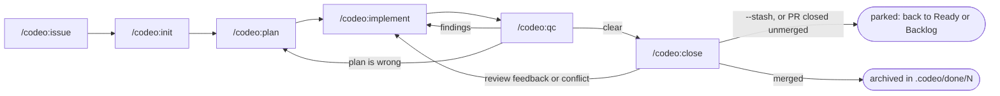

# codeo

codeo is an agent-workflow plugin for Claude Code. It is for engineers who work from GitHub issues: it carries a piece of work from issue to merged pull request through six steps (issue, init, plan, implement, QC and close), keeping a dossier of each step in the repository. It needs bash, `jq`, `git`, `gh` and `claude`, and a GitHub repository to work in. It is unrelated to SYSGO's CODEO IDE and to GoCodeo.

## Contents

- [Start here](#start-here)
- [Requirements](#requirements)
- [Installing](#installing)
- [Setting a project up](#setting-a-project-up)
- [Your first workflow](#your-first-workflow)
- [Configuration](#configuration)
- [Troubleshooting](#troubleshooting)
- [Updating](#updating)
- [Uninstalling](#uninstalling)
- [The skills](#the-skills)
- [More documentation](#more-documentation)
- [Contributing](#contributing)

## Start here

1. Run the one install command in [Installing](#installing) and watch it print an `install:` line for each step.
2. Restart Claude Code, so the new session lists the codeo commands.
3. In your project, run `/codeo:setup` and then `/codeo:doctor`, and see `.codeo/config.json` written and every check pass or each failure explained ([Setting a project up](#setting-a-project-up)).
4. File your first issue with `/codeo:issue` and see it created on GitHub.
5. Run the six steps for that issue, each handing off to the next ([Your first workflow](#your-first-workflow)).
6. Merge the pull request that `/codeo:close` opens, then run `/codeo:close` again: the workflow finishes on that second run.
7. If something stops, find its message in [Troubleshooting](#troubleshooting).

## Requirements

- bash 4.3 or later
- `jq`
- `git`
- `gh`, the GitHub CLI; board use also needs `gh project`, which reads GraphQL, so the token must be allowed to use it
- `claude`, Claude Code

`install.sh` checks all five tools in one run and names every one that is missing or too old; `/codeo:doctor` checks bash, `jq`, `git` and `gh`, and never runs `claude`. The installer installs none of them: use your system's package manager, then run it again.

## Installing

One command installs codeo and the superpowers plugin it builds on, for you, in every project:

```bash
curl -fsSL https://raw.githubusercontent.com/kbajpai/codeo/main/install.sh | bash
```

It installs the latest release, which is the highest `vX.Y.Z` tag of the repository. Claude Code sessions that are already open need a restart to load the plugins. It prints one `install:` line per step, between the lines `claude` prints itself.

```
install: release v1.0.10
Adding marketplace…SSH not configured, cloning via HTTPS: https://github.com/obra/superpowers-marketplace.git
Refreshing marketplace cache (timeout: 120s)…
Cloning repository (timeout: 120s): https://github.com/obra/superpowers-marketplace.git
Clone complete, validating marketplace…
Cleaning up old marketplace cache…
✔ Successfully added marketplace: superpowers-marketplace (declared in user settings)
Installing plugin "superpowers@superpowers-marketplace"...✔ Successfully installed plugin: superpowers@superpowers-marketplace (scope: user)
install: superpowers installed (user scope)
Adding marketplace…SSH not configured, cloning via HTTPS: https://github.com/kbajpai/codeo.git
Refreshing marketplace cache (timeout: 120s)…
Cloning repository (timeout: 120s): https://github.com/kbajpai/codeo.git (ref: v1.0.10)
Clone complete, validating marketplace…
Cleaning up old marketplace cache…
✔ Successfully added marketplace: codeo (declared in user settings)
Installing plugin "codeo@codeo"...✔ Successfully installed plugin: codeo@codeo (scope: user)
install: codeo v1.0.10 installed (user scope)
install: done - codeo v1.0.10, user scope, superpowers 7.0.2
install: restart any Claude Code sessions already open to load the plugins
```

`install.sh` installs the two plugins and not the `codeo` host command, which opens the containers from a terminal and is installed separately; see [Installing the `codeo` command](.devcontainer/README.md#installing-the-codeo-command).

Run it again and nothing changes:

```
install: release v1.0.10
install: superpowers already installed (user scope), left alone
install: codeo v1.0.10 already installed (user scope)
install: nothing changed - codeo v1.0.10, user scope, superpowers 7.0.2
```

`claude plugin list` shows what is installed:

```
Installed plugins:

  ❯ codeo@codeo
    Version: 1.0.10
    Scope: user
    Status: ✔ enabled

  ❯ superpowers@superpowers-marketplace
    Version: 7.0.2
    Scope: user
    Status: ✔ enabled
```

### Options

`--version` installs a release other than the latest (`v1.0.9`, or `1.0.9`). The installer checks the tag exists before it changes anything. Asking for a different version than the one installed replaces it; [docs/updating.md](docs/updating.md) shows what that prints, including a downgrade:

```bash
curl -fsSL https://raw.githubusercontent.com/kbajpai/codeo/main/install.sh | bash -s -- --version v1.0.9
```

`--scope project` installs both plugins for one project instead of for you. Run it inside the project's git repository (any folder in it works); it writes the project's `.claude/settings.json`:

```bash
curl -fsSL https://raw.githubusercontent.com/kbajpai/codeo/main/install.sh | bash -s -- --scope project
```

```
install: release v1.0.10
Adding marketplace…SSH not configured, cloning via HTTPS: https://github.com/obra/superpowers-marketplace.git
Refreshing marketplace cache (timeout: 120s)…
Cloning repository (timeout: 120s): https://github.com/obra/superpowers-marketplace.git
Clone complete, validating marketplace…
Cleaning up old marketplace cache…
✔ Successfully added marketplace: superpowers-marketplace (declared in project settings)
Installing plugin "superpowers@superpowers-marketplace"...✔ Successfully installed plugin: superpowers@superpowers-marketplace (scope: project)
install: superpowers installed (project scope)
Adding marketplace…SSH not configured, cloning via HTTPS: https://github.com/kbajpai/codeo.git
Refreshing marketplace cache (timeout: 120s)…
Cloning repository (timeout: 120s): https://github.com/kbajpai/codeo.git (ref: v1.0.10)
Clone complete, validating marketplace…
Cleaning up old marketplace cache…
✔ Successfully added marketplace: codeo (declared in project settings)
Installing plugin "codeo@codeo"...✔ Successfully installed plugin: codeo@codeo (scope: project)
install: codeo v1.0.10 installed (project scope)
install: done - codeo v1.0.10, project scope, superpowers 7.0.2
install: restart any Claude Code sessions already open to load the plugins
```

Commit the file it wrote. This is its content (`jq -S . .claude/settings.json`), and you can write it by hand instead:

```json
{
  "enabledPlugins": {
    "codeo@codeo": true,
    "superpowers@superpowers-marketplace": true
  },
  "extraKnownMarketplaces": {
    "codeo": {
      "source": {
        "ref": "v1.0.10",
        "repo": "kbajpai/codeo",
        "source": "github"
      }
    },
    "superpowers-marketplace": {
      "source": {
        "repo": "obra/superpowers-marketplace",
        "source": "github"
      }
    }
  }
}
```

`ref` pins the codeo release the project uses; write the newest release tag, which `git ls-remote --tags --refs https://github.com/kbajpai/codeo 'v*'` lists. A teammate who opens the folder in Claude Code and trusts it is offered both plugins. A later run that replaces codeo on your machine drops this project's install (see [Updating](#updating)). To move the project to another release, change `ref` ([Moving a project's pin](docs/updating.md#moving-a-projects-pin)).

`-h` or `--help` prints the usage line, `install: usage: install.sh [--version vX.Y.Z] [--scope user|project]`, and exits 0. `--scope` takes `user` (the default) or `project`. A wrong argument (an unknown option, a missing or malformed value) prints the reason and the usage line on stderr and exits 2, before any command runs. A missing tool exits 1 after the installer has named every missing tool, and installs nothing.

Updating, replacing and restoring are in [Updating](#updating).

## Setting a project up

Run these once, in the project's git repository, inside Claude Code, after installing the plugin. Each skill runs a script, and the script's own output is what the skill reports.

### 1. Run /codeo:setup

It creates `.codeo/` with a starter `config.json` (the schema, the repository's owner and name read from the `origin` remote, the base branch read from `origin/HEAD`, and empty `suites` and `resources`), a `.codeo/.gitignore` for the per-checkout files, and `docs/plans/`. A value it cannot read is written as `TODO-set-me` and named on stderr. Until you replace it, `/codeo:doctor` fails `config` (`config.json: repo.owner is still TODO-set-me`, and likewise `repo.name` or `baseBranch`) and `ruleset` is skipped. It refuses to overwrite a `config.json` that exists. `--stack <name>` records a stack name. In a project cloned from a GitHub repository whose `origin` points at it, `setup` prints:

```
codeo: created .codeo/config.json for kbajpai/codeo (base main); run /codeo:doctor next
```

That file reads:

```json
{
  "schema": 1,
  "repo": {
    "owner": "kbajpai",
    "name": "codeo"
  },
  "baseBranch": "main",
  "suites": [],
  "resources": []
}
```

### 2. Edit .codeo/config.json

Every key is in [Configuration](#configuration). The one thing most projects set first is `suites`, the build and test commands `/codeo:implement` and `/codeo:qc` run. A suite names itself and gives its commands:

```json
{
  "suites": [
    { "name": "app", "build": "npm run build", "test": "npm test" }
  ]
}
```

`board`, `codename`, `plugin`, `models` and everything else optional are written by hand; setup leaves them out (`/codeo:setup --stack <name>` also writes `stacks`).

### 3. Run /codeo:doctor

It checks that everything the workflow needs is in place and reports every failure, not only the first. Fix what it reports (see [Troubleshooting](#troubleshooting)) and run it again until it ends clean. With a logged-in `gh` and superpowers installed it prints:

```
ok config: config.json is valid
ok schema: supported (plugin understands up to 1)
ok codename: not set
ok gh-auth: gh api user succeeded
ok gh-scopes: no board configured; the project scope is not needed
ok board: no board configured
ok ruleset: main requires: tests qc-verdict
ok suites: 0 suite(s), every build and test command resolves
ok deps: jq, git, bash 5.3.9(1)-release
ok overlays: none
ok superpowers: installed
```

That is what a project sees when its base branch has the ruleset. A new repository has no branch ruleset yet, so `ruleset` fails (`fail ruleset: main does not require: tests qc-verdict`, or `could not read rules`) until the base branch requires the checks `tests` and `qc-verdict`, or you list your own under `ci.requiredChecks` (see [Configuration](#configuration)); see **ruleset.** in [Checks from /codeo:doctor](#checks-from-codeodoctor).

A twelfth check, `priority-labels`, prints only when `issue.priority` is `true`; see **priority-labels.** in [Checks from /codeo:doctor](#checks-from-codeodoctor).

Then commit `.codeo/` and `docs/plans/`; the config is shared by everyone who works on the project.

### Running on the host

The home role runs `/codeo:issue`, `/codeo:init`, `/codeo:triage` and `/codeo:cleanup` in a clone named `<codename>-home`. A project with its own role guard refuses a skill outside its checkout. The project needs a GitHub repository whose `origin` remote points at it; a project board is optional.

See [docs/home-checkout.md](docs/home-checkout.md) for the home checkout, the guard and the tracking comment, and [.devcontainer/README.md](.devcontainer/README.md) for the dev container.

### Adopting codeo with containers

A project that wants codeo's dev container and sbx sandbox files has two ways to adopt them. Both need the same things first: the repository exists on GitHub, the clone's `origin` remote points at it, and `gh` is logged in with access to it. codeo never creates a repository. The one-command way checks all three and stops with `init: fail preflight` when one is missing.

**One command.** From inside the project's clone, run:

```bash
curl -fsSL https://raw.githubusercontent.com/kbajpai/codeo/main/scripts/codeo-init.sh | bash -s -- --env containers
```

`scripts/codeo-init.sh` fetches its own release when it runs alone like this, installs the plugins, writes `.codeo/config.json`, writes the container files and then runs the `/codeo:doctor` checks. It asks a few questions (codename, scope, whether to add a suite) only at a terminal, and only for what a flag did not answer; `--yes` takes every default. Its other flags are `--codename <name>`, `--scope user|project`, `--version vX.Y.Z`, `--suite <name>:<paths>:<build>:<test>` (repeatable; the build command cannot contain a colon, only the test command may) and `--skip-install`, which leaves the plugin install to you. Each step prints one line, `init: ok <step>`, `init: skip <step>` (nothing to do, for example a config that already exists and is kept) or `init: fail <step>: <reason>`, and the doctor's lines follow. The steps run in this order: `preflight` (the repository exists and `gh` can see it), `install`, `config`, `suite` (one per `--suite`), `config` again for the plugin pin the container installs, and `containers`. The exit status is 0 when every step and every doctor check passed, 1 otherwise and 2 for a usage error. Running it again is safe.

**Inside Claude Code.** With the plugin installed, run `/codeo:setup --containers`; add `--codename <name>` to choose the codename. It writes `.codeo/config.json` as [step 1](#1-run-codeosetup) describes, then the container files. In a project that already has a config, `/codeo:setup --containers` alone leaves the config as it is and writes only the container files.

Either way, the files written are the managed scripts and the seeds. The managed files are `.devcontainer/codeo`, `.devcontainer/codeo-container.sh`, `.devcontainer/codeo-track.sh`, `.sbx/codeo-sandbox.sh` and the scripts under `.devcontainer/scripts/`; `bash scripts/containers.sh --force` rewrites them and `/codeo:doctor` checks that they match. The seeds are yours to edit and are never overwritten: `.devcontainer/Dockerfile`, `.devcontainer/devcontainer.json`, `.sbx/claude-image` and one for each of the eight workflow skills in `.codeo/overlays/`. [docs/container-templates.md](docs/container-templates.md) lists each file, where its names come from and where your own toolchain goes. The sandbox uses Docker's pinned image and does not get the project's toolchain, which the dev container does (see [docs/container-templates.md](docs/container-templates.md)).

Commit `.devcontainer/`, `.sbx/` and `.codeo/` to your base branch: `codeo issue <N>` downloads its scripts from there.

A new repository has no branch ruleset, so `/codeo:doctor` reports `fail ruleset` until the base branch requires the checks `tests` and `qc-verdict` (or `ci.requiredChecks` lists your own). On a host that has the project's toolchain and the plugins installed, `fail ruleset` is the one failure a fresh adoption is expected to show; a host without them also shows the `deps`, `superpowers` or `suites` check.

## Your first workflow

A piece of work goes through six slash commands, one after the other. Each step owns one file under `.codeo/<N>/`, where `<N>` is the GitHub issue number. That file is the step's *dossier*: it records what the step decided, so the next step (and you, later) can read it. When `/codeo:close` opens the pull request, the folder moves to `.codeo/done/<N>/` inside the pull request itself, so it lands on the base branch when the pull request merges.

The example is issue #143, which fixed leftovers from an earlier change. Its finished workflow is archived in this repository under `.codeo/done/143/`, so you can open the file each step wrote: [issue.md](.codeo/done/143/issue.md), [init.md](.codeo/done/143/init.md), [plan.md](.codeo/done/143/plan.md), [implement.md](.codeo/done/143/implement.md), [qc.md](.codeo/done/143/qc.md) and [close.md](.codeo/done/143/close.md). For the long detail of each skill, follow its link to [docs/skills.md](docs/skills.md).



### 1. /codeo:issue

- **Run:** `/codeo:issue <idea, bug, or problem to turn into an issue>`.
- **It asks:** numbered questions (the problem, what is out of scope, what done looks like, constraints) in a draft file, `.codeo/intake/new-<slug>/issue.md`. It shows you the finished draft in the conversation and files nothing on GitHub until you approve.
- **It writes:** `.codeo/intake/<N>/issue.md` on the project's `codeo/intake` branch only (the example: [issue.md](.codeo/done/143/issue.md)), and the GitHub issue itself. With a project board, the card goes to Backlog.
- **It commits:** `docs(codeo): issue dossier for #<N> — filed`.
- **Next:** `/codeo:init #<N>` when the issue is Ready (or the project has no board). Otherwise `/codeo:triage` first, then `/codeo:init #<N>`.

Details: [docs/skills.md#issue](docs/skills.md#issue).

### 2. /codeo:init

- **Run:** `/codeo:init <number>`. The number can be `42`, `#42` or the issue's URL.
- **It asks:** almost nothing. It stops for one review of `init.md` (approve, change or reject), and for an override if you are taking over someone else's claim. Its own question list normally reads `None.`
- **It writes:** [.codeo/<N>/init.md](.codeo/done/143/init.md): the issue, the branch, the state, and the acceptance criteria word for word. It also copies the approved draft to `.codeo/<N>/issue.md`. It cuts and pushes the branch (`<type>/<N>-<slug>`), moves the card to In progress and takes the workflow lock. Once the push has claimed the branch, it assigns you to the issue; when `gh` has no login it skips that and notes the skip in a Claim line of `## Outcome`.
- **It commits:** `docs(codeo): init dossier for #<N>`.
- **Next:** `/codeo:plan`, usually in the same session.

Details: [docs/skills.md#init](docs/skills.md#init).

### 3. /codeo:plan

- **Run:** `/codeo:plan [optional: which part of the locked issue to plan]`.
- **It asks:** its questions go in the dossier, `.codeo/<N>/plan.md`, each with why it matters and the options. The run stops until you answer there; run the command again to continue. You then review the plan in the conversation.
- **It writes:** [.codeo/<N>/plan.md](.codeo/done/143/plan.md), the decisions. The plan itself goes under `docs/plans/` only after you approve it, and is left uncommitted for you to review. The output can also be a reference doc under `docs/`, or both. While you review it, the draft is a preview file, `.codeo/<N>/plan-draft.md`, which is not committed and is deleted once the real file is written. It never writes application code.
- **It compares:** the plan's footprint with every other workflow in flight. Each overlap becomes a numbered question in `plan.md`, and the run stops until you answer it. For an exclusive resource it takes the resource's lease and, when another workflow holds it, records the wait and stops until the lease is free.
- **It commits:** only the dossier: `docs(codeo): plan dossier for #<N>`, or with a suffix such as `— Q1-Q9 raised` or `— footprint`.
- **Next:** review and commit the plan, then `/codeo:implement`.

Details: [docs/skills.md#plan](docs/skills.md#plan).

### 4. /codeo:implement

- **Run:** `/codeo:implement [optional: plan path or slug]`. With no argument it uses the plan `plan.md` names.
- **It asks:** in the dossier, `.codeo/<N>/implement.md`, when the plan looks wrong or unclear or when another workflow overlaps this one (`overlap.sh`); and in the conversation when the plan is uncommitted or only staged, where it offers to commit it. A design question goes back to `/codeo:plan`.
- **It writes:** [.codeo/<N>/implement.md](.codeo/done/143/implement.md), with an `## Outcome` of what was built, the documentation pages changed, the build result and any deviations from the plan. The code is built task by task through the plan's superpowers skill. It builds each configured suite but does not run its tests.
- **It commits:** a round starts by merging `origin/<base>` into the branch (`sync-main.sh`; a merge commit when the base branch has moved, nothing when the branch already contains it), then one commit per task, then `docs(codeo): implement dossier for #<N>`.
- **Next:** `/codeo:qc`.

Details: [docs/skills.md#implement](docs/skills.md#implement).

### 5. /codeo:qc

- **Run:** `/codeo:qc`. It checks the workflow that holds the lock.
- **It asks:** nothing in the conversation, unless a question must be answered in the dossier, `.codeo/<N>/qc.md`; overlap with another workflow (`overlap.sh`) is one such question. It fixes nothing.
- **It writes:** [.codeo/<N>/qc.md](.codeo/done/143/qc.md): one `### Round` per pass, a table of the acceptance criteria, findings marked blocking or not, and a bold verdict with where to go next.
- **It commits:** a round starts by merging `origin/<base>` into the branch (`sync-main.sh --abort-on-conflict`; a merge commit when the base branch has moved, and a conflict aborts the merge and sends the branch back to `/codeo:implement`), then `docs(codeo): qc dossier for #<N>` (`— round <n>` for a later pass).
- **Next:** `/codeo:close` when the verdict is clear. Otherwise `/codeo:implement` or `/codeo:plan`.

Details: [docs/skills.md#qc](docs/skills.md#qc).

### 6. /codeo:close

- **Run:** `/codeo:close [--stash]`. `--stash` parks the workflow instead of finishing it.
- **It asks:** whether to delete the remote branch, once, after the merge. It never merges: you merge the pull request on GitHub, then run the command again. Overlap with another workflow (`overlap.sh`) is a numbered question in `close.md`, and so is what to do with a pull request closed unmerged: reopen it, stash the work or abandon it.
- **It writes:** [.codeo/<N>/close.md](.codeo/done/143/close.md). It opens the pull request, and the dossier moves to `.codeo/done/<N>/` inside that pull request. With a board, the card goes to In review when the pull request opens, back to In progress on a send-back, and to Done once the merge is proved and the issue is closed. When the pull request is behind the base branch (which GitHub reports only where the base requires branches to be up to date), a clean `git merge --no-edit origin/<base>` is pushed for you; a conflict is a send-back. It comments on the pull request when it returns from review, listing what changed, and again after the merge, recording what it checked and released. After you merge and run it again, it proves the merge, releases every lease, asks about deleting the branch, then deletes the issue's `codeo-live/<issue>/*` branches on origin (a hosted web session deletes none: it cannot delete a branch) and removes the lock. A stash sends the card back to Ready. A pull request closed unmerged can be abandoned, which sends the card to Backlog.
- **It commits:** `docs(codeo): close dossier for #<N> — PR #<pr>`. Review feedback or a conflict with the base branch is another round (`— review feedback`) and goes back through `/codeo:implement` and `/codeo:qc`.
- **Next:** the first run ends by telling you to review and merge the pull request, then run `/codeo:close` again. After the merge, `/codeo:triage`, which looks for loose ends the work left behind. A stash ends with `/codeo:init #<N>`, to start it again.

Details: [docs/skills.md#close](docs/skills.md#close).

**Where each step runs.** `/codeo:issue` and `/codeo:init` run in a home checkout when the project has a role guard. `/codeo:plan`, `/codeo:implement`, `/codeo:qc` and `/codeo:close` run in the issue's own checkout, the one that holds the lock. A project with no role guard, such as one just set up with `/codeo:setup`, has no such split: `/codeo:init` switches this checkout to the issue's branch, takes the lock and hands off to `/codeo:plan` in the same session. See [docs/home-checkout.md](docs/home-checkout.md).

**The closing block, and running a step again.** Every step ends with the same three-part block, so you never have to work out what to type next:

```
---
**Done:** <what this run did, in plain words>
**Next goal:** <the one outcome to reach next, and the skill that gets there>
**Steps:**
1. <the exact command to run first>
2. <the action after it>
```

Run the command in Steps 1. A step that was interrupted can be run again: it works out where the workflow stands from its dossier and from GitHub, and carries on. If it does not, see [Troubleshooting](#troubleshooting).

## Configuration

The project's settings live in `.codeo/config.json`. It is committed, so everyone on the project shares it. Four keys are required (`schema`, `repo.owner`, `repo.name`, `baseBranch`); every other key is optional and has the default shown. A key the plugin does not know is ignored without a message, so a misspelt key does nothing. The four required keys fail validation if they are missing or still hold the `TODO-set-me` marker that `/codeo:setup` writes for a value it could not read. `/codeo:doctor` checks that, and then `schema`, `codename`, `board` (`board.owner` and `board.projects` are read, and the board counts as set if either is present), `issue.priority`, `ci.requiredChecks` (against the base branch's ruleset, which also reads `repo.*` and `baseBranch`) and each suite's `build` and `test`. It does not check `resources`, `environment`, `hooks`, `modules`, `models`, `triage`, `invariants`, `docsDir`, `plansDir`, `labelTypes`, `skipGlobs`, `plugin` or `stacks`. `/codeo:setup` writes only the required keys plus an empty `suites` and an empty `resources`; `/codeo:setup --stack <name>` also writes `stacks`.

The table runs in five groups, in this order: required keys, project and suites, board and issues, environment and leases, models and checks. A key written `suites[].name` is a field of each entry in the `suites` list.

| Key | Required? | Default | What it does |
|---|---|---|---|
| `schema` | yes | none | The config format version, an integer. It is `1` today; a number higher than the plugin understands is refused. |
| `repo.owner` | yes | none | The GitHub owner of the repository. |
| `repo.name` | yes | none | The GitHub name of the repository. |
| `baseBranch` | yes | none | The branch workflows start from and pull requests target, such as `main`. |
| `codename` | no | the repository name (`repo.name`) when `scripts/containers.sh` writes the container files; the clone's folder name when `.devcontainer/scripts/container-name.sh` names a container or session | A short name for the project, used to name its clones and dev containers (`<codename>-home`, `<codename>-<N>`). Lower-case letters, digits and single hyphens, starting with a letter. `/codeo:setup --codename` and `/codeo:doctor` require 2 to 30 characters; `scripts/containers.sh` checks only the characters. |
| `plugin.repo` | no | none | The codeo plugin repository the dev container installs, as `owner/name`. Set it together with `plugin.ref`. |
| `plugin.ref` | no | none | The tag or branch of the codeo plugin the dev container installs. Needed together with `plugin.repo`. |
| `suites[].name` | yes, per suite | none | The suite's name. |
| `suites[].paths` | no | none (never matches) | Globs of the files that make this suite run; `*` stays within a folder, `**` crosses folders. A suite without `paths` never matches a path itself, but every suite runs when a changed path matches no suite. |
| `suites[].build` | no, but `/codeo:doctor` fails a suite without one | none | The command `/codeo:implement` and `/codeo:qc` run to build. `/codeo:doctor` fails a suite whose `build` is empty or unset, or whose first word is not found. |
| `suites[].test` | no, but `/codeo:doctor` fails a suite without one | none | The command `/codeo:qc` runs to test. `/codeo:doctor` fails a suite whose `test` is empty or unset, or whose first word is not found. |
| `suites[].filter` | no | none (the whole `test` command is the proof) | A command that runs one test; `{}` stands for the test's name. |
| `suites[].parallel` | no | `false` | `true` lets the suite run at the same time as other parallel suites. |
| `skipGlobs` | no | none | Globs of changed files to ignore when deciding which suites run. |
| `docsDir` | no | `docs` | The project's documentation folder. |
| `plansDir` | no | `docs/plans` | Where `/codeo:plan` saves plans. |
| `invariants` | no | none | The path of the project's invariants document. `/codeo:plan` reads it and `/codeo:qc` checks the change against it. |
| `modules` | no | none | Optional modules to switch on. Only `wiki` means anything; other entries are ignored. |
| `labelTypes` | no | `enhancement:feat`, `bug:fix`, `documentation:docs`; any other label gives `chore` | Maps an issue label to the type that starts its branch name. A `labelTypes` you write replaces the defaults whole. |
| `stacks` | no | none | Written by `/codeo:setup --stack`; read by nothing. It only records the stack names. |
| `board.owner` | yes, when `board` is set | none | The owner of the GitHub Projects board. |
| `board.gateProject` | yes, when `board` is set | none | The board's project number. `/codeo:init` starts only an issue whose card is in its Ready column. |
| `board.projects` | no | just `board.gateProject` | Every project number whose cards move as a workflow advances. |
| `board.statuses.backlog` | no | `Backlog` | The name of the board column for backlog. |
| `board.statuses.ready` | no | `Ready` | The name of the column for issues that may be started. |
| `board.statuses.inProgress` | no | `In progress` | The name of the column for issues being worked on. |
| `board.statuses.inReview` | no | `In review` | The name of the column for issues with a pull request open. |
| `board.statuses.done` | no | `Done` | The name of the column for finished issues. |
| `issue.priority` | no | off (only `true` turns it on) | `/codeo:issue` assigns one priority label (`priority: blocker`, `priority: high`, `priority: medium` or `priority: low`); `/codeo:doctor` checks the four labels exist. |
| `triage.parkedDays` | no | `7` | Days without a pushed change after which `/codeo:triage` asks about a workflow in flight as parked. |
| `resources[].name` | yes, per resource | none | The name of an exclusive resource, a lease two workflows cannot hold at once. |
| `resources[].paths` | no | none | Globs of the files that need the resource. `/codeo:plan` uses them to fill the `exclusive:` line of a plan's footprint, for every resource except the one named by `environment.resource`; for that one they only decide the `deploy=` line `scope.sh` prints, which says whether a change must be deployed. With no suites configured `scope.sh` prints no `deploy=` line, and `/codeo:implement` and `/codeo:qc` read the diff themselves. |
| `resources[].parameterised` | no | `false` | `true` makes the resource stand for `<name>:<suffix>` leases, never the bare name. |
| `environment.resource` | no | none (no shared environment) | The resource that is the project's shared environment. `/codeo:implement` takes its lease at the first task that needs it; `/codeo:qc` releases it at a clear verdict, otherwise `/codeo:close` does. The `environment.hooks.*` commands run only for this resource. |
| `environment.hooks.start` | no | skipped | A command run first when the environment lease is taken; a non-zero exit refuses the lease. The hooks can run more than once: when its holder takes the lease again, which `/codeo:qc` does when `deployed` fails for want of activation, it re-runs `start`, `preflight` and `activate`, and `/codeo:qc` runs `start` when `deployed` reports a stopped workload, so each must be safe to run twice. |
| `environment.hooks.preflight` | no | skipped | Run after `start`; a non-zero exit refuses the lease. |
| `environment.hooks.activate` | no | skipped | Run after `preflight`; a non-zero exit refuses the lease. |
| `environment.hooks.revoke` | no | skipped | Run when the lease is released or a take fails; a failure is ignored. |
| `environment.hooks.deploy` | no | none (`/codeo:implement` stops if a plan needs a deploy) | The project's deploy command; its last line of output is the deployed revision. |
| `environment.hooks.deployed` | no | none | A command that prints one tab-separated row per workload (name, revision, state, and optionally declared yes or no), for `/codeo:qc` to check. |
| `hooks.onLeaseChange` | no | none | A command run, without failing the workflow, after every lease change that reaches origin. Top-level `hooks`, not under `environment`. |
| `models.subagent` | no | `sonnet` | The model every subagent of a workflow runs on; a hook refuses any other while a workflow is active. |
| `models.reviewer` | no | `opus` | The model of the `/codeo:qc` code reviewer, the one subagent allowed to differ. |
| `ci.requiredChecks` | no | `tests` and `qc-verdict` | The status checks the base branch's ruleset must require; `/codeo:doctor` checks them. |

The file `/codeo:setup` writes needs only the required keys:

```json
{
  "schema": 1,
  "repo": { "owner": "acme", "name": "shop" },
  "baseBranch": "main",
  "suites": [],
  "resources": []
}
```

A fuller file adds a codename, a shell suite, a board, priorities and models:

```json
{
  "schema": 1,
  "codename": "shop",
  "repo": { "owner": "acme", "name": "shop" },
  "baseBranch": "main",
  "suites": [
    {
      "name": "shell",
      "paths": ["scripts/**", "tests/**"],
      "build": "bash -n scripts/*.sh",
      "test": "bash tests/run.sh"
    }
  ],
  "resources": [],
  "board": { "owner": "acme", "gateProject": 3 },
  "issue": { "priority": true },
  "models": { "subagent": "sonnet", "reviewer": "opus" }
}
```

## Troubleshooting

The entries are in three groups. *During a workflow* covers what stops a step while you work an issue: a refused skill, a lock that is not yours, a step that stopped half way, and a card that is not Ready. *Checks from /codeo:doctor* covers the lines `/codeo:doctor` prints when codeo is not ready in a project. *Installing and the pin* covers two problems with `claude plugin` and `install.sh` that `/codeo:doctor` does not check. Each entry gives the symptom, the cause and the fix.

### During a workflow

**A role-guard refusal.** The guard is the project's own, not the plugin's: it is this project's role check, run at the start of each skill, and a project set up with `/codeo:setup` has none and is never refused. If you meet a refusal, you are in a project that has added the guard; [docs/home-checkout.md](docs/home-checkout.md) and [.devcontainer/README.md](.devcontainer/README.md#roles-and-the-guard) describe it. To add a guard to your own project, see [Adopting the guard in your project](docs/home-checkout.md#adopting-the-guard-in-your-project).

- **Symptom.** The skill stops with one line that starts `/codeo:<skill> can't run here:` or says where the skill runs.
- **Cause.** The skill belongs in another checkout. `/codeo:issue`, `/codeo:init`, `/codeo:triage` and `/codeo:cleanup` run in a home checkout; `/codeo:plan`, `/codeo:implement`, `/codeo:qc` and `/codeo:close` run in the issue's own checkout.
- **Fix.** Run the skill in the checkout the line names. Nothing you say in the session lifts a refusal. In a dev container, a line with `role stale:<N>` says what became of the workflow: finished (`/codeo:cleanup` in a home checkout prints how to remove the container), stashed (`/codeo:init #<N>` in a home checkout is the way back, never the start script, and the old container is removed on the host first) or abandoned (nothing more runs there; check the branch is still on origin before removing the container). A workflow that is live but lost its lock is fixed by re-running `bash .devcontainer/scripts/devcontainer-start.sh`. The `stale` row of [.devcontainer/README.md](.devcontainer/README.md#roles-and-the-guard) has the full list. A clone named `<codename>-home` that reads as `stray` needs `jq` installed; see [docs/home-checkout.md](docs/home-checkout.md).

```
/codeo:plan runs in an issue's checkout, but this checkout's role is home.
```

**A lock that is stuck or not yours.** Every step after `/codeo:init` checks the workflow lock file first. The file belongs to one checkout (it is not committed), and `/codeo:close` removes it when the workflow ends, is stashed or is abandoned (the dev container start script also removes an empty one).

- **Symptom.** A skill stops and says there is no lock; or says the lock's `branch` differs from the branch you are on; or says the lock names a different issue from the one you asked for; or `/codeo:init` refuses because a lock already exists; or a `lock: TODO …` line appears.
- **Cause.** No lock means the step before was skipped, or you are in another checkout. A branch mismatch means someone switched branches or the lock is stale. The other two mean this checkout already holds a workflow. A `lock: TODO …` line means the lock script could not finish part of its work, and the line says which.
- **Fix.** For no lock, run `/codeo:init #<N>`. For a branch mismatch, switch back to the branch the lock names (`git switch <branch>`), or finish the workflow there with `/codeo:close` or `/codeo:close --stash`; do not edit `.codeo/active` to make it agree with the branch. For another issue, finish or stash that one first, in its own checkout. When `/codeo:init` refuses, run it in another checkout (a second clone or a `git worktree`), or finish this workflow with `/codeo:close`. For a `lock: TODO …` line, do what it says, except as set out here: the example below is the one case where you edit the lock, by writing the volume name into its `volume:` line (`docker volume ls` on the host lists the volumes). For a TODO that says no single `init.md` names the branch and found 0, run `/codeo:init #<N>`. For a TODO that says the issue is stashed or abandoned, `/codeo:init #<N>` resumes a stashed issue; for an abandoned one it stops with the `claim: #<N> was abandoned …` line, and there are two ways on: say in so many words that you are taking the work up again, or delete the old branch on origin and run `/codeo:init #<N>` again (the card must then be Ready; see "A card that is not Ready" below). When the TODO says it found more than one, two issues' dossiers name the same branch; despite the line's "run init for the issue", `/codeo:init` does not fix it: settle by hand which issue owns the branch, then re-run the script. For a TODO that says the local branch holds commits the branch it would check out lacks (`origin/<branch>` or the current `HEAD`), or that the branch and `origin/<branch>` have diverged, reconcile by hand (the `git log --oneline …` command the line prints shows the commits) and re-run the script; `/codeo:init` does not fix it. Taking a lock that exists only prints `lock already taken`.

```
lock: TODO — could not read the workspace volume's name from /proc/self/mountinfo: fill the lock's volume line in by hand (docker volume ls on the host)
```

Another `lock: TODO` line, specific to a container lock, is `--sandbox needs a name of letters, digits, ., _ and -: the lock records a volume instead`. The sandbox name the dev container start script passes (the first line of the sandbox marker, else the clone folder's name) is not made of letters, digits, `.`, `_` and `-`, or does not start with a letter or digit, so the lock carries a `volume:` line instead of a `sandbox:` line. Give the sandbox a name made of those characters (`/codeo:close` removes the lock when the workflow ends, and the next lock records the sandbox).

**A step that was interrupted.** Every step resumes from its dossier file in `.codeo/<N>/` and from GitHub, not from the conversation.

- **Symptom.** A session ended part way, a push failed, or a step is waiting on an answer.
- **Cause.** The session ended, a push failed, or a question was left unanswered.
- **Fix.** Run the same command again. An unanswered question is a `### Q<n>` heading in `.codeo/<N>/<step>.md` with an empty `**Answer:**`: write your answer under it and run the command again. A failed push is loud; the commit stays on your machine until the push lands, so push again before you continue elsewhere. `/codeo:close` is safe to repeat at any point. If `/codeo:init` stops half way, the next run reports a leftover local branch and the `git worktree remove --force <scratch>` and `git branch -D <branch>` commands that remove it; run them, then run `/codeo:init #<N>` again. Contributors to codeo can check a dossier's shape with `bash scripts/dossier-check.sh .codeo/<N>` (see [CONTRIBUTING.md](CONTRIBUTING.md)).

**A card that is not Ready.** This applies when the project has a board.

- **Symptom.** `/codeo:init` stops and names what the board script printed for the issue: `none`, `unset` or a column before Ready.
- **Cause.** `/codeo:init` starts only an issue whose card is in the Ready column of the board named by `board.gateProject`. `none` means the issue is not on the board; `unset` means it has no status; an earlier column means nobody has said it is workable yet.
- **Fix.** Run `/codeo:triage` and choose *mark Ready* for the issue, or move the card to Ready by hand, then run `/codeo:init #<N>` again. If the script fails because the token is refused, run `gh auth refresh -s project`. If the board has no column called Ready, set `board.statuses.ready` to the column you use. In a hosted session the check may print `unavailable`; `/codeo:init` notes that and goes on.

### Checks from /codeo:doctor

`/codeo:doctor` prints one `ok` or `fail` line per check and reports every failure. Each entry below is one check and the fix its own message gives. Paths in the messages below are your project's own.

**config.** `config.json not found at …/.codeo/config.json` means the project has no codeo state: run `/codeo:setup`. An `invalid JSON` message means the file does not parse; fix the file with `jq . .codeo/config.json`, which points at the error. A `schema … is newer than this plugin supports (1); update the plugin` message means the project was set up by a newer codeo: run the install command to get the latest release. A `config.json: missing <key>` message (`.schema`, `.repo.owner`, `.repo.name` or `.baseBranch`) means a required key is absent, and `config.json: repo.owner is still TODO-set-me` (or `repo.name`, or `baseBranch`) means `/codeo:setup` could not read it and wrote the marker: set the value in `.codeo/config.json`. Until you do, `ruleset` is skipped (`fail ruleset: skipped: baseBranch is not set` when it is the base branch, otherwise `skipped: config is unusable`).

```
fail config: config.json not found at /home/you/app/.codeo/config.json
fail schema: no usable schema value
```

**schema.** `no usable schema value` follows an unreadable config; fix the config. `N is newer than this plugin supports` means the plugin is older than the project's config; run the install command.

```
fail config: config.json: schema 2 is newer than this plugin supports (1); update the plugin
fail schema: 2 is newer than this plugin supports (1)
```

**codename.** The optional `codename` must be lower-case letters, digits and single hyphens between them, starting with a letter, 2 to 30 characters. Change it in `.codeo/config.json`, or remove it.

```
fail codename: "Bad Name" is not valid: lower-case letters, digits and single hyphens between them, starting with a letter, 2-30 characters
```

**gh-auth.** `gh api user failed` means `gh` is not logged in or its token was rejected: run `gh auth login`. `gh is not installed` means install `gh`.

```
fail gh-auth: gh api user failed: HTTP/2.0 401 Unauthorized
```

**gh-scopes.** Checked only when the config has a board. `the token lacks the project scope; run 'gh auth refresh -s project'`: run that command.

**board.** `not readable: <numbers>` lists the board projects in `.codeo/config.json` (`board.projects`) that `gh project view` cannot open. Correct the number or the `board.owner`, and check `gh auth status` shows the `project` scope.

```
fail board: not readable: 9999
```

**priority-labels.** Checked only when `issue.priority` is `true`. `missing: …; create each with: …` prints the command that creates each missing label; run them. `cannot read the repository's labels` means `gh` could not read them: check `repo` in the config and your access.

**ruleset.** `<branch> does not require: <checks>` means the base branch's ruleset or branch protection lacks a required status check codeo relies on (`tests` and `qc-verdict`, or the names in `ci.requiredChecks`): add it to the ruleset in the repository's settings. `could not read rules for <owner>/<name>@<branch>` means the repository or branch in the config is wrong or `gh` cannot read it.

```
fail ruleset: main does not require: lint
```

**suites.** `not installed or unset: <suite>:<command>` means a suite's `build` or `test` command does not resolve on this machine: install the tool, or correct the command in `.codeo/config.json`.

```
fail suites: not installed or unset: api:make api:pytest
```

**deps.** `missing: …` names a tool `codeo` needs that is not installed (`jq`, `git`, or `bash>=4.3` with the version found): install it with your package manager.

**overlays.** Each `## <name>` heading in `.codeo/overlays/<skill>.md` must be an extension point of that skill, spelled `## <point>` with one space after the hashes, and used once. The message names the file, the heading and the points the skill has; rename or delete the section. `docs/extension-points.md` lists them. Two more failures: `<file>: no extension points for skill <skill>` means the file is named for a skill that has none (`setup` and `doctor` have none, as does any name that is not a skill): rename the file to a skill that has them, or delete it. `extension-point registry not readable: <path>` means the plugin's own list of extension points cannot be read at that path (the plugin's `lib/extension-points.tsv`).

**superpowers.** `not installed; install it with: claude plugin install superpowers@superpowers-marketplace`: run that command (or the install command, which installs it). A `cannot verify` result is `ok`: the file `claude` keeps of installed plugins was not readable.

```
fail superpowers: not installed; install it with: claude plugin install superpowers@superpowers-marketplace
```

### Installing and the pin

**`its source doesn't match its extraKnownMarketplaces entry`.** Adding the codeo marketplace at a second tag by hand fails, because the marketplace is already added at the first:

```
$ claude plugin marketplace add kbajpai/codeo@v1.0.10
Adding marketplace…✘ Failed to add marketplace: Cannot add marketplace "codeo": its source doesn't match its extraKnownMarketplaces entry in user or managed settings; add it from the source that entry lists, or change the entry.
```

Run the install command instead, which removes the marketplace and adds it at the tag you ask for (the latest, or the one after `--version`).

**A hand-edited `ref` does not take effect.** After you edit `ref` under `extraKnownMarketplaces.codeo.source` in a project's `.claude/settings.json`, `install.sh --scope project` still installs what the machine's codeo marketplace holds: the installer reads the machine's pin, not the project's file. Run `claude plugin marketplace remove codeo` first (from outside any project, to leave every project's settings file alone; it drops codeo from every project on the machine, so restore each as in [Restoring a project or local install](docs/updating.md#restoring-a-project-or-local-install)), then `install.sh --scope project` in the project. The install rewrites `ref` to the latest release; to keep an older one, run `install.sh --scope project --version <tag>` instead.

## Updating

Run the install command again. With no `--version` it installs the latest release. If that differs from what you have, it replaces codeo: one machine holds one codeo version, so the replace removes the codeo marketplace, which uninstalls codeo at every scope on the machine, and installs the new release at the scope you asked for. A plain run installs it at user scope, for you; `--scope project` installs it for the project; `--version <tag>` picks a release, and moving to an older one also replaces codeo ([docs/updating.md](docs/updating.md)):

```
install: release v1.0.10
install: superpowers already installed (user scope), left alone
✔ Successfully removed marketplace: codeo
Also uninstalled 1 plugin from this marketplace:
  codeo@codeo
The removal also deletes their saved options, secrets and data where it can.
To use a plugin again, add the marketplace back and reinstall the plugin.
install: codeo v1.0.9 -> v1.0.10 (user scope)
install: done - codeo v1.0.10, user scope, superpowers 7.0.2
install: restart any Claude Code sessions already open to load the plugins
```

Before you run the install command, read [`CHANGELOG.md`](CHANGELOG.md) for every release between yours and the new one; each entry opens with `Config schema`, `Shared state` and `Safe to bump mid-workflow`, which say what to check or finish first. Then restart any Claude Code sessions already open.

superpowers is left alone by the installer when it is already installed. Update it with `claude plugin update superpowers@superpowers-marketplace`.

A replace drops every project and local install of codeo on the machine and prints a restore command for each. [docs/updating.md](docs/updating.md) covers [what a replace drops](docs/updating.md#what-a-replace-drops), [restoring a project or local install](docs/updating.md#restoring-a-project-or-local-install), [when an update fails](docs/updating.md#when-an-update-fails) and [moving a project's pin](docs/updating.md#moving-a-projects-pin).

## Uninstalling

Uninstall codeo for you:

```
$ claude plugin uninstall codeo@codeo
✔ Successfully uninstalled plugin: codeo (scope: user)
```

Run in a project, the bare command acts on the copy you installed for yourself when there is one: with a user-scope copy and a project-scope install side by side, it uninstalls the user-scope copy and leaves the project's install in place:

```
$ cd /home/you/app
$ claude plugin uninstall codeo@codeo
✔ Successfully uninstalled plugin: codeo (scope: user)
```

When codeo is installed there at project scope and nowhere at user scope, `claude` refuses, and the scope must be named:

```
$ claude plugin uninstall codeo@codeo
✘ Failed to uninstall plugin "codeo@codeo": Plugin "codeo@codeo" is enabled at project scope (.claude/settings.json, shared with your team). To disable just for you: claude plugin disable codeo@codeo --scope local
```

`claude plugin uninstall codeo@codeo --scope project`, run in the project, uninstalls it and removes `codeo@codeo` from `enabledPlugins` in the project's `.claude/settings.json`; the `codeo` entry under `extraKnownMarketplaces` stays, so the marketplace is still declared.

To remove codeo and its marketplace together, which also uninstalls codeo at every scope on the machine:

```
$ claude plugin marketplace remove codeo
✔ Successfully removed marketplace: codeo
Also uninstalled 1 plugin from this marketplace:
  codeo@codeo
The removal also deletes their saved options, secrets and data where it can.
To use a plugin again, add the marketplace back and reinstall the plugin.
```

Every project-scope and local install is gone afterwards, whichever project you ran it from; the installer does the same on a replace and prints a restore command for each (see [Restoring a project or local install](docs/updating.md#restoring-a-project-or-local-install)). Run it from outside any project (`cd ~` first): then it leaves every project's `.claude/settings.json` alone. Run inside a project that declares codeo, it also removes `codeo@codeo` from that project's `enabledPlugins` and the `codeo` entry from its `extraKnownMarketplaces`, and the file shows as modified in `git status`.

superpowers is separate: `claude plugin uninstall superpowers@superpowers-marketplace` (add `--scope project` for a project-scope install).

What stays in each project that used codeo, unless you ran one of the commands above inside it:

- `.codeo/`, with the config and every dossier, committed to the project's repository
- `docs/plans/`, the plans
- `.claude/settings.json`, which still declares both marketplaces and plugins

To take codeo out of a project, delete `.codeo/` and `docs/plans/` (or keep the plans), and remove the `codeo` entries from `extraKnownMarketplaces` and `enabledPlugins` in `.claude/settings.json`, then commit.

## The skills

The six pipeline skills run in order inside one workflow, each owning one dossier file under `.codeo/<issue>/`; `triage` and `cleanup` run outside the workflow lock, between workflows, and a project's role guard (see [`.devcontainer/README.md`](.devcontainer/README.md#roles-and-the-guard)) keeps each skill in the checkout it belongs in; `setup` and `doctor` set a project up and check it. [`docs/skills.md`](docs/skills.md) describes each one: what it does, what it reads and writes, what it hands off to and never does, and its extension points.

| Skill | Purpose |
|-------|---------|
| [`/codeo:issue`](docs/skills.md#issue) | Turn a raw idea or finding into a well-formed GitHub issue through a question-and-answer pass |
| [`/codeo:init`](docs/skills.md#init) | Start work on a Ready issue: claim the branch, write its dossier, take the lock, hand off to plan |
| [`/codeo:plan`](docs/skills.md#plan) | Explore, ask, and document a change as a reference doc or implementation plan, and check its footprint against every other workflow in flight |
| [`/codeo:implement`](docs/skills.md#implement) | Execute the approved plan task by task through the superpowers execution skills, deploy to a shared environment under its lease when the plan needs it, build, and hand off to QC |
| [`/codeo:qc`](docs/skills.md#qc) | Check the build, the suites, the criteria, the documentation and an independent review, read what the environment runs, and route forward or back |
| [`/codeo:close`](docs/skills.md#close) | Open the pull request, wait for the merge, route review feedback back, verify the merge, clean up and release the lock; also the way to stash or abandon a workflow |
| [`/codeo:triage`](docs/skills.md#triage) | Find the loose ends development left behind and route them to issues |
| [`/codeo:cleanup`](docs/skills.md#cleanup) | Print the commands that remove finished issues' containers; it proves each one first and runs nothing |

[`/codeo:setup`](docs/skills.md#setup) writes `.codeo/` with a starter `config.json` and creates `docs/plans/`;
[`/codeo:doctor`](docs/skills.md#doctor) checks the whole set-up — config, schema, codename, GitHub login and scopes, board, priority labels, branch ruleset, suites, dependencies, overlays and superpowers (twelve checks, `priority-labels` only when `issue.priority` is `true`) — and reports every failure.

A project shapes a skill without editing it through overlay files, `.codeo/overlays/<skill>.md`.
Each skill's extension points are listed in `docs/skills.md` and documented in
`docs/extension-points.md`, which also gives the file format. The dossier and hand-off protocols are
in `docs/dossier.md` and `docs/handoff.md`.

## More documentation

- [`docs/skills.md`](docs/skills.md): each skill, what it reads and writes, what it hands off to
- [`docs/extension-points.md`](docs/extension-points.md): the overlay files and the format of each extension point
- [`docs/dossier.md`](docs/dossier.md): the dossier files under `.codeo/<issue>/` and their protocol
- [`docs/handoff.md`](docs/handoff.md): how a workflow moves between steps, sessions and machines
- [`docs/home-checkout.md`](docs/home-checkout.md): the home checkout, the role guard and the tracking comment
- [`docs/container-templates.md`](docs/container-templates.md): the dev container and sbx sandbox files codeo writes, managed or seed, and where each name comes from
- [`docs/updating.md`](docs/updating.md): updating, replacing, restoring and moving a project's pin
- [`.devcontainer/README.md`](.devcontainer/README.md): the dev container, roles and the `codeo` host command
- [`CHANGELOG.md`](CHANGELOG.md): every release, with its config schema, shared state and mid-workflow safety

## Contributing

Working on codeo itself (the dev container, the tests, the dossier checker): see [`CONTRIBUTING.md`](CONTRIBUTING.md).
