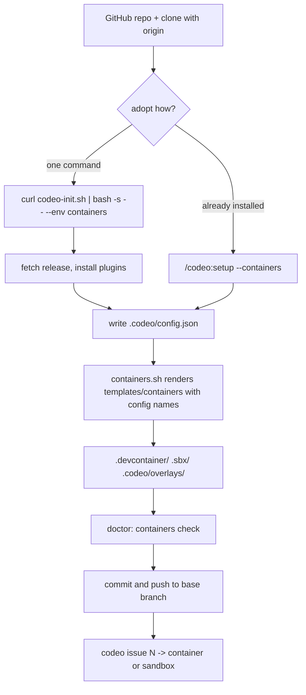

# The container templates

This page is the reference for the dev container and sbx sandbox files codeo writes into a project: what is codeo's and what is yours, which files are managed and which are seeds, where each name comes from, and where your own toolchain goes. The command that uses them is described in the [README](../README.md), and the container's own behaviour in the [dev container README](../.devcontainer/README.md).

## Contents

- [What is codeo's and what is yours](#what-is-codeos-and-what-is-yours)
- [Managed and seed files](#managed-and-seed-files)
- [Where each name comes from](#where-each-name-comes-from)
- [Adding your toolchain](#adding-your-toolchain)
- [The C# + Angular example](#the-c--angular-example)
- [Adopting the templates](#adopting-the-templates)

## What is codeo's and what is yours

`scripts/containers.sh` renders the templates under `templates/containers/`, and the generic scripts under `.devcontainer/scripts/`, into the project from its `.codeo/config.json`. The table lists every place where a shipped file names a project, a branch or codeo itself (found by searching the templates, the scripts and the libraries for `kbajpai`, `codeo-`, `main` and `master`), and says what it is:

- **Placeholder**: the file names the project or its base branch, so it carries a placeholder (`@CODENAME@`, `@REPO_SLUG@` or `@BASE_BRANCH@`) that the render fills in.
- **Intentionally codeo's**: the name is the plugin's own (a product name, a marker, an environment variable), and every project keeps it.

| File or setting | What it held | What it is |
|---|---|---|
| `.devcontainer/codeo`, the raw download URL of the `codeo` command | the branch `main` | Placeholder: `@BASE_BRANCH@` |
| `.devcontainer/codeo-container.sh`, the base ref of a new issue's checkout | the branch `main` | Placeholder: `@BASE_BRANCH@` |
| `.codeo/overlays/init.md`, the branch the home checkout is on | the branch `main` | Placeholder: `@BASE_BRANCH@` |
| `.devcontainer/codeo`, the repository in the raw download URL | the repository's slug | Placeholder: `@REPO_SLUG@` |
| `.devcontainer/codeo-container.sh`, `.devcontainer/codeo-track.sh` and `.sbx/codeo-sandbox.sh`, the repository they clone | the repository's slug | Placeholder: `@REPO_SLUG@` |
| `.sbx/codeo-sandbox.sh`, the name of a sandbox for issue N | `<codename>-N` | Placeholder: `@CODENAME@` |
| `.devcontainer/devcontainer.json`, the container name and the two volume names | `<codename>`, `<codename>-gh`, `<codename>-git` | Placeholder: `@CODENAME@` |
| `.devcontainer/codeo` (the `~/<codename>` home directory), `.devcontainer/codeo-container.sh` (the `<codename>-home` and `<codename>-N` containers, the `<codename>-dev` images, the `<codename>-gh` and `<codename>-git` volumes) and the `.codeo/overlays/` seeds (the `<codename>-N` container pattern) | the project name | Placeholder: `@CODENAME@` |
| The file names `codeo-container.sh`, `codeo-sandbox.sh`, `codeo-track.sh` and the `codeo-<kind>.sh` forms the `codeo` command builds from them | the plugin's own scripts | Intentionally codeo's |
| The `codeo-sandbox:`, `codeo-container:` and `codeo-root:` prefixes of the scripts' messages | the plugin's own scripts | Intentionally codeo's |
| `~/.codeo-sandbox` and the `CODEO_SANDBOX_MARK` variable (`.devcontainer/scripts/session-title.sh`, `.sbx/codeo-sandbox.sh`) | the marker that says a shell is inside a sandbox | Intentionally codeo's |
| `.devcontainer/scripts/codeo-root.sh` | the lookup of the installed plugin | Intentionally codeo's |
| The `CODEO_*` environment variables and the `.codeo/` directory | the plugin's settings and state | Intentionally codeo's |
| The home clone's folder name, which `.devcontainer/scripts/role.sh` reads | `<codename>-home` | Placeholder: `@CODENAME@`; the clone `setup --containers` ran in is a home checkout only when its folder has this name |
| `kbajpai/codeo` in `scripts/codeo-init.sh` (`CODEO_PLUGIN_REPO`) and the `codeo-init.sh` usage text | the plugin's own source repository | Intentionally codeo's |

A project that is not codeo therefore carries its own name, its repository and its base branch in every shipped file, and codeo's own name only where the plugin's own scripts and settings are meant.

## Managed and seed files

`scripts/containers.sh` writes two kinds of file.

**Managed** files are rewritten from the template by `--force` and held equal to it by `--check`; `/codeo:doctor` runs the same check in its `containers` line and fails with the differing files named:

- `.devcontainer/codeo`
- `.devcontainer/codeo-container.sh`
- `.devcontainer/codeo-track.sh`
- `.sbx/codeo-sandbox.sh`
- every file under `.devcontainer/scripts/` (`codeo-root.sh`, `container-name.sh`, `devcontainer-start.sh`, `folder-check.sh`, `plugins.sh`, `role.sh`, `session-title.sh`, `window-title.sh`), copied as they are, with no placeholder filled

**Seed** files are the ones a project edits. They are written only when absent, never overwritten, even by `--force`, and never checked:

- `.devcontainer/Dockerfile`
- `.devcontainer/devcontainer.json`
- `.sbx/claude-image`
- `.codeo/overlays/issue.md`, `init.md`, `triage.md`, `cleanup.md`, `plan.md`, `implement.md`, `qc.md` and `close.md`

Run it from inside the project, where `<plugin>` is the installed plugin's directory (the script is in the plugin, not in the project):

```bash
bash <plugin>/scripts/containers.sh [--check] [--force]
```

- Without a flag, a file that is absent is written and a file that exists is left alone.
- `--force` rewrites the managed files; the seed files still stay.
- `--check` writes nothing and fails when a managed file differs from its template or is missing. It skips the seed files. `--check` and `--force` do not go together.

Each file gets one output line, `containers: wrote <path>`, `containers: skip <path>` (it exists and was left alone), `containers: ok <path>` (`--check`, equal to the template) or `containers: differs <path>` (`--check`, different or missing). The exit status is 0 on success, 1 when `--check` finds a difference or the config is unusable (a missing key or a name that fails the rules below), and 2 on a usage error.

Running it twice writes nothing the second time, and a seed you edited stays as you left it.

## Where each name comes from

| Placeholder | Config key | Default | Example |
|---|---|---|---|
| `@CODENAME@` | `codename` | none: it is required, and the script stops saying how to set it (`/codeo:setup --containers` writes it from the repository name) | `shop` gives the containers `shop-home` and `shop-<N>`, the volumes `shop-gh` and `shop-git` |
| `@REPO_SLUG@` | `repo.owner` and `repo.name`, joined with a slash | none: both are required, and the script stops naming the missing key | `acme-co/shop` |
| `@BASE_BRANCH@` | `baseBranch` | `main` | `develop` makes the `codeo` command download from, and the checkouts start from, `develop` |

The script checks each value before it writes anything, and stops with exit status 1 and one message when a value fails:

- `codename`: lower-case letters, digits and single hyphens, starting with a letter (`^[a-z][a-z0-9]*(-[a-z0-9]+)*$`).
- `repo.owner` and `repo.name`: a GitHub owner and repository name. The owner starts with a letter or digit and holds letters, digits, dots, underscores and hyphens; the name holds the same characters and may start with any of them. A dot or underscore comes through unchanged.
- `baseBranch`: starts with a letter or digit and holds letters, digits, dots, underscores, slashes and hyphens.
- `baseBranch`, `repo.owner` and `repo.name` may not be `TODO-set-me`, the marker `/codeo:setup` writes for a value it could not read.

The container also needs `plugin.repo` and `plugin.ref` in the config to install codeo; `/codeo:setup --containers` writes them from the newest release, and `/codeo:doctor` fails the `containers` check while they are absent.

A codename that is a prefix of another name, for example `shop` beside the repository `shop-api`, does not change the longer name: only the placeholder is replaced.

Nothing defaults to codeo's own values. The settings themselves are described in the README's [Configuration](../README.md#configuration) section.

## Adding your toolchain

The Dockerfile is stack-neutral: Ubuntu with `git`, `jq`, `gh` and Claude Code, running as the non-root user `dev`, with no language runtime. Your build tools go in one place, the section between the two marker comments:

```dockerfile
# ---- Project toolchain (yours) -----
# ... your RUN lines, as root ...
# ---- End project toolchain -----
```

Put every `RUN` for your compilers, SDKs and CLIs inside it and nowhere else, so that comparing the file with a newer template stays a small diff. The section runs as root, before the `dev` user takes over. The Dockerfile is a seed, so the script never rewrites what you put there.

Then tell codeo how to build and test, in `suites` in `.codeo/config.json`: each suite has a `name`, the `paths` that make it run, a `build` command and a `test` command, and optionally `filter` and `parallel`. The fields are in the README's [Configuration](../README.md#configuration) section, and `/codeo:doctor` checks that each suite's commands are found.

The toolchain section configures the dev container image only. The sandbox runs Docker's pinned image and does not get it; [the sandbox's README](../.sbx/README.md#what-the-sandbox-contains) says what that means for a build. The example's suites were run in the dev container.

If a build needs more than the image holds, such as a different pinned sandbox image, edit the seeds `.sbx/claude-image` and `.devcontainer/devcontainer.json` the same way.

## The C# + Angular example

`examples/csharp-angular/` is a worked adoption for a C# API, an Angular web app and Kubernetes manifests. It holds:

- `examples/csharp-angular/.devcontainer/Dockerfile`, whose toolchain section installs the .NET SDK, Node, a headless Chromium for the Angular tests, the Docker CLI and `kubectl`
- `codeo-suites.json`, the three suites (`api`, `web`, `k8s`) as they would sit in `suites`
- `api/`, a small .NET API with a test project
- `k8s/`, the Kubernetes manifests for the API and the web app
- `web/`, the Angular app, generated and shipped as is (its `package.json`, `angular.json`, `src/` and the rest; no `node_modules`)
- `examples/csharp-angular/scripts/generate-web.sh`, which regenerates that app into `web/` (it refuses when `web/angular.json` exists: delete `web/` first), and `examples/csharp-angular/scripts/run-suites.sh`, which runs every suite in `.codeo/config.json`, build then test

The example has not been built by this repository's tests: its suite never runs .NET, Node or Docker, and it uses stub commands in their place. To use it in a project that adopted the templates:

1. Copy the toolchain section of `examples/csharp-angular/.devcontainer/Dockerfile` into the section between the markers of your `.devcontainer/Dockerfile`.
2. Merge the suites in `examples/csharp-angular/codeo-suites.json` into the `suites` array of your `.codeo/config.json`.
3. Copy `api/`, `web/` and `k8s/` from `examples/csharp-angular/` (in a checkout of codeo or the installed plugin's directory) into your project's root, put `examples/csharp-angular/scripts/run-suites.sh` in a folder named `scripts` there, and commit them. The suites use project-root paths (`api`, `web`, `k8s`), and `run-suites.sh` takes the folder above its own folder as the project root. To regenerate `web/` first, on a host with Node, delete `examples/csharp-angular/web` and run `bash examples/csharp-angular/scripts/generate-web.sh`.
4. In the issue's container, run `bash ./scripts/run-suites.sh` from the project root to run every suite's build and test.

To check the whole example in one command, run `bash examples/csharp-angular/scripts/host-run.sh <owner>/<repo>` from a checkout of codeo. It needs Docker running, `git`, `gh` logged in, `jq`, an existing public, otherwise empty throwaway GitHub repository, `web/` as the example ships it, and, for doctor's `deps` check to pass, bash 4.3 or newer on the host (the script itself runs under bash 3.2, so an older host sees `fail deps`, which it accepts and prints). It builds the neutral template image, copies the example into a clone of that repository, runs the wizard, pushes, starts the issue container `shopdemo-1` and runs the three suites in it, then prints doctor's output. On a host that has the project's toolchain and the plugins installed, `fail ruleset` (a fresh repository has no branch ruleset) is the one failure a fresh adoption is expected to show; a host without them also shows the `deps`, `superpowers` or `suites` check. Those four are the only doctor failures it accepts; any other failure stops the run. It ignores the `CODEO_CONTEXT`, `CODEO_REPO_URL`, `CODEO_RAW_URL`, `CODEO_TRACK` and `CODEO_HOME` overrides (it unsets them and prints which were set), because they would redirect the throwaway run to another repository or directory, and it checks the toolchain in the issue container before running the suites. It removes nothing: it prints the commands that remove what it created, and the work clone's path to `cd` to first, and you run them.

## Adopting the templates

One command adopts the whole setup in a project that has a GitHub repository and a clone with an `origin`: `scripts/codeo-init.sh --env containers`, or `/codeo:setup --containers` where codeo is already installed. Either writes `.codeo/config.json` and then runs `scripts/containers.sh`. The README's [Setting a project up](../README.md#setting-a-project-up) describes these two ways to adopt.



Commit the files it wrote and push them to the base branch; after that, `codeo issue <N>` opens an issue in a container or a sandbox. Three conditions decide whether it works:

- **The repository is public.** The image build (`https://github.com/<owner>/<repo>.git#<ref>:.devcontainer`), the container's clone, and the `codeo` command with its install line (`raw.githubusercontent.com`) fetch without credentials, so for a private repository the install line, `codeo issue <N>`, `codeo update` and the container's clone fail with no explanation. `CODEO_CONTEXT`, the `.devcontainer` directory of a local clone, builds the image without fetching it, but the container still clones from `CODEO_REPO_URL` with no credentials, so it does not make a private repository's container work. `CODEO_RAW_URL` names another base URL for the `codeo` command's three script downloads, and a script already present in `CODEO_HOME` is not downloaded again. The sandbox route's clone is made by the host's own `git`. codeo does not test a private repository and has no authenticated fetch. The audit table's two kinds (a placeholder, or codeo's own name) do not describe a requirement on the repository's visibility, so this section states it instead of a table row.
- **The folder you ran it in is named `<codename>-home`.** That clone is a home checkout only under that name: the shipped role guard reads the folder name, and in any other folder `role.sh --check issue` reports `stray` and `/codeo:issue` is refused. `scripts/setup.sh` and the wizard end by printing `the home checkout is a clone whose folder is named <codename>-home` with the current folder's name, and one line more to rename or re-clone it when it differs.
- **The clone is not at `~/<codename>`.** The `codeo` command's home directory (`CODEO_HOME`) defaults to `~/<codename>`, and the codename defaults to the repository's name, so a project cloned to `~/<repo>` makes every `codeo` command stop with "is a git checkout; set CODEO_HOME". Keep the project's clone elsewhere, or set `CODEO_HOME`.
