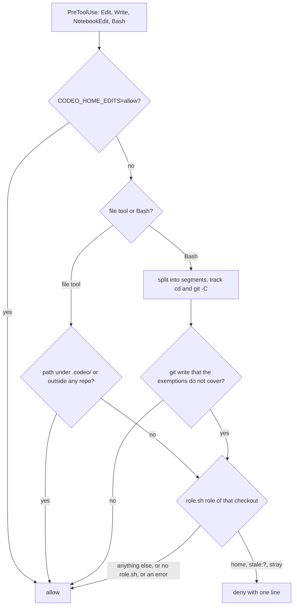

# The home checkout, the guard and the tracking comment

## The home checkout

The home role runs `/codeo:issue`, `/codeo:init`, `/codeo:triage` and `/codeo:cleanup`: the steps that work on the project rather than inside one issue's workflow. It runs on your machine in a clone named `<codename>-home` (for this repository, `codeo-home`) that sits on the base branch, or in the `codeo-home` dev container ([`.devcontainer/README.md`](../.devcontainer/README.md)). `<codename>` is the optional `codename` in `.codeo/config.json` (this repository sets `codeo`); without one it is the clone's own folder name, so a host clone named `<project>-home` needs `codename` set to `<project>` to be recognised as home.

To run it on the host you need:

- Claude Code, `git`, `jq` and `gh` logged in. `/codeo:doctor` checks the login and, when the project has a board, that the token carries the `project` scope. `jq` is required, not optional. The plugin's scripts read `.codeo/config.json` and the GitHub responses with it and stop without it, except the guard and the hooks described below (a missing `jq` shows as `config.json: invalid JSON`; `install.sh` reports it missing first, and `/codeo:doctor` prints `fail config: config.json: invalid JSON …` first and reaches `deps: missing: jq` later). The guard does not stop: it reads `baseBranch` and `codename` with `jq` and falls back to `main` and to the clone's folder name, so a clone named `codeo-home` becomes `codeo-home-home` in the guard's eyes and reads as `stray`, and every guarded skill refuses it. `codeo-root.sh` reads the plugin registry with `jq` and finds no installed codeo without it. The hooks read the hook input JSON with `jq` (`hooks/subagent-model.sh` the `cwd` and the subagent's `model`, `subagent_type` and `description`, `hooks/live-signal.sh` the `cwd` and the event name): without `jq`, `subagent-model.sh` exits 127 with `jq: command not found` and prints no decision, and `live-signal.sh` exits 0 silently, reading the `cwd` as empty and the event name as unset; with no project found it does nothing, and with a lock present it starts `live.sh`, and `live.sh` publishes the signal without `jq`, reading the base branch as empty and skipping the assignee lookup.
- The codeo plugin, installed with `install.sh` (see [*Installing*](../README.md#installing)), which needs bash 4.3 or later, `jq`, `git`, `gh` and `claude`.
- A git identity: `git config --global user.name "Your Name"` and `git config --global user.email you@example.com`.
- A clone of the project in a folder named `<codename>-home`, kept on the base branch and current with `git pull`.

Keeping it current:

- Claude Code: `claude update`.
- The `gh` login: `gh auth status`; when it fails, `gh auth login`. `/codeo:doctor` checks it too.
- The codeo plugin: run `install.sh` again (see [*Updating*](updating.md)).
- The `codeo` command and its scripts: `codeo update`.
- The clone: `git pull` on the base branch.

It works on Linux, on macOS and on Windows through WSL2. On macOS, `install.sh` and the `codeo` command need bash 4.3 or later (for example from Homebrew) and `flock` (`brew install flock`), and the stock bash 3.2 is too old for them; the role guard and `codeo-container.sh` run on 3.2. Over SSH, `codeo home` can stop at the Docker build with a keychain error until the login keychain is unlocked; see [The keychain over SSH on macOS](../.devcontainer/README.md#the-keychain-over-ssh-on-macos). On Windows run everything inside WSL2, `codeo` and `gh` included.

## The guard

Each skill asks `.devcontainer/scripts/role.sh --check <skill>` first, and the answer comes from the clone's folder, the workflow lock and the branch. A refusal is one line naming the role, the skill and where the skill does run, and nothing you say lifts it.

| Role | Means | Runs | Refused |
|---|---|---|---|
| `home` | a clone named `<codename>-home`, on the base branch, holding no lock | `/codeo:issue`, `/codeo:init`, `/codeo:triage`, `/codeo:cleanup` | `/codeo:plan`, `/codeo:implement`, `/codeo:qc`, `/codeo:close`: they run in an issue's checkout |
| `issue:<N>` | holds the lock for issue `<N>`; in a container also in the folder `<codename>-<N>`, on the host in any folder | `/codeo:plan`, `/codeo:implement`, `/codeo:qc`, `/codeo:close` | the four home skills: they run in a home checkout |
| `stale:<N>`, `stale:?` | no lock, and not home: `stale:<N>` in a container's folder `<codename>-<N>`, `stale:?` in a `<codename>-home` (container or host clone) off the base branch | nothing | every guarded skill; the line says what became of the workflow, or to switch back to the base branch |
| `mismatch:<N>:<folder>` | a container locked for `<N>` in another folder | nothing | every guarded skill |
| `stray` | a host checkout that is neither home nor an issue's: no lock, and not named `<codename>-home` | nothing | every guarded skill: it is neither the home clone nor an issue's |
| `unguarded` | a hosted web session (`CLAUDE_CODE_REMOTE=true`), or a container in a folder that is neither `<codename>-home` nor `<codename>-<N>` | everything | nothing |

`/codeo:doctor` and `/codeo:setup` are outside the guard. A host checkout is `home`, `issue:<N>` or `stray`; only a hosted web session and a container in an unrelated folder are `unguarded`.

## The edit guard

A plugin hook, `hooks/home-guard.sh` (registered in `hooks/hooks.json`), refuses a change to the project in a checkout whose role is `home`, `stale:?` or `stray`, so the work goes through an issue: `/codeo:issue`, then `codeo issue <N>`, then the work in that issue's checkout. It asks the checkout's own `.devcontainer/scripts/role.sh` for the role and keeps no copy of its rules. A refusal is one line naming the role and the way out.

Refused in such a checkout:

- `Edit`, `Write` and `NotebookEdit` of any file in the project, including a new file in a directory that does not exist yet.
- These git writes run through Bash: `commit`, `push`, `merge`, `rebase`, `cherry-pick`, `revert`, `am`, `apply`, `reset`, `stash` and `tag` (even when it only lists tags), `add`, `rm`, `mv` and `restore`, `checkout -b`, `-B` or `--orphan`, and `switch -c`, `-C`, `--create`, `--force-create` or `--orphan`.

Allowed:

- Any path under `.codeo/`, which is how `/codeo:issue`, `/codeo:init`, `/codeo:triage` and `/codeo:cleanup` keep their notes, drafts and ledgers; a `..` that climbs out of `.codeo/` is not under it. `git add`, `rm`, `mv` and `restore` pass only when every pathspec is under `.codeo/`, and `git commit` passes only when everything it would commit is under `.codeo/` and it names no pathspec outside it; `--amend`, `-i`, `--include`, `-o`, `--only` and a bare `--` are always refused.
- Plain `git checkout` and `git switch`, `worktree`, `fetch`, `pull`, `branch` and every script, so `/codeo:init`'s scratch worktree and the `codeo` command work.
- Every other role, a hosted web session, a project without `.devcontainer/scripts/role.sh`, and a path outside any repository.

A Bash command is split at `;`, `&&`, `||`, `|` and `&`, and each `git` segment is judged by the checkout it addresses: `cd` and `git -C` targets are followed, quoted ones too, so `git -C <issue clone> commit` run from home is allowed and `git -C <home> commit` run from an issue's checkout is refused. Quoted text is never read as a command.

To switch the guard off, start Claude Code with `CODEO_HOME_EDITS=allow` in the environment, or put it in the project's `.claude/settings.local.json` `env`. It lasts for the session started with it, the session cannot set it for itself, and only the exact value `allow` counts.

What it does not see:

- A file changed through the shell: `sed -i`, redirection, `rm`, `cp`.
- A nested shell (`bash -c`), a subshell `( … )`, a `$(…)` substitution, and a script's contents; the body of a heredoc is read as commands.
- A failure of its own: when the hook cannot find out the role, it allows the call.

A clone of a project that has the role check, in a folder not named `<codename>-home`, reads as `stray` and is guarded. The guard comes with the plugin version that carries the hook, so a project has it after it updates and re-pins.



## Adopting the guard in your project

The guard is the project's own: `/codeo:setup` writes none, and a project without one is never refused.

To add one, give each of the eight guarded skills (`issue`, `init`, `triage`, `cleanup`, `plan`, `implement`, `qc`, `close`) a `## role-guard` section in `.codeo/overlays/<skill>.md`. The section is plain text that tells the skill to run the project's check first and what each exit means:

- 0: go on.
- 1: print the one line and stop; nothing the engineer says lifts it.
- Anything else: report what was printed and go on.

The check is any script the project writes. The skill reads the exit and, on exit 1, the one line the check prints; on any other exit it reports what the check printed. `/codeo:doctor`'s `overlays` check confirms each section name is a registered point and used once.

codeo's own guard is the worked example: `.codeo/overlays/plan.md` (a one-paragraph section) and `.devcontainer/scripts/role.sh`, whose roles are the table above. The script reads the clone's folder, the lock and the branch, calls `container-name.sh` beside it, and assumes the folder names `<codename>-home` and `<codename>-<N>`. It is not shipped for other projects, so a project writes its own check for its own layout.

For the point's contract and its generic example, see [`extension-points.md`](extension-points.md#issuerole-guard).

## The tracking comment

An issue's branch, containers, images, volumes and sandboxes are recorded in one comment on the issue, found by its hidden marker `<!-- codeo:tracking -->` anywhere in a comment body:

```
<!-- codeo:tracking -->
Codeo tracking for #12: branches, containers and their removal.

| Kind | Name | Host | Status | Created (UTC) | Removed (UTC) |
|---|---|---|---|---|---|
| branch | `feat/12-order-export` | | deleted | 2026-11-22T09:00:00Z | 2026-11-23T16:30:00Z |
| container | `codeo-12` | my-laptop | removed | 2026-11-22T09:05:00Z | 2026-11-23T16:20:00Z |
| image | `codeo-dev:codeo-12` | my-laptop | active | 2026-11-22T09:05:00Z | |
| volume | `codeo-12` | my-laptop | removed | 2026-11-22T09:05:00Z | 2026-11-23T16:20:00Z |

Edited by codeo; the table is rewritten, text outside it is kept.
```

Who writes which row, through `.devcontainer/codeo-track.sh`:

- `/codeo:init` adds the `branch` row once the claim is pushed; running it again changes nothing.
- `codeo-container.sh issue` adds the `container`, `image` and `volume` rows, and `codeo-sandbox.sh issue` adds the `sandbox` row. Host is the host machine's name.
- `codeo rm <N>` marks the container, its volume and its image `removed`, and `codeo-sandbox.sh end <N>` marks the sandbox `removed`, with the time.
- `/codeo:close` marks the `branch` `deleted` after it deletes the remote branch. A kept branch stays `active`.
- A row nothing has removed stays `active`; a row on another host is not proof the container still exists.
- A container opened through VS Code's "Clone Repository in Named Container Volume" is recorded as the branch row alone: its container, image and volume are not recorded.

Creating a container or sandbox for an issue that already has an `active` container or sandbox row lists the rows and asks before it creates another. `codeo issue <N> --yes` answers yes; without a terminal and without `--yes` it stops. The question is asked only when the container or sandbox is missing on this host. A container of that name that already exists on this host, in any state, is refused whatever `--yes` says: `codeo-container.sh` warns and stops, and its message names the ways out (enter it with `shell`, rebuild it with `--rebuild`, or remove it). An existing sandbox is not refused: `codeo-sandbox.sh issue` asks nothing and reuses it. Creating a sandbox while a container `codeo-<N>` exists on this host is not refused either: `codeo-sandbox.sh` names the container to the tracker, which asks about it even with no active row, and `--yes` answers the question.

A record that fails never fails the creation or the removal. When `gh` is missing, not logged in or failing, the tracker prints one `track:` line naming the row to add by hand and goes on. Edit the comment as you like outside the table: text there is kept. A comment that carries the marker but no recognisable table is reported and left untouched. Two first creations at the same moment can each find no comment and leave two; the first one found by marker is the one codeo then uses.
