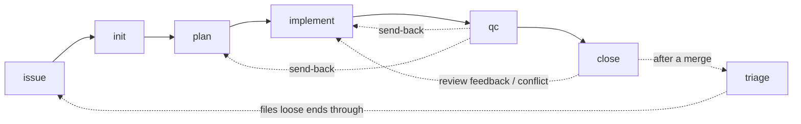

# Describe Every Skill Implementation Plan

> **For agentic workers:** REQUIRED SUB-SKILL: Use superpowers:subagent-driven-development (recommended) or superpowers:executing-plans to implement this plan task-by-task. Steps use checkbox (`- [ ]`) syntax for tracking.

**Goal:** A `docs/skills.md` that describes all nine skills under `skills/` in one fixed shape, a README that summarises and links to it, and a test that fails when a skill has no section or lists the wrong extension points.

**Architecture:** `docs/skills.md` is one `## <skill>` section per directory under `skills/`, each with the same four `###` sub-parts, written by following each skill's `## Hand-off` and `## Non-goals` wording closely (`setup` and `doctor` from their scripts' headers). A standalone `tests/skills-doc.test.sh` checks the doc's shape against `skills/*/` and its extension-point lists against `lib/extension-points.tsv`, and carries its own scratch-tree negative cases so the guard is itself proved. The README's Skills table loses its *Extension points* column and links each row to its section.

**Tech Stack:** bash 4.3+, awk, grep (the test suite's existing tools); Markdown with Mermaid.

**Spec:** GitHub issue #34 as restated in `.codeo/34/init.md` → `## Outcome` (acceptance criteria verbatim); decisions in `.codeo/34/plan.md` Q1–Q3.

## Options considered

| Decision | Chosen | Rejected | Why |
|---|---|---|---|
| Where the guard lives | standalone `tests/skills-doc.test.sh`, on the `tests/inventory.test.sh` precedent | a seventh check in `tests/skills.test.sh` | the lint checks a skill against the plugin; this checks a doc against the skills list, and a seventh check would force every scratch tree in `skills-lint.test.sh` to carry a `docs/skills.md` |
| Negative cases | inside the same file, against a scratch tree | a separate `skills-doc-lint.test.sh` | one small checker; the two-file split exists for the lint because it is large |
| Prose source | `## Hand-off` / `## Non-goals` wording, rephrased only where needed (Q1) | fresh newcomer prose | stays in step with `SKILL.md`; nothing can test prose, so review is the only drift guard |
| Test strictness | headings + four sub-parts + exact extension-point match (Q2) | headings only | the point list is the one thing in the doc that is mechanically checkable, and `lib/extension-points.tsv` already is the source of truth |
| README table | drop *Extension points*, link each row (Q3) | keep as is | the column would duplicate a full section of the new doc |
| `doctor` summary in README | "checks the whole set-up" + link; the check list lives in `docs/skills.md` | list every check in the README | the list is `doctor.sh`'s to own; one copy outside it is enough |

## Global Constraints

- Only `docs/skills.md`, `tests/skills-doc.test.sh`, `README.md` and `CHANGELOG.md` change. No `SKILL.md`, no script, nothing under `lib/`, and not `docs/skills-inventory.md` or `docs/extension-points.md` (issue's Out of Scope).
- Section headings in `docs/skills.md` are exactly `## <directory name>`; every `## ` heading outside a fenced block names a directory under `skills/`, so the intro uses no `## ` headings of its own.
- The four sub-headings, exactly and in this order: `### Purpose and triggers`, `### Reads and writes`, `### Hand-offs and non-goals`, `### Extension points`.
- An extension point is listed as a bullet whose first token is `` `<skill>/<point>` `` — e.g. `` - `plan/plan-shape` — … `` — one per `lib/extension-points.tsv` row for that skill; a skill with no rows writes `None.` as the sub-part's only line.
- Links into `docs/extension-points.md` use GitHub's anchor for `### plan/plan-shape`, which is `#planplan-shape` (lowercase, `/` dropped).
- The guard compares the doc's points to `lib/extension-points.tsv` only; `tests/skills.test.sh` check 4 already pins that registry to each `SKILL.md`'s `<!-- point: -->` markers and to `docs/extension-points.md`'s `###` headings, so agreement with all three (acceptance criterion 3) follows without a second copy of that check.
- The checker strips `\r` before reading, as `tests/skills.test.sh` does, so a CRLF checkout passes.
- Test output follows the suite's convention: one `FAIL <check>: <detail>` line per finding, `all cases passed` on success, exit 1 on any FAIL. It runs under `bash tests/run.sh` because it is named `tests/*.test.sh`; `bash tests/run.sh skills-doc` runs it alone.
- Documentation moved by this change: `README.md` (Skills section) — Task 3. No other page under `docs/` describes the skills, so none other changes. No wiki module.
- No shared environment is configured: every task is proved in this checkout.
- The repository already fails nine unrelated tests on Windows checkouts (CRLF); the suite's verdict is CI's. Locally, prove each task with the single file (`bash tests/skills-doc.test.sh`) and the subset runner (`bash tests/run.sh skills-doc`).

## Review Focus

1. A CRLF `docs/skills.md` (Windows checkout) must pass — checker strips `\r` (Task 1, case `crlf`).
2. A `## ` line inside a fenced code block in `docs/skills.md` (a quoted dossier heading) must not be read as a section — the checker tracks ``` fences (Task 1, case `fenced`).
3. A point listed twice must be reported, not collapsed — compare sorted lists without `-u` (Task 1, case `duplicate`).
4. A bullet under `### Extension points` that is not of the form `` - `<skill>/<point>` `` (a point filed under the wrong skill, or prose) must fail as `malformed`, never be silently ignored (Task 1, case `malformed`).
5. A missing `lib/extension-points.tsv` must fail loudly, as the lint does, rather than pass every skill with an empty set (Task 1, case `no-tsv`).

---

### Task 1: The guard — `tests/skills-doc.test.sh`

**Files:**
- Create: `tests/skills-doc.test.sh`

**Interfaces:**
- Produces: `check_skills_doc <skills_dir> <doc> <tsv>` — prints zero or more `FAIL <check>: <detail>` lines, where `<check>` is one of `doc-missing`, `tsv-missing`, `missing-section`, `unknown-section`, `missing-part`, `points`; returns 0 always (the caller greps). Checks, in order, per skill directory `S` (basename of each `<skills_dir>/*/`):
  - `doc-missing` when `<doc>` is not a file (then stop); `tsv-missing` when `<tsv>` is not a file (then stop).
  - `missing-section: S` when no line outside a fence is exactly `## S`.
  - `unknown-section: X` for each `## X` outside a fence with no `<skills_dir>/X/` directory.
  - `missing-part: S ### <name>` for each of the four sub-headings not present exactly once between `## S` and the next `## ` line.
  - `points: S missing <skill/point>` / `points: S extra <skill/point>` / `points: S malformed <line>` — bullets under `### Extension points` (up to the next `###` or `##`) are parsed as `` - `S/<name>` ``; the sorted list (duplicates kept) must equal the sorted `$2` column of tsv rows whose `$1` is `S`. A line that starts with `- ` but does not match the form is `malformed`. When tsv has no row for `S`, the sub-part's only non-blank line must be `None.` (else `points: S expected None.`).
- The file, when executed, runs `check_skills_doc "$repo/skills" "$repo/docs/skills.md" "$repo/lib/extension-points.tsv"`, then the scratch cases below, and prints `all cases passed` or exits 1 having printed the FAIL lines.

- [ ] **Step 1: Write the checker and the scratch cases**

Header comment in the suite's style (what it checks, invocation, exit codes). `set -euo pipefail`. Scratch tree under `mktemp -d` with `trap 'rm -rf "$scratch"' EXIT`: `skills/alpha/SKILL.md`, `skills/beta/SKILL.md` (any content), and `lib/extension-points.tsv` with the one row `alpha<TAB>p1<TAB>default`. A `make_doc <path> <body>` helper writes the doc. Cases, each asserting the exact FAIL substring (or none):

```bash
# good: both sections, all four parts, alpha lists `alpha/p1`, beta says None. → no FAIL
# crlf: the good doc through `sed 's/$/\r/'`                                  → no FAIL
# fenced: the good doc plus a ```-fenced block containing "## gamma"          → no FAIL
# missing-section: good doc without "## beta"                                 → "FAIL missing-section: beta"
# unknown-section: good doc plus "## gamma" outside a fence                   → "FAIL unknown-section: gamma"
# missing-part: alpha without "### Reads and writes"                          → "FAIL missing-part: alpha ### Reads and writes"
# extra: alpha lists `alpha/p1` and `alpha/p2`                                → "FAIL points: alpha extra alpha/p2"
# duplicate: alpha lists `alpha/p1` twice                                     → "FAIL points: alpha extra alpha/p1"
# malformed: alpha has the bullet "- `beta/p1` — …"                           → "FAIL points: alpha malformed"
# none: beta's Extension points holds "- `beta/p9`" though tsv has no beta row → "FAIL points: beta"
# no-tsv: good doc, tsv path that does not exist                              → "FAIL tsv-missing"
```

Then the repository check: `out=$(check_skills_doc "$repo/skills" "$repo/docs/skills.md" "$repo/lib/extension-points.tsv")`; print it; any `^FAIL` → exit 1.

- [ ] **Step 2: Run it; the scratch cases pass and the repository check fails**

Run: `bash tests/skills-doc.test.sh`
Expected: exactly one line `FAIL doc-missing: docs/skills.md`, exit 1 (the scratch cases are silent — a scratch-case failure would print `FAIL: <case>` and exit before reaching the repository check).

- [ ] **Step 3: Commit**

```bash
git add tests/skills-doc.test.sh
git commit -m "test: skills-doc.test.sh guards docs/skills.md coverage and its extension-point lists (#34)"
```

### Task 2: `docs/skills.md`

**Files:**
- Create: `docs/skills.md`

**Interfaces:**
- Consumes: the shape Task 1 enforces (Global Constraints).
- Produces: nine anchors `#issue`, `#init`, `#plan`, `#implement`, `#qc`, `#close`, `#triage`, `#setup`, `#doctor` that Task 3 links to.

- [ ] **Step 1: Write the intro**

`# Skills`, then prose with no `##` headings: what the file is; the six pipeline skills run in order inside one workflow, bound to one issue by the lock (`.codeo/active`, `docs/handoff.md`); `triage` runs outside the lock between workflows; `setup` and `doctor` set a project up and check it. Then this diagram, verbatim:

````markdown

````

- [ ] **Step 2: Write the nine sections, in this order: issue, init, plan, implement, qc, close, triage, setup, doctor**

Each `## <skill>` carries the four sub-parts. Sources, per sub-part (Q1: follow the wording, rephrase only where a sentence does not stand alone):

- `### Purpose and triggers` — the skill's frontmatter `description` (it already carries the trigger phrases) and its opening paragraph.
- `### Reads and writes` — the `## Hand-off` bullets **Reads**, **Writes**, and where present **Deletes**, **Releases**, **Moves**; name the dossier file (`.codeo/<N>/<skill>.md`), branches, lock, leases, board moves and GitHub objects as the skill does.
- `### Hand-offs and non-goals` — the `## Hand-off` bullets **Hands off to**, **May call**/**Calls**, **Never touches**, then the `## Non-goals` list condensed to one bullet per item.
- `### Extension points` — one bullet per `lib/extension-points.tsv` row for the skill: `` - `<skill>/<point>` — <column 3 of the row, the default> ([detail](extension-points.md#<anchor>)) ``; `None.` for issue, setup and doctor.

`setup` and `doctor` have no `## Hand-off`: their *Purpose* comes from `scripts/setup.sh`'s and `scripts/doctor.sh`'s header comments (setup: creates `.codeo/` with its `.gitignore`, a starter `config.json`, and `docs/plans/`; reads `origin` and `HEAD` for repo and base branch; refuses when `config.json` exists; `--stack`), (doctor: the eleven checks named in its header — config, schema, codename, gh-auth, gh-scopes, board, ruleset, suites, deps, overlays, superpowers — one `ok|fail` line each, runs every check after a failure). *Reads and writes*: what the script reads and creates. *Hand-offs and non-goals*: hands off to nobody; the skill reports the script's output verbatim and adds nothing.

- [ ] **Step 3: Run the guard**

Run: `bash tests/skills-doc.test.sh`
Expected: `all cases passed`, exit 0.

- [ ] **Step 4: Run the lint that reads `docs/` references, to be sure nothing else objects**

Run: `bash tests/run.sh skills`
Expected: `all cases passed` (runs `skills.test.sh`, `skills-lint.test.sh`, `skills-doc.test.sh`).

- [ ] **Step 5: Commit**

```bash
git add docs/skills.md
git commit -m "docs: describe every skill in docs/skills.md (#34)"
```

### Task 3: README and changelog

**Files:**
- Modify: `README.md:3` (the "six steps" sentence), `README.md:11-28` (Skills section)
- Modify: `CHANGELOG.md:1-3` (add an Unreleased section above v1.0.3)

**Interfaces:**
- Consumes: Task 2's anchors.

- [ ] **Step 1: Rewrite the Skills section**

Line 3 keeps "six steps" but the Skills section opens: the six pipeline skills run in order inside one workflow; `triage` runs outside the workflow lock, between workflows; `setup` and `doctor` set a project up and check it — then "`docs/skills.md` describes each one: what it does, what it reads and writes, what it hands off to and never does, and its extension points." The table becomes two columns, Skill and Purpose, keeping the current Purpose cells, with each Skill cell a link: `` [`/codeo:issue`](docs/skills.md#issue) `` … `` [`/codeo:triage`](docs/skills.md#triage) ``. Replace the `setup`/`doctor` paragraph with: `` [`/codeo:setup`](docs/skills.md#setup) `` writes `.codeo/` with a starter `config.json` and creates `docs/plans/`; `` [`/codeo:doctor`](docs/skills.md#doctor) `` checks the whole set-up — config, GitHub login and scopes, board, branch ruleset, suites, dependencies, overlays and superpowers — and reports every failure. Keep the overlay paragraph (it now says extension points are listed per skill in `docs/skills.md` and documented in `docs/extension-points.md`). Drop the line "The whole pipeline ships: …" — the table shows it.

- [ ] **Step 2: Add the changelog entry**

Above `## v1.0.3 — 2026-11-07`, insert:

```markdown
## Unreleased

Config schema: 1
Shared state: unchanged from v1.0.3.
Safe to bump mid-workflow: yes

- `docs/skills.md` describes every skill — purpose and triggers, reads and writes, hand-offs and non-goals, extension points — and `README.md`'s Skills table links to it. `tests/skills-doc.test.sh` fails when a directory under `skills/` has no section there, or a section's extension points differ from `lib/extension-points.tsv` (#34).

```

- [ ] **Step 3: Verify the README's claims**

Run: `grep -c 'docs/skills.md#' README.md && grep -n 'docs/plans/' README.md && grep -n 'six steps\|Extension points' README.md`
Expected: first count is 9; the `docs/plans/` line is the setup sentence; `six steps` appears only on line 3 and `Extension points` not at all as a table column.

- [ ] **Step 4: Run the suite**

Run: `bash tests/run.sh skills-doc && bash tests/run.sh agnostic`
Expected: `all cases passed` twice (`agnostic.test.sh` guards that no project-specific word entered the new doc).

- [ ] **Step 5: Commit**

```bash
git add README.md CHANGELOG.md
git commit -m "docs: README Skills section summarises and links docs/skills.md (#34)"
```
