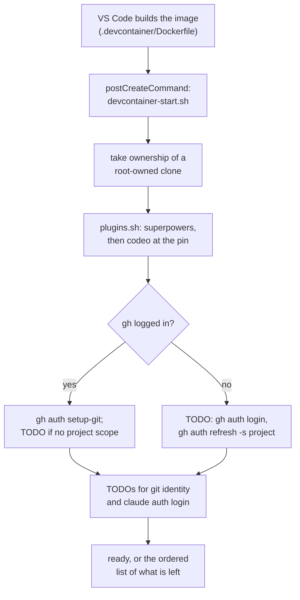

# Dev Container Implementation Plan

> **For agentic workers:** REQUIRED SUB-SKILL: Use superpowers:subagent-driven-development (recommended) or superpowers:executing-plans to implement this plan task-by-task. Steps use checkbox (`- [ ]`) syntax for tracking.

**Goal:** A `.devcontainer/` that builds from a clean machine, runs `bash tests/run.sh` and `/codeo:doctor` as a non-root `dev` user, and keeps the `gh` login across rebuilds, so codeo is developed with codeo in an image of its own.

**Architecture:** One image on `ubuntu:24.04` carrying only what codeo needs (bash, jq, git, gh, shellcheck, Claude Code). `devcontainer.json` mounts one named volume, `codeo-gh`, and caps memory and CPU. Its `postCreateCommand` runs a short start script that installs superpowers and codeo from the pin in `.codeo/config.json` (`plugins.sh`), wires `gh` into git, and lists what is left for the engineer to do by hand. A new `tests/devcontainer.test.sh` pins the files' shape and exercises both scripts against stubbed `claude` and `gh`; the image itself is proved with `docker build` and `docker run`.

**Tech Stack:** bash 4.3+, jq, Docker (Dockerfile, `devcontainer.json`), the test suite's existing conventions.

**Spec:** GitHub issue #36 as restated in `.codeo/36/init.md` → `## Outcome` (acceptance criteria verbatim); decisions in `.codeo/36/plan.md` Q1-Q4.

## Options considered

| Decision | Chosen | Rejected | Why |
|---|---|---|---|
| Where the container is defined | `.devcontainer/` in this repo (Q4) | a separate private repo that clones this one | a per-issue container is a clone of the issue's branch and reads `devcontainer.json` from it |
| Plugin pin (Q1) | codeo at `v1.0.3` in `.codeo/config.json` `plugin{repo,ref}`; superpowers unpinned | codeo on `main`; superpowers pinned | a released codeo is what the container's own tooling should run; superpowers has no version this repo depends on |
| Start script (Q2) | minimal: ownership, `plugins.sh`, `gh` wiring, git identity, to-do list | also take the container lock and name the container; carry over the identity and Claude-login scripts | `lock.sh` already binds locally in any container; the rest is project machinery |
| Proof of the AC that need VS Code and a login (Q3) | `docker build` / `docker run` here, two manual checks by the engineer before close | install the `devcontainer` CLI on the host | no extra host tooling; the manual checks are listed in Task 6 |
| Base image | `ubuntu:24.04` | a language SDK image | the issue asks for Ubuntu 24.04 and none of the SDK tools |
| git | Ubuntu's own (2.43) | the git-core PPA | `git merge-tree --write-tree`, which `/codeo:close` uses, arrived in 2.38 |
| `devcontainer.json` | strict JSON, no comments; the reasons live in the Dockerfile and scripts | commented JSONC | `jq` reads it, so the test can assert on it |
| Container name | Docker's own | `--name` from the folder | `--name` needs clone-in-volume and collides when two containers share a folder name |

## Global Constraints

- bash 4.3+ in every script; each script starts `#!/usr/bin/env bash` and `set -euo pipefail`. No `grep -q` at the end of a pipeline: capture the command's output first, then `grep -q ... <<<"$out"` (codeo fixed this class of bug in v1.0.3, #32).
- `codeo` is a public plugin that serves every project, so no tracked file names a project that uses it. `tests/agnostic.test.sh` enforces this over every tracked file, new ones included. `.devcontainer/` assumes nothing about a project that uses codeo, and `tests/devcontainer.test.sh` assembles any forbidden word from parts if it ever needs one.
- `.devcontainer/` ships inside every installed copy of the plugin (the plugin source is `./`). It is inert there; nothing in `scripts/`, `lib/`, `hooks/` or `skills/` reads it.
- The image holds none of: .NET, Node/npm, Terraform, gcloud/`google-cloud-cli`, PostgreSQL, Docker, `kubectl`. `devcontainer.json` has no bind mount, no `secrets` volume and no `.codeo-secrets` path.
- The only mount is the named volume `codeo-gh` at `/home/dev/.config/gh`. The Dockerfile creates that directory owned by `dev` so the empty volume takes `dev`'s ownership on first mount.
- User `dev`, UID 1000. Ubuntu 24.04's `ubuntu` user holds UID 1000 and is removed first.
- `runArgs` is exactly `["--memory=4g", "--cpus=2"]`.
- The pin is `.codeo/config.json` → `plugin: {"repo": "kbajpai/codeo", "ref": "v1.0.3"}`, and `"codename": "codeo"`. codeo itself reads neither key; `doctor.sh` only validates the codename.
- The `shell` suite's `paths` gains `.devcontainer/**`, so a change there is judged by the suite.
- `.devcontainer/scripts/devcontainer-start.sh` never fails the container's creation: it exits 0 and prints what it could not do as `devcontainer-start: TODO — …` on stderr.
- Documentation moved by this change: none. `README.md` is out of scope (issue), and no page under `docs/` describes the repo's own tooling. The change is recorded in `CHANGELOG.md` (Task 6). No wiki module.
- No shared environment is configured: every task is proved in this checkout, except Tasks 3 and 6, which also need the local `docker` engine.

## Review Focus

1. A first build with no volume and no host folder present must succeed: `devcontainer.json` has no bind mount and the `codeo-gh` volume is created by Docker (Task 2 test `no_bind_mounts`; Task 6 manual check).
2. An empty `codeo-gh` volume must come up owned by `dev`, not root, or `gh auth login` fails with a permission error (Task 3 `docker run` check on `/home/dev/.config/gh`).
3. `plugins.sh` re-run when everything is already installed at the pin must change nothing and exit 0; run with the pin missing from the config it must exit 1 and say so (Task 4 cases `idempotent`, `no_pin`).
4. `plugins.sh` must not remove a working codeo when the pin cannot be fetched (offline): it stays, exits 1, and says which ref it kept (Task 4 case `offline_keeps_codeo`).
5. The start script run with no `gh` login, no git identity and no Claude login still exits 0 and lists all three as TODO, in the order that clears them (Task 5 case `todo_when_nothing_is_set_up`).

---



### Task 1: Config — `codename`, the plugin pin, and the suite path

**Files:**
- Modify: `.codeo/config.json`
- Create: `tests/devcontainer.test.sh`

**Interfaces:**
- Produces: `tests/devcontainer.test.sh` with the helpers every later task adds cases to: `fail <message>` (appends to a failure list and sets a non-zero final exit), `case_name` runner that calls each function named in a final `cases=( … )` array, and `repo_root`. It prints `FAIL <case>: <detail>` per failure and `all cases passed` on success, like the other `tests/*.test.sh`.

- [ ] **Step 1: Write the failing test.** `tests/devcontainer.test.sh` with the helpers above and one case, `config_has_codename_pin_and_suite_path`, asserting with `jq -e` on `.codeo/config.json`: `.codename == "codeo"`; `.plugin.repo == "kbajpai/codeo"`; `.plugin.ref == "v1.0.3"`; and `.suites[] | select(.name == "shell") | .paths | index(".devcontainer/**")` is not null.
- [ ] **Step 2: Run it and see it fail.** `bash tests/devcontainer.test.sh` → `FAIL config_has_codename_pin_and_suite_path`, exit 1.
- [ ] **Step 3: Edit `.codeo/config.json`.** Add `"codename": "codeo"` and `"plugin": {"repo": "kbajpai/codeo", "ref": "v1.0.3"}` as top-level keys, and `".devcontainer/**"` to the `shell` suite's `paths`.
- [ ] **Step 4: Prove it.** `bash tests/devcontainer.test.sh` → `all cases passed`; `bash tests/run.sh` → `all cases passed` (this includes `doctor.test.sh` and `agnostic.test.sh`); `bash scripts/config.sh validate` exits 0.
- [ ] **Step 5: Commit.** `git add .codeo/config.json tests/devcontainer.test.sh && git commit -m "feat(devcontainer): codename, plugin pin and suite path in the config (#36)"`

### Task 2: `devcontainer.json`

**Files:**
- Create: `.devcontainer/devcontainer.json`
- Modify: `tests/devcontainer.test.sh`

**Interfaces:**
- Consumes: Task 1's helpers.
- Produces: `.devcontainer/devcontainer.json` whose `build.dockerfile` is `Dockerfile` (Task 3) and whose `postCreateCommand` is `bash .devcontainer/scripts/devcontainer-start.sh` (Task 5).

- [ ] **Step 1: Write the failing tests**, all reading the file with `jq`:
  - `devcontainer_json_is_valid_and_runs_as_dev`: `jq -e .` succeeds; `.remoteUser == "dev"`; `.build.dockerfile == "Dockerfile"`; `.postCreateCommand == "bash .devcontainer/scripts/devcontainer-start.sh"`.
  - `run_args_cap_memory_and_cpus`: `.runArgs == ["--memory=4g","--cpus=2"]`.
  - `gh_login_is_one_named_volume`: `.mounts == ["source=codeo-gh,target=/home/dev/.config/gh,type=volume"]`.
  - `no_bind_mounts_or_secrets`: the file's text contains none of `type=bind`, `secrets`, `localEnv`.
- [ ] **Step 2: Run and see them fail.** `bash tests/devcontainer.test.sh` → four FAIL lines.
- [ ] **Step 3: Create `.devcontainer/devcontainer.json`** (strict JSON): `name: "codeo"`, the four fields above, and `customizations.vscode.extensions` = `["anthropic.claude-code", "timonwong.shellcheck", "bierner.markdown-mermaid"]` with `settings` = `{"files.insertFinalNewline": true, "files.trimTrailingWhitespace": true, "[markdown]": {"files.trimTrailingWhitespace": false}}`.
- [ ] **Step 4: Prove it.** `bash tests/devcontainer.test.sh` and `bash tests/run.sh` → `all cases passed`.
- [ ] **Step 5: Commit.** `git add .devcontainer/devcontainer.json tests/devcontainer.test.sh && git commit -m "feat(devcontainer): devcontainer.json with one gh volume and a resource ceiling (#36)"`

### Task 3: The image — `Dockerfile`

**Files:**
- Create: `.devcontainer/Dockerfile`
- Modify: `tests/devcontainer.test.sh`

**Interfaces:**
- Consumes: the volume path `/home/dev/.config/gh` from Task 2.
- Produces: an image whose default user is `dev` (UID 1000), with `CLAUDE_CONFIG_DIR=/home/dev/.claude` and `~/.local/bin` on `PATH`.

- [ ] **Step 1: Write the failing tests** over the Dockerfile's non-comment lines:
  - `dockerfile_is_ubuntu_2404_with_the_tools`: first `FROM` is `ubuntu:24.04`; the text names `jq`, `shellcheck`, `git`, `gh` and `https://claude.ai/install.sh`.
  - `dockerfile_creates_dev_uid_1000_and_the_gh_dir`: `ARG USER_UID=1000`, `ARG USERNAME=dev`, a `userdel` of `ubuntu`, and an `install -d -o` that names `.config/gh`.
  - `dockerfile_has_none_of_the_excluded_tools`: no match for `dotnet|nodejs|npm|terraform|google-cloud|gcloud|postgresql|kubectl|docker\.io|docker-ce`, case-insensitively.
- [ ] **Step 2: Run and see them fail.**
- [ ] **Step 3: Create `.devcontainer/Dockerfile`.** Header comment says what the image is for and what is left out on purpose. Then: `FROM ubuntu:24.04`; `ARG USERNAME=dev`, `ARG USER_UID=1000`; `ENV DEBIAN_FRONTEND=noninteractive`; one `RUN` installing `ca-certificates curl git gnupg jq less locales shellcheck sudo` with `--no-install-recommends`, generating `en_US.UTF-8`, and cleaning `/var/lib/apt/lists`; one `RUN` adding GitHub's apt repository (keyring `https://cli.github.com/packages/githubcli-archive-keyring.gpg`, source `https://cli.github.com/packages stable main`) and installing `gh`; one `RUN` that removes the `ubuntu` user, creates `dev` with `--uid ${USER_UID}` and `/bin/bash`, creates `/home/dev/.config/gh` and `/home/dev/.claude` owned by `dev`, creates `/workspaces`, and writes `dev ALL=(root) NOPASSWD:ALL` to `/etc/sudoers.d/dev` mode 0440 (VS Code's clone-in-volume clones as root, so the start script must be able to take ownership); `USER ${USERNAME}`; `ENV CLAUDE_CONFIG_DIR=/home/dev/.claude PATH=/home/dev/.local/bin:${PATH} LANG=en_US.UTF-8`; and a last `RUN curl -fsSL https://claude.ai/install.sh | bash -s latest` followed by removing everything in `${CLAUDE_CONFIG_DIR}` except `settings.json`, so the build's machine id is not baked in. Claude Code is left to update itself in a running container.
- [ ] **Step 4: Prove it.** `bash tests/devcontainer.test.sh` → `all cases passed`. Then, on a machine with `docker`:
  - `docker build -t codeo-dev-test .devcontainer` → exit 0.
  - `docker run --rm codeo-dev-test bash -c 'id -u; id -un; bash --version | head -1; git --version; jq --version; gh --version | head -1; shellcheck --version | head -2; claude --version'` → `1000`, `dev`, bash 5.x, git 2.4x, and a version for each of the rest.
  - `docker run --rm codeo-dev-test bash -c 'stat -c %U /home/dev/.config/gh; for t in dotnet node npm terraform gcloud psql kubectl docker; do command -v $t && echo "UNEXPECTED $t"; done; true'` → `dev` and no `UNEXPECTED` line.
- [ ] **Step 5: Commit.** `git add .devcontainer/Dockerfile tests/devcontainer.test.sh && git commit -m "feat(devcontainer): an Ubuntu 24.04 image with only codeo's tools (#36)"`

### Task 4: `plugins.sh`

**Files:**
- Create: `.devcontainer/scripts/plugins.sh`
- Modify: `tests/devcontainer.test.sh`

**Interfaces:**
- Consumes: `.codeo/config.json` `plugin.repo` / `plugin.ref` (Task 1).
- Produces: `bash .devcontainer/scripts/plugins.sh` — no arguments; exit 0 when superpowers and codeo are installed at the pin, exit 1 with the reason on stderr otherwise; prints `plugins: …` lines on stdout. Safe to re-run. Task 5 calls it.

The test runs the script from a scratch git repo that has the script, a config, and a `bin/claude` stub on `PATH`. The stub keeps its installed set in `$STUB_DIR/installed` and the marketplace ref in `$CLAUDE_CONFIG_DIR/plugins/known_marketplaces.json`, appends every call to `$STUB_DIR/calls`, and answers `plugin list`, `plugin marketplace add|remove`, `plugin install`. A `bin/git` stub answers `ls-remote` with the exit code in `$STUB_LS_REMOTE_RC` and passes everything else to the real git.

- [ ] **Step 1: Write the failing tests:**
  - `fresh_machine_installs_both`: nothing installed → exit 0; `calls` holds `plugin marketplace add obra/superpowers-marketplace`, `plugin install superpowers@superpowers-marketplace --scope user`, `plugin marketplace add kbajpai/codeo@v1.0.3`, `plugin install codeo@codeo --scope user`.
  - `idempotent`: run twice → the second run's calls are only `plugin list` calls; exit 0.
  - `ref_change_reinstalls`: installed at `v1.0.2`, config at `v1.0.3` → `calls` has `plugin marketplace remove codeo` before the add at the new ref.
  - `offline_keeps_codeo`: installed at `v1.0.2`, config at `v1.0.3`, `STUB_LS_REMOTE_RC=2` → exit 1; stderr names `v1.0.2` and says it stays; `calls` has no `marketplace remove`.
  - `no_pin`: config without `plugin` → exit 1; stderr says `.codeo/config.json has no plugin.repo and plugin.ref`.
  - `large_plugin_list_does_not_break_the_pipe`: the stub's `plugin list` prints 20000 lines with the wanted name first → exit 0 (the `grep -q` under `pipefail` regression).
- [ ] **Step 2: Run and see them fail.**
- [ ] **Step 3: Create `.devcontainer/scripts/plugins.sh`**, `chmod +x`. The algorithm the tests do not determine:
  ```bash
  cd "$(git -C "$(dirname "${BASH_SOURCE[0]}")" rev-parse --show-toplevel)"
  config_dir=${CLAUDE_CONFIG_DIR:-$HOME/.claude}
  say() { echo "plugins: $*"; }
  ok=1
  has_plugin() { local list; list=$(claude plugin list 2>/dev/null || true); grep -q "$1" <<<"$list"; }

  has_plugin 'superpowers@superpowers-marketplace' || {
      if claude plugin marketplace add obra/superpowers-marketplace >/dev/null 2>&1 &&
          claude plugin install superpowers@superpowers-marketplace --scope user >/dev/null 2>&1; then
          say "installed superpowers"
      else ok=; echo "plugins: superpowers is not installed: check the network, then re-run this script" >&2; fi
  }

  repo=$(jq -r '.plugin.repo // empty' .codeo/config.json 2>/dev/null || true)
  ref=$(jq -r '.plugin.ref // empty' .codeo/config.json 2>/dev/null || true)
  have_ref=$(jq -r '.codeo.source.ref // empty' "$config_dir/plugins/known_marketplaces.json" 2>/dev/null || true)
  if [[ -z $repo || -z $ref ]]; then
      ok=; echo "plugins: .codeo/config.json has no plugin.repo and plugin.ref, so codeo is not installed" >&2
  elif [[ $have_ref != "$ref" ]] || ! has_plugin 'codeo@codeo'; then
      # An installed codeo is only replaced once the pin is known to exist: `marketplace remove`
      # also uninstalls it, so an add that then fails offline would leave no codeo at all.
      if has_plugin 'codeo@codeo' &&
          ! GIT_TERMINAL_PROMPT=0 timeout 20 git ls-remote --exit-code -q "https://github.com/$repo" "$ref" >/dev/null 2>&1; then
          ok=; echo "plugins: codeo stays at ${have_ref:-its current version}: the pin $ref could not be fetched: check the network and the pin, then re-run this script" >&2
      else
          claude plugin marketplace remove codeo >/dev/null 2>&1 || true
          if claude plugin marketplace add "$repo@$ref" >/dev/null 2>&1 &&
              claude plugin install codeo@codeo --scope user >/dev/null 2>&1; then
              say "installed codeo $ref"
          else ok=; echo "plugins: codeo is not installed at $ref: check the network, then re-run this script" >&2; fi
      fi
  fi
  [[ -n $ok ]] || exit 1
  say "superpowers, codeo ${ref}"
  ```
  The header comment says what it installs, that it is safe to re-run, that Claude loads plugins when a session starts, and that it exits 1 with the reason on stderr.
- [ ] **Step 4: Prove it.** `bash tests/devcontainer.test.sh` → `all cases passed`; `shellcheck .devcontainer/scripts/plugins.sh` → no output (skip when `shellcheck` is not on the host; Task 6 runs it in the image); `bash tests/run.sh` → `all cases passed`.
- [ ] **Step 5: Commit.** `git add .devcontainer/scripts/plugins.sh tests/devcontainer.test.sh && git commit -m "feat(devcontainer): plugins.sh installs superpowers and codeo at the pin (#36)"`

### Task 5: `devcontainer-start.sh`

**Files:**
- Create: `.devcontainer/scripts/devcontainer-start.sh`
- Modify: `tests/devcontainer.test.sh`

**Interfaces:**
- Consumes: `plugins.sh` (Task 4), called as `bash .devcontainer/scripts/plugins.sh`.
- Produces: `bash .devcontainer/scripts/devcontainer-start.sh` — no arguments, always exits 0, safe to re-run. Prints `devcontainer-start: …` lines; each thing left undone is `devcontainer-start: TODO — <text>` on stderr, and when any of the three logins is outstanding it then prints `devcontainer-start: what is left to do, in this order:` followed by numbered commands.

The test runs it from a scratch git repo holding the script, a stub `plugins.sh` that exits `$STUB_PLUGINS_RC`, and `bin/` stubs for `gh` (`auth status` exit and output from `$STUB_GH_*`; `auth setup-git` logged to `calls`), `claude` (`auth status` exit from `$STUB_CLAUDE_RC`) and `sudo` (logs, runs nothing).

- [ ] **Step 1: Write the failing tests:**
  - `todo_when_nothing_is_set_up`: `gh auth status` fails, `claude auth status` fails, no `user.email` → exit 0; stderr has one TODO each for `gh auth login`, git identity, and `claude auth login`; the numbered list is in the order `gh auth login`, `gh auth refresh -s project`, `claude auth login`, `bash .devcontainer/scripts/devcontainer-start.sh`, with git identity not in it.
  - `ready_when_everything_is_set_up`: `gh auth status` succeeds with `'project'` in its output, `claude auth status` succeeds, identity set, plugins stub exits 0 → stdout ends `devcontainer-start: ready`, stderr empty, `calls` has `gh auth setup-git`.
  - `project_scope_missing_is_a_todo`: logged in, no `'project'` scope → TODO names `gh auth refresh -s project`.
  - `plugins_failure_is_a_todo_not_a_failure`: `STUB_PLUGINS_RC=1` → exit 0 and a TODO naming `plugins.sh`.
  - `takes_ownership_of_a_root_owned_clone`: the stub `stat` reports another uid → `calls` shows `sudo chown -R` on the clone's parent directory; when the uid matches, no `sudo` call.
- [ ] **Step 2: Run and see them fail.**
- [ ] **Step 3: Create `.devcontainer/scripts/devcontainer-start.sh`**, `chmod +x`, in this order, each step checking before it acts: (1) find the clone from the script's own location, and `sudo chown -R` its parent directory if `stat -c %u` of the clone is not `id -u` (VS Code's clone-in-volume clones as root, and git then refuses it as dubious ownership); (2) `cd` to `git rev-parse --show-toplevel`; (3) `bash .devcontainer/scripts/plugins.sh || todo+=(…)`; (4) `gh auth status`: on success `gh auth setup-git`, then a TODO if its output lacks `'project'`; on failure a TODO for `gh auth login`; (5) a TODO when `git config user.email` or `user.name` is empty; (6) a TODO when `claude auth status` fails; (7) print TODOs on stderr or `ready`, then the numbered list when a login is outstanding. The header comment says it is the `postCreateCommand`, is safe to re-run, and never fails the container's creation.
- [ ] **Step 4: Prove it.** `bash tests/devcontainer.test.sh` → `all cases passed`; `shellcheck` on both scripts → no output (when available); `bash tests/run.sh` → `all cases passed`.
- [ ] **Step 5: Commit.** `git add .devcontainer/scripts/devcontainer-start.sh tests/devcontainer.test.sh && git commit -m "feat(devcontainer): a start script that never fails and lists what is left (#36)"`

### Task 6: Changelog and the end-to-end proof

**Files:**
- Modify: `CHANGELOG.md`

- [ ] **Step 1: Add the changelog line.** Under `## Unreleased`, after the existing bullet: `` - `.devcontainer/` defines a development container for this repository: an Ubuntu 24.04 image with bash, jq, git, gh, shellcheck and Claude Code, a non-root `dev` user, the `gh` login in the `codeo-gh` volume, and a start script that installs superpowers and codeo at the pin in `.codeo/config.json` (`plugin`). `.codeo/config.json` gains `codename` and `plugin`, and the `shell` suite's paths gain `.devcontainer/**`. Nothing in `scripts/`, `lib/`, `hooks/` or `skills/` changes (#36). ``
- [ ] **Step 2: Prove the docs and the suite.** `bash tests/run.sh` → `all cases passed` (the agnostic test is part of it).
- [ ] **Step 3: Prove the suite inside the image.** `docker build -t codeo-dev-test .devcontainer`, then `docker run --rm -v "$PWD":/work -w /work codeo-dev-test bash -c 'git config --global --add safe.directory /work && bash tests/run.sh'` → `all cases passed`. A failure here is a real gap in the image or in a test that assumes host state; fix it in this task and add a case to `tests/devcontainer.test.sh` for it.
- [ ] **Step 4: Prove the scripts inside the image.** `docker run --rm -v "$PWD":/work -w /work codeo-dev-test bash -c 'git config --global --add safe.directory /work && shellcheck .devcontainer/scripts/*.sh && bash .devcontainer/scripts/devcontainer-start.sh; echo rc=$?'` → no shellcheck output, TODO lines for the logins, and `rc=0`.
- [ ] **Step 5: Manual checks for the engineer, before `/codeo:close`.** (a) On a machine with the Dev Containers extension and no `codeo-gh` volume, run *Dev Containers: Clone Repository in Named Container Volume…* on this branch: the build completes with no folder or volume created beforehand. (b) In that container run `gh auth login`, then `gh auth refresh -s project`, then `gh auth status` (shows `project`); rebuild the container; `gh auth status` still shows it. Then `bash .devcontainer/scripts/devcontainer-start.sh` ends `ready` after `claude auth login`, and `/codeo:doctor` reports every line `ok`.
- [ ] **Step 6: Commit.** `git add CHANGELOG.md && git commit -m "docs: changelog for the dev container (#36)"`
