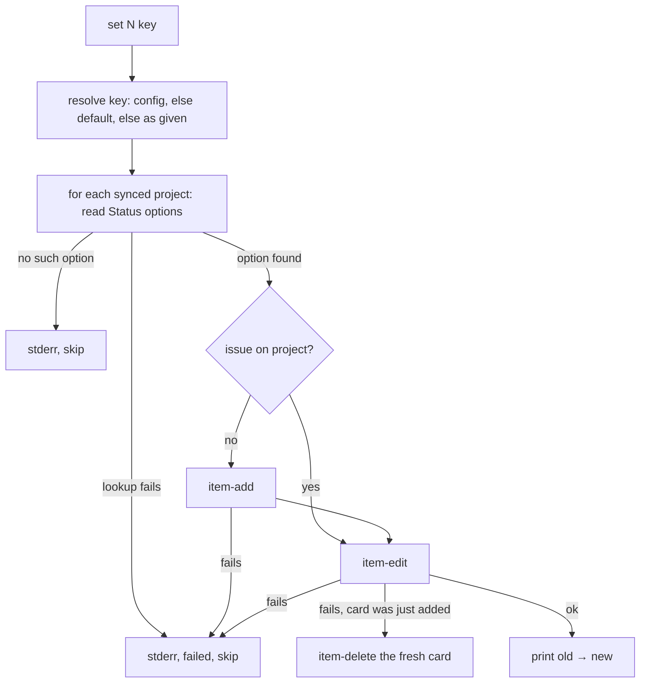

# Board Status Keys and Footprint Union Implementation Plan

> **For agentic workers:** REQUIRED SUB-SKILL: Use superpowers:subagent-driven-development (recommended) or superpowers:executing-plans to implement this plan task-by-task. Steps use checkbox (`- [ ]`) syntax for tracking.

**Goal:** `board.sh set <N> ready|backlog|…` works with or without `board.statuses`; a failed `set` leaves the card as it found it; and a footprint written after a send-back covers every file the branch still changes.

**Architecture:** `board.sh set` gains conventional defaults for its five status keys and probes every synced project's Status options *before* it adds the issue anywhere, then adds and writes per project and removes a card it just added if the write fails. The footprint fix is a rule plus a check in the `plan` skill: after the earlier round's block is replaced, `overlap.sh --outside <N>` is run and every path it prints is folded into the new block; `overlap.sh`, `inflight.sh` and `dossier-check.sh` do not change.

**Tech Stack:** bash 4.3+, jq, gh (stubbed in tests), awk; Markdown.

**Spec:** GitHub issue #39 as restated in `.codeo/39/init.md` → `## Outcome` (acceptance criteria verbatim); decisions in `.codeo/39/plan.md` Q1–Q3.

## Options considered

| Decision | Chosen | Rejected | Why |
|---|---|---|---|
| Where the key fix lives (Q1) | `board.sh` defaults the five keys; a configured `board.statuses` entry wins | triage passes names; both | one owner of the mapping, as the script's header intends; `triage`, `init` and `close` all keep working unchanged |
| Keeping a failed `set` clean (Q2) | probe options first, add only where it will write, delete a fresh add whose write fails | check-first only; undo only | the first fixes the reported case without a compensating call, the second closes the failed-write hole the criterion also covers |
| Keeping the footprint whole (Q3) | one block, covering the branch, proved with `overlap.sh --outside` | scripts union every block; rule alone | the replace rule exists so a stale block stops producing overlaps; reading all blocks would undo it |

## Global Constraints

- Files that change: `scripts/board.sh`, `tests/board.test.sh`, `tests/overlap.test.sh`, `tests/plan-skill.test.sh`, `skills/plan/SKILL.md`, `skills/init/SKILL.md` (one sentence), `docs/handoff.md`, `docs/dossier.md`, `CHANGELOG.md`. Not `overlap.sh`, `inflight.sh`, `dossier-check.sh`, `skills/triage/SKILL.md`, `skills/close/SKILL.md`, `lib/`, and nothing about which Status names a project uses (issue's Out of Scope).
- `board.sh`'s defaults are exactly: `ready`→`Ready`, `backlog`→`Backlog`, `inProgress`→`In progress`, `inReview`→`In review`, `done`→`Done` — the keys and names `skills/close/SKILL.md` already derives. Order of resolution: a configured `board.statuses.<arg>`, else the default, else the argument unchanged. Only an argument matching `^[A-Za-z0-9_]+$` is looked up, as today.
- `board.sh`'s observable contract stays: the per-project stdout line `board.sh: #<N> <old> → <new> on #<project> <title>`, one stderr line per skipped project, exit non-zero when anything failed or nothing was written, and the message `no project #<N> is on has the option '<want>' (it has: …)` verbatim. Every existing case in `tests/board.test.sh` stays green without editing.
- **One deviation from Q3's wording, found while designing:** `overlap.sh` reads *every* `### Footprint` block in `plan.md`, so while the earlier round's block is still present `--outside` cannot see the gap. The check therefore runs at sub-step 4, after the old block is replaced and before the dossier is committed — not at sub-step 1. The rule and the check are as answered.
- `bash tests/run.sh` runs every `tests/*.test.sh`; `bash tests/run.sh <pattern>` runs the files whose names contain it (`board`, `overlap`, `plan-skill`). The `shell` suite has no `filter`, so a task's proof is its test file through the subset runner, and the whole suite is the last task's proof. `shellcheck` is in the dev container: run it on a changed script as the task says.
- Documentation moved by this change: `docs/handoff.md` (board paragraph, send-back paragraph), `docs/dossier.md` (the footprint, rounds), `skills/init/SKILL.md` (one sentence) — Tasks 4–5. No wiki module. No shared environment is configured: every task is proved in this checkout.
- Tasks are ordered so each leaves the suite green; the installed plugin is v1.0.3, so this workflow's own later steps still follow the old footprint rule.

## Review Focus

1. A project whose board lacks the option, with the issue on no board at all: no `item-add` is made, nothing is left behind (Task 2, case `no-option-no-add`).
2. A write that fails on a card the script just added: the card is removed again; a card that was already there is never deleted (Task 2, cases `undo-fresh-add`, `keep-existing-card`).
3. The delete itself failing: reported with the item id and what to do by hand, exit non-zero (Task 2, case `undo-fails`).
4. A configured `board.statuses` entry beats the default, and a plain option name (`Ready`, `Blocked`) still passes through (Task 1, cases `configured-wins`, existing cases).
5. A two-round plan whose second block replaced the first: `--outside` shows exactly the gap the check closes; with both blocks present, or the union, it shows nothing (Task 3, cases `replaced-block`, `union-block`, `both-blocks`).

---

### Task 1: Logical status keys without `board.statuses`

**Files:**
- Modify: `scripts/board.sh:15-19` (header), `scripts/board.sh:119-125` (key resolution)
- Test: `tests/board.test.sh` (new cases after the existing logical-status case at line 264-269)

**Interfaces:**
- Produces: `default_status <key>` — prints the conventional option name for one of the five keys and returns 0, returns 1 for any other word. Key resolution in `set`: `mapped=$(codeo_cfg ".board.statuses.$arg")` if configured, else `default_status "$arg"`, else the argument.

- [ ] **Step 1: Write the failing cases** in `tests/board.test.sh`, using `with_board` (its `statuses` is `{}`) and a card on #2 (`$P2`, Status `Ready`): `set 7 backlog` → `rc` 0, `out` contains `Ready → Backlog on #2`, log has `--single-select-option-id O_BACKLOG`; with the row's Status `Backlog`, `set 7 ready` → `Backlog → Ready on #2`, `O_READY`; `set 7 inProgress`, `set 7 inReview`, `set 7 done` → the options `In progress`, `In review`, `Done` (`O_PROG`, `O_REVIEW`, `O_DONE`). Case `configured-wins`: config projects `[9]`, gate `9`, `statuses` `{"inProgress":"Doing"}`, row `$url\tITEM_9\tTodo\t9\tOther`, `set 7 inProgress` → `Todo → Doing on #9 Other` and the log has `--single-select-option-id O_DOING` (the stub's project 9 offers `Todo` and `Doing`). Restore `with_board` afterwards, as the neighbouring cases do.
- [ ] **Step 2: Run** `bash tests/run.sh board`. Expected: FAIL, first message `project #2 Acme - Kanban has no option 'backlog'`-style (`FAIL: …` from the first new case).
- [ ] **Step 3: Implement** `default_status` as a `case` in `scripts/board.sh` and extend the resolution at line 123 per the Interfaces block; update the header's `set` paragraph to say the five keys have conventional defaults and a configured entry wins.
- [ ] **Step 4: Run** `bash tests/run.sh board && shellcheck scripts/board.sh`. Expected: `all cases passed`, shellcheck silent.
- [ ] **Step 5: Commit** `git add scripts/board.sh tests/board.test.sh` · `fix: board.sh set resolves ready/backlog/inProgress/inReview/done without board.statuses (#39)`.

### Task 2: A failed `set` leaves the card as it was

**Files:**
- Modify: `scripts/board.sh:174-268` (the `set)` branch), header comment lines 20-27
- Test: `tests/board.test.sh` (stub gains `project item-delete`; new cases after the failed-field-lookup case, line 221)

**Interfaces:**
- Consumes: Task 1's resolved `$3`.
- Produces: `set` in two passes over `$synced`. **Probe:** for each project, find the issue's item in `$rows` (if any), take the title from the row or `run_gh project view 
 --owner <owner> --jq .title`, read the Status options exactly as today (cached per project), and skip with today's stderr lines and `failed=1` on a failed lookup, or the existing `has no option '<want>' — skipped` line when the option is absent. **Write:** for each probed project with the option, `item-add` when the issue is not on it (failure: today's `could not add … — skipped`, `failed=1`), then `item-edit`; if the edit fails, today's `could not write` line, `failed=1`, and — only when this run added the card — `gh project item-delete 
 --owner <owner> --id <item>`; if the delete fails, one more stderr line `board.sh: could not remove the card it added to project #
 — remove item <id> by hand`. Output order is `$synced` order; stdout, exit codes and the "no project … has the option" message are unchanged.

- [ ] **Step 1: Extend the stub and write the failing cases.** In the stub add `"project item-delete")` that exits 1 with `gh: could not delete` when `$GH_STUB_DELETE_FAILS` equals `$3`, else prints `{}`. Cases (each asserts on `$GH_STUB_LOG`, `rc`, `err`):
  - `no-option-no-add`: config projects `[9]`, gate `9`; rows `$url\t\t\t\t`; `set 7 Blocked` → `rc` ≠ 0, `err` contains `project #9 PROJ_9 has no option 'Blocked' — skipped`, log has no `item-add` and no `item-edit`.
  - `no-option-keeps-others`: projects `[2,9]`, row `$P2`; `set 7 "In progress"` where #9 lacks it → `rc` 0, log has no `item-add 9`, `item-edit --id ITEM_2` present.
  - `undo-fresh-add`: `with_board`, rows `$url\t\t\t\t`, `GH_STUB_EDIT_FAILS=PROJ_1`, `set 7 Ready` → `rc` ≠ 0, log has `project item-delete 1 --owner acme --id ITEM_NEW`, no `item-delete 2`, `item-edit … PROJ_2` present.
  - `keep-existing-card`: rows `$P1\n$P2`, `GH_STUB_EDIT_FAILS=PROJ_1`, `set 7 "In progress"` → `rc` ≠ 0, log has no `item-delete`.
  - `undo-fails`: as `undo-fresh-add` plus `GH_STUB_DELETE_FAILS=1` → `rc` ≠ 0, `err` contains `remove item ITEM_NEW by hand`.
- [ ] **Step 2: Run** `bash tests/run.sh board`. Expected: FAIL at `no-option-no-add` (today `item-add 9` is in the log).
- [ ] **Step 3: Restructure** the `set)` branch as the Interfaces block describes; keep `names_of`/`field_of`/`option_of` and the title-from-`project view` read; delete the add loop that runs before the field lookups. Update the header's description of when the issue is added.
- [ ] **Step 4: Run** `bash tests/run.sh board && shellcheck scripts/board.sh`. Expected: `all cases passed` — the new cases and every existing one — and shellcheck silent.
- [ ] **Step 5: Commit** `git add scripts/board.sh tests/board.test.sh` · `fix: board.sh set probes options before adding and removes a card whose write failed (#39)`.

### Task 3: A re-planned footprint covers the branch

**Files:**
- Modify: `skills/plan/SKILL.md:247-305` (step 10 sub-step 4), `tests/plan-skill.test.sh`, `tests/overlap.test.sh`

**Interfaces:**
- Consumes: `overlap.sh --outside <N>` (unchanged): this branch's changed paths that match none of the `files` globs of *any* `### Footprint` block in `plan.md`, plansDir and dossiers excluded.
- Produces: the sentence in step 10 sub-step 4, after "The new `### Footprint` replaces the earlier round's": "A block written after a send-back covers the branch, not only this round: once the earlier block is gone, run `overlap.sh --outside <N>` and add every path it prints to `files:` before committing, then run `overlap.sh <N>` again if you added any and raise what it prints as at sub-step 2."

- [ ] **Step 1: Write the failing cases.** In `tests/overlap.test.sh` add a helper `rewrite_plan <clone> <files>` that rewrites issue 7's `plan.md` with one block carrying `<files>` and commits, and cases using `scenario` (branch changes `Clips/Endpoints/Health.cs` and `Terraform/a.tf`):
  - `replaced-block`: `SC_A_FILES='Terraform/**'` (round 2 alone) → `--outside 7` prints exactly `Clips/Endpoints/Health.cs`.
  - `union-block`: `SC_A_FILES='Terraform/**, Clips/Endpoints/Health.cs'` → prints nothing.
  - `both-blocks`: a plan with two `### Footprint` blocks, one per file → prints nothing (the reason the check runs after the old block is removed).
  In `tests/plan-skill.test.sh` add `must_contain` pins for: `A block written after a send-back covers the branch, not only this round`, ``run `overlap.sh --outside <N>` and add every path it prints to `files:` before committing``, and ``run `overlap.sh <N>` again if you added any``.
- [ ] **Step 2: Run** `bash tests/run.sh overlap && bash tests/run.sh plan-skill`. Expected: the overlap cases pass (they pin existing behaviour, so this task's failing test is the skill's), `plan-skill` FAILs with `no [A block written after a send-back covers the branch…]`.
- [ ] **Step 3: Edit** `skills/plan/SKILL.md` sub-step 4 to carry the Interfaces sentence, wrapped like its neighbours.
- [ ] **Step 4: Run** `bash tests/run.sh overlap && bash tests/run.sh plan-skill && bash tests/run.sh skills`. Expected: `all cases passed` three times.
- [ ] **Step 5: Commit** `git add skills/plan/SKILL.md tests/plan-skill.test.sh tests/overlap.test.sh` · `fix: a footprint written after a send-back covers the whole branch (#39)`.

### Task 4: Document `board.sh set`

**Files:**
- Modify: `docs/handoff.md:117-123` (the board paragraph), `skills/init/SKILL.md:291-294`

**Interfaces:**
- Consumes: Tasks 1–2's behaviour.

- [ ] **Step 1: Edit `docs/handoff.md`.** Where it says `set` writes each synced project whose Status has the option, "first adding the issue to each synced project it is missing from", say instead: it adds the issue only to a project whose Status has the option, writes it, and removes the card again if the write fails after the add, so a failed `set` leaves the board as it found it. Where it says a status is named by its key in `board.statuses`, add: the keys `ready`, `backlog`, `inProgress`, `inReview` and `done` default to `Ready`, `Backlog`, `In progress`, `In review` and `Done` when the map leaves them out; a configured entry wins; any other name passes through.
- [ ] **Step 2: Edit `skills/init/SKILL.md:291-294`**: its sentence that `set` "adds the issue to every synced project … it is missing from, and sets the Status on each of them that has the option" becomes: sets the Status on every synced project whose board has the option, adding the issue there first when it is missing.
- [ ] **Step 3: Prove** `bash tests/run.sh skills && bash tests/run.sh agnostic && grep -c "inReview" docs/handoff.md`. Expected: `all cases passed` twice, then a count of at least 1.
- [ ] **Step 4: Commit** `git add docs/handoff.md skills/init/SKILL.md` · `docs: board.sh set defaults its status keys and never leaves a stray card (#39)`.

### Task 5: Document the footprint rule; changelog

**Files:**
- Modify: `docs/dossier.md` (`## The footprint` and the Send-backs bullet under `## What a finished dossier looks like`), `docs/handoff.md:296-299`, `CHANGELOG.md` (`## Unreleased`)

- [ ] **Step 1: Edit `docs/dossier.md`.** In *The footprint*, add a bullet or sentence: a block written after a send-back covers the branch — the round's own files plus every earlier file the branch still changes — checked with `overlap.sh --outside`. In the Send-backs bullet, after "its `### Footprint` replaces the earlier round's block", add "and covers everything the branch still changes".
- [ ] **Step 2: Edit `docs/handoff.md:296-299`** the same way: the replacing block carries the earlier round's files too.
- [ ] **Step 3: Add to `CHANGELOG.md` → `## Unreleased`** a bullet: `board.sh set` accepts `ready`, `backlog`, `inProgress`, `inReview` and `done` without `board.statuses`, adds the issue only where it will write the Status, and removes a card whose write failed; a plan footprint written after a send-back covers every file the branch still changes (#39).
- [ ] **Step 4: Prove the whole suite** `bash tests/run.sh`. Expected: `all cases passed`, exit 0.
- [ ] **Step 5: Commit** `git add docs/dossier.md docs/handoff.md CHANGELOG.md` · `docs: a re-planned footprint covers the branch; changelog for #39`.
