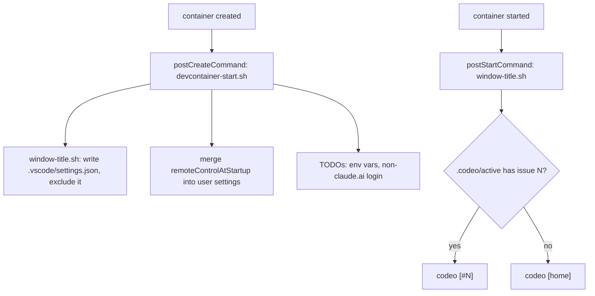

# Dev Container Defaults: Remote Control and Window Title Implementation Plan

> **For agentic workers:** REQUIRED SUB-SKILL: Use superpowers:subagent-driven-development (recommended) or superpowers:executing-plans to implement this plan task-by-task. Steps use checkbox (`- [ ]`) syntax for tracking.

**Goal:** Every Claude Code session in codeo's dev container starts with Remote Control on, and the VS Code window is titled `codeo [home]` or `codeo [#<N>]`, with the start script reporting the logins Remote Control needs.

**Architecture:** One new script, `.devcontainer/scripts/window-title.sh`, owns the title text (`--print`) and writes it into the clone's `.vscode/settings.json`, hidden from git through the clone's `info/exclude`. `devcontainer-start.sh` calls it, merges `remoteControlAtStartup: true` into the user-scope Claude settings, and gains the login and environment checks. `devcontainer.json` re-runs the title script on every container start.

**Tech Stack:** bash 4.3+, jq, git; `tests/devcontainer.test.sh` (stub executables in scratch repos).

**Spec:** GitHub issue #44 as restated in `.codeo/44/init.md` → `## Outcome` (acceptance criteria verbatim); decisions in `.codeo/44/plan.md` Q1–Q5.

## Options considered

| Decision | Chosen | Rejected | Why |
|---|---|---|---|
| Where the setting is written (Q1) | start script merges into `${CLAUDE_CONFIG_DIR:-$HOME/.claude}/settings.json` | Dockerfile `jq` merge; both | no rebuild, re-runnable in this container, testable by behaviour |
| Keeping the title current (Q2) | `window-title.sh` from the start script and a `postStartCommand` | creation only; also hook `lock.sh` | the lock appears after creation; `lock.sh` is outside this issue |
| Hiding `.vscode/settings.json` (Q3) | the clone's `info/exclude` | a tracked `.gitignore` line | per clone, no tracked change, worktree-safe |
| Proving the claude.ai listing (Q4) | tests for the setting; criteria 1–2 checked by hand, recorded in `qc.md` | declare them unverifiable | the suite cannot see claude.ai/code |
| Login checks (Q5) | inside the start script, four TODOs | a separate `claude-login.sh` | one `claude` caller, no new file |

## Global Constraints

- Files that change: `.devcontainer/scripts/window-title.sh` (new), `.devcontainer/scripts/devcontainer-start.sh`, `.devcontainer/devcontainer.json`, `tests/devcontainer.test.sh`, `CHANGELOG.md`. Nothing in `scripts/`, `lib/`, `hooks/`, `skills/` or `docs/`, and no change to the Dockerfile or `.gitignore` (issue's Out of Scope: session titles are #45, projects that use codeo, #40's items).
- The title text is exactly `<codename> [home]` with no `.codeo/active`, and `<codename> [#<N>]` with one, `<N>` read from the lock's `issue:` line. `<codename>` is `.codeo/config.json`'s `codename`, else the clone directory's name. `window-title.sh --print` prints the text alone on stdout; #45 will call it.
- `window-title.sh` writes `window.title` into `<clone>/.vscode/settings.json` by merging with `jq`: every other key stays, the directory and file are created when absent, and a file that is not valid JSON is left untouched with an error (exit 1).
- The exclude entry is `.vscode/settings.json`, appended once to `$(git -C <clone> rev-parse --git-path info/exclude)`; nothing tracked changes, so `git status` stays clean.
- The setting is `{"remoteControlAtStartup": true}` merged into `${CLAUDE_CONFIG_DIR:-$HOME/.claude}/settings.json` (user scope; the reference project says project scope ignores `true`). Every other key in the file stays, the file is created when absent, and a file that is not valid JSON is left untouched with a TODO.
- The start script still always exits 0. New TODO wording names the cause: for each of `CLAUDE_CODE_OAUTH_TOKEN`, `ANTHROPIC_API_KEY`, `ANTHROPIC_BASE_URL` that is set, one TODO saying Remote Control does not work while it is set; and, when `claude auth status` succeeds but its `authMethod` is present and not `claude.ai`, one TODO saying to run `claude auth login`. An `authMethod` that is absent or unparsable raises nothing, so the existing stubs (which print no output) are unaffected.
- **Test isolation.** `ds_run` in `tests/devcontainer.test.sh` must clear the three variables (`env -u …`) and set `CLAUDE_CONFIG_DIR="$ds_dir/claude"`; otherwise a variable set where the tests run changes "ready" into a TODO, and the settings merge would write into the real `~/.claude/settings.json`.
- `bash tests/run.sh devcontainer` runs the one test file; `bash tests/run.sh` runs the suite. The `shell` suite has no `filter`, so a task's proof is `bash tests/run.sh devcontainer` (the whole file; it is fast) and the last task's is the full suite. `shellcheck` is in the dev container: run it on each changed script as the task says.
- Documentation moved by this change: `CHANGELOG.md` only (Task 4), plus the header comments of the files in the list above. No page under `docs/` describes the dev container, and there is no wiki module.
- No shared environment is configured: every task is proved in this checkout.
- Tasks are ordered so each leaves the suite green.



## Review Focus

1. A `.vscode/settings.json` that already holds the engineer's own keys: only `window.title` changes (Task 1, `title_keeps_other_keys`).
2. Running the title script twice, or in a `git worktree` where `.git` is a file: one exclude entry, still clean (Task 1, `title_rerun_and_worktree`).
3. A user settings file with plugins and `autoUpdatesChannel` already in it: both survive the merge (Task 2, `start_keeps_other_settings`).
4. `ANTHROPIC_BASE_URL` (or the other two) set where the tests run: no effect on cases that expect "ready" (Task 2, `ds_run` isolation).
5. A malformed settings file: untouched, a TODO, exit 0 (Task 2, `start_malformed_settings_is_a_todo`).

---

### Task 1: The title script

**Files:**
- Create: `.devcontainer/scripts/window-title.sh`
- Test: `tests/devcontainer.test.sh`

**Interfaces:**
- Produces: `bash .devcontainer/scripts/window-title.sh --print` → stdout `codeo [home]` or `codeo [#<N>]`, exit 0. `bash .devcontainer/scripts/window-title.sh` → writes the title, prints `window-title: <title>`, exit 0; exit 1 with one `window-title: …` line on stderr when it could not write.

- [ ] **Step 1: Write the failing tests.** Add a `wt_setup <name>` helper (scratch git repo with the real `window-title.sh` copied in, `.codeo/config.json` holding `{"codename":"codeo"}`; sets `wt_dir`) and a `wt_run [args]` helper (sets `wt_rc`, `wt_out`, `wt_err`). Add cases, each listed in `cases=( … )`:
  - `title_is_home_without_a_lock`: `--print` prints `codeo [home]`; a plain run writes `.vscode/settings.json` with `.["window.title"] == "codeo [home]"`.
  - `title_names_the_issue_with_a_lock`: with `.codeo/active` holding `issue:   44` (the format `lock.sh` writes), `--print` prints `codeo [#44]`.
  - `title_falls_back_to_the_clone_name`: no `codename` in the config → the clone directory's name is used.
  - `title_keeps_other_keys`: a seeded `.vscode/settings.json` of `{"editor.tabSize": 2}` keeps that key after the run.
  - `title_rerun_and_worktree`: two runs add `.vscode/settings.json` to `info/exclude` once; `git status --porcelain` is empty; the same holds in a `git worktree add` of the scratch repo.
  - `title_follows_the_lock_on_a_rerun`: a run, then `.codeo/active` written, then a run → the title now reads `codeo [#44]`.
  - `title_leaves_malformed_settings_alone`: a seeded file of `{not json` is unchanged, exit 1, stderr names `window-title`.
- [ ] **Step 2: Run to verify they fail.** Run: `bash tests/run.sh devcontainer`. Expected: FAIL lines for the new cases (script missing).
- [ ] **Step 3: Implement `.devcontainer/scripts/window-title.sh`** with a header comment in the style of `plugins.sh`. It takes the clone from `git -C "$(dirname "${BASH_SOURCE[0]}")" rev-parse --show-toplevel`, reads the issue with `awk '/^issue:/ {print $2}'`, merges with `jq --arg t "$title" '. + {"window.title": $t}'` through a temp file in the same directory, and finds the exclude file with `git -C "$root" rev-parse --git-path info/exclude` (making its directory if needed, appending the entry only when `grep -qxF` does not find it).
- [ ] **Step 4: Run to verify they pass.** Run: `bash tests/run.sh devcontainer && shellcheck .devcontainer/scripts/window-title.sh`. Expected: `all cases passed` and no shellcheck output.
- [ ] **Step 5: Commit.**

```bash
git add .devcontainer/scripts/window-title.sh tests/devcontainer.test.sh
git commit -m "feat(devcontainer): window-title.sh writes codeo [home] or codeo [#N] (#44)"
```

### Task 2: Start script — title, Remote Control setting, login checks

**Files:**
- Modify: `.devcontainer/scripts/devcontainer-start.sh`
- Test: `tests/devcontainer.test.sh`

**Interfaces:**
- Consumes: `window-title.sh` from Task 1 (no arguments; exit 1 on failure).
- Produces: after a run, `${CLAUDE_CONFIG_DIR:-$HOME/.claude}/settings.json` has `remoteControlAtStartup == true` and keeps every other key; `.vscode/settings.json` holds the title; the new TODOs of Global Constraints. Exit status is still 0.

- [ ] **Step 1: Update the harness, then write the failing tests.** In `ds_setup`, also copy the real `window-title.sh` into the scratch repo and write a `.codeo/config.json` of `{"codename":"codeo"}`. In `ds_run`, run under `env -u CLAUDE_CODE_OAUTH_TOKEN -u ANTHROPIC_API_KEY -u ANTHROPIC_BASE_URL` with `CLAUDE_CONFIG_DIR="$ds_dir/claude"`; let `STUB_CLAUDE_OUT` set what the stub `claude auth status` prints. Run `bash tests/run.sh devcontainer` once: every existing case must still pass before new ones are added. Then add (listed in `cases`):
  - `start_enables_remote_control`: a run with no settings file creates it with `.remoteControlAtStartup == true`.
  - `start_keeps_other_settings`: a seeded file holding `enabledPlugins` and `autoUpdatesChannel` keeps both after the run and after a second run.
  - `start_malformed_settings_is_a_todo`: a seeded `{not json` is unchanged, one TODO mentions `settings.json`, exit 0.
  - `start_writes_the_title`: a run leaves `.vscode/settings.json` with the home title; with the stub `window-title.sh` failing, one TODO mentions `window-title.sh` and exit is 0.
  - `start_env_vars_are_todos`: for each of the three variables set, exactly one TODO names it and says Remote Control; with none set (and everything else configured) the output is `ready`.
  - `start_non_claude_ai_login_is_a_todo`: `STUB_CLAUDE_RC=0` with `STUB_CLAUDE_OUT='{"loggedIn":true,"authMethod":"api_key"}'` → one TODO mentioning `claude auth login`; with `"authMethod":"claude.ai"` → none.
- [ ] **Step 2: Run to verify they fail.** Run: `bash tests/run.sh devcontainer`. Expected: FAIL for the new cases only.
- [ ] **Step 3: Implement** in `devcontainer-start.sh`: after step 3 (plugins), call `bash .devcontainer/scripts/window-title.sh || add_todo "…"`; add a step that merges the setting (create the config directory; `jq '. + {remoteControlAtStartup: true}'` through a temp file; on a `jq` failure leave the file and `add_todo`); extend step 6 with the env-variable loop and the `authMethod` check (`jq -r '.authMethod // empty'` over the captured `claude auth status` output, as step 4 captures `gh auth status` before reading it). Update the header comment.
- [ ] **Step 4: Run to verify they pass.** Run: `bash tests/run.sh devcontainer && shellcheck .devcontainer/scripts/devcontainer-start.sh`. Expected: `all cases passed` and no shellcheck output.
- [ ] **Step 5: Commit.**

```bash
git add .devcontainer/scripts/devcontainer-start.sh tests/devcontainer.test.sh
git commit -m "feat(devcontainer): start script enables Remote Control and checks its logins (#44)"
```

### Task 3: Re-run the title on every container start

**Files:**
- Modify: `.devcontainer/devcontainer.json`
- Test: `tests/devcontainer.test.sh`

**Interfaces:**
- Consumes: `window-title.sh` from Task 1.

- [ ] **Step 1: Write the failing test** `post_start_command_reruns_the_title`: `jq -e '.postStartCommand == "bash .devcontainer/scripts/window-title.sh || true"'` on `devcontainer.json`; add it to `cases`. `devcontainer_json_is_valid_and_runs_as_dev` keeps pinning `postCreateCommand` unchanged.
- [ ] **Step 2: Run to verify it fails.** Run: `bash tests/run.sh devcontainer`. Expected: `FAIL post_start_command_reruns_the_title`.
- [ ] **Step 3: Add `"postStartCommand": "bash .devcontainer/scripts/window-title.sh || true"`** to `devcontainer.json`, after `postCreateCommand`, and update the test file's header comment to mention the title and login checks.
- [ ] **Step 4: Run to verify it passes.** Run: `bash tests/run.sh devcontainer && jq -e . .devcontainer/devcontainer.json >/dev/null`. Expected: `all cases passed`.
- [ ] **Step 5: Commit.**

```bash
git add .devcontainer/devcontainer.json tests/devcontainer.test.sh
git commit -m "feat(devcontainer): retitle the window on every container start (#44)"
```

### Task 4: Changelog and the whole suite

**Files:**
- Modify: `CHANGELOG.md`

- [ ] **Step 1: Add an `Unreleased` entry** in the style of the #36 line: the dev container now starts Claude Code with Remote Control on, titles the VS Code window `codeo [home]` / `codeo [#<N>]` through `.devcontainer/scripts/window-title.sh`, and its start script reports the logins Remote Control needs; nothing in `scripts/`, `lib/`, `hooks/` or `skills/` changes (#44). Say that Remote Control needs `claude auth login` in the container, and that the title follows the lock at the next container start or when `bash .devcontainer/scripts/window-title.sh` is run.
- [ ] **Step 2: Prove the whole change.** Run: `bash tests/run.sh && shellcheck .devcontainer/scripts/*.sh`. Expected: `all cases passed`, no shellcheck output.
- [ ] **Step 3: Commit.**

```bash
git add CHANGELOG.md
git commit -m "docs: changelog entry for the dev container defaults (#44)"
```

### After the tasks (not a plan task): checks only the engineer can make

Criteria 1 and 2 (the session is listed in claude.ai/code, also after `/clear`) cannot be seen by the suite. After `/codeo:qc`, re-run `bash .devcontainer/scripts/devcontainer-start.sh` here (or rebuild), run `claude auth login` if the start script says so, open a new Claude Code session and a `/clear`ed one, and look for both in claude.ai/code. The result goes in `qc.md` as a manual check. If the key does not take effect from user-scope settings, that comes back as a send-back to this plan.
