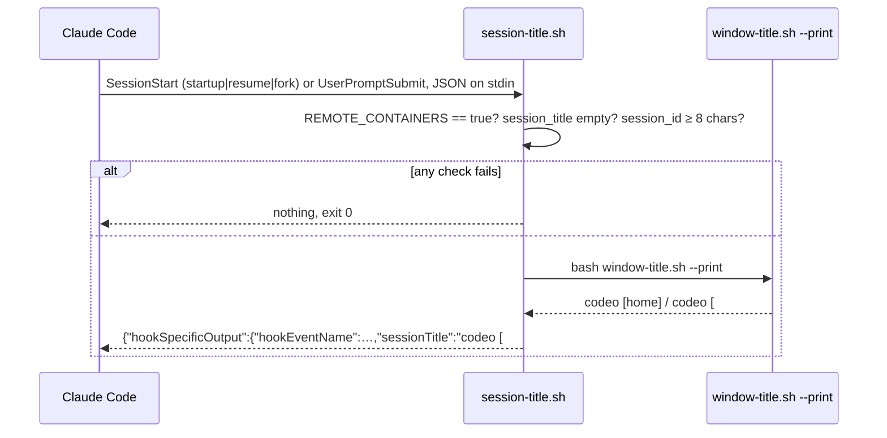

# Dev Container Session Titles Implementation Plan

> **For agentic workers:** REQUIRED SUB-SKILL: Use superpowers:subagent-driven-development (recommended) or superpowers:executing-plans to implement this plan task-by-task. Steps use checkbox (`- [ ]`) syntax for tracking.

**Goal:** Every Claude Code session started inside codeo's dev container is titled `<container title> · <first eight characters of the session id>` — `codeo [home] · a21b9973` or `codeo [#45] · a21b9973` — so sessions in claude.ai/code and the session picker can be matched to their container, without ever overwriting a name the engineer gave or delaying a session.

**Architecture:** One new hook script, `.devcontainer/scripts/session-title.sh`, is a thin adapter between Claude Code's hook contract and #44's `window-title.sh --print`: it reads the hook's JSON on stdin, does nothing unless `REMOTE_CONTAINERS=true` and no `session_title` is already set, and prints one JSON object carrying `sessionTitle`. The tracked `.claude/settings.json` registers it on `SessionStart` (`startup|resume|fork`) and on `UserPromptSubmit`, which is what titles a `/clear`ed session (Claude Code ignores a `SessionStart` title when `source` is `clear`). Every failure path exits 0 with no output.

**Tech Stack:** bash 4.3+, jq; Claude Code hooks (`SessionStart`, `UserPromptSubmit`, `hookSpecificOutput.sessionTitle`, stdin `session_title`); `tests/devcontainer.test.sh` (scratch repos, stdin fixtures).

**Spec:** GitHub issue #45 as restated in `.codeo/45/init.md` → `## Outcome` (acceptance criteria verbatim); decisions in `.codeo/45/plan.md` Q1–Q3.

## Options considered

| Decision | Chosen | Rejected | Why |
|---|---|---|---|
| Where the hook is registered (Q1) | tracked `.claude/settings.json` | user settings merged by the start script; both | reviewable, identical in every container, testable with `jq`; the script's own gate keeps it inert elsewhere |
| Titling a `/clear`ed session (Q2) | `SessionStart` on `startup\|resume\|fork` + `UserPromptSubmit`, one script | `UserPromptSubmit` only; `SessionStart` on `…\|clear` as the reference did | the docs say a `SessionStart` title is ignored on `clear`; the prompt hook catches it at the first prompt, and new/resumed sessions are still titled at start |
| Where the script lives and gets its text (Q3) | `.devcontainer/scripts/session-title.sh` calling `window-title.sh --print` | `.claude/hooks/`; a `--session` mode inside `window-title.sh` | one source for the container title; under paths the `shell` suite already covers; same test harness as `window-title.sh` |
| Detecting an existing title | the hook input's `session_title` field | grepping `transcript_path` for `"type":"custom-title"` | the field is documented for exactly this; the transcript format is not |
| The dev-container gate | `REMOTE_CONTAINERS=true` | also `CODESPACES`, `DEVCONTAINER` | VS Code sets it in this container; Codespaces and the `devcontainer` CLI are out of scope with "projects that use codeo" |

## Global Constraints

- Files that change: `.devcontainer/scripts/session-title.sh` (new, mode 100755), `.claude/settings.json`, `tests/devcontainer.test.sh`, `CHANGELOG.md`. Nothing in `scripts/`, `lib/`, `hooks/`, `skills/` or `docs/`; no change to `window-title.sh`, `devcontainer-start.sh`, `devcontainer.json` or the Dockerfile (issue's Out of Scope: #44's items; projects that use codeo).
- The title is exactly `<window-title.sh --print> · <first eight characters of session_id>` — the separator is space, U+00B7 MIDDLE DOT, space. The id is taken with `${sid:0:8}`; a `session_id` shorter than eight characters or empty means no title.
- The script prints, on stdout, either nothing or exactly one compact JSON line, `{"hookSpecificOutput":{"hookEventName":"<event>","sessionTitle":"<title>"}}`, where `<event>` is the stdin's `hook_event_name` (`SessionStart` or `UserPromptSubmit`; any other event prints nothing). Plain text on stdout would be fed to the model as context, so nothing else is ever printed. Build the JSON with `jq -cn --arg`, never by string concatenation.
- It prints nothing and exits 0 when: `REMOTE_CONTAINERS` is not exactly `true`; stdin is empty or not valid JSON; `session_title` is present and non-empty; `session_id` is missing or shorter than eight characters; `window-title.sh` is missing, fails, or prints nothing. Its stderr is always empty: inner commands run with `2>/dev/null`. The exit status is 0 on every path (criterion 6); the script does not use `set -e`.
- `.claude/settings.json` keeps `enabledPlugins` exactly as it is and gains `hooks` with two events and nothing else: `SessionStart` — one entry, `matcher` `startup|resume|fork`, one command hook — and `UserPromptSubmit` — one entry with no `matcher`, the same command hook. The command is `bash "${CLAUDE_PROJECT_DIR}/.devcontainer/scripts/session-title.sh"` with `"timeout": 10` (seconds; the default is 600 for `SessionStart`, and the issue says a title never delays a session).
- `window-title.sh` is called as `bash "$(dirname "${BASH_SOURCE[0]}")/window-title.sh" --print` so the hook works from any `cwd`, including a `git worktree`.
- **Test isolation.** The hook is run from a scratch repo that holds copies of both scripts, with `REMOTE_CONTAINERS=true` set by the test (`env REMOTE_CONTAINERS=true …`), never relying on the environment the tests run in; the "outside a dev container" case runs with `env -u REMOTE_CONTAINERS`.
- `bash tests/run.sh devcontainer` runs the one test file; `bash tests/run.sh` runs the suite. The `shell` suite has no `filter`, so a task's proof is `bash tests/run.sh devcontainer` and the last task's is the full suite. `shellcheck` is in the dev container: run it on the new script as the task says.
- Documentation moved by this change: `CHANGELOG.md` only (Task 3), plus the test file's header comment. No page under `docs/` describes the dev container, and there is no wiki module.
- No shared environment is configured: every task is proved in this checkout. Tasks are ordered so each leaves the suite green.
- The claude.ai/code and session-picker listing, the `/clear` and `/rename` behaviour, and the project-hooks trust prompt cannot be seen by the suite; the section after the tasks names the engineer's manual check, recorded in `qc.md` as #44 did.



## Review Focus

1. A session already titled by the hook, then prompted again: `UserPromptSubmit` sees `session_title` set and prints nothing — no title churn on every prompt (Task 1, `session_title_keeps_an_existing_title`).
2. `REMOTE_CONTAINERS` set to anything but `true` (`false`, `1`, empty): silent (Task 1, `session_title_is_silent_outside_a_dev_container`).
3. Empty stdin, `{not json`, or JSON with no `session_id`: silent, exit 0, nothing on stderr (Task 1, `session_title_is_silent_on_bad_input`).
4. `window-title.sh` missing, exiting 1, or printing nothing (a scratch dir that is not a git repo makes it fail): silent, exit 0, nothing on stderr (Task 1, `session_title_is_silent_when_the_title_script_fails`).
5. A `codename` holding a double quote or a backslash: the JSON stays valid because `jq --arg` builds it (Task 1, `session_title_escapes_the_codename`).

---

### Task 1: The hook script

**Files:**
- Create: `.devcontainer/scripts/session-title.sh`
- Test: `tests/devcontainer.test.sh`

**Interfaces:**
- Consumes: `bash .devcontainer/scripts/window-title.sh --print` (#44) → `codeo [home]` or `codeo [#<N>]` on stdout, exit 0.
- Produces: `bash .devcontainer/scripts/session-title.sh < <hook json>` → stdout `{"hookSpecificOutput":{"hookEventName":"<event>","sessionTitle":"<title>"}}` (one line) or nothing; stderr empty; exit 0 always. Task 2 registers this command.

- [ ] **Step 1: Write the failing tests.** Add helpers after the `title_*` cases:
  - `st_setup <name>`: like `wt_setup` — a committed scratch git repo at `st_dir` with the real `window-title.sh` **and** `session-title.sh` copied into `.devcontainer/scripts/` and `.codeo/config.json` of `{"codename":"codeo"}`.
  - `st_json <event> <session_id> [session_title]`: prints the stdin fixture with `jq -cn --arg`: `{hook_event_name, session_id, transcript_path: "/x.jsonl", cwd: $st_dir}` plus `source: "startup"` when the event is `SessionStart`, plus `session_title` when given.
  - `st_run <stdin> [remote]`: runs `env -u REMOTE_CONTAINERS ${remote:+REMOTE_CONTAINERS=$remote} bash "$st_dir/.devcontainer/scripts/session-title.sh"` with the string on stdin, from `cwd=/`; sets `st_rc`, `st_out`, `st_err`. Default `remote` is `true`.
  - `st_title`: `jq -r '.hookSpecificOutput.sessionTitle' <<<"$st_out"`; `st_event`: the same for `hookEventName`.

  Then add the cases, each listed in `cases=( … )`, with `sid=a21b9973-0000-4000-8000-000000000000`:
  - `session_title_names_home_and_the_id`: `st_run "$(st_json SessionStart $sid)"` → `st_rc == 0`, `st_err` empty, `st_out` is one line, `st_event == SessionStart`, `st_title == 'codeo [home] · a21b9973'`.
  - `session_title_names_the_issue_with_a_lock`: `.codeo/active` holding `issue:   45` (the `lock.sh` format, as `title_names_the_issue_with_a_lock` writes it) → `st_title == 'codeo [#45] · a21b9973'`.
  - `session_title_on_a_prompt_after_clear`: `st_json UserPromptSubmit $sid` → `st_event == UserPromptSubmit`, `st_title == 'codeo [home] · a21b9973'`.
  - `session_title_keeps_an_existing_title`: `st_json SessionStart $sid 'my name'` and `st_json UserPromptSubmit $sid 'my name'` → both `st_rc == 0`, `st_out` empty, `st_err` empty.
  - `session_title_is_silent_outside_a_dev_container`: the `SessionStart` fixture with `remote` unset, `false`, `1` → `st_out` and `st_err` empty, `st_rc == 0` each time.
  - `session_title_is_silent_on_bad_input`: stdin empty, `{not json`, `{"hook_event_name":"SessionStart"}` (no id), `st_json SessionStart abc` (id of three characters), `st_json PreToolUse $sid` → silent, exit 0, each.
  - `session_title_is_silent_when_the_title_script_fails`: `window-title.sh` removed; then replaced by `printf '#!/usr/bin/env bash\necho boom >&2\nexit 1\n'`; then by one that prints nothing and exits 0 → silent on both streams, exit 0, each.
  - `session_title_escapes_the_codename`: config `{"codename":"co\"de\\o"}` → `jq -e . <<<"$st_out"` succeeds and `st_title` begins with `co"de\o [home]`.
- [ ] **Step 2: Run to verify they fail.** Run: `bash tests/run.sh devcontainer`. Expected: `FAIL session_title_*` lines (script missing); every existing case still passes.
- [ ] **Step 3: Implement `.devcontainer/scripts/session-title.sh`** with a header comment in the style of `window-title.sh` (what it does, the two hook events, the gate, "prints nothing and exits 0 on any failure", the usage line `bash .devcontainer/scripts/session-title.sh < <hook json>`), `set -uo pipefail` (no `-e`), then in order: the `REMOTE_CONTAINERS` gate; `input=$(cat)`; one `jq -r '[.hook_event_name // "", .session_id // "", .session_title // ""] | @tsv'` read into `event`, `sid`, `existing` (any `jq` failure → `exit 0`); the event, `existing` and `${#sid}` checks; `base=$(bash "$(dirname "${BASH_SOURCE[0]}")/window-title.sh" --print 2>/dev/null) || exit 0`, empty → `exit 0`; `jq -cn --arg e "$event" --arg t "$base · ${sid:0:8}" '{hookSpecificOutput:{hookEventName:$e,sessionTitle:$t}}'`; `exit 0`. `chmod +x` it.
- [ ] **Step 4: Run to verify they pass.** Run: `bash tests/run.sh devcontainer && shellcheck .devcontainer/scripts/session-title.sh && git ls-files -s .devcontainer/scripts/session-title.sh | grep -q '^100755'`. Expected: `all cases passed`, no shellcheck output, exit 0.
- [ ] **Step 5: Commit.**

```bash
git add .devcontainer/scripts/session-title.sh tests/devcontainer.test.sh
git commit -m "feat(devcontainer): session-title.sh titles a session after its container (#45)"
```

### Task 2: Register the hook

**Files:**
- Modify: `.claude/settings.json`
- Test: `tests/devcontainer.test.sh`

**Interfaces:**
- Consumes: the command from Task 1.
- Produces: Claude Code runs the script on `SessionStart` (`startup`, `resume`, `fork`) and on every `UserPromptSubmit`, in any clone of this repository.

- [ ] **Step 1: Write the failing test** `session_title_hooks_are_registered` (listed in `cases`), with `cmd='bash "${CLAUDE_PROJECT_DIR}/.devcontainer/scripts/session-title.sh"'` and `hook="$(jq -cn --arg c "$cmd" '{type:"command",command:$c,timeout:10}')"`, all `jq -e` on `.claude/settings.json`:
  - `.enabledPlugins["codeo@codeo"] == true`
  - `.hooks | keys == ["SessionStart","UserPromptSubmit"]`
  - `.hooks.SessionStart == [{matcher:"startup|resume|fork", hooks:[$hook]}]` (pass `--argjson hook "$hook"`)
  - `.hooks.UserPromptSubmit == [{hooks:[$hook]}]`
- [ ] **Step 2: Run to verify it fails.** Run: `bash tests/run.sh devcontainer`. Expected: `FAIL session_title_hooks_are_registered`.
- [ ] **Step 3: Add the `hooks` block** to `.claude/settings.json` after `enabledPlugins`, two-space indented like the rest of the file, exactly the shape the test pins.
- [ ] **Step 4: Run to verify it passes.** Run: `bash tests/run.sh devcontainer && jq -e . .claude/settings.json >/dev/null`. Expected: `all cases passed`.
- [ ] **Step 5: Commit.**

```bash
git add .claude/settings.json tests/devcontainer.test.sh
git commit -m "feat(devcontainer): run session-title.sh on SessionStart and UserPromptSubmit (#45)"
```

### Task 3: Test header, changelog and the whole suite

**Files:**
- Modify: `tests/devcontainer.test.sh` (header comment only)
- Modify: `CHANGELOG.md`

- [ ] **Step 1: Update the header comment** of `tests/devcontainer.test.sh`: one sentence that it also runs `.devcontainer/scripts/session-title.sh` against hook fixtures on stdin (home and lock titles, the prompt hook, an existing title kept, silent outside a dev container and on every failure) and checks that `.claude/settings.json` registers it.
- [ ] **Step 2: Add an `Unreleased` entry** to `CHANGELOG.md` after the #44 line, in its style: inside the dev container every Claude Code session is titled `codeo [home] · <id8>` / `codeo [#<N>] · <id8>` by `.devcontainer/scripts/session-title.sh`, registered in `.claude/settings.json` on `SessionStart` and `UserPromptSubmit` (a `/clear`ed session is titled at its first prompt); a title set by `/rename` is kept; outside a dev container (`REMOTE_CONTAINERS` not `true`) the hook prints nothing; nothing in `scripts/`, `lib/`, `hooks/` or `skills/` changes (#45).
- [ ] **Step 3: Prove the whole change.** Run: `bash tests/run.sh && shellcheck .devcontainer/scripts/*.sh`. Expected: `all cases passed`, no shellcheck output.
- [ ] **Step 4: Commit.**

```bash
git add tests/devcontainer.test.sh CHANGELOG.md
git commit -m "docs: changelog entry for dev container session titles (#45)"
```

### After the tasks (not a plan task): checks only the engineer can make

Criteria 1–5 are about what Claude Code shows, which the suite cannot see. In this container, after the branch is checked out (and the project hooks accepted if Claude Code asks): open a new Claude Code session — the picker (`claude --resume`) and claude.ai/code list it as `codeo [#45] · <id8>`; `/clear`, send one prompt — the new session is titled the same way; `/rename` a session, exit, `claude --resume` it — the name stays; on the host, outside any container, a session in a clone of this branch gets no hook-set title. The result goes in `qc.md` as a manual check. If a bare `sessionTitle` (without `additionalContext`) is not applied by the installed Claude Code, or `session_title` is not delivered on stdin, that comes back as a send-back to this plan.
