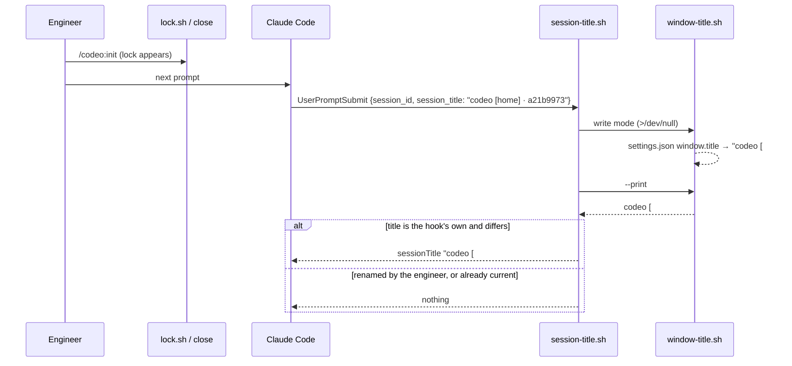
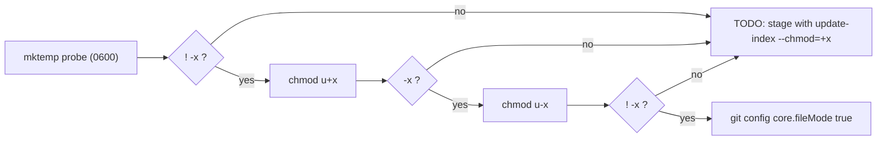
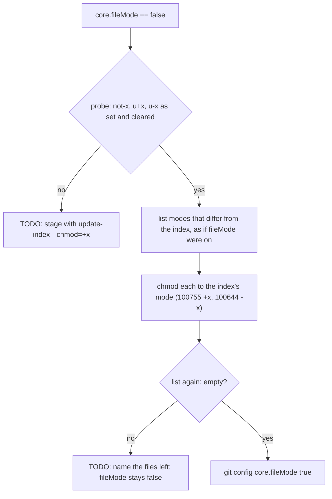
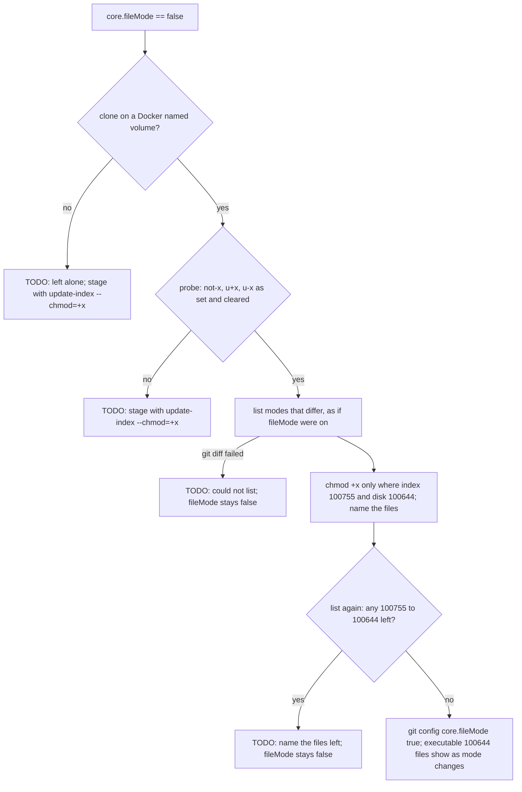

# Dev Container Hardening Implementation Plan

> **For agentic workers:** REQUIRED SUB-SKILL: Use superpowers:subagent-driven-development (recommended) or superpowers:executing-plans to implement this plan task-by-task. Steps use checkbox (`- [ ]`) syntax for tracking.

**Goal:** Close the edge cases #44 and #45 left in the dev container's scripts, keep the git identity across containers, and make the VS Code window title and the Claude Code session title follow the workflow lock without a container restart.

**Architecture:** The three scripts under `.devcontainer/scripts/` are fixed in place; no new script. `window-title.sh` and `devcontainer-start.sh` get one settings-merge contract (resolve symlinks, distinguish "not JSON" from "not an object", keep the mode, leave no temp file). `session-title.sh` — already run on every prompt — becomes the single thing that retitles: it refreshes the window title through `window-title.sh` and replaces a session title it set itself when the lock has changed. A second named volume, `codeo-git`, holds the global git config, reached by pointing `GIT_CONFIG_GLOBAL` into it.

**Tech Stack:** bash 4.3+, GNU coreutils (`readlink -f`, `chmod --reference`), jq 1.7, git; Claude Code hooks; `tests/devcontainer.test.sh` (scratch repos, stub executables, stdin fixtures).

**Spec:** GitHub issue #47 as restated in `.codeo/47/init.md` → `## Outcome` (acceptance criteria verbatim); decisions in `.codeo/47/plan.md` Q1–Q3.

## Options considered

| Decision | Chosen | Rejected | Why |
|---|---|---|---|
| What retitles a running session and the window (Q1) | `session-title.sh` on every prompt: refresh the window via `window-title.sh`, replace its own session title | window only; a `PostToolUse` hook; hooking `lock.sh`/`close` in the plugin core | the hook already runs per prompt; the core ships to every project and stays untouched |
| Telling its own title from a `/rename` | the title ends in ` · <first eight of this session's id>` | grepping the transcript; a marker file | nothing new to store; a rename never ends in this session's id |
| Where the git identity lives (Q2) | volume `codeo-git` at `/home/dev/.config/git` + `containerEnv.GIT_CONFIG_GLOBAL` pointing at its `config` | the volume alone (fragile ordering); an `include.path` volume | with the variable every `--global` write lands in the volume whatever `~/.gitconfig` holds |
| Split (Q3) | one PR, ten tasks, one commit each | two or three PRs | the fixes edit the same scripts and test file |
| Sharing the merge code | the same ~12 lines in each script | a sourced helper file | the test harness copies scripts into scratch repos one by one; a helper would need copying everywhere |
| Making the hook command safe (qc:45 F1) | a guard in the registered command | `\|\| true` inside the script | the script being absent is the failure; it cannot guard itself |
| Executable scripts (F7 and the cause) | commit mode 100755, probe `core.fileMode` in the start script, pin the mode in the suite | only fix the one file | a container with `core.fileMode=false` commits the next script as 100644 again |

## Global Constraints

- Files that change: `.devcontainer/scripts/devcontainer-start.sh`, `.devcontainer/scripts/window-title.sh` (also mode 100644 → 100755), `.devcontainer/scripts/session-title.sh`, `.devcontainer/devcontainer.json`, `.devcontainer/Dockerfile`, `.claude/settings.json`, `tests/devcontainer.test.sh`, `CHANGELOG.md`. Nothing in `scripts/`, `lib/`, `hooks/`, `skills/` or `docs/` (issue's Out of Scope: JSONC parsing, Claude login and plugin persistence #40).
- **Settings-merge contract**, in `window-title.sh` (key `window.title`, file `<clone>/.vscode/settings.json`) and in `devcontainer-start.sh` step 3c (key `remoteControlAtStartup`, file `${CLAUDE_CONFIG_DIR:-$HOME/.claude}/settings.json`): resolve the file with `readlink -f` and write the resolved path, so a symlink stays a symlink (a dangling one is created at its target); parse with `jq -rn '[inputs][0] // {} | type'`: no output → "is not valid JSON; left untouched" (this covers JSONC); anything but `object` → "is not a JSON object; left untouched"; write through `mktemp` in the target's directory, `chmod --reference` the original onto it, `mv` it over the target, and on any failure `rm -f` the temp file before reporting. An empty file counts as `{}`. Every failure leaves the original byte-for-byte.
- `window-title.sh` order: root → title → exclude entry → settings. Every step that can fail ends in `die` (`window-title: <reason>` on stderr, exit 1); nothing is written to `.vscode/` before the exclude entry is in place. When the stored `window.title` already equals the title it writes nothing (its inode is unchanged) and still prints `window-title: <title>`.
- Lock line: `issue:` followed by spaces and a number, with or without a leading `#` (`lock.sh` writes the bare form, `intake.sh` accepts both); the title always has exactly one `#`.
- `session-title.sh` after this plan: gate on `REMOTE_CONTAINERS=true` and a supported event; refresh the window title (`bash window-title.sh >/dev/null 2>&1 || true`); then print a `sessionTitle` only when the session has no title **or** its title ends in ` · <sid8>` and differs from the new one. Fields are read NUL-separated (`jq -j` with `"\u0000"`, `read -r -d ''`), so a title with a newline in it is still a title. Still: stdout is nothing or one JSON line, stderr empty, exit 0 on every path.
- The registered hook command is exactly `f="${CLAUDE_PROJECT_DIR}/.devcontainer/scripts/session-title.sh"; [ -f "$f" ] && bash "$f" || true`, `timeout` 10, same two events and matcher as today.
- `devcontainer-start.sh` still always exits 0. When `CLAUDE_CODE_OAUTH_TOKEN` or `ANTHROPIC_API_KEY` is set the whole `claude auth status` check is skipped (the "unset it" TODO for the variable is the advice); `ANTHROPIC_BASE_URL` keeps only its own TODO.
- `core.fileMode` probe: when `git config --type=bool core.fileMode` is `false`, create a `0600` file in the git dir, `chmod u+x` it, and if `-x` then holds set `core.fileMode true` on the clone and say so; if it does not hold, add a TODO naming `git update-index --chmod=+x`.
- **Test isolation.** `ds_run` gains `DS_SET` (one `NAME=value` passed after the `env -u` list) and `DS_GITCONFIG` (default `$ds_dir/gitconfig`); `wt_run` gains `wt_path` (prepended to `PATH`). Hook cases run with `env -u REMOTE_CONTAINERS` unless they set it, as `st_run` does.
- `bash tests/run.sh devcontainer` runs the one test file; `bash tests/run.sh` the whole `shell` suite. That suite has no `filter`, so a task's proof is `bash tests/run.sh devcontainer` (fast) plus `shellcheck` on what changed, and the last task's is the full suite. A failing case prints `FAIL <case>: …` under `=== FAIL: devcontainer.test.sh`.
- Documentation moved: `CHANGELOG.md` only (Task 10) and the test file's header comment. No page under `docs/` describes the dev container, and there is no wiki module. No invariants document and no shared environment are configured: no task carries a lease marker and every task is proved in this checkout. Tasks are ordered so each leaves the suite green.



## Review Focus

1. `settings.json` holding `[]`, an empty file, `{not json` or JSONC (comments): each left byte-for-byte, with "not a JSON object" for `[]` and "not valid JSON" for the rest (Tasks 3, 5).
2. A symlinked `settings.json`, including one pointing outside the clone and a dangling one: still a symlink, target updated (Tasks 3, 5).
3. A `/rename`d session, and a title ending in another session's id: kept; only a title ending in this session's own id is replaced (Task 7).
4. Lock lines `issue:   44`, `issue: #44`, an empty file, no file: one `#`, `[home]` when there is no number (Tasks 2, 7).
5. `info/exclude` that cannot be touched, and a directory that is not a git repository: a `window-title:` line, exit 1, nothing written to `.vscode/` (Task 2).

---

### Task 1: Pin the executable bit

**Files:**
- Modify: `.devcontainer/scripts/window-title.sh` (mode only)
- Test: `tests/devcontainer.test.sh`

**Interfaces:**
- Produces: `git ls-files -s .devcontainer/scripts/window-title.sh` → mode `100755`; case `scripts_are_committed_executable` guards every `.devcontainer/scripts/*.sh`, now and later.

- [ ] **Step 1: Write the failing test** `scripts_are_committed_executable` (add to `cases`): for each `$repo/.devcontainer/scripts/*.sh`, the mode field of `git -C "$repo" ls-files -s -- <path>` must be `100755`; a file git does not track yet must have the working-tree executable bit (`-x`). Failure message names the file and the mode.
- [ ] **Step 2: Run to verify it fails.** Run: `bash tests/run.sh devcontainer`. Expected: `FAIL scripts_are_committed_executable` naming `window-title.sh` and `100644`; every other case passes.
- [ ] **Step 3: Fix the mode.** `chmod +x .devcontainer/scripts/window-title.sh && git update-index --chmod=+x .devcontainer/scripts/window-title.sh`.
- [ ] **Step 4: Run to verify it passes.** Run: `bash tests/run.sh devcontainer && git ls-files -s .devcontainer/scripts/window-title.sh | grep -q '^100755'`. Expected: `all cases passed`, exit 0.
- [ ] **Step 5: Commit.**

```bash
git add tests/devcontainer.test.sh .devcontainer/scripts/window-title.sh
git commit -m "fix(devcontainer): window-title.sh is committed executable like its siblings (#47)"
```

### Task 2: `window-title.sh` — failures say so, `#` lock lines

**Files:**
- Modify: `.devcontainer/scripts/window-title.sh`
- Test: `tests/devcontainer.test.sh`

**Interfaces:**
- Produces: exit 1 with exactly one `window-title: …` stderr line on every failure, including an unwritable `info/exclude` and a non-repository; title `codeo [#44]` for `issue: #44`. Task 3 builds the settings step on this order.

- [ ] **Step 1: Write the failing tests** (add to `cases`; `wt_run` gains the `wt_path` variable now, unused until Task 3):
  - `title_strips_a_hash_from_the_lock_line`: `.codeo/active` holding `issue: #44` → `--print` prints `codeo [#44]`; a plain run writes the same title into `.vscode/settings.json`.
  - `title_reports_an_unwritable_exclude`: replace `info/exclude` with a directory (`rm -f` then `mkdir`; root-proof) → `wt_rc == 1`, `wt_err` is one line starting `window-title:`, and `.vscode/settings.json` does not exist.
  - `title_outside_a_repository_says_so`: copy the script into a non-git scratch directory (`wt_clone` pointing at it) → `wt_rc == 1`, `wt_err` one `window-title:` line.
  - Extend `title_is_home_without_a_lock`: a plain run's stdout is exactly `window-title: codeo [home]`.
- [ ] **Step 2: Run to verify they fail.** Run: `bash tests/run.sh devcontainer`. Expected: FAIL for the four above (`[##44]`, empty stderr, exit 1 with no line, and — if already passing — the stdout assertion).
- [ ] **Step 3: Implement in `window-title.sh`.** Define `die` first; wrap the `rev-parse` of the root in `|| die "not inside a git repository"`; strip one leading `#` from the lock's issue word (`${issue#\#}`); move the exclude block before the settings block and end `mkdir -p`, `touch`, the `grep -qxF … ||` append and the append itself in `|| die "could not add .vscode/settings.json to <exclude path>"`. Update the header comment: every failure prints one `window-title:` line.
- [ ] **Step 4: Run to verify they pass.** Run: `bash tests/run.sh devcontainer && shellcheck .devcontainer/scripts/window-title.sh`. Expected: `all cases passed`, no shellcheck output.
- [ ] **Step 5: Commit.**

```bash
git add .devcontainer/scripts/window-title.sh tests/devcontainer.test.sh
git commit -m "fix(devcontainer): window-title.sh reports an unwritable exclude and reads issue: #N (#47)"
```

### Task 3: `window-title.sh` — the settings-merge contract, and a title that follows the lock

**Files:**
- Modify: `.devcontainer/scripts/window-title.sh`
- Test: `tests/devcontainer.test.sh`

**Interfaces:**
- Consumes: Task 2's order (exclude, then settings).
- Produces: the merge contract of Global Constraints for `.vscode/settings.json`; a write-mode run that leaves the file untouched when the title is current. Task 7's hook calls write mode on every prompt and relies on that.

- [ ] **Step 1: Write the failing tests** (add to `cases`; `wt_run` prepends `${wt_path:+$wt_path:}` to `PATH`):
  - `title_rejects_settings_that_are_not_an_object`: seeds `[]`, `{not json` and a JSONC file (`{ // c` newline `"a": 1 }`), each in its own scratch clone → each unchanged byte-for-byte, `wt_rc == 1`, one `window-title:` line; `[]` says `not a JSON object`, the other two say `not valid JSON`. Replace the body of `title_leaves_malformed_settings_alone` with the `{not json` leg of this loop (or keep it and add the other two here).
  - `title_writes_through_a_symlink`: `.vscode/settings.json` a symlink to `$pl_root/real-settings.json` (`{"a":1}`, outside the clone) → after a run it is still a symlink, the target holds `a == 1` and the title. A second leg: a dangling symlink in an existing directory → still a symlink, its target created holding the title.
  - `title_keeps_the_settings_mode`: seeded `0644` stays `0644`; seeded `0600` stays `0600` (`stat -c %a`).
  - `title_leaves_no_temp_file_when_mv_fails`: `wt_path` pointing at a directory holding a `mv` that exits 1, a seeded settings file → `wt_rc == 1`, one `window-title:` line, and `ls -A .vscode` prints only `settings.json`.
  - `title_does_not_rewrite_a_current_title`: two runs; the file's inode (`stat -c %i`) is the same after the second, and the second still prints `window-title: codeo [home]`.
  - `title_follows_a_released_lock`: run (`codeo [home]`), write `.codeo/active` with `issue:   47`, run (`codeo [#47]`), remove the lock, run (`codeo [home]`) — the title read from `settings.json` each time.
- [ ] **Step 2: Run to verify they fail.** Run: `bash tests/run.sh devcontainer`. Expected: FAIL for the six new cases (and nothing else).
- [ ] **Step 3: Implement the settings block** per the merge contract, using `readlink -f` for the target, the `type` probe for the two messages, `mktemp "$(dirname "$target")/.settings.XXXXXX"`, `chmod --reference="$target" "$tmp"`, and `mv -- "$tmp" "$target" || { rm -f "$tmp"; die … }`. Before writing, read the stored `window.title`; when it equals `$title`, skip straight to the final `echo`. Update the header comment: JSONC (comments) in `settings.json` is left untouched with an error; symlinks are written through.
- [ ] **Step 4: Run to verify they pass.** Run: `bash tests/run.sh devcontainer && shellcheck .devcontainer/scripts/window-title.sh`. Expected: `all cases passed`, no shellcheck output.
- [ ] **Step 5: Commit.**

```bash
git add .devcontainer/scripts/window-title.sh tests/devcontainer.test.sh
git commit -m "fix(devcontainer): window-title.sh keeps symlinks and modes, names non-objects, skips a current title (#47)"
```

### Task 4: `devcontainer-start.sh` — no `claude auth login` advice while a credential variable is set

**Files:**
- Modify: `.devcontainer/scripts/devcontainer-start.sh`
- Test: `tests/devcontainer.test.sh`

**Interfaces:**
- Produces: with `ANTHROPIC_API_KEY` or `CLAUDE_CODE_OAUTH_TOKEN` set, no stderr line contains `claude auth login`, and the numbered "what is left" list does not offer it.

- [ ] **Step 1: Write the failing tests.** Add `DS_SET` to `ds_run` (after the `env -u` list) and rewrite `start_env_vars_are_todos` to use it instead of its inline `env` call (same assertions). Add `start_credential_variables_hide_the_login_advice` (to `cases`): for `ANTHROPIC_API_KEY=x` with `STUB_CLAUDE_OUT='{"loggedIn":true,"authMethod":"api_key"}'` and for `CLAUDE_CODE_OAUTH_TOKEN=x` with `"authMethod":"oauth_token"` (all else ready, `STUB_CLAUDE_RC=0`): `ds_rc == 0`; `grep -c 'claude auth login'` over `ds_err` is 0; exactly one TODO names the variable and says `unset`; the output has no `what is left to do`. A second leg with `STUB_CLAUDE_RC=1` (status fails) and the variable set: still no `claude auth login`.
- [ ] **Step 2: Run to verify it fails.** Run: `bash tests/run.sh devcontainer`. Expected: `FAIL start_credential_variables_hide_the_login_advice` (the line is present); the refactored `start_env_vars_are_todos` passes.
- [ ] **Step 3: Implement.** In step 6, run the `claude auth status` block only when both `CLAUDE_CODE_OAUTH_TOKEN` and `ANTHROPIC_API_KEY` are empty; keep the three-variable "unset it" loop as it is. Add a comment saying why the block is skipped.
- [ ] **Step 4: Run to verify it passes.** Run: `bash tests/run.sh devcontainer && shellcheck .devcontainer/scripts/devcontainer-start.sh`. Expected: `all cases passed`, no shellcheck output.
- [ ] **Step 5: Commit.**

```bash
git add .devcontainer/scripts/devcontainer-start.sh tests/devcontainer.test.sh
git commit -m "fix(devcontainer): start script stops advising claude auth login while a credential variable is set (#47)"
```

### Task 5: `devcontainer-start.sh` — the settings-merge contract for the Claude settings

**Files:**
- Modify: `.devcontainer/scripts/devcontainer-start.sh` (step 3c)
- Test: `tests/devcontainer.test.sh`

**Interfaces:**
- Consumes: the merge contract of Global Constraints.
- Produces: `${CLAUDE_CONFIG_DIR:-$HOME/.claude}/settings.json` gets `remoteControlAtStartup: true` with every other key, its symlink and its mode kept; failures leave the original and no temp file, each as one TODO.

- [ ] **Step 1: Write the failing tests** (add to `cases`; each seeds `$ds_dir/claude/settings.json`, then `ds_ready_run`; `ds_rc == 0` throughout):
  - `start_settings_that_are_not_an_object_are_a_todo`: `[]` → file unchanged, exactly one TODO matching `settings.json` and `not a JSON object`.
  - `start_settings_symlink_is_kept`: the file is a symlink to `$ds_dir/real-claude-settings.json` (`{"autoUpdatesChannel":"stable"}`) → still a symlink; the target holds `remoteControlAtStartup == true` and `autoUpdatesChannel`.
  - `start_settings_keep_their_mode`: seeded `0644` stays `0644`, seeded `0600` stays `0600`.
  - `start_leaves_no_temp_file_when_mv_fails`: a `mv` that exits 1 in `$ds_dir/bin` → one TODO matching `could not write`, and `ls -A "$ds_dir/claude"` prints only `settings.json`.
- [ ] **Step 2: Run to verify they fail.** Run: `bash tests/run.sh devcontainer`. Expected: FAIL for the four (wrong message, a regular file replacing the link, mode `600`, a leftover `.tmp`).
- [ ] **Step 3: Implement step 3c** per the contract. Keep the existing creation of an absent file (`echo '{}'`) and its TODO; replace the fixed `$claude_settings.tmp` with `mktemp` in the target's directory. Messages: `<file> is not valid JSON and was left alone: …` and `<file> is not a JSON object and was left alone: …`, both ending with the existing instruction to add `"remoteControlAtStartup": true`. Update the step's comment.
- [ ] **Step 4: Run to verify they pass.** Run: `bash tests/run.sh devcontainer && shellcheck .devcontainer/scripts/devcontainer-start.sh`. Expected: `all cases passed`, no shellcheck output.
- [ ] **Step 5: Commit.**

```bash
git add .devcontainer/scripts/devcontainer-start.sh tests/devcontainer.test.sh
git commit -m "fix(devcontainer): start script keeps the Claude settings' symlink and mode and leaves no temp file (#47)"
```

### Task 6: `devcontainer-start.sh` — executable scripts in a container with `core.fileMode=false`

**Files:**
- Modify: `.devcontainer/scripts/devcontainer-start.sh`
- Test: `tests/devcontainer.test.sh`

**Interfaces:**
- Produces: after the start script, `git config --type=bool core.fileMode` is `true` on the clone whenever the filesystem keeps the executable bit; otherwise a TODO says to stage with `git update-index --chmod=+x`.

- [ ] **Step 1: Write the failing tests** (add to `cases`; `ds_ready_run` in a scratch clone):
  - `start_sets_file_mode_so_new_scripts_are_executable`: `git config core.fileMode false` in the scratch clone; run; `git config --type=bool core.fileMode` prints `true`; then `printf '#!/bin/sh\n' > new.sh && chmod +x new.sh && git add new.sh` and `git ls-files -s new.sh` starts `100755`; stdout says `core.fileMode`.
  - `start_leaves_file_mode_alone_when_it_is_fine`: a clone with the default (true) and one with it unset in a freshly `git init`ed repo → config unchanged, no output line about `core.fileMode`.
  - `start_file_mode_that_cannot_stick_is_a_todo`: `core.fileMode false` and a no-op `chmod` stub in `$ds_dir/bin` → fileMode still `false`, exactly one TODO matching `update-index --chmod`, `ds_rc == 0`.
- [ ] **Step 2: Run to verify they fail.** Run: `bash tests/run.sh devcontainer`. Expected: FAIL for the first and third; the second passes.
- [ ] **Step 3: Implement** a new step after step 2 ("Work from the top of the clone"): the probe of Global Constraints, using `mktemp "$(git rev-parse --git-dir)/filemode.XXXXXX"`, removing the probe either way. Update the header comment.
- [ ] **Step 4: Run to verify they pass.** Run: `bash tests/run.sh devcontainer && shellcheck .devcontainer/scripts/devcontainer-start.sh`. Expected: `all cases passed`, no shellcheck output.
- [ ] **Step 5: Commit.**

```bash
git add .devcontainer/scripts/devcontainer-start.sh tests/devcontainer.test.sh
git commit -m "fix(devcontainer): start script turns core.fileMode back on where the filesystem keeps the executable bit (#47)"
```

### Task 7: `session-title.sh` — newline-safe, retitles its own title, refreshes the window

**Files:**
- Modify: `.devcontainer/scripts/session-title.sh`
- Test: `tests/devcontainer.test.sh`

**Interfaces:**
- Consumes: `window-title.sh` write mode (Task 3: silent no-op when current) and `--print`.
- Produces: the hook behaviour of Global Constraints. Output shape unchanged: nothing or `{"hookSpecificOutput":{"hookEventName":…,"sessionTitle":…}}`.

- [ ] **Step 1: Write the failing tests** (add to `cases`; `sid=$st_sid`):
  - `session_title_treats_a_leading_newline_as_a_title`: `st_json UserPromptSubmit $sid $'\nmy name'` → silent (`st_silent`).
  - `session_title_replaces_its_own_title_when_the_lock_changes`: lock `issue:   47`, `st_json UserPromptSubmit $sid 'codeo [home] · a21b9973'` → `st_title == 'codeo [#47] · a21b9973'`. Then remove the lock, existing `codeo [#47] · a21b9973` → `codeo [home] · a21b9973`. Existing equal to the new title → silent.
  - `session_title_keeps_a_renamed_title`: existing `my name`, and `codeo [home] · ffffffff` (another session's id) → silent, with a lock present.
  - `session_title_refreshes_the_window_title`: hook run with no lock → `.vscode/settings.json` title `codeo [home]`; lock `issue:   47`, hook run → `codeo [#47]`; lock removed, hook run with existing `my name` (silent output) → `codeo [home]`.
  - Fix `session_title_names_home_and_the_id`: replace the `wc -l <<<` count with `[[ -n $st_out && $st_out != *$'\n'* ]]`, which fails on empty output and on two lines.
- [ ] **Step 2: Run to verify they fail.** Run: `bash tests/run.sh devcontainer`. Expected: FAIL for the first four new cases; the rewritten one-line check passes.
- [ ] **Step 3: Implement in `session-title.sh`** the read, the own-title rule, the refresh and the unchanged-title exit (Global Constraints). Fields via `jq -j '[(.hook_event_name // ""), (.session_id // ""), (.session_title // "")] | map(tostring)[] | ., "\u0000"'` into three `IFS= read -r -d ''`; any `jq` failure → `exit 0`. Rewrite the header comment (the two hook events, the own-title rule, the window refresh, silence). Keep `set -uo pipefail` without `-e`.
- [ ] **Step 4: Run to verify they pass.** Run: `bash tests/run.sh devcontainer && shellcheck .devcontainer/scripts/session-title.sh`. Expected: `all cases passed`, no shellcheck output.
- [ ] **Step 5: Commit.**

```bash
git add .devcontainer/scripts/session-title.sh tests/devcontainer.test.sh
git commit -m "feat(devcontainer): the prompt hook retitles its own session title and the window when the lock changes (#47)"
```

### Task 8: Guard the registered hook command, and harden its registration test

**Files:**
- Modify: `.claude/settings.json`
- Test: `tests/devcontainer.test.sh`

**Interfaces:**
- Produces: with `session-title.sh` removed, `bash -c "<registered command>"` exits 0, stdout and stderr empty.

- [ ] **Step 1: Write the failing tests.** Update `session_title_hooks_are_registered`: `cmd` becomes the guarded command of Global Constraints; replace `keys == […]` with `.hooks | has("SessionStart") and has("UserPromptSubmit") and length == 2`. Add (to `cases`) `session_title_hook_command_survives_a_missing_script`: read the command from `.claude/settings.json` with `jq -r '.hooks.UserPromptSubmit[0].hooks[0].command'`, run `env -u REMOTE_CONTAINERS REMOTE_CONTAINERS=true CLAUDE_PROJECT_DIR="$st_dir" bash -c "$cmd" </dev/null` from `/` in a scratch clone with `session-title.sh` removed → rc 0, empty stdout and stderr; and the same command with the script present and a `SessionStart` fixture on stdin → one JSON line whose `sessionTitle` is `codeo [home] · a21b9973`.
- [ ] **Step 2: Run to verify they fail.** Run: `bash tests/run.sh devcontainer`. Expected: `FAIL session_title_hooks_are_registered` and `FAIL session_title_hook_command_survives_a_missing_script` (rc 127 today).
- [ ] **Step 3: Replace the `command` string** in both hook entries of `.claude/settings.json` with the guarded command, JSON-escaped, leaving every other key as it is.
- [ ] **Step 4: Run to verify they pass.** Run: `bash tests/run.sh devcontainer && jq -e . .claude/settings.json >/dev/null`. Expected: `all cases passed`, exit 0.
- [ ] **Step 5: Commit.**

```bash
git add .claude/settings.json tests/devcontainer.test.sh
git commit -m "fix(devcontainer): the session-title hook command exits 0 when its script is missing (#47)"
```

### Task 9: The `codeo-git` volume

**Files:**
- Modify: `.devcontainer/devcontainer.json`, `.devcontainer/Dockerfile`
- Test: `tests/devcontainer.test.sh`

**Interfaces:**
- Produces: `mounts` = the `codeo-gh` volume then `source=codeo-git,target=/home/dev/.config/git,type=volume`; `containerEnv` = `{"GIT_CONFIG_GLOBAL": "/home/dev/.config/git/config"}`; `/home/dev/.config/git` created in the image, owned by `dev`.

- [ ] **Step 1: Write the failing tests.** Replace `gh_login_is_one_named_volume` with `volumes_hold_the_gh_login_and_the_git_config` (`jq -e '.mounts == [<the two strings>]'`; update `cases`). Add: `git_config_global_points_into_the_git_volume` (`.containerEnv == {"GIT_CONFIG_GLOBAL":"/home/dev/.config/git/config"}`); `dockerfile_creates_the_git_config_dir` (over `dockerfile_code`: an `install -d -o…` line naming `.config/git`); `git_global_writes_land_in_the_volume_file` (a scratch `HOME` holding an existing `.gitconfig`, `GIT_CONFIG_GLOBAL=$HOME/.config/git/config`, `git config --global user.name X` → the volume file has it, `.gitconfig` does not); `start_finds_the_identity_in_the_git_volume_file` (give `ds_run` a `DS_GITCONFIG` override; identity in a file at `$ds_dir/home/.config/git/config`; `ds_ready_run` → `ds_todos 'git identity'` is 0 and the last stdout line is `devcontainer-start: ready`).
- [ ] **Step 2: Run to verify they fail.** Run: `bash tests/run.sh devcontainer`. Expected: FAIL for the first three; the last two pass or fail only on the missing `DS_GITCONFIG` hook until it is added in this step.
- [ ] **Step 3: Implement.** Add the second mount and `containerEnv` to `devcontainer.json`; add `/home/${USERNAME}/.config/git` to the Dockerfile's `install -d -o … -g …` line, with the comment saying why (an empty named volume takes the directory's owner). Update the Dockerfile comment on that line.
- [ ] **Step 4: Run to verify they pass.** Run: `bash tests/run.sh devcontainer && jq -e . .devcontainer/devcontainer.json >/dev/null`. Expected: `all cases passed`, exit 0.
- [ ] **Step 5: Commit.**

```bash
git add .devcontainer/devcontainer.json .devcontainer/Dockerfile tests/devcontainer.test.sh
git commit -m "feat(devcontainer): the git identity lives in a codeo-git volume shared by every dev container (#47)"
```

### Task 10: Test header, changelog and the whole suite

**Files:**
- Modify: `tests/devcontainer.test.sh` (header comment only), `CHANGELOG.md`

- [ ] **Step 1: Update the test file's header comment** (one or two sentences): it also checks the scripts are committed executable, the settings-merge cases (not an object, symlink, mode, no temp file), the credential-variable advice, the `core.fileMode` probe, the prompt hook's retitling, the guarded hook command and the `codeo-git` volume.
- [ ] **Step 2: Edit `CHANGELOG.md`'s `Unreleased` section.** Reword the #45 line: "Inside the dev container a Claude Code session without a title is titled …" (a resumed session keeps the title it was given). Add a #47 entry in the style of the #44 line: the start script stops advising `claude auth login` while a credential variable is set, probes `core.fileMode`, and keeps the Claude settings' symlink and mode; `window-title.sh` reports every failure, reads `issue: #N`, writes through a symlink and is executable; the prompt hook now retitles the window and its own session title when the lock changes, and the registered command exits 0 with the script missing; the git identity lives in the new `codeo-git` volume via `GIT_CONFIG_GLOBAL` — **rebuild the container once to get the volume**, then set the identity once; nothing in `scripts/`, `lib/`, `hooks/` or `skills/` changes (#47).
- [ ] **Step 3: Prove the whole change.** Run: `bash tests/run.sh && shellcheck .devcontainer/scripts/*.sh tests/devcontainer.test.sh`. Expected: `all cases passed`, no shellcheck output.
- [ ] **Step 4: Commit.**

```bash
git add tests/devcontainer.test.sh CHANGELOG.md
git commit -m "docs: changelog entry for the dev container hardening (#47)"
```

### After the tasks (not a plan task): checks only the engineer can make

The suite cannot see Claude Code or VS Code. Rebuild this container (the new volume and `containerEnv` need it), set the identity once (`git config --global user.name …`, `user.email …`) and confirm it is in the `codeo-git` volume; create a second container and confirm the start script prints no identity TODO. In a container, open a Claude Code session, run `/codeo:init` (or `lock.sh take container`), send a prompt: the picker and claude.ai/code title and the VS Code window title should now say `[#N]`; after `/codeo:close`, `[home]` at the next prompt; a `/rename`d session keeps its name. If Claude Code does not apply a `sessionTitle` on a session that already has one, that comes back as a send-back to this plan (the window title would still follow). Results go in `qc.md` as manual checks.

---

## Round 2 — after `qc.md` round 1 (2026-11-09)

Tasks 1-10 above are done (`d963bfa`..`dbccb2c`). `/codeo:qc` round 1 sent the branch back with one blocking
finding, F1, and six non-blocking ones, F2-F7 (`.codeo/47/qc.md`). This round fixes all seven in five tasks,
appended here so the issue keeps one plan. The constraints below amend the matching bullets of Global
Constraints; everything else there still binds.

**Amended constraints**

- **`core.fileMode` probe (F1).** The probe passes only when the filesystem honours the executable bit *both
  ways*: the fresh `mktemp` file (`0600`) is not executable, `chmod u+x` makes it executable, and `chmod u-x`
  makes it not executable again. Any step failing means the bit is not honoured — a filesystem that reports
  every file as executable (a Windows bind mount) fails the first or the last step — and `core.fileMode` is
  left `false` with the existing TODO naming `git update-index --chmod=+x`. The probe file is removed on every
  path. Wording: "keeps the executable bit as set".
- **`safe.directory` (F2).** Step 1 adds the clone to `safe.directory` only when
  `git config --global --get-all safe.directory` does not already list it, so a re-run and a second container
  on the shared `codeo-git` volume add nothing; the header's "each step checks before it acts" is then true.
- **The hook's own title (F3).** A `session_title` is the hook's own only when it contains no newline *and* is
  `<anything> [home] · <sid8>` or `<anything> [#<digits>] · <sid8>` for this session's `<sid8>`. Anything else —
  `my name`, `my name · <sid8>`, `codeo [x] · <sid8>`, a title with a newline — is kept.
- **The lock line (F5).** `window-title.sh` reads the issue as the digits after `issue:`, any number of spaces
  and any number of `#` (`issue:   44`, `issue: #44`, `issue:#44`, `issue: ##44` all give `[#44]`); a line with
  no digits gives `[home]`. This matches `scripts/intake.sh`'s parser.
- **Changelog (F4, F7).** The #45 line says "A `/rename`d title is kept." (not "a session that already has a
  title … keeps it"); the #44 line's "follows the lock at the next container start or when … is run" gains "or
  at the next Claude Code prompt in the container".
- Files that change this round: `.devcontainer/scripts/devcontainer-start.sh`, `.devcontainer/scripts/session-title.sh`,
  `.devcontainer/scripts/window-title.sh`, `tests/devcontainer.test.sh`, `CHANGELOG.md`. No other file.



### Task 11: The `core.fileMode` probe checks both directions (F1)

**Files:**
- Modify: `.devcontainer/scripts/devcontainer-start.sh` (step 2b and its comment)
- Test: `tests/devcontainer.test.sh`

**Interfaces:**
- Produces: `core.fileMode` is set to `true` only on a filesystem where the bit can be both set and cleared; the
  success line and the TODOs keep their current wording except "keeps the executable bit" → "keeps the
  executable bit as set".

- [ ] **Step 1: Write the failing test** `start_file_mode_that_cannot_clear_is_a_todo` (add to `cases`): like
  `start_file_mode_that_cannot_stick_is_a_todo`, but the stub `$ds_dir/bin/chmod` is
  `#!/usr/bin/env bash` / `exec /usr/bin/chmod u+x -- "${@: -1}"` — whatever mode is asked, the file ends up
  executable, as on a filesystem that reports every file executable. Assert: `ds_rc == 0`, `core.fileMode` still
  `false`, exactly one TODO matching `update-index --chmod`, and `ls "$ds_dir/repo/.git"` has no `filemode.*`
  entry. Also add that last assertion (no `filemode.*` left) to `start_sets_file_mode_so_new_scripts_are_executable`
  and `start_file_mode_that_cannot_stick_is_a_todo`.
- [ ] **Step 2: Run to verify it fails.** Run: `bash tests/run.sh devcontainer`. Expected:
  `FAIL start_file_mode_that_cannot_clear_is_a_todo` (`core.fileMode` was changed); the other cases pass.
- [ ] **Step 3: Implement** the three-step probe in step 2b, one `if` chain:
  `[[ ! -x $p ]] && chmod u+x -- "$p" 2>/dev/null && [[ -x $p ]] && chmod u-x -- "$p" 2>/dev/null && [[ ! -x $p ]]`,
  `rm -f` the probe before either branch's message. Reword the step comment and the header to "keeps the
  executable bit as set", and the TODO to "does not keep the executable bit as set".
- [ ] **Step 4: Run to verify it passes.** Run: `bash tests/run.sh devcontainer && shellcheck .devcontainer/scripts/devcontainer-start.sh`.
  Expected: `all cases passed`, no shellcheck output.
- [ ] **Step 5: Commit.**

```bash
git add .devcontainer/scripts/devcontainer-start.sh tests/devcontainer.test.sh
git commit -m "fix(devcontainer): the core.fileMode probe requires the bit to clear as well as set (#47)"
```

### Task 12: `safe.directory` is added once (F2)

**Files:**
- Modify: `.devcontainer/scripts/devcontainer-start.sh` (step 1)
- Test: `tests/devcontainer.test.sh`

- [ ] **Step 1: Write the failing test** `start_trusts_the_clone_once` (add to `cases`): seed the scratch global
  config (`$ds_dir/gitconfig`, which `ds_run` passes as `GIT_CONFIG_GLOBAL`) with `safe.directory = /elsewhere`;
  `ds_ready_run` twice; then `git config --file "$ds_dir/gitconfig" --get-all safe.directory` prints exactly two
  lines, `/elsewhere` and the clone's resolved path (`cd "$ds_dir/repo" && pwd -P`), in that order.
- [ ] **Step 2: Run to verify it fails.** Run: `bash tests/run.sh devcontainer`. Expected:
  `FAIL start_trusts_the_clone_once` (three lines).
- [ ] **Step 3: Implement:** `git config --global --get-all safe.directory 2>/dev/null | grep -qxF -- "$clone" ||
  git config --global --add safe.directory "$clone" || add_todo …` (the existing TODO text). The pipeline ends in
  `grep -q` only on a `git config` whose output is a few lines — acceptable here, or capture first as step 4 does
  for `gh auth status`.
- [ ] **Step 4: Run to verify it passes.** Run: `bash tests/run.sh devcontainer && shellcheck .devcontainer/scripts/devcontainer-start.sh`.
  Expected: `all cases passed`, no shellcheck output.
- [ ] **Step 5: Commit.**

```bash
git add .devcontainer/scripts/devcontainer-start.sh tests/devcontainer.test.sh
git commit -m "fix(devcontainer): start script adds safe.directory once, not on every container (#47)"
```

### Task 13: The hook recognises only a title of its own shape (F3)

**Files:**
- Modify: `.devcontainer/scripts/session-title.sh`
- Test: `tests/devcontainer.test.sh`

**Interfaces:**
- Consumes: `window-title.sh --print` → `<codename> [home]` or `<codename> [#N]`.
- Produces: the own-title rule of the amended constraints; output contract unchanged.

- [ ] **Step 1: Write the failing tests.** Extend `session_title_treats_a_leading_newline_as_a_title`: with the
  lock `issue:   47`, `st_json UserPromptSubmit $st_sid $'\nfoo · a21b9973'` → `st_silent`. Extend
  `session_title_keeps_a_renamed_title` (lock present): `'my name · a21b9973'` and `'codeo [x] · a21b9973'` → both
  `st_silent`. `session_title_replaces_its_own_title_when_the_lock_changes` stays as it is (home ↔ #47).
- [ ] **Step 2: Run to verify they fail.** Run: `bash tests/run.sh devcontainer`. Expected: FAIL for the two
  extended cases (a `sessionTitle` is printed).
- [ ] **Step 3: Implement** the rule in `session-title.sh` where `existing` is judged: no newline, and after
  stripping the suffix ` · ${sid:0:8}` the rest ends in ` [home]` or ` [#<digits>]` (parameter expansion or one
  `[[ =~ ]]`; the implementer chooses). Update the header's sentence on the own title.
- [ ] **Step 4: Run to verify they pass.** Run: `bash tests/run.sh devcontainer && shellcheck .devcontainer/scripts/session-title.sh`.
  Expected: `all cases passed`, no shellcheck output.
- [ ] **Step 5: Commit.**

```bash
git add .devcontainer/scripts/session-title.sh tests/devcontainer.test.sh
git commit -m "fix(devcontainer): the prompt hook retitles only a title of its own shape (#47)"
```

### Task 14: `window-title.sh` — the lock line like `intake.sh`, and a read-only exclude (F5, F6)

**Files:**
- Modify: `.devcontainer/scripts/window-title.sh`
- Test: `tests/devcontainer.test.sh`

- [ ] **Step 1: Write the failing tests.** Extend `title_strips_a_hash_from_the_lock_line`: `issue:#44` and
  `issue: ##44` each give `codeo [#44]` from `--print`; `issue: x` gives `codeo [home]`. Extend
  `title_reports_an_unwritable_exclude` with a second leg, run only when `(( $(id -u) != 0 ))`: a fresh scratch
  clone (`wt_setup noexcl-ro`), `info/exclude` created empty and `chmod 444`, a plain run → `wt_rc == 1`, one
  `window-title:` line, no `.vscode/settings.json`.
- [ ] **Step 2: Run to verify they fail.** Run: `bash tests/run.sh devcontainer`. Expected:
  `FAIL title_strips_a_hash_from_the_lock_line` (`issue:#44` gives `[home]`, `##44` gives `[##44]`); the
  read-only leg passes already (the behaviour exists — it is pinned, not fixed).
- [ ] **Step 3: Implement:** replace the `awk` + `${issue#\#}` pair with
  `issue=$(sed -n 's/^issue: *#*\([0-9]\{1,\}\).*/\1/p' "$root/.codeo/active" | head -n 1)`; update the header's
  parenthesis on the lock line.
- [ ] **Step 4: Run to verify they pass.** Run: `bash tests/run.sh devcontainer && shellcheck .devcontainer/scripts/window-title.sh`.
  Expected: `all cases passed`, no shellcheck output.
- [ ] **Step 5: Commit.**

```bash
git add .devcontainer/scripts/window-title.sh tests/devcontainer.test.sh
git commit -m "fix(devcontainer): window-title.sh reads the lock line as intake.sh does (#47)"
```

### Task 15: Changelog wording, a test that says what it checks, the whole suite (F4, F7)

**Files:**
- Modify: `CHANGELOG.md`, `tests/devcontainer.test.sh`

- [ ] **Step 1: Tighten `start_credential_variables_hide_the_login_advice`:** one run per variable with
  `STUB_CLAUDE_RC=1` (a status that fails is exactly what used to advise `claude auth login`); drop the `rc`
  loop and the `method`/`STUB_CLAUDE_OUT` lines, keep the four assertions. Leave
  `git_global_writes_land_in_the_volume_file` (it pins the premise the volume design rests on) but give it a
  one-line comment saying so.
- [ ] **Step 2: Edit `CHANGELOG.md`:** the #45 line's "A session that already has a title, such as a resumed
  or `/rename`d one, keeps it." → "A `/rename`d title is kept."; the #44 line's "The title follows the lock at
  the next container start or when `bash .devcontainer/scripts/window-title.sh` is run." → "The title follows
  the lock at the next container start, at the next Claude Code prompt in the container, or when
  `bash .devcontainer/scripts/window-title.sh` is run."; the #47 line's "turns `core.fileMode` back on where the
  filesystem keeps the executable bit" → "… keeps the executable bit as set".
- [ ] **Step 3: Prove the whole change.** Run: `bash tests/run.sh && shellcheck .devcontainer/scripts/*.sh`.
  Expected: `all cases passed`, no shellcheck output. (`shellcheck tests/devcontainer.test.sh` prints its one
  pre-existing `SC2016` info note and nothing else.)
- [ ] **Step 4: Commit.**

```bash
git add CHANGELOG.md tests/devcontainer.test.sh
git commit -m "docs: changelog wording for the dev container titles; credential test says what it checks (#47)"
```

The manual checks in *After the tasks* above still stand for `/codeo:qc` round 2.

---

## Round 3 — after `qc.md` round 2 (2026-11-09)

Tasks 1-15 above are done (`d963bfa`..`e59e859`). `/codeo:qc` round 2 sent the branch back with one blocking
finding, F8, and seven non-blocking ones, F9-F15 (`.codeo/47/qc.md`). This round fixes all eight in five
tasks, appended here so the issue keeps one plan. Q4 and Q5 in `.codeo/47/plan.md` decided F8 and F9. The
constraints below amend the matching bullets of Global Constraints and of Round 2's amended constraints;
everything else there still binds.

**Amended constraints**

- **`core.fileMode` (F8, Q4).** The two-way probe of Round 2 stays and gates everything below. When it passes,
  the script does *not* set `core.fileMode` first. It lists the tracked files whose mode on disk differs from the
  index *as if the setting were on* — `git -c core.fileMode=true diff --raw -z --no-renames` — keeps the entries
  whose old and new modes are both `100644` or `100755` (anything else, a symlink or a submodule, is left alone),
  and gives each the mode the index records: `chmod +x -- <path>` for `100755`, `chmod -x -- <path>` for `100644`
  (what `git checkout` would have written; `+x` respects the umask). It then lists again. Only when that second
  list is empty does it run `git config core.fileMode true` and say so, naming how many files it restored (none
  restored → the existing message). If the list is still not empty — a `chmod` failed — `core.fileMode` stays
  `false` and one TODO names the files left (at most five, then "and N more") and says to `chmod` them to the
  index's modes or stage with `git update-index --chmod=+x`. A restored file is never one the setting being off
  had let you edit mode-wise: with it off, git neither showed nor staged those modes. The probe-failure TODOs
  are unchanged.
- **Settings classification (F11).** In both scripts the "is this a JSON object" probe becomes
  `jq -rn '[inputs] | if length == 0 then "object" elif length == 1 then (.[0] | type) else "multi" end'` (an
  empty file is still `{}`): no output → "not valid JSON" (as before); `multi` → "not valid JSON" (two top-level
  values; the merge would drop the second); any other result but `object` — `array`, `string`, `number`,
  `boolean`, `null` — → "not a JSON object". The file is left untouched in each.
- **Resolve failure (F13).** In `devcontainer-start.sh` step 3c a `readlink -f` that fails (or prints nothing)
  adds one TODO "could not resolve `<file>`: Remote Control was not enabled", not "not valid JSON".
- **One line on stderr (F12).** In `window-title.sh` every external command whose failure reaches `die` —
  `mkdir -p "$root/.vscode"`, `mktemp`, `mv` — has its own stderr discarded (`2>/dev/null`), so a failure prints
  exactly the one `window-title:` line the header promises.
- **The lock line (F14).** `window-title.sh` accepts any whitespace after `issue:` (`[[:space:]]*`, so a TAB
  works) before the `#`s and digits. It deliberately keeps taking the leading digits (`issue: 44abc`, `issue:
  ##44` → `[#44]`) where `scripts/intake.sh` rejects them: a title is cosmetic and a stricter parse would turn a
  hand-edited lock into `[home]`. The header says "the digits after `issue:`", not "as `intake.sh` does".
- **Changelog (F9, F10).** The #47 line says the title is read from the lock (`.codeo/active`), and that with
  `GIT_CONFIG_GLOBAL` set the host's `~/.gitconfig` that VS Code copies into the container no longer applies
  inside it (Q5: documented, not guarded); its `core.fileMode` clause says it also restores tracked files'
  modes to the index's.
- Files that change this round: `.devcontainer/scripts/devcontainer-start.sh`, `.devcontainer/scripts/window-title.sh`,
  `tests/devcontainer.test.sh`, `CHANGELOG.md`. No other file.



### Task 16: Restore the index's modes before turning `core.fileMode` on (F8, Q4)

**Files:**
- Modify: `.devcontainer/scripts/devcontainer-start.sh` (step 2b and its comment)
- Test: `tests/devcontainer.test.sh`

**Interfaces:**
- Consumes: Round 2's two-way probe in step 2b (unchanged).
- Produces: after a run, either `core.fileMode` is `true` and `git status --porcelain` shows no mode-only change,
  or it is `false` with a TODO naming the files left; the script still exits 0.

- [ ] **Step 1: Write the failing tests** (add to `cases`). Both build the scratch repo of `ds_setup`, then
  `git add -A` and commit everything (a committed `bin/run.sh` at `100755` and `data.txt` at `100644` are added
  first), then `git config core.fileMode false`, then change the disk modes: `chmod 644 bin/run.sh`,
  `chmod 755 data.txt`.
  - `start_restores_tracked_modes_before_turning_file_mode_on`: `ds_ready_run`; `ds_rc == 0`; `core.fileMode` is
    `true`; `bin/run.sh` is executable and `data.txt` is not; `git status --porcelain` is empty; stdout
    mentions `core.fileMode` and the count `2`.
  - `start_keeps_file_mode_off_when_a_mode_cannot_be_restored`: a `$ds_dir/bin/chmod` stub that runs the real
    `/usr/bin/chmod` when its arguments contain `filemode.` (the probe) or `--reference` (step 3c) and otherwise
    exits 1; `ds_ready_run`; `ds_rc == 0`; `core.fileMode` is still `false`; `bin/run.sh` is still `644`;
    exactly one TODO matches `update-index --chmod` and it names `bin/run.sh`.
  Keep `start_sets_file_mode_so_new_scripts_are_executable`, `start_file_mode_that_cannot_stick_is_a_todo` and
  `start_file_mode_that_cannot_clear_is_a_todo` as they are.
- [ ] **Step 2: Run to verify they fail.** Run: `bash tests/run.sh devcontainer`. Expected:
  `FAIL start_restores_tracked_modes_before_turning_file_mode_on` (status lists ` M bin/run.sh`) and
  `FAIL start_keeps_file_mode_off_when_a_mode_cannot_be_restored` (`core.fileMode` was turned on); the rest pass.
- [ ] **Step 3: Implement** in step 2b, after the probe branch that now sets `core.fileMode`: replace the bare
  `git config core.fileMode true` with the sequence of the amended constraint, written as a small function
  (`restore_modes`: list, `chmod`, list again; prints nothing, returns non-zero with the leftover paths in a
  variable) so the branch reads: probe passes → `restore_modes` → `git config core.fileMode true` and `say …`, or
  `add_todo …`. Read the `-z` output with `while IFS= read -r -d '' meta; IFS= read -r -d '' path` (the raw record
  is `:<old> <new> <sha> <sha> <status>`). Update the step comment and header sentence to say the tracked files'
  modes are restored to the index's.
- [ ] **Step 4: Run to verify they pass.** Run: `bash tests/run.sh devcontainer && shellcheck .devcontainer/scripts/devcontainer-start.sh`.
  Expected: `all cases passed`, no shellcheck output.
- [ ] **Step 5: Commit.**

```bash
git add .devcontainer/scripts/devcontainer-start.sh tests/devcontainer.test.sh
git commit -m "fix(devcontainer): restore tracked files' modes to the index's before turning core.fileMode on (#47)"
```

### Task 17: Settings classification and an honest resolve failure, in both scripts (F11, F13)

**Files:**
- Modify: `.devcontainer/scripts/window-title.sh`, `.devcontainer/scripts/devcontainer-start.sh` (step 3c)
- Test: `tests/devcontainer.test.sh`

- [ ] **Step 1: Write the failing tests.** Extend `title_rejects_settings_that_are_not_an_object` with three legs,
  each its own scratch clone: `false` and `null` → unchanged, exit 1, one `window-title:` line saying
  `not a JSON object`; `{"a":1} [2]` → unchanged, exit 1, `not valid JSON`. Extend
  `start_settings_that_are_not_an_object_are_a_todo` with the same three seeds in `$ds_dir/claude/settings.json`:
  `false` and `null` → one TODO matching `settings.json.*not a JSON object`, file unchanged; `{"a":1} [2]` → one
  TODO matching `not valid JSON`, unchanged. Add `start_settings_that_cannot_be_resolved_are_a_todo`: a
  `$ds_dir/bin/readlink` stub that exits 1 (settings file seeded `{"a":1}`), `ds_ready_run` → one TODO matching
  `could not resolve`, none matching `not valid JSON`, file unchanged, `ds_rc == 0`.
- [ ] **Step 2: Run to verify they fail.** Run: `bash tests/run.sh devcontainer`. Expected: FAIL for the three
  extended/new cases (`false`/`null` are rewritten; the multi-value file loses its second value; the resolve
  failure says "not valid JSON"); everything else passes.
- [ ] **Step 3: Implement** the classification of the amended constraint in both scripts (the same one-liner in
  each; the plan keeps the duplication), and in `devcontainer-start.sh` guard `claude_target` — empty after
  `readlink -f` → the resolve TODO, no `jq` call.
- [ ] **Step 4: Run to verify they pass.** Run: `bash tests/run.sh devcontainer && shellcheck .devcontainer/scripts/window-title.sh .devcontainer/scripts/devcontainer-start.sh`.
  Expected: `all cases passed`, no shellcheck output.
- [ ] **Step 5: Commit.**

```bash
git add .devcontainer/scripts/window-title.sh .devcontainer/scripts/devcontainer-start.sh tests/devcontainer.test.sh
git commit -m "fix(devcontainer): settings that are false, null or several values are left alone; a failed resolve says so (#47)"
```

### Task 18: `window-title.sh` — one stderr line, and a TAB after `issue:` (F12, F14)

**Files:**
- Modify: `.devcontainer/scripts/window-title.sh`
- Test: `tests/devcontainer.test.sh`

- [ ] **Step 1: Write the failing tests.** Change the `mv` stub of `title_leaves_no_temp_file_when_mv_fails` to
  print `mv: boom` on stderr before exiting 1 (so the case now proves the single-line promise against a noisy
  tool); add a leg to `title_reports_an_unwritable_exclude`-style coverage for `.vscode`: make `<clone>/.vscode` a
  regular file (`touch`), plain run → `wt_rc == 1`, `wt_err` exactly one line starting `window-title:`. Extend
  `title_strips_a_hash_from_the_lock_line` with `printf 'issue:\t44\n'` → `--print` gives `codeo [#44]`.
- [ ] **Step 2: Run to verify they fail.** Run: `bash tests/run.sh devcontainer`. Expected: FAIL for the `mv` case
  (two lines: `mv: boom` and the `window-title:` line), the `.vscode` leg (`mkdir: cannot create directory`
  first) and the TAB leg (`[home]`).
- [ ] **Step 3: Implement:** `2>/dev/null` on the three commands of the amended constraint (their `die` lines
  keep the reason), `[[:space:]]*` after `issue:` in the `sed`, and the header sentence "the digits after
  `issue:`, with or without spaces, tabs or `#`".
- [ ] **Step 4: Run to verify they pass.** Run: `bash tests/run.sh devcontainer && shellcheck .devcontainer/scripts/window-title.sh`.
  Expected: `all cases passed`, no shellcheck output.
- [ ] **Step 5: Commit.**

```bash
git add .devcontainer/scripts/window-title.sh tests/devcontainer.test.sh
git commit -m "fix(devcontainer): window-title.sh prints one line per failure and reads a tab after issue: (#47)"
```

### Task 19: Tests that pin what they claim (F15)

**Files:**
- Test: `tests/devcontainer.test.sh`

These add coverage to behaviour that already exists, so apart from the rename each passes on arrival; the proof
is that they pass and that the mutation noted in each makes them fail (the implementer checks it in a scratch
copy, not in the repo).

- [ ] **Step 1: Write the tests.**
  - In `session_title_keeps_a_renamed_title` (lock present) add `$'\ncodeo [home] · a21b9973'` →
    `st_silent`. Mutation: remove `$existing != *$'\n'*` from `session-title.sh` in a scratch copy → this leg
    fails.
  - In `start_credential_variables_hide_the_login_advice` add a second run per variable with
    `STUB_CLAUDE_RC=0` and `STUB_CLAUDE_OUT` of `{"loggedIn":true,"authMethod":"api_key"}` /
    `"oauth_token"`, same four assertions. Mutation: make the step-6 guard `if true` in a scratch copy → the
    rc 0 leg fails on the `authMethod` TODO.
  - Rename `start_finds_the_identity_in_the_git_volume_file` to
    `start_reads_the_identity_from_the_global_config_file` (function, `cases` entry, and its comment saying it
    pins that the start script reads whatever `GIT_CONFIG_GLOBAL` names; the wiring itself is pinned by
    `git_config_global_points_into_the_git_volume` and `volumes_hold_the_gh_login_and_the_git_config`).
- [ ] **Step 2: Run to verify.** Run: `bash tests/run.sh devcontainer`. Expected: `all cases passed`.
- [ ] **Step 3: Commit.**

```bash
git add tests/devcontainer.test.sh
git commit -m "test(devcontainer): pin the newline guard and the authMethod leg; name the identity test for what it checks (#47)"
```

### Task 20: Changelog and the whole suite (F9, F10)

**Files:**
- Modify: `CHANGELOG.md`

- [ ] **Step 1: Edit the #47 line:** "reads `issue: #N` from the dossier" → "reads the issue number from the
  lock (`.codeo/active`), with or without a `#`"; "turns `core.fileMode` back on where the filesystem keeps the
  executable bit as set" → "… as set, restoring the tracked files' modes to the index's first"; after "rebuild the
  container once to get the volume, then set the identity once" add "; with `GIT_CONFIG_GLOBAL` set the host's
  `~/.gitconfig`, which VS Code copies into the container, no longer applies inside it". Quote before/after in the
  report; change nothing else.
- [ ] **Step 2: Prove the whole change.** Run: `bash tests/run.sh && shellcheck .devcontainer/scripts/*.sh tests/devcontainer.test.sh`.
  Expected: `all cases passed`; no shellcheck output apart from the one pre-existing `SC2016` info note on the
  single-quoted hook-command string in `session_title_hooks_are_registered`.
- [ ] **Step 3: Commit.**

```bash
git add CHANGELOG.md
git commit -m "docs: changelog says where the title reads the issue from and that the host gitconfig no longer applies (#47)"
```

### After the tasks (not a plan task): checks only the engineer can make

The manual checks of *After the tasks* above still stand, plus two for this round: in a clone with
`core.fileMode false` whose tracked scripts are `644` on disk, run the start script and see `core.fileMode`
`true`, the scripts executable and `git status` clean (and, with a tracked file `chmod`-protected, `false` and a
TODO); and after the rebuild read `/home/dev/.config/git/config` for a VS Code credential helper naming a
`/tmp/vscode-remote-containers-*.js` (Q5) — if one is there and a second container prints helper errors, file
the follow-up.

---

## Round 4 — after `qc.md` round 3 (2026-11-09)

Tasks 1-20 above are done (`d963bfa`..`8ef25ff`). `/codeo:qc` round 3 sent the branch back with one blocking
finding, F16, and seven non-blocking ones, F17-F23 (`.codeo/47/qc.md`). `qc.md` Q1 and Q2 decided F16 and F17;
`plan.md` Q6 chose which minors to fold in. This round is five tasks, appended here so the issue keeps one plan.
The constraints below amend the matching bullets of Round 3's amended constraints; everything else there still binds.

**Amended constraints**

- **`core.fileMode` runs only on a named volume (F17, qc Q2).** Step 2b does nothing at all to a clone that is
  not on a Docker named volume: it tests `clone_on_named_volume "$clone"` (the function step 1 already uses; `$clone`
  is set there) before the probe. A `core.fileMode=false` clone that is not on a volume — a bind-mounted host
  checkout, or a mountinfo that cannot be read — gets one TODO, "core.fileMode is false and the clone is not on a
  Docker volume, so it was left alone (its config and file modes are the host's): stage each new script with git
  update-index --chmod=+x <file>", and no probe, no `chmod`, no `git config`. A clone on a volume is handled as
  Round 3 says, amended by the next bullet.
- **Restore only the `100755` direction (F16, qc Q1).** `restore_modes` acts only on a listing entry whose index
  mode (the first mode of the `:<old> <new>` record) is `100755` and whose disk mode (the second) is `100644`: it
  runs `chmod +x -- <path>`. An entry with index `100644` and disk `100755` — executable on disk, recorded without
  the bit, which is what `git add` leaves under `core.fileMode=false` — is never touched: it is left for git to
  show as `mode change 100644 => 100755` once the setting is on, ready to commit. Entries with any other mode
  (symlinks, submodules) or equal modes (content-only edits) are still skipped. The second listing counts only the
  `100755`→`100644` entries still left.
- **Name what was changed (qc Q1).** `restore_modes` keeps the paths it changed in `restored_paths` (alongside
  `restored_count` and `left_paths`). The success line names up to five of them, then "and N more": `…restored the
  modes of 2 tracked files (a.sh, b.sh) to the index's and set it to true for this clone`. Nothing restored → the
  existing "set it to true" line.
- **A failed listing stops the flip (deferred minor).** Each `git -c core.fileMode=true diff --raw -z --no-renames`
  is written to a temp file in the git dir (a `-z` stream cannot be held in a shell variable: bash drops the NULs)
  and read from there; if either `git diff` exits non-zero, `restore_modes` returns 2, removes the temp file, and
  the caller adds one TODO "core.fileMode is false and the tracked files' modes could not be listed: stage each new
  script with git update-index --chmod=+x <file>", leaving `core.fileMode` false. `restore_modes` returns 1 when
  entries are left and 0 when none are; the temp file is removed on every path.
- **The hook's own title (F18, F19).** `session-title.sh` treats an existing session title as its own only when it
  has no newline and matches `^<codename> \[(home|#[0-9]+)\] · [0-9a-f]{8}$`, where `<codename>` is
  `window-title.sh --print`'s output without its ` [home]`/` [#N]` tail. The id in the suffix is *any* eight hex
  digits, not only this session's: a forked or resumed session inherits the old session's title, and now gets this
  session's. A title is still replaced only when it differs from the new one. Everything else — a `/rename`,
  another codename, a non-hex or short suffix, a newline — is kept. Header comment updated.
- **A settings file that is not a regular file (F22).** In step 3c, when `$claude_settings` exists but is not a
  regular file (a directory, or a link to one), the step adds one TODO "$claude_settings is not a regular file
  and was left alone: fix it, then add \"remoteControlAtStartup\": true" instead of skipping silently. A missing
  file is still created; a link to a regular file is still written through.
- **Changelog (F16/F17 wording, deferred comma).** The #47 line says `core.fileMode` is turned back on "on a clone
  that sits on a Docker volume, restoring the executable bit the index records on tracked files first and leaving
  any executable file the index records without it for git to show"; "with or without a `#`" gains the missing
  comma ("…with or without a `#`, and writes through a symlink"); "retitles the window and its own session title"
  gains "(a forked session's inherited one included)".
- Files that change this round: `.devcontainer/scripts/devcontainer-start.sh`, `.devcontainer/scripts/session-title.sh`,
  `tests/devcontainer.test.sh`, `CHANGELOG.md`. No other file. Left alone on purpose, recorded in `qc.md`: F20
  (the lock parse), F21 (owner and hard links of `settings.json`), F23 (linked worktrees).



### Task 21: Step 2b only on a Docker named volume (F17, qc Q2)

**Files:**
- Modify: `.devcontainer/scripts/devcontainer-start.sh` (step 2b and its comment)
- Test: `tests/devcontainer.test.sh`

**Interfaces:**
- Consumes: `clone_on_named_volume <path>` and `$clone` from step 1; the test helper `ds_mountinfo <root> <mountpoint>...`.
- Produces: the test helper `ds_on_volume() { ds_mountinfo /var/lib/docker/volumes/v1/_data "$ds_dir/repo"; }`; after a run on a non-volume clone with `core.fileMode=false`, the setting is still `false`, no tracked file's mode changed, and exactly one TODO says it was left alone.

- [ ] **Step 1: Write the tests.** Add `ds_on_volume` next to `ds_mountinfo` and call it, after `ds_setup`, in the seven cases that
  exercise a `core.fileMode=false` clone — `start_sets_file_mode_so_new_scripts_are_executable`,
  `start_file_mode_that_cannot_stick_is_a_todo`, `start_file_mode_that_cannot_clear_is_a_todo`,
  `start_restores_tracked_modes_before_turning_file_mode_on`, `start_keeps_file_mode_off_when_a_mode_cannot_be_restored`,
  `start_ignores_content_edits_when_restoring_modes` (and any other that sets `core.fileMode false`; find them with
  `grep -n 'core.fileMode false\|ds_modes_repo' tests/devcontainer.test.sh`). Those still pass before the change.
  Add `start_leaves_a_bind_mounted_clone_alone`: `ds_setup`, `ds_identity`, `ds_modes_repo`,
  `ds_mountinfo /home/u/src/codeo "$ds_dir/repo"`, `ds_ready_run`; `ds_rc == 0`; `core.fileMode` still `false`;
  `bin/run.sh` still `644` and `data.txt` still `755`; no `filemode.*` file left in the git dir; exactly one TODO
  matching `not on a Docker volume` and it contains `update-index --chmod`; no stdout line mentioning `core.fileMode`.
- [ ] **Step 2: Run to verify it fails.** Run: `bash tests/run.sh devcontainer`. Expected: `FAIL start_leaves_a_bind_mounted_clone_alone`
  (the setting is turned on, modes changed); every other case passes.
- [ ] **Step 3: Implement** in step 2b: wrap the probe in `if clone_on_named_volume "$clone"; then … else add_todo "…not on a
  Docker volume…" fi` as the amended constraint words it (the TODO text is fixed there); update the step comment
  ("only on a clone that is on a Docker volume, as step 1 does: a bind-mounted host checkout's config and file modes
  are the host's").
- [ ] **Step 4: Run to verify they pass.** Run: `bash tests/run.sh devcontainer && shellcheck .devcontainer/scripts/devcontainer-start.sh tests/devcontainer.test.sh`.
  Expected: `all cases passed`; shellcheck prints only the one pre-existing `SC2016` info note (on the test file).
- [ ] **Step 5: Commit.**

```bash
git add .devcontainer/scripts/devcontainer-start.sh tests/devcontainer.test.sh
git commit -m "fix(devcontainer): leave core.fileMode and tracked modes alone on a clone that is not on a Docker volume (#47)"
```

### Task 22: Restore only the `100755` direction, name the files, stop on a failed listing (F16, qc Q1; deferred minor)

**Files:**
- Modify: `.devcontainer/scripts/devcontainer-start.sh` (`restore_modes`, step 2b and their comments)
- Test: `tests/devcontainer.test.sh`

**Interfaces:**
- Consumes: Task 21's `ds_on_volume`; `ds_modes_repo` (unchanged: `bin/run.sh` `755` in the index and `644` on disk, `data.txt` `644` in the index and `755` on disk, `core.fileMode false`).
- Produces: `restore_modes` returns 0 (nothing left), 1 (entries left, in `left_paths`) or 2 (a listing failed); sets `restored_count` and `restored_paths`; after a run `bin/run.sh` is executable and `data.txt` is still executable.

- [ ] **Step 1: Write the tests.**
  - Change `start_restores_tracked_modes_before_turning_file_mode_on`: `core.fileMode` `true`; `bin/run.sh` executable; **`data.txt` still executable**; `git status --porcelain` is exactly ` M data.txt` (the mode change git now shows); stdout matches `restored the modes of 1 tracked file (bin/run.sh)`.
  - Add `start_keeps_an_executable_bit_the_index_does_not_record`: `ds_setup`, `ds_on_volume`, `ds_identity`, a repo with only `tool.sh` committed at `100644` then `chmod +x tool.sh`, `core.fileMode false`; `ds_ready_run`; `ds_rc == 0`; `core.fileMode` `true`; `tool.sh` still executable; `git diff --summary` contains `mode change 100644 => 100755 tool.sh`; stdout does not contain `restored`.
  - `start_keeps_file_mode_off_when_a_mode_cannot_be_restored`: unchanged assertions (the TODO names `bin/run.sh`, not `data.txt`).
  - Add `start_keeps_file_mode_off_when_the_mode_listing_fails`: a `$ds_dir/bin/git` stub that exits 1 when its arguments contain `diff --raw` and otherwise `exec`s the real git (the path `command -v git` gave before the stub dir was put on `PATH`); `ds_modes_repo`, `ds_on_volume`, `ds_ready_run`; `ds_rc == 0`; `core.fileMode` still `false`; exactly one TODO matching `could not be listed` containing `update-index --chmod`; no `modes.*` temp file left in the git dir.
- [ ] **Step 2: Run to verify they fail.** Run: `bash tests/run.sh devcontainer`. Expected: FAIL for the changed restore case (`data.txt` lost its bit), `start_keeps_an_executable_bit_the_index_does_not_record` (`tool.sh` lost its bit) and `start_keeps_file_mode_off_when_the_mode_listing_fails` (the setting was turned on); the rest pass.
- [ ] **Step 3: Implement** the three amended constraints ("Restore only the `100755` direction", "Name what was changed", "A failed listing stops the flip") in `restore_modes` and the step 2b branch: the listing goes to `list=$(mktemp "$(git rev-parse --git-dir)/modes.XXXXXX")` with a non-zero `git diff` returning 2 (remove the file first), the loops read from `"$list"`, `restored_paths+=("$path")` beside the count, and the success line names up to five. Update the function comment and the step comment.
- [ ] **Step 4: Run to verify they pass.** Run: `bash tests/run.sh devcontainer && shellcheck .devcontainer/scripts/devcontainer-start.sh tests/devcontainer.test.sh`.
  Expected: `all cases passed`; shellcheck prints only the one pre-existing `SC2016` info note.
- [ ] **Step 5: Commit.**

```bash
git add .devcontainer/scripts/devcontainer-start.sh tests/devcontainer.test.sh
git commit -m "fix(devcontainer): restore only the executable bit the index records, name the files, stop when the listing fails (#47)"
```

### Task 23: The hook replaces a title it set, whichever session set it, and only for its own codename (F18, F19)

**Files:**
- Modify: `.devcontainer/scripts/session-title.sh` (the own-title test and the header)
- Test: `tests/devcontainer.test.sh`

**Interfaces:**
- Consumes: `base` (the output of `window-title.sh --print`), `title="$base · ${sid:0:8}"`, `existing`.
- Produces: `codename=${base% \[*\]}` (the part of `base` before its final ` [home]`/` [#N]`); an existing title is replaceable iff it has no newline, matches `^(.+) \[(home|#[0-9]+)\] · [0-9a-f]{8}$` with the captured codename equal to `$codename`, and differs from `$title`.

- [ ] **Step 1: Write the tests.** In `session_title_keeps_a_renamed_title` (lock present, `st_sid` `a21b9973`): change the leg
  `codeo [home] · ffffffff` ("another session's id") out of that case and add it to
  `session_title_replaces_its_own_title_when_the_lock_changes` as a fork: the hook prints `codeo [#47] · a21b9973`
  for an existing `codeo [home] · ffffffff`. In `session_title_keeps_a_renamed_title` add silent legs: `x [home] · a21b9973`
  (another codename), `codeo [home] · a21b997` (short suffix), `codeo [home] · A21B9973` and `codeo [home] · a21b997g`
  (non-hex suffix). Keep the existing legs (`my name`, `my name · a21b9973`, `codeo [x] · a21b9973`, the multi-line one).
- [ ] **Step 2: Run to verify they fail.** Run: `bash tests/run.sh devcontainer`. Expected: FAIL for the fork leg (silent today) and for the
  `x [home] · a21b9973` leg (replaced today); the rest pass.
- [ ] **Step 3: Implement** the amended constraint ("The hook's own title"): replace the `rest=${existing% · …}` test with the
  regex-and-codename test; update the header paragraph ("one line, `<codename> [home]` or `<codename> [#<N>]` then ` · ` and
  any eight hex digits").
- [ ] **Step 4: Run to verify they pass.** Run: `bash tests/run.sh devcontainer && shellcheck .devcontainer/scripts/session-title.sh`.
  Expected: `all cases passed`, no shellcheck output.
- [ ] **Step 5: Commit.**

```bash
git add .devcontainer/scripts/session-title.sh tests/devcontainer.test.sh
git commit -m "fix(devcontainer): the hook retitles a title it set in another session and keeps one of another codename (#47)"
```

### Task 24: A Claude settings path that is not a regular file is a TODO (F22)

**Files:**
- Modify: `.devcontainer/scripts/devcontainer-start.sh` (step 3c)
- Test: `tests/devcontainer.test.sh`

- [ ] **Step 1: Write the test** `start_settings_that_are_not_a_regular_file_are_a_todo`: `ds_setup`, `ds_identity`, `mkdir -p "$ds_dir/claude/settings.json"` (a directory); `ds_ready_run`; `ds_rc == 0`; exactly one TODO matching `settings.json.*not a regular file`; the directory still a directory. A second leg: a link to a directory (`ln -s "$ds_dir/claude/d" "$ds_dir/claude/settings.json"` with `d` a directory), same assertions.
- [ ] **Step 2: Run to verify it fails.** Run: `bash tests/run.sh devcontainer`. Expected: FAIL (no TODO today); the rest pass.
- [ ] **Step 3: Implement:** an `elif [[ -e $claude_settings ]]` branch after the `if [[ -f $claude_settings ]]` block of step 3c adding the TODO of the amended constraint ("A settings file that is not a regular file").
- [ ] **Step 4: Run to verify it passes.** Run: `bash tests/run.sh devcontainer && shellcheck .devcontainer/scripts/devcontainer-start.sh`.
  Expected: `all cases passed`, no shellcheck output.
- [ ] **Step 5: Commit.**

```bash
git add .devcontainer/scripts/devcontainer-start.sh tests/devcontainer.test.sh
git commit -m "fix(devcontainer): a Claude settings path that is not a regular file is a TODO, not silence (#47)"
```

### Task 25: Changelog and the whole suite

**Files:**
- Modify: `CHANGELOG.md`

- [ ] **Step 1: Edit the #47 line** as the "Changelog" amended constraint says: the `core.fileMode` clause ("turns `core.fileMode` back on where the
  filesystem keeps the executable bit as set, restoring the tracked files' modes to the index's first") becomes "turns `core.fileMode`
  back on, on a clone that sits on a Docker volume and where the filesystem keeps the executable bit as set, restoring the executable bit
  the index records on tracked files first and leaving any executable file the index records without it for git to show"; add the comma
  before "and writes through a symlink"; "retitles the window and its own session title when the lock changes" gains "(a forked
  session's inherited one included)". Quote before/after in the report; change nothing else.
- [ ] **Step 2: Prove the whole change.** Run: `bash tests/run.sh && shellcheck .devcontainer/scripts/*.sh tests/devcontainer.test.sh`.
  Expected: `all cases passed`; no shellcheck output apart from the one pre-existing `SC2016` info note on the single-quoted hook-command
  string in `session_title_hooks_are_registered`.
- [ ] **Step 3: Commit.**

```bash
git add CHANGELOG.md
git commit -m "docs: changelog says the mode restore is for a volume clone and keeps an executable bit the index lacks (#47)"
```

### After the tasks (not a plan task): checks only the engineer can make

The manual checks of *After the tasks* above and in Round 3 still stand, plus: in a clone on the `codeo-47` volume with
`core.fileMode false`, a script made executable and committed (so recorded `100644`) is still executable after the start script and
`git status` shows it as a mode change to stage; and in a bind-mounted host checkout with `core.fileMode false` the start script
prints the "left alone" TODO and changes nothing in the host's `.git/config`.
