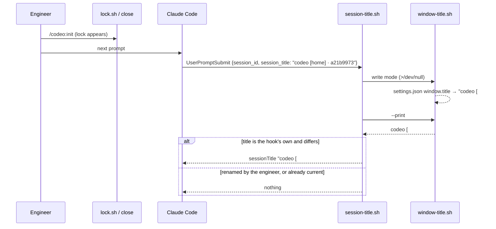

# Dev Container Hardening Implementation Plan

> **For agentic workers:** REQUIRED SUB-SKILL: Use superpowers:subagent-driven-development (recommended) or superpowers:executing-plans to implement this plan task-by-task. Steps use checkbox (`- [ ]`) syntax for tracking.

**Goal:** Close the edge cases #44 and #45 left in the dev container's scripts, keep the git identity across containers, and make the VS Code window title and the Claude Code session title follow the workflow lock without a container restart.

**Architecture:** The three scripts under `.devcontainer/scripts/` are fixed in place; no new script. `window-title.sh` and `devcontainer-start.sh` get one settings-merge contract (resolve symlinks, distinguish "not JSON" from "not an object", keep the mode, leave no temp file). `session-title.sh` — already run on every prompt — becomes the single thing that retitles: it refreshes the window title through `window-title.sh` and replaces a session title it set itself when the lock has changed. A second named volume, `codeo-git`, holds the global git config, reached by pointing `GIT_CONFIG_GLOBAL` into it.

**Tech Stack:** bash 4.3+, GNU coreutils (`readlink -f`, `chmod --reference`), jq 1.7, git; Claude Code hooks; `tests/devcontainer.test.sh` (scratch repos, stub executables, stdin fixtures).

**Spec:** GitHub issue #47 as restated in `.codeo/47/init.md` → `## Outcome` (acceptance criteria verbatim); decisions in `.codeo/47/plan.md` Q1–Q3.

## Options considered

| Decision | Chosen | Rejected | Why |
|---|---|---|---|
| What retitles a running session and the window (Q1) | `session-title.sh` on every prompt: refresh the window via `window-title.sh`, replace its own session title | window only; a `PostToolUse` hook; hooking `lock.sh`/`close` in the plugin core | the hook already runs per prompt; the core ships to every project and stays untouched |
| Telling its own title from a `/rename` | the title ends in ` · <first eight of this session's id>` | grepping the transcript; a marker file | nothing new to store; a rename never ends in this session's id |
| Where the git identity lives (Q2) | volume `codeo-git` at `/home/dev/.config/git` + `containerEnv.GIT_CONFIG_GLOBAL` pointing at its `config` | the volume alone (fragile ordering); an `include.path` volume | with the variable every `--global` write lands in the volume whatever `~/.gitconfig` holds |
| Split (Q3) | one PR, ten tasks, one commit each | two or three PRs | the fixes edit the same scripts and test file |
| Sharing the merge code | the same ~12 lines in each script | a sourced helper file | the test harness copies scripts into scratch repos one by one; a helper would need copying everywhere |
| Making the hook command safe (qc:45 F1) | a guard in the registered command | `\|\| true` inside the script | the script being absent is the failure; it cannot guard itself |
| Executable scripts (F7 and the cause) | commit mode 100755, probe `core.fileMode` in the start script, pin the mode in the suite | only fix the one file | a container with `core.fileMode=false` commits the next script as 100644 again |

## Global Constraints

- Files that change: `.devcontainer/scripts/devcontainer-start.sh`, `.devcontainer/scripts/window-title.sh` (also mode 100644 → 100755), `.devcontainer/scripts/session-title.sh`, `.devcontainer/devcontainer.json`, `.devcontainer/Dockerfile`, `.claude/settings.json`, `tests/devcontainer.test.sh`, `CHANGELOG.md`. Nothing in `scripts/`, `lib/`, `hooks/`, `skills/` or `docs/` (issue's Out of Scope: JSONC parsing, Claude login and plugin persistence #40).
- **Settings-merge contract**, in `window-title.sh` (key `window.title`, file `<clone>/.vscode/settings.json`) and in `devcontainer-start.sh` step 3c (key `remoteControlAtStartup`, file `${CLAUDE_CONFIG_DIR:-$HOME/.claude}/settings.json`): resolve the file with `readlink -f` and write the resolved path, so a symlink stays a symlink (a dangling one is created at its target); parse with `jq -rn '[inputs][0] // {} | type'`: no output → "is not valid JSON; left untouched" (this covers JSONC); anything but `object` → "is not a JSON object; left untouched"; write through `mktemp` in the target's directory, `chmod --reference` the original onto it, `mv` it over the target, and on any failure `rm -f` the temp file before reporting. An empty file counts as `{}`. Every failure leaves the original byte-for-byte.
- `window-title.sh` order: root → title → exclude entry → settings. Every step that can fail ends in `die` (`window-title: <reason>` on stderr, exit 1); nothing is written to `.vscode/` before the exclude entry is in place. When the stored `window.title` already equals the title it writes nothing (its inode is unchanged) and still prints `window-title: <title>`.
- Lock line: `issue:` followed by spaces and a number, with or without a leading `#` (`lock.sh` writes the bare form, `intake.sh` accepts both); the title always has exactly one `#`.
- `session-title.sh` after this plan: gate on `REMOTE_CONTAINERS=true` and a supported event; refresh the window title (`bash window-title.sh >/dev/null 2>&1 || true`); then print a `sessionTitle` only when the session has no title **or** its title ends in ` · <sid8>` and differs from the new one. Fields are read NUL-separated (`jq -j` with `"\u0000"`, `read -r -d ''`), so a title with a newline in it is still a title. Still: stdout is nothing or one JSON line, stderr empty, exit 0 on every path.
- The registered hook command is exactly `f="${CLAUDE_PROJECT_DIR}/.devcontainer/scripts/session-title.sh"; [ -f "$f" ] && bash "$f" || true`, `timeout` 10, same two events and matcher as today.
- `devcontainer-start.sh` still always exits 0. When `CLAUDE_CODE_OAUTH_TOKEN` or `ANTHROPIC_API_KEY` is set the whole `claude auth status` check is skipped (the "unset it" TODO for the variable is the advice); `ANTHROPIC_BASE_URL` keeps only its own TODO.
- `core.fileMode` probe: when `git config --type=bool core.fileMode` is `false`, create a `0600` file in the git dir, `chmod u+x` it, and if `-x` then holds set `core.fileMode true` on the clone and say so; if it does not hold, add a TODO naming `git update-index --chmod=+x`.
- **Test isolation.** `ds_run` gains `DS_SET` (one `NAME=value` passed after the `env -u` list) and `DS_GITCONFIG` (default `$ds_dir/gitconfig`); `wt_run` gains `wt_path` (prepended to `PATH`). Hook cases run with `env -u REMOTE_CONTAINERS` unless they set it, as `st_run` does.
- `bash tests/run.sh devcontainer` runs the one test file; `bash tests/run.sh` the whole `shell` suite. That suite has no `filter`, so a task's proof is `bash tests/run.sh devcontainer` (fast) plus `shellcheck` on what changed, and the last task's is the full suite. A failing case prints `FAIL <case>: …` under `=== FAIL: devcontainer.test.sh`.
- Documentation moved: `CHANGELOG.md` only (Task 10) and the test file's header comment. No page under `docs/` describes the dev container, and there is no wiki module. No invariants document and no shared environment are configured: no task carries a lease marker and every task is proved in this checkout. Tasks are ordered so each leaves the suite green.



## Review Focus

1. `settings.json` holding `[]`, an empty file, `{not json` or JSONC (comments): each left byte-for-byte, with "not a JSON object" for `[]` and "not valid JSON" for the rest (Tasks 3, 5).
2. A symlinked `settings.json`, including one pointing outside the clone and a dangling one: still a symlink, target updated (Tasks 3, 5).
3. A `/rename`d session, and a title ending in another session's id: kept; only a title ending in this session's own id is replaced (Task 7).
4. Lock lines `issue:   44`, `issue: #44`, an empty file, no file: one `#`, `[home]` when there is no number (Tasks 2, 7).
5. `info/exclude` that cannot be touched, and a directory that is not a git repository: a `window-title:` line, exit 1, nothing written to `.vscode/` (Task 2).

---

### Task 1: Pin the executable bit

**Files:**
- Modify: `.devcontainer/scripts/window-title.sh` (mode only)
- Test: `tests/devcontainer.test.sh`

**Interfaces:**
- Produces: `git ls-files -s .devcontainer/scripts/window-title.sh` → mode `100755`; case `scripts_are_committed_executable` guards every `.devcontainer/scripts/*.sh`, now and later.

- [ ] **Step 1: Write the failing test** `scripts_are_committed_executable` (add to `cases`): for each `$repo/.devcontainer/scripts/*.sh`, the mode field of `git -C "$repo" ls-files -s -- <path>` must be `100755`; a file git does not track yet must have the working-tree executable bit (`-x`). Failure message names the file and the mode.
- [ ] **Step 2: Run to verify it fails.** Run: `bash tests/run.sh devcontainer`. Expected: `FAIL scripts_are_committed_executable` naming `window-title.sh` and `100644`; every other case passes.
- [ ] **Step 3: Fix the mode.** `chmod +x .devcontainer/scripts/window-title.sh && git update-index --chmod=+x .devcontainer/scripts/window-title.sh`.
- [ ] **Step 4: Run to verify it passes.** Run: `bash tests/run.sh devcontainer && git ls-files -s .devcontainer/scripts/window-title.sh | grep -q '^100755'`. Expected: `all cases passed`, exit 0.
- [ ] **Step 5: Commit.**

```bash
git add tests/devcontainer.test.sh .devcontainer/scripts/window-title.sh
git commit -m "fix(devcontainer): window-title.sh is committed executable like its siblings (#47)"
```

### Task 2: `window-title.sh` — failures say so, `#` lock lines

**Files:**
- Modify: `.devcontainer/scripts/window-title.sh`
- Test: `tests/devcontainer.test.sh`

**Interfaces:**
- Produces: exit 1 with exactly one `window-title: …` stderr line on every failure, including an unwritable `info/exclude` and a non-repository; title `codeo [#44]` for `issue: #44`. Task 3 builds the settings step on this order.

- [ ] **Step 1: Write the failing tests** (add to `cases`; `wt_run` gains the `wt_path` variable now, unused until Task 3):
  - `title_strips_a_hash_from_the_lock_line`: `.codeo/active` holding `issue: #44` → `--print` prints `codeo [#44]`; a plain run writes the same title into `.vscode/settings.json`.
  - `title_reports_an_unwritable_exclude`: replace `info/exclude` with a directory (`rm -f` then `mkdir`; root-proof) → `wt_rc == 1`, `wt_err` is one line starting `window-title:`, and `.vscode/settings.json` does not exist.
  - `title_outside_a_repository_says_so`: copy the script into a non-git scratch directory (`wt_clone` pointing at it) → `wt_rc == 1`, `wt_err` one `window-title:` line.
  - Extend `title_is_home_without_a_lock`: a plain run's stdout is exactly `window-title: codeo [home]`.
- [ ] **Step 2: Run to verify they fail.** Run: `bash tests/run.sh devcontainer`. Expected: FAIL for the four above (`[##44]`, empty stderr, exit 1 with no line, and — if already passing — the stdout assertion).
- [ ] **Step 3: Implement in `window-title.sh`.** Define `die` first; wrap the `rev-parse` of the root in `|| die "not inside a git repository"`; strip one leading `#` from the lock's issue word (`${issue#\#}`); move the exclude block before the settings block and end `mkdir -p`, `touch`, the `grep -qxF … ||` append and the append itself in `|| die "could not add .vscode/settings.json to <exclude path>"`. Update the header comment: every failure prints one `window-title:` line.
- [ ] **Step 4: Run to verify they pass.** Run: `bash tests/run.sh devcontainer && shellcheck .devcontainer/scripts/window-title.sh`. Expected: `all cases passed`, no shellcheck output.
- [ ] **Step 5: Commit.**

```bash
git add .devcontainer/scripts/window-title.sh tests/devcontainer.test.sh
git commit -m "fix(devcontainer): window-title.sh reports an unwritable exclude and reads issue: #N (#47)"
```

### Task 3: `window-title.sh` — the settings-merge contract, and a title that follows the lock

**Files:**
- Modify: `.devcontainer/scripts/window-title.sh`
- Test: `tests/devcontainer.test.sh`

**Interfaces:**
- Consumes: Task 2's order (exclude, then settings).
- Produces: the merge contract of Global Constraints for `.vscode/settings.json`; a write-mode run that leaves the file untouched when the title is current. Task 7's hook calls write mode on every prompt and relies on that.

- [ ] **Step 1: Write the failing tests** (add to `cases`; `wt_run` prepends `${wt_path:+$wt_path:}` to `PATH`):
  - `title_rejects_settings_that_are_not_an_object`: seeds `[]`, `{not json` and a JSONC file (`{ // c` newline `"a": 1 }`), each in its own scratch clone → each unchanged byte-for-byte, `wt_rc == 1`, one `window-title:` line; `[]` says `not a JSON object`, the other two say `not valid JSON`. Replace the body of `title_leaves_malformed_settings_alone` with the `{not json` leg of this loop (or keep it and add the other two here).
  - `title_writes_through_a_symlink`: `.vscode/settings.json` a symlink to `$pl_root/real-settings.json` (`{"a":1}`, outside the clone) → after a run it is still a symlink, the target holds `a == 1` and the title. A second leg: a dangling symlink in an existing directory → still a symlink, its target created holding the title.
  - `title_keeps_the_settings_mode`: seeded `0644` stays `0644`; seeded `0600` stays `0600` (`stat -c %a`).
  - `title_leaves_no_temp_file_when_mv_fails`: `wt_path` pointing at a directory holding a `mv` that exits 1, a seeded settings file → `wt_rc == 1`, one `window-title:` line, and `ls -A .vscode` prints only `settings.json`.
  - `title_does_not_rewrite_a_current_title`: two runs; the file's inode (`stat -c %i`) is the same after the second, and the second still prints `window-title: codeo [home]`.
  - `title_follows_a_released_lock`: run (`codeo [home]`), write `.codeo/active` with `issue:   47`, run (`codeo [#47]`), remove the lock, run (`codeo [home]`) — the title read from `settings.json` each time.
- [ ] **Step 2: Run to verify they fail.** Run: `bash tests/run.sh devcontainer`. Expected: FAIL for the six new cases (and nothing else).
- [ ] **Step 3: Implement the settings block** per the merge contract, using `readlink -f` for the target, the `type` probe for the two messages, `mktemp "$(dirname "$target")/.settings.XXXXXX"`, `chmod --reference="$target" "$tmp"`, and `mv -- "$tmp" "$target" || { rm -f "$tmp"; die … }`. Before writing, read the stored `window.title`; when it equals `$title`, skip straight to the final `echo`. Update the header comment: JSONC (comments) in `settings.json` is left untouched with an error; symlinks are written through.
- [ ] **Step 4: Run to verify they pass.** Run: `bash tests/run.sh devcontainer && shellcheck .devcontainer/scripts/window-title.sh`. Expected: `all cases passed`, no shellcheck output.
- [ ] **Step 5: Commit.**

```bash
git add .devcontainer/scripts/window-title.sh tests/devcontainer.test.sh
git commit -m "fix(devcontainer): window-title.sh keeps symlinks and modes, names non-objects, skips a current title (#47)"
```

### Task 4: `devcontainer-start.sh` — no `claude auth login` advice while a credential variable is set

**Files:**
- Modify: `.devcontainer/scripts/devcontainer-start.sh`
- Test: `tests/devcontainer.test.sh`

**Interfaces:**
- Produces: with `ANTHROPIC_API_KEY` or `CLAUDE_CODE_OAUTH_TOKEN` set, no stderr line contains `claude auth login`, and the numbered "what is left" list does not offer it.

- [ ] **Step 1: Write the failing tests.** Add `DS_SET` to `ds_run` (after the `env -u` list) and rewrite `start_env_vars_are_todos` to use it instead of its inline `env` call (same assertions). Add `start_credential_variables_hide_the_login_advice` (to `cases`): for `ANTHROPIC_API_KEY=x` with `STUB_CLAUDE_OUT='{"loggedIn":true,"authMethod":"api_key"}'` and for `CLAUDE_CODE_OAUTH_TOKEN=x` with `"authMethod":"oauth_token"` (all else ready, `STUB_CLAUDE_RC=0`): `ds_rc == 0`; `grep -c 'claude auth login'` over `ds_err` is 0; exactly one TODO names the variable and says `unset`; the output has no `what is left to do`. A second leg with `STUB_CLAUDE_RC=1` (status fails) and the variable set: still no `claude auth login`.
- [ ] **Step 2: Run to verify it fails.** Run: `bash tests/run.sh devcontainer`. Expected: `FAIL start_credential_variables_hide_the_login_advice` (the line is present); the refactored `start_env_vars_are_todos` passes.
- [ ] **Step 3: Implement.** In step 6, run the `claude auth status` block only when both `CLAUDE_CODE_OAUTH_TOKEN` and `ANTHROPIC_API_KEY` are empty; keep the three-variable "unset it" loop as it is. Add a comment saying why the block is skipped.
- [ ] **Step 4: Run to verify it passes.** Run: `bash tests/run.sh devcontainer && shellcheck .devcontainer/scripts/devcontainer-start.sh`. Expected: `all cases passed`, no shellcheck output.
- [ ] **Step 5: Commit.**

```bash
git add .devcontainer/scripts/devcontainer-start.sh tests/devcontainer.test.sh
git commit -m "fix(devcontainer): start script stops advising claude auth login while a credential variable is set (#47)"
```

### Task 5: `devcontainer-start.sh` — the settings-merge contract for the Claude settings

**Files:**
- Modify: `.devcontainer/scripts/devcontainer-start.sh` (step 3c)
- Test: `tests/devcontainer.test.sh`

**Interfaces:**
- Consumes: the merge contract of Global Constraints.
- Produces: `${CLAUDE_CONFIG_DIR:-$HOME/.claude}/settings.json` gets `remoteControlAtStartup: true` with every other key, its symlink and its mode kept; failures leave the original and no temp file, each as one TODO.

- [ ] **Step 1: Write the failing tests** (add to `cases`; each seeds `$ds_dir/claude/settings.json`, then `ds_ready_run`; `ds_rc == 0` throughout):
  - `start_settings_that_are_not_an_object_are_a_todo`: `[]` → file unchanged, exactly one TODO matching `settings.json` and `not a JSON object`.
  - `start_settings_symlink_is_kept`: the file is a symlink to `$ds_dir/real-claude-settings.json` (`{"autoUpdatesChannel":"stable"}`) → still a symlink; the target holds `remoteControlAtStartup == true` and `autoUpdatesChannel`.
  - `start_settings_keep_their_mode`: seeded `0644` stays `0644`, seeded `0600` stays `0600`.
  - `start_leaves_no_temp_file_when_mv_fails`: a `mv` that exits 1 in `$ds_dir/bin` → one TODO matching `could not write`, and `ls -A "$ds_dir/claude"` prints only `settings.json`.
- [ ] **Step 2: Run to verify they fail.** Run: `bash tests/run.sh devcontainer`. Expected: FAIL for the four (wrong message, a regular file replacing the link, mode `600`, a leftover `.tmp`).
- [ ] **Step 3: Implement step 3c** per the contract. Keep the existing creation of an absent file (`echo '{}'`) and its TODO; replace the fixed `$claude_settings.tmp` with `mktemp` in the target's directory. Messages: `<file> is not valid JSON and was left alone: …` and `<file> is not a JSON object and was left alone: …`, both ending with the existing instruction to add `"remoteControlAtStartup": true`. Update the step's comment.
- [ ] **Step 4: Run to verify they pass.** Run: `bash tests/run.sh devcontainer && shellcheck .devcontainer/scripts/devcontainer-start.sh`. Expected: `all cases passed`, no shellcheck output.
- [ ] **Step 5: Commit.**

```bash
git add .devcontainer/scripts/devcontainer-start.sh tests/devcontainer.test.sh
git commit -m "fix(devcontainer): start script keeps the Claude settings' symlink and mode and leaves no temp file (#47)"
```

### Task 6: `devcontainer-start.sh` — executable scripts in a container with `core.fileMode=false`

**Files:**
- Modify: `.devcontainer/scripts/devcontainer-start.sh`
- Test: `tests/devcontainer.test.sh`

**Interfaces:**
- Produces: after the start script, `git config --type=bool core.fileMode` is `true` on the clone whenever the filesystem keeps the executable bit; otherwise a TODO says to stage with `git update-index --chmod=+x`.

- [ ] **Step 1: Write the failing tests** (add to `cases`; `ds_ready_run` in a scratch clone):
  - `start_sets_file_mode_so_new_scripts_are_executable`: `git config core.fileMode false` in the scratch clone; run; `git config --type=bool core.fileMode` prints `true`; then `printf '#!/bin/sh\n' > new.sh && chmod +x new.sh && git add new.sh` and `git ls-files -s new.sh` starts `100755`; stdout says `core.fileMode`.
  - `start_leaves_file_mode_alone_when_it_is_fine`: a clone with the default (true) and one with it unset in a freshly `git init`ed repo → config unchanged, no output line about `core.fileMode`.
  - `start_file_mode_that_cannot_stick_is_a_todo`: `core.fileMode false` and a no-op `chmod` stub in `$ds_dir/bin` → fileMode still `false`, exactly one TODO matching `update-index --chmod`, `ds_rc == 0`.
- [ ] **Step 2: Run to verify they fail.** Run: `bash tests/run.sh devcontainer`. Expected: FAIL for the first and third; the second passes.
- [ ] **Step 3: Implement** a new step after step 2 ("Work from the top of the clone"): the probe of Global Constraints, using `mktemp "$(git rev-parse --git-dir)/filemode.XXXXXX"`, removing the probe either way. Update the header comment.
- [ ] **Step 4: Run to verify they pass.** Run: `bash tests/run.sh devcontainer && shellcheck .devcontainer/scripts/devcontainer-start.sh`. Expected: `all cases passed`, no shellcheck output.
- [ ] **Step 5: Commit.**

```bash
git add .devcontainer/scripts/devcontainer-start.sh tests/devcontainer.test.sh
git commit -m "fix(devcontainer): start script turns core.fileMode back on where the filesystem keeps the executable bit (#47)"
```

### Task 7: `session-title.sh` — newline-safe, retitles its own title, refreshes the window

**Files:**
- Modify: `.devcontainer/scripts/session-title.sh`
- Test: `tests/devcontainer.test.sh`

**Interfaces:**
- Consumes: `window-title.sh` write mode (Task 3: silent no-op when current) and `--print`.
- Produces: the hook behaviour of Global Constraints. Output shape unchanged: nothing or `{"hookSpecificOutput":{"hookEventName":…,"sessionTitle":…}}`.

- [ ] **Step 1: Write the failing tests** (add to `cases`; `sid=$st_sid`):
  - `session_title_treats_a_leading_newline_as_a_title`: `st_json UserPromptSubmit $sid $'\nmy name'` → silent (`st_silent`).
  - `session_title_replaces_its_own_title_when_the_lock_changes`: lock `issue:   47`, `st_json UserPromptSubmit $sid 'codeo [home] · a21b9973'` → `st_title == 'codeo [#47] · a21b9973'`. Then remove the lock, existing `codeo [#47] · a21b9973` → `codeo [home] · a21b9973`. Existing equal to the new title → silent.
  - `session_title_keeps_a_renamed_title`: existing `my name`, and `codeo [home] · ffffffff` (another session's id) → silent, with a lock present.
  - `session_title_refreshes_the_window_title`: hook run with no lock → `.vscode/settings.json` title `codeo [home]`; lock `issue:   47`, hook run → `codeo [#47]`; lock removed, hook run with existing `my name` (silent output) → `codeo [home]`.
  - Fix `session_title_names_home_and_the_id`: replace the `wc -l <<<` count with `[[ -n $st_out && $st_out != *$'\n'* ]]`, which fails on empty output and on two lines.
- [ ] **Step 2: Run to verify they fail.** Run: `bash tests/run.sh devcontainer`. Expected: FAIL for the first four new cases; the rewritten one-line check passes.
- [ ] **Step 3: Implement in `session-title.sh`** the read, the own-title rule, the refresh and the unchanged-title exit (Global Constraints). Fields via `jq -j '[(.hook_event_name // ""), (.session_id // ""), (.session_title // "")] | map(tostring)[] | ., "\u0000"'` into three `IFS= read -r -d ''`; any `jq` failure → `exit 0`. Rewrite the header comment (the two hook events, the own-title rule, the window refresh, silence). Keep `set -uo pipefail` without `-e`.
- [ ] **Step 4: Run to verify they pass.** Run: `bash tests/run.sh devcontainer && shellcheck .devcontainer/scripts/session-title.sh`. Expected: `all cases passed`, no shellcheck output.
- [ ] **Step 5: Commit.**

```bash
git add .devcontainer/scripts/session-title.sh tests/devcontainer.test.sh
git commit -m "feat(devcontainer): the prompt hook retitles its own session title and the window when the lock changes (#47)"
```

### Task 8: Guard the registered hook command, and harden its registration test

**Files:**
- Modify: `.claude/settings.json`
- Test: `tests/devcontainer.test.sh`

**Interfaces:**
- Produces: with `session-title.sh` removed, `bash -c "<registered command>"` exits 0, stdout and stderr empty.

- [ ] **Step 1: Write the failing tests.** Update `session_title_hooks_are_registered`: `cmd` becomes the guarded command of Global Constraints; replace `keys == […]` with `.hooks | has("SessionStart") and has("UserPromptSubmit") and length == 2`. Add (to `cases`) `session_title_hook_command_survives_a_missing_script`: read the command from `.claude/settings.json` with `jq -r '.hooks.UserPromptSubmit[0].hooks[0].command'`, run `env -u REMOTE_CONTAINERS REMOTE_CONTAINERS=true CLAUDE_PROJECT_DIR="$st_dir" bash -c "$cmd" </dev/null` from `/` in a scratch clone with `session-title.sh` removed → rc 0, empty stdout and stderr; and the same command with the script present and a `SessionStart` fixture on stdin → one JSON line whose `sessionTitle` is `codeo [home] · a21b9973`.
- [ ] **Step 2: Run to verify they fail.** Run: `bash tests/run.sh devcontainer`. Expected: `FAIL session_title_hooks_are_registered` and `FAIL session_title_hook_command_survives_a_missing_script` (rc 127 today).
- [ ] **Step 3: Replace the `command` string** in both hook entries of `.claude/settings.json` with the guarded command, JSON-escaped, leaving every other key as it is.
- [ ] **Step 4: Run to verify they pass.** Run: `bash tests/run.sh devcontainer && jq -e . .claude/settings.json >/dev/null`. Expected: `all cases passed`, exit 0.
- [ ] **Step 5: Commit.**

```bash
git add .claude/settings.json tests/devcontainer.test.sh
git commit -m "fix(devcontainer): the session-title hook command exits 0 when its script is missing (#47)"
```

### Task 9: The `codeo-git` volume

**Files:**
- Modify: `.devcontainer/devcontainer.json`, `.devcontainer/Dockerfile`
- Test: `tests/devcontainer.test.sh`

**Interfaces:**
- Produces: `mounts` = the `codeo-gh` volume then `source=codeo-git,target=/home/dev/.config/git,type=volume`; `containerEnv` = `{"GIT_CONFIG_GLOBAL": "/home/dev/.config/git/config"}`; `/home/dev/.config/git` created in the image, owned by `dev`.

- [ ] **Step 1: Write the failing tests.** Replace `gh_login_is_one_named_volume` with `volumes_hold_the_gh_login_and_the_git_config` (`jq -e '.mounts == [<the two strings>]'`; update `cases`). Add: `git_config_global_points_into_the_git_volume` (`.containerEnv == {"GIT_CONFIG_GLOBAL":"/home/dev/.config/git/config"}`); `dockerfile_creates_the_git_config_dir` (over `dockerfile_code`: an `install -d -o…` line naming `.config/git`); `git_global_writes_land_in_the_volume_file` (a scratch `HOME` holding an existing `.gitconfig`, `GIT_CONFIG_GLOBAL=$HOME/.config/git/config`, `git config --global user.name X` → the volume file has it, `.gitconfig` does not); `start_finds_the_identity_in_the_git_volume_file` (give `ds_run` a `DS_GITCONFIG` override; identity in a file at `$ds_dir/home/.config/git/config`; `ds_ready_run` → `ds_todos 'git identity'` is 0 and the last stdout line is `devcontainer-start: ready`).
- [ ] **Step 2: Run to verify they fail.** Run: `bash tests/run.sh devcontainer`. Expected: FAIL for the first three; the last two pass or fail only on the missing `DS_GITCONFIG` hook until it is added in this step.
- [ ] **Step 3: Implement.** Add the second mount and `containerEnv` to `devcontainer.json`; add `/home/${USERNAME}/.config/git` to the Dockerfile's `install -d -o … -g …` line, with the comment saying why (an empty named volume takes the directory's owner). Update the Dockerfile comment on that line.
- [ ] **Step 4: Run to verify they pass.** Run: `bash tests/run.sh devcontainer && jq -e . .devcontainer/devcontainer.json >/dev/null`. Expected: `all cases passed`, exit 0.
- [ ] **Step 5: Commit.**

```bash
git add .devcontainer/devcontainer.json .devcontainer/Dockerfile tests/devcontainer.test.sh
git commit -m "feat(devcontainer): the git identity lives in a codeo-git volume shared by every dev container (#47)"
```

### Task 10: Test header, changelog and the whole suite

**Files:**
- Modify: `tests/devcontainer.test.sh` (header comment only), `CHANGELOG.md`

- [ ] **Step 1: Update the test file's header comment** (one or two sentences): it also checks the scripts are committed executable, the settings-merge cases (not an object, symlink, mode, no temp file), the credential-variable advice, the `core.fileMode` probe, the prompt hook's retitling, the guarded hook command and the `codeo-git` volume.
- [ ] **Step 2: Edit `CHANGELOG.md`'s `Unreleased` section.** Reword the #45 line: "Inside the dev container a Claude Code session without a title is titled …" (a resumed session keeps the title it was given). Add a #47 entry in the style of the #44 line: the start script stops advising `claude auth login` while a credential variable is set, probes `core.fileMode`, and keeps the Claude settings' symlink and mode; `window-title.sh` reports every failure, reads `issue: #N`, writes through a symlink and is executable; the prompt hook now retitles the window and its own session title when the lock changes, and the registered command exits 0 with the script missing; the git identity lives in the new `codeo-git` volume via `GIT_CONFIG_GLOBAL` — **rebuild the container once to get the volume**, then set the identity once; nothing in `scripts/`, `lib/`, `hooks/` or `skills/` changes (#47).
- [ ] **Step 3: Prove the whole change.** Run: `bash tests/run.sh && shellcheck .devcontainer/scripts/*.sh tests/devcontainer.test.sh`. Expected: `all cases passed`, no shellcheck output.
- [ ] **Step 4: Commit.**

```bash
git add tests/devcontainer.test.sh CHANGELOG.md
git commit -m "docs: changelog entry for the dev container hardening (#47)"
```

### After the tasks (not a plan task): checks only the engineer can make

The suite cannot see Claude Code or VS Code. Rebuild this container (the new volume and `containerEnv` need it), set the identity once (`git config --global user.name …`, `user.email …`) and confirm it is in the `codeo-git` volume; create a second container and confirm the start script prints no identity TODO. In a container, open a Claude Code session, run `/codeo:init` (or `lock.sh take container`), send a prompt: the picker and claude.ai/code title and the VS Code window title should now say `[#N]`; after `/codeo:close`, `[home]` at the next prompt; a `/rename`d session keeps its name. If Claude Code does not apply a `sessionTitle` on a session that already has one, that comes back as a send-back to this plan (the window title would still follow). Results go in `qc.md` as manual checks.
