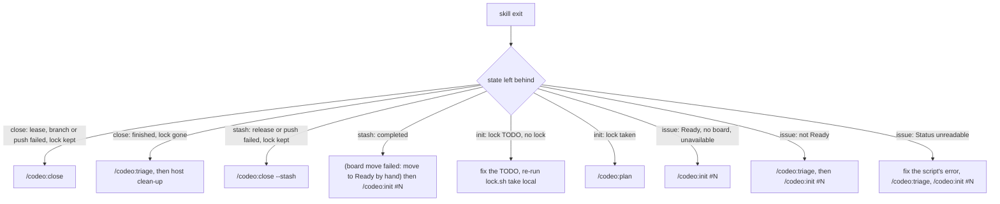

# Closing Blocks That Can Run Implementation Plan

> **For agentic workers:** REQUIRED SUB-SKILL: Use superpowers:subagent-driven-development (recommended) or superpowers:executing-plans to implement this plan task-by-task. Steps use checkbox (`- [ ]`) syntax for tracking.

**Goal:** Every closing block names a command that can run in the state its exit leaves, a plan's host-run commands run from the engineer's shell, and #67's wording notes are corrected (#69).

**Architecture:** The rule is written once in `docs/handoff.md → Closing block`. Each of the four skills labels the paragraph for each exit it can take with `**Closing block — <exit>:**`, and a new test, `tests/closing-exits.test.sh`, reads those labelled paragraphs and fails when one names the command that cannot run. `/codeo:plan` gains a rule for tasks the engineer runs on their own host. No script changes: what the pipeline decides is untouched.

**Tech Stack:** bash, `bash tests/run.sh` (the `shell` suite; no `filter`, so a task's proof is a test file run on its own, or the whole suite).

**Spec:** `.codeo/69/issue.md` and `.codeo/69/init.md` (the issue's requirements and acceptance criteria); plan dossier Q1-Q3 (`.codeo/69/plan.md`). No separate reference doc: the decisions are recorded in the dossier and in `docs/handoff.md`.

## Global Constraints

- One issue, one branch, one pull request (plan Notes). No change under `scripts/`, `lib/` or `hooks/`; nothing the pipeline decides changes.
- **Q1 = A:** the rule lives once in `docs/handoff.md`; the skills state their exits; the test reads both.
- **Q2 = A:** `/codeo:issue` reads `board.sh status <N>`. No board → no call, names `/codeo:init #<N>`. `unavailable` → names `/codeo:init #<N>` and says the Status could not be read. A script failure → its fix first, then `/codeo:triage`, then `/codeo:init #<N>`.
- **Q3 = A:** no config key. A host task is marked `Runs on: the engineer's host` and written shell-neutral, or the plan asks the shell and labels the command `Shell: <name>`.
- Exit labels are fixed strings the test reads: `**Closing block — lock kept:**`, `**Closing block — finished:**`, `**Closing block — stash interrupted:**`, `**Closing block — stash completed:**`, `**Closing block — no lock:**`, `**Closing block — Ready, no board or unavailable:**`, `**Closing block — not Ready:**`, `**Closing block — Status unreadable:**`. A labelled paragraph runs from its label line to the next blank line.
- Invariants: none configured. Shared environment: none, so no task carries `Needs lease:`. Every task is proved in this checkout by the `shell` suite, in any order.
- Documentation: `docs/handoff.md` and `docs/skills.md` move (Tasks 1 and 7); `.devcontainer/README.md` and `CHANGELOG.md` move (Task 8). No wiki module.
- Out of scope, unchanged: the archived `.codeo/done/61/plan.md`, the local-only `v1.0.4` tag, #40, #51, #54, #57, and the `ubuntu:26.04` move itself.

## Review Focus

- `/codeo:close` run in a `host: web` or `host: local` checkout after a failed release: the lock-kept block must not name any checkout clean-up for either host.
- A stash whose release succeeded but whose push failed: it keeps `.codeo/active`, so it is "interrupted" and names `/codeo:close --stash`, not `/codeo:init`.
- A stash whose board move failed after everything else completed: "completed", but the manual Ready repair comes before `/codeo:init #<N>`.
- `/codeo:issue` with a board whose Status read prints `none` (the issue was never added): that is "not Ready", `/codeo:triage` first.
- A host task in a plan under a `host: container` lock: no `$PWD`, `$(…)` or nested quotes reach the engineer's PowerShell.

---

### Task 1: State the rule, and write the test that holds the four skills to it

**Files:**
- Modify: `docs/handoff.md` (the *Closing block* bullets and its table, lines 346-371)
- Create: `tests/closing-exits.test.sh`
- Test: `tests/closing-exits.test.sh` itself

**Interfaces:**
- Produces: `bash tests/closing-exits.test.sh [case]`, exit 0 when every case (or the named one) passes, otherwise each failure as `FAIL: <case> — <reason>` and exit 1. Cases: `rule`, `close-lock-kept`, `close-finished`, `stash-interrupted`, `stash-completed`, `init-no-lock`, `issue-ready`, `issue-not-ready`, `issue-unreadable`. Tasks 2-5 each make some of these pass; the labels in Global Constraints are the contract.
- Helper inside the test: `para <file> <label>` prints from the line containing the fixed string `<label>` to the next blank line, and fails the case when the label is absent. A second helper `before <text> <a> <b>` is true when `<a>` occurs in `<text>` and `<b>` occurs only after it (the form `text_order` takes in `tests/close-skill.test.sh`).

- [ ] **Step 1: Write `tests/closing-exits.test.sh`**, in the style of `tests/closing-block.test.sh` (`set -euo pipefail`, `fail()`, "all cases passed"), reading `skills/{close,init,issue}/SKILL.md` and `docs/handoff.md`. Assertions per case:
  - `rule`: `docs/handoff.md`'s Closing block section contains `**It names only a command that can run.**`, and its table has the rows for the exceptions (`lock kept`, `stash interrupted`, `no lock`, `not Ready`).
  - `close-lock-kept`: the paragraph contains `/codeo:close` and contains none of `remove`, `clean-up`, `/codeo:triage`; `/codeo:close` is the first command in it.
  - `close-finished`: the paragraph contains `/codeo:triage`.
  - `stash-interrupted`: contains `/codeo:close --stash` and does not contain `/codeo:init`.
  - `stash-completed`: contains `/codeo:init #<N>`; contains `by hand` and the word `Ready`, and `by hand` comes before `/codeo:init`.
  - `init-no-lock`: contains `lock.sh" take local` and does not contain `/codeo:plan`.
  - `issue-ready`: contains `/codeo:init #<N>`, does not contain `/codeo:triage`, and contains `unavailable`.
  - `issue-not-ready`: `/codeo:triage` comes before `/codeo:init #<N>`.
  - `issue-unreadable`: `gh auth refresh -s project` comes before `/codeo:triage`, which comes before `/codeo:init #<N>`.
  - `issue-ready` and `issue-not-ready` also require step 8's text to contain `board.sh" status <N>` and `config.sh" get .board`.
  - A test argument naming no case exits 2.

- [ ] **Step 2: Run it to see it fail.**
  Run: `bash tests/closing-exits.test.sh`
  Expected: exit 1, with a `FAIL:` line for every case (each label is absent, and `rule`'s bullet is absent).

- [ ] **Step 3: Write the rule into `docs/handoff.md`.** In the *Closing block* bullets, add after "A skill with several exits states the one it took": `**It names only a command that can run.**` — the first step is the command that can run in the state the exit leaves behind; a lock a failed step kept, a lock never taken, a Ready gate not yet passed each change which command that is, and the block never names the command the state refuses nor, while the lock is kept, a clean-up that destroys the checkout the lock lives in. In the table of default next goals, add a second table, "Exits whose next command is not the default", with one row per exception: `close — lock kept` (`/codeo:close`), `stash — interrupted` (`/codeo:close --stash`), `stash — completed` (`/codeo:init #<N>`, after the manual Ready repair when the board move failed), `init — no lock` (the recovery, then the default), `issue — not Ready` (`/codeo:triage`, then `/codeo:init #<N>`).

- [ ] **Step 4: Run `rule` on its own.**
  Run: `bash tests/closing-exits.test.sh rule`
  Expected: `all cases passed`, exit 0. Running without an argument still exits 1, naming the eight skill cases.

- [ ] **Step 5: Commit** `docs/handoff.md` and `tests/closing-exits.test.sh`, subject `feat: state the closing-block rule and test the exits that break it (#69)`.

---

### Task 2: `/codeo:close` — the lock-kept block and the finished block

**Files:**
- Modify: `skills/close/SKILL.md` steps 16 and 17 (lines 497-525)
- Test: `tests/closing-exits.test.sh` (`close-lock-kept`, `close-finished`)

**Interfaces:**
- Consumes: the labels and assertions from Task 1.
- Produces: step 17 ends with two labelled paragraphs, one per exit.

- [ ] **Step 1: Run the failing cases.**
  Run: `bash tests/closing-exits.test.sh close-lock-kept` and `bash tests/closing-exits.test.sh close-finished`
  Expected: each exits 1 with a `FAIL:` line saying the label is absent.

- [ ] **Step 2: Edit step 17.** Replace its last sentence (`End with the closing block: the goal is the loose ends found, the first step /codeo:triage, then the host's checkout clean-up above.`) with the two paragraphs. `**Closing block — finished:**` keeps today's goal and steps (`/codeo:triage`, then the host's clean-up), and says it applies only when step 16 deleted `.codeo/active`. `**Closing block — lock kept:**` applies when step 16 kept it: the goal is a finished close; the first step is `/codeo:close` again, in this checkout; the later steps name what failed (the release, the deletion or the push). It names no triage and no clean-up, because the checkout holds the lock that the next `/codeo:close` needs. The paragraph above it keeps "say what is left of this checkout" for the finished exit only: say so there.

- [ ] **Step 3: Run the two cases.**
  Run: `bash tests/closing-exits.test.sh close-lock-kept` and `bash tests/closing-exits.test.sh close-finished`
  Expected: `all cases passed` for each.

- [ ] **Step 4: Run the close skill's own wording test.**
  Run: `bash tests/close-skill.test.sh`
  Expected: `all cases passed`. If a `must_contain` pinned the sentence this task replaced, update that case to the new paragraph's text, in this task.

- [ ] **Step 5: Commit** `skills/close/SKILL.md` and any test touched, subject `fix: close names /codeo:close, not a clean-up, while it keeps the lock (#69)`.

---

### Task 3: `/codeo:close --stash` — interrupted and completed

**Files:**
- Modify: `skills/close/SKILL.md`, the *Stash* paragraph ending "End with the closing block: the goal is resuming the work, the first step `/codeo:init #<N>`." (lines 605-611)
- Test: `tests/closing-exits.test.sh` (`stash-interrupted`, `stash-completed`)

**Interfaces:**
- Consumes: Task 1's labels. Independent of Task 2 (a different paragraph).

- [ ] **Step 1: Run the failing cases.**
  Run: `bash tests/closing-exits.test.sh stash-interrupted` and `bash tests/closing-exits.test.sh stash-completed`
  Expected: each exits 1, label absent.

- [ ] **Step 2: Edit the paragraph.** Keep "Delete `.codeo/active` last; when the release or a push failed, keep it, say what failed". Replace the final report with two labelled paragraphs. `**Closing block — stash interrupted:**` (`.codeo/active` kept): goal is a finished stash; first step `/codeo:close --stash` in this checkout; names what failed; names no `/codeo:init`, which would stop at the lock. `**Closing block — stash completed:**` (`.codeo/active` deleted): goal is resuming the work; when the board move failed (the failure `close.md`'s outcome records), the first step is to move `#<N>` to `$READY` by hand, naming the status the way the failure line does, and the next is `/codeo:init #<N>`; otherwise the first step is `/codeo:init #<N>`, on any machine.

- [ ] **Step 3: Run the two cases, then the close skill test.**
  Run: `bash tests/closing-exits.test.sh stash-interrupted && bash tests/closing-exits.test.sh stash-completed && bash tests/close-skill.test.sh`
  Expected: `all cases passed` three times.

- [ ] **Step 4: Commit** `skills/close/SKILL.md`, subject `fix: a stash that kept the lock names /codeo:close --stash, and a failed board move gets its repair first (#69)`.

---

### Task 4: `/codeo:init` — no lock, no `/codeo:plan`

**Files:**
- Modify: `skills/init/SKILL.md` step 11 (lines 312-325)
- Test: `tests/closing-exits.test.sh` (`init-no-lock`), `tests/init-skill.test.sh`

**Interfaces:**
- Consumes: Task 1's label `**Closing block — no lock:**`.

- [ ] **Step 1: Run the failing case.**
  Run: `bash tests/closing-exits.test.sh init-no-lock`
  Expected: exit 1, label absent.

- [ ] **Step 2: Edit step 11.** Replace "Either way, end with the closing block … the first step `/codeo:plan`" with: with the lock taken, the block's goal is a reviewed plan and its first step is `/codeo:plan` (with a host workflow, the step that opens the checkout it names); after a `lock: TODO — …` line there is no lock, and the paragraph `**Closing block — no lock:**` has the goal "the lock taken", the first step to fix what the TODO line says, the second `bash "${CLAUDE_PLUGIN_ROOT}/scripts/lock.sh" take local` again (with a host workflow, the recovery its text names), and no `/codeo:plan` — it is named only once the lock was taken.

- [ ] **Step 3: Run the case and the init wording test.**
  Run: `bash tests/closing-exits.test.sh init-no-lock && bash tests/init-skill.test.sh`
  Expected: `all cases passed` twice.

- [ ] **Step 4: Commit** `skills/init/SKILL.md`, subject `fix: init names a recovery, not /codeo:plan, when no lock was taken (#69)`.

---

### Task 5: `/codeo:issue` — read the Status, name the command that can run

**Files:**
- Modify: `skills/issue/SKILL.md` step 8 (lines 158-168) and the intro line 17 if it says the next step is always init
- Test: `tests/closing-exits.test.sh` (`issue-ready`, `issue-not-ready`, `issue-unreadable`), `tests/issue-skill.test.sh`

**Interfaces:**
- Consumes: `bash "${CLAUDE_PLUGIN_ROOT}/scripts/board.sh" status <N>`, which prints the gate project's Status name, `unset`, `none` or `unavailable`, and `bash "${CLAUDE_PLUGIN_ROOT}/scripts/config.sh" get .board` (exit 1, nothing printed, means no board). The Ready name is `config.sh get '.board.statuses.ready // "Ready"'`, as `/codeo:init` reads it.

- [ ] **Step 1: Run the failing cases.**
  Run: `bash tests/closing-exits.test.sh issue-ready`, `… issue-not-ready`, `… issue-unreadable`
  Expected: each exits 1, label absent.

- [ ] **Step 2: Edit step 8**, after the rename commit and before the report. With a board (`config.sh get .board` succeeds), read `board.sh status <N>` once, with the number from the created issue. No board: no `board.sh` call. Then three labelled paragraphs. `**Closing block — Ready, no board or unavailable:**` (the status equals the Ready name, there is no board, or it printed `unavailable`, in which case say above the block that the Status could not be read in a web session): first step `/codeo:init #<N>`. `**Closing block — not Ready:**` (`none`, `unset` or any other column, which is what a new issue gets): first `/codeo:triage`, whose *mark Ready* moves the card, then `/codeo:init #<N>`. `**Closing block — Status unreadable:**` (the script exited non-zero): quote its line, first step the fix it names (for example `gh auth refresh -s project`), then `/codeo:triage`, then `/codeo:init #<N>`. When another skill delegated here, nothing changes: the number goes back with no block.

- [ ] **Step 3: Run the three cases and the issue wording test.**
  Run: `bash tests/closing-exits.test.sh issue-ready && bash tests/closing-exits.test.sh issue-not-ready && bash tests/closing-exits.test.sh issue-unreadable && bash tests/issue-skill.test.sh`
  Expected: `all cases passed` four times.

- [ ] **Step 4: Commit** `skills/issue/SKILL.md`, subject `fix: issue names /codeo:triage first when the new issue is not Ready (#69)`.

---

### Task 6: `/codeo:plan` — host-run commands run from the engineer's shell

**Files:**
- Modify: `skills/plan/SKILL.md` step 8, after the `plan-04` proof-of-done paragraph (line 197)
- Test: `tests/plan-skill.test.sh`

**Interfaces:**
- Produces: a paragraph beginning `**Mark the tasks the engineer runs on their own host.**`.

- [ ] **Step 1: Add the failing cases to `tests/plan-skill.test.sh`**, as `must_contain` lines in its existing style, for these fixed strings: `**Mark the tasks the engineer runs on their own host.**`, `Runs on: the engineer's host`, `no shell variable or substitution`, ``Shell: <name>`` (with backticks), `a numbered question in plan.md`.
  Run: `bash tests/plan-skill.test.sh`
  Expected: exit 1, four `FAIL:` lines naming those strings.

- [ ] **Step 2: Write the paragraph.** A task the engineer runs outside this session's checkout — a build or run on their own machine, where the session cannot see the shell — starts with `Runs on: the engineer's host`. Its command is neutral: no shell variable or substitution (`$PWD`, `$(…)`), no nested quotes, no `&&` or line continuation, nothing but one command a shell passes through unchanged; anything longer becomes a script in the repository, run as one command. When a command cannot be neutral, the plan asks which shell they use as a numbered question in `plan.md` and labels the command `Shell: <name>`. A `host: local` lock needs no question, because the session's own shell is the engineer's. The paragraph says why: the session's shell tells nothing about the machine the engineer types on (#67's Task 3).

- [ ] **Step 3: Run the test.**
  Run: `bash tests/plan-skill.test.sh`
  Expected: `all cases passed`.

- [ ] **Step 4: Commit** `skills/plan/SKILL.md` and `tests/plan-skill.test.sh`, subject `feat: plan marks host-run tasks and writes their commands shell-neutral (#69)`.

---

### Task 7: Documentation — `docs/skills.md`

**Files:**
- Modify: `docs/skills.md`: the `issue` section's Hand-offs line (34), the `init` section's Hand-offs (61-70), the `close` section's Hand-offs (183-194), the `plan` section's Reads and writes (84-89)
- Test: `tests/skills-doc.test.sh`

- [ ] **Step 1: Edit.** `issue`: its closing block names `/codeo:init #<N>`, or `/codeo:triage` first when the project has a board and the new issue is not Ready, reading the Status with `board.sh status`. `init`: after a `lock: TODO` it names the recovery and not `/codeo:plan`. `close`: its block is per exit, `/codeo:close` while the lock is kept and `/codeo:close --stash` for an interrupted stash. `plan`: a task the engineer runs on their own host is marked and written shell-neutral. Each line states what the system does and points at `docs/handoff.md → Closing block` for the rule; no *why* is repeated.

- [ ] **Step 2: Prove the docs hold.**
  Run: `bash tests/skills-doc.test.sh`
  Expected: `all cases passed`.

- [ ] **Step 3: Commit** `docs/skills.md`, subject `docs: describe the per-exit closing blocks and the host-task rule (#69)`.

---

### Task 8: `CHANGELOG.md` and `.devcontainer/README.md`

**Files:**
- Modify: `CHANGELOG.md` (the `## Unreleased` entry on lines 3-10)
- Modify: `.devcontainer/README.md` (the last paragraph, line 38)
- Test: the whole suite

- [ ] **Step 1: Correct the #67 entry.** Replace "The same tools are installed, at 26.04's versions (bash 5.3, git 2.53, jq 1.8.1, shellcheck 0.11), the coreutils behind `stat`, `readlink` and `install` are the Rust implementation," with: the same tools are installed; bash, git, jq and shellcheck come from 26.04 (bash 5.3, git 2.53, jq 1.8.1, shellcheck 0.11) while `gh` and Claude Code come from their own sources, not 26.04's; the coreutils are the Rust implementation, `stat`, `readlink`, `install`, `chmod`, `chown`, `mv`, `mktemp` and `ls` among them. Keep the rest of the sentence.

- [ ] **Step 2: Add a second bullet** under `## Unreleased` for this change (#69): every closing block now names a command that can run in the state its exit leaves (`/codeo:close` and `/codeo:close --stash` while the lock is kept, a recovery and not `/codeo:plan` after `lock: TODO`, `/codeo:triage` before `/codeo:init #<N>` for an issue not yet Ready), `docs/handoff.md → Closing block` states the rule, `tests/closing-exits.test.sh` fails when an exit names the command that cannot run, and `/codeo:plan` marks tasks the engineer runs on their own host and writes their commands shell-neutral. The header lines (`Config schema: 1`, `Shared state: unchanged from v1.0.5.`, `Safe to bump mid-workflow: yes`) stay true and stay.

- [ ] **Step 3: Fix the README's last paragraph.** After "The clone and the `codeo-gh` and `codeo-git` volumes are kept.": all of `~/.claude` is lost on a rebuild — the Claude Code login, past sessions and user settings — because it is not on a volume; run `claude auth login` again, and the start script reinstalls the plugins.

- [ ] **Step 4: Prove the whole change.**
  Run: `bash tests/run.sh`
  Expected: `all cases passed`, exit 0, with `closing-exits.test.sh` among the files run.

- [ ] **Step 5: Commit** `CHANGELOG.md` and `.devcontainer/README.md`, subject `docs: correct the 26.04 changelog and the rebuild note, and log #69 (#69)`.

---

## Self-review

- **Coverage.** Criterion 1 → Task 2; 2 → Task 3; 3 → Task 4; 4 → Task 5; 5 → Task 1 plus Tasks 2-5; 6 → Task 6; 7 → Task 8 steps 1 and 3; 8 → Task 8 steps 2 and 4. Intake Q1 (Status read) → Task 5; intake Q2 (where the rule lives) → Task 1.
- **Consistency.** The labels and case names are those of Global Constraints and Task 1, used unchanged in Tasks 2-5.
- **Proportion.** Eight tasks for four skills, one rule, one rule-paragraph, two docs; tests are the tasks' first steps.
