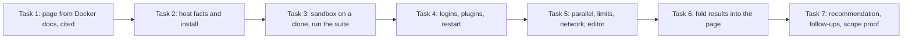

# Evaluate Docker Sandboxes (sbx) for codeo's development environment — Implementation Plan

> **For agentic workers:** REQUIRED SUB-SKILL: Use superpowers:subagent-driven-development (recommended) or superpowers:executing-plans to implement this plan task-by-task. Steps use checkbox (`- [ ]`) syntax for tracking.

**Goal:** Produce `docs/dev-environment-sbx-evaluation.md`: a comparison of the dev container setup and Docker Sandboxes (`sbx`) for codeo's own development, every point marked *tried* or *cited*, ending in one recommendation (migrate, hybrid or stay).

**Architecture:** A spike, not a migration. Task 1 writes the page with every row filled from Docker's documentation (*cited*) and a numbered checklist of host trials. Tasks 2-5 are the engineer's: they run the trials on their own machine and paste the output. Task 6 turns each trial's output into *tried* rows, Task 7 writes the recommendation and files any follow-up issues.

**Tech Stack:** Markdown and Mermaid; bash on WSL2 for the host trials; `sbx`; the repository's `bash tests/run.sh` suite.

**Spec:** `.codeo/73/issue.md` (the issue's Key Requirements and Acceptance Criteria) and plan Q1-Q5 in `.codeo/73/plan.md`.

## Options considered

| Option | Verdict |
|---|---|
| Comparison as a page in `docs/` (Q1 = A) | **Chosen.** Reviewed as a diff, citable by path. |
| Comparison only as comments on #73 | Rejected by Q1: not reviewed in the pull request. |
| Cited only, nothing installed | Rejected by Q2 = A: three of the four drivers (lifecycle, logins, parallel agents) are about behaviour. |
| Host check only | Rejected by Q2 = A. |

## Global Constraints

- **Changed:** `docs/dev-environment-sbx-evaluation.md` and this plan. Nothing else. `.devcontainer/` and `skills/` are unchanged (issue criterion 6); Task 7 proves it with `git diff --stat main -- .devcontainer skills`, which must print nothing.
- **Evidence marks.** Every row of both tables ends in exactly one of `tried` (with the date, the host and the command's output, or a pointer to where it is quoted) or `cited` (with Docker's URL and the date it was read). A row is never both and never blank. Nothing is called *tried* that was not run on a real host.
- **Duties.** Every duty listed in the issue's Key Requirements gets one of: an `sbx` equivalent, a workaround, or `no equivalent`.
- **Host.** The host is Windows + WSL2. The engineer's tasks run in bash in a WSL2 distribution (Q4) and are marked `Runs on: the engineer's host` and `Shell: bash (WSL2)`. Each command is one plain line: no variables, substitutions, nested quotes, `&&` or continuations. If `sbx` can only be run from PowerShell or `cmd`, the engineer says so in Task 2 and the finding goes in the page, and later host tasks are re-labelled by a plan question.
- **Weighing (Q5, my reading).** The four drivers are weighed as the issue lists them: isolation and safety, the VS Code dependency, the per-issue lifecycle, parallel agents. A lost VS Code window and a lost Remote Control are costs to record, not vetoes.
- **No shared environment, no invariants document, no wiki module, no exclusive resources:** no task carries `Needs lease:`.
- **Documentation moves:** none beyond the new page. The change alters no endpoint, flow, status or configuration key of the plugin, so no existing page under `docs/` is wrong after it merges.
- **Follow-up issues** are filed only if the recommendation is migrate or hybrid, through `/codeo:issue`, one at a time with the engineer. Nothing in this plan does the migration.

## Review Focus

- A row marked `tried` whose output was not pasted in by the engineer (the page must quote or point to the output for every `tried`).
- `sbx` behaving differently when run from WSL2 than from Windows itself (Task 2 records which of the two was used; every later `tried` row inherits that).
- Credentials appearing in pasted output (`gh auth status` and similar print account names and token scopes; tokens must be redacted before they go in the page).
- A recommendation that rests on a `cited` row where a `tried` one was possible.
- `docs/` ships with the plugin: the page must say at the top that it concerns codeo's own development only, not how projects use codeo.

If Task 2 shows `sbx` cannot run on this host, Tasks 3-5 shrink to recording why, and the recommendation is `stay` or a conditional one with that as its reason.

## File Structure

- Create: `docs/dev-environment-sbx-evaluation.md` — status banner, `## Contents`, `## Scope`, `## Host`, `## Drivers` (table), `## Duties of the current setup` (table), `## Trials` (numbered, with output), `## Recommendation`, `## Follow-up issues`.
- Create: `docs/plans/2026-11-14-evaluate-docker-sandboxes-sbx.md` — this plan, written after approval.
- Dossier files (`.codeo/73/*`) are written by the skills, not by these tasks.

### Footprint

- files: `docs/dev-environment-sbx-evaluation.md`, `docs/plans/2026-11-14-evaluate-docker-sandboxes-sbx.md`
- wiki: none
- exclusive: none

## Tasks

### Task 1: The page, with every row cited and the trials listed

**Files:**
- Create: `docs/dev-environment-sbx-evaluation.md`

**Interfaces:**
- Produces: the page's section names (above) and the trial numbers `T1`…`T12` that Tasks 2-6 refer to. Each row of the two tables has a column `Evidence` holding `cited <URL> (read <date>)` until a trial replaces it.

- [ ] **Step 1: Write the proof first.** Run the check below against the page that does not exist yet.

Run: `test -f docs/dev-environment-sbx-evaluation.md && grep -c '^| .* | cited ' docs/dev-environment-sbx-evaluation.md`
Expected now: no output and exit status 1 (the file is absent).

- [ ] **Step 2: Read Docker's documentation for Docker Sandboxes / `sbx`** (the product pages, the CLI reference, the system requirements, the pages on credentials, networking, resource limits and editor access) and note each URL with today's date. Where a point is not documented, the row says `cited: not documented in <URL>`, never a guess.

- [ ] **Step 3: Write the page.** `## Drivers` has one row each for: isolation and safety, VS Code dependency, per-issue lifecycle, parallel agents, host support (Windows + WSL2), resource limits, `gh`/git/Claude login persistence, plugin installation, network policy, editor attach. `## Duties of the current setup` has one row each for: the home/issue split; one clone per issue; the start script's steps (trust and chown of the clone, the executable-bit repair, the workflow lock from `init.md`, the folder check, the TODO lines, `gh` wiring and the project-scope check, git identity seeding, the Claude login check, Remote Control setting); `plugins.sh`; window and session titles; the `codeo-gh` and `codeo-git` volumes; the `--memory=4g --cpus=2` limits; the three VS Code extensions. Each row: the current mechanism (with the `.devcontainer/` path), the `sbx` equivalent / workaround / `no equivalent`, and `Evidence`. `## Trials` lists `T1`…`T12`, each with the exact command from the docs, what output would show it worked, and the rows it settles.

- [ ] **Step 4: Run the suite and the row check.**

Run: `bash tests/run.sh`
Expected: exits 0.
Run: `grep -c '^| .* | cited ' docs/dev-environment-sbx-evaluation.md`
Expected: a number equal to the count of rows written in Step 3 (at least 25), and `grep -c '| *|$' docs/dev-environment-sbx-evaluation.md` prints `0` (no blank evidence cell).

### Task 2: Host facts and installing `sbx` (T1-T2)

Runs on: the engineer's host
Shell: bash (WSL2)

**Files:** none changed. Output is pasted into the session for Task 6.

- [ ] **Step 1: Record the host.** One command at a time, paste each output (redact anything personal):
  - `cmd.exe /c ver` — Windows version.
  - `wsl.exe --status` — WSL version and default distribution.
  - `docker --version` — whether Docker is reachable from the distribution, and which.
  - `command -v sbx` — whether `sbx` is already installed.

- [ ] **Step 2: Install `sbx`** by the method Task 1's page records for this host (T2's command). Where the install needs a Windows feature or an administrator step, say so and what it was.

- [ ] **Step 3: Prove it.**

Run: `sbx --version`
Expected: prints a version number and exits 0. If it does not, paste the error: that is the host finding, and the plan continues at Task 6 (see the note under the diagram).

### Task 3: A sandbox on a clone of codeo; the suite runs inside it (T3-T5)

Runs on: the engineer's host
Shell: bash (WSL2)

**Files:** none changed.

- [ ] **Step 1: Create a sandbox for Claude Code on a fresh clone of `https://github.com/kbajpai/codeo`** (a new folder, not an existing checkout), with the commands T3 gives. Paste the output, and say where the clone lives (a Windows folder, the WSL2 filesystem, or inside the sandbox).
- [ ] **Step 2: Run the repository's suite inside the sandbox** with the command T4 gives (the sandbox's shell, running `bash tests/run.sh`).

Run: `bash tests/run.sh`
Expected: exits 0, as it does in the dev container. Paste the last ten lines.

- [ ] **Step 3: Time it.** Paste the time to create the sandbox (T3) and to start a stopped one (T5), with the commands T5 gives.

### Task 4: Logins, plugins and a restart (T6-T8)

Runs on: the engineer's host
Shell: bash (WSL2)

**Files:** none changed.

- [ ] **Step 1: Log in to Claude and `gh` in the sandbox** the way T6 describes. Paste the output of `gh auth status` with every token masked.
- [ ] **Step 2: Install the two plugins** (`superpowers`, and `codeo` at the pin in `.codeo/config.json`) the way `.devcontainer/scripts/plugins.sh` does, inside the sandbox: `bash .devcontainer/scripts/plugins.sh`.

Run: `bash .devcontainer/scripts/plugins.sh`
Expected: prints `plugins: superpowers, codeo v1.0.6` and exits 0. Paste what it printed instead if not.

- [ ] **Step 3: Stop the sandbox and start it again** (T7's commands), then paste the output of `gh auth status` (masked), `claude auth status`, and `claude plugin list` again.
Expected: logins and plugins are still there, or the output shows exactly which is lost.
- [ ] **Step 4: Remove the sandbox and make a new one** (T8), and repeat the three commands, so "survives a restart" and "survives a rebuild" are separate findings.

### Task 5: Parallel sandboxes, limits, network, editor (T9-T12)

Runs on: the engineer's host
Shell: bash (WSL2)

**Files:** none changed.

- [ ] **Step 1 (T9): two sandboxes at once, on two clones.** Start both; paste the list of running sandboxes and their memory use after the suite runs in each.
- [ ] **Step 2 (T10): resource limits.** Set a memory and CPU limit by the way the docs give and paste the sandbox's own view of them (for example `nproc` and `free -m` inside it).
- [ ] **Step 3 (T11): network policy.** From inside the sandbox, request one allowed address (`curl -sI https://github.com`) and one that policy should block (the docs' example, or `curl -sI https://example.org`); paste both results.
- [ ] **Step 4 (T12): editor attach.** Try to open the sandbox in VS Code by every way the docs give; paste what happened, including "no way to" when that is the answer. Say whether Claude Code's VS Code extension worked against it.

### Task 6: Fold the results into the page

**Files:**
- Modify: `docs/dev-environment-sbx-evaluation.md`

**Interfaces:**
- Consumes: Tasks 2-5's pasted output, keyed by trial number `T1`…`T12`.

- [ ] **Step 1:** Under `## Host`, state whether `sbx` runs on Windows + WSL2 as `yes`, `no` or `partly`, with the Task 2 output quoted, whether it ran from WSL2 or Windows, and what had to be enabled.
- [ ] **Step 2:** Under `## Trials`, quote each trial's output (secrets masked) with its date.
- [ ] **Step 3:** For each row a trial settled, replace `cited <URL> …` with `tried T<n>, <date>`; where the trial contradicted the doc, say so in the row. A row no trial touched stays `cited`.
- [ ] **Step 4: Prove it.**

Run: `grep -c 'tried T' docs/dev-environment-sbx-evaluation.md`
Expected: at least the number of trials that ran (up to 12).
Run: `grep -c '| *|$' docs/dev-environment-sbx-evaluation.md`
Expected: `0`.
Run: `bash tests/run.sh`
Expected: exits 0.

### Task 7: Recommendation, follow-up issues, scope proof

**Files:**
- Modify: `docs/dev-environment-sbx-evaluation.md`

- [ ] **Step 1: Write `## Recommendation`:** one of `migrate`, `hybrid` or `stay`, in the first line, then the rationale against the four drivers and the three open questions from the issue (home/issue split and the lock; editor attach; login persistence), each answered in a line with the row it rests on.
- [ ] **Step 2: If `migrate` or `hybrid`:** list the follow-up issues needed, and file each through `/codeo:issue` with the engineer; record each number under `## Follow-up issues` and in a comment on #73 (`gh issue comment 73 --body-file <file>`). If `stay`, the section says `none: the recommendation is to stay` and why.
- [ ] **Step 3: Prove the scope.**

Run: `git diff --stat main -- .devcontainer skills`
Expected: prints nothing.
Run: `bash tests/run.sh`
Expected: exits 0.
Run: `grep -ci '^## Recommendation' docs/dev-environment-sbx-evaluation.md && grep -c '^\*\*Recommendation:\*\* \(migrate\|hybrid\|stay\)' docs/dev-environment-sbx-evaluation.md`
Expected: `1` then `1`.
