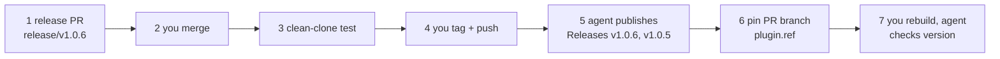

# Release v1.0.6 Implementation Plan

> **For agentic workers:** REQUIRED SUB-SKILL: Use superpowers:subagent-driven-development (recommended) or superpowers:executing-plans to implement this plan task-by-task. Steps use checkbox (`- [ ]`) syntax for tracking.

**Goal:** Ship codeo v1.0.6 from `main` as it stands (release PR, clean-clone test, tag, GitHub Release), publish the missing v1.0.5 Release, then pin this project to v1.0.6 so its container and sessions run it.

**Architecture:** Two pull requests, as intake Q3 settled. The release PR comes from its own branch `release/v1.0.6`, cut from `origin/main` in a git worktree: two files and no dossier, like #62 and #65, so the required `qc-verdict` check passes (it fails a head that carries a live dossier). This workflow branch carries the pin, the plan and the dossier, and `/codeo:close` opens its PR after the tag exists. Steps that are the engineer's (merges, tag push, container rebuild) are tasks that stop and wait.

**Tech Stack:** `git`, `gh`, `jq`, `awk`, `bash tests/run.sh`, `claude plugin list`.

**Spec:** `.codeo/75/init.md` (`## Outcome`: the six acceptance criteria); `docs/release-checklist.md` steps 6-7; `.codeo/75/plan.md` Q1-Q4.



## Global Constraints

- Release scope is `main` as it stands when the release PR is opened; open issues ship later (intake Q2).
- The release PR changes `.claude-plugin/plugin.json` (`version`) and `CHANGELOG.md` only; `.claude-plugin/marketplace.json` carries no version.
- The changelog heading is `## v1.0.6 — <date>`, the day the PR is opened (corrected before merge if it merges on a later day). Its `Config schema: 1`, `Shared state: unchanged from v1.0.5.` and `Safe to bump mid-workflow: yes` lines stay as written. Bullets are released as they stand, including any that merged to `main` before the PR is opened.
- **Other workflows touching `CHANGELOG.md` (plan Q1, Q2 = proceed and coordinate).** #51 (`feat/seed-dev-container-git-identity`, kbajpai, last QC verdict back to implement, no PR yet) adds a bullet under `## Unreleased`; #52 (`feat/run-codeo-latest-claude-models`, kbajpai, at plan, sequenced after #51) will. Neither is waited for. Whichever merges `main` after this release must put its bullet under a new `## Unreleased` above `## v1.0.6`, not under `## v1.0.6`, since git will merge the edit silently. The release PR body says so, and `implement.md` records it.
- The tag push, both PR merges and the container rebuild are the engineer's. The agent never merges or tags. The agent publishes the GitHub Releases only after the engineer says the tag is pushed (plan Q3 = A). A pushed tag is never moved.
- The tag is lightweight, as `docs/release-checklist.md` step 7 writes it and as `v1.0.5` is: `git tag v1.0.6 <SHA>`.
- The pin moves only after the tag exists: `.devcontainer/scripts/plugins.sh` checks the pin on GitHub before replacing codeo.
- The v1.0.5 Release (plan Q4 = A) is published with `--latest=false`, so v1.0.6 stays the latest.
- Tasks 2, 4 and 7 mark `Runs on: the engineer's host`; their commands are single commands a shell passes through unchanged (the lock's host is `container`).
- No shared environment, so no task carries `Needs lease:`. No invariants document, no `wiki` module, no exclusive resources, so nothing is leased.
- Documentation: this change moves no page. No page names a version or the pin, and changing the release checklist is out of scope (issue).
- `/codeo:close` opens one PR per workflow from this branch; the release PR is opened by `/codeo:implement` from `release/v1.0.6` and is a different head.

## Review Focus

- The release branch is cut from `origin/main`, not from this branch: a diff beyond two files, or any `.codeo/` change, fails `qc-verdict` and drags a live dossier into `main`.
- The clean-clone test must run at the merge commit, not at `main`'s tip if `main` moved after the merge.
- `main` may have moved between this plan and Task 1: the changelog edit is the heading only, so any new bullet under `## Unreleased` ships; Task 1 reads `## Unreleased` before retitling it.
- A lightweight tag has no `^{}` line in `git ls-remote --tags origin`: criterion 3 is read from the plain `refs/tags/v1.0.6` line, and `gh release create --verify-tag` is the check that the tag exists.
- `gh release create` for v1.0.5 must not be marked latest.
- A stale `CODEO_ROOT` or an old session: the version check runs in a session started after the rebuild, and `claude plugin list` shows a user-scope and a project-scope `codeo@codeo`; Task 7 records either one that is not 1.0.6.

---

### Task 1: Open the release PR from `release/v1.0.6`

**Files:**
- Modify: `.claude-plugin/plugin.json:3` (`version`)
- Modify: `CHANGELOG.md:3` (`## Unreleased` heading)
- Worktree: `../codeo-75-release`, branch `release/v1.0.6` from `origin/main`

**Interfaces:**
- Produces: PR number `<RPR>` for Task 2, and the branch `release/v1.0.6` on origin.

- [ ] **Step 1: Cut the branch in a worktree**

Run: `git fetch origin && git worktree add -b release/v1.0.6 ../codeo-75-release origin/main && git -C ../codeo-75-release log --oneline -1`
Expected: the tip of `origin/main` (`2a86915`, or later if `main` moved).

- [ ] **Step 2: Run the failing check**

Run: `cd ../codeo-75-release && jq -e '.version == "1.0.6"' .claude-plugin/plugin.json && grep -q '^## v1.0.6 — ' CHANGELOG.md`
Expected: FAIL (exit 1; version is `1.0.5`, no such heading).

- [ ] **Step 3: Make the two edits**

Set `version` to `"1.0.6"`; retitle line 3 `## Unreleased` as `## v1.0.6 — 2026-11-14` (the opening day). Read `sed -n 1,12p CHANGELOG.md` first and touch nothing else.

- [ ] **Step 4: Run the check and the suite**

Run: `jq -e '.version == "1.0.6"' .claude-plugin/plugin.json && grep -c '^## v1.0.6 — ' CHANGELOG.md && ! grep -q '^## Unreleased' CHANGELOG.md && git diff --name-only origin/main && bash tests/run.sh | tail -1`
Expected: `true`, `1`, then exactly `.claude-plugin/plugin.json` and `CHANGELOG.md`, then `all cases passed`.

- [ ] **Step 5: Commit, push, open the PR**

```bash
git add .claude-plugin/plugin.json CHANGELOG.md
git commit -m "release: v1.0.6"   # trailer: Co-Authored-By per the session's attribution
git push -u origin release/v1.0.6
gh pr create --base main --title "release: v1.0.6" --body-file <body>
```
Body, following #65: patch release; config schema 1, shared state unchanged from v1.0.5, safe to bump mid-workflow; one line per change (dev container on `ubuntu:26.04` (#67); closing blocks name only a command that can run (#69)); "After merge: tag `v1.0.6` on the merge commit"; the coordination note for #51 and #52 from Global Constraints; the PR attribution footer.
Proof: `gh pr view <RPR> --json baseRefName,files --jq '[.baseRefName, ([.files[].path]|sort)]'` prints `["main",[".claude-plugin/plugin.json","CHANGELOG.md"]]`, and `gh pr checks <RPR>` shows `tests` and `qc-verdict` passing.

### Task 2: The engineer merges the release PR (wait)

Runs on: the engineer's host

**Interfaces:**
- Consumes: `<RPR>` from Task 1.
- Produces: `<SHA>`, the merge commit, for Tasks 3 and 4.

- [ ] **Step 1: Stop and say the PR is waiting for the engineer's merge.** The agent does not merge.
- [ ] **Step 2: Once told it is merged, read the commit**

Run: `gh pr view <RPR> --json state,mergeCommit --jq '[.state, .mergeCommit.oid]'`
Expected: `["MERGED","<40-hex SHA>"]`. Record `<SHA>` in `implement.md`. Remove the worktree: `git worktree remove ../codeo-75-release`.

### Task 3: Clean-clone test of the merged commit (agent)

**Interfaces:**
- Consumes: `<SHA>`.
- Produces: the result line the engineer reads before tagging.

- [ ] **Step 1: Run it**

```bash
dir=$(mktemp -d) && git clone https://github.com/kbajpai/codeo.git "$dir" && cd "$dir" && git checkout --detach <SHA>
git rev-parse HEAD; jq -r .version .claude-plugin/plugin.json; bash tests/run.sh | tail -1
```
Expected: `<SHA>`, `1.0.6`, `all cases passed`. Record the SHA and the last line in `implement.md`. (No golden directory, so `tests/replay.test.sh` is not run.)

### Task 4: The engineer tags and pushes v1.0.6 (wait)

Runs on: the engineer's host

**Interfaces:**
- Consumes: `<SHA>` and Task 3's passing line.
- Produces: tag `v1.0.6` on origin, which Tasks 5 and 6 need.

- [ ] **Step 1: Give the engineer these three commands, one at a time, and stop.** Each is one command with nothing the shell rewrites:

```
git fetch origin
git tag v1.0.6 <SHA>
git push origin v1.0.6
```
- [ ] **Step 2: Once told it is pushed, prove criterion 3**

Run: `git ls-remote --tags origin v1.0.6`
Expected: `<SHA>	refs/tags/v1.0.6` (lightweight: no `^{}` line). If the line names another commit or the tag is missing, stop and say so; never move a pushed tag.

### Task 5: Publish the GitHub Releases (agent, on the engineer's say-so)

**Interfaces:**
- Consumes: the tag from Task 4; `CHANGELOG.md` sections `## v1.0.6` and `## v1.0.5`.
- Produces: Releases `v1.0.6` and `v1.0.5`.

- [ ] **Step 1: Failing check:** `gh release view v1.0.6; gh release view v1.0.5` → both `release not found`.
- [ ] **Step 2: Publish v1.0.6 from a checkout at `<SHA>`** (the clean clone of Task 3):

```bash
awk '/^## v1.0.6 /{f=1;next} /^## /{f=0} f' CHANGELOG.md > <scratchpad>/notes-v1.0.6.md
gh release create v1.0.6 --verify-tag --title "release: v1.0.6" --notes-file <scratchpad>/notes-v1.0.6.md --generate-notes
```
- [ ] **Step 3: Publish v1.0.5** (plan Q4 = A), not as latest, from the same checkout:

```bash
awk '/^## v1.0.5 /{f=1;next} /^## /{f=0} f' CHANGELOG.md > <scratchpad>/notes-v1.0.5.md
gh release create v1.0.5 --verify-tag --latest=false --title "release: v1.0.5" --notes-file <scratchpad>/notes-v1.0.5.md
```
- [ ] **Step 4: Prove criterion 4**

Run: `gh release list --limit 3 && gh release view v1.0.6 --json tagName,name,isDraft,isPrerelease --jq '[.tagName,.name,.isDraft,.isPrerelease]'`
Expected: `release: v1.0.6` marked `Latest` above `release: v1.0.5`, then `["v1.0.6","release: v1.0.6",false,false]`.

### Task 6: Pin this project to v1.0.6

**Files:**
- Modify: `.codeo/config.json:6` (`plugin.ref`)

**Interfaces:**
- Consumes: the tag from Task 4.

- [ ] **Step 1: Failing check:** `jq -e '.plugin.ref == "v1.0.6"' .codeo/config.json` → FAIL (ref is `v1.0.5`).
- [ ] **Step 2: Edit** `plugin.ref` to `"v1.0.6"`; nothing else in the file.
- [ ] **Step 3: Prove it**

Run: `jq -e '.plugin.ref == "v1.0.6"' .codeo/config.json && git ls-remote --exit-code origin refs/tags/v1.0.6 >/dev/null && bash tests/run.sh | tail -1`
Expected: `true`, then `all cases passed` (`tests/devcontainer.test.sh` accepts any well-formed ref).
- [ ] **Step 4: Commit** `.codeo/config.json`; `/codeo:close` opens this branch's PR. Criterion 5 is met when that PR merges.

### Task 7: Rebuild, then prove the container runs v1.0.6 (criterion 6)

Runs on: the engineer's host

- [ ] **Step 1: The engineer rebuilds or restarts the dev container, then starts a new Claude Code session.** The agent stops until told.
- [ ] **Step 2: Version**

Run: `claude plugin list`
Expected: `codeo@codeo` shows `Version: 1.0.6` for the user-scope entry. If the project-scope entry still shows another version, record it as a finding in `implement.md`; do not edit `.claude/settings.json` to hide it.
