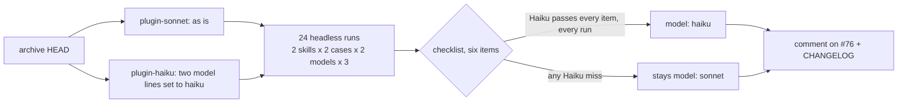

# Trial `doctor` and `setup` on Haiku 5.5 Implementation Plan

> **For agentic workers:** REQUIRED SUB-SKILL: Use superpowers:subagent-driven-development (recommended) or superpowers:executing-plans to implement this plan task-by-task. Steps use checkbox (`- [ ]`) syntax for tracking.

**Goal:** Run `doctor` and `setup` on Haiku 5.5 and on Sonnet 5.5 against the same inputs, record the comparison on #76, and switch a skill's `model:` line to `haiku` only where every Haiku run passed the same checklist.

**Architecture:** A throwaway trial script in the session scratchpad (not in the repository) runs each skill headlessly with `claude -p`, once per case, model and repetition, and scores every run against a six-item checklist from its own stream log. The only repository changes are the `model:` lines the results justify and a `CHANGELOG.md` entry; the evidence goes on the issue.

**Tech Stack:** bash, jq, `claude -p --output-format stream-json --verbose`, `gh`, `bash tests/run.sh`.

**Spec:** `.codeo/76/init.md` (`## Outcome`: the four acceptance criteria); plan Q1-Q3 of `.codeo/76/plan.md`, all answered A.



## Global Constraints

- **What "matched" means (Q2 = A).** Per run, six items. Haiku must pass every applicable item on every one of its three runs of a case, for both cases of a skill; one miss keeps that skill on `model: sonnet`. A Sonnet run that misses an item is recorded and does not count against Haiku.
  1. `one-script` — exactly one Bash call, and it runs the skill's script: `scripts/doctor.sh`; for `setup`, `scripts/setup.sh`, with `--stack node` when the case passes it.
  2. `verbatim` — every non-empty line the script printed (the Bash tool result) appears as a line of the final report.
  3. `exit-stated` — a non-zero exit is stated in the report (`non-zero`, `exit 1`, or `exited with 1`); a zero exit is not described as a failure.
  4. `closing-block` — a line `---`, then `**Done:**`, `**Next goal:**` and `**Steps:**` in that order, then only numbered steps (two to five), and nothing after the last one.
  5. `next-goal` — per case: `doctor-pass` names `/codeo:issue` and `/codeo:init`; `doctor-fail` makes fixing the named failures the goal and its last step re-runs `/codeo:doctor`; `setup-fresh` names `/codeo:doctor`; `setup-refuse` makes the existing config the goal (read by hand: the skill names no command for it). In every case step 1 holds a backticked command.
  6. `files` — `setup` only: the scratch repository's tree (excluding `.git`) equals what running `scripts/setup.sh` directly produces for that case (fresh: the config and `docs/plans/`; refuse: unchanged from before the run). `-` for `doctor`.
- **Cases (Q1 = A), three runs per model each:** `doctor-pass` (this checkout) · `doctor-fail` (a scratch repository whose `.codeo/config.json` is not valid JSON) · `setup-fresh` (a fresh scratch repository with an `origin` remote, run as `/codeo:setup --stack node`) · `setup-refuse` (a scratch repository that already has `.codeo/config.json`, run as `/codeo:setup`, where `setup.sh` exits 1). 24 runs, about $2-3.
- **The model that ran is read from `modelUsage`,** never assumed. A Haiku-copy run must show `claude-haiku-5-5` with output tokens and no `claude-sonnet-5-5` output tokens; a Sonnet-copy run, the reverse. Sonnet runs are started with `--model sonnet`, Haiku runs with the session default left at `sonnet` so that it is the skill's `model: haiku` line being tested. If the skill's line does not switch the model (Task 1, Step 4), the Haiku runs add `--model haiku` instead and the comment says so.
- **Nothing the trial runs writes into this checkout.** `doctor` runs here and writes nothing; `setup` and `doctor-fail` run in scratch repositories under the trial directory.
- **The trial script is not committed** (my call, Q3 = A): its result is the record. It lives in `/tmp/claude-1000/-workspaces-codeo-76/6609c84d-3bcd-498b-8cc1-4363e3bb9d1e/scratchpad/trial`, called `$TRIAL` below.
- **Out of scope** (the issue's): explicit model IDs in place of aliases, any other skill, the `models.subagent` and `models.reviewer` defaults, `scripts/usage.sh`.
- **Documentation.** No page under `docs/` names the model of `doctor` or `setup` (`docs/handoff.md:390` is about the subagent default), so the one document the change moves is `CHANGELOG.md`. No wiki, no invariants document, no shared environment: no task carries `Needs lease:`, and no task runs on the engineer's host.
- **Other workflows.** #73's footprint (`docs/dev-environment-sbx-evaluation.md`, one plan under `docs/plans/`) shares nothing with this one. #51 and #52, which also edited `CHANGELOG.md`, have merged.
- The `shell` suite has no `filter`, so a repository task's proof is the whole `bash tests/run.sh`. Tasks 1-3 are not repository code; their proof is a command that must print the stated result.

## Review Focus

- A Haiku run that never used Haiku. If the installed codeo v1.0.6 wins over `--plugin-dir`, or the skill's `model:` line does not switch the model, every "Haiku" run is a Sonnet run and the comparison is empty. Task 1 Step 4 and the per-run `modelUsage` check catch it.
- Sonnet failing its own checklist. Closing-block wording varies run to run; if Sonnet misses item 4 or 5 often, the checklist is wrong, not the model. Task 2 reports Sonnet's misses beside Haiku's so the comment can say so.
- The `doctor-fail` case not failing. A config the scripts tolerate would make the case a second pass. Task 1 Step 3 proves `doctor.sh` exits non-zero there.
- Machine state leaking between runs: `gh` rate limits or auth for `doctor`, a leftover `.codeo/` in a scratch repository for `setup`. Each `setup` run gets a fresh directory; a `doctor` run that fails on `gh` is re-run once and both are recorded.
- Switching a skill on three runs of two cases. Three is a sample, not proof; the comment says "no miss in 3 runs per case", not "equal".

---

### Task 1: Build the trial script and prove it before the 24 runs

**Files:**
- Create (not committed): `$TRIAL/check.sh`, `$TRIAL/trial.sh`, `$TRIAL/fixtures/good.stream.jsonl`, `$TRIAL/fixtures/bad.stream.jsonl`

**Interfaces:**
- Produces `$TRIAL/check.sh <stream.jsonl> <skill> <case> [<repo-dir> <reference-dir>]` → six lines `<item><TAB>P|F|-`, in the order of Global Constraints, and exit 0.
- Produces `$TRIAL/trial.sh setup` → creates `$TRIAL/plugin-sonnet` and `$TRIAL/plugin-haiku` from `git archive HEAD` (the second with the `model:` line of `skills/doctor/SKILL.md` and `skills/setup/SKILL.md` set to `haiku`), and the reference trees under `$TRIAL/ref/`.
- Produces `$TRIAL/trial.sh run <skill> <case> <model> <n>` → runs the case in `$TRIAL/runs/<skill>-<case>-<model>-<n>/`, saving `stream.jsonl`, and appends one TSV row to `$TRIAL/results.tsv`: `skill case model n i1 i2 i3 i4 i5 i6 modelUsage-keys cost`.
- A stream log is the output of `claude -p --plugin-dir <copy> --allowedTools Bash --model <m> --output-format stream-json --verbose "<prompt>"`, lines not starting with `{` dropped (the `[mcp-sdk]` warning). `check.sh` reads `tool_use` blocks named `Bash`, their `tool_result`, and the final `{"type":"result"}` line's `.result` and `.modelUsage`.

- [ ] **Step 1: Write the fixtures and the failing check.** `good.stream.jsonl` is a hand-written stream: one Bash `tool_use` running `bash "/x/scripts/doctor.sh"`, its `tool_result` of two `ok` lines, and a `result` that repeats both lines and ends `---` / `**Done:** …` / `**Next goal:** … /codeo:issue … /codeo:init …` / `**Steps:**` / `1. \`/codeo:issue\``. `bad.stream.jsonl` is the same with one `ok` line dropped from the report and a sentence after the last step. Write `$TRIAL/fixtures/check.test.sh` asserting `check.sh good… doctor doctor-pass` prints `P` for items 1-5 and `-` for 6, and `check.sh bad… doctor doctor-pass` prints `F` for items 2 and 4.
- [ ] **Step 2: Run it to see it fail.** `bash $TRIAL/fixtures/check.test.sh`. Expected: FAIL, `check.sh: No such file`.
- [ ] **Step 3: Implement `check.sh` and `trial.sh`.** One `jq` pass per item for the mechanical ones; the case table from Global Constraints (prompt, expected script, expected arguments) lives in `trial.sh`. `trial.sh setup` also builds the references by running `scripts/setup.sh --stack node` directly in a fresh scratch repository (`git init`, `git remote add origin https://github.com/acme/shop.git`, `git symbolic-ref refs/remotes/origin/HEAD refs/remotes/origin/main`) and copying its tree without `.git` to `$TRIAL/ref/setup-fresh`; `$TRIAL/ref/setup-refuse` is the pre-run tree of a repository holding `.codeo/config.json`. `doctor-fail`'s repository holds `.codeo/config.json` with the text `{ not json`.
- [ ] **Step 4: Prove the check, the cases and the mechanism.**
  1. `bash $TRIAL/fixtures/check.test.sh`. Expected: `ok`, no `F` lines unexpected.
  2. `bash $TRIAL/trial.sh setup`, then in the `doctor-fail` repository `bash $TRIAL/plugin-sonnet/scripts/doctor.sh; echo $?`. Expected: at least one `fail` line, then `1`. Run `setup.sh --stack node` twice in two fresh repositories and `diff -r` them. Expected: no output (the trees are deterministic).
  3. `bash $TRIAL/trial.sh run doctor doctor-pass sonnet 0` and `bash $TRIAL/trial.sh run doctor doctor-pass haiku 0`. Expected: two rows; the `modelUsage` column of the first names only `claude-sonnet-5-5`, of the second names `claude-haiku-5-5` and not `claude-sonnet-5-5`. If the second still names Sonnet, re-run it with `--model haiku` added in `trial.sh` for Haiku copies and note that in the comment. If it names Sonnet even then, stop: raise it in `implement.md`.
  4. Delete the two `n = 0` rows from `results.tsv` so the 24 runs start clean.

**Proof of done:** `bash $TRIAL/fixtures/check.test.sh` prints `ok`, and the Step 4 outputs match the expectations above.

### Task 2: Run the 24 trial runs and read the result

**Files:** none; output is `$TRIAL/results.tsv` and `$TRIAL/runs/`.

**Interfaces:** Consumes `$TRIAL/trial.sh run` from Task 1.

- [ ] **Step 1: Run every combination.**

  ```bash
  for skill_case in doctor:doctor-pass doctor:doctor-fail setup:setup-fresh setup:setup-refuse; do
    for model in sonnet haiku; do for n in 1 2 3; do
      bash "$TRIAL/trial.sh" run "${skill_case%%:*}" "${skill_case##*:}" "$model" "$n"
    done; done
  done
  ```

  Expected: 24 rows in `results.tsv`, none with an empty `modelUsage` column.
- [ ] **Step 2: Check the model column.** `awk -F'\t' '$3=="haiku" && $11 ~ /sonnet/' $TRIAL/results.tsv` Expected: no output (no Haiku run used Sonnet). `awk -F'\t' '$3=="sonnet" && $11 ~ /haiku-5-5/ && $11 !~ /sonnet/' $TRIAL/results.tsv` Expected: no output.
- [ ] **Step 3: Read item 5 of `setup-refuse` by hand** for the six runs (`jq -r 'select(.type=="result").result' $TRIAL/runs/setup-setup-refuse-*/stream.jsonl`): the Next goal must be about the existing `.codeo/config.json`, with a fix as its steps. Write `P` or `F` into that item's column. Any run that failed on `gh` (a `doctor` run whose script output shows a `gh` network error) is re-run once; keep both rows.
- [ ] **Step 4: Decide per skill.** `awk -F'\t' '$3=="haiku" { for (i=5;i<=10;i++) if ($i=="F") miss[$1]++ } END { print (miss["doctor"]+0), (miss["setup"]+0) }' $TRIAL/results.tsv` Expected: two numbers, the Haiku misses for `doctor` and for `setup`. A skill with 0 misses switches in Task 4; a skill with more keeps `sonnet`. Keep the rows for every miss, Sonnet's too, for Task 3.

**Proof of done:** `wc -l < $TRIAL/results.tsv` prints `24` (`25` if a re-run row was kept; count it in the comment) and Step 2's two `awk` commands print nothing.

### Task 3: Record the comparison on #76

**Files:** none; the record is one comment on issue #76.

**Interfaces:** Consumes `$TRIAL/results.tsv` and the per-skill decision from Task 2.

- [ ] **Step 1: Write the comment** to `$TRIAL/comment.md`: the Claude Code version (`claude --version`), the command form from Task 1, and what was compared (the six items, the four cases, three runs per model each). Then a table, one row per case and model, giving the number of runs passing each item, then the decision per skill. For every Haiku miss, say which item, which case and what the report did differently, quoting the line; for a Sonnet miss, the same, marked as Sonnet's. Say that three runs per case is a sample, and which skill switches or stays. The raw reports are not kept (Q3 = A).
- [ ] **Step 2: Post it.** `gh issue comment 76 --body-file $TRIAL/comment.md`.
- [ ] **Step 3: Prove it.** `gh issue view 76 --comments --json comments -q '.comments[].body' | grep -cE 'doctor-pass|setup-refuse'`. Expected: `2` or more (the table names the cases).

**Proof of done:** the Step 3 command prints 2 or more.

### Task 4: Switch the lines the result justifies, and the changelog

**Files:**
- Modify: `skills/doctor/SKILL.md:4`, `skills/setup/SKILL.md:4` (only for a skill with 0 Haiku misses)
- Modify: `CHANGELOG.md` (a new bullet under `## Unreleased`)

**Interfaces:** Consumes the per-skill decision from Task 2 and the comment's URL from Task 3.

- [ ] **Step 1: Show the check failing.** `grep -n '^model:' skills/doctor/SKILL.md skills/setup/SKILL.md`. Expected: both `sonnet`; this is the state a switch changes.
- [ ] **Step 2: Switch.** For each skill with no Haiku miss, change its `model: sonnet` line to `model: haiku`; leave the other as it is. When neither passed, change neither.
- [ ] **Step 3: Write the changelog bullet** under `## Unreleased`, beside the #51 and #52 bullets, ending `(#76)`: the Claude Code version, the four cases and three runs per model, which skill now runs on `haiku` and which stays on `sonnet` and how its Haiku runs differed, the link to the comment, and `Nothing in scripts/, lib/ or hooks/ changes`. If neither switched, say that the trial found a difference and that nothing changed.
- [ ] **Step 4: Prove it.** `grep -n '^model:' skills/doctor/SKILL.md skills/setup/SKILL.md` — Expected: `haiku` for each skill Task 2 cleared, `sonnet` for any other. `bash tests/run.sh` — Expected: `all cases passed`.
- [ ] **Step 5: Commit** `feat: run <skills> on Haiku 5.5 after a trial (#76)` (or `docs: record the Haiku 5.5 trial of doctor and setup; nothing switched (#76)`), staging `CHANGELOG.md` and each changed `SKILL.md` by name.

**Proof of done:** the `grep` shows the lines Task 2 decided and `bash tests/run.sh` prints `all cases passed`.

---

## Self-review

- **Coverage:** criterion 1 → Tasks 1-3; criterion 2 → Tasks 2 and 4, with how a skill differed in Task 3's comment; criterion 3 → Task 4 Step 4; criterion 4 → Task 4 Step 3. Q1 (cases and counts), Q2 (checklist, one miss keeps Sonnet) and Q3 (comment only) are Global Constraints, Task 2 and Task 3.
- **One refinement of Q2:** item 6 compares each run's files to what the script itself writes, not to a Sonnet run's; when the Sonnet runs pass the item, that is the same comparison, and a Sonnet run that differs is recorded.
