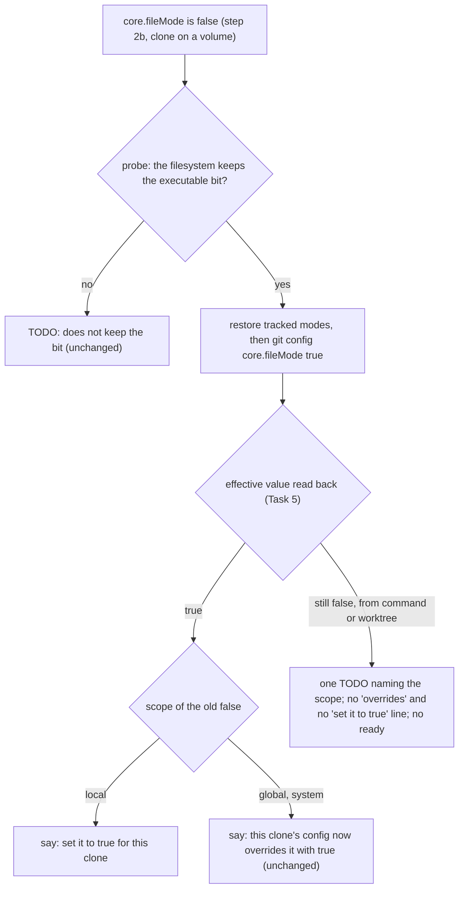

# Dev Container Follow-ups from #96's QC Implementation Plan

> **For agentic workers:** REQUIRED SUB-SKILL: Use superpowers:subagent-driven-development (recommended) or superpowers:executing-plans to implement this plan task-by-task. Steps use checkbox (`- [ ]`) syntax for tracking.

**Goal:** Fix the small defects and weak tests that #96's QC (F3-F7, F10-F18) recorded as non-blocking, in one pull request, so that the release commit (#100, v1.0.7) does not turn the suite red and no assertion in `tests/devcontainer.test.sh` is vacuous.

**Architecture:** Small edits to `.devcontainer/scripts/devcontainer-start.sh` and `.devcontainer/scripts/codeo-root.sh`, each driven by a failing case in the test file that already guards the script (`tests/devcontainer.test.sh`, `tests/codeo-root.test.sh`). Three tasks only strengthen existing tests and change no script. Two pages move: `.devcontainer/README.md` and `CHANGELOG.md`, both in Task 8 after merging `origin/main`. No image, tool, `scripts/`, `hooks/` or `skills/` change.

**Tech Stack:** bash, jq, git, shellcheck (for one check), `bash tests/run.sh`.

**Spec:** `.codeo/107/init.md` (`## Outcome`: the acceptance criteria, verbatim from the issue) and `.codeo/107/plan.md` (Q1-Q4 and their answers). The findings' original text is in `.codeo/done/96/qc.md` (rounds 2-3, F3-F7, F10-F18) and in the issue body.

## Global Constraints

- **Out of scope** (the issue's): the folder-name limit for `my project` / `_x`; persisting Claude's login across a rebuild; image changes, new tools, anything under `scripts/`, `hooks/` or `skills/`. `lib/` is not touched either. That the bind-mount TODO never clears under rootless Docker or Podman (F3's second sentence) stays as it is.
- `devcontainer-start.sh` still always exits 0 and every failure stays a TODO line; `codeo-root.sh` still exits 0 with a root or 1 with one `codeo-root:` line.
- **Q1 (answered: option A).** After the script writes the local `core.fileMode true`, it reads the effective value back. When that is still `false`, a scope that outranks the clone's config (`command`: `GIT_CONFIG_COUNT`, `GIT_CONFIG_PARAMETERS`; or `worktree`) supplies it: the script prints neither the "overrides it with true" line nor the "set it to true for this clone" clause, lists one TODO naming the scope, and so does not print `ready`. The modes are still restored and the local `true` stays.
- **Q2 (answered: proceed with the guard).** The trap never runs `rm` with an empty operand (Task 4). The literal `rm -f -- ""` is refused by this environment's safety check, so Task 9 records what is established (`/usr/bin/rm` resolves to `gnurm`, GNU coreutils 9.7, on the 26.04.1 image; `mktemp` is the Rust one) and that the literal command was not run, unless the engineer pasted its output into `.codeo/107/plan.md` first, in which case that output is recorded.
- **Q3, Q4 (answered: proceed and coordinate).** #70 and #71 also edit `CHANGELOG.md` (#70 also `.devcontainer/README.md` and `tests/**`). `CHANGELOG.md` and the README are therefore each edited once, in Task 8, after merging `origin/main`; whichever branch merges second keeps both bullets.
- **F14 by construction.** The growing-gitconfig case no longer sleeps: its stub `stat` appends the next piece of the host file on each settle-stamp read, so two consecutive reads agree only after the email is written. The issue allows this in place of 20 runs under `nice`; the load-dependent timing is gone, and it is proved by a mutation (Task 3), not by repetition.
- **Documentation this change moves:** `.devcontainer/README.md` (the `core.fileMode` bullet, Task 8) and `CHANGELOG.md` (Task 8). No other page under `docs/` describes the dev container; there is no wiki module.
- **Mutation check.** Where a task says "mutate in a scratch copy", run this and apply the named edit in the copy only, never in the checkout:

  ```
  m=$(mktemp -d) && cp -a . "$m" && (cd "$m" && <the edit> && bash tests/devcontainer.test.sh); rm -rf "$m"
  ```

  The run must print the `FAIL` line the task names. `tests/devcontainer.test.sh` finds the scripts relative to itself, so the copy tests the mutated script.
- Ordering: every task is proved in this checkout by the `shell` suite; no shared environment is configured, so no task carries `Needs lease:`, none runs on the engineer's host, and no invariants document is configured.
- The `shell` suite has no `filter`: a task's proof is the file it touches (`bash tests/devcontainer.test.sh`, `bash tests/codeo-root.test.sh`), ending `all cases passed`, then the whole `bash tests/run.sh`, ending `all cases passed`. Tests print `FAIL <case>: <detail>` and exit 1.

## Review Focus

- The new `core.fileMode` branch (Task 5) must leave the existing global-scope case untouched: with the `false` in the global config the message is unchanged (`start_names_a_file_mode_overridden_from_a_wider_scope`).
- The `mktemp` failure path (Task 4) must not leave the error text in `modes_list`, or the EXIT trap would try to remove it.
- `codeo-root.sh` must still never take another project's entry, whatever `projectPath` looks like (Task 6).
- No test may lose the failure it had: each strengthened assertion is shown red by a mutation (Tasks 1-3).



---

## File Structure

| File | Change |
|---|---|
| `.devcontainer/scripts/devcontainer-start.sh` | the bind-mount TODO claims trust only when it holds, `mktemp` failure reason and guarded trap (Task 4); effective `core.fileMode` read back (Task 5) |
| `.devcontainer/scripts/codeo-root.sh` | registry fields read raw, not through `@tsv` (Task 6) |
| `tests/devcontainer.test.sh` | the cases each task names; stubs in `ds_setup` (`claude` marker, growing `stat`) |
| `tests/codeo-root.test.sh` | backslash, empty and `false` `projectPath` cases (Task 6) |
| `.devcontainer/README.md`, `CHANGELOG.md` | Task 8 |

---

### Task 1: The changelog test finds its bullets wherever they sit (F16)

**Files:**
- Modify: `tests/devcontainer.test.sh` (`docs_changelog_names_the_replay_sed_and_the_folder_limit`, at the end of the file before `cases=`)

- [ ] **Step 1: Write the failing proof first.** In a scratch copy, retitle the section: `(cd "$m" && sed -i 's/^## Unreleased/## v9.9.9/' CHANGELOG.md && bash tests/devcontainer.test.sh)` (mutation check). Expected today: `FAIL docs_changelog_names_the_replay_sed_and_the_folder_limit: the #52 bullet does not name tests/replay.test.sh` and the folder-limit failure.
- [ ] **Step 2: Rewrite the case** to search the whole file:

  ```bash
  docs_changelog_names_the_replay_sed_and_the_folder_limit() {
      local log="$repo/CHANGELOG.md"
      grep '(#52)' "$log" | grep -q 'tests/replay.test.sh' || fail 'the #52 bullet does not name tests/replay.test.sh'
      grep -q 'my project' "$log" || fail 'CHANGELOG.md does not state the folder-name limit (my project)'
  }
  ```

- [ ] **Step 3: Prove it.** In a scratch copy with `## Unreleased` retitled to `## v9.9.9` as in Step 1, `bash tests/devcontainer.test.sh` prints no `FAIL docs_changelog_` line; in a second scratch copy with the `(#52)` bullet's file name removed (`sed -i '/(#52)$/ s#tests/replay\.test\.sh#tests/gone.sh#g' CHANGELOG.md`) it prints `FAIL docs_changelog_names_the_replay_sed_and_the_folder_limit: the #52 bullet does not name tests/replay.test.sh`. In the checkout, `bash tests/devcontainer.test.sh` → `all cases passed`.
- [ ] **Step 4: Commit** `fix: the changelog test reads the whole CHANGELOG, so a release retitle cannot break it (#107)`.

---

### Task 2: F5, F6 and F10 assert what they claim

**Files:**
- Modify: `tests/devcontainer.test.sh` (`ds_setup`'s `claude` stub; `start_lock_crash_is_a_todo`; `start_runs_claude_outside_the_clone`; `title_reports_a_failing_container_name_as_one_line`)

- [ ] **Step 1: F5.** In `start_lock_crash_is_a_todo` replace the line `[[ $(grep -c boom <<<"$ds_err" || true) == 1 ]] || fail "boom is not on stderr on exactly one line: $ds_err"` with an occurrence count: `[[ $(grep -o boom <<<"$ds_err" | wc -l | tr -d ' ') == 1 ]] || fail "boom does not appear exactly once on stderr: $ds_err"`.
- [ ] **Step 2: F10.** In the `claude` stub in `ds_setup`, after the `echo "$PWD" >> "$STUB_DIR/claude-pwds"` line add `[[ -z ${STUB_CLAUDE_MARK:-} ]] || : > "$PWD/claude-was-here"`. In `start_runs_claude_outside_the_clone` set `STUB_CLAUDE_MARK=1` on the run (`STUB_CLAUDE_MARK=1 ds_ready_run`) and replace the `git status --porcelain --untracked-files=no` line with `[[ ! -e "$ds_dir/codeo-home/claude-was-here" ]] || fail 'claude left a file in the clone'` and `[[ -e "$ds_dir/home/claude-was-here" ]] || fail 'claude did not run from the home directory'`.
- [ ] **Step 3: F6.** In `title_reports_a_failing_container_name_as_one_line`, before `wt_run` create the folder and a settings file that must survive: `mkdir -p "$wt_dir/.vscode" && printf '{"editor.tabSize":2}\n' > "$wt_dir/.vscode/settings.json"`. Replace the final `! compgen -G ...` line with: `[[ $(ls -A "$wt_dir/.vscode") == settings.json ]] || fail "the failure left something in .vscode: $(ls -A "$wt_dir/.vscode")"` and `[[ $(<"$wt_dir/.vscode/settings.json") == '{"editor.tabSize":2}' ]] || fail 'the failing run changed settings.json'`.
- [ ] **Step 4: Prove each goes red when its behaviour breaks** (mutation check, one scratch copy each; each run must print the named `FAIL`):
  - F5: in the copy's `.devcontainer/scripts/devcontainer-start.sh`, make the `codeo's lock.sh failed` TODO print `${lock_out//$'\n'/ / }` twice. Expect `FAIL start_lock_crash_is_a_todo: boom does not appear exactly once on stderr`. (The old `grep -c` line counts one line and passes.)
  - F10: in the copy, change `claude_status=$(cd "$HOME" && claude auth status 2>&1)` to `claude_status=$(claude auth status 2>&1)`. Expect `FAIL start_runs_claude_outside_the_clone: claude left a file in the clone`.
  - F6: in the copy's `.devcontainer/scripts/window-title.sh`, insert `: > "$root/.vscode/.settings.leak"` on the line before `title=$(bash`. Expect `FAIL title_reports_a_failing_container_name_as_one_line: the failure left something in .vscode`. (Against the old assertion the same mutation passed, because `.vscode` did not exist.)
- [ ] **Step 5: Prove it in the checkout.** `bash tests/devcontainer.test.sh` → `all cases passed`; then `bash tests/run.sh` → `all cases passed`.
- [ ] **Step 6: Commit** `test: the lock-crash, claude-cwd and title-failure cases can fail (#107)`.

---

### Task 3: A growing gitconfig without sleeps, a quiet interrupt, one shellcheck directive, an accurate header (F14, F13, F18, F12)

**Files:**
- Modify: `tests/devcontainer.test.sh` (header comment, the `run_args_name_the_container_after_its_clone` directive, `ds_setup`'s `stat` stub, `start_waits_for_a_host_gitconfig_that_is_still_growing`, `start_leaves_no_modes_file_when_interrupted`)

- [ ] **Step 1: F12.** In the header comment, replace `mounts only the one named gh volume` with `mounts only the two named volumes, codeo-gh (the gh login) and codeo-git (the git config)`.
- [ ] **Step 2: F18.** The directive inside `run_args_are_exact` is right and stays. Add the same one-line directive (`# shellcheck disable=SC2016 # the ${...} is the text under test, not an expansion`) directly above the `run_args_are_exact "$(dc_json)" \` command in `run_args_name_the_container_after_its_clone`: a directive covers the whole next command, including the `|| fail '…${containerWorkspaceFolderBasename}…'` continuation line (checked in a scratch file).
- [ ] **Step 3: F14.** Extend the `stat` stub in `ds_setup`: in the `*'%s %y'*)` branch, before `exec /usr/bin/stat "$@"`, add

  ```bash
  if [[ -n ${STUB_GROW_DIR:-} ]]; then
      n=$(cat "$STUB_DIR/grow-n" 2>/dev/null || echo 0)
      if [[ -f $STUB_GROW_DIR/$((n + 1)) ]]; then
          cat "$STUB_GROW_DIR/$((n + 1))" >> "$HOME/.gitconfig"
          echo $((n + 1)) > "$STUB_DIR/grow-n"
      fi
  fi
  ```

  (restructure the one-line `case` into a block). Rewrite `start_waits_for_a_host_gitconfig_that_is_still_growing`: no background subshell, no `sleep`, no `wait`. It creates `$ds_dir/grow/1` to `$ds_dir/grow/8` holding the same pieces as today (`[user]`, `\tname = Ada O'Neil`, four `\t# …` comment lines, and last `\temail = ada@example.com`, each ending in a newline), creates the host file empty, and runs `STUB_GROW_DIR="$ds_dir/grow" DS_GITCONFIG_WAIT=5 DS_AUTHOR_NAME=Env DS_AUTHOR_EMAIL=env@example.com ds_ready_run`. Its assertions stay (name and email from `~/.gitconfig`, both reports on stdout) and gain `[[ $(cat "$ds_dir/grow-n") == 8 ]] || fail 'the stub did not append all eight pieces'`.
- [ ] **Step 4: F13.** In `start_leaves_no_modes_file_when_interrupted`, run the script as `{ ds_ready_run; } 2>/dev/null` (the `Terminated` line is the test shell's own job report, which the redirect swallows; `ds_run` already sends the script's stderr to a file).
- [ ] **Step 5: Prove it.**
  - F14 mutation (one scratch copy): in the copy's `devcontainer-start.sh` change `if [[ -s $HOME/.gitconfig && $now == "$stamp" ]]; then break; fi` to `if [[ -s $HOME/.gitconfig ]]; then break; fi`. Expect `FAIL start_waits_for_a_host_gitconfig_that_is_still_growing: user.email is not the host's`.
  - F18: `shellcheck --include=SC2016 tests/devcontainer.test.sh` no longer lists the `fail '…${containerWorkspaceFolderBasename}…'` line (it still lists the two other, older lines near `lock.sh` and `session-title.sh`; they are not this plan's).
  - F13: `bash tests/devcontainer.test.sh 2>&1 | grep -c Terminated` → `0`.
  - F12: `sed -n 1,12p tests/devcontainer.test.sh | grep -c 'codeo-gh (the gh login) and codeo-git'` → `1`; `grep -c 'only the one named gh volume' tests/devcontainer.test.sh` → `0`.
  - Whole file: `bash tests/devcontainer.test.sh` → `all cases passed`; then `bash tests/run.sh` → `all cases passed`.
- [ ] **Step 6: Commit** `test: the growing-gitconfig case has no timing, the interrupt case no stray line, the header names both volumes (#107)`.

---

### Task 4: The bind-mount TODO is truthful, a failed `mktemp` says why, the trap never removes an empty name (F3, F17, F15)

**Files:**
- Modify: `tests/devcontainer.test.sh` (three new cases, registered in `cases=`)
- Modify: `.devcontainer/scripts/devcontainer-start.sh` (step 1, `restore_modes`, the EXIT trap)

- [ ] **Step 1: Write the failing tests** (register all three after `start_never_chowns_a_bind_mount` / `start_keeps_file_mode_off_when_the_mode_listing_fails`).
  - `start_bind_mount_todo_does_not_claim_trust_when_the_add_failed` (F3): `ds_setup trustfail`; `ds_mountinfo /home/u/src/codeo "$ds_dir/codeo-home"`; put a stub `git` first in `$ds_dir/bin` that exits 1 for `config --global --add safe.directory` and otherwise `exec`s the real git (the shape `start_keeps_file_mode_off_when_the_mode_listing_fails` uses, with `real_git=$(command -v git)`); `STUB_STAT_UID=$(( $(id -u) + 1 )) ds_run`. Assert exit 0; one TODO matching `not on a Docker volume`; that TODO does **not** contain `already told to trust`; one TODO matching `was not told to trust the clone`.
  - `start_mode_listing_todo_carries_the_reason_when_mktemp_fails` (F17): `ds_setup mktempfail`, `ds_on_volume`, `ds_identity`, `ds_modes_repo` (as `start_keeps_file_mode_off_when_the_mode_listing_fails` does); a stub `mktemp` first in `$ds_dir/bin` that prints `mktemp: boom` on stderr and exits 1 when an argument contains `modes.`, else `exec`s the real `mktemp` (resolved before the stub is written); `ds_ready_run`. Assert exit 0, `core.fileMode` still `false`, one TODO matching `could not be listed`, naming `update-index --chmod` and containing `mktemp: boom`.
  - `start_trap_never_runs_rm_with_an_empty_operand` (F15): `ds_setup emptyrm`; a stub `rm` first in `$ds_dir/bin` that appends every call to `$STUB_DIR/rm-calls` with each argument in brackets (`printf '[%s]' "$@"; echo`) and then `exec`s the real `rm`; `ds_ready_run`; assert exit 0 and `! grep -q '\[\]' "$ds_dir/rm-calls"` (the file may be absent or empty: treat that as a pass).
- [ ] **Step 2: Run to verify they fail.** `bash tests/devcontainer.test.sh` → `FAIL start_bind_mount_todo_does_not_claim_trust_when_the_add_failed`, `FAIL start_mode_listing_todo_carries_the_reason_when_mktemp_fails` (the TODO has no `mktemp: boom`), `FAIL start_trap_never_runs_rm_with_an_empty_operand` (the log holds `[-f][--][]`).
- [ ] **Step 3: Edit the script.**
  - F3: set `trust_ok=1` before step 1's `grep -qxF …`; make the `add` branch `|| { trust_ok=; add_todo "git was not told to trust the clone: …"; }` (same text). In the bind-mount TODO drop the closing `, and git is already told to trust the clone` and append `${trust_ok:+, and git is already told to trust the clone}` instead, so the text is unchanged when trust holds.
  - F17: in `restore_modes` replace `modes_list=$(mktemp "$(git rev-parse --git-dir)/modes.XXXXXX" 2>/dev/null) || return 2` with `modes_list=$(mktemp "$(git rev-parse --git-dir)/modes.XXXXXX" 2>&1) || { list_err=${modes_list//$'\n'/ / }; modes_list=; return 2; }`.
  - F15: change the trap to `trap '[[ -z ${modes_list:-} ]] || rm -f -- "$modes_list"' EXIT`. Update the comment above it if it names the old form.
- [ ] **Step 4: Prove it.** `bash tests/devcontainer.test.sh` → `all cases passed`, including `start_leaves_no_modes_file_when_interrupted` and `start_never_chowns_a_bind_mount` (the unchanged TODO text); then `bash tests/run.sh` → `all cases passed`.
- [ ] **Step 5: Commit** `fix: the bind-mount TODO claims trust only when it holds; a failed mktemp gives its reason; the EXIT trap never removes an empty name (#107)`.

---

### Task 5: `core.fileMode` is not claimed overridden from a scope that outranks the clone (F4, Q1 option A)

**Files:**
- Modify: `tests/devcontainer.test.sh` (new case, registered after `start_names_a_file_mode_overridden_from_a_wider_scope`)
- Modify: `.devcontainer/scripts/devcontainer-start.sh` (step 2b's `elif git config core.fileMode true; then` branch, and its header comment)

- [ ] **Step 1: Write the failing test** `start_does_not_claim_an_override_the_scope_outranks`. Three sub-runs, each in its own `ds_setup` name, each as in `start_names_a_file_mode_overridden_from_a_wider_scope` (`ds_on_volume`, `git -C "$r" config --unset core.filemode`) but with the `false` from another source:
  - command scope through `GIT_CONFIG_PARAMETERS="'core.fileMode=false'" ds_ready_run`;
  - command scope through `GIT_CONFIG_COUNT=1 GIT_CONFIG_KEY_0=core.fileMode GIT_CONFIG_VALUE_0=false ds_ready_run`;
  - worktree scope: `git -C "$r" config extensions.worktreeConfig true && git -C "$r" config --worktree core.fileMode false`, then `ds_ready_run` (if this git does not honour it, drop this sub-run and say so in the commit message).
  Each asserts: exit 0; `git -C "$r" config --local --type=bool core.fileMode` is `true`; stdout has no `overrid` and no `set it to true for this clone`; exactly one TODO matching `still false from the` that names the scope (`command` or `worktree`) and `update-index --chmod`; and stdout does not end with `ready`. The existing global-scope case stays as it is and must still pass.
- [ ] **Step 2: Run to verify it fails.** `bash tests/devcontainer.test.sh` → `FAIL start_does_not_claim_an_override_the_scope_outranks: stdout claims an override` for each sub-run.
- [ ] **Step 3: Edit the script.** In the `elif git config core.fileMode true; then` branch, first read the effective value: `[[ $(git config --type=bool core.fileMode 2>/dev/null || true) == false ]]`. When it is still false: `outranked=$(git config --show-scope --get core.fileMode 2>/dev/null || true); outranked=${outranked%%[[:space:]]*}`, add the TODO `core.fileMode is still false from the ${outranked:-wider} config, which outranks this clone's own config: unset it there (for the command scope, the GIT_CONFIG_COUNT or GIT_CONFIG_PARAMETERS variable), or stage each new script with git update-index --chmod=+x <file>`, print the restore line without its `and set it to true for this clone` clause when `restored_count > 0` (and nothing when it is 0), and keep the `kept_paths` line as it is. Otherwise the branch is unchanged (the `$filemode_scope != local` override line, the restore/`set it to true` lines). Update the header comment's step 2b sentence to say a `true` that does not take effect is reported.
- [ ] **Step 4: Prove it.** `bash tests/devcontainer.test.sh` → `all cases passed`; then `bash tests/run.sh` → `all cases passed`.
- [ ] **Step 5: Commit** `fix: the start script does not claim a core.fileMode override that a command or worktree scope outranks (#107)`.

---

### Task 6: `codeo-root.sh` matches a path with a backslash and treats an empty or `false` `projectPath` as none (F7)

**Files:**
- Modify: `tests/codeo-root.test.sh` (new cases, registered in `cases=`)
- Modify: `.devcontainer/scripts/codeo-root.sh`

- [ ] **Step 1: Write the failing tests.**
  - `registry_matches_a_project_path_with_a_backslash`: a second clone at a folder whose name holds a backslash (`bs="$root/back\\slash"`, so the directory name is `back\slash`; `mkdir -p "$bs/.devcontainer/scripts"`, `git -C "$bs" init -q`, copy the script in, `cr_clone=$(cd "$bs" && pwd -P)`); `registry "$(plugin user)" "$(plugin mine)|$cr_clone"`; `cr_run`; assert it prints `mine`. Today it prints `user`, because `@tsv` doubles the backslash.
  - `registry_treats_an_empty_project_path_as_none`: `registry "$(plugin other)|/somewhere/else" "$(plugin none)|"`; assert `cr_run` prints `none` and never `other`.
  - `registry_treats_a_false_project_path_as_none`: write the registry by hand (the helper cannot write `false`): `jq -n --arg o "$(plugin other)" --arg n "$(plugin none)" '{plugins: {"codeo@codeo": [{installPath: $o, projectPath: "/somewhere/else"}, {installPath: $n, projectPath: false}]}}' > "$root/cfg/plugins/installed_plugins.json"` (after `mkdir -p "$root/cfg/plugins"`); assert it prints `none` and never `other`.
- [ ] **Step 2: Run to verify it fails.** `bash tests/codeo-root.test.sh` → `FAIL registry_matches_a_project_path_with_a_backslash: wanted '…/mine', got '…/user'`. The other two may already pass: they pin the documented behaviour.
- [ ] **Step 3: Edit `codeo-root.sh`:** read the entries with `jq -r '.plugins["codeo@codeo"][]? | [((.projectPath // "") | tostring), ((.installPath // "") | tostring)] | join("\t")'` instead of `@tsv`, so a backslash arrives as written. Say in the header comment that a path holding a tab or a newline is not supported, and that an empty or `false` `projectPath` counts as none.
- [ ] **Step 4: Prove it.** `bash tests/codeo-root.test.sh` → `all cases passed`; `bash tests/devcontainer.test.sh` (its start cases run the script) → `all cases passed`; then `bash tests/run.sh` → `all cases passed`.
- [ ] **Step 5: Commit** `fix: codeo-root.sh reads registry paths as written, so a backslash matches (#107)`.

---

### Task 7: Check the whole suite once, as the issue asks

**Files:** none.

- [ ] **Step 1:** `bash tests/run.sh` → `all cases passed` (about 3.5 minutes). If any earlier task's proof was only the one file, this is the first run of everything together.
- [ ] **Step 2: The issue's mutation criteria in one pass.** Confirm, from the output of Tasks 1-3, that each of F5, F6 and F10 was shown red by a mutation and green in the checkout, and that `bash tests/devcontainer.test.sh 2>&1 | grep -c Terminated` prints `0`. Write what was seen into `.codeo/107/implement.md`, not here.

---

### Task 8: README, CHANGELOG, after merging `origin/main` (F4's wording, F11)

**Files:**
- Modify: `.devcontainer/README.md` (the `core.fileMode` bullet under *What the start script does*)
- Modify: `CHANGELOG.md` (the #96 bullet; one new bullet under `## Unreleased`)

- [ ] **Step 1: Merge first.** `git fetch origin main && git merge origin/main` (run through `scripts/sync-main.sh` if the checkout has the helper; resolve a CHANGELOG or README conflict by keeping both sides).
- [ ] **Step 2: README.** In the `core.fileMode` bullet, after "it says which scope the clone's `true` overrides", add: when the `false` comes from a scope that outranks the clone's config (the `GIT_CONFIG_COUNT` or `GIT_CONFIG_PARAMETERS` variables, or a worktree config), the local `true` changes nothing, so it lists one TODO naming the scope instead and does not print `ready`.
- [ ] **Step 3: The #96 CHANGELOG bullet (F11).** Change its opening to `The dev container's follow-ups to #36, #47, #50, #51, #52, #55, #57, #75 and #87` (the issues #40, #54, #81, #88 and #91 collected; the closing `(#96, closing #40, #54, #81, #88, #91)` stays). Add one sentence that `docs/release-checklist.md` step 8 now says to create the GitHub Release from the changelog section only (`--notes-file`, never `--generate-notes`) and how to repair one created with generated notes. Reword the `safe.directory` clause so it does not read as new work: the script already added the entry once however often it ran, and `start_trusts_the_clone_once` now pins it.
- [ ] **Step 4: The new bullet** at the top of the `## Unreleased` bullets, in the style of its neighbours: the dev container's follow-ups to #96's QC: the changelog test reads the whole file, so the release retitle of `## Unreleased` cannot break it (F16); the bind-mount TODO claims trust only when the `safe.directory` add worked (F3); a `core.fileMode` `false` from the command or worktree scope is a TODO naming the scope, not an "overrides" claim (F4); a failed `mktemp` gives the mode-listing TODO its reason (F17); the EXIT trap no longer runs `rm` with an empty operand (F15); `codeo-root.sh` matches a `projectPath` with a backslash and treats an empty or `false` one as none (F7); the lock-crash, claude-cwd and title-failure assertions can fail, the growing-gitconfig case has no timing, the interrupt case prints no `Terminated` line, and the test header names `codeo-gh` and `codeo-git` (F5, F6, F10, F12-F14, F18). End with `Nothing in `scripts/`, `lib/`, `hooks/` or `skills/` changes (#107).`
- [ ] **Step 5: Prove it.**
  - `grep -c 'follow-ups to #36, #47, #50, #51, #52, #55, #57, #75 and #87' CHANGELOG.md` → `1`.
  - `grep -c 'docs/release-checklist.md. step 8' CHANGELOG.md` → `1` or more.
  - `grep -c '(#107)' CHANGELOG.md` → `1`.
  - `grep -c 'outranks' .devcontainer/README.md` → `1` or more.
  - `bash tests/devcontainer.test.sh` → `all cases passed` (the changelog test still finds both bullets); then `bash tests/run.sh` → `all cases passed`.
- [ ] **Step 6: Commit** `docs: the dev container follow-ups of #107 in the README and the changelog`.

---

### Task 9: Record the `rm` check on #107 (criterion 8)

**Files:** none (one comment on the issue).

- [ ] **Step 1:** Read `.codeo/107/plan.md`'s Q2 answer. If it holds the engineer's pasted output of `rm --version | head -1` and `rm -f -- ""; echo "rc=$?"`, use it verbatim. Otherwise run `readlink -f /usr/bin/rm && /usr/bin/rm --version | head -1 && dpkg -S /usr/bin/rm` (expect `/usr/bin/gnurm`, `rm (GNU coreutils) 9.7`, `coreutils-from-uutils: /usr/bin/rm`) and state in the comment that the literal `rm -f -- ""` was not run, because this environment's safety check refuses it.
- [ ] **Step 2:** `gh issue comment 107 --body-file <the comment's text in a file>` with: the result of Step 1, and that the EXIT trap now runs `rm` only when a temp file exists (Task 4, pinned by `start_trap_never_runs_rm_with_an_empty_operand`).
- [ ] **Step 3: Prove it.** `gh issue view 107 --comments --json comments -q '.comments[-1].body' | grep -c 'gnurm\|rc='` → `1` or more.
