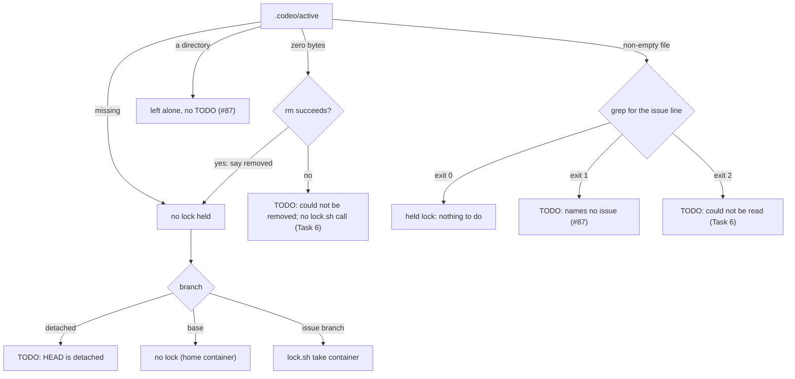

# Dev Container Follow-ups from #40, #54, #81, #88 and #91 Implementation Plan

> **For agentic workers:** REQUIRED SUB-SKILL: Use superpowers:subagent-driven-development (recommended) or superpowers:executing-plans to implement this plan task-by-task. Steps use checkbox (`- [ ]`) syntax for tracking.

**Goal:** Close the non-blocking findings #40, #54, #81, #88 and #91 left in the dev container (`.devcontainer/`, its start scripts, `codeo-root.sh` and their tests) in one pull request.

**Architecture:** Small changes to the existing scripts under `.devcontainer/scripts/`, each driven by a failing case in the test file that already guards the script (`tests/devcontainer.test.sh`, `tests/codeo-root.test.sh`, `tests/env.test.sh`). Two pages move: `.devcontainer/README.md` and `docs/release-checklist.md`; `CHANGELOG.md` records the change once, in the last task. Nothing is built that the issue did not ask for.

**Tech Stack:** bash, jq, git, `bash tests/run.sh`.

**Spec:** `.codeo/96/init.md` (`## Outcome`: the acceptance criteria, verbatim from the issue) and `.codeo/96/plan.md` (Q1-Q7 and their answers). The five sections' original findings are in the issue body and in `.codeo/done/47/qc.md`, `.codeo/done/50/qc.md`, `.codeo/done/51/qc.md`, `.codeo/done/52/qc.md`, `.codeo/done/57/qc.md`, `.codeo/done/75/qc.md` and `.codeo/done/87/qc.md`.

## Global Constraints

- **Files that may not change** (the sections' own Out of Scope): nothing under `scripts/`, `hooks/` or `skills/`; `lib/` changes only by the one comment line in Task 4 (#40 requires it); no change to the image (`.devcontainer/Dockerfile`) and no new tool; `folder-check.sh`, `lock.sh` and `container-name.sh`'s behaviour are not changed (Task 7 edits one comment in `container-name.sh`). The container runs the pinned plugin, so a change to this repository's own `scripts/` would not reach it before the next pin bump.
- `devcontainer-start.sh` still always exits 0, and every failure stays a TODO line.
- **Q1 (answered: keep the folder as the Docker name):** `runArgs`' `--name=${containerWorkspaceFolderBasename}` does not change, so #54's criterion "a dev container for a clone in a folder named `my project` or `_x` starts" is **not met, by decision**. Docker rejects the name before any script runs and `devcontainer.json` cannot transform it. This plan states the limit in the CHANGELOG (Task 10), which the README already does. `/codeo:qc` reports that criterion as `not met — decided in plan Q1`; amend it on #96 if you want it to read as met.
- **Q2 (answered):** `--cpus=2` is removed; `--memory=4g` stays. No container needs more than a rebuild to pick this up.
- **Q3 (answered):** persisting Claude's login across rebuilds is not done here. It is filed as its own issue in Task 11 (after the PR's other work, through `/codeo:issue`), and the README's *Rebuilding* paragraph stays as it is.
- **Q4 (answered):** the v1.0.6 Release body is edited by the engineer, not by `/codeo:implement`; Task 10 prepares the notes file and the command, Task 11 hands it over.
- **Q6, Q7 (answered: proceed and coordinate):** #70 and #98 also add `CHANGELOG.md` bullets and (#70) edit the dev container README. `CHANGELOG.md` and the README are therefore touched once, in Task 10, after merging `origin/main`; the second branch to merge keeps both bullets.
- **#88's six left minors:** five are fixed (Tasks 6-8: the trivially true `lock-calls-mine` assertion, the loose `grep -o boom | wc -l`, the `--docker` usage line, the `registry` helper's `@` split; and Task 10: the CHANGELOG's one-parenthetical limit); one is dismissed — `home_folder_on_a_configured_base_is_silent` also passing at the base, because the issue says its two sibling cases carry the proof.
- **#50 F3** (the stray line in the test header comment) is fixed in Task 1, where the same comment changes.
- **Documentation this change moves:** `.devcontainer/README.md` (Tasks 9 and 10) and `docs/release-checklist.md` (Task 10). No other page under `docs/` describes the dev container, so none moves; the root `README.md` only links to the dev container README. There is no wiki module.
- Ordering: every task is proved by the `shell` suite in this checkout. No shared environment is configured, so no task carries `Needs lease:`; the one task the engineer runs themselves (Task 11, a `gh` command in this same container) is not on their own machine, so it carries no `Runs on:`. No invariants document is configured.
- The `shell` suite has no `filter`, so a task's proof is the whole `bash tests/run.sh` ending `all cases passed` (exit 0). The file named in a task is the quick loop: `bash tests/<file>`.
- The tests print `FAIL <case>: <detail>` and exit 1; a case that cannot run here prints `SKIP <case>: <reason>` on stdout and returns, never fails.

## Review Focus

- A `.codeo/active` that is empty but cannot be removed, or non-empty and unreadable, never leads to a `lock.sh` call (Task 6).
- `plugins.sh` must not reinstall codeo on every start when `known_marketplaces.json` has no `source.repo` (an older record or another source type): an absent recorded repo counts as a match (Task 2).
- A host `~/.gitconfig` that stays empty must not stall the start script past `CODEO_GITCONFIG_WAIT`, nor fill the identity with nothing (Task 9).
- A clone whose git top level cannot be found: one TODO, exit 0, nothing run in the wrong directory (Task 3).
- `codeo-root.sh` with a registry `projectPath` that no longer exists on disk: no crash under `set -e`, and no match unless the strings agree after dropping a trailing slash (Task 8).

---

## File Structure

| File | Change |
|---|---|
| `.devcontainer/devcontainer.json` | `runArgs` loses `--cpus=2` (Task 1) |
| `.devcontainer/scripts/plugins.sh` | compare the recorded repo as well as the ref (Task 2) |
| `.devcontainer/scripts/devcontainer-start.sh` | `claude auth status` from `$HOME`, bind-mount TODO text, `cd ""` quirk, `>=` comment (Task 3); `core.fileMode` naming, override message, listing stderr, temp-file cleanup (Task 5); `.codeo/active` handling and comments (Task 6); identity wait (Task 9) |
| `.devcontainer/scripts/window-title.sh` | `info/exclude` not touched when current, non-regular `settings.json`, failure text of `container-name.sh` (Task 7) |
| `.devcontainer/scripts/container-name.sh` | one usage-line comment (Task 7) |
| `.devcontainer/scripts/codeo-root.sh` | registry `projectPath` matched after resolving (Task 8) |
| `lib/env.sh` | one comment line documenting `plugin` (Task 4) |
| `tests/devcontainer.test.sh`, `tests/codeo-root.test.sh`, `tests/env.test.sh` | the cases each task names |
| `.devcontainer/README.md`, `docs/release-checklist.md`, `CHANGELOG.md` | Tasks 9-10 |
| `.codeo/96/release-v1.0.6-notes.md` | the v1.0.6 changelog section, for the Release edit (Task 10) |

---

### Task 1: Drop the CPU cap, pin `runArgs` exactly (#40, #54 F2, #50 F3)

**Files:**
- Modify: `tests/devcontainer.test.sh` (`run_args_cap_memory_and_cpus`, `run_args_name_the_container_after_its_clone`, header comment lines 1-16)
- Modify: `.devcontainer/devcontainer.json`

**Interfaces:**
- Produces: `runArgs == ["--name=${containerWorkspaceFolderBasename}","--memory=4g"]`.

- [ ] **Step 1: Write the failing tests.** Rename `run_args_cap_memory_and_cpus` to `run_args_cap_memory_only` (in the `cases=(...)` array too): it asserts `runArgs` contains `--memory=4g` and that **no** entry starts with `--cpus`. Change `run_args_name_the_container_after_its_clone` to pin the two-element array exactly; because it is `==` on the whole array, a second `--memory` or `--cpus` entry fails it (#54 F2). Add a third case `run_args_reject_an_extra_or_duplicate_entry` that runs the same jq equality against a copy of `devcontainer.json` with `--memory=8g` appended and then with `--cpus=1` appended (`jq '.runArgs += [...]'` into a temp file under `mktemp -d`) and fails unless both copies are rejected by the equality used above (factor that equality into one helper `run_args_are_exact <file>` so the case and the real check share it).
- [ ] **Step 2: Run to verify it fails.** `bash tests/devcontainer.test.sh` prints `FAIL run_args_cap_memory_only: ...` and `FAIL run_args_name_the_container_after_its_clone: ...` (the file still carries `--cpus=2`).
- [ ] **Step 3: Edit `.devcontainer/devcontainer.json`:** remove `"--cpus=2"` from `runArgs`. Reword the test file's header: replace "caps memory and cpus" with "caps memory", and join the stray line "It also checks .devcontainer/Dockerfile" to the sentence that follows it (#50 F3).
- [ ] **Step 4: Prove it.** `bash tests/devcontainer.test.sh` → `all cases passed`; then `bash tests/run.sh` → `all cases passed`.
- [ ] **Step 5: Commit** `git add .devcontainer/devcontainer.json tests/devcontainer.test.sh` with `fix: no CPU cap in the dev container, and runArgs pinned exactly (#96)`.

---

### Task 2: `plugins.sh` reinstalls codeo when `plugin.repo` changes (#40)

**Files:**
- Modify: `tests/devcontainer.test.sh` (`pl_setup`'s stub `claude`, `pl_installed_codeo_at`, new case)
- Modify: `.devcontainer/scripts/plugins.sh`

**Interfaces:**
- Consumes: `known_marketplaces.json` records codeo's source as `{"codeo":{"source":{"source":"github","repo":"kbajpai/codeo","ref":"v1.0.6"}}}` (read from a real install).
- Produces: `pl_installed_codeo_at <ref> [repo]` (repo defaults to `kbajpai/codeo`) writing `{codeo:{source:{repo,ref}}}`.

- [ ] **Step 1: Write the failing test.** In the stub `claude`, make `plugin marketplace add <repo>@<ref>` record both: `{codeo:{source:{repo:"${4%@*}",ref:"${4#*@}"}}}`. Change `pl_installed_codeo_at` to take the optional repo. Add `plugins_repo_change_reinstalls_codeo`: pin `kbajpai/codeo` at `v1.0.3`; installed superpowers, and codeo recorded at `v1.0.3` from repo `someone/codeo-fork` (the same ref); run; assert exit 0, `plugin marketplace remove codeo` came before `plugin marketplace add kbajpai/codeo@v1.0.3`, `plugin install codeo@codeo --scope user` ran, superpowers was not reinstalled. Add `plugins_record_without_a_repo_is_not_reinstalled`: the record is `{codeo:{source:{ref:"v1.0.3"}}}` with codeo installed; a run makes no call but `plugin list` (Review Focus). Register both in `cases=(...)`.
- [ ] **Step 2: Run to verify it fails.** `bash tests/devcontainer.test.sh` → `FAIL plugins_repo_change_reinstalls_codeo: no marketplace remove codeo`; the second new case passes already.
- [ ] **Step 3: Edit `plugins.sh`:** read `have_repo` from `.codeo.source.repo` beside `have_ref`; the reinstall condition becomes "ref differs, or `have_repo` is non-empty and differs from `repo`, or codeo is not installed". Keep the offline guard and its message; name the recorded repo in the "stays at" message only when it is the thing that differs. Update the header comment ("a changed pin replaces the installed codeo" already says it; add "repo or ref").
- [ ] **Step 4: Prove it.** `bash tests/devcontainer.test.sh` → `all cases passed`; then `bash tests/run.sh` → `all cases passed`.
- [ ] **Step 5: Commit** `fix: plugins.sh reinstalls codeo when plugin.repo changes (#96)` (stage the two files by name).

---

### Task 3: Start script: `claude` from `$HOME`, the bind-mount TODO, the `cd ""` quirk, the `>=` comment (#40)

**Files:**
- Modify: `tests/devcontainer.test.sh` (`ds_setup`'s stub `claude`, `start_never_chowns_a_bind_mount`, three new cases)
- Modify: `.devcontainer/scripts/devcontainer-start.sh` (steps 1, 2, 6; the comment above `clone_on_named_volume`)

**Interfaces:**
- Produces: stub `claude` appends `$PWD` to `$STUB_DIR/claude-pwds` on every call.

- [ ] **Step 1: Write the failing tests.**
  - `start_runs_claude_outside_the_clone`: run the ready path (`ds_ready_run`); assert `claude-pwds` is non-empty, every line equals `$ds_dir/home`, none is inside `$ds_dir/codeo-home`, and `git -C "$ds_dir/codeo-home" status --porcelain` is empty.
  - Extend `start_never_chowns_a_bind_mount`: the TODO line contains no `sudo chown -R` and does contain `user namespace`.
  - `start_without_a_git_top_level_is_one_todo`: `ds_setup`, `rm -rf "$ds_dir/codeo-home/.git"`, `ds_ready_run`; assert exit 0 and exactly one TODO matching `could not enter the clone`. Other TODOs may appear (git is absent); only this one is pinned.
  - Register the two new cases.
- [ ] **Step 2: Run to verify it fails.** `bash tests/devcontainer.test.sh` → `FAIL start_runs_claude_outside_the_clone` (the pwd is the clone), `FAIL start_never_chowns_a_bind_mount` (advice still there), `FAIL start_without_a_git_top_level_is_one_todo` (`cd ""` succeeds, no TODO).
- [ ] **Step 3: Edit the start script.**
  - Step 6: capture `claude auth status` as `(cd "$HOME" && claude auth status 2>&1)`, the way `plugins.sh`'s `claude_out` does; say so in its comment.
  - Step 1's non-owned, not-on-a-volume TODO keeps the phrase `not on a Docker volume` and drops `sudo chown -R`: it explains that under rootless Docker or Podman the user-namespace mapping makes host files look owned by another user, that changing that ownership would change the host's files, and that git is already told to trust the clone.
  - Step 2: `top=$(git -C "$clone" rev-parse --show-toplevel 2>/dev/null) && cd "$top" || add_todo "could not enter the clone at $clone"` so an empty result is a failure, not `cd ""`.
  - Move the `(The last of several lines for one mount point is the one in effect, hence >=.)` comment from above the function header to the `>=` test inside `clone_on_named_volume`.
- [ ] **Step 4: Prove it.** `bash tests/devcontainer.test.sh` → `all cases passed`; `grep -n -B3 '>= best_len' .devcontainer/scripts/devcontainer-start.sh` shows the comment beside the test; then `bash tests/run.sh` → `all cases passed`.
- [ ] **Step 5: Commit** `fix: start script runs claude outside the clone, explains the bind-mount mapping, handles a missing git top level (#96)`.

---

### Task 4: `lib/env.sh` documents the `plugin` key (#40)

**Files:**
- Modify: `tests/env.test.sh` (one new block, in that file's own style)
- Modify: `lib/env.sh` (the "Config keys" comment block)

- [ ] **Step 1: Write the failing test.** `env_key_reference_lists_plugin`: the key-reference comment in `lib/env.sh` has a line starting `#   plugin{repo,ref}`. Assert with `grep -qE '^#   plugin\{repo,ref\} ' "$plugin_root/lib/env.sh" || fail 'lib/env.sh does not document the plugin key'`.
- [ ] **Step 2: Run to verify it fails.** `bash tests/env.test.sh` → `FAIL: lib/env.sh does not document the plugin key`.
- [ ] **Step 3: Add the line** after `modules[]`: `#   plugin{repo,ref}        optional; the codeo plugin this project pins: repo (owner/name) and ref (a tag or branch); read by the dev container's plugins.sh`. A comment only: no code in `lib/` changes.
- [ ] **Step 4: Prove it.** `bash tests/env.test.sh` → `all cases passed`; then `bash tests/run.sh` → `all cases passed`.
- [ ] **Step 5: Commit** `docs: lib/env.sh lists the plugin config key (#96)`.

---

### Task 5: Start script: name the modes `core.fileMode` leaves, the override, the listing's reason, no stray temp file (#54)

**Files:**
- Modify: `tests/devcontainer.test.sh` (`start_keeps_an_executable_bit_the_index_does_not_record`, `start_keeps_file_mode_off_when_the_mode_listing_fails`, four new cases)
- Modify: `.devcontainer/scripts/devcontainer-start.sh` (step 2b: `restore_modes`, the success messages)

**Interfaces:**
- Consumes: `ds_modes_repo`, `ds_on_volume`, `ds_ready_run` (existing helpers).
- Produces: `restore_modes` also sets `kept_paths` (paths the disk has executable and the index records `100644`) and puts a failed listing's stderr in `list_err`.

- [ ] **Step 1: Write the failing tests.**
  - Extend `start_keeps_an_executable_bit_the_index_does_not_record`: stdout contains a line naming `tool.sh` and `100644` (the wording is the implementer's; it must not contain `restored`).
  - `start_names_a_file_mode_overridden_from_a_wider_scope`: `ds_on_volume`; `git -C "$r" config --unset core.filemode`; `git config --file "$ds_dir/gitconfig" core.fileMode false`; `ds_ready_run`; assert `core.fileMode` is now true locally and stdout contains `overrid` and `global`.
  - `start_files_restore_and_content_edit_both_count`: `ds_modes_repo`, then edit `bin/run.sh`'s content (mode left 644); run; assert `bin/run.sh` is executable, its edited content is kept, and stdout says `restored the modes of 1 tracked file (bin/run.sh)`.
  - Extend `start_keeps_file_mode_off_when_the_mode_listing_fails`: the stub `git` also prints `fatal: boom` on stderr for `diff --raw`; the TODO contains `fatal: boom`.
  - `start_leaves_no_modes_file_when_interrupted`: a stub `git` whose `diff --raw` branch runs `kill -TERM "$PPID"` then `sleep 5`; after `ds_ready_run`, `! compgen -G "$r/.git/modes.*"`.
  - Register the new cases.
- [ ] **Step 2: Run to verify it fails.** `bash tests/devcontainer.test.sh` → FAIL for the naming, the override, the stderr and the interrupted run; the both-changed case passes already (it pins existing behaviour; note that in its comment).
- [ ] **Step 3: Edit step 2b.**
  - The second listing in `restore_modes` also collects `100644 → 100755` paths into `kept_paths`; after `core.fileMode` goes on, list them (first five, `and N more`) in one `say` line that explains these show as `mode change` and that `git add -A` would commit them.
  - Read the scope with `git config --show-scope --get core.fileMode` before turning it on; when it is not `local`, the success line says it overrode the `false` set in that scope.
  - Replace both `2>/dev/null` on the `diff --raw` calls with a capture of stderr (`list_err=$(git ... 2>&1 >"$list")` form) and append it, with newlines joined by ` / `, to the "could not be listed" TODO.
  - Keep `$list` in a script-level variable removed by `trap 'rm -f -- "${modes_list:-}"' EXIT INT TERM`, so an interrupt leaves no `modes.*` file.
- [ ] **Step 4: Prove it.** `bash tests/devcontainer.test.sh` → `all cases passed`; then `bash tests/run.sh` → `all cases passed`.
- [ ] **Step 5: Commit** `fix: start script names the mode changes core.fileMode exposes, the value it overrode, and why a listing failed (#96)`.

---

### Task 6: Start script: an empty lock that cannot be removed, an unreadable lock, the comments (#88, #91)

**Files:**
- Modify: `tests/devcontainer.test.sh` (`ds_lock_stub`, `start_empty_lock_file_is_removed_and_the_lock_taken`, `start_ignores_another_projects_codeo`, `start_lock_crash_is_a_todo`, `start_hash_issue_line_is_a_held_lock`, new cases)
- Modify: `.devcontainer/scripts/devcontainer-start.sh` (step 3a)

**Interfaces:**
- Consumes: `ds_lock_stub`, `ds_branch`, `ds_lock_ready`, `ds_todos`, `ds_no_issue`.
- Produces: `active_rc` in step 3a: empty when there is no regular non-empty `.codeo/active`, else `grep`'s exit status (0 names an issue, 1 does not, 2 cannot be read); `empty_stuck`: non-empty when a zero-byte file could not be removed.

- [ ] **Step 1: Make the stub honest, then show the old test cannot fail.** In `ds_lock_stub`'s `lock.sh`: when `.codeo/active` exists, print `lock already taken: .codeo/active` and take nothing (no write), as the real `lock.sh` does for an empty file. Then, with the removal step disabled, run the test: comment out the `rm -f .codeo/active` line in `devcontainer-start.sh`, run `bash tests/devcontainer.test.sh` and confirm `FAIL start_empty_lock_file_is_removed_and_the_lock_taken` (this is the acceptance criterion's red step); restore the line and confirm the case passes.
- [ ] **Step 2: Write the other failing tests.**
  - `start_empty_lock_file_on_a_detached_head_is_removed_and_reported`: `ds_setup`, `ds_lock_stub`, commit and `checkout --detach` as `start_detached_head_is_a_todo` does, `: > .codeo/active`, `ds_lock_ready`; assert the removal line on stdout, the file gone, one `detached` TODO, no lock call. (Passes today: it pins behaviour.)
  - `start_empty_lock_file_that_cannot_be_removed_is_one_todo`: on an issue branch, an empty `.codeo/active`, and a stub `rm` in `$ds_dir/bin` that exits 1 when its arguments name `.codeo/active` and otherwise execs the real `rm`; assert one TODO matching `could not be removed`, no other TODO about a lock, and `ds_lock_calls` is 0.
  - `start_unreadable_lock_file_is_one_todo`: issue branch, `.codeo/active` holding `issue:   55`, `chmod 000`; if `[[ -r ... ]]` is still true print `SKIP start_unreadable_lock_file_is_one_todo: the tests run as a user that can read a mode-000 file` and return; else assert exit 0, exactly one TODO matching `\.codeo/active could not be read`, no `names no issue` TODO, `ds_lock_calls` 0, the file unchanged (`cmp` against a copy made before `chmod`) and still mode 000.
  - Tighten `start_ignores_another_projects_codeo` (delete its trivially true `lock-calls-mine` assertion: that plugin root is not in the registry in that case; the `lock-calls-other` line is the proof) and `start_lock_crash_is_a_todo` (`grep -c 'boom'` on stderr equals exactly 1 line, using `grep -c`, not `grep -o | wc -l`).
  - Register the new cases. A readable file with no `issue:` line, one with it, and the existing #87 cases are the unchanged regression set.
- [ ] **Step 3: Run to verify it fails.** `bash tests/devcontainer.test.sh` → `FAIL start_empty_lock_file_that_cannot_be_removed_is_one_todo` (`lock.sh` was called) and, as a non-root user, `FAIL start_unreadable_lock_file_is_one_todo` (reports `names no issue`).
- [ ] **Step 4: Edit step 3a.** Compute `active_rc` once (`grep -Eq '^issue:[[:space:]]*#*[0-9]+' .codeo/active` only when `-f` and `-s`); set `empty_stuck=1` when the zero-byte file's `rm -f` fails. The chain becomes: `active_rc == 1` → the #87 TODO; `active_rc >= 2` → the TODO `.codeo/active could not be read, so it may hold a lock: fix its permissions or remove it, then re-run this script`; `-s .codeo/active` (a directory, or a held lock) → nothing; `empty_stuck` → nothing (its own TODO is already listed); then detached HEAD, base branch, lock as today. Comments: the step 3a comment states the rule as `issue:`, optional whitespace, optional `#`s, then digits; the `-f &&` carries "a directory is out of scope of #87: `-f` keeps it out of the new TODO"; the header line 8 mentions the unreadable case. In `start_hash_issue_line_is_a_held_lock` add a comment saying `DS_REPO` points the run at the renamed clone.
- [ ] **Step 5: Prove it.** `bash tests/devcontainer.test.sh` → `all cases passed` (with a `SKIP` line when run as root); then `bash tests/run.sh` → `all cases passed`.
- [ ] **Step 6: Commit** `fix: start script reports an unreadable or unremovable .codeo/active and never locks over it (#96)`.

---

### Task 7: `window-title.sh`: leave `info/exclude` alone, name a non-regular `settings.json`, report `container-name.sh`'s failure cleanly (#54, #88)

**Files:**
- Modify: `tests/devcontainer.test.sh` (`title_rejects_settings_that_are_not_an_object`, new cases)
- Modify: `.devcontainer/scripts/window-title.sh`, `.devcontainer/scripts/container-name.sh` (usage-line comment)

- [ ] **Step 1: Write the failing tests** (register all).
  - `title_leaves_the_exclude_file_alone_when_it_has_the_entry`: `wt_setup`; `wt_run`; set the exclude file's mtime to a fixed old time with `touch -d '2001-01-01 00:00:00'`; record `stat -c %y`; `wt_run`; assert it is unchanged.
  - `title_reports_a_settings_path_that_is_not_a_regular_file`: `.vscode/settings.json` is a directory; assert exit 1, one `window-title:` stderr line containing `not a regular file` and not `not valid JSON`; and, unless `[[ -r ]]` stays true after `chmod 000` on a file (then `SKIP ...: the tests run as a user that can read a mode-000 file`), an unreadable file is reported as `not readable`.
  - `title_reports_a_failing_container_name_as_one_line`: replace the copied `container-name.sh` with a stub that prints `container-name: first` and `container-name: second` on stderr and exits 1; `wt_run`; assert exit 1, stderr exactly `window-title: could not name the container: first / second`, and `! compgen -G "$wt_dir/.vscode/.settings.*"`.
- [ ] **Step 2: Run to verify it fails.** `bash tests/devcontainer.test.sh` → the mtime case fails (`touch` runs every call), the directory case says `not valid JSON`, the join case reports `first / container-name: second`.
- [ ] **Step 3: Edit `window-title.sh`:** `touch "$exclude"` only when the file does not exist (keep the `mkdir -p` and the `grep -qxF` guard); after `target=` add `[[ ! -e $target || -f $target ]] || die "$target is not a regular file; left untouched"` and `[[ ! -e $target || -r $target ]] || die "$target is not readable; left untouched"`, before the JSON classification; strip `container-name: ` from **each** stderr line before joining with ` / `. Update the header comment's failure list ("a settings.json that is a directory or unreadable"). In `container-name.sh`, change the `--docker` usage line to "prints the name the container should have".
- [ ] **Step 4: Prove it.** `bash tests/devcontainer.test.sh` and `bash tests/container-name.test.sh` → `all cases passed`; then `bash tests/run.sh` → `all cases passed`.
- [ ] **Step 5: Commit** `fix: window-title.sh leaves info/exclude alone, names a non-regular settings.json, reports a failing container-name cleanly (#96)`.

---

### Task 8: `codeo-root.sh` matches the registry entry however the path was recorded (#88)

**Files:**
- Modify: `tests/codeo-root.test.sh` (the `registry` helper, new cases)
- Modify: `.devcontainer/scripts/codeo-root.sh`

**Interfaces:**
- Produces: `registry <entry>...` where an entry is `installPath` or `installPath|projectPath`; an empty `installPath` before `|` writes JSON `null`. (Was `@`, which a path may contain.)

- [ ] **Step 1: Rework the helper and write the failing tests.** Change `registry` to split on `|`, and update every call that passes `"$x@$y"` to `"$x|$y"`. Add (register all):
  - `registry_matches_a_project_path_with_a_trailing_slash`: `registry "$(plugin user)" "$(plugin mine)|$cr_clone/"` → prints mine.
  - `registry_matches_a_symlinked_project_path`: `ln -s "$cr_clone" "$root/link"`; `registry "$(plugin user)" "$(plugin mine)|$root/link"` → prints mine.
  - `registry_skips_a_null_install_path_for_this_clone`: `registry "|$cr_clone" "$(plugin user)" "$(plugin mine)|$cr_clone"` → prints mine (today it prints user).
  - `registry_survives_a_project_path_that_no_longer_exists`: an entry `$(plugin gone)|$root/missing` first, then a user entry → prints the user entry, exit 0.
  - The existing `other_projects_entry_first_is_skipped` and `only_another_projects_entry_fails` stay as the "never another project's" proof.
- [ ] **Step 2: Run to verify it fails.** `bash tests/codeo-root.test.sh` → `FAIL registry_matches_a_project_path_with_a_trailing_slash`, `...symlinked...`, `...null_install_path...`.
- [ ] **Step 3: Edit `codeo-root.sh`:** read the entries with `jq -r '.plugins["codeo@codeo"][]? | [(.projectPath // ""), (.installPath // "")] | @tsv'`; first pass: an entry whose `installPath` is non-empty and whose `projectPath` is non-empty and equals the clone's physical root after `cd "$pp" && pwd -P` (falling back to `${pp%/}` when `cd` fails) wins; second pass: the first entry with an empty `projectPath` and a non-empty `installPath`. An empty clone (outside git) skips the first pass. Update the header comment to say so.
- [ ] **Step 4: Prove it.** `bash tests/codeo-root.test.sh` → `all cases passed`; `bash tests/devcontainer.test.sh` (its `start_uses_this_projects_lock_sh` and `start_ignores_another_projects_codeo` use the script) → `all cases passed`; then `bash tests/run.sh` → `all cases passed`.
- [ ] **Step 5: Commit** `fix: codeo-root.sh matches a registry projectPath after resolving it and skips a null installPath (#88)`.

---

### Task 9: The host `~/.gitconfig` is read only once it is whole; an included identity is documented (#81)

**Files:**
- Modify: `tests/devcontainer.test.sh` (new cases)
- Modify: `.devcontainer/scripts/devcontainer-start.sh` (step 5's wait loop and header comment)
- Modify: `.devcontainer/README.md` (the identity bullet only)

**Interfaces:**
- Produces: the wait in step 5 continues while `$HOME/.gitconfig` is missing, empty, or changed in the last settle interval (size and mtime read twice, 0.2 s apart, equal), bounded by `CODEO_GITCONFIG_WAIT` as before.

Background, recorded on the issue at Task 11: in this container `stat ~/.gitconfig` gives birth `13:11:58.459` and modify/change `13:11:58.500`; a rename moves the change time past the modify time (probed on this filesystem), so VS Code created the file at its own path and wrote it about 41 ms later. The window exists.

- [ ] **Step 1: Write the failing tests** (register all).
  - `start_waits_for_a_host_gitconfig_that_is_written_after_it_is_created`: a background subshell creates `$ds_dir/home/.gitconfig` empty, sleeps 1 s, then writes the two identity keys with `git config --file` (in place); the run has `DS_GITCONFIG_WAIT=5`, `DS_AUTHOR_NAME=Env` and `DS_AUTHOR_EMAIL=env@example.com`; assert `ds_global user.name` is the host's, not `Env`, and stdout says `user.name set from ~/.gitconfig`.
  - `start_does_not_stall_on_a_host_gitconfig_that_stays_empty`: the empty file is created and never filled; `DS_GITCONFIG_WAIT=2` with the environment fallback set; assert the run took under 6 s, exit 0, and the identity came from `GIT_AUTHOR_NAME`.
  - `readme_says_included_identities_do_not_count`: `.devcontainer/README.md` contains `[include]` and `directly in` (the sentence from Step 3).
- [ ] **Step 2: Run to verify it fails.** `bash tests/devcontainer.test.sh` → `FAIL start_waits_for_a_host_gitconfig_that_is_written_after_it_is_created: user.name is not the host's` and `FAIL readme_says_included_identities_do_not_count`.
- [ ] **Step 3: Edit step 5's loop** (signature unchanged) and the README bullet: `Only values written directly in ~/.gitconfig count: an identity kept in a file it [include]s or [includeIf]s is not followed, because VS Code copies only ~/.gitconfig into the container.` Say in the bullet that the wait now also waits for the copy to stop growing.
- [ ] **Step 4: Prove it.** `bash tests/devcontainer.test.sh` → `all cases passed`, including the existing `start_waits_for_the_host_gitconfig_to_arrive` and `start_does_not_wait_when_the_volume_has_the_identity`; then `bash tests/run.sh` → `all cases passed`.
- [ ] **Step 5: Commit** `fix: start script waits for the host gitconfig to be whole; README says includes do not count (#96)`.

---

### Task 10: Documentation, changelog, release notes (#81, #88, #54, #96)

**Files:**
- Modify: `.devcontainer/README.md`, `docs/release-checklist.md`, `CHANGELOG.md`
- Create: `.codeo/96/release-v1.0.6-notes.md`
- Modify: `tests/devcontainer.test.sh` (docs cases)

- [ ] **Step 1: Merge first.** `bash scripts/sync-main.sh --abort-on-conflict` (merges `origin/main`; #70 and #98 may have changed `CHANGELOG.md` and the README: keep both sides' bullets and paragraphs).
- [ ] **Step 2: Write the failing tests** (register both): `docs_say_two_same_named_containers_cannot_both_exist`: neither `.devcontainer/README.md` nor `CHANGELOG.md` contains `cannot run at once`; the README contains `cannot both exist` and `name already in use`. `docs_changelog_names_the_replay_sed_and_the_folder_limit`: the `#52` bullet contains `tests/replay.test.sh`; the Unreleased section contains `my project`. Run: both FAIL.
- [ ] **Step 3: Edit the documents.**
  - `.devcontainer/README.md`, *The folder rule*: replace "cannot run at once" with: two containers whose folders share a name cannot both exist, Docker reports `name already in use`, also while the first is stopped; the fix already given (another folder name, or the named-volume flow) stays. Start-script bullets: the unreadable-`.codeo/active` TODO (one sentence), the `core.fileMode` naming and override line (one sentence).
  - `CHANGELOG.md` under `## Unreleased`: **edit in place** the #57 bullet (`cannot run at once` → `cannot both exist`) and the `#52` bullet (add that `tests/replay.test.sh`'s `sed` changed too, to keep matching the renamed fixture), and **add one bullet** for this change: the CPU cap removed, `plugin.repo` change reinstalls codeo, duplicate-free trust and `claude` outside the clone (already so, now pinned), the mode names and override, the unreadable/unremovable `.codeo/active`, the window title edges, `codeo-root.sh`'s matching, the identity wait and the include note, `lib/env.sh`'s `plugin` line, and the stated limit that a clone folder Docker rejects as a name (a space, `+`, `@`, non-ASCII, a leading `.` or `_`) cannot start a container (#50 F1, plan Q1); end it `(#96, closing #40, #54, #81, #88, #91)`. The bullet says nothing in `scripts/`, `lib/` (beyond one comment), `hooks/` or `skills/` changes. Keep `Shared state: unchanged from v1.0.6.`
  - `docs/release-checklist.md`: add step 8 after the tag step: create the Release from the changelog section only, `gh release create vX.Y.Z --verify-tag --title vX.Y.Z --notes-file <the section>` (no `--generate-notes`), and say a Release created with generated notes is repaired with `gh release edit vX.Y.Z --notes-file <the section>`.
  - `.codeo/96/release-v1.0.6-notes.md`: the lines of `CHANGELOG.md` between the `## v1.0.6 — 2026-11-14` heading and the `## v1.0.5` heading, exactly as they are (extract with `awk '/^## v1.0.6 /{f=1;next} /^## v1.0.5 /{f=0} f' CHANGELOG.md`, trimming leading and trailing blank lines).
- [ ] **Step 4: Prove it.** `bash tests/devcontainer.test.sh` → `all cases passed`; `grep -c 'cannot run at once' CHANGELOG.md .devcontainer/README.md` → `0` for both; `head -1 .codeo/96/release-v1.0.6-notes.md` → `Config schema: 1`; then `bash tests/run.sh` → `all cases passed`.
- [ ] **Step 5: Commit** `docs: dev container README, changelog and release checklist for #96`, staging the five paths by name.

---

### Task 11: Close the loops on GitHub (#81, #40, #96)

The first two steps are `/codeo:implement`'s; the third is the engineer's, run from this container's terminal (`gh` is logged in here).

- [ ] **Step 1: Record the VS Code finding on the issue.** `gh issue comment 96 --body-file .codeo/96/vscode-gitconfig-note.md` after writing a short note to that file from Task 9's Background (create, then write about 41 ms later, so a half-written read is possible and the wait is closed). Proof: `gh issue view 96 --comments --json comments -q '.comments[-1].body'` starts with the note.
- [ ] **Step 2: File the optional item as its own issue.** `/codeo:issue` for "Persist Claude Code's login and plugins across a dev container rebuild" (the shared volume against per-container volume trade-off from plan Q3 is its Description); record the number under `## Log`.
- [ ] **Step 3 (the engineer runs it):** `gh release edit v1.0.6 --notes-file .codeo/96/release-v1.0.6-notes.md`. Proof: `gh release view v1.0.6 --json body -q .body` ends with the last bullet of the v1.0.6 changelog section and has no `What's Changed` or `Full Changelog` line.

---

## Acceptance map

| Criterion (issue section) | Task · proof |
|---|---|
| #40 `plugin.repo` change reinstalls | 2 · `plugins_repo_change_reinstalls_codeo` |
| #40 two runs, one `safe.directory` | already met · `start_trusts_the_clone_once` |
| #40 `git status` clean after `claude` calls | 3 · `start_runs_claude_outside_the_clone` |
| #40 no `sudo chown -R` advice on a bind mount | 3 · `start_never_chowns_a_bind_mount` |
| #40 no 1-CPU-host failure | 1 · `run_args_cap_memory_only`, `run_args_name_the_container_after_its_clone` |
| #40 `lib/env.sh` documents `plugin` | 4 · `env.test.sh` block |
| #40 tests cover the behaviour | 1-3 |
| #40 optional login persistence | not done; filed as its own issue (Task 11, Q3) |
| #54 mode named after `core.fileMode` on | 5 · `start_keeps_an_executable_bit_the_index_does_not_record` |
| #54 `window-title.sh` twice, same mtime | 7 · `title_leaves_the_exclude_file_alone_when_it_has_the_entry` |
| #54 `settings.json` directory reported | 7 · `title_reports_a_settings_path_that_is_not_a_regular_file` |
| #54 global `core.fileMode=false` override said | 5 · `start_names_a_file_mode_overridden_from_a_wider_scope` |
| #54 folders `my project`, `_x` start | **not met, by decision (Q1)**; limit stated in Task 10's CHANGELOG bullet |
| #54 second `--memory`/`--cpus` fails | 1 · `run_args_reject_an_extra_or_duplicate_entry` |
| #54 listing reason, both-changed, interrupted run | 5 · the extended listing case, `start_files_restore_and_content_edit_both_count`, `start_leaves_no_modes_file_when_interrupted` |
| #54 / #88 / #91 `bash tests/run.sh` and CHANGELOG | every task; 10 |
| #81 VS Code single write recorded; no half-written read; test | 9 · `start_waits_for_a_host_gitconfig_that_is_written_after_it_is_created`; 11 step 1 records it |
| #81 include documented | 9 · `readme_says_included_identities_do_not_count` |
| #81 `#52` bullet names the `sed` | 10 · `docs_changelog_names_the_replay_sed_and_the_folder_limit` |
| #81 v1.0.6 Release body | 10 (notes file, checklist step 8) and 11 step 3 (engineer) |
| #88 empty-lock test proves the removal | 6 · Step 1's red step, then `start_empty_lock_file_is_removed_and_the_lock_taken` |
| #88 detached HEAD empty lock; removal fails | 6 · the two new cases |
| #88 `window-title.sh` failure line | 7 · `title_reports_a_failing_container_name_as_one_line` |
| #88 "cannot both exist" | 10 · `docs_say_two_same_named_containers_cannot_both_exist` |
| #88 `codeo-root.sh` trailing slash, symlink, other project, null `installPath` | 8 · the four new cases and the two existing |
| #91 unreadable lock gets its own TODO | 6 · `start_unreadable_lock_file_is_one_todo` (SKIP as root) |
| #91 readable file unchanged | 6 · the existing #87 cases |
| #91 comments (step 3a rule, `-f &&`, `DS_REPO`) | 6 · Step 4 |
