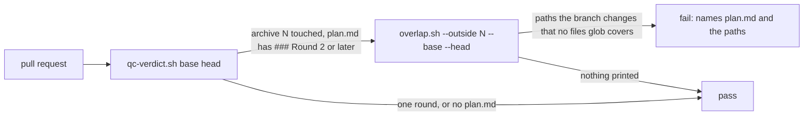

# Docs, skill wording and test-guard follow-ups (#97) Implementation Plan

> **For agentic workers:** REQUIRED SUB-SKILL: Use superpowers:subagent-driven-development (recommended) or superpowers:executing-plans to implement this plan task-by-task. Steps use checkbox (`- [ ]`) syntax for tracking.

**Goal:** Close the docs, wording and test-guard gaps that #34, #39 and #69 left (consolidated from #41, #43 and #74): a guard that counts and orders correctly, a footprint rule that CI enforces, a `board.sh set` that reports what happened and finds every card, and an abandon exit with closing blocks that name a command that can run.

**Architecture:** Three independent parts on one branch, ordered so the work other in-flight issues also edit comes last (Q2, Q3). The footprint rule becomes a failure of the existing `qc-verdict` required check: `qc-verdict.sh` asks `overlap.sh --outside` (given the pull request's own base and head) whether a re-planned footprint omits a path the branch still changes. Everything else is a correction to a script, a skill's text or a page, each pinned by a test that fails first.

**Tech Stack:** bash, `jq`, `gh` (stubbed in tests), git; tests are `tests/*.test.sh` run by `bash tests/run.sh [name-fragment]`.

**Spec:** the GitHub issue #97 and `.codeo/97/init.md` (`## Outcome` has its acceptance criteria verbatim); decisions in `.codeo/97/plan.md` (Q1-Q5).

## Global Constraints

- One suite, `shell`: build `true`, test `bash tests/run.sh`; a task's proof is `bash tests/run.sh <fragment>` for the test file it writes, and the last task runs the whole suite. No invariants document, wiki module, shared environment or `resources[]` is configured: no task carries `Needs lease:` or `Runs on:`, and no page is a wiki page.
- **Order is a constraint.** The tasks that edit text #98, #70 and #71 also edit come last: Tasks 7-9 (`skills/close/SKILL.md`, `docs/handoff.md`, `skills/plan/SKILL.md`, `docs/dossier.md`, their tests) and Task 10 (`CHANGELOG.md`). Per Q2, Task 9 starts only after #98 has merged; rebase on `main` first.
- Closing blocks name only a command that can run in the state the exit leaves (`docs/handoff.md → Closing block`). A block that is *forbidden* to name a command must not contain that command's text, even to say it is not named.
- Tests print `FAIL: <what>` and exit non-zero, and print `all cases passed` on success. A guard added to a test is shown to bite: the plan names the old text, and the task runs the test against a copy with it restored.
- Out of scope, per the issue: redesigning the footprint format or `overlap.sh` / `inflight.sh` semantics, changing `board.sh set`'s resolution order (configured → default → pass-through), re-describing other skills' pages, #70, closing blocks for close's other pre-#69 stops, `/codeo:implement` on `Runs on:` tasks, dev container follow-ups.
- Documentation moved by this change: `docs/skills.md` (`doctor`, `qc`, `close`), `docs/handoff.md` (closing-block exits and rows, the replacing-footprint sentence, the `qc-verdict` check), `docs/dossier.md` (when the footprint check runs), `lib/env.sh`'s key reference, `skills/triage/SKILL.md`, `CHANGELOG.md`. Each has its own task below.

## Review Focus

- A skill directory whose name has regex metacharacters (`a.b`) must not match another skill's bullets (Task 1).
- The guard's output must be identical run to run, not merely "usually sorted" (Task 1).
- An issue whose card sits past the 50th item must never have that card deleted by a failed write (Task 4).
- `qc-verdict` must not start failing pull requests that have only one planning round, or whose dossier has no plan (Task 6).
- An old unconditional sentence put back beside the new labelled paragraphs must fail a test, shown against a mutated copy (Tasks 7-8).

## File Structure

| File | Responsibility | Tasks |
|---|---|---|
| `tests/skills-doc.test.sh` | the `docs/skills.md` coverage guard and its scratch cases | 1 |
| `docs/skills.md` | per-skill reference pages (`doctor`, `qc`, `close` entries change) | 2, 7 |
| `scripts/board.sh`, `tests/board.test.sh` | `set`'s messages, undo and 50-item lookup, with the stubbed `gh` | 3, 4 |
| `scripts/overlap.sh`, `tests/overlap.test.sh` | `--outside` learns to judge a given base and head | 5 |
| `scripts/qc-verdict.sh`, `tests/qc-verdict.test.sh` | the required check gains the footprint rule | 6 |
| `lib/env.sh`, `skills/triage/SKILL.md` | wording only | 3 |
| `skills/close/SKILL.md`, `tests/close-skill.test.sh`, `tests/closing-exits.test.sh` | abandon blocks, step 17 lead, guards | 7 |
| `docs/handoff.md` | exits list, exceptions rows, footprint and required-check sentences | 8 |
| `skills/plan/SKILL.md`, `tests/plan-skill.test.sh`, `docs/dossier.md` | step 10 ordering, host-task paragraph | 9 |
| `CHANGELOG.md` | corrects the v1.0.4 entry, adds the `## Unreleased` entry | 10 |



---

### Task 1: Make the skills coverage guard ignore fences, escape names and print in a stable order (#41)

**Files:**
- Modify: `tests/skills-doc.test.sh` (the `check_skills_doc` function and the scratch cases)

**Interfaces:**
- Produces: `check_skills_doc <skills_dir> <doc> <tsv>` unchanged in signature; its FAIL lines now come out sorted, and a fenced bullet in an Extension points part is not counted.

- [ ] **Step 1: Write the three failing cases**, after the `none` case, before `expect no-tsv`:
  - `fenced-part`: a doc whose `alpha` Extension points part is one real bullet then a fenced block holding `- \`alpha/p9\` — shown as an example`; `expect fenced-part "" <doc>` (the checker prints nothing).
  - `metachar-name`: a separate scratch tree with one skill directory `a.b`, a tsv row `a.b<TAB>p1<TAB>default`, and a section `## a.b` whose bullet is `- \`axb/p1\` — wrong skill`; assert `check_skills_doc` prints a line containing `FAIL points: a.b malformed`.
  - `stable-order`: `alpha` registers `p1`..`p6` in the tsv; its doc part holds six *different* bullets `e1`..`e6`. Run the checker twice. Assert the two outputs are identical, that the `missing` lines are in `sort` order, and that the `extra` lines are in `sort` order (compare each group with `sort` of itself). If this case passes against the unfixed code, rename the points until it fails there: the unfixed code iterates an associative array.

- [ ] **Step 2: Run** `bash tests/run.sh skills-doc`. Expected: FAIL lines for `fenced-part`, `metachar-name` and `stable-order`.

- [ ] **Step 3: Fix `check_skills_doc`.**
  - Add `export LC_ALL=C` before the function, so every `sort` and glob is in one collation.
  - In the awk that builds `info`, make the fence line `next` after toggling (`/^```/ { fence = !fence; next }`) and add `!fence &&` to the Extension points rule, so neither a fence marker nor anything inside it is an `N` or `B` line.
  - Replace the `=~` match against `$s` with a literal prefix test: `[[ $line == "- \`$s/"* ]]`, then take the point name from what follows the prefix up to the closing backtick with parameter expansion; keep the existing `malformed` failure when the shape is wrong.
  - Iterate the multiset keys in sorted order: `while IFS= read -r k; do [[ -n $k ]] || continue; … done < <(printf '%s\n' "${!wc[@]}" | sort)` for `missing`, the same over `gc` for `extra`. Sort the `skills` list the same way.

- [ ] **Step 4: Run** `bash tests/run.sh skills-doc`. Expected: `all cases passed`.

- [ ] **Step 5: Commit** `tests/skills-doc.test.sh` — `test: make the skills coverage guard ignore fences, escape names and sort its output (#97)`.

### Task 2: Correct the `doctor` and `qc` entries of `docs/skills.md` (#41)

**Files:**
- Modify: `docs/skills.md` (the `## doctor` and `## qc` sections)

**Interfaces:** none.

- [ ] **Step 1: Confirm each clause against the code** before writing it: `scripts/doctor.sh` — the `overlays` check reads `lib/extension-points.tsv` (line ~194); the `superpowers` check reads `~/.claude/plugins/installed_plugins.json` (~240); `gh` is checked with `command -v` in `gh-auth`, `jq`, `git` and bash ≥ 4.3 in `deps`, and each suite's first command word in `suites`; `ci.requiredChecks` falls back to `tests` and `qc-verdict` (~128-129). `skills/qc/SKILL.md` step 2 runs `sync-main.sh`, and its Non-goals say the sync's merge commit rides the same push.

- [ ] **Step 2: Edit `doctor`'s Reads bullet** to read: "Reads `.codeo/config.json`, the project's overlays and the extension-point registry `lib/extension-points.tsv` (the `overlays` check), and the installed-plugins file `~/.claude/plugins/installed_plugins.json` (the `superpowers` check). Checks with `command -v` that `gh`, `jq`, `git` and the first word of each suite's build and test commands are on the PATH, and that bash is 4.3 or newer. Reads GitHub through `gh api` (the board check's `gh project view` is the one exception, being GraphQL-backed); when `ci.requiredChecks` is absent the ruleset check compares against `tests` and `qc-verdict`." Leave "Writes nothing but its report."

- [ ] **Step 3: Edit `qc`'s non-goal bullet** "It pushes its own dossier commits and nothing else." to "It pushes its own dossier commits and, when step 2's sync merged the base branch, that merge commit on the same push; nothing else."

- [ ] **Step 4: Prove it.** Run `bash tests/run.sh skills-doc` (Expected: `all cases passed`) and `grep -cF 'extension-points.tsv' docs/skills.md` (Expected: at least `1` more than before; `git diff docs/skills.md` shows only the two bullets). The page must still end `## doctor` with `### Extension points` / `None.`.

- [ ] **Step 5: Commit** `docs/skills.md` — `docs: correct skills.md for doctor's reads and qc's sync merge (#97)`.

### Task 3: Make `board.sh set` report what happened, and tidy its tests and wording (#43)

**Files:**
- Modify: `scripts/board.sh`, `tests/board.test.sh`, `lib/env.sh`, `skills/triage/SKILL.md`

**Interfaces:**
- Produces: stub variable `GH_STUB_VIEW_FAILS=<project number>` in `tests/board.test.sh` — makes `project view <n> … --jq .title` fail (the id read, `--jq .id`, still succeeds). Task 4 builds on the same stub.

- [ ] **Step 1: Write the failing cases** in `tests/board.test.sh`, each with its own config rewritten into `$config` and restored to `$with_board` after:
  - `no-board-message`: config `projects:[9]`, `gateProject:9` (project 9 has no `Ready` option in the stub); `GH_STUB_ROWS="$url\t\t\t\t" run set 7 Ready`. Assert `rc` ≠ 0, `$err` does **not** contain `is on has the option`, and contains `no synced project has the option 'Ready'`.
  - `title-read-fails`: `GH_STUB_VIEW_FAILS=1 GH_STUB_ROWS="$url\t\t\t\t" run set 7 Ready`. Assert `$err` contains `could not read the title of project #1` and does not contain `could not add #7 to project #1`.
  - `undo-fails` (existing): add `grep -q "project item-delete 1 --owner acme --id ITEM_NEW" "$GH_STUB_LOG" || fail "undo-fails: item-delete was not called"` and assert `$err` contains `gh: could not delete` (the delete's reason) beside the existing `remove item ITEM_NEW by hand`.
  - `statuses-absent`: config `{"schema":1,"repo":{"owner":"acme","name":"widgets"},"baseBranch":"main","board":{"owner":"acme","projects":[1,2],"gateProject":2}}` (no `statuses` key); `set 7 inProgress` with `GH_STUB_ROWS="$P2"` writes option `O_PROG` (the default name `In progress`). This case may pass at once; it is a regression guard, and if it fails that is a real defect in the absent-`statuses` path to fix in `board.sh`.
  Extend the stub for `GH_STUB_VIEW_FAILS` as described under Interfaces.

- [ ] **Step 2: Run** `bash tests/run.sh board`. Expected: FAIL for `no-board-message`, `title-read-fails` and `undo-fails`'s reason; `statuses-absent` and the log assertion may pass.

- [ ] **Step 3: Fix `scripts/board.sh`.**
  - The closing message (~282) becomes `board.sh: no synced project has the option '$want' (it has: …)`.
  - The failed title read (~216) says `could not read the title of project #$p — skipped: <first line of stderr>` and still sets `failed=1`; the add-failure message (~253) keeps `could not add`.
  - The delete (~270) writes its stderr to a temp file like the add and write steps do, and the failure line becomes `could not remove the card it added to project #$p — remove item $item by hand: <first line of stderr>`. Rewrite the comment above it: removal is best effort; a card this run created and could not stamp is taken off again when the delete succeeds, and a card that was already there is never touched.
  - Above `for p in ${probed[@]+"${probed[@]}"}` (~248) add the comment `github.sh:189` already has: the `+` expansion keeps an empty array legal under `set -u` on bash 4.3 (`doctor` requires 4.3, and a newer bash cannot show the guard biting, so the suite does not try).

- [ ] **Step 4: Wording.** `lib/env.sh` (the `statuses` line of the key reference): replace "a name that is not a key passes through." with "a key with no entry resolves to its conventional default (ready → Ready, backlog → Backlog, inProgress → In progress, inReview → In review, done → Done); any other name passes through as an option name." `skills/triage/SKILL.md` (~220): replace "which adds the issue to the board if it is not on it" with "which adds the issue to a synced project only where that project's Status has the Ready option, and sets Ready there".

- [ ] **Step 5: Run** `bash tests/run.sh board` (Expected: `all cases passed`), then `bash tests/run.sh env` (Expected: `all cases passed`), and `grep -n 'is on has the option' scripts/board.sh` (Expected: no output).

- [ ] **Step 6: Commit** `scripts/board.sh tests/board.test.sh lib/env.sh skills/triage/SKILL.md` — `fix: say what board.sh set did, test its undo, correct two descriptions (#97)`.

### Task 4: Find a card beyond the first 50 items in `board.sh set` (#43)

**Files:**
- Modify: `scripts/board.sh` (`lookup`), `tests/board.test.sh`

**Interfaces:**
- Consumes: Task 3's stub and `$P1`/`$P2` rows.

- [ ] **Step 1: Write the failing case** `beyond-50`. The stub returns one answer whatever the query, so it cannot page; the case asserts two halves instead: (a) the recorded `api graphql` call in `$GH_STUB_LOG` carries `--paginate` and its query text contains `endCursor`; (b) with `GH_STUB_ROWS` holding 59 filler rows for other projects' items and then the issue's card on project 1 (`$P1`) as the 60th, and `GH_STUB_EDIT_FAILS=PROJ_1`, `set 7 Ready` exits non-zero and the log has **no** `item-delete` line. (b) passes against today's code because the stub ignores paging; (a) is what bites, and is the proof that the lookup now follows pages.

- [ ] **Step 2: Run** `bash tests/run.sh board`. Expected: FAIL on (a) (`no --paginate`).

- [ ] **Step 3: Implement in `lookup`:** make the query take `$endCursor: String` and read `projectItems(first: 50, after: $endCursor) { pageInfo { hasNextPage endCursor } nodes {…} }`, and add `--paginate` to the `gh api graphql` call (gh follows one connection's `pageInfo`). The `--jq` filter runs per page, so a page with none of `$owner`'s items prints the existing blank row; that row is harmless to `status` and `set` (both read only rows with a non-empty item and the first row's url) — keep it.

- [ ] **Step 4: Run** `bash tests/run.sh board`. Expected: `all cases passed`. Then, as a read-only check against GitHub, `bash scripts/board.sh status 97` — Expected: prints one Status word (`Ready`, `In progress`, `none` …) and exits 0; if `gh` is not logged in with the `project` scope, report that and skip.

- [ ] **Step 5: Commit** `scripts/board.sh tests/board.test.sh` — `fix: follow every page of an issue's project items in board.sh (#97)`.

### Task 5: Let `overlap.sh --outside` judge a given base and head (#43)

**Files:**
- Modify: `scripts/overlap.sh`, `tests/overlap.test.sh`

**Interfaces:**
- Produces: `overlap.sh --outside <N> [--base <ref>] [--head <ref>]`. With neither flag the behaviour is unchanged (`origin/<base>...HEAD` and the working tree's `plan.md`). With `--head`, the diff is `git diff --name-only <base>...<head>` (`--base` defaults to `origin/<baseBranch>`) and the plan is read with `git show <head>:<state>/<N>/plan.md`, falling back to `<state>/done/<N>/plan.md`; a plan absent at `<head>` prints every changed path as today's absent plan does.

- [ ] **Step 1: Write the failing cases** in `tests/overlap.test.sh`, after the replaced-block / union-block cases (`two_block_plan`, ~282-300): build a repo whose `main` has one commit and whose branch adds `a.txt` and `b.txt` and a `done/7/plan.md` whose only block lists `a.txt`; from a working tree checked out at `main` (so HEAD is not the branch) assert `overlap.sh --outside 7 --base main --head <branch>` prints exactly `b.txt`, and prints nothing when the block lists both. Add `--outside 7 --head` with a missing plan (every changed path printed).

- [ ] **Step 2: Run** `bash tests/run.sh overlap`. Expected: FAIL (`usage: overlap.sh [--outside] <N>`).

- [ ] **Step 3: Implement** the two optional flags in the argument parsing (only valid with `--outside`; anything else is the usage error), have `changes` take its base from `--base`, and read `myplan` from `git show` when `--head` is given. Update the header comment's usage block.

- [ ] **Step 4: Run** `bash tests/run.sh overlap`. Expected: `all cases passed`.

- [ ] **Step 5: Commit** `scripts/overlap.sh tests/overlap.test.sh` — `feat: let overlap.sh --outside judge a given base and head (#97)`.

### Task 6: Fail `qc-verdict` when a re-planned footprint omits a path the branch changes (#43)

**Files:**
- Modify: `scripts/qc-verdict.sh`, `tests/qc-verdict.test.sh`

**Interfaces:**
- Consumes: `overlap.sh --outside <N> --base <ref> --head <ref>` (Task 5).
- Produces: a failure line on stderr, `qc-verdict: .codeo/done/<N>/plan.md: round <k> footprint omits: <path> <path>…`, exit 1.

- [ ] **Step 1: Write the failing cases** in `tests/qc-verdict.test.sh` (its `new_repo`, `run_case`, `assert_*` helpers), each a scratch repo with a base commit and a head commit that adds `.codeo/done/7/qc.md` (a clear verdict, as the existing cases write one), `.codeo/done/7/plan.md`, and changed files `a.txt` and `b.txt`:
  - `omitted path`: `plan.md`'s `## Outcome` has an unheaded first round and `### Round 2`, and its only `### Footprint` lists `files: b.txt`. Assert exit 1 and that stderr contains `.codeo/done/7/plan.md`, `round 2` and `a.txt`.
  - `union block`: same but the block lists `a.txt, b.txt`; assert exit 0.
  - `one round`: no `### Round 2`, block lists only `b.txt`; assert exit 0 (the rule is about re-planned footprints).
  - `no plan`: no `plan.md` in the archive; assert exit 0.
  The scratch repo needs no `origin`: the check passes `--base <merge-base> --head <head>` explicitly.

- [ ] **Step 2: Run** `bash tests/run.sh qc-verdict`. Expected: FAIL on `omitted path` only (the others already exit 0).

- [ ] **Step 3: Implement** in `qc-verdict.sh`'s final `for n in $touched` loop, before its `continue`: when `$state_rel/done/$n/plan.md` exists at `$head_ref` and its `## Outcome` has a `### Round <k>` heading with k ≥ 2, run `bash "$(dirname "${BASH_SOURCE[0]}")/overlap.sh" --outside "$n" --base "$base" --head "$head_ref"`; when it prints paths, `fail "$state_rel/done/$n/plan.md: round $k footprint omits: <the paths on one line>"`. Mention the rule in the script's header comment. Never run it for an archive the diff does not touch.

- [ ] **Step 4: Run** `bash tests/run.sh qc-verdict` (Expected: `all cases passed`), then `bash tests/run.sh overlap` and `bash tests/run.sh replay` (Expected: `all cases passed` each; the golden dossiers have one planning round).

- [ ] **Step 5: Commit** `scripts/qc-verdict.sh tests/qc-verdict.test.sh` — `feat: fail qc-verdict when a re-planned footprint omits a changed path (#97)`.

### Task 7: Give the abandon exit its closing blocks, and fix step 17's lead (#74)

*Ordered after Tasks 1-6 (Q3).*

**Files:**
- Modify: `skills/close/SKILL.md`, `tests/closing-exits.test.sh`, `tests/close-skill.test.sh`, `docs/skills.md` (`close` entry)

**Interfaces:**
- Produces: labels `**Closing block — abandon finished:**` and `**Closing block — abandon interrupted:**` in `skills/close/SKILL.md`; env override `CLOSING_EXITS_ROOT` in `tests/closing-exits.test.sh` (default: the repository root), and cases `abandon-finished`, `abandon-interrupted`, `close-step17-lead`, `stash-prose`, `bites`.

- [ ] **Step 1: Write the failing cases** in `tests/closing-exits.test.sh`:
  - `root=${CLOSING_EXITS_ROOT:-$(cd … && pwd)}`; add the five names to `all` and to the header's case list.
  - `case_abandon_finished`: `para "$close" '**Closing block — abandon finished:**'`; `has` `/codeo:triage`; `lacks` `/codeo:init #<N>` and `/codeo:close --stash`.
  - `case_abandon_interrupted`: `para` the `— abandon interrupted:` label; `has` `/codeo:close`; `lacks` `/codeo:close --stash` and `/codeo:init #<N>`; and nothing slash-prefixed before the first `/codeo:close` (as `case_close_lock_kept` checks).
  - `case_close_step17_lead`: `s=$(step "$close" 17)`; fail if `$s` is empty; `lacks "$s" 'Report** that the workflow is finished'`.
  - `case_stash_prose`: the stash text (from `## Stash, and closed unmerged` to the abandon paragraph) `lacks` ``Report that `/codeo:init #<N>` resumes it``.
  - `case_bites`: for each of two mutations — the old step-17 lead put back, and the old stash sentence put back — copy `skills/close/SKILL.md` and `docs/handoff.md` into a scratch tree (`mkdir -p $t/skills/close $t/docs`; the init and issue skills too, since the other cases read them), apply the mutation with `sed` on the copy, run `CLOSING_EXITS_ROOT=$t bash "${BASH_SOURCE[0]}" close-step17-lead` (or `stash-prose`) and `fail` unless it exits non-zero.
  And in `tests/close-skill.test.sh`: `must_contain` pins for the new step 17 lead, both new labels, and the sentence "End with the closing block that matches how the abandon ended".

- [ ] **Step 2: Run** `bash tests/run.sh closing-exits` and `bash tests/run.sh close-skill`. Expected: FAIL for the two abandon cases (`no paragraph labelled …`), `close-step17-lead` (the old lead is present) and the new pins; `stash-prose` passes today and `bites` fails (the mutated copy must exit non-zero for the *right* reason, so also assert its output contains the case name).

- [ ] **Step 3: Edit `skills/close/SKILL.md`.**
  - Step 17's lead (line ~504): "**Report** that the workflow is finished." becomes "**Report** how the close ended: finished when step 16 deleted `.codeo/active`, lock kept when it did not." Keep the rest of the step.
  - After the abandon paragraph's last sentence (before `<!-- rule: close-13 -->`), add: "Once the lock is gone the checkout holds nothing the branch lacks: say what is left of it as step 17 does, by the lock's host, read before the lock goes. End with the closing block that matches how the abandon ended." then the two paragraphs:
    - `**Closing block — abandon finished:** `.codeo/active` is deleted, and the card is at `$BACKLOG` (or the board move failed: say so, the card is the engineer's to move by hand). The goal is the loose ends found; the first step is `/codeo:triage`, then the host's checkout clean-up as step 17 relays it. Name no command that resumes or stashes this work: an abandoned workflow is not resumed.`
    - `**Closing block — abandon interrupted:** `.codeo/active` is kept, because the branch deletion, the release or a push failed. The goal is a finished abandon; the first step is `/codeo:close`, run again in this checkout. Say what failed. Name no other command: the lock is still held, so anything else would stop at it.`
  Neither paragraph may contain the strings `/codeo:init #<N>` or `/codeo:close --stash`.

- [ ] **Step 4: Edit `docs/skills.md`'s `close` entry** (the closing-block bullet, ~189): add "`/codeo:close` while the lock is kept, after an interrupted abandon as well, `/codeo:triage` once an abandon is finished, …" — one sentence naming both abandon outcomes, keeping `docs/handoff.md → Closing block` as the pointer.

- [ ] **Step 5: Run** `bash tests/run.sh closing-exits`, `bash tests/run.sh close-skill`, `bash tests/run.sh skills-doc` (Expected: `all cases passed` each). Then prove the pins bite: `git show origin/main:skills/close/SKILL.md > "$TMPDIR/old-close.md"; CLOSE_SKILL="$TMPDIR/old-close.md" bash tests/close-skill.test.sh` — Expected: FAIL lines naming the new lead and both labels, exit 1.

- [ ] **Step 6: Commit** the four files — `fix: give close's abandon exit its closing blocks and guard step 17's lead (#97)`.

### Task 8: Complete `docs/handoff.md`'s closing-block exits, and fix the guard's minors (#74, #43)

*Ordered after Task 7 (Q3).*

**Files:**
- Modify: `docs/handoff.md`, `tests/closing-exits.test.sh`

**Interfaces:**
- Consumes: Task 7's labels.

- [ ] **Step 1: Write the failing assertions** in `case_rule` of `tests/closing-exits.test.sh`:
  - a helper `row_for <label>` that fails with `docs/handoff.md has no row for [<label>]` when the table has none, then returns the row; use it for `lock kept`, `stash — interrupted`, `stash — completed`, `abandon — finished`, `abandon — interrupted`, `init — no lock`, `issue — not Ready`, `issue — Status unreadable`;
  - the exits bullet `has` `stashed or abandoned`;
  - the `init — no lock` row `has` `lock: TODO` and `host workflow`, and still `has` `lock.sh take local` and `lacks` `/codeo:plan`;
  - the `abandon — interrupted` row `has` `/codeo:close` and `lacks` `--stash`; the `abandon — finished` row `has` `/codeo:triage`; the `issue — Status unreadable` row `has` `/codeo:triage`.
  In the same file: `fail()` writes to stderr (`echo "FAIL: …" >&2`), as `tests/closing-block.test.sh` does; and `case_init_no_lock` fails when `step "$init" 11` is empty (`[[ -n $s ]] || { fail "no step 11 in skills/init/SKILL.md"; return; }`).

- [ ] **Step 2: Run** `bash tests/run.sh closing-exits`. Expected: FAIL for each missing row, the exits bullet and the `host workflow` clause.

- [ ] **Step 3: Edit `docs/handoff.md`.**
  - The exits bullet (~351-353): "… `/codeo:close` is waiting on a merge, sent back, finished, stashed or abandoned."
  - Exceptions table: add `| \`abandon — finished\` | \`/codeo:triage\`, then the host's checkout clean-up |`, `| \`abandon — interrupted\` | \`/codeo:close\` |`, `| \`issue — Status unreadable\` | the fix its line names (for example \`gh auth refresh -s project\`), then \`/codeo:triage\`, then \`/codeo:init #<N>\` |`; reword `init — no lock` to "the fix the \`lock: TODO\` line names, then, with a host workflow, the recovery its text names, otherwise \`lock.sh take local\` again; a \`lock: TODO\` printed after the lock was taken (the volume name unreadable on \`host: container\`) needs the fix alone".
  - The replacing-footprint sentence (~300-303): "The replacing block carries the earlier round's files too, so it covers the whole branch" becomes "The replacing block carries every earlier path the branch still changes, so it covers the whole branch".
  - The required-checks bullet: after "`qc-verdict` is the pipeline's own (…)", add: "It also fails a pull request whose archived `plan.md` has a `### Round 2` or later and whose footprint omits a path `overlap.sh --outside` prints for the branch."

- [ ] **Step 4: Run** `bash tests/run.sh closing-exits` (Expected: `all cases passed`), `bash tests/run.sh closing-block` and `bash tests/run.sh dossier-check` (Expected: `all cases passed` each).

- [ ] **Step 5: Commit** `docs/handoff.md tests/closing-exits.test.sh` — `docs: list the abandon exits and the Status-unreadable exit in handoff.md; guard the closing-exits test (#97)`.

### Task 9: Make step 10 of the plan skill order its checks, and the host-task paragraph consistent (#43, #74)

*Starts only after #98 has merged (Q2): `git fetch && git merge origin/main` first, and re-read `skills/plan/SKILL.md` step 8 and step 10 as they stand.*

**Files:**
- Modify: `skills/plan/SKILL.md`, `tests/plan-skill.test.sh`, `docs/dossier.md`

**Interfaces:**
- Produces: `must_lack <case> <fixed string>` and `must_order <case> <a> <b>` helpers in `tests/plan-skill.test.sh` (`must_order` passes when `<b>` first occurs after `<a>`'s first occurrence in the skill text; offsets, as `tests/close-skill.test.sh`'s `text_order` does).

- [ ] **Step 1: Write the failing pins** in `tests/plan-skill.test.sh`, replacing the pins the rewrite changes (the old ones are listed in Step 3):
  - Step 10: `must_contain` "On a pass after a send-back, sub-step 1 removes the earlier round's `### Footprint` block and puts the draft under `## Notes`"; `must_contain` "run `overlap.sh --outside <N>` and add every path it prints to `files:` before committing it"; `must_order` that sentence before "Only now run" (the pair check); `must_lack` "once the earlier block is gone"; and `must_lack` "`## Outcome` still pending" **inside** the paragraph that runs `--outside` (assert the new paragraph's heading line `**After a send-back, make the draft cover the branch.**` exists and that the pending phrase appears only under sub-step 2).
  - Step 8 host-task paragraph: `must_contain` "is `local` on Windows"; `must_lack` "outside this session's checkout"; `must_contain` "single-quoted arguments", "no glob", "no `~`", "no `./script`"; `must_order` "asks which shell they use" before "labels the command `Shell: <name>`"; `must_lack` "the task is labelled `Shell: <name>` and asked like".

- [ ] **Step 2: Run** `bash tests/run.sh plan-skill`. Expected: FAIL on the new pins.

- [ ] **Step 3: Edit `skills/plan/SKILL.md`.**
  - *Step 10.* Move the `--outside` instruction out of the trailing paragraph (~324-327) into sub-step 1, as a paragraph headed **After a send-back, make the draft cover the branch.**: on a pass after a send-back, the first edit is the one sanctioned edit of an answered round — remove the earlier round's `### Footprint` block (it is the only block `overlap.sh` would otherwise union with the new one) and put the draft under `## Notes`; then run `overlap.sh --outside <N>`, add every path it prints to `files:` before committing it, and `qc-verdict` will fail the pull request if one is still missing. Sub-step 4 then only moves the block to end the new round (delete the sentences that said moving it removes the old block, and the trailing paragraph). Sub-step 2's "raise what it prints" and its pending `## Outcome` stay as they are: nothing between sub-step 1 and 4 now requires `## Outcome` to be both written and pending. Update the earlier pins' text to match (the "moving it out of `## Notes`… removes the old block", "That removal is the one edit…" and "once the earlier block is gone" pins).
  - *Step 8 host-task paragraph* (~168-185), replaced with: "**Mark the tasks the engineer runs on their own host.** A task the engineer runs on their own machine, not in this session's shell — a build or run there — is marked with a line `Runs on: the engineer's host`. That is every such task when the lock's `host` is not `local`, and also when it is `local` on Windows: the checkout is the same, but Claude Code then runs commands in Git Bash while the engineer may type in PowerShell or cmd. Its command is neutral — one command a shell passes through unchanged: no shell variable or substitution (`$PWD`, `$(…)`), no nested quotes or single-quoted arguments, no glob, no `~`, no `./script` path, no `&&` or line continuation, because bash, PowerShell and cmd read these differently. Anything longer becomes a script in the repository, run as one command, in a language the engineer's host is known to have. A command that cannot be neutral is asked about and then labelled: the plan asks which shell they use as a numbered question in plan.md (`.codeo/<N>/plan.md`), repeats step 4's stop (commit, push, end the turn; resume from the file), and labels the command `Shell: <name>`. A `host: local` lock on any platform but Windows needs no question. The reason: the session's shell tells nothing about the machine the engineer types on (#67's Task 3 wrote bash that failed in their PowerShell). `Runs on:` and `Needs lease:` are independent: a task on the engineer's own machine against the environment carries both markers, each on its own line, in either order, and a `Needs lease:` task is not a host task by itself." Update the surviving pins to the new wording (`is marked with a line`, `unless the session runs on Windows` → `any platform but Windows`).
  - Keep each pinned phrase on one line (the rewrap this task does must not split a pin across lines).

- [ ] **Step 4: Edit `docs/dossier.md`** (after the `overlap.sh --outside <N>` sentence in *The footprint*, ~242): add "It runs after the earlier round's block has been removed, so it judges the block that remains; `qc-verdict` runs the same check on the archived `plan.md`."

- [ ] **Step 5: Run** `bash tests/run.sh plan-skill` (Expected: `all cases passed`), then `bash tests/run.sh dossier-check` and `bash tests/run.sh skills` (Expected: `all cases passed`). Prove the pins bite: `git show origin/main:skills/plan/SKILL.md > "$TMPDIR/old-plan.md"; PLAN_SKILL="$TMPDIR/old-plan.md" bash tests/plan-skill.test.sh` — Expected: FAIL lines for the new pins, exit 1.

- [ ] **Step 6: Commit** the three files — `fix: order step 10's footprint checks and make the host-task paragraph consistent (#97)`.

### Task 10: Correct and extend the changelog (#43, #74)

*Ordered last: every other issue also adds a bullet here.*

**Files:**
- Modify: `CHANGELOG.md`

**Interfaces:** none.

- [ ] **Step 1: Correct the v1.0.4 bullet** (`board.sh set … removes a card whose write failed … finds nothing the new block omits (#39)`): "removes a card whose write failed" becomes "removes a card it added when its write failed; one that was already there is never touched", and "so `overlap.sh --outside` finds nothing the new block omits" becomes "so `overlap.sh --outside` finds nothing the new block omits when the planning step is followed (#39; enforced by `qc-verdict` from #97)".

- [ ] **Step 2: Add one bullet under `## Unreleased`** (the file's existing form, one issue ref at the end) saying, in this order: `qc-verdict` now fails a pull request whose archived `plan.md` has a second or later round and whose footprint omits a path the branch changes; `board.sh set` follows every page of an issue's project items, names what failed (a title read is not an add, a failed removal says why) and no longer says "no project #N is on …"; `/codeo:close`'s abandon exit ends with its own closing blocks (finished: `/codeo:triage`; interrupted: `/codeo:close`) and `docs/handoff.md` lists them with `issue — Status unreadable`; `/codeo:plan` marks tasks the engineer runs on their own host and writes their commands shell-neutral, **and** a command that cannot be neutral is asked about as a numbered question and labelled `Shell: <name>`; `docs/skills.md`, the skills coverage guard and the plan skill's step 10 are corrected. Keep the `Config schema` / `Shared state` / `Safe to bump mid-workflow` lines as they are (nothing here changes shared state).

- [ ] **Step 3: Prove it.** `grep -c 'removes a card whose write failed' CHANGELOG.md` — Expected: `0`; `grep -cF 'Shell: <name>' CHANGELOG.md` — Expected: at least `1`; then the whole suite, `bash tests/run.sh` — Expected: `all cases passed`.

- [ ] **Step 4: Commit** `CHANGELOG.md` — `docs: correct the v1.0.4 entry and add the #97 entry to the changelog`.

---

## Self-Review

- **Spec coverage.** #41's five criteria: Tasks 1-2. #43's eight: footprint test → Tasks 5-6; plan ordering → Task 9; board messages and statuses/undo cases → Task 3; 50 items → Task 4; wording (CHANGELOG, `lib/env.sh`, triage, handoff, dossier) → Tasks 3, 8, 9, 10. #74's seven: abandon blocks → Task 7; handoff rows → Task 8; guards and bite proof → Tasks 7-8; plan paragraph and its pins → Task 9; CHANGELOG → Task 10; left minors → below; `bash tests/run.sh` → Task 10.
- **Left minors** (each fixed or dismissed): fixed — step 17's lead (Task 7), the empty-`step` guard, the missing-row message, FAIL lines to stderr (Task 8), the host-task paragraph's wrapping and overlap (Task 9). Dismissed — long lines in `skills/issue/SKILL.md` (line 3 is frontmatter and cannot wrap; lines 177-181 are closing-block paragraphs that `para` reads whole, so a rewrap is churn in a file #71 also edits); `docs/skills.md` lines that do not enumerate every exit (the page defers to `docs/handoff.md → Closing block`, which Task 8 completes).
- **Calls the plan makes** (shown at the review gate): the footprint check is a `qc-verdict` failure scoped to archives with a `### Round 2` or later (Q1(a)), which needs the small `--base`/`--head` extension to `overlap.sh` (Task 5); `lookup` uses `gh api --paginate`, which the stub can only observe by its flag (Task 4); the bash 4.3 guard is kept and commented, not tested; step 10's check moves to sub-step 1 by making the old block's removal the first edit of a send-back pass (Task 9).
- **Type consistency.** Labels (`abandon finished`, `abandon interrupted`), `CLOSING_EXITS_ROOT`, `GH_STUB_VIEW_FAILS`, `overlap.sh --outside <N> [--base] [--head]` and the failure line's wording are used identically in every task that names them.
