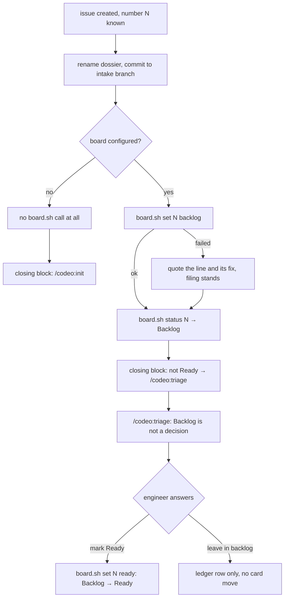

# File New Issues Straight Into the Board's Backlog Implementation Plan

> **For agentic workers:** REQUIRED SUB-SKILL: Use superpowers:subagent-driven-development (recommended) or superpowers:executing-plans to implement this plan task-by-task. Steps use checkbox (`- [ ]`) syntax for tracking.

**Goal:** With a board configured, `/codeo:issue` puts each issue it files into the board's Backlog, so `/codeo:triage`'s *mark Ready* moves Backlog → Ready instead of adding a card that was never there.

**Architecture:** This is skill text plus the tests and pages that restate it; no script changes. `skills/issue/SKILL.md` step 8 gains one board call, `board.sh set <N> backlog`, between the dossier commit and the existing status read. `board.sh` already adds an issue that is not on the board, so it needs no change. `skills/triage/SKILL.md` keeps asking about a Backlog issue that has no ledger row, and stops moving a card that is already in Backlog.

**Tech Stack:** bash wording tests under `tests/` (the `shell` suite, `bash tests/run.sh`), Markdown skills and docs.

**Spec:** issue #71 (https://github.com/kbajpai/codeo/issues/71) as restated in `.codeo/71/init.md`'s `## Outcome`, and the decisions in `.codeo/71/plan.md` (Q1-Q4, Notes). No separate reference doc: the rule lands in `docs/handoff.md`.



## Global Constraints

- **Invariants:** none configured, so there is no invariants check.
- **Suite:** `shell` (`bash tests/run.sh`; `build` is `true`; no `filter`, so a task's proof is its own test file, run directly, and the whole suite once at the end). No shared environment and no `Needs lease:` task. No task runs on the engineer's host.
- **Failure never gates filing.** A failed Backlog move is reported with its fix and never fails the filing (`handoff.md` already says every board move is "part of its step and never a gate on it").
- **No board, no call.** With `config.sh get .board` failing, `/codeo:issue` makes no `board.sh` call at all, as today.
- **Out of scope** (from the issue): issues filed outside codeo, moving existing issues into Backlog in bulk, and any Status other than Backlog (In progress, In review and Done stay with `/codeo:init` and `/codeo:close`).
- **Exact wording is pinned by tests.** The sentences quoted in the tasks below are the strings the tests grep for; write them verbatim, then reflow around them.
- **Rule hash.** `tests/inventory.test.sh` pins the inventory's rule texts by hash: Task 1 adds `issue-08` and regenerates the fixture once. No other rule text changes (`triage-05` stays as written).
- **Documentation moved by this change:** `docs/handoff.md` (Task 4), `docs/skills.md` (Task 5), `docs/skills-inventory.md` (Task 1) and the header comment of `scripts/board.sh` and `CHANGELOG.md` (Task 6). No diagram on those pages changes. The *why* stays in this plan and `.codeo/71/`.
- **Task order:** every task is proved by the shell suite in the issue's own checkout; none needs the environment.
- **Overlap:** #70, #96 and #98 touch some of the same files (`plan.md` Q2-Q4, all answered *proceed and coordinate*). Expect adjacent-line conflicts in `CHANGELOG.md`, `docs/skills-inventory.md` and `tests/fixtures/skills-inventory.rules.sha256`; on a conflict in the fixture, regenerate it with `bash tests/inventory.test.sh --update` rather than merging hashes by hand.

## Review Focus

- The filing succeeds when `board.sh set` fails (missing `project` scope, or a hosted web session): the number is still reported and still handed back to a caller. Task 1 pins the sentence.
- A project with no board: no `board.sh` call anywhere in `/codeo:issue`, including the new step. Task 1 pins the sentence and keeps the existing no-board cases.
- A "no, not ready yet" after triage files an issue must not bring the issue back next run (Q1 = A). Task 2 pins the sentence.
- A card already in Backlog must not be moved again by *leave in the backlog*; a card in any other state still is. Task 2 pins both halves.
- Backlog is a Status, not a decision: a Backlog issue with no `issue:<N>` ledger row is still asked about, once. Task 2 pins the sentence.

---

## File Structure

| File | Responsibility |
|---|---|
| `skills/issue/SKILL.md` | step 8 gains the Backlog move; new rule `issue-08`; hand-off bullets name the write |
| `skills/triage/SKILL.md` | says who writes Backlog; Backlog is not a decision; a no after filing is a backlog decision; no move for a card already in Backlog |
| `docs/skills-inventory.md`, `tests/fixtures/skills-inventory.rules.sha256` | `issue-08` and the regenerated hash |
| `docs/handoff.md`, `docs/skills.md` | the board bullet, its transition table, the ownership table; the `issue` and `triage` sections |
| `scripts/board.sh` | header comment only |
| `tests/issue-skill.test.sh`, `tests/closing-exits.test.sh`, `tests/inventory.test.sh`, `tests/board.test.sh` | existing tests gain cases |
| `tests/triage-skill.test.sh` | new: the triage wording |
| `CHANGELOG.md` | one `## Unreleased` bullet |

### Task 1: `/codeo:issue` files into Backlog

**Files:**
- Modify: `skills/issue/SKILL.md` (step 8; Hand-off bullets), `docs/skills-inventory.md` (`## issue`), `tests/fixtures/skills-inventory.rules.sha256`
- Test: `tests/issue-skill.test.sh`, `tests/closing-exits.test.sh`, `tests/inventory.test.sh`

**Interfaces:**
- Consumes: `board.sh set <N> backlog` (adds the issue to the board when it is missing, prints `board.sh: #<N> (not on the board) → Backlog on #<project> <title>`); `config.sh get .board`.
- Produces: the sentences below, which Tasks 4 and 5 restate in the docs.

- [ ] **Step 1: Write the failing tests.**
  - In `tests/issue-skill.test.sh`, after the step 8 rename cases, add `must_contain` cases (case name first): `"step 8 files into the Backlog"` for `put the new issue in the Backlog`; `"step 8 runs the move"` for `board.sh" set <N> backlog`; `"a failed move never fails the filing"` for `A failed move never fails the filing`; `"the failure is quoted with its fix"` for `quoted with the fix it names`; `"no board, no call"` for ``With no board, make no `board.sh` call at all``; `"the hand-off names the write"` for `its board Status, to Backlog only`; `"the hand-off bounds the write"` for `any board Status other than the Backlog`. The order of the move and the status read is covered in `closing-exits` below.
  - In `tests/closing-exits.test.sh` add `case_issue_backlog`, registered in `all=(...)` and the header's case list: it takes `step "$issue" 8`, asserts `has` for `board.sh" set <N> backlog` and `board.sh" status <N>` and `before "$s" 'board.sh" set <N> backlog' 'board.sh" status <N>'`.
  - In `tests/inventory.test.sh` change `[issue]=7` to `[issue]=8`.
- [ ] **Step 2: Run them to see them fail.**
  Run: `bash tests/issue-skill.test.sh; bash tests/closing-exits.test.sh issue-backlog; bash tests/inventory.test.sh`
  Expected: `FAIL:` lines naming each missing string, `FAIL: issue-backlog`, and `FAIL issue has 7 rules, expected 8`; each exits non-zero.
- [ ] **Step 3: Edit `skills/issue/SKILL.md` step 8.** Replace the paragraph that begins `Then, with a board (` and ends `(a hosted web session); it exits non-zero on a real failure.` with the two paragraphs below, keeping its existing sentences about the Ready name and what `board.sh status` prints inside the second:

  > Then, with a board (`bash "${CLAUDE_PLUGIN_ROOT}/scripts/config.sh" get .board` succeeds; exit 1 with nothing printed means no board), put the new issue in the Backlog: `bash "${CLAUDE_PLUGIN_ROOT}/scripts/board.sh" set <N> backlog`, with `<N>` from the created issue's response. It adds the issue to the board when it is not on it, and prints one line naming the old and the new Status.
  >
  > `<!-- rule: issue-08 -->` (on its own line, before the next sentence)
  > A failed move never fails the filing: the issue exists, so its number is reported as usual, and handed back to a caller, and the line the script printed is quoted with the fix it names (`gh auth refresh -s project` when the token lacks the `project` scope; in a hosted web session the script says to move the card by hand). Then read the new issue's Status once: `bash "${CLAUDE_PLUGIN_ROOT}/scripts/board.sh" status <N>` … (the rest of the old paragraph, unchanged). With no board, make no `board.sh` call at all.

  In `## Hand-off`: the **Writes** bullet gains ", and, with a board, the new issue's card: its board Status, to Backlog only, through `board.sh`"; the **Never touches** bullet gains ", or any board Status other than the Backlog it sets at filing". Both contain the strings Step 1 greps for.
- [ ] **Step 4: Add the inventory rule.** Append to `## issue` in `docs/skills-inventory.md`: `- [issue-08] A failed Backlog move never fails the filing; report the number and quote the fix.` Then run `bash tests/inventory.test.sh --update` and keep the rewritten fixture.
- [ ] **Step 5: Run the proof.**
  Run: `bash tests/issue-skill.test.sh && bash tests/closing-exits.test.sh && bash tests/inventory.test.sh && bash tests/skills.test.sh issue`
  Expected: each prints `all cases passed` and the chain exits 0.
- [ ] **Step 6: Commit** the five files by name: `feat: file new issues into the board's Backlog (#71)`.

### Task 2: `/codeo:triage` wording

**Files:**
- Modify: `skills/triage/SKILL.md`
- Create: `tests/triage-skill.test.sh` (same mode and same `must_contain` shape as `tests/issue-skill.test.sh`)

**Interfaces:**
- Consumes: Task 1's statement that `/codeo:issue` writes Backlog at filing.
- Produces: nothing later tasks call.

- [ ] **Step 1: Write the failing test** `tests/triage-skill.test.sh`, `must_contain` on `skills/triage/SKILL.md` (with `TRIAGE_SKILL` overriding the path, as `ISSUE_SKILL` does): `"says who writes Backlog"` ← `a new issue is already in the Backlog when it reaches this skill`; `"Backlog is not a decision"` ← `Being in the Backlog is not a decision`; `"a no after filing is a backlog decision"` ← `a no is a *leave in the backlog*`; `"a card already in Backlog is not moved"` ← `make no \`board.sh set\` call`; `"the read decides"` ← `when it prints the Backlog status`; `"the hand-off bounds the write"` ← `only when the card is not already in the Backlog`; and the unchanged no-board path `"no board, no call"` ← ``no card move, no `board.sh` call``.
- [ ] **Step 2: Run it to see it fail.**
  Run: `bash tests/triage-skill.test.sh`
  Expected: six `FAIL:` lines (every case but the no-board one), exit 1.
- [ ] **Step 3: Edit `skills/triage/SKILL.md`:**
  1. In the paragraph beginning `**It is what makes an issue startable.**`, after the sentence ending `(`set <N> backlog`)`, add: "`/codeo:issue` writes the Backlog Status when it files a new issue, so a new issue is already in the Backlog when it reaches this skill; this skill's *leave in the backlog* is for an issue that is not there yet."
  2. In step 1.2's last bullet (open issues with no branch or PR), after the Ready sentence add: "Being in the Backlog is not a decision: an issue there with no `issue:<N>` ledger row is asked about like any other, once."
  3. In step 5, **File it**: after "yes is a *mark Ready*" add "; a no is a *leave in the backlog*, recorded as `issue:<N>` → `backlog`, so it is not asked about again".
  4. In step 5, **Leave in the backlog**: with a board, read `board.sh status <N>` first; "when it prints the Backlog status (the option `board.statuses.backlog` names, else `Backlog`), record the decision and make no `board.sh set` call; otherwise run `board.sh set <N> backlog` as before". Keep the no-board sentence and the failure sentence.
  5. In `## Hand-off`, **Writes**: after `*leave in the backlog*` add `, and a Backlog move only when the card is not already in the Backlog`.
- [ ] **Step 4: Run the proof.**
  Run: `bash tests/triage-skill.test.sh && bash tests/skills.test.sh triage && bash tests/inventory.test.sh`
  Expected: `all cases passed` three times (`triage-05`'s rule text is untouched, so the pinned hash still matches).
- [ ] **Step 5: Commit** `skills/triage/SKILL.md` and `tests/triage-skill.test.sh`.

### Task 3: Pin the two board moves the change relies on

**Files:** Test: `tests/board.test.sh`

- [ ] **Step 1: Add a case** beside the existing `set 7 backlog` case (line ~308): an issue that is on no board, `set 7 backlog`, asserting `rc` 0 and `out` containing `(not on the board) → Backlog on #2`; copy the stub setup of the `(not on the board) → In progress on #2` case (line ~127). The existing `Backlog → Ready on #2` case (line ~311) already pins the second move; leave it.
- [ ] **Step 2: Run the proof.**
  Run: `bash tests/board.test.sh`
  Expected: `all cases passed`. (Both moves are existing `board.sh` behaviour, so this case passes at once; it is a pin, not a fix.)
- [ ] **Step 3: Commit** `tests/board.test.sh`.

### Task 4: `docs/handoff.md`

**Files:** Modify: `docs/handoff.md` (the board bullet near line 114, its transition table, the ownership table near line 229); Test: `tests/issue-skill.test.sh`

- [ ] **Step 1: Write the failing doc cases** in `tests/issue-skill.test.sh`, a `doc_has <case> <file> <string>` helper beside `must_contain`: in `docs/handoff.md`, `puts every issue it files in **Backlog**`; the table row ``| A new issue is filed | `issue` | `backlog` |``; ``and `issue`, whose dossier is committed before the card moves``; ```backlog`: `/codeo:issue` at filing``.
- [ ] **Step 2: Run:** `bash tests/issue-skill.test.sh` — Expected: four new `FAIL:` lines.
- [ ] **Step 3: Edit.** Board bullet: after the sentence naming `/codeo:triage` as the one that marks Ready, add "A new issue is in Backlog before that: `/codeo:issue` puts every issue it files in **Backlog**, so marking it Ready moves Backlog → Ready." Failure sentence: `(except `init`, whose dossier is already pushed when the card moves, and `issue`, whose dossier is committed before the card moves; each reports the failure in the turn)`. Transition table: a first row ``| A new issue is filed | `issue` | `backlog` |``. Ownership table: ```backlog`: `/codeo:issue` at filing, `/codeo:triage`, and `/codeo:close` on an abandon``.
- [ ] **Step 4: Run:** `bash tests/issue-skill.test.sh && bash tests/closing-block.test.sh` — Expected: `all cases passed` for both.
- [ ] **Step 5: Commit** both files.

### Task 5: `docs/skills.md`

**Files:** Modify: `docs/skills.md` (`## issue` Reads and writes and hand-off bullets, `## triage` Reads and writes); Test: `tests/issue-skill.test.sh`

- [ ] **Step 1: Write the failing doc cases** (`doc_has`, `docs/skills.md`): ``Writes the new issue's board Status, to Backlog only``; ``a failed move is reported and never fails the filing``; ``because `/codeo:issue` writes that Status when it files it``.
- [ ] **Step 2: Run:** `bash tests/issue-skill.test.sh` — Expected: three `FAIL:` lines.
- [ ] **Step 3: Edit.** `## issue` → Reads and writes: add the bullet "Writes the new issue's board Status, to Backlog only, through `board.sh set <N> backlog`, when a board is configured; a failed move is reported and never fails the filing. With no board it makes no `board.sh` call." and, in the Never-touches bullet, "any board Status other than that Backlog". `## triage` → the bullet beginning `Writes an issue's board Status`: append "A new issue arrives in Backlog already, because `/codeo:issue` writes that Status when it files it; this skill moves a card to Backlog only when it is not already there."
- [ ] **Step 4: Run:** `bash tests/issue-skill.test.sh && bash tests/skills-doc.test.sh` — Expected: `all cases passed` for both.
- [ ] **Step 5: Commit** both files.

### Task 6: `scripts/board.sh` header, `CHANGELOG.md`, whole suite

**Files:** Modify: `scripts/board.sh` (comment lines 2-5 only), `CHANGELOG.md` (`## Unreleased`)

- [ ] **Step 1: Edit.** In `board.sh`'s opening comment add "issue files a new issue into Backlog," before "triage moves a workable issue to Ready or Backlog". No code changes. Add one `CHANGELOG.md` bullet under `## Unreleased`: `/codeo:issue` now puts each issue it files into the board's Backlog (`board.sh set <N> backlog`, with a board; no call without one), so marking it Ready in `/codeo:triage` moves Backlog → Ready; a failed move is reported with its fix and never fails the filing; `/codeo:triage` still asks once about a Backlog issue with no ledger row and no longer moves a card already in Backlog; new rule `issue-08`. State no config change and no shared-state change.
- [ ] **Step 2: Run the proof.**
  Run: `grep -F 'issue files a new issue into Backlog' scripts/board.sh && bash -n scripts/board.sh && bash tests/run.sh`
  Expected: the grep prints the comment line, then `bash tests/run.sh` ends with every test file passing and exit 0.
- [ ] **Step 3: Commit** both files.

## Self-review

- **Acceptance criteria:** 1 and 2 → Task 1 (the move) and Task 3 (`board.sh` behaviour pinned); AC 1 and 2 against a live board can only be seen by `/codeo:qc` running `/codeo:issue` and `/codeo:triage` once, so they are `untestable` in the shell suite and QC should say so. 3 → Task 1 (no-board sentence, existing no-board cases untouched). 4 → Task 1 (`issue-08`). 5 → Task 2. 6 → Tasks 1-2 (wording tests for the new step and the unchanged no-board path).
- **Names:** the strings in each test are the strings in the text it pins, copied from this plan.

