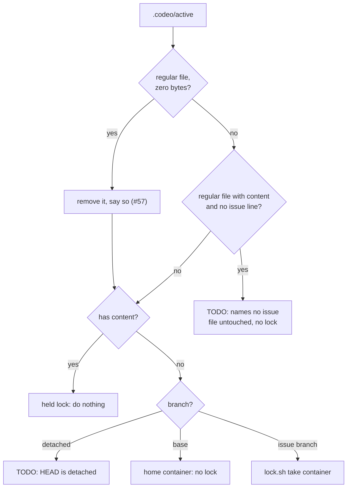

# Report a `.codeo/active` That Names No Issue Implementation Plan

> **For agentic workers:** REQUIRED SUB-SKILL: Use superpowers:subagent-driven-development (recommended) or superpowers:executing-plans to implement this plan task-by-task. Steps use checkbox (`- [ ]`) syntax for tracking.

**Goal:** When a dev container starts with a `.codeo/active` that has content but names no issue, the start script lists one TODO naming the file, takes no lock and leaves the file exactly as it is, on an issue branch and on the base branch alike.

**Architecture:** One new first arm in step 3a's chain in `.devcontainer/scripts/devcontainer-start.sh`: a regular, non-empty `.codeo/active` with no line matching `container-name.sh`'s rule (`^issue:[[:space:]]*#*[0-9]+`) becomes a TODO. Every other arm stays as it is, so a file that names an issue is still a held lock and a zero-byte file is still removed first (#57). The change is driven by failing cases in `tests/devcontainer.test.sh`, which already has the harness for this step; the README and the CHANGELOG then state the behaviour.

**Tech Stack:** bash, grep, `bash tests/run.sh`.

**Spec:** `.codeo/87/init.md` (`## Outcome`: the five acceptance criteria and what is out of scope); `.codeo/87/issue.md` Q1-Q2 (report and leave the file; the start script only); `.codeo/87/plan.md` Q1 (the `CHANGELOG.md` overlap with #83).

## Approaches

| | Approach | Trade-off | Verdict |
|---|---|---|---|
| A | A new first arm in step 3a's `if` chain, testing the file with `grep -Eq` on `container-name.sh`'s pattern | The pattern is written a second time, in a second script; a comment in each place names the other. Smallest change, and only the start script moves | **Chosen** |
| B | Ask `container-name.sh --docker` and treat `codeo-home` with a non-empty file as "names no issue" | No second copy of the pattern, but the start script then depends on that script's output for a lock decision, and its failure (not a git clone) needs a path of its own | Rejected: more moving parts for one line of pattern |
| C | A shared helper script both scripts source | Changes `container-name.sh`, which the issue puts out of scope | Rejected: out of scope |

## Global Constraints

- Only `.devcontainer/scripts/devcontainer-start.sh` changes behaviour. `container-name.sh`, `folder-check.sh`, `window-title.sh`, `lock.sh` and everything under `scripts/`, `lib/`, `hooks/` and `skills/` are untouched.
- The file is never deleted, rewritten or locked over: `lock.sh` is not called for it. A zero-byte file is still removed, as #57 does.
- "Names an issue" is exactly `container-name.sh`'s rule: `issue:` at the start of a line, then optional spaces, tabs or `#`, then at least one digit (`grep -Eq '^issue:[[:space:]]*#*[0-9]+'`).
- The TODO text, verbatim: `.codeo/active names no issue, so it holds no usable lock: look at it, remove it if it is not yours, then re-run this script`. It is one `add_todo`, so it prints on stderr as `devcontainer-start: TODO — <text>`.
- `devcontainer-start.sh` still always exits 0.
- A `.codeo/active` that is a directory is out of scope and keeps today's behaviour (no TODO, no lock call); Task 1 pins that the new arm does not report it.
- CHANGELOG (`plan.md` Q1): #83 also adds a bullet under `## Unreleased`. Proceed and coordinate: Task 2 merges `origin/main` first, and on a conflict keeps both bullets.
- Documentation: the one page this change moves is `.devcontainer/README.md` (Task 2). No page under `docs/` describes the dev container's start script, so none moves.
- Ordering: every task is proved by the `shell` suite in this checkout. There is no shared environment, so no task carries `Needs lease:`; no task runs on the engineer's host, so none carries `Runs on:`; no invariants document is configured.
- The `shell` suite has no `filter`, so a task's proof is the whole `bash tests/run.sh` (prints `all cases passed`, exit 0). `bash tests/devcontainer.test.sh` is the quick loop.

## Step 3a after the change



The new arm is `D → T`. It comes before the detached-HEAD arm, so a file that names no issue on a detached HEAD gives the file's TODO alone; the detached-HEAD TODO appears on the re-run, once the file is gone.

## Review Focus

- An `issue:` line with no number (`issue: none`, a half-written lock): reported, like any text. Case `start_issue_line_without_a_number_is_a_todo`.
- `issue: #55`, the hash form `container-name.sh` accepts: a held lock, no TODO, no lock call. Case `start_hash_issue_line_is_a_held_lock`.
- A file that names no issue on a detached HEAD: one TODO, the file's. Case `start_no_issue_lock_file_on_a_detached_head_is_one_todo`.
- A `.codeo/active` that is a directory: not reported by the new arm. Case `start_lock_directory_is_not_reported`.
- The file after the run is byte-identical, trailing newline included: every reported case compares with `cmp`, not with `$(cat …)`, which drops trailing newlines.

---

### Task 1: The start script reports a `.codeo/active` that names no issue

**Files:**
- Modify: `tests/devcontainer.test.sh` (two helpers and seven cases after `start_nonempty_lock_file_is_left_alone`, line 544; one assertion added to that case; `cases=( ... )`; the header comment)
- Modify: `.devcontainer/scripts/devcontainer-start.sh` (step 3a, lines 144-164; the header comment, lines 7-8)

**Interfaces:**
- Consumes: the existing harness in `tests/devcontainer.test.sh`: `ds_setup <name>`, `ds_lock_stub`, `ds_branch <name>`, `ds_lock_ready` (sets `ds_rc`, `ds_out`, `ds_err`), `ds_todos <pattern>`, `ds_lock_calls`, `fail`, and `DS_REPO`.
- Produces: in step 3a, a regular non-empty `.codeo/active` with no line matching `^issue:[[:space:]]*#*[0-9]+` adds the TODO in Global Constraints and nothing else happens in that step.

- [ ] **Step 1: Write the helpers and the failing cases** after `start_nonempty_lock_file_is_left_alone`:

```bash
# ds_no_issue <content>: write <content> (printf %b) to the scratch .codeo/active, keep a copy, and run.
ds_no_issue() {
    printf '%b' "$1" > "$ds_dir/codeo-home/.codeo/active"
    cp "$ds_dir/codeo-home/.codeo/active" "$ds_dir/active-before"
    ds_lock_ready
}
# ds_no_issue_reported: exit 0, exactly one TODO and it is the one for the file, no lock call, the file byte-identical.
ds_no_issue_reported() {
    local n
    ((ds_rc == 0)) || fail "exit $ds_rc: $ds_err"
    n=$(ds_todos '\.codeo/active names no issue, so it holds no usable lock: look at it, remove it if it is not yours, then re-run this script$')
    ((n == 1)) || fail "wanted one names-no-issue TODO, got $n: $ds_err"
    n=$(ds_todos ''); ((n == 1)) || fail "wanted that TODO alone, got $n: $ds_err"
    [[ $(ds_lock_calls) == 0 ]] || fail "lock.sh was called: $(cat "$ds_dir/lock-calls")"
    cmp -s "$ds_dir/codeo-home/.codeo/active" "$ds_dir/active-before" || fail "the file was changed"
}
```

  The cases, each beginning `ds_setup <name> || return 0` then `ds_lock_stub`:
  - `start_newline_only_lock_file_is_a_todo` (criterion 1): `ds_branch feat/x`; `ds_no_issue '\n'`; `ds_no_issue_reported`.
  - `start_lock_file_without_an_issue_line_is_a_todo` (criterion 1): `ds_branch feat/x`; `ds_no_issue 'garbage\n'`; `ds_no_issue_reported`.
  - `start_no_issue_lock_file_on_the_base_branch_is_a_todo` (criterion 2): no `ds_branch`; loop over `'\n'` and `'garbage\n'`, with a fresh `ds_setup "noissuebase${#content}"` and `ds_lock_stub` per content; `ds_no_issue "$content"`; `ds_no_issue_reported`.
  - `start_issue_line_without_a_number_is_a_todo`: `ds_branch feat/x`; `ds_no_issue 'issue: none\nbranch:  feat/x\n'`; `ds_no_issue_reported`.
  - `start_no_issue_lock_file_on_a_detached_head_is_one_todo`: commit and detach as `start_detached_head_is_a_todo` does; `ds_no_issue 'garbage\n'`; `ds_no_issue_reported` (which already requires the TODO to be the only one, so no detached-HEAD TODO).
  - `start_hash_issue_line_is_a_held_lock` (criterion 3): `ds_branch feat/x`; write `printf 'issue: #55\nbranch:  feat/x\n'` to `.codeo/active` and copy it to `$ds_dir/active-before`; `mv "$ds_dir/codeo-home" "$ds_dir/codeo-55"`; `DS_REPO="$ds_dir/codeo-55" ds_lock_ready`; assert `ds_rc == 0`, `[[ -z $ds_err ]]`, `ds_lock_calls` is 0, and `cmp -s "$ds_dir/codeo-55/.codeo/active" "$ds_dir/active-before"`.
  - `start_lock_directory_is_not_reported`: `ds_branch feat/x`; `mkdir "$ds_dir/codeo-home/.codeo/active"`; `ds_lock_ready`; assert `ds_rc == 0`, `ds_todos 'names no issue'` is 0, `ds_lock_calls` is 0.

  In `start_nonempty_lock_file_is_left_alone` (`issue:   55`, criterion 3) add: `n=$(ds_todos 'names no issue'); ((n == 0)) || fail "a held lock was reported: $ds_err"` (declare `local n`). List the seven new cases in `cases=( ... )` after `start_nonempty_lock_file_is_left_alone`. The zero-byte half of criterion 3 is already pinned by `start_empty_lock_file_is_removed_and_the_lock_taken` and `start_empty_lock_file_on_the_base_branch_is_removed`; leave them as they are.

- [ ] **Step 2: Run them to see them fail.**
  Run: `bash tests/devcontainer.test.sh`
  Expected: exit 1, with `FAIL` lines for `start_newline_only_lock_file_is_a_todo`, `start_lock_file_without_an_issue_line_is_a_todo`, `start_no_issue_lock_file_on_the_base_branch_is_a_todo`, `start_issue_line_without_a_number_is_a_todo` and `start_no_issue_lock_file_on_a_detached_head_is_one_todo`, each `wanted one names-no-issue TODO, got 0`. `start_hash_issue_line_is_a_held_lock`, `start_lock_directory_is_not_reported` and `start_nonempty_lock_file_is_left_alone` pass before the fix; they pin what must not change.

- [ ] **Step 3: Add the arm to step 3a.** Make it the first arm of the chain at line 163, before `if [[ -s .codeo/active ]]` (which becomes `elif`):

```bash
if [[ -f .codeo/active && -s .codeo/active ]] && ! grep -Eq '^issue:[[:space:]]*#*[0-9]+' .codeo/active 2>/dev/null; then
    add_todo ".codeo/active names no issue, so it holds no usable lock: look at it, remove it if it is not yours, then re-run this script"
elif [[ -s .codeo/active ]]; then
```

  Update the comments: in step 3a's block (line 148) replace "a file with content is left alone" by a sentence saying that a file with content that names no issue (no line `issue:` then spaces, tabs or `#`, then digits: the rule `container-name.sh` reads the number with) is a TODO, is left as it is and takes no lock, on any branch, and that a file naming an issue is a held lock. In the script header (lines 7-8) add that a `.codeo/active` naming no issue is reported and left alone. In the test file's header comment add one sentence saying the start-script cases cover a `.codeo/active` that names no issue.

- [ ] **Step 4: Run them to see them pass.**
  Run: `bash tests/devcontainer.test.sh`
  Expected: `all cases passed`, exit 0.

- [ ] **Step 5: Prove nothing else moved.**
  Run: `bash tests/run.sh`
  Expected: `all cases passed`, exit 0.

- [ ] **Step 6: Commit.**

```bash
git add tests/devcontainer.test.sh .devcontainer/scripts/devcontainer-start.sh
git commit -m "fix: report a .codeo/active that names no issue at container start (#87)"
```

### Task 2: The README and the CHANGELOG state the behaviour

**Files:**
- Modify: `.devcontainer/README.md` (*What the start script does*, the bullet at line 28)
- Modify: `CHANGELOG.md` (a new bullet at the end of `## Unreleased`)

**Interfaces:**
- Consumes: Task 1's behaviour and TODO text.
- Documentation only; no test changes. The proof is Step 4.

- [ ] **Step 1: Merge `main`.**
  Run: `git fetch origin` then `git merge origin/main`
  Expected: `Already up to date.` or a clean merge; a conflict can only be in `CHANGELOG.md` under `## Unreleased` (#83 adds a bullet there): keep both sides' bullets and commit the merge.

- [ ] **Step 2: Update `.devcontainer/README.md`** (criterion 4). In *What the start script does*, end the empty-file bullet after "goes on to take the lock on an issue branch." (drop its last sentence, "A `.codeo/active` with content is left alone.") and add this bullet after it:

```markdown
- A `.codeo/active` that has content but names no issue holds no usable lock. A file names an issue when a line starts with `issue:` followed by a number (`issue:   87` or `issue: #87`); a file holding only a newline, or other text, does not. The script leaves such a file exactly as it is, takes no lock, and lists one TODO: `.codeo/active names no issue, so it holds no usable lock: look at it, remove it if it is not yours, then re-run this script`. This is the same on `main` and on an issue's branch. A file that names an issue is a held lock and is left alone.
```

- [ ] **Step 3: Add the CHANGELOG bullet** (criterion 5) as the last bullet under `## Unreleased`, leaving that section's three header lines as they are:

```markdown
- The dev container's start script now reports a `.codeo/active` that has content but names no issue (a file holding only a newline, or text with no line that starts `issue:` followed by a number). It lists one TODO naming the file (`.codeo/active names no issue, so it holds no usable lock: look at it, remove it if it is not yours, then re-run this script`), takes no lock and leaves the file exactly as it is, on the base branch and on an issue branch alike. Until now such a file counted as a held lock, so the container started with no lock and said nothing. A file that names an issue is still a held lock, and an empty one is still removed. Nothing in `scripts/`, `lib/`, `hooks/` or `skills/` changes (#87).
```

- [ ] **Step 4: Prove it.**
  Run: `grep -c 'names no issue, so it holds no usable lock' .devcontainer/README.md CHANGELOG.md .devcontainer/scripts/devcontainer-start.sh`
  Expected: each of the three files reports `1`.
  Run: `bash tests/run.sh`
  Expected: `all cases passed`, exit 0.

- [ ] **Step 5: Commit.**

```bash
git add .devcontainer/README.md CHANGELOG.md
git commit -m "docs: state what the start script does with a .codeo/active that names no issue (#87)"
```
