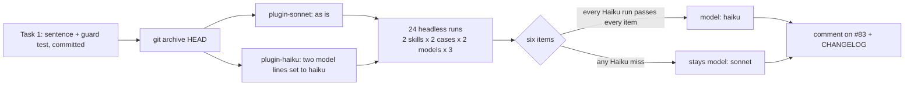

# Re-run the Haiku 5.5 Trial of `doctor` and `setup` Implementation Plan

> **For agentic workers:** REQUIRED SUB-SKILL: Use superpowers:subagent-driven-development (recommended) or superpowers:executing-plans to implement this plan task-by-task. Steps use checkbox (`- [ ]`) syntax for tracking.

**Goal:** Make `doctor` and `setup` tell the model to read the closing-block template with the Read tool, re-run #76's Haiku 5.5 vs Sonnet 5.5 trial against that text, and switch a skill to `model: haiku` only where every Haiku run passed every item.

**Architecture:** One sentence is added to each skill and pinned by a test. A throwaway trial script in the session scratchpad (not committed) runs each skill headlessly with `claude -p`, once per case, model and repetition, and scores each run on #76's six-item checklist from its own stream log. The repository changes are the sentence, its test, the `model:` lines the result justifies, and a `CHANGELOG.md` bullet; the evidence goes on #83.

**Tech Stack:** bash, jq, `claude -p --output-format stream-json --verbose`, `gh`, `bash tests/run.sh`.

**Spec:** `.codeo/83/init.md` (`## Outcome`: the five acceptance criteria); `docs/plans/2026-11-14-trial-doctor-setup-haiku.md` (the cases, the items and the method this plan re-runs); `.codeo/83/plan.md` Q1-Q3, answered A, A, proceed and coordinate.



## Global Constraints

- **One wording, one trial (Q1 = A).** The sentence in Task 1 is fixed before any run and is not reworded after a miss. A Haiku miss on any item of any run keeps that skill on `sonnet`; the sentence stays in both skills either way.
- **The sentence** (Task 1), placed in each skill directly before its "If it exits non-zero" / "If every check passes" sentence: `Read the template with the Read tool, not with a Bash command.` The existing citation `docs/handoff.md → Closing block` stays, because `tests/closing-block.test.sh` requires it.
- **Six items per run, as in #76** (`docs/plans/2026-11-14-trial-doctor-setup-haiku.md`, Global Constraints), scored the way #76's corrected scorer did: (1) `one-script`: exactly one Bash call, and it runs the skill's script (`scripts/doctor.sh`; `scripts/setup.sh`, with `--stack node` when the case passes it); (2) `verbatim`: every non-empty line the script printed appears as a line of the final report; (3) `exit-stated`: a non-zero exit is stated (`non-zero`, `exit 1`, `exited with 1`, `exited with status 1`, or an `EXIT_CODE=N` line the report relays), a zero exit is not described as a failure; (4) `closing-block`: a line `---`, then `**Done:**`, `**Next goal:**`, `**Steps:**` in order, then only numbered steps (two to five), nothing after; (5) `next-goal`: `doctor-pass` names `/codeo:issue` and `/codeo:init` on the Next goal line; `doctor-fail` makes fixing the named failures the goal and its last step re-runs `/codeo:doctor`; `setup-fresh` names `/codeo:doctor`; `setup-refuse` makes the existing config the goal (read by hand), and step 1 holds a backticked command in every case; (6) `files`: `setup` only, the scratch repository's tree (without `.git`) equals what `scripts/setup.sh` writes directly (fresh) or the unchanged pre-run tree (refuse); `-` for `doctor`.
- **Cases, three runs per model each:** `doctor-pass` (this checkout) · `doctor-fail` (a scratch repository whose `.codeo/config.json` is `{ not json`) · `setup-fresh` (a scratch repository with an `origin` remote and `origin/HEAD`, run as `/codeo:setup --stack node`) · `setup-refuse` (a scratch repository that already has `.codeo/config.json`, run as `/codeo:setup`, where `setup.sh` exits 1). 24 runs, about $2-3.
- **A headless run needs `--allowedTools Bash Read --add-dir <plugin copy>`.** Without them the template read is denied and the run is scored on a harness fault (#76's first pass was discarded for this). Runs are made with `claude -p --plugin-dir <copy> --allowedTools Bash Read --add-dir <copy> --model <m> --output-format stream-json --verbose "<prompt>"`, lines not starting with `{` dropped. Sonnet runs pass `--model sonnet`; Haiku runs leave the session default at `sonnet` so the skill's `model: haiku` line is what is tested (#76 showed that line switches the model; Task 2 Step 4 checks again).
- **The model that ran is read from `modelUsage`.** A Haiku-copy run must show `claude-haiku-5-5` with output tokens and no `claude-sonnet-5-5` output tokens; a Sonnet-copy run, the reverse.
- **Both plugin copies are `git archive HEAD` after Task 1's commit,** so both carry the new sentence and differ only in the two `model:` lines.
- **Nothing the trial runs writes into this checkout.** `doctor-pass` runs here and writes nothing; the other cases run in scratch repositories under the trial directory.
- **The trial script is not committed** (the issue's out of scope). It lives in `/tmp/claude-1000/-workspaces-codeo-83/38296bcc-93b9-47ca-b158-0ca27e8bb29e/scratchpad/trial`, called `$TRIAL` below. #76's copy no longer exists, so Task 2 rebuilds it.
- **Out of scope** (the issue's): any skill other than `doctor` and `setup`; the `models.subagent` and `models.reviewer` defaults; `scripts/usage.sh`; pinning explicit model IDs; committing the trial script.
- **Documentation.** `docs/skills.md`'s `doctor` and `setup` sections say what each skill reports, not which tool reads the template or which model runs it, and stay true either way; `docs/handoff.md` is the template itself and does not change. The one document the change moves is `CHANGELOG.md`. No wiki, no invariants document, no shared environment: no task carries `Needs lease:`, and no task runs on the engineer's host.
- **Other workflows.** #57 also edits `CHANGELOG.md` (Q3: proceed and coordinate; one added bullet under `## Unreleased`). #73 shares no file. No exclusive resource is configured.
- The `shell` suite has no `filter`, so a repository task's proof is a `tests/run.sh` run (`bash tests/run.sh <pattern>` for one file, whole for the last). Tasks 2-4 are not repository code; their proof is a command that must print the stated result.

## Review Focus

- A Haiku run that never used Haiku, or the new sentence not reaching the copy: every "Haiku" run would be a Sonnet run. Task 2 Step 4 and the per-run `modelUsage` check catch the first; Task 2 Step 4 greps the sentence in both copies for the second.
- Haiku passing item 1 by skipping the read altogether (no template read, a closing block from memory). Item 1 alone would pass it; items 4-5 do not check the template was read. Task 3 Step 3 lists, per run, whether a Read of `handoff.md` appears, and the comment reports it.
- Sonnet failing its own checklist. In #76 Sonnet missed item 5 of `doctor-fail` twice in three runs; the checklist is the same, so expect it. Sonnet's misses are reported beside Haiku's and do not count against it.
- `doctor-fail` not failing, or `doctor` failing on `gh` for a reason unrelated to the skill. Task 2 Step 3 proves the fixture exits non-zero; a `doctor` run whose script output shows a `gh` network error is re-run once and both rows kept.
- Switching on a sample. Three runs per case is not proof; the comment says "no miss in 3 runs per case", not "equal".

---

### Task 1: Tell both skills to read the template with Read, and pin it

**Files:**
- Modify: `tests/closing-block.test.sh` (the per-skill loop, line 17-23)
- Modify: `skills/doctor/SKILL.md:12`, `skills/setup/SKILL.md:12`

**Interfaces:**
- Produces: both `SKILL.md` files contain the exact text `Read the template with the Read tool, not with a Bash command.`; Tasks 2-3 archive `HEAD` after this task's commit.

- [ ] **Step 1: Write the failing assertion.** In `tests/closing-block.test.sh`, after the loop over `skills/*/SKILL.md`, add a loop over `doctor` and `setup` that calls `fail "skills/$name/SKILL.md does not tell the model to read the closing-block template with the Read tool"` unless `grep -qF 'Read the template with the Read tool, not with a Bash command.' "$root/skills/$name/SKILL.md"`.
- [ ] **Step 2: Run it to see it fail.** `bash tests/run.sh closing-block`. Expected: `=== FAIL: closing-block.test.sh` with two `FAIL: skills/<name>/SKILL.md does not tell the model to read…` lines, one for `doctor` and one for `setup`.
- [ ] **Step 3: Add the sentence.** In `skills/doctor/SKILL.md`, insert `Read the template with the Read tool, not with a Bash command.` as its own sentence directly before `If every check passes`; in `skills/setup/SKILL.md`, directly before `If it exits non-zero`. Change nothing else, including the `model:` lines.
- [ ] **Step 4: Run the suite.** `bash tests/run.sh`. Expected: `all cases passed`.
- [ ] **Step 5: Commit** `feat: tell doctor and setup to read the closing-block template with Read (#83)`, staging `tests/closing-block.test.sh`, `skills/doctor/SKILL.md` and `skills/setup/SKILL.md` by name.

**Proof of done:** `bash tests/run.sh closing-block` prints `all cases passed`, and `git show --stat HEAD` lists exactly those three files.

### Task 2: Rebuild the trial script and prove it before the 24 runs

**Files:** create (not committed): `$TRIAL/check.sh`, `$TRIAL/trial.sh`, `$TRIAL/fixtures/good.stream.jsonl`, `$TRIAL/fixtures/bad.stream.jsonl`, `$TRIAL/fixtures/check.test.sh`.

**Interfaces:**
- Consumes: the committed `HEAD` of Task 1.
- Produces `$TRIAL/check.sh <stream.jsonl> <skill> <case> [<repo-dir> <reference-dir>]` → six lines `<item><TAB>P|F|-`, in the order of Global Constraints, exit 0. It reads the `Bash` `tool_use` blocks and their `tool_result`, and the final `{"type":"result"}` line's `.result` and `.modelUsage`.
- Produces `$TRIAL/trial.sh setup` → `$TRIAL/plugin-sonnet` and `$TRIAL/plugin-haiku` from `git archive HEAD` (the second with the `model:` line of both skills set to `haiku`), and the reference trees under `$TRIAL/ref/`.
- Produces `$TRIAL/trial.sh run <skill> <case> <model> <n>` → runs the case in `$TRIAL/runs/<skill>-<case>-<model>-<n>/`, saves `stream.jsonl`, and appends one TSV row to `$TRIAL/results.tsv`: `skill case model n i1 i2 i3 i4 i5 i6 modelUsage-keys cost read-handoff`, where `read-handoff` is `read`, `bash` or `none` by how `docs/handoff.md` was opened.

- [ ] **Step 1: Write the fixtures and the failing check.** `good.stream.jsonl` is hand-written: one Bash `tool_use` running `bash "/x/scripts/doctor.sh"`, its `tool_result` of two `ok` lines, a `Read` of `/x/docs/handoff.md`, and a `result` that repeats both lines and ends `---` / `**Done:** …` / `**Next goal:** … /codeo:issue … /codeo:init …` / `**Steps:**` / ``1. `/codeo:issue` ``. `bad.stream.jsonl` is the same with a second Bash call (`cat /x/docs/handoff.md`) and one `ok` line dropped from the report. `check.test.sh` asserts that `check.sh good… doctor doctor-pass` prints `P` for items 1-5 and `-` for item 6, and that `check.sh bad… doctor doctor-pass` prints `F` for items 1 and 2.
- [ ] **Step 2: Run it to see it fail.** `bash $TRIAL/fixtures/check.test.sh`. Expected: failure, `check.sh: No such file`.
- [ ] **Step 3: Implement `check.sh` and `trial.sh`** to the interfaces above. The case table (prompt, script, arguments) lives in `trial.sh`. `trial.sh setup` builds the reference by running `scripts/setup.sh --stack node` in a fresh scratch repository (`git init`, `git remote add origin https://github.com/acme/shop.git`, `git symbolic-ref refs/remotes/origin/HEAD refs/remotes/origin/main`) and copying its tree without `.git` to `$TRIAL/ref/setup-fresh`; `$TRIAL/ref/setup-refuse` is the pre-run tree of a repository holding a `.codeo/config.json`.
- [ ] **Step 4: Prove the check, the cases and the mechanism.**
  1. `bash $TRIAL/fixtures/check.test.sh`. Expected: `ok`.
  2. `bash $TRIAL/trial.sh setup`; then `grep -c 'Read the template with the Read tool' $TRIAL/plugin-sonnet/skills/doctor/SKILL.md $TRIAL/plugin-haiku/skills/setup/SKILL.md`. Expected: `1` for each file. In the `doctor-fail` repository, `bash $TRIAL/plugin-sonnet/scripts/doctor.sh; echo $?`. Expected: at least one `fail` line, then `1`. Run `setup.sh --stack node` in two fresh repositories and `diff -r` them. Expected: no output.
  3. `bash $TRIAL/trial.sh run doctor doctor-pass sonnet 0` and `… haiku 0`. Expected: two rows; the `modelUsage` column of the first names only `claude-sonnet-5-5`, of the second `claude-haiku-5-5` and not `claude-sonnet-5-5`. If the second still names Sonnet, add `--model haiku` to Haiku-copy runs and say so in the comment; if it names Sonnet even then, stop and raise it in `implement.md`.
  4. Delete the two `n = 0` rows from `results.tsv` so the 24 runs start clean.

**Proof of done:** `bash $TRIAL/fixtures/check.test.sh` prints `ok`, and the Step 4 outputs match.

### Task 3: Run the 24 trial runs and decide per skill

**Files:** none; output is `$TRIAL/results.tsv` and `$TRIAL/runs/`.

**Interfaces:** Consumes `$TRIAL/trial.sh run`.

- [ ] **Step 1: Run every combination.**

  ```bash
  for skill_case in doctor:doctor-pass doctor:doctor-fail setup:setup-fresh setup:setup-refuse; do
    for model in sonnet haiku; do for n in 1 2 3; do
      bash "$TRIAL/trial.sh" run "${skill_case%%:*}" "${skill_case##*:}" "$model" "$n"
    done; done
  done
  ```

  Expected: 24 rows in `results.tsv`, none with an empty `modelUsage` column.
- [ ] **Step 2: Check the model column.** `awk -F'\t' '$3=="haiku" && $11 ~ /sonnet/' $TRIAL/results.tsv` and `awk -F'\t' '$3=="sonnet" && $11 ~ /haiku-5-5/ && $11 !~ /sonnet/' $TRIAL/results.tsv`. Expected: no output from either.
- [ ] **Step 3: Read item 5 of `setup-refuse` by hand** for the six runs (`jq -r 'select(.type=="result").result' $TRIAL/runs/setup-setup-refuse-*/stream.jsonl`): the Next goal must be about the existing `.codeo/config.json`, with a fix as its steps; write `P` or `F` into that column. Then count how the template was read: `awk -F'\t' '$3=="haiku" {n[$1" "$13]++} END {for (k in n) print k, n[k]}' $TRIAL/results.tsv`. Expected: every Haiku run `read`; any `bash` or `none` is a finding for the comment. A `doctor` run that failed on `gh` is re-run once; keep both rows.
- [ ] **Step 4: Decide per skill.** `awk -F'\t' '$3=="haiku" { for (i=5;i<=10;i++) if ($i=="F") miss[$1]++ } END { print (miss["doctor"]+0), (miss["setup"]+0) }' $TRIAL/results.tsv`. Expected: two numbers, the Haiku misses of `doctor` and of `setup`. A skill with 0 misses switches in Task 5; one with more stays on `sonnet`. Keep every miss's row, Sonnet's too, for Task 4.

**Proof of done:** `wc -l < $TRIAL/results.tsv` prints `24` (`25` or more if a re-run row was kept; count it in the comment) and Step 2's two `awk` commands print nothing.

### Task 4: Record the comparison on #83

**Files:** none; the record is one comment on issue #83.

**Interfaces:** Consumes `$TRIAL/results.tsv` and Task 3's decision.

- [ ] **Step 1: Write the comment** to `$TRIAL/comment.md`: the Claude Code version (`claude --version`), the command form, the exact sentence under test, and what was compared (six items, four cases, three runs per model each, as in #76). Then a table, one row per case and model, with the runs passing each item and how the template was read; then the decision per skill. For every Haiku miss, say which item, which case and what the report did differently, quoting the line; for a Sonnet miss, the same, marked as Sonnet's. Compare with #76's result (all 6 Haiku `doctor` runs and 1 of 6 Haiku `setup` runs read the template with Bash). Say that three runs per case is a sample, and which skill switches or stays.
- [ ] **Step 2: Post it.** `gh issue comment 83 --body-file $TRIAL/comment.md`.
- [ ] **Step 3: Prove it.** `gh issue view 83 --json comments -q '.comments[].body' | grep -cE 'doctor-pass|setup-refuse'`. Expected: `2` or more.

**Proof of done:** the Step 3 command prints 2 or more.

### Task 5: Switch the lines the result justifies, and the changelog

**Files:**
- Modify: `skills/doctor/SKILL.md:4`, `skills/setup/SKILL.md:4` (only for a skill with 0 Haiku misses)
- Modify: `CHANGELOG.md` (a new bullet under `## Unreleased`)

**Interfaces:** Consumes Task 3's decision and Task 4's comment URL.

- [ ] **Step 1: Show the state a switch changes.** `grep -n '^model:' skills/doctor/SKILL.md skills/setup/SKILL.md`. Expected: both `sonnet`.
- [ ] **Step 2: Switch.** For each skill with no Haiku miss, change `model: sonnet` to `model: haiku`; leave the other. When neither passed, change neither.
- [ ] **Step 3: Write the changelog bullet** under `## Unreleased`, after the existing bullets, ending `(#83)`: the sentence added to both skills and the test that pins it; the Claude Code version, the four cases and three runs per model; which skill now runs on `haiku` and which stays on `sonnet` and how its Haiku runs differed (or that nothing switched and why); the link to the comment; `Nothing in scripts/, lib/ or hooks/ changes`.
- [ ] **Step 4: Prove it.** `grep -n '^model:' skills/doctor/SKILL.md skills/setup/SKILL.md` Expected: `haiku` for each skill Task 3 cleared, `sonnet` for any other. `bash tests/run.sh`. Expected: `all cases passed`.
- [ ] **Step 5: Commit** `feat: run <skills> on Haiku 5.5 after a re-run trial (#83)` (or `docs: record the Haiku 5.5 re-run of doctor and setup; nothing switched (#83)`), staging `CHANGELOG.md` and each changed `SKILL.md` by name.

**Proof of done:** the `grep` shows the lines Task 3 decided and `bash tests/run.sh` prints `all cases passed`.

---

## Self-Review

- **Coverage:** criterion 1 → Task 1 (text and test); criterion 2 → Tasks 3-4 (what was compared, how the template was read, comment on #83); criterion 3 → Tasks 3 and 5; criterion 4 → Tasks 1 and 5; criterion 5 → Task 5. Q1 is the first Global Constraint, Q2 is Task 1's test, Q3 the Other workflows line.
- **Order:** the plugin copies are archived from `HEAD`, so Task 1's commit precedes Task 2; Task 5's `model:` edit comes after the trial so the trial never runs a skill whose line the result has not yet earned.
- **One refinement of #76's method:** the `read-handoff` column records how the template was opened, so a Haiku run that passes item 1 by skipping the read is visible rather than counted as a pass.
