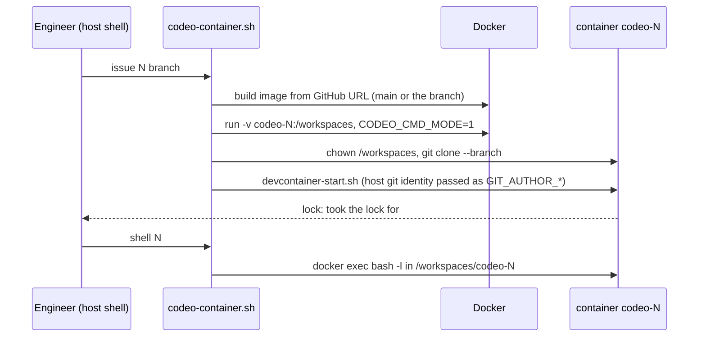

# Cmd Mode for the Dev Containers Implementation Plan

> **For agentic workers:** REQUIRED SUB-SKILL: Use superpowers:subagent-driven-development (recommended) or superpowers:executing-plans to implement this plan task-by-task. Steps use checkbox (`- [ ]`) syntax for tracking.

**Goal:** One host-side script, needing only Docker, creates, starts, enters and rebuilds the `codeo-home` and `codeo-<N>` containers from a Linux or macOS command line, and the container's start script and session titles stop assuming VS Code when started that way.

**Architecture:** `.devcontainer/codeo-container.sh` (bash 3.2, BSD-safe, builtins plus `docker` and `git` only) builds the image straight from the repository's GitHub URL, runs the container with the names, volumes and environment `devcontainer.json` gives, clones the branch into the `/workspaces` volume and runs the unchanged `devcontainer-start.sh`. It sets `CODEO_CMD_MODE=1` in the container; `devcontainer-start.sh` and `session-title.sh` read it to skip the `.vscode/settings.json` write and the host `~/.gitconfig` wait. `devcontainer.json` and the VS Code route are not touched.



**Tech Stack:** bash (3.2 on the host script, 4.3+ in the container), Docker (BuildKit), git, `bash tests/run.sh`.

**Spec:** `.codeo/113/init.md` (`## Outcome`: the ten acceptance criteria); plan Q1-Q4 of `.codeo/113/plan.md`.

## Global Constraints

- The host script uses only bash 3.2 syntax and BSD-compatible tools: no `declare -A`, `mapfile`/`readarray`, `local -n`, `${x,,}`/`${x^^}`, `&>`, `|&`, `;&`, `[[ -v`, arrays at all, `readlink -f`, `sed -i`, `stat -c`, `date -d`, `grep -P`, `xargs -r`. Its tests run it with `PATH` holding only a stub `docker` (and, for the identity cases, `git`), which proves it calls nothing else. In-container scripts keep bash 4.3+.
- The host needs Docker with BuildKit (Docker 23 or later builds from a Git URL in the daemon), `curl` once to fetch the script, and git only to seed the identity. No clone of codeo on the host (Q1).
- Names are exactly the VS Code route's: container, hostname and volume `codeo-home` / `codeo-<N>`, the clone at `/workspaces/<name>`, volumes `codeo-gh` and `codeo-git`, `GIT_CONFIG_GLOBAL=/home/dev/.config/git/config`, `--memory=4g`. So `role.sh`, `folder-check.sh`, `lock.sh`'s `volume:` line and the removal commands `/codeo:close` and `/codeo:cleanup` print work unchanged.
- The Claude config of a cmd-mode container lives at `/workspaces/.claude` on its own volume (`CLAUDE_CONFIG_DIR`), beside the clone and outside it; the volume's removal removes it (Q2).
- Git identity: the host script reads `git config user.name` / `user.email` (else the host's `GIT_AUTHOR_NAME` / `GIT_AUTHOR_EMAIL`) and passes them, as `GIT_AUTHOR_*`, to the start script's `docker exec` only, never to `docker run`; a value already in the `codeo-git` volume is never overwritten (existing step 5).
- `REMOTE_CONTAINERS=true` keeps meaning VS Code and its path is unchanged: with `CODEO_CMD_MODE` unset, every existing case in `tests/devcontainer.test.sh` passes untouched. `.devcontainer/devcontainer.json` is not edited. A container with both variables set (VS Code attached to a cmd-mode container) still refreshes the window title.
- Out of scope, as in the issue: retiring the VS Code route, the `devcontainer` CLI and Codespaces, `sbx` (#99), Windows without WSL, bash 3.2 for codeo's in-container scripts, a single `codeo` host command wrapping the plugin's scripts. Not done here either: a `rm` sub-command (removal stays the commands `/codeo:close` and `/codeo:cleanup` print), and Remote Control in cmd mode, which Task 10 only tries and the README records.
- Documentation moved: `.devcontainer/README.md` (Task 9), the `init` hand-off in `.codeo/overlays/init.md` (Task 8) and `CHANGELOG.md` (Task 9). No page under `docs/` describes the container's opening or titles; `docs/dev-environment-sbx-evaluation.md` is a dated evaluation of another tool and stays as it is.
- Ordering: Tasks 1-9 are proved by the `shell` suite in this checkout; Task 10 is the engineer's, on their own machines. No shared environment is configured, so no task carries `Needs lease:`, and no invariants document is configured.
- The `shell` suite has no `filter`, so each task's proof is the whole `bash tests/run.sh` (prints `all cases passed`, exit 0). `bash tests/devcontainer.test.sh` and `bash tests/cmd-mode.test.sh` are the quick loops for red and green.
- #104 (at `qc`) also edits `CHANGELOG.md`: proceed and coordinate (Q4); Task 9 adds one bullet and merges `origin/main` first.

## Review Focus

- A branch or number that is not safe to hand to Docker (a leading `-`, a space, `;`, `$(…)`, `..`) is refused with exit 2 before any docker call (Task 5, `issue_rejects_unsafe_numbers_and_branches`).
- Running `home` or `issue` again on a running container makes no second container, build or clone and leaves the identity as it was (Task 3, `home_rerun_on_a_running_container_creates_nothing`; Task 4, `identity_is_passed_to_the_start_script_only`).
- A container the host's reboot left stopped is started, then the start script runs again (Task 3, `home_starts_a_stopped_container`).
- A host with no git, or with git but no identity, passes no `-e GIT_AUTHOR_*` and the start script lists its identity TODO (Task 4, `identity_falls_back_to_the_host_environment_then_to_nothing`).
- Docker not installed or not running ends in one `codeo-container:` line, exit 1, no `run` or `build` (Task 3, `docker_that_is_not_there_is_one_line`).
- `--rebuild` removes the container and never a volume, so the clone and the Claude login survive (Task 3, `rebuild_removes_the_container_and_keeps_the_volumes`).

---

### Task 1: The start script in cmd mode

**Files:**
- Modify: `.devcontainer/scripts/devcontainer-start.sh` (header comment, step 3b, step 5's wait)
- Modify: `tests/devcontainer.test.sh` (`ds_run`, three new cases, the `cases=( … )` list, the header comment)

**Interfaces:**
- Produces: `CODEO_CMD_MODE` (any non-empty value) makes the start script skip step 3b (no `window-title.sh`, so no `.vscode/`) and skip step 5's wait for `~/.gitconfig`. Everything else is unchanged. Tasks 3-4 set it on the container.
- Test harness: `ds_run` unsets `CODEO_CMD_MODE` and sets it to `1` when `DS_CMD_MODE` is non-empty.

- [ ] **Step 1: Write the failing cases.** In `tests/devcontainer.test.sh`, after `start_does_not_wait_when_the_volume_has_the_identity`, add three cases using `ds_setup`, `ds_ready_run` and `ds_global`, and list them in `cases=( … )`:
  - `start_cmd_mode_writes_no_vscode_settings`: with `DS_CMD_MODE=1`, the run exits 0; `$ds_dir/codeo-home/.vscode` does not exist; stdout has no `window-title:` line.
  - `start_cmd_mode_does_not_wait_for_a_host_gitconfig`: `DS_CMD_MODE=1 DS_GITCONFIG_WAIT=10`, an empty `$ds_dir/gitconfig` and no `DS_AUTHOR_*`: `$SECONDS` rises by under 5, and one TODO matches `git identity is not set` (`ds_todos`).
  - `start_cmd_mode_seeds_the_identity_from_the_environment_once`: `DS_CMD_MODE=1 DS_AUTHOR_NAME="Ada O'Neil" DS_AUTHOR_EMAIL=ada@example.com`; `ds_global user.name` is `Ada O'Neil` and stdout has `git identity: user.name set from GIT_AUTHOR_NAME`. Run again with `DS_AUTHOR_NAME=Other`: `ds_global user.name` is still `Ada O'Neil` and no `git identity:` line is printed.

- [ ] **Step 2: Run to verify they fail.**
  Run: `bash tests/devcontainer.test.sh`
  Expected: `FAIL start_cmd_mode_writes_no_vscode_settings` (`.vscode` exists) and `FAIL start_cmd_mode_does_not_wait_for_a_host_gitconfig` (the run waited); the seeding case passes already, as it pins existing behaviour in cmd mode.

- [ ] **Step 3: Implement.** In `ds_run` add `-u CODEO_CMD_MODE` to the `env -u …` list and `${DS_CMD_MODE:+CODEO_CMD_MODE=1}` beside `DS_SET`. In `devcontainer-start.sh`, run step 3b only when `CODEO_CMD_MODE` is empty (`[[ -n ${CODEO_CMD_MODE:-} ]] || bash …window-title.sh || add_todo …`), add `&& [[ -z ${CODEO_CMD_MODE:-} ]]` to the condition around step 5's wait loop, and add one comment line each to the script header and to step 3b and step 5 saying cmd mode skips them and why (no VS Code to name or to copy the host file).

- [ ] **Step 4: Run to verify they pass.**
  Run: `bash tests/run.sh`
  Expected: `all cases passed`, exit 0.

- [ ] **Step 5: Commit.**

```bash
git add .devcontainer/scripts/devcontainer-start.sh tests/devcontainer.test.sh
git commit -m "feat: let the start script run without VS Code (CODEO_CMD_MODE) (#113)"
```

### Task 2: Session titles in cmd mode

**Files:**
- Modify: `.devcontainer/scripts/session-title.sh` (header comment, the gate on line 19, the `window-title.sh` refresh)
- Modify: `tests/devcontainer.test.sh` (`st_run`, three new cases, the `cases` list)

**Interfaces:**
- Consumes: `window-title.sh --print` (unchanged).
- Produces: `session-title.sh` works inside a container when `REMOTE_CONTAINERS=true` **or** `CODEO_CMD_MODE=1`; it refreshes the VS Code window title (`window-title.sh`, which writes `.vscode/settings.json`) only when `REMOTE_CONTAINERS=true`.
- Test harness: `st_run <stdin> [remote]` also unsets `CODEO_CMD_MODE` and sets `CODEO_CMD_MODE=1` when `ST_CMD_MODE` is non-empty.

- [ ] **Step 1: Write the failing cases** (use `st_setup`, `st_json`, `st_run`, `st_title`):
  - `session_title_cmd_mode_titles_home_and_the_issue`: `ST_CMD_MODE=1`, `remote=unset`: a SessionStart in a clone with no lock gives `codeo [home] · a21b9973`; with a lock for 113 (as `session_title_names_the_issue_with_a_lock` makes it) gives `codeo [#113] · a21b9973`.
  - `session_title_cmd_mode_writes_no_vscode_settings`: after the run, `$st_dir/.vscode` does not exist and the clone's `info/exclude` has no `.vscode` line.
  - `session_title_with_both_variables_still_refreshes_the_window_title`: `ST_CMD_MODE=1` with `remote=true`: `$st_dir/.vscode/settings.json` has `window.title` `codeo [home]`.

- [ ] **Step 2: Run to verify they fail.**
  Run: `bash tests/devcontainer.test.sh`
  Expected: `FAIL session_title_cmd_mode_titles_home_and_the_issue` (the hook prints nothing); the other two pass or fail on the missing title; the existing `session_title_is_silent_outside_a_dev_container` still passes.

- [ ] **Step 3: Implement.** Gate: `[[ ${REMOTE_CONTAINERS:-} == true || ${CODEO_CMD_MODE:-} == 1 ]] || exit 0`. Refresh: `[[ ${REMOTE_CONTAINERS:-} != true ]] || bash "$here/window-title.sh" >/dev/null 2>&1 || true`. Update the header comment's "Only inside a dev container (REMOTE_CONTAINERS=true)" sentence to name both variables and say cmd mode writes no `.vscode/settings.json`.

- [ ] **Step 4: Run to verify they pass.**
  Run: `bash tests/run.sh`
  Expected: `all cases passed`, exit 0.

- [ ] **Step 5: Commit.**

```bash
git add .devcontainer/scripts/session-title.sh tests/devcontainer.test.sh
git commit -m "feat: title sessions in a cmd-mode container without .vscode (#113)"
```

### Task 3: The host script's core and `home`

**Files:**
- Create: `.devcontainer/codeo-container.sh` (mode 100755)
- Create: `tests/cmd-mode.test.sh` (same shape as `tests/devcontainer.test.sh`: cases in functions, a final `cases=( … )` array, `FAIL <case>: <detail>` lines, `all cases passed`)

**Interfaces:**
- Produces, on the command line: `codeo-container.sh home [--rebuild]`. Any other first word, a missing argument or an unknown flag prints the three-line usage (below) on stderr and exits 2 before any docker call. Docker not installed or not running: one line `codeo-container: Docker is not available: install it and start it, then run this again` on stderr, exit 1, after only `docker info`.
- Usage text: `usage: codeo-container.sh home [--rebuild]` / `       codeo-container.sh issue <N> <branch> [--rebuild]` / `       codeo-container.sh shell home|<N>`.
- Produces, as functions in the script (later tasks reuse them): `container_state <name>` prints `missing`, `stopped` or `running`; `ensure_container <name> <ref> <rebuild:0|1>`; `ensure_clone <name> <ref>`; `run_start <name>`; `die <message> [exit-code]` (prints `codeo-container: <message>` on stderr, default exit 1). Constants: `repo_url=${CODEO_REPO_URL:-https://github.com/kbajpai/codeo.git}`, `base_ref=main`, `context=${CODEO_CONTEXT:-}` (a local build context overriding the Git URL, for a developer's own clone).
- The docker calls of a fresh `home`, in order, exactly as the stub logs them (`echo "$*"`), the contract this task's tests pin:

```
info
inspect --format {{.State.Running}} codeo-home
image inspect codeo-dev:codeo-home
build -t codeo-dev:codeo-home https://github.com/kbajpai/codeo.git#main:.devcontainer
run -d --init --name codeo-home --hostname codeo-home --memory=4g -v codeo-home:/workspaces -v codeo-gh:/home/dev/.config/gh -v codeo-git:/home/dev/.config/git -e GIT_CONFIG_GLOBAL=/home/dev/.config/git/config -e CLAUDE_CONFIG_DIR=/workspaces/.claude -e CODEO_CMD_MODE=1 codeo-dev:codeo-home sleep infinity
exec -u root codeo-home chown dev:dev /workspaces
exec codeo-home test -d /workspaces/codeo-home/.git
exec codeo-home git clone --branch main https://github.com/kbajpai/codeo.git /workspaces/codeo-home
exec -w /workspaces/codeo-home codeo-home bash .devcontainer/scripts/devcontainer-start.sh
```

  The `image inspect` and `build` lines are skipped when the image exists and `--rebuild` is absent; `inspect` onward (build, run, chown) is skipped when the container exists; a stopped container gets `start codeo-home` in place of them; `--rebuild` adds `rm -f codeo-home` after `inspect` and always builds. The `test -d` line is always run, and `git clone` only when it fails. With `CODEO_CONTEXT` set, the build's last argument is that directory.
- Test harness (in `tests/cmd-mode.test.sh`): `cm_setup <name>` makes a scratch directory with a stub `docker` in `bin/`; the stub appends `echo "$*"` to `calls`, and answers from the environment: `STUB_INFO_RC` (default 0), a `state` file (`missing` / `stopped` / `running`, which `run` and `start` set to running and `rm` to missing; `inspect` exits 1 when missing, else prints `false` or `true`), an `image` file (present once `build` ran, or when `STUB_IMAGE=present`), `STUB_CLONE` (`present` makes `exec … test -d` succeed; a successful `git clone` makes it present), `STUB_CLONE_RC` (the clone's exit status, default 0), and prints `devcontainer-start: ready` for the start script. `cm_run <args…>` runs the script with `PATH="$cm_dir/bin"` only, through the absolute path of the current `bash`, and sets `cm_rc`, `cm_out`, `cm_err`; `cm_calls` prints the log.

- [ ] **Step 1: Write the failing cases** in `tests/cmd-mode.test.sh`, each failing first because the script does not exist:
  - `usage_errors_exit_2_and_run_no_docker`: no arguments, `frobnicate`, `home --nope` and `issue` each exit 2, print `usage: codeo-container.sh home` on stderr, and leave `calls` empty.
  - `docker_that_is_not_there_is_one_line`: `STUB_INFO_RC=1`, `home`: exit 1; stderr is exactly one line starting `codeo-container: Docker is not available`; `calls` is exactly `info`.
  - `home_creates_builds_clones_and_starts`: a fresh `home` exits 0 and `cm_calls` equals the nine lines above; stdout holds `devcontainer-start: ready` (the start script's output passes through).
  - `home_rerun_on_a_running_container_creates_nothing`: state `running`, clone present: `calls` is `info`, the `inspect` line, the `test -d` line and the start-script line, in that order.
  - `home_starts_a_stopped_container`: state `stopped`, clone present: `calls` is `info`, `inspect`, `start codeo-home`, `test -d`, start script.
  - `rebuild_removes_the_container_and_keeps_the_volumes`: state `running`, image present, `home --rebuild`: `calls` has `rm -f codeo-home` before a `build` and a `run`, and no line starts `volume`.
  - `home_reports_a_failed_clone_as_one_line`: `STUB_CLONE_RC=1`: exit 1; stderr is one line naming `main`, the repository URL and `codeo-home`; no `devcontainer-start.sh` line in `calls`.
  - `the_script_is_committed_executable_with_a_bash_shebang`: `.devcontainer/codeo-container.sh` is mode 100755 in the index (or executable when untracked) and its first line is `#!/usr/bin/env bash`.

- [ ] **Step 2: Run to verify they fail.**
  Run: `bash tests/cmd-mode.test.sh`
  Expected: every case prints a `FAIL` line (the script is missing), exit 1.

- [ ] **Step 3: Implement** `.devcontainer/codeo-container.sh` to the interfaces above: `set -euo pipefail`, a header comment that says what it is, that it runs on the host under bash 3.2 and needs only Docker, and lists the three commands and `CODEO_REPO_URL` / `CODEO_CONTEXT`; one `docker` call per line of the contract; refuse nothing but the cases above (validation of `issue` is Task 5, `shell` is Task 6). Build `run`'s arguments directly, not through an array. Make the file executable (`chmod +x`, then `git update-index --chmod=+x` after `git add`).

- [ ] **Step 4: Run to verify they pass.**
  Run: `bash tests/run.sh`
  Expected: `all cases passed`, exit 0.

- [ ] **Step 5: Commit.**

```bash
git add .devcontainer/codeo-container.sh tests/cmd-mode.test.sh
git commit -m "feat: add codeo-container.sh, which starts the home container from a host shell (#113)"
```

### Task 4: The host's git identity

**Files:**
- Modify: `.devcontainer/codeo-container.sh` (`run_start`)
- Modify: `tests/cmd-mode.test.sh`

**Interfaces:**
- Consumes: `run_start <name>` from Task 3.
- Produces: `run_start` adds `-e GIT_AUTHOR_NAME=<value>` and `-e GIT_AUTHOR_EMAIL=<value>` between `exec` and `-w` for each of the two that is non-empty, in that order, taking `git config user.name` / `git config user.email` when `git` is on `PATH`, else the host's `GIT_AUTHOR_NAME` / `GIT_AUTHOR_EMAIL`, each key on its own. Build the line with `set -- exec; set -- "$@" -e …` (positional parameters, no arrays). The value is passed as one argument, so a name with spaces or an apostrophe survives. `run` never carries them.
- Test harness: `cm_run` takes the stub `git` or real `git` from `$cm_git_bin` (a directory put on `PATH` after `bin/`): the cases create one containing a symlink to the real `git`, or none; `GIT_CONFIG_GLOBAL` points at a scratch config and `HOME` at the scratch directory.

- [ ] **Step 1: Write the failing cases:**
  - `identity_is_passed_to_the_start_script_only`: the scratch git config holds `Ada O'Neil` and `ada@example.com`: the start-script line in `calls` is `exec -e GIT_AUTHOR_NAME=Ada O'Neil -e GIT_AUTHOR_EMAIL=ada@example.com -w /workspaces/codeo-home codeo-home bash .devcontainer/scripts/devcontainer-start.sh`, and the `run` line contains no `GIT_AUTHOR`.
  - `identity_falls_back_to_the_host_environment_then_to_nothing`: with git on `PATH` but an empty config and `GIT_AUTHOR_NAME=Grace GIT_AUTHOR_EMAIL=g@example.com` in the host environment, those are passed; with no git on `PATH` and nothing in the environment, the start-script line is the Task 3 line unchanged.
  - `a_host_with_only_a_name_passes_only_the_name`: the config has `user.name` only: the line carries `-e GIT_AUTHOR_NAME=…` and no `GIT_AUTHOR_EMAIL`.

- [ ] **Step 2: Run to verify they fail.**
  Run: `bash tests/cmd-mode.test.sh`
  Expected: `FAIL identity_is_passed_to_the_start_script_only` (the line has no `-e`) and the fallback case.

- [ ] **Step 3: Implement** `run_start` as specified; a `git` that fails or prints nothing counts as no value.

- [ ] **Step 4: Run to verify they pass.**
  Run: `bash tests/run.sh`
  Expected: `all cases passed`, exit 0.

- [ ] **Step 5: Commit.**

```bash
git add .devcontainer/codeo-container.sh tests/cmd-mode.test.sh
git commit -m "feat: seed a cmd-mode container's git identity from the host (#113)"
```

### Task 5: `issue <N> <branch>`

**Files:**
- Modify: `.devcontainer/codeo-container.sh`
- Modify: `tests/cmd-mode.test.sh`

**Interfaces:**
- Consumes: `ensure_container`, `ensure_clone`, `run_start`, `die` (Task 3).
- Produces: `codeo-container.sh issue <N> <branch> [--rebuild]`. `<N>` must match `^[1-9][0-9]*$`; `<branch>` must match `^[A-Za-z0-9][A-Za-z0-9._/-]*$` and contain no `..`; otherwise the usage line and exit 2, before any docker call. The name is `codeo-<N>`; the build ref, the clone's `--branch` and the image's `#<ref>` are `<branch>`. The calls are Task 3's with `codeo-<N>` for `codeo-home` and `<branch>` for `main`.

- [ ] **Step 1: Write the failing cases:**
  - `issue_uses_the_numbered_name_and_the_branch`: `issue 113 feat/cmd-mode-start-use-home` gives the build line `build -t codeo-dev:codeo-113 https://github.com/kbajpai/codeo.git#feat/cmd-mode-start-use-home:.devcontainer`, the `run` line with `--name codeo-113 --hostname codeo-113 … -v codeo-113:/workspaces …`, the clone `git clone --branch feat/cmd-mode-start-use-home https://github.com/kbajpai/codeo.git /workspaces/codeo-113` and the start line `exec -w /workspaces/codeo-113 codeo-113 bash .devcontainer/scripts/devcontainer-start.sh`; stdout passes through a stub `lock: took the lock for #113 on feat/cmd-mode-start-use-home` line.
  - `issue_rejects_unsafe_numbers_and_branches`: numbers `abc`, `0`, `1a`, `-1`, `01`, empty; branches `-x`, `a b`, `a;b`, `$(id)`, `a/../b`, `` `id` ``, empty: each exits 2 and leaves `calls` empty.
  - `issue_rebuild_and_rerun_follow_home`: `issue 113 b --rebuild` removes `codeo-113` and builds again; a re-run on a running container makes only `info`, `inspect`, `test -d` and the start script.

- [ ] **Step 2: Run to verify they fail.**
  Run: `bash tests/cmd-mode.test.sh`
  Expected: the three cases fail (usage exit 2 for `issue`).

- [ ] **Step 3: Implement** the `issue` branch of the argument parser and its validation with `case` patterns (no `=~` needed); `home` and `issue` share one function that takes name and ref.

- [ ] **Step 4: Run to verify they pass.**
  Run: `bash tests/run.sh`
  Expected: `all cases passed`, exit 0.

- [ ] **Step 5: Commit.**

```bash
git add .devcontainer/codeo-container.sh tests/cmd-mode.test.sh
git commit -m "feat: start an issue container from a host shell (#113)"
```

### Task 6: `shell home|<N>`

**Files:**
- Modify: `.devcontainer/codeo-container.sh`
- Modify: `tests/cmd-mode.test.sh`

**Interfaces:**
- Consumes: `container_state`, `die` (Task 3).
- Produces: `codeo-container.sh shell home|<N>`: name `codeo-home` / `codeo-<N>` (`<N>` as in Task 5); the container missing is `codeo-container: no container codeo-<N>: create it with 'bash codeo-container.sh issue <N> <branch>'` (for home, `… home`), exit 1; stopped gets `start <name>` first; then `docker exec [-it] -w /workspaces/<name> <name> bash -l`, with `-it` only when stdin and stdout are both terminals (`[ -t 0 ] && [ -t 1 ]`), after printing the terminal title (`printf '\033]0;%s\007' "codeo [#<N>]"`, or `codeo [home]`) when stdout is a terminal. The container's hostname is its name, so the prompt reads `dev@codeo-<N>`. The script's exit status is `docker exec`'s.

- [ ] **Step 1: Write the failing cases:**
  - `shell_opens_bash_in_the_clone`: state `running`: `calls` is `info`, `inspect`, `exec -w /workspaces/codeo-113 codeo-113 bash -l` for `shell 113`, and the same with `codeo-home` for `shell home` (no `-it` under the test, which has no terminal).
  - `shell_starts_a_stopped_container_first`: state `stopped`: `start codeo-113` comes before the `exec`.
  - `shell_on_a_missing_container_names_the_command_that_creates_it`: state `missing`: exit 1, stderr one line containing `codeo-container.sh issue 113 <branch>` (and `codeo-container.sh home` for `shell home`); no `exec`.
  - `shell_rejects_anything_but_home_or_a_number`: `shell`, `shell codeo-113`, `shell x`: exit 2, no docker call.

- [ ] **Step 2: Run to verify they fail.**
  Run: `bash tests/cmd-mode.test.sh`
  Expected: the four cases fail (usage exit 2).

- [ ] **Step 3: Implement** the `shell` branch. Use `exec docker …` so the container shell's status is the script's.

- [ ] **Step 4: Run to verify they pass.**
  Run: `bash tests/run.sh`
  Expected: `all cases passed`, exit 0.

- [ ] **Step 5: Commit.**

```bash
git add .devcontainer/codeo-container.sh tests/cmd-mode.test.sh
git commit -m "feat: open a shell in a cmd-mode container (#113)"
```

### Task 7: Keep the host script bash 3.2 and BSD safe

**Files:**
- Modify: `tests/cmd-mode.test.sh`
- Modify: `.devcontainer/codeo-container.sh` (only if the scan finds something)

**Interfaces:**
- Produces: a case that fails the build when a later edit brings in something macOS's bash 3.2 or BSD tools lack. This is the only proof of the macOS criterion this suite can give; Task 10 runs it on a Mac.

- [ ] **Step 1: Write the case** `script_uses_only_bash_3_2_and_bsd_constructs`: take the script's lines with comments and blank lines removed, and fail once per line matching any of: `declare -A`, `declare -n`, `local -n`, `mapfile`, `readarray`, `coproc`, `${…,,}`, `${…^^}`, `&>`, `|&`, `;&`, `;;&`, `[[ -v`, `readlink -f`, `sed -i`, `stat -c`, `date -d`, `grep -P`, `xargs -r`, `=(` (an array), `$EPOCHSECONDS`, `$BASHPID`. Name the line in the failure. Also assert the file has `set -euo pipefail` and no line using `[[ … =~ … ]]` with a quoted pattern.

- [ ] **Step 2: Prove the case can fail.** Append `declare -A x` to a copy of the script in a scratch directory and run the case's check function against the copy through `CM_SCRIPT=<copy>` (the case reads `${CM_SCRIPT:-$repo/.devcontainer/codeo-container.sh}`).
  Run: `CM_SCRIPT=<the scratch copy> bash tests/cmd-mode.test.sh`
  Expected: `FAIL script_uses_only_bash_3_2_and_bsd_constructs: … declare -A x`.

- [ ] **Step 3: Fix anything the scan finds in the real script** (nothing is expected after Tasks 3-6).

- [ ] **Step 4: Run to verify it passes.**
  Run: `bash tests/run.sh`
  Expected: `all cases passed`, exit 0.

- [ ] **Step 5: Commit.**

```bash
git add tests/cmd-mode.test.sh .devcontainer/codeo-container.sh
git commit -m "test: guard the host script against bash 4 and GNU-only constructs (#113)"
```

### Task 8: The `init` hand-off prints the command-line step

**Files:**
- Modify: `.codeo/overlays/init.md` (the `host-workflow` section's "Hand off" paragraph)
- Modify: `tests/init-overlay.test.sh` (the needle list)

**Interfaces:**
- Produces: the hand-off prints both routes, VS Code as today and, beside it, the command-line one with `<N>` and `<branch>` filled in: on the host, `bash codeo-container.sh issue <N> <branch>` (the file is the one the README's download line saves; say so and name `.devcontainer/README.md`), then `bash codeo-container.sh shell <N>` and `claude` inside; the start script's `lock: took the lock for #<N> on <branch>` line is the same, and `/codeo:plan` runs in that shell.

- [ ] **Step 1: Write the failing test.** In `tests/init-overlay.test.sh` add the needles `bash codeo-container.sh issue <N> <branch>`, `bash codeo-container.sh shell <N>` and `command line` to the `for needle in …` list.

- [ ] **Step 2: Run to verify it fails.**
  Run: `bash tests/init-overlay.test.sh`
  Expected: `FAIL: overlay output lacks: bash codeo-container.sh issue <N> <branch>`.

- [ ] **Step 3: Edit the overlay** so the paragraph reads as two routes (a short list: *In VS Code* with the existing text, *From a command line* with the new commands), keeping every phrase the existing needles check.

- [ ] **Step 4: Run to verify it passes.**
  Run: `bash tests/run.sh`
  Expected: `all cases passed`, exit 0.

- [ ] **Step 5: Commit.**

```bash
git add .codeo/overlays/init.md tests/init-overlay.test.sh
git commit -m "docs: print the command-line step in the init hand-off (#113)"
```

### Task 9: Document cmd mode

**Files:**
- Modify: `.devcontainer/README.md`
- Modify: `CHANGELOG.md` (one bullet under `## Unreleased`, after merging `origin/main`)
- Modify: `tests/cmd-mode.test.sh` (two docs cases)

**Interfaces:**
- Consumes: the commands, names, paths and messages of Tasks 1-6.
- Produces, in `.devcontainer/README.md`:
  - the opening table's "VS Code window title" row gains the terminal's title (`codeo [home]` / `codeo [#<N>]`);
  - a section **Opening a container from the command line** after *Opening a container*: what the host needs (Docker with BuildKit, `curl` once), the one-time download `curl -fsSL -o codeo-container.sh https://raw.githubusercontent.com/kbajpai/codeo/main/.devcontainer/codeo-container.sh`, then `bash codeo-container.sh home`, `bash codeo-container.sh issue <N> <branch>` and `bash codeo-container.sh shell home|<N>` with what each prints, the Mermaid sequence diagram of Task 3-6's flow, `CODEO_REPO_URL` and `CODEO_CONTEXT`, and the `claude auth login` step the start script's TODO names;
  - what cmd mode changes: no `.vscode/settings.json`, no wait for a host `~/.gitconfig` (the identity comes from the host's git config through `GIT_AUTHOR_*`, never overwriting the volume's), the Claude login and sessions kept on the container's volume at `/workspaces/.claude`;
  - **Rebuilding** gains `bash codeo-container.sh home --rebuild` / `issue <N> <branch> --rebuild` (removes the container, keeps the volumes);
  - **Removing a finished container** says the printed `docker rm -f codeo-<N>; docker volume rm codeo-<N>` serves a cmd-mode container too, and that removing the volume also removes its Claude login;
  - the **folder rule** gains one sentence that cmd mode names the container itself, so the rule cannot be broken there.

- [ ] **Step 1: Write the failing cases** in `tests/cmd-mode.test.sh`:
  - `docs_readme_documents_the_command_line_route`: the README contains `Opening a container from the command line`, `codeo-container.sh home`, `codeo-container.sh issue <N> <branch>`, `codeo-container.sh shell`, `--rebuild`, `CODEO_CMD_MODE`, `/workspaces/.claude`, `raw.githubusercontent.com/kbajpai/codeo/main/.devcontainer/codeo-container.sh`, a ```` ```mermaid ```` fence and `sequenceDiagram`.
  - `docs_changelog_names_cmd_mode`: a `CHANGELOG.md` line containing `(#113)` also contains `codeo-container.sh` and `CODEO_CMD_MODE` and says no rebuild is needed.

- [ ] **Step 2: Run to verify they fail.**
  Run: `bash tests/cmd-mode.test.sh`
  Expected: both cases fail on the first missing needle.

- [ ] **Step 3: Merge `origin/main`, write the README sections and the changelog bullet** as listed. The bullet states what is new and that an existing container needs no rebuild, because nothing in `devcontainer.json` changed.
  Run: `git merge origin/main`
  Expected: a clean merge, or conflicts only in `CHANGELOG.md` (resolve by keeping both bullets).

- [ ] **Step 4: Run to verify they pass.**
  Run: `bash tests/run.sh`
  Expected: `all cases passed`, exit 0.

- [ ] **Step 5: Commit.**

```bash
git add .devcontainer/README.md CHANGELOG.md tests/cmd-mode.test.sh
git commit -m "docs: document starting the containers from a command line (#113)"
```

### Task 10: Run it on your machines

Runs on: the engineer's host

This task is yours, not a subagent's: this session has no Docker. Every command is one command with no shell variable, so it is the same in WSL2's bash, a Mac's bash or zsh. Run it after Tasks 1-9 are pushed. If a VS Code container named `codeo-home` or `codeo-113` already exists on a machine, `home` and `issue` adopt it (the re-run path); for a fresh create, remove it first with `docker rm -f codeo-113; docker volume rm codeo-113` (everything is pushed) or use the other machine.

- [ ] **Step 1: Linux (WSL2, bash).** Run each, in this order:
  - `curl -fsSL -o codeo-container.sh https://raw.githubusercontent.com/kbajpai/codeo/feat/cmd-mode-start-use-home/.devcontainer/codeo-container.sh` — saves the file.
  - `bash codeo-container.sh home` — ends with `devcontainer-start: ready` or `TODO` lines. (Criterion 1; the home clone is `main`, so it still runs the pre-merge start script.)
  - `bash codeo-container.sh issue 113 feat/cmd-mode-start-use-home` — prints `lock: took the lock for #113 on feat/cmd-mode-start-use-home`. (3)
  - `docker ps --format {{.Names}}` — lists `codeo-home` and `codeo-113`. (4)
  - `bash codeo-container.sh shell 113`, then inside it, one at a time: `git config user.name` and `git config user.email` print your identity (6); `bash .devcontainer/scripts/role.sh` prints `issue:113`; `ls .vscode` says no such directory (7); `claude` starts, and `/codeo:plan` there passes the role guard (5); `claude --resume` lists the session titled `codeo [#113] · <id8>` (7). `exit` leaves the shell.
  - `bash codeo-container.sh issue 113 feat/cmd-mode-start-use-home` again, then `git config user.name` in a new `shell 113`: unchanged (6).
  - `docker rm -f codeo-113; docker volume rm codeo-113`, then `docker ps --format {{.Names}}`: `codeo-113` is gone. (4)

- [ ] **Step 2: macOS (`/bin/bash` 3.2, no Homebrew coreutils or gnu-sed on `PATH`).** Run `/bin/bash --version` (3.2.x), then Step 1's commands with `/bin/bash codeo-container.sh …` in place of `bash codeo-container.sh …`. Every one gives the same result. (2)

- [ ] **Step 3: Remote Control.** In a `shell 113`, `claude` with `remoteControlAtStartup` set: note whether Remote Control connects. Write one line in `.devcontainer/README.md` (*Opening a container from the command line*) saying it does or does not, and file a `/codeo:issue` if it does not.

- [ ] **Step 4: The VS Code route.** In VS Code, open the repository through Dev Containers as before (Clone Repository in Named Container Volume…, a new volume): it starts, `git status` is clean and the window is titled `codeo [#113]`. (9)

- [ ] **Step 5: After the pull request merges** (not before: it needs `main` to hold the new scripts and overlay): in a cmd-mode `codeo-home` (`bash codeo-container.sh home`, then `shell home`), `/codeo:init` on a Ready issue prints the command-line step with the branch and `codeo-<N>` filled in. (8)
