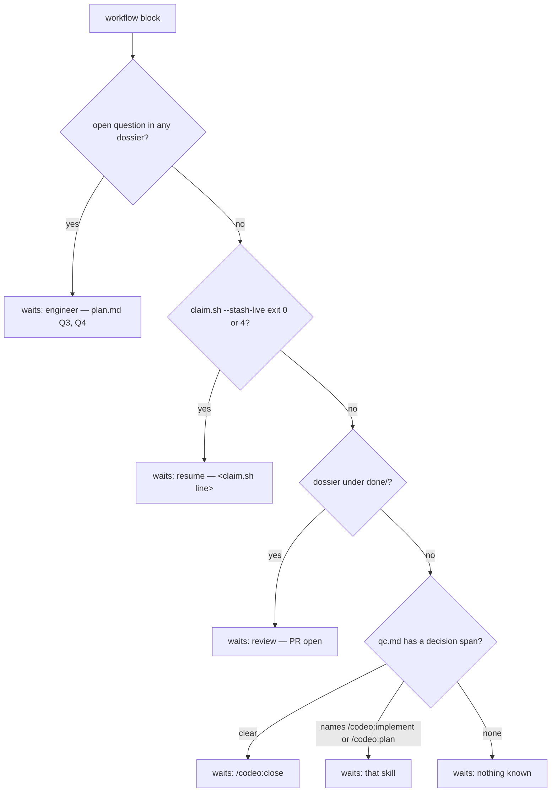

# Triage judges in-flight work from evidence Implementation Plan

> **For agentic workers:** REQUIRED SUB-SKILL: Use superpowers:subagent-driven-development (recommended) or superpowers:executing-plans to implement this plan task-by-task. Steps use checkbox (`- [ ]`) syntax for tracking.

**Goal:** `inflight.sh` tells, for every workflow, when it was last touched (and by what evidence), what it waits on and qc's verdict, and `/codeo:triage` uses those lines, a configurable parked threshold and the board Status to decide which workflows to ask about, quoting the facts.

**Architecture:** Three new lines in `inflight.sh`'s human block, all read from the pushed branch with git alone: `touched:`, `waits:` and (when qc has decided) `verdict:`. `--tsv`, `--branches` and `--live` do not change. The threshold (`triage.parkedDays`, default 7) and the board comparison live in `skills/triage/SKILL.md`, since the skill already reads `board.sh status` and the pull request of every branch.

**Tech Stack:** bash, git plumbing (`git show <sha>:<path>`, `git log -1 --format=%cs`), GNU `date -d` (already used by `intake.sh`), `scripts/claim.sh --stash-live`, the repo's `tests/*.test.sh` harness (`bash tests/run.sh [pattern]`).

**Spec:** `.codeo/103/init.md` (`## Outcome`: the issue and its acceptance criteria) and `.codeo/103/plan.md` (Q1-Q6, all answered "as recommended"). No standing reference doc: the behaviour is documented where it already is (`inflight.sh`'s header, `docs/handoff.md`, `docs/skills.md`, `lib/env.sh`).

## Context and decisions

Today a block says `step: qc (working)` and nothing else about time or state: `working` only means the dossier is not archived. Triage's rule "one whose last step is weeks old" has no date to apply it to.

| Decision | Chosen | Rejected (why) |
|---|---|---|
| Date evidence (Q1) | Git only: the newest of the branch tip's committer date, each dossier's `Updated` row and each dossier's last `## Log` date. Printed with its source. | The pull request's `updated_at`: one or two REST calls per archived workflow on every `inflight.sh` run, and a change to `scripts/github.sh` (in #116's footprint). |
| What it waits on (Q2) | First that applies: open question (file and numbers) · stash or abandon not resumed · PR open · next step after qc's verdict · `nothing known`. `verdict:` is its own line, printed whenever qc has decided. | The issue's four only: a deliberately stashed workflow would read `nothing known`. |
| Machine form (Q3) | Human block only. `--tsv`, `--branches`, `--live` byte for byte as today. | A `--facts` listing, or columns appended to `--tsv` (breaks a five-variable `read` and the equality tests). |
| Threshold (Q4) | `triage.parkedDays`, default 7, compared by the skill against the day count `inflight.sh` prints; more than the threshold is parked. Fingerprint `parked:<N>:<touched date>`. | `inflight.sh` deciding `parked: yes|no` itself. |
| Board mismatch (Q5) | Triage compares `board.sh status` with an expected Status derived from where the dossier sits, the stash state and the pull request; a mismatch is a question naming the `board.sh set` command, never run. Fingerprint `board:<N>:<Status found>`. | Listing without asking; triage writing the Status itself (widens its board writes). |
| Overlap with #116 (Q6) | Proceed and coordinate. | Sequencing; re-scoping. |

The block after this change (the three new lines between `changed:` and `live:`):

```
#116  fix/follow-ups-70-71-104
  assignee:  kbajpai
  step:      qc (working)
  files:      …
  changed:    …
  touched:   2026-11-17 (qc.md log), 0 days ago
  waits:     /codeo:implement
  verdict:   round 1 — back to /codeo:implement.
  live:      kbajpai on codeo-116 (container), 3m ago
```



Triage's expected board Status (Q5):

| What is pushed | Expected Status |
|---|---|
| dossier at `.codeo/<N>/`, no live stash or abandon | In progress (`board.statuses.inProgress`) |
| dossier at `.codeo/<N>/`, stash live | Ready (`board.statuses.ready`) |
| dossier at `.codeo/<N>/`, abandon live | Backlog (`board.statuses.backlog`) |
| dossier at `.codeo/done/<N>/`, pull request open | In review (`board.statuses.inReview`) |
| dossier at `.codeo/done/<N>/`, no pull request, or closed unmerged | none fits: always a mismatch |
| pull request merged | not compared: the existing `unclosed:<N>` item covers it |

**Not in this plan.** Liveness (#104 shipped it; the `live:` rule in triage stays as it is). Changing what `step:` or `(working)` mean. A machine-readable form of the new lines.

## Global Constraints

- **Additive only.** `--tsv` rows, `--branches` rows, `--live` rows and every existing human line (`#N  branch`, `assignee:`, `step:`, the footprint lines, `changed:`, `live:`) keep their text and their order. The new lines sit after `changed:` and before the first `live:` line. The one existing assertion that pins `changed:` directly followed by `live:` (`human_block_shows_a_live_session`) is updated to allow the new lines between; no other existing assertion changes.
- **No new network call.** The new lines come from `git show`, `git log` and `claim.sh --stash-live`, which reads the already-fetched `origin/<branch>`. `--tsv` and `--branches` compute none of them (no extra work for `overlap.sh`).
- **Never fails the listing.** An unreadable file, an unparseable date or a `claim.sh` exit other than 0, 3 or 4 falls back (to the branch tip's date; to the next `waits:` rule) and never aborts the script, which runs under `set -euo pipefail`.
- **Dates.** `YYYY-MM-DD`; a commit's date is its committer date in the committer's own zone (`%cs`). Days are whole calendar days from that date to today, `date +%F` (overridden by `CODEO_TODAY=YYYY-MM-DD` for tests), never negative (a future date counts 0). Always written `<d> days ago`, including `0 days ago` and `1 days ago`, so a reader parses one form.
- **Open question** means exactly what `dossier-check.sh`'s `open_questions_of` means: a `### ` heading under `## Questions` whose `**Answer:**` body (the rest of that line, then every line to the next heading) is blank; a heading with no `**Answer:**` line is not open; lines inside a ``` fence are ignored.
- **Verdict** means qc-verdict.sh's decision span: the last `**Verdict: …**` / `**Routing: …**` bold span (label inside the bold, lines joined) in the last round of `qc.md`'s `## Outcome`; the round is the number of the last `### Round <k>` heading there, else 1.
- **Triage's board writes stay Ready and Backlog.** A mismatch names the `board.sh set` command; triage never runs it. `docs/handoff.md`'s ownership table does not change.
- **Web sessions.** Everything in `inflight.sh` is git; `board.sh status` prints `unavailable` there, which triage reports in the run's `## Outcome` (rule `triage-07`), never as a mismatch.
- No invariants document is configured, so there is no invariant to check. No shared environment: no task carries `Needs lease:`; every task runs in this checkout. No `wiki` module; no `resources[]`, so `exclusive: none`.
- No config schema change: `triage.parkedDays` is an optional key; absent means 7.
- The `shell` suite has no `filter`, so each task's proof of done is the whole `bash tests/run.sh`; `bash tests/run.sh <pattern>` is used for the red and green steps.
- **Documentation moved.** `scripts/inflight.sh`'s header (Tasks 1-2), `docs/handoff.md` → *Who else is in flight* (Task 2), `lib/env.sh`'s config key list and `docs/skills.md` → *triage* → *Reads and writes* (Task 3), `CHANGELOG.md` (Task 4). `docs/dossier.md` does not move (no dossier convention changes); `docs/skills-inventory.md` does not move (no new rule marker). No `wiki` pages.
- **Overlap with #116 (Q6, proceed and coordinate).** #116 (`fix/follow-ups-70-71-104`, kbajpai, at qc) changes `CHANGELOG.md`, `docs/skills.md` and `docs/handoff.md`. Tasks 2-4 re-read the lines they edit after `/codeo:implement` merges `origin/main`, and keep every line the other branch wrote.

## Review Focus

- **A `**Answer:**` inside a fenced example** (a dossier quoting the dossier format) is not a question: `waits:` must not say `engineer` for it (Task 2: `waits_ignores_a_fenced_question`).
- **A branch whose dossiers carry no parseable date** (no `Updated` row, a log line like `- someday — …`, or `2026-13-45`) still gets a `touched:` line, from the branch tip (Task 1: `touched_falls_back_to_the_tip`).
- **Evidence dated after today** (a clock ahead, or a dossier dated tomorrow) reads `0 days ago`, never a negative count (Task 1: `touched_never_negative`).
- **A qc.md with a send-back round then a clear round** shows the clear round, and waits on `/codeo:close` (Task 2: `verdict_reads_the_last_round`).
- **A board read that is `unavailable`** is reported once in the run's `## Outcome`, not raised as a mismatch for every workflow (Task 3: the skill-wording case `unavailable is not a mismatch`).

---

### Task 1: `touched:` — the last-touched date and its source

**Files:**
- Modify: `scripts/inflight.sh` (new helpers after `last_step`; one `echo` after the `changed:` line; header comment lines 5-8)
- Test: `tests/inflight.test.sh`

**Interfaces:**
- Produces: `touched_of <sha> <dir>` → prints `YYYY-MM-DD<TAB><source>`, source one of `branch tip`, `<step>.md Updated`, `<step>.md log`. `days_since <YYYY-MM-DD>` → prints a whole number ≥ 0. The block line `  touched:   <date> (<source>), <d> days ago`.

- [ ] **Step 1: Write the failing tests.** In a new origin of their own (so the existing fixtures stay as they are), commits made with fixed `GIT_COMMITTER_DATE`, runs with `CODEO_TODAY=2026-11-17`:
  - `touched_takes_the_newest_log_date` — tip committed 2026-11-10; `.codeo/21/init.md` with `| Updated | 2026-11-11 |` and `## Log` lines `- 2026-11-11 — …`, `- 2026-11-14 — …`. Block contains `  touched:   2026-11-14 (init.md log), 3 days ago`.
  - `touched_prefers_the_tip_when_newer` — tip 2026-11-16, dossier dates 2026-11-12. `  touched:   2026-11-16 (branch tip), 1 days ago`.
  - `touched_tie_names_the_dossier` — tip 2026-11-15, `plan.md` `Updated` 2026-11-15, no log. `(plan.md Updated)`.
  - `touched_falls_back_to_the_tip` — `Updated` row `2026-13-45`, log line `- someday — x`. Source is `branch tip`.
  - `touched_never_negative` — log date 2026-11-20. `, 0 days ago`.
  - `touched_reads_an_archived_dossier` — dossier at `.codeo/done/22/`, log 2026-11-13. `(qc.md log), 4 days ago` in `#22`'s block.
  - `touched_sits_between_changed_and_live` — with a planted live signal (`plant_signal`), the block's lines in order are `changed:`, `touched:`, `live:`.
  - `tsv_and_branches_are_unchanged` — `--tsv` and `--branches` on this origin print exactly the rows the existing cases' format gives (five and three columns), with no `touched`.
- [ ] **Step 2: Run to see them fail.** `bash tests/run.sh inflight`. Expected: exit 1, the `touched_*` cases failing with `want substring [  touched: …]`; `tsv_and_branches_are_unchanged` passes.
- [ ] **Step 3: Implement `touched_of` and `days_since` in `scripts/inflight.sh`.** Candidates in this order, each replacing the current best when its date is `>=` the best (so on a tie the later candidate wins: dossier over tip, log over `Updated`, later step over earlier): the tip (`git log -1 --format=%cs <sha>`), then for each step in `steps[]` that has `<dir>/<step>.md`, its `| Updated | <date> |` row and then the newest `^- <date> ` line under `## Log`. A date counts only when it matches `^[0-9]{4}-[0-9]{2}-[0-9]{2}$` and `date -d` accepts it. `days_since` uses `date -u -d <d> +%s` on both dates and clamps at 0. Print the line after `changed:` in the human block only. Update the header comment to describe `touched:`.
- [ ] **Step 4: Run to see them pass.** `bash tests/run.sh inflight`. Expected: `all cases passed`.
- [ ] **Step 5: Proof of done.** `bash tests/run.sh` prints `all cases passed`.
- [ ] **Step 6: Commit** `scripts/inflight.sh` and `tests/inflight.test.sh`: `feat(inflight): print when each workflow was last touched, and by what evidence (#103)`.

### Task 2: `waits:` and `verdict:`

**Files:**
- Modify: `scripts/inflight.sh` (helpers; two `echo`s after `touched:`; header comment)
- Modify: `docs/handoff.md` → *Who else is in flight* (the sentence listing what `inflight.sh` prints)
- Test: `tests/inflight.test.sh`

**Interfaces:**
- Consumes: Task 1's block layout (`touched:` is the line before these).
- Produces: `open_questions_in <sha> <path>` → prints `Q3, Q4` (labels comma-joined) or nothing. `verdict_of <sha> <dir>` → prints `round <k> — <span text without ** and label>` or nothing. `waits_of <sha> <dir> <state_token> <branch> <n>` → prints the `waits:` value. Block lines `  waits:     <value>` (always) and `  verdict:   <value>` (only when `verdict_of` printed something), in that order.

- [ ] **Step 1: Write the failing tests** (same origin pattern as Task 1):
  - `waits_on_the_engineer` — `plan.md` with `### Q1` answered, `### Q2` and `### Q3` with empty `**Answer:**`; `qc.md` with `### Q1` open. `  waits:     engineer — plan.md Q2, Q3; qc.md Q1`.
  - `waits_answer_on_the_same_line_is_answered` — `**Answer:** Paid only.` on the heading's answer line. Not `engineer`.
  - `waits_ignores_a_fenced_question` — a ``` fence under `## Notes` and one under `## Questions` containing `### Q9` and an empty `**Answer:**`. Not `engineer`.
  - `waits_on_a_stash` — `close.md` with `### Round 1 — stashed`, no resume line in `init.md`. `  waits:     resume — #<N>'s stash is live`.
  - `waits_on_an_abandon` — `### Round 2 — abandoned`. Value starts `resume — #<N> was abandoned on`.
  - `waits_on_review` — archived dossier, no open question. `  waits:     review — PR open`.
  - `waits_after_a_send_back` — `qc.md` `## Outcome` with ``**Verdict: back to `/codeo:implement`.**``. `  waits:     /codeo:implement` and `  verdict:   round 1 — back to /codeo:implement.`.
  - `verdict_reads_the_last_round` — round 1 back to `/codeo:plan`, `### Round 2` with `**Verdict: clear — forward to `/codeo:close`.**`. `waits:     /codeo:close`, `verdict:   round 2 — clear — forward to /codeo:close.`.
  - `verdict_shown_under_an_open_question` — the send-back above plus an open `implement.md` question: `waits:` says `engineer — implement.md Q1` and the `verdict:` line is still there.
  - `waits_nothing_known` — only `init.md` with an outcome. `  waits:     nothing known`, and no `verdict:` line.
  - `human_block_shows_a_live_session` (existing) — change its first assertion to check `  changed:    src/x.txt` and the `live:` line are both in block 7 with `touched:` and `waits:` between; leave every other assertion as it is.
- [ ] **Step 2: Run to see them fail.** `bash tests/run.sh inflight`. Expected: exit 1, the new cases failing with `want substring [  waits: …]`.
- [ ] **Step 3: Implement the helpers in `scripts/inflight.sh`.** `open_questions_in`: one awk pass over `git show <sha>:<path>`, the rules in Global Constraints (fence lines toggled by ```` ^``` ````). `verdict_of`: the `## Outcome` section of `<dir>/qc.md`, from its last `### Round` heading; lines joined; `grep -o -i -E '\*\*(verdict|routing)( then)?:[^*]*\*\*'`, last match; strip `**`, backticks, underscores and the label as `qc-verdict.sh` does. `waits_of`, first that applies: open questions in any `<dir>/<step>.md` (`engineer — ` and `<step>.md <labels>` joined by `; `, pipeline order); for a working dossier, `bash "$CODEO_PLUGIN_ROOT/scripts/claim.sh" --stash-live <n> <branch> .` exiting 0 or 4 → `resume — ` and its stdout without `claim: `; `state_token == pr-open` → `review — PR open`; a verdict starting `clear` → `/codeo:close`; a verdict naming `/codeo:implement` or `/codeo:plan` → that name; else `nothing known`. Every call guarded so a failure falls to the next rule. Update the header comment.
- [ ] **Step 4: Edit `docs/handoff.md` → *Who else is in flight*.** Re-read the bullet first. The list of what `inflight.sh` prints becomes: issue, branch, assignee, last finished step, its plan's footprint, the files the branch changes, when it was last touched and by what evidence (`touched:`), what it waits on (`waits:`), qc's last verdict when there is one (`verdict:`), and a `live:` line per live session. Add one sentence: these three lines are read from the pushed branch only, and `--tsv` does not carry them.
- [ ] **Step 5: Run to see them pass.** `bash tests/run.sh inflight`. Expected: `all cases passed`.
- [ ] **Step 6: Proof of done.** `bash tests/run.sh` prints `all cases passed`.
- [ ] **Step 7: Commit** `scripts/inflight.sh`, `tests/inflight.test.sh`, `docs/handoff.md`: `feat(inflight): say what each workflow waits on and qc's last verdict (#103)`.

### Task 3: Triage uses the dates, the threshold and the board

**Files:**
- Modify: `skills/triage/SKILL.md` (step 1.2's first bullet; the fingerprint list under `triage-02`; step 4's options; step 6's report)
- Modify: `lib/env.sh` (config key list: `triage{parkedDays}`)
- Modify: `docs/skills.md` → *triage* → *Reads and writes*
- Test: `tests/triage-skill.test.sh`

**Interfaces:**
- Consumes: the `touched:`, `waits:`, `verdict:` lines (Tasks 1-2), `board.sh status <N>`, `github.sh pr list-for-branch <branch>` (already called in step 1.2's branch bullet), `claim.sh`'s stash state as `waits:` shows it.
- Produces: fingerprints `parked:<N>:<touched date>` and `board:<N>:<Status found>`; config key `triage.parkedDays`.

- [ ] **Step 1: Write the failing wording checks** in `tests/triage-skill.test.sh`, one `must_contain` each:
  - `"reads the threshold"` — `` '.triage.parkedDays // 7' ``
  - `"more than the threshold is parked"` — `more than the threshold`
  - `"within the threshold is listed, not asked"` — `listed in the run's ``## Outcome`` with its ``touched:`` and ``waits:`` lines and not asked about` (escape as the file's other checks do)
  - `"quotes the date and the threshold"` — `quote its ``touched:`` line and the threshold`
  - `"parked fingerprint"` — `` `parked:<N>:<touched date>` ``
  - `"board fingerprint"` — `` `board:<N>:<Status found>` ``
  - `"send-back is In progress with a PR open"` — `` dossier at `.codeo/<N>/` ``
  - `"mismatch names, never runs"` — `named, never run`
  - `"unavailable is not a mismatch"` — `` `unavailable` is never a mismatch ``
- [ ] **Step 2: Run to see them fail.** `bash tests/run.sh triage-skill`. Expected: exit 1, nine `FAIL: … — no [...]` lines.
- [ ] **Step 3: Edit `skills/triage/SKILL.md`.** Re-read step 1.2 first.
  - Replace "One whose last step is weeks old, or assigned to nobody, is worth asking about." with: read the threshold with `bash "${CLAUDE_PLUGIN_ROOT}/scripts/config.sh" get '.triage.parkedDays // 7'`; a workflow whose `touched:` day count is more than the threshold, or assigned to nobody, is asked about as parked work — quote its `touched:` line and the threshold (`triage.parkedDays`), with its `waits:`, `verdict:` and `step:` lines; fingerprint `parked:<N>:<touched date>`, so a dismissal holds until the workflow is touched again. One within the threshold is listed in the run's `## Outcome` with its `touched:` and `waits:` lines and not asked about. The `live:` sentences stay as they are.
  - A new bullet after it, **board mismatch**: with a board, `board.sh status <N>` for each workflow in flight, compared with an expected-Status table copied into the skill from this plan's *Context and decisions*, its first column worded as there (statuses through `board.statuses`, as `/codeo:init` and `/codeo:close` name them; a pull request's state from the branch bullet's `pr list-for-branch`; stash and abandon from `waits:`). `none` and `unset` are mismatches; a merged pull request is not compared. A mismatch is a question quoting the `status` line, the `step:` line and the pull request's state; fingerprint `board:<N>:<Status found>`. With no board, nothing to compare (the run's opening line already says the board is not configured); `unavailable` is never a mismatch: say once in the run's `## Outcome` that the board comparison was unavailable (`triage-07`).
  - Add `parked:<N>:<touched date>` and `board:<N>:<Status found>` to the fingerprint list under `triage-02`.
  - Step 4's options gain: a board mismatch: *fix it* (the `board.sh set <N> <status>` command, named, never run — triage's own writes stay Ready and Backlog) · *dismiss (why)* · *defer*.
- [ ] **Step 4: Document the key.** `lib/env.sh`'s key list: `triage{parkedDays}   optional; days without a pushed change after which /codeo:triage asks about an in-flight workflow (default 7; more than this is parked)`. `docs/skills.md` → *triage* → *Reads and writes*: the first bullet adds that `inflight.sh` supplies `touched:`, `waits:` and `verdict:` lines, the config's `triage.parkedDays` (default 7) sets when a quiet workflow is asked about, and `board.sh status` is compared with the dossier and pull request, a mismatch named and never fixed by triage. Re-read the section first.
- [ ] **Step 5: Run to see them pass.** `bash tests/run.sh triage-skill`. Expected: `all cases passed`.
- [ ] **Step 6: Proof of done.** `bash tests/run.sh` prints `all cases passed` (the skills lint, the inventory and the skills-doc checks read these files).
- [ ] **Step 7: Commit** the four files: `feat(triage): judge in-flight workflows by last-touched date, threshold and board Status (#103)`.

### Task 4: Changelog

**Files:**
- Modify: `CHANGELOG.md` (`## Unreleased`)

- [ ] **Step 1:** Re-read `## Unreleased` after merging `origin/main`. Keep `Config schema: 1`, the `Shared state:` line (unchanged by this issue) and every existing bullet. Append one bullet: `inflight.sh`'s human block gains `touched:` (date and source: branch tip, a dossier's `Updated` row or its last `## Log` date; days ago), `waits:` (an open question with file and number, a live stash or abandon, a PR open, the step after qc's verdict, or `nothing known`) and `verdict:` lines, between `changed:` and `live:`; `--tsv`, `--branches` and `--live` are unchanged. `/codeo:triage` asks about a workflow untouched for more than `triage.parkedDays` days (new optional config key, default 7), lists the others without asking, and raises a board Status that disagrees with the dossier and pull request, naming the `board.sh set` command (#103).
- [ ] **Step 2: Proof of done.** `bash tests/run.sh` prints `all cases passed`, and `grep -c 'triage.parkedDays' CHANGELOG.md` prints `1`.
- [ ] **Step 3: Commit** `CHANGELOG.md`: `docs(changelog): record #103`.

## Acceptance criteria → tasks

| Criterion | Proved by |
|---|---|
| Last-touched date for every workflow, matching the newest pushed evidence | Task 1 (`touched_*`) |
| Unanswered question shown as waiting on the engineer, with file and number | Task 2 (`waits_on_the_engineer`) |
| A `qc.md` verdict is shown | Task 2 (`waits_after_a_send_back`, `verdict_reads_the_last_round`) |
| Untouched beyond the threshold asked; within it listed, not asked | Task 3 (wording checks) |
| Board Status disagreeing with dossier and PR is flagged, quoting both | Task 3 (wording checks) |
| `--tsv` and human lines unchanged; consumers' tests pass | Task 1 (`tsv_and_branches_are_unchanged`), existing cases, `bash tests/run.sh` |
| Config setting documented with its default | Task 3 Step 4 |
| `bash tests/run.sh` passes; `CHANGELOG.md` records it | every task's proof; Task 4 |
