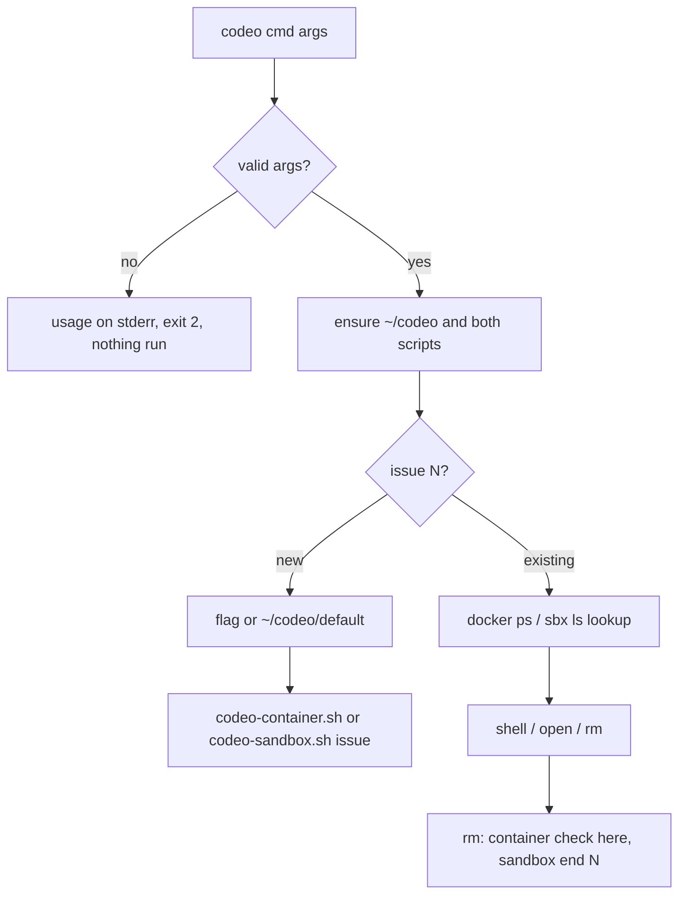

# `codeo` Host Command Implementation Plan

> **For agentic workers:** REQUIRED SUB-SKILL: Use superpowers:subagent-driven-development (recommended) or superpowers:executing-plans to implement this plan task-by-task. Steps use checkbox (`- [ ]`) syntax for tracking.

**Goal:** One `codeo` bash command on a Linux host that installs and updates itself and the two host scripts, runs their short forms, finds an issue's branch, chooses container or sandbox, lists what runs, and removes a container or sandbox only after a safe check (#133).

**Architecture:** A single new script `.devcontainer/codeo`, installed to `~/.local/bin/codeo`, with everything else in `$CODEO_HOME` (default `~/codeo`). It never changes `codeo-container.sh` or `codeo-sandbox.sh`: it `cd`s to `$CODEO_HOME` and runs them (`exec` where it can). The new logic is the branch lookup, the kind choice, `list`, container `rm` and `update`. One new test file drives it against stub `docker`, `sbx`, `git`, `curl` and stub copies of the two scripts.

**Tech Stack:** bash 4.3+ (Linux only), `curl`, `git`, `docker`, `sbx`; tests in `bash tests/run.sh` (the `shell` suite).

**Spec:** `.codeo/133/init.md` (`## Outcome`: the ten acceptance criteria) and the answers to Q1-Q6 in `.codeo/133/plan.md`. No standing reference doc: the command is documented in the two READMEs.

## Global Constraints

- **`codeo-container.sh`, `codeo-sandbox.sh`, the skills and the commands they print are not changed** (issue's out of scope). `codeo` only calls `codeo-container.sh home|issue|shell` and `codeo-sandbox.sh issue|open|shell|end`.
- **Bash 4.3 or later, Linux only.** The host needs only `bash`, `curl` and `git`; `docker` and `sbx` are each optional, and a missing one counts as "none of that kind".
- **Layout (Q1).** `~/.local/bin/codeo`; `$CODEO_HOME` (default `~/codeo`) holds `codeo-container.sh`, `codeo-sandbox.sh`, the sandbox clones `codeo-<N>`, `default`, and `.lookup.git`. `codeo` creates `$CODEO_HOME` and downloads a missing script on first use. It never edits `~/.bashrc`; `codeo help` prints the one line to add when `~/.local/bin` is not on `PATH`.
- **Commands (Q2):** `home [--rebuild]`, `issue <N> [<branch>] [--rebuild] [--container|--sandbox]`, `shell home|<N>`, `open <N>`, `list`, `rm <N> [--force]`, `default [container|sandbox]`, `update`, `help`. `rm` is the only way to end a sandbox; `--rebuild` with `--sandbox` is a usage error.
- **Argument checks first.** N matches `^[1-9][0-9]*$`; a branch matches `^[A-Za-z0-9][A-Za-z0-9._/-]*$` and has no `..`. A bad argument, a missing argument or an unknown command prints a usage on stderr, exits 2, and runs no `docker`, `sbx`, `git`, `curl` or script.
- **Exit status** is the called script's.
- **Kind choice (Q3).** `issue`: `--container`/`--sandbox`, else `$CODEO_HOME/default` (one word; `container` when absent). `shell`, `open` and `rm`: look at the host (`docker` container `codeo-<N>`, `sbx ls` sandbox `codeo-<N>`); one found is used, neither prints one line naming `codeo issue <N>` and exits 1, both prints one line and `--container`/`--sandbox` picks. `CODEO_KIND` is not read.
- **Branch lookup.** Blob-less bare clone `$CODEO_HOME/.lookup.git` of `${CODEO_REPO_URL:-https://github.com/kbajpai/codeo.git}`, fetched on each lookup; every origin branch is tested with `git cat-file -e <branch>:.codeo/<N>/init.md`. One match is the branch; none or several print one line naming what was found and create nothing.
- **Update is all or nothing.** The three files are downloaded into a temporary directory in `$CODEO_HOME`, each non-empty and starting with `#!`, then moved over the installed ones, `codeo` last; any failure removes the temporary directory and changes nothing. `CODEO_RAW_URL` names another base URL (default `https://raw.githubusercontent.com/kbajpai/codeo/main`).
- **Container `rm` (Q4).** Through `docker exec` in `/workspaces/codeo-<N>` (a stopped container is started first): `git fetch origin`, then refuse (up to 10 lines of each) on `git status --porcelain`, `git stash list`, a detached HEAD, or `git rev-list --branches --not --remotes=origin` output. Else `docker rm -f codeo-<N>`, `docker volume rm codeo-<N>`, `docker rmi codeo-dev:codeo-<N>` (a failure there only a warning), and one line `removed codeo-<N>` that says the Claude Code login on the volume is gone. `--force` skips the refusal, and also removes when the check cannot run (it says nothing could be checked). A failed fetch without `--force` removes nothing.
- **`list` (Q5).** One row per container or sandbox, containers first, by number: `#<N>  <kind>  <state>  <branch>`. A container's branch comes from `docker exec … git branch --show-current` and is `-` when stopped; a sandbox's from `git -C $CODEO_HOME/codeo-<N> branch --show-current`, `-` with no clone; nothing starts. Nothing to list prints `no issue containers or sandboxes`, exit 0; both `docker` and `sbx` missing prints one line, exit 1; one missing is skipped silently.
- **Parallel work (Q6 = proceed and coordinate).** #131 edits `.devcontainer/README.md`, `.sbx/README.md` and `CHANGELOG.md` too. This plan edits different sections, adds its own bullet, and adds `## Unreleased` to `CHANGELOG.md` only if it is absent when Task 7 runs. Whichever branch merges second rebases and keeps both.
- **Documentation:** Task 7 is the documentation task: `.devcontainer/README.md`, `.sbx/README.md` and `CHANGELOG.md`; the repository `README.md` names neither script, so it is unchanged. No wiki module, no `docs/` page describes these scripts.
- **No invariants document, no shared environment, no exclusive resource:** no task carries `Needs lease:`. No task runs on the engineer's host (a real Docker or sbx run is out of scope), so no `Runs on:` marker and no shell question.
- **Proof of done:** the `shell` suite has no single-test filter, so every task is proved by `bash tests/run.sh`, which must print `all cases passed` for `codeo-command.test.sh` and exit 0. Task 7's proof is the same run plus a grep named in the task.

## File Structure

| File | Responsibility |
|---|---|
| `.devcontainer/codeo` (new, executable, `#!/usr/bin/env bash`) | the whole command |
| `tests/codeo-command.test.sh` (new) | one function per case, listed in a final `cases=( … )` array, as in `tests/sandbox.test.sh` |
| `.devcontainer/README.md`, `.sbx/README.md`, `CHANGELOG.md` | documentation (Task 7) |

## Review Focus

- `codeo` run from a directory that holds a `codeo-<N>` folder: the sandbox script must still use `$CODEO_HOME`'s clone (Task 3 test).
- A branch name with a leading `-` or `..` given to `issue`: usage error, nothing run (Task 1 test).
- A stub `docker` that prints nothing and exits 1 (daemon down) during `list` and the lookup: counts as no containers, not a crash (Tasks 3, 4).
- `update` interrupted by a download that returns an empty file or an HTML error page: installed files unchanged (Task 6).
- `rm` on a container whose branch is pushed but whose clone has an untracked file: refused (Task 5).

---

### Task 1: Skeleton, argument checks, help

**Files:** Create `.devcontainer/codeo`, `tests/codeo-command.test.sh`.

**Interfaces:**
- Produces: `die <msg> [code]` (stderr `codeo: <msg>`, default 1); `usage` (the command list on stderr, exit 2); `valid_number <N>`, `valid_branch <b>`; `main "$@"` dispatching to `cmd_<name>`; `home_dir` = `${CODEO_HOME:-$HOME/codeo}`; the test helper `cm_setup <name>` that makes a scratch dir with `bin/` stubs (`docker`, `sbx`, `git`, `curl`) logging `<stub> <args>` to `calls`, and a `$CODEO_HOME` holding stub `codeo-container.sh` and `codeo-sandbox.sh` that log `<script> <args> pwd=<cwd>` to `calls`; `cm_run <args…>` that runs `codeo` under `env -i` with `PATH=<bin>:/usr/bin:/bin`.

- [ ] **Step 1: Write failing tests** `t_no_args_usage`, `t_unknown_command_usage`, `t_bad_number_usage` (`issue abc`, `issue 0`, `issue 07`, `shell x`, `rm 1x`), `t_bad_branch_usage` (`issue 5 -x`, `issue 5 a..b`, `issue 5 'a b'`), `t_missing_arg_usage` (`issue`, `shell`, `rm`, `open`): each asserts exit 2, a line starting `usage:` on stderr, and an empty `calls` file. `t_help_lists_commands`: `codeo help` exits 0 and stdout names all nine commands. `t_executable_bash`: the file is `git ls-files -s` mode `100755` with a `#!/usr/bin/env bash` first line. `t_suite_covers`: `.codeo/config.json` suite `shell` has a path glob covering `.devcontainer/codeo`.
- [ ] **Step 2: Run** `bash tests/run.sh codeo-command` — Expected: FAIL (`.devcontainer/codeo` missing).
- [ ] **Step 3: Implement** the skeleton above in `.devcontainer/codeo`; `help` also prints `export PATH="$HOME/.local/bin:$PATH"` when `~/.local/bin` is not on `PATH`. Every `cmd_*` checks its arguments with `valid_number`/`valid_branch` before anything else.
- [ ] **Step 4: Proof** `bash tests/run.sh` — Expected: `all cases passed` for `codeo-command.test.sh`, exit 0.
- [ ] **Step 5: Commit** `git add .devcontainer/codeo tests/codeo-command.test.sh && git commit -m "feat(codeo): codeo host command skeleton and argument checks (#133)"`

### Task 2: Bootstrap, `home`, container `issue`, container `shell`

**Interfaces:**
- Consumes: Task 1's `die`, `usage`, `home_dir`, `cm_setup`, `cm_run`.
- Produces: `ensure_home` (mkdir `home_dir`, download a missing `codeo-container.sh`/`codeo-sandbox.sh` with `curl -fsSL` from `${CODEO_RAW_URL:-https://raw.githubusercontent.com/kbajpai/codeo/main}/.devcontainer/codeo-container.sh` and `/.sbx/codeo-sandbox.sh`); `find_branch <N>` (prints the one branch, else `die` with the Global Constraints wording); `run_script <script> <args…>` (`cd "$home_dir"` then `exec bash "$script" "$@"`).

- [ ] **Step 1: Write failing tests** `t_home_runs_script` (`home --rebuild` logs `codeo-container.sh home --rebuild pwd=$CODEO_HOME` even when run from another directory), `t_issue_with_branch` (`issue 5 fix/x` logs `codeo-container.sh issue 5 fix/x`), `t_issue_rebuild_flag`, `t_issue_branch_lookup_one` (stub `git` answers `for-each-ref` with two branches and `cat-file -e` succeeds for one: that branch is passed), `t_issue_lookup_none` and `t_issue_lookup_several` (stderr one line naming what was found, the stub script is never called), `t_shell_container` (`shell 5` with a stub `docker` that lists `codeo-5` runs `codeo-container.sh shell 5`; `shell home` runs it without a lookup), `t_first_use_downloads` (empty `$CODEO_HOME`: the stub `curl` is called for both scripts, `-o` into `$CODEO_HOME`), `t_runs_from_any_directory`.
- [ ] **Step 2: Run** `bash tests/run.sh codeo-command` — Expected: FAIL (`unknown command`/no calls logged).
- [ ] **Step 3: Implement** `ensure_home`, `find_branch`, `run_script`, `cmd_home`, `cmd_issue` (container path only: `--container` and the default both mean container for now), `cmd_shell` (`home` direct; `<N>` is resolved by `detect_kind`, introduced in Task 3, so here it calls `codeo-container.sh shell <N>` directly). The lookup uses `git clone --bare --filter=blob:none "$repo_url" "$home_dir/.lookup.git"` once, then `git -C … fetch --prune origin '+refs/heads/*:refs/heads/*'` each time, `git for-each-ref --format='%(refname:short)' refs/heads`, `git cat-file -e "$b:.codeo/$N/init.md"`.
- [ ] **Step 4: Proof** `bash tests/run.sh` — Expected: `codeo-command.test.sh` passes, exit 0.
- [ ] **Step 5: Commit** `feat(codeo): codeo home, issue and shell for containers (#133)`

### Task 3: Kind choice, sandbox commands, `default`, `open`

**Interfaces:**
- Consumes: Tasks 1-2.
- Produces: `saved_default` (reads `$home_dir/default`, `container` when absent or not one of the two words); `host_kinds <N>` (prints `container`, `sandbox`, both, or nothing; `docker ps -a --format '{{.Names}}'` and `sbx ls`, a missing program or a failing call counts as none); `detect_kind <N> <flag-or-empty>` (the Q3 rule, `die` with the one-line messages); `cmd_default [container|sandbox]` (prints the saved value, or saves the word, anything else is usage); `cmd_open <N>` (sandbox: `codeo-sandbox.sh open <N>`; container: `die` one line, exit 1).

- [ ] **Step 1: Write failing tests** `t_issue_sandbox_flag` (`issue 5 fix/x --sandbox` runs `codeo-sandbox.sh issue 5 fix/x`), `t_issue_default_sandbox` (after `default sandbox`, `issue 5 fix/x` is a sandbox issue; `--container` overrides), `t_issue_rebuild_sandbox_usage` (exit 2, no calls), `t_default_show_and_save` (no file prints `container`; `default sandbox` writes it; `default bogus` is usage), `t_shell_sandbox` (only `sbx ls` shows `codeo-5`: `codeo-sandbox.sh shell 5`), `t_shell_neither` (one line naming `codeo issue 5`, exit 1), `t_shell_both` (one line, nothing run; with `--sandbox` it runs), `t_open_sandbox`, `t_open_container_refused`, `t_no_docker_program` (a PATH without `docker` still reaches a sandbox), `t_sandbox_uses_home_clone` (run from a directory holding a decoy `codeo-5`: the script call logs `pwd=$CODEO_HOME`).
- [ ] **Step 2: Run** `bash tests/run.sh codeo-command` — Expected: FAIL.
- [ ] **Step 3: Implement** the four functions; `cmd_issue` and `cmd_shell` now use `saved_default` and `detect_kind` (`shell` and `open` accept `--container`/`--sandbox` too).
- [ ] **Step 4: Proof** `bash tests/run.sh` — Expected: passes, exit 0.
- [ ] **Step 5: Commit** `feat(codeo): codeo chooses container or sandbox, adds default and open (#133)`

### Task 4: `list`

**Interfaces:**
- Consumes: Task 3's `host_kinds` approach (its own two listing calls here).
- Produces: `cmd_list` printing `#<N>  <kind>  <state>  <branch>` rows as in Global Constraints.

- [ ] **Step 1: Write failing tests** `t_list_rows` (stub `docker ps -a --format '{{.Names}} {{.State}}'` gives `codeo-131 running`, `codeo-140 exited`, `codeo-home running`; stub `sbx ls` gives `codeo-133`; stub `git -C … branch --show-current` and `docker exec codeo-131 git … branch --show-current` answer; the output is exactly the three rows, container 131 and 140 then sandbox 133, `codeo-home` absent, 140's branch `-`, no `docker start` and no `sbx exec` in `calls`), `t_list_empty` (`no issue containers or sandboxes`, exit 0), `t_list_no_programs` (one line, exit 1), `t_list_docker_down` (`docker` exits 1: skipped, sandbox rows still print).
- [ ] **Step 2: Run** `bash tests/run.sh codeo-command` — Expected: FAIL.
- [ ] **Step 3: Implement** `cmd_list`; rows sorted by number within each kind.
- [ ] **Step 4: Proof** `bash tests/run.sh` — Expected: passes, exit 0.
- [ ] **Step 5: Commit** `feat(codeo): codeo list (#133)`

### Task 5: `rm`

**Interfaces:**
- Consumes: Task 3's `detect_kind`.
- Produces: `container_check <N>` (prints the refusal lines, returns 0 clean, 1 dirty, 2 could not check); `cmd_rm <N> [--force] [--container|--sandbox]`: sandbox runs `codeo-sandbox.sh end <N> [--force]`; container follows Global Constraints.

- [ ] **Step 1: Write failing tests** `t_rm_sandbox` and `t_rm_sandbox_force` (the exact `end` call), `t_rm_container_clean` (calls in order: `docker exec … git fetch origin`, status, stash list, rev-list, then `docker rm -f codeo-5`, `docker volume rm codeo-5`, `docker rmi codeo-dev:codeo-5`; stdout `removed codeo-5`), `t_rm_container_untracked` (stub status prints `?? f`: refused, the line names it, no `docker rm`), `t_rm_container_unpushed` (rev-list prints a SHA), `t_rm_container_stash`, `t_rm_container_detached`, `t_rm_container_force` (dirty, `--force`: removed and says what was not kept), `t_rm_container_cannot_check` (fetch fails: without `--force` nothing removed and the raw `docker` commands are named; with `--force` removed and says nothing could be checked), `t_rm_image_failure_warns` (`docker rmi` fails: exit 0 and a warning line), `t_rm_stopped_container_started_first`.
- [ ] **Step 2: Run** `bash tests/run.sh codeo-command` — Expected: FAIL.
- [ ] **Step 3: Implement** `container_check` and `cmd_rm`; each refusal list is cut at 10 lines per kind.
- [ ] **Step 4: Proof** `bash tests/run.sh` — Expected: passes, exit 0.
- [ ] **Step 5: Commit** `feat(codeo): codeo rm with a safe check (#133)`

### Task 6: `update`

**Interfaces:**
- Consumes: Task 2's raw URL rule.
- Produces: `cmd_update`.

- [ ] **Step 1: Write failing tests** `t_update_replaces_three` (stub `curl` writes known `#!` bodies; all three installed files change, `codeo` last in `calls` order of `mv`), `t_update_failed_download_changes_nothing` (the second download fails: the three files are byte-identical, no temporary directory left), `t_update_empty_file_refused`, `t_update_not_a_script_refused` (an HTML body).
- [ ] **Step 2: Run** `bash tests/run.sh codeo-command` — Expected: FAIL.
- [ ] **Step 3: Implement** `cmd_update`. `codeo` is replaced with `mv` of a temporary file in its own directory so a running copy is not truncated.
- [ ] **Step 4: Proof** `bash tests/run.sh` — Expected: passes, exit 0.
- [ ] **Step 5: Commit** `feat(codeo): codeo update (#133)`

### Task 7: Documentation and changelog

**Files:** Modify `.devcontainer/README.md`, `.sbx/README.md`, `CHANGELOG.md`.

- [ ] **Step 1: `.devcontainer/README.md`** — add a section *Installing the `codeo` command* (the download line `mkdir -p ~/.local/bin && curl -fsSL -o ~/.local/bin/codeo https://raw.githubusercontent.com/kbajpai/codeo/main/.devcontainer/codeo && chmod +x ~/.local/bin/codeo`, `codeo help`, `codeo update`, `CODEO_HOME`); in *Opening a container from the command line*, *Removing a finished container* and *Rebuilding* show the `codeo` form beside each long command (`codeo home`, `codeo issue <N> [<branch>]`, `codeo shell <N>`, `codeo rm <N> [--force]`, `codeo issue <N> --rebuild`) with the Q4 safe-check rules in *Removing*.
- [ ] **Step 2: `.sbx/README.md`** — in *Getting the script*, *Commands* and *Ending a sandbox* show `codeo issue <N> --sandbox`, `codeo default sandbox`, `codeo open <N>`, `codeo shell <N>`, `codeo rm <N> [--force]` beside the `bash codeo-sandbox.sh` forms; `codeo list` in *Commands*.
- [ ] **Step 3: `CHANGELOG.md`** — under `## Unreleased` (add the heading above `## v1.0.7` only if absent) one bullet: the new `codeo` host command, its commands, and that it adds no change to the two scripts.
- [ ] **Step 4: Proof** `bash tests/run.sh` — Expected: exits 0; and `grep -c 'codeo rm' .devcontainer/README.md .sbx/README.md` prints a count of at least 1 for each file.
- [ ] **Step 5: Commit** `docs(codeo): document the codeo host command (#133)`
