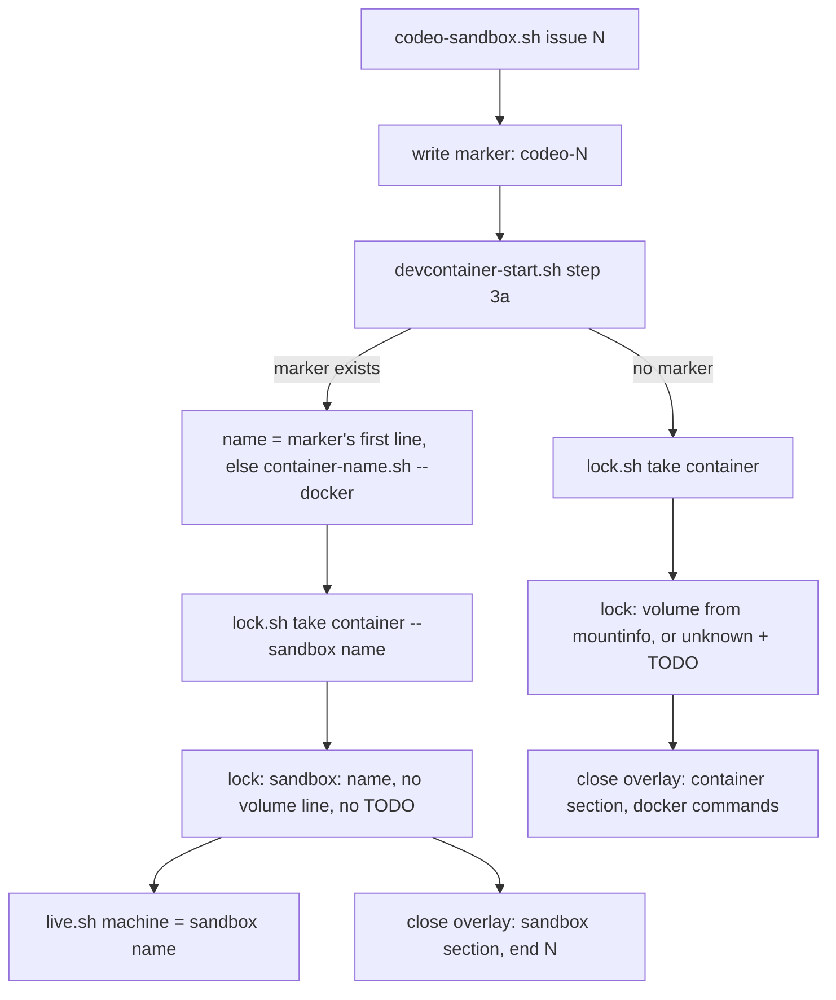

# Make the sbx sandbox lock and follow-ups right Implementation Plan (#131)

> **For agentic workers:** REQUIRED SUB-SKILL: Use superpowers:subagent-driven-development (recommended) or superpowers:executing-plans to implement this plan task-by-task. Steps use checkbox (`- [ ]`) syntax for tracking.

**Goal:** A lock taken in an sbx sandbox records the sandbox instead of a Docker volume, `/codeo:close` names `codeo-sandbox.sh end <N>` for it, and the #99 script and test gaps (#123, #125) are closed, with `tests/run.sh` passing.

**Architecture:** `codeo-sandbox.sh` writes the sandbox's name into the `~/.codeo-sandbox` marker. `devcontainer-start.sh` reads the marker and calls `lock.sh take container --sandbox <name>`; `lock.sh` then writes `sandbox: <name>` in place of the `volume:` line and skips the volume lookup. Without the flag nothing changes. `live.sh` and `/codeo:close` read the new line.

**Tech Stack:** bash, jq, git; the `shell` suite (`bash tests/run.sh`, one file per `bash tests/<name>.test.sh`).

**Spec:** `.codeo/131/init.md` `## Outcome` (the issue's acceptance criteria) and `.codeo/131/plan.md` Q1-Q5, whose answers are the design. Reference doc: none; the lock line is documented in `docs/handoff.md`.

## Global Constraints

- **Lock line.** A sandbox lock has `host:    container` and `sandbox: <name>` (one space after the colon, as `session:`), and no `volume:` line. A dev container lock is byte-for-byte what it is now (Q1; criterion 4).
- **`lock.sh` ships to every project.** It learns only the general `--sandbox <name>` flag; it never reads `~/.codeo-sandbox` and never knows the name `codeo-<N>`. It never fails its caller: a bad flag value is a `lock: TODO —` line.
- **Pin.** The start script runs the installed plugin's `lock.sh` (pinned v1.0.7), so a real sandbox shows the change only after the next release and pin bump. The criteria are proved by tests against the clone's scripts (Q2); no task runs on the engineer's host and no task needs a lease (no shared environment is configured).
- **`skills/close/SKILL.md` names no container engine**; `tests/close-removal.test.sh` fails on `docker` there. The sandbox command lives in `.codeo/overlays/close.md`.
- **Existing sandboxes keep `volume: unknown`**; nothing recognises them (Q5).
- **`end` never removes what it could not read** (Q3): a failed start or fetch removes nothing, with or without `--force`, and the message names `sbx rm --force codeo-<N>`.
- **Close covers all three endings** for a sandbox (Q4); `/codeo:triage`, `/codeo:cleanup` and `/codeo:init` still run in the home container `codeo-home`.
- **Out of scope** (the issue): `/codeo:cleanup` and `scripts/cleanup.sh` for sandboxes; `role.sh`; F17, F18, F22; the sbx CLI.
- **Invariants:** none configured. **Environment tasks:** none; every task is proved in this checkout.
- **Documentation:** five pages move (`docs/handoff.md`, `docs/extension-points.md`, `.sbx/README.md`, `.devcontainer/README.md`, `CHANGELOG.md`), one task each, Tasks 9-12. No wiki module.
- **Overlap:** #133 (`feat/codeo-command-host-short-bash`, kbajpai) is at `init` with no footprint and no changed files, so it cannot be compared yet; it is named here rather than assumed to touch nothing.
- **Plan-wide proof.** Each task's proof is the named test file; Task 13 runs the whole `bash tests/run.sh`.



## Review Focus

- A `--sandbox` value that is empty, has a space, or starts with `-`: a TODO, and the volume path runs as before.
- An old `~/.codeo-sandbox` that is empty (made by the previous script): the start script falls back to `container-name.sh --docker`, and when that fails to a TODO, never a failed start.
- `issue` on an existing sandbox with the pin missing and no `CODEO_SBX_IMAGE`: succeeds (F20). With the sandbox missing it still refuses before creating anything.
- `end` with `--force` when the fetch fails: removes nothing and says so (a reader may expect `--force` to win).
- The stamp test run in a checkout whose live hook has fired (this one).

## File Structure

| File | Change |
|---|---|
| `scripts/lock.sh` | `--sandbox <name>`; `CODEO_MOUNTINFO` override; header comment |
| `scripts/live.sh` | machine label from `sandbox:` |
| `.devcontainer/scripts/devcontainer-start.sh` | step 3a passes `--sandbox` |
| `.sbx/codeo-sandbox.sh` | marker holds the name; F19, F20, F21; `required_state` declared |
| `.codeo/overlays/close.md`, `skills/close/SKILL.md` | sandbox paragraphs; `sandbox:` named |
| `tests/lock.test.sh`, `live.test.sh`, `devcontainer.test.sh`, `sandbox.test.sh`, `close-removal.test.sh` | the cases below |
| `docs/handoff.md`, `docs/extension-points.md`, `.sbx/README.md`, `.devcontainer/README.md`, `CHANGELOG.md` | what each task says |

---

### Task 1: `lock.sh` records a sandbox

**Files:** Modify `scripts/lock.sh` (the `take` function, the `container` branch at `:139-145`, the header and the `usage` line); Test `tests/lock.test.sh`.

**Interfaces:**
- Produces: `lock.sh take container [--sandbox <name>] [session-id]`. With `--sandbox <name>` (name matching `^[A-Za-z0-9][A-Za-z0-9._-]*$`) the lock gets `sandbox: <name>` after `host:` and no `volume:` line, and no volume TODO. Any other value prints `lock: TODO — --sandbox needs a name of letters, digits, ., _ and -: the lock records a volume instead` and takes the volume path. The flag is read only for host `container`. The mountinfo file is `${CODEO_MOUNTINFO:-/proc/self/mountinfo}`.

- [ ] **Step 1: Write the failing cases** in `tests/lock.test.sh`, beside the container cases, using `fresh_repo`, `write_init`, `run_lock "$repo" "$marker" container …`. Case `container, sandbox lock`: after `--sandbox codeo-38`, `active` contains `sandbox: codeo-38` and `host:    container`, not `volume:`, and the output has no `TODO`. Case `container, sandbox name refused`: `--sandbox 'a b'` → output contains `--sandbox needs a name`, and the lock has a `volume:` line. Case `container, volume read`: with `CODEO_MOUNTINFO` set to a file holding `100 1 0:50 /var/lib/docker/volumes/codeo-38/_data /workspaces rw - ext4 /dev/x rw`, the lock has `volume:  codeo-38` and no TODO. Case `container, volume unreadable`: with `CODEO_MOUNTINFO` set to an empty file, the lock has `volume:  unknown` and the output contains `could not read the workspace volume's name from /proc/self/mountinfo: fill the lock's volume line in by hand (docker volume ls on the host)` (criterion 4: unchanged).
- [ ] **Step 2: Run** `bash tests/lock.test.sh`. Expected: FAIL on the sandbox and refused cases (the flag is read as a session id); the volume cases pass or fail only on the missing override.
- [ ] **Step 3: Implement** the flag parse at the top of `take` (shift it off before `session` is read), the `sandbox` branch before the volume lookup, and the `CODEO_MOUNTINFO` default. Update the header comment to say a container records its volume, or its sandbox when told.
- [ ] **Step 4: Run** `bash tests/lock.test.sh`. Expected: `all cases passed`.
- [ ] **Step 5: Commit** `git add scripts/lock.sh tests/lock.test.sh` — `feat(lock): record the sandbox, not a volume, when told (#131)`.

### Task 2: fix `live.test.sh`'s stamp checks

**Files:** Modify `tests/live.test.sh:229`, `:236`, `:370-375`.

**Interfaces:** Produces: three assertions that read the stamp from `git -C "$clone" rev-parse --path-format=absolute --git-path codeo-live-beat` (git 2.31 or later), so they no longer resolve a relative `.git/...` against the test's working directory.

- [ ] **Step 1: Confirm the failure.** Run `bash tests/live.test.sh` in this checkout. Expected: three `FAIL` lines (`no lock: stamp`, `base: stamp`, `stamp gone`), because `.git/codeo-live-beat` exists here.
- [ ] **Step 2: Implement** the absolute path in all four places; at `:371` and `:375` drop the `$clone/$stamp ||` alternative.
- [ ] **Step 3: Run** `bash tests/live.test.sh`. Expected: no `FAIL`, `all cases passed`, with the real `.git/codeo-live-beat` still present.
- [ ] **Step 4: Commit** `tests/live.test.sh` — `test(live): read the stamp by absolute path (#131)`.

### Task 3: the live signal names a sandbox

**Files:** Modify `scripts/live.sh:106` (and the `machine` comment at `:35`); Test `tests/live.test.sh` case `machine_by_host`.

**Interfaces:** Produces: for host `container`, the machine label is the lock's `volume:` value, else its `sandbox:` value, else the hostname (as now).

- [ ] **Step 1: Write the failing case** in `machine_by_host`: a lock with `host:    container` and `sandbox: codeo-104`, written directly to `$clone/.codeo/active`, publishes `refs/codeo/live/104/codeo-104`.
- [ ] **Step 2: Run** `bash tests/live.test.sh`. Expected: FAIL, the ref is named after the hostname.
- [ ] **Step 3: Implement** the fallback: `container) name=$(lock_field volume); [[ -n $name ]] || name=$(lock_field sandbox) ;;`.
- [ ] **Step 4: Run** `bash tests/live.test.sh`. Expected: `all cases passed`.
- [ ] **Step 5: Commit** `scripts/live.sh tests/live.test.sh` — `feat(live): name a sandbox's signal after the sandbox (#131)`.

### Task 4: the marker holds the name and the start script passes it

**Files:** Modify `.sbx/codeo-sandbox.sh` (`ensure_sandbox`, `:159-160`), `.devcontainer/scripts/devcontainer-start.sh` (step 3a, `:229-230`; `mark` defined once and reused at `:252`); Test `tests/sandbox.test.sh` (`issue_writes_the_sandbox_marker`), `tests/devcontainer.test.sh` (`start_in_a_sandbox_skips_the_folder_check` and new cases).

**Interfaces:**
- Consumes: Task 1's flag.
- Produces: the marker `${CODEO_SANDBOX_MARK:-$HOME/.codeo-sandbox}` holds `codeo-<N>` on its first line (written by `ensure_sandbox` as `sbx exec <name> bash -c 'printf "%s\n" "$1" > "$HOME/.codeo-sandbox"' _ <name>`). Step 3a calls `lock.sh take container --sandbox <name>` when the marker exists, `<name>` being its first line, else `container-name.sh --docker`'s output, else no flag and a TODO `the sandbox marker names no sandbox and container-name.sh failed: the lock records a volume`. Without the marker the call is `lock.sh take container` as now. Readers of the marker (`session-title.sh`, step 3a') still only test that it exists.

- [ ] **Step 1: Write the failing cases.** `sandbox.test.sh`: `issue_writes_the_sandbox_marker` expects the new exec line (`sbx exec codeo-113 bash -c printf "%s\n" "$1" > "$HOME/.codeo-sandbox" _ codeo-113`) on a missing and on an existing sandbox. `devcontainer.test.sh`, with `ds_lock_stub` (it logs `lock.sh`'s arguments to `$ds_dir/lock-calls`): `start_in_a_sandbox_passes_the_sandbox_to_the_lock` (marker file holding `codeo-122` → logged args end `take container --sandbox codeo-122`); `start_with_an_empty_marker_names_the_sandbox_from_the_folder` (empty marker, clone folder `codeo-122` with a lock → `--sandbox codeo-122`); `start_without_a_marker_takes_the_lock_as_before` (args exactly `take container`).
- [ ] **Step 2: Run** `bash tests/sandbox.test.sh` and `bash tests/devcontainer.test.sh`. Expected: FAIL in the four cases above.
- [ ] **Step 3: Implement** both edits. Keep `bash -c` with the name as `$1`, not interpolated into the command.
- [ ] **Step 4: Run** both files. Expected: `all cases passed`.
- [ ] **Step 5: Commit** the four files — `feat(sbx): the marker names the sandbox and the start script locks with it (#131)`.

### Task 5: the dev container test no longer depends on the real `$HOME`

**Files:** Modify `tests/devcontainer.test.sh` (`start_in_a_sandbox_skips_the_folder_check`, `:1508-1520`).

**Interfaces:** Produces: the no-marker half sets `DS_SET=CODEO_SANDBOX_MARK=$ds_dir/no-such-mark` and the case adds a second run with `HOME` set to a scratch folder that holds `.codeo-sandbox`, which must still list the folder TODO once (criterion 9).

- [ ] **Step 1: Write the case** `start_without_the_marker_ignores_the_callers_home_marker`: `mkdir -p "$ds_dir/outer"; : > "$ds_dir/outer/.codeo-sandbox"`, run `HOME="$ds_dir/outer" DS_REPO="$ds_dir/codeo-122" ds_ready_run`, expect one `docker ps` TODO. Register it in the case list.
- [ ] **Step 2: Run** `HOME=<a folder holding .codeo-sandbox> bash tests/devcontainer.test.sh`. Expected: `all cases passed` (the scratch `HOME` in `ds_run` already isolates it, so this case pins that; it fails if `ds_run` ever stops setting `HOME`).
- [ ] **Step 3: Pin** the existing half's marker path as above so neither half reads `$HOME`.
- [ ] **Step 4: Run** `bash tests/devcontainer.test.sh`. Expected: `all cases passed`.
- [ ] **Step 5: Commit** — `test(devcontainer): the no-marker case does not read the caller's HOME (#131)`.

### Task 6: `/codeo:close` names the sandbox's removal

**Files:** Modify `.codeo/overlays/close.md` (`## host-workflow`), `skills/close/SKILL.md:518` and `:531-535`; Test `tests/close-removal.test.sh`.

**Interfaces:** Produces: the overlay opens its container text with "When the lock's `host` is `container` and it has a `volume:` line", and gains a section "When the lock has a `sandbox:` line" with three paragraphs (finished, stash, abandon, in the wording of Q4) placed before "For any other host". The finished paragraph says to run `bash codeo-sandbox.sh end <N>` on the host in the folder that holds `codeo-<N>` (`end` itself refuses while anything is unpushed), and names no `docker rm` and no `docker volume rm`. Stash: `print no removal command`, the sandbox may stay, resume is `/codeo:init #<N>` in the home container `codeo-home`, then `bash codeo-sandbox.sh issue <N> <branch>` again. Abandon: `print no removal command`; branch kept, `end <N>` is safe; branch deleted, the sandbox holds the only copy and `end` refuses without `--force`. The skill's `host: container` bullet says "the lock's `volume:` or `sandbox:` line" and that either identifies what the host removes; it still contains `on the host`, `git status`, `volume:` and no `docker`.

- [ ] **Step 1: Write the failing checks** in `tests/close-removal.test.sh`: the overlay output contains `When the lock has a \`sandbox:\` line`, `codeo-sandbox.sh end <N>`, `codeo-sandbox.sh issue <N> <branch>`; the sandbox section (from its heading to `For any other host`) contains neither `docker rm` nor `docker volume rm`; and the container section's slices still end at the sandbox heading, not at `For any other host` (change `check_overlay`'s `aband` slice accordingly). Add a mutant: a `docker rm` line inside the sandbox section must fail from its own check.
- [ ] **Step 2: Run** `bash tests/close-removal.test.sh`. Expected: FAIL `overlay output lacks: When the lock has a ...`.
- [ ] **Step 3: Write** the overlay section and the skill edit.
- [ ] **Step 4: Run** `bash tests/close-removal.test.sh` and `bash tests/close-skill.test.sh`. Expected: `all cases passed` for both.
- [ ] **Step 5: Commit** — `feat(close): a sandbox's finished close names codeo-sandbox.sh end (#131)`.

### Task 7: `issue` names the next step when the start script fails, and a rerun needs no pin (F19, F20)

**Files:** Modify `.sbx/codeo-sandbox.sh` (`cmd_issue`, `ensure_sandbox`, `run_start` call); Test `tests/sandbox.test.sh`.

**Interfaces:** Produces: when `run_start` fails, `cmd_issue` dies with `codeo-sandbox: the start script failed in codeo-<N>: fix what it printed above, then run codeo-sandbox.sh issue <N> <branch> again, or codeo-sandbox.sh shell <N> to look inside` (exit 1; `check_name` and `run -d` do not run). `read_pin` is called inside `ensure_sandbox`, only on the path that creates, so an existing sandbox needs no pin; a missing sandbox with no pin still refuses before `create`.

- [ ] **Step 1: Write the failing cases.** `issue_names_the_next_step_when_the_start_script_fails`: a `startfail` file makes the stub's `devcontainer-start.sh` exec exit 1 (extend the stub's `*devcontainer-start.sh*)` arm); expect exit 1, the exact stderr line above with `113` and `fix/x`, and no `container-name.sh` or `sbx run` call. `issue_rerun_needs_no_pin`: sandbox listed as `running (detached)`, `CODEO_SBX_IMAGE` set to a missing file → exit 0, no `create`.
- [ ] **Step 2: Run** `bash tests/sandbox.test.sh`. Expected: FAIL in both.
- [ ] **Step 3: Implement.**
- [ ] **Step 4: Run** `bash tests/sandbox.test.sh`. Expected: `all cases passed` (the existing pin cases still refuse when the sandbox is missing).
- [ ] **Step 5: Commit** — `fix(sbx): name the next step when the start script fails; a rerun needs no pin (#131)`.

### Task 8: `end` names a way out when the sandbox cannot be read (F21)

**Files:** Modify `.sbx/codeo-sandbox.sh:371-374`; Test `tests/sandbox.test.sh` (`end_with_a_failed_sandbox_fetch_removes_nothing`, `end_starts_a_stopped_sandbox_first`).

**Interfaces:** Produces: when `exec … true` (a stopped sandbox) or `fetch_sandbox` fails, `end` removes nothing and dies with `codeo-sandbox: could not <start|fetch> … nothing removed: nothing in it could be read, so nothing can be proved or kept; to remove it anyway run: <sbx> rm --force codeo-<N>`. With `--force` the line adds before `nothing removed`: ` (--force cannot keep commits it could not fetch)`. `<sbx>` is the program's name as `ensure_detached`'s message prints it.

- [ ] **Step 1: Write the failing cases:** the fetch-failure case checks both forms (`end 113` and `end 113 --force`) for exit 1, no `rm` call, and the `rm --force codeo-113` text, with `--force` adding the parenthesis; a stopped sandbox whose `exec true` fails gets the same.
- [ ] **Step 2: Run** `bash tests/sandbox.test.sh`. Expected: FAIL.
- [ ] **Step 3: Implement** one helper for both messages.
- [ ] **Step 4: Run** `bash tests/sandbox.test.sh`. Expected: `all cases passed`.
- [ ] **Step 5: Commit** — `fix(sbx): end names a way to remove a sandbox it cannot read (#131)`.

### Task 9: the remaining test gaps

**Files:** Modify `.sbx/codeo-sandbox.sh:74-75` area, `tests/sandbox.test.sh` (`docs_readme_gives_the_extension_route` and `docs_changelog_names_the_sandbox_route`).

**Interfaces:** Produces: `required_state=''` declared beside `create_agent`; no test reads `CHANGELOG.md` by line number.

- [ ] **Step 1: Write the cases.** `sandbox_state_ignores_a_row_with_fewer_than_three_columns` (a row `codeo-113 claude` with no status → `stopped`, matching `sandbox_state`'s current behaviour for an empty status; assert what the script does and name that in the case); `issue_with_a_failed_run_d_is_one_line` (a `runfail` file; sandbox missing → exit 1, stderr is one line naming `run -d --name codeo-113`, as `a_failed_run_d_is_one_line` does for `open`). In `docs_readme_gives_the_extension_route` replace `sed -n 9p "$repo/CHANGELOG.md" | grep -Fq …` with: the bullet `grep -E '^- .*\.sbx/codeo-sandbox\.sh'` lacks `` `remote.SSH.defaultExtensions`; `` and contains ``which needs a one-time `sbx policy allow network` rule``.
- [ ] **Step 2: Run** `bash tests/sandbox.test.sh`. Expected: PASS for the new cases (they pin existing behaviour); then `grep -rnE "sed -n [0-9]+p.*CHANGELOG|CHANGELOG.*sed -n [0-9]+p" tests` prints nothing.
- [ ] **Step 3: Declare** `required_state`.
- [ ] **Step 4: Run** `bash tests/sandbox.test.sh` and `shellcheck .sbx/codeo-sandbox.sh` (when installed). Expected: `all cases passed`, no findings.
- [ ] **Step 5: Commit** — `test(sbx): close the remaining #99 test gaps (#131)`.

### Task 10: `docs/handoff.md` and `docs/extension-points.md`

**Files:** Modify `docs/handoff.md:49-50` (the `container` bullet), the live-signal machine paragraph near `:177`, `:446`'s row if it mentions the volume TODO; `docs/extension-points.md:445`.

**What they say afterwards:** handoff: a `container` lock has a `volume:` line, or, when its start script ran in an sbx sandbox, a `sandbox:` line with the sandbox's name instead (never both); either identifies the checkout so it can be found again; the live signal's machine is the container's volume, else its sandbox, else the hostname. extension-points: `close/host-workflow` *May rely on* reads "The lock's host line (`volume:`, `sandbox:` or `session:`)".

- [ ] **Step 1: Edit** the three passages.
- [ ] **Step 2: Proof:** `grep -c 'sandbox:' docs/handoff.md docs/extension-points.md` prints a count of at least 1 for each file, and `bash tests/skills-doc.test.sh` ends `all cases passed`.
- [ ] **Step 3: Commit** — `docs: the lock's sandbox: line (#131)`.

### Task 11: `.sbx/README.md`

**Files:** Modify the `issue` sequence diagram's "write the sandbox marker" step, the *Ending a sandbox* section and its flowchart; Test `tests/sandbox.test.sh` (new `docs_readme_says_how_a_unreadable_sandbox_is_removed`, `docs_readme_says_the_marker_names_the_sandbox`).

**What it says afterwards:** the marker holds the sandbox's name, and the start script uses it to take the lock with `sandbox: codeo-<N>` and no volume line; a sandbox made before this change keeps `volume: unknown` and is ended with `end <N>` all the same; *Ending a sandbox*: when `end` cannot start the sandbox or fetch from it, it removes nothing, with or without `--force`, and names `sbx rm --force codeo-<N>`, which discards whatever the sandbox holds. The flowchart's `D -- fails --> Z2` node reads `exit 1, nothing removed: names sbx rm --force codeo-N`. The `issue` diagram's start-script failure adds `S-->>E: one codeo-sandbox: line naming the next step`.

- [ ] **Step 1: Write** the two doc cases (grep for `sbx rm --force codeo-<N>` and `sandbox: codeo-<N>` in the README). Run `bash tests/sandbox.test.sh`. Expected: FAIL.
- [ ] **Step 2: Edit** the README and both diagrams.
- [ ] **Step 3: Run** `bash tests/sandbox.test.sh`. Expected: `all cases passed`.
- [ ] **Step 4: Commit** — `docs(sbx): the marker, the lock line and the unreadable sandbox (#131)`.

### Task 12: `.devcontainer/README.md` and `CHANGELOG.md`

**Files:** Modify `.devcontainer/README.md:116` (the section *Removing a finished container*), `CHANGELOG.md` under `## Unreleased` (add the heading above `## v1.0.7` if absent, following `docs/release-checklist.md:75`); Test `tests/sandbox.test.sh` (`docs_changelog_names_the_sandbox_lock`).

**What they say afterwards:** README: one sentence that the removal commands are for a dev container, and that for a workflow hosted in an sbx sandbox (a lock with `sandbox:`) `/codeo:close` names `bash codeo-sandbox.sh end <N>` instead, linking `.sbx/README.md`. CHANGELOG: a bullet naming `scripts/lock.sh` `--sandbox`, the `sandbox:` line, `live.sh`, the close overlay, F19-F21, the test gaps and the `live.test.sh` stamp fix, ending with `(#131, #123, #125)`, and the line `Safe to bump mid-workflow: yes` (a lock taken before keeps `volume: unknown`).

- [ ] **Step 1: Write the case:** a bullet in `CHANGELOG.md` contains `--sandbox` and `(#131`. Run `bash tests/sandbox.test.sh`. Expected: FAIL.
- [ ] **Step 2: Edit** both files.
- [ ] **Step 3: Run** `bash tests/sandbox.test.sh`. Expected: `all cases passed`.
- [ ] **Step 4: Commit** — `docs: README and CHANGELOG for the sandbox lock (#131)`.

### Task 13: the whole suite

- [ ] **Step 1: Run** `bash tests/run.sh`. Expected: no `=== FAIL` and no `failed:` line, exit 0 (criterion 12). It takes about five minutes.
- [ ] **Step 2: Run** `HOME=<a scratch folder holding .codeo-sandbox> bash tests/run.sh`. Expected: the same (criterion 9, inside a sandbox's `HOME`).
- [ ] **Step 3: Check the criteria** from `.codeo/131/init.md` one by one and record each in `implement.md`; nothing to commit.

---

### Footprint

```
files:      scripts/lock.sh, scripts/live.sh, .devcontainer/scripts/devcontainer-start.sh, .sbx/codeo-sandbox.sh, .sbx/README.md, .devcontainer/README.md, skills/close/SKILL.md, .codeo/overlays/close.md, docs/handoff.md, docs/extension-points.md, CHANGELOG.md, tests/lock.test.sh, tests/live.test.sh, tests/devcontainer.test.sh, tests/sandbox.test.sh, tests/close-removal.test.sh, docs/plans/2026-11-18-sbx-sandbox-lock-follow-ups-131.md
wiki:       none
exclusive:  none
sequenced:  none
```
