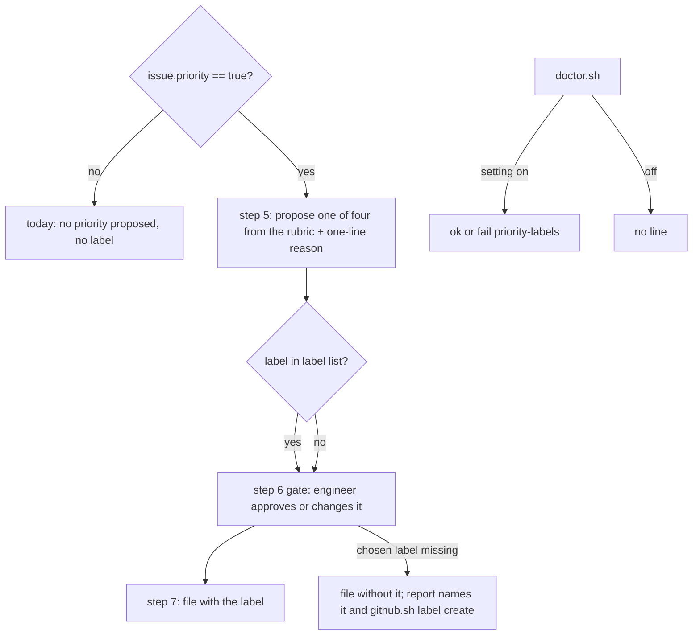

# Priority labels for `/codeo:issue` Implementation Plan (#102)

> **For agentic workers:** REQUIRED SUB-SKILL: Use superpowers:subagent-driven-development (recommended) or superpowers:executing-plans to implement this plan task-by-task. Steps use checkbox (`- [ ]`) syntax for tracking.

**Goal:** With `issue.priority: true` in `.codeo/config.json`, `/codeo:issue` proposes one of four priority labels at its review gate and files the issue with the engineer's choice; `/codeo:doctor` checks the labels exist; this project turns the setting on and has the labels; `bash tests/run.sh` passes.

**Architecture:** One config switch, read by the skill (`config.sh get .issue.priority`) and by `doctor.sh`. The four label names are fixed by the plugin and listed in the skill and in `doctor.sh`. A new `github.sh label create <name>` verb is the one command the filing report, doctor and the engineer use to create a missing label. The skill's step 5 proposes the priority from a four-line rubric, step 6 shows it with its reason, step 7 sends it as a label only if the label exists. Rule `issue-07` becomes "Priority only under the setting and only with the engineer's approval; Effort never".

**Tech Stack:** bash, jq, `gh api`; the `shell` suite (`bash tests/run.sh`, one file per `bash tests/<name>.test.sh`).

**Spec:** `.codeo/102/init.md` `## Outcome` (the issue's acceptance criteria) and `.codeo/102/plan.md` Q1-Q5, whose answers are the design. Reference doc: none; the behaviour is documented in `docs/skills.md` and `docs/skills-inventory.md`.

## Global Constraints

- **The setting (Q1).** `issue.priority`, a boolean under a new `issue` object. On means the value is exactly `true`; absent, `false` or anything else is off. No label-name mapping. `lib/env.sh`'s header documents the key (`tests/skills.test.sh` check 6 fails a `config.sh get` filter its header does not name).
- **The labels (Q2).** `priority: blocker`, `priority: high`, `priority: medium`, `priority: low`, exactly, space included. Every other place that names them is checked against this list.
- **The rubric (Q3)** is fixed text in the skill, no extension point (`lib/extension-points.tsv` and `docs/extension-points.md` do not change). The wording is in Task 3.
- **Off is today (criterion 3).** With the setting absent or off the skill proposes no priority, adds no label, and its text for that case says so; `doctor.sh` prints nothing about priority (Q4), so its output and line count are unchanged for every project that has not opted in.
- **A missing label never fails the filing.** The skill decides from the `label list` it already runs; a label that is not in that list is left out of the `gh api` call, and the report names it with `github.sh label create`. The filed issue then has no priority label, and the report says so.
- **Effort is never set,** setting on or off. Rule `issue-07` keeps its number; the inventory still has nine `issue` rules.
- **Delegated filings (criterion 4).** `/codeo:triage`, `/codeo:plan`, `/codeo:implement` and `/codeo:qc` pass a finding, never a priority (`issue-04`); the proposal and the gate are the same as for a human invocation. `skills/triage/SKILL.md` needs no change.
- **Pin.** This project pins plugin `v1.0.7`, so the setting does nothing here until a release carrying this change is pinned. The criteria are proved by tests and by the labels and config on GitHub; no task runs on the engineer's host and none needs a lease (no shared environment is configured).
- **Repository change (Q5).** Task 5 creates four labels on `kbajpai/codeo`. It runs only after this plan is approved and through the plan's own verb.
- **Invariants:** none configured. **Environment tasks:** none; every task is proved in this checkout.
- **Documentation:** four pages move, one task each, all in Task 4 except the skill's own rule text (Task 3): `docs/skills-inventory.md` (Task 3), `docs/skills.md`, `CHANGELOG.md`, and the header comments of `scripts/doctor.sh`, `scripts/github.sh` and `lib/env.sh` (Tasks 1-2). No wiki module, no diagram changes.
- **Overlap:** #108 and #122 are at `init` with no footprint and no changed files, so there is nothing to compare; both are named here rather than assumed to touch nothing. The footprint is checked again before the hand-off.

## Review Focus

- `issue.priority` set to `"true"` (a string), `false`, `null` or an array: off, in the skill's wording and in doctor (Task 2 test; Task 3 wording).
- Setting on, a repository with more than one page of labels: doctor still finds the four (`--paginate`).
- Setting on and `gh` cannot read the labels: doctor prints `fail priority-labels: cannot read the repository's labels`, not a pass and not a crash.
- The engineer changes the proposal at the gate to a label that is missing: the issue is filed without it and the report names that label (Task 3 wording).
- A caller passes a priority along with its finding: the skill ignores it and proposes its own at the gate (Task 3 wording, `issue-04`).
- Setting on and the engineer wants no priority: the skill says the setting makes one required and asks again; turning the setting off is the way not to have one.

## File Structure

| File | Change |
|---|---|
| `scripts/github.sh` | `label create <name>` verb; header comment |
| `scripts/doctor.sh` | the `priority-labels` check, only when the setting is on; header comment |
| `lib/env.sh` | header documents `issue{priority}` |
| `skills/issue/SKILL.md` | steps 5-8 and rule `issue-07` |
| `docs/skills-inventory.md`, `tests/fixtures/skills-inventory.rules.sha256` | the new `issue-07` text and its pinned hash |
| `docs/skills.md` | the issue and doctor sections |
| `CHANGELOG.md` | an Unreleased entry |
| `tests/github.test.sh`, `tests/doctor.test.sh`, `tests/issue-skill.test.sh` | the cases below |
| `.codeo/config.json` | `issue.priority: true` |

---

### Task 1: `github.sh label create`

**Files:** Modify `scripts/github.sh` (the `label)` branch, which today rejects every subcommand but `list`; the header's verb list); Test `tests/github.test.sh` (beside the `label list (two pages)` case).

**Interfaces:**
- Produces: `github.sh label create <name>` — `POST repos/<owner>/<name>/labels` with `-f name=<name>`, GitHub's default colour, prints nothing and exits 0 on success; on failure one `github: label create <name>: POST failed` line on stderr and a non-zero exit. An existing label is a failure like any other (the callers only run it for a label `label list` did not print). The name may hold a space and is passed as one argument.

- [ ] **Step 1: Write the failing test** `label create sends the name`: write a `POST_repos_acme_widgets_labels` fixture (as the neighbouring cases do), run `bash "$script" label create 'priority: high'`; assert exit 0, empty stdout, and that `$calls_log` contains `METHOD=POST` and `PATH=repos/$repo/labels` and `name=priority: high`. A second case `label create failure` marks that fixture failing and asserts exit non-zero, empty stdout and `label create priority: high` on stderr.
- [ ] **Step 2: Run it to see it fail.** Proof: `bash tests/github.test.sh` → FAIL `unknown label subcommand: create`.
- [ ] **Step 3: Implement** the `create` subcommand in the `label)` branch, writing the response to `/dev/null` and dying with the message above. Add `label create <name>` to the header's verb list.
- [ ] **Step 4: Proof of done.** `bash tests/github.test.sh` → `all cases passed`.
- [ ] **Step 5: Commit** `scripts/github.sh tests/github.test.sh` — `feat(github): label create verb (#102)`.

### Task 2: The setting is documented and doctor checks the labels

**Files:** Modify `lib/env.sh` (header, after the `labelTypes{}` entry); `scripts/doctor.sh` (a new check after `board`, the header's check list and comment); Test `tests/doctor.test.sh`.

**Interfaces:**
- Consumes: Task 1's verb, named in doctor's failure line.
- Produces: with `.issue.priority == true` in the config, one line from doctor: `ok priority-labels: all four exist` or `fail priority-labels: missing: <names, comma-separated>; create each with: bash <plugin root>/scripts/github.sh label create '<name>'`, or `fail priority-labels: cannot read the repository's labels` when `gh api --paginate repos/<owner>/<name>/labels` fails. With any other value, or an unusable config, no line at all. The four names are one array in `doctor.sh`: `priority: blocker`, `priority: high`, `priority: medium`, `priority: low`.
- `lib/env.sh` header gains: `issue{priority}         optional; priority is a bool, default false: true makes /codeo:issue give every issue it files exactly one priority label (priority: blocker, high, medium or low) and makes /codeo:doctor check the four labels exist`.

- [ ] **Step 1: Write the failing tests.** Extend the stub `gh` with an `"api --paginate"` branch answering the names in `$GH_LABELS` (one per line; unset → the four names; `GH_LABELS_FAIL` set → exit 1). Cases, each run with `$healthy` plus `.issue.priority`: `doctor_priority_labels_ok_when_all_four_exist` (`true`, all four → `^ok priority-labels: all four exist`, exit 0, twelve lines); `doctor_priority_labels_fail_names_the_missing_one` (`GH_LABELS` without `priority: low` → `^fail priority-labels: missing: priority: low`, the line contains `label create 'priority: low'`, exit non-zero); `doctor_priority_labels_fail_when_labels_cannot_be_read`; `doctor_priority_labels_say_nothing_when_off` for `false`, `"true"`, `null` and an absent key (no `priority-labels` anywhere in the output; eleven lines; exit 0 with `GH_LABELS_FAIL` set, proving gh is not called); `doctor_priority_labels_say_nothing_when_the_config_is_unusable`. Add the case names to the loop at the bottom of the file.
- [ ] **Step 2: Run to see them fail.** Proof: `bash tests/doctor.test.sh` → FAIL on the first new case (`no priority-labels line`).
- [ ] **Step 3: Implement** the check in `doctor.sh`: on only when `cfg '.issue.priority == true'` prints `true`; read names with `gh api --paginate "repos/$repo/labels" -q '.[].name'` (repository from `cfg .repo.owner` / `.repo.name`); compare each wanted name with `grep -Fxq`; report with the existing `report` function. Update the header's check list and the `lib/env.sh` header as above.
- [ ] **Step 4: Proof of done.** `bash tests/doctor.test.sh` → `all cases passed`; `bash tests/skills.test.sh` → `all cases passed`.
- [ ] **Step 5: Commit** `lib/env.sh scripts/doctor.sh tests/doctor.test.sh` — `feat(doctor): check the priority labels when issue.priority is on (#102)`.

### Task 3: The skill proposes, shows and files a priority

**Files:** Modify `skills/issue/SKILL.md` (steps 5, 6, 7, 8 and rule `issue-07` at `:129-131`; the scope sentence and the Hand-off section only where they say the skill sets nothing but the Backlog on the board — the label is not a board write); `docs/skills-inventory.md` (`[issue-07]`); `tests/fixtures/skills-inventory.rules.sha256`; Test `tests/issue-skill.test.sh`.

**Interfaces:**
- Consumes: Task 1's verb and the label names (Global Constraints).
- Produces: the skill text the tests pin. Each string below appears in `SKILL.md` exactly:
  1. Step 5: `config.sh" get .issue.priority` and `prints \`true\``; the four label names in full; the rubric — `blocker`: work already in flight cannot continue, or the base branch or a release is broken, until this is fixed; `high`: a defect or gap that affects normal use and has no acceptable workaround, or work a committed piece of work depends on; `medium`: worth doing; there is a workaround, or the effect is limited, and the default when neither `blocker`, `high` nor `low` fits; `low`: polish, cleanup, or a follow-up nobody is waiting on; and `one-line reason` naming the rubric line that applied.
  2. Step 5, off: `When it prints anything else, or nothing, propose no priority and add no priority label`.
  3. Step 5, delegated: `A priority a calling skill passes along is ignored; the proposal is this skill's, made at the gate`.
  4. Step 6: the gate shows `the proposed priority and its one-line reason`; `Changing it at the gate files the issue with the engineer's choice`; with the setting on, no priority means asking again — `the setting makes one required`.
  5. Step 7: the label goes in the `gh api` call as `-f 'labels[]=priority: <name>'` only when `label list` printed it; `A missing priority label never fails the filing` (a new `<!-- rule: issue-07 -->` sentence keeps its comment); the report names the missing label and `github.sh" label create '<label>'`, and says the issue has no priority label.
  6. Rule `issue-07`: `Set a Priority only when \`issue.priority\` is on and only with the engineer's approval at the review gate, as a label; never set \`Effort\` or any custom field.`
- Inventory `[issue-07]`: `Priority only under issue.priority and with the engineer's approval at the gate, as a label; never Effort.`

- [ ] **Step 1: Write the failing tests** in `tests/issue-skill.test.sh` with the file's `must_contain`/`doc_has` helpers: every string in the list above; the four label names in `skills/issue/SKILL.md` and in `scripts/doctor.sh` (one loop, so the two lists cannot drift); `docs/skills-inventory.md` has the new `issue-07` text; the old text `Never set Priority or Effort.` is gone from both the skill's rule and the inventory (`! grep`); `skills/triage/SKILL.md` still says it files through `/codeo:issue` (criterion 4's path is the skill's own gate).
- [ ] **Step 2: Run to see them fail.** Proof: `bash tests/issue-skill.test.sh` → FAIL cases `no [config.sh" get .issue.priority]` and the rest.
- [ ] **Step 3: Edit `skills/issue/SKILL.md`** so each pinned string is present, in the steps named, keeping step order, the rule comments and the precedence sentence. In the same edit, update `docs/skills-inventory.md` and run `bash tests/inventory.test.sh --update` to rewrite the pinned hash.
- [ ] **Step 4: Proof of done.** `bash tests/issue-skill.test.sh` → `all cases passed`; `bash tests/inventory.test.sh` → exit 0; `bash tests/skills.test.sh` → `all cases passed`.
- [ ] **Step 5: Commit** the four files — `feat(issue): propose a priority label at the gate when issue.priority is on (#102)`; the message explains the `issue-07` rule change, as the inventory test asks.

### Task 4: Documentation

**Files:** Modify `docs/skills.md` (the `issue` section: purpose paragraph, Reads and writes, and the `doctor` section's check count); `CHANGELOG.md` (`## Unreleased`); Test `tests/issue-skill.test.sh`, `tests/skills-doc.test.sh` as run.

- [ ] **Step 1: Write the failing test.** In `tests/issue-skill.test.sh`: `doc_has` for `docs/skills.md` containing `issue.priority` and `priority: blocker`; for `CHANGELOG.md` containing `issue.priority`.
- [ ] **Step 2: Run to see it fail.** Proof: `bash tests/issue-skill.test.sh` → FAIL `no [issue.priority] in docs/skills.md`.
- [ ] **Step 3: Edit the pages.** `docs/skills.md` `issue`: with `issue.priority` on, the skill proposes one of `priority: blocker|high|medium|low` with a one-line reason at the gate and files it as a label; off or absent, no priority; a missing label does not fail the filing; Effort is never set. Reads and writes: reads the repository's labels; writes the issue's priority label under the setting. `doctor`: eleven checks, plus `priority-labels` as a twelfth only when `issue.priority` is on. `CHANGELOG.md` Unreleased: one entry for the setting, the labels, the `github.sh label create` verb and the doctor check; `Config schema: 1` (the key is optional), `Shared state:` and `Safe to bump mid-workflow:` lines unchanged in form.
- [ ] **Step 4: Proof of done.** `bash tests/issue-skill.test.sh` → `all cases passed`; `bash tests/skills-doc.test.sh` → `all cases passed`.
- [ ] **Step 5: Commit** — `docs: issue.priority in skills.md and the changelog (#102)`.

### Task 5: This project turns the setting on and has the labels

**Files:** Modify `.codeo/config.json` (adds `"issue": { "priority": true }`).

This is the one task that changes the repository on GitHub. Needs a working `gh` login with write access to `kbajpai/codeo`; no lease.

- [ ] **Step 1: Create the four labels,** each through the verb Task 1 wrote, one command each, run in this session's shell: `bash scripts/github.sh label create 'priority: blocker'` and likewise `high`, `medium`, `low`. A label that already exists is skipped, not recreated.
- [ ] **Step 2: Add** `"issue": { "priority": true }` to `.codeo/config.json`.
- [ ] **Step 3: Proof of done.** `bash scripts/github.sh label list | grep -c '^priority: '` → `4`; `bash scripts/config.sh get .issue.priority` → `true`; `bash scripts/doctor.sh | grep priority-labels` → `ok priority-labels: all four exist` (run with this clone's script, not the pinned plugin's).
- [ ] **Step 4: Commit** `.codeo/config.json` — `chore: turn issue.priority on for this project (#102)`.

### Task 6: The whole suite

- [ ] **Step 1: Proof of done.** `bash tests/run.sh` → `all cases passed`, exit 0. Nothing is committed.

---

## Self-review (run against the issue's acceptance criteria)

| Criterion | Task |
|---|---|
| Exactly one priority label with the setting on | 3 (step 7 wording, step 6 "required") |
| Gate shows the proposal and reason; a change is honoured | 3 |
| Off or absent: no label, no proposal | 3 (off wording), 2 (doctor silent) |
| Delegated filing through the same gate | 3 (delegated wording, triage pin) |
| Label missing: still filed, report names it and the command | 1 (verb), 3 |
| Doctor fails on missing labels when on, silent when off | 2 |
| No filing sets Effort | 3 (`issue-07`) |
| Inventory and `docs/skills.md` describe the rule; tests cover on and off | 3, 4 |
| This project's config on; four labels exist | 5 |
