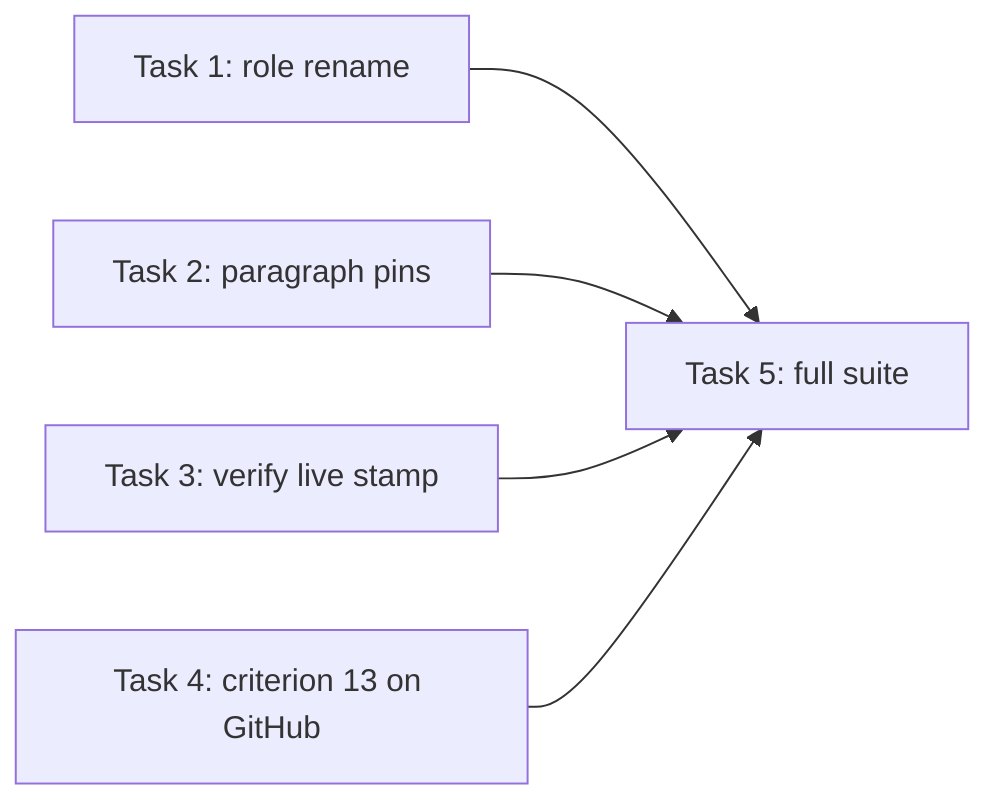

# Fix test-suite gaps left by #116 and #100 Implementation Plan (#132)

> **For agentic workers:** REQUIRED SUB-SKILL: Use superpowers:subagent-driven-development (recommended) or superpowers:executing-plans to implement this plan task-by-task. Steps use checkbox (`- [ ]`) syntax for tracking.

**Goal:** Close the leftovers #132 consolidates from #116's QC (F7, F10, F11) and #100's QC (the stamp checks in `tests/live.test.sh`), so each test says what it pins and each acceptance criterion has a recorded proof. No script or skill behaviour changes.

**Architecture:** Tests and GitHub housekeeping only. `tests/live.test.sh` is already fixed on `main` by #131 (commit `df2cdf9`) and is verified, not edited (plan Q1). One renamed case in `tests/role.test.sh`, one paragraph-scoped helper and two pins in `tests/close-skill.test.sh`, and one tick plus two comments on closed issues.

**Tech Stack:** bash, `bash tests/run.sh` (the `shell` suite), `gh`.

**Spec:** `.codeo/132/init.md` (`## Outcome`: the issue and its six acceptance criteria) and `.codeo/132/plan.md` (Q1-Q3 answered). Source findings: `.codeo/done/116/qc.md` round 2 (F7, F10, F11) and `.codeo/done/100/qc.md` line 19.

## Global Constraints

- **`tests/live.test.sh` is not edited (plan Q1, verify only).** The three stamp assertions (`:229`, `:236`, `:374-379`) already read `git -C "$clone" rev-parse --path-format=absolute --git-path codeo-live-beat`. Task 3 proves criteria 4, 5 and 6 and reports the results; it adds no guard case.
- **F10 is renamed, not strengthened.** `role.sh:57` is unguarded only when both markers are absent, so a case that creates both can never fail when the `/run/.containerenv` check is removed. `containerenv_alone_is_guarded` stays the case that pins that check; the other is renamed and commented so its name claims nothing more (criterion 2, second branch).
- **F11's helper matches exactly one paragraph.** It takes the paragraph that holds an anchor string and fails when no paragraph, or more than one, holds it, so a needle cannot be met by a neighbour. `skills/close/SKILL.md` does not change.
- **Criterion 13 is posted and ticked (plan Q2).** Task 4 writes to #107 and #116, which are closed, with `gh`: one comment on each and one checkbox edit in #116's body. Nothing else on either issue is touched.
- **No documentation moves, no changelog entry (plan Q3).** The change is tests only and alters nothing a user of codeo sees; no page under `docs/` and no `CHANGELOG.md` line is wrong after it merges, so `/codeo:qc` should read their absence as deliberate. This also keeps the plan clear of #102, #108 and #122, which all touch `CHANGELOG.md`.
- **Overlap.** `inflight.sh --except 132` (2026-11-19) shows #102, #108 and #122; none changes `tests/role.test.sh`, `tests/close-skill.test.sh` or `tests/live.test.sh`. No overlap question is raised.
- **Suite.** The `shell` suite has no `filter`, so a task's proof is its test file (`bash tests/<file>.test.sh`, ending `all cases passed`), then `bash tests/run.sh` in Task 5. No task carries `Needs lease:` (no shared environment is configured) or `Runs on:` (every command runs in this checkout; the lock's host is `container`).
- **Invariants.** None configured.

## File Structure

| File | Change |
|---|---|
| `tests/role.test.sh` | Rename `both_markers_are_guarded_the_same` (`:221`, and its call at `:363`) and say in a comment what it pins |
| `tests/close-skill.test.sh` | New helper `paragraph_contains_flat` beside `section_contains_flat` (`:90`); the two pins at `:321-322` use it |
| `tests/live.test.sh` | None (verified in Task 3) |
| `docs/plans/2026-11-19-test-suite-gaps-132.md` | This plan |

## Review Focus

- Task 2's anchors must each occur in exactly one paragraph of the `## Stash, and closed unmerged` section (the stash paragraph is `skills/close/SKILL.md:632-640`, the abandon one `:664-680`), and the helper's one-paragraph check must fail loudly when they do not.
- Task 3 must not pass vacuously: criterion 6's mutations are run on a scratch copy and must make the named cases fail.
- Task 4 edits only the one checkbox line of #116's body.

---

### Task 1: Rename the case that cannot pin the Podman check (criterion 2)

**Files:** Modify `tests/role.test.sh:221-225` and its call at `:363`.

**Interfaces:** Produces: a case `both_markers_present_is_guarded` that creates `/.dockerenv`'s stub and the `/run/.containerenv` stub and expects `issue:70`.

- [ ] **Step 1: Show the gap.** In a scratch copy of the repo (`git archive HEAD | tar -x -C <scratch>`), delete the `/run/.containerenv` test from `.devcontainer/scripts/role.sh:57` (leave `! -e ${CODEO_DOCKERENV:-/.dockerenv}` alone), then run `bash tests/role.test.sh` in the copy. Expected: `both_markers_are_guarded_the_same` still passes, `containerenv_alone_is_guarded` fails.
- [ ] **Step 2: Implement.** Rename the case to `both_markers_present_is_guarded` in its definition and its call, and put one comment above it: both stubs present is still guarded, and it passes on the dockerenv stub alone, so `containerenv_alone_is_guarded` is the case that pins the `/run/.containerenv` check.
- [ ] **Step 3: Proof of done.** `bash tests/role.test.sh` ends `all cases passed`, and `grep -c both_markers_are_guarded_the_same tests/role.test.sh` prints `0`.
- [ ] **Step 4: Commit** `tests/role.test.sh` — `test(role): name the both-markers case for what it pins (#132)`.

### Task 2: Each stash and abandon pin searches only its own paragraph (criterion 3)

**Files:** Modify `tests/close-skill.test.sh` (helper beside `section_contains_flat` at `:90`; the two assertions at `:321-322`).

**Interfaces:** Produces: `paragraph_contains_flat <case> <section> <anchor> <needle>`: takes the paragraphs of `## <section>` (blank-line separated), keeps those whose text contains `<anchor>`, fails unless exactly one does, flattens it and requires `<needle>`. Consumes: `section` (`:82`).

- [ ] **Step 1: Show the gap (failing check first).** Build two scratch copies of the skill in the scratch directory. *Stash copy:* in the stash paragraph change ``Delete `.codeo/active` last`` to ``Remove `.codeo/active` last``, and add ``Delete `.codeo/active` last, as step 16 does, with the signal cleared`` to the abandon paragraph (for example in place of `close-10 does on the merge path, and running` put `close-10 does on the merge path. Delete ...cleared, and running`). *Abandon copy:* change `Then the lock is deleted last,` to `Then the lock goes last,` in the abandon paragraph, and add `The lock is deleted last, as a stash does, as step 16 does, with the signal cleared.` to the stash paragraph after `finishes the stash.`. Run `CLOSE_SKILL=<copy> bash tests/close-skill.test.sh` for each. Expected today: neither run reports `a stash clears the signal with the lock` or `an abandon clears the signal with the lock`, because the section-wide search is met by the other paragraph (the gap).
- [ ] **Step 2: Implement.** Add `paragraph_contains_flat`, with `awk 'BEGIN{RS=""} index($0,a)'` over `section "$2"`, a count check for exactly one match, then `tr '\n' ' ' | tr -s ' '` and `grep -qF`. Replace the two assertions with `paragraph_contains_flat` calls: the stash one anchored on `Then write beneath the round what the environment is left carrying` with its existing needle, the abandon one anchored on `Work that never merged is kept unless someone says otherwise` with its existing needle. Keep the case descriptions.
- [ ] **Step 3: Proof of done.** `bash tests/close-skill.test.sh` ends `all cases passed`; and `CLOSE_SKILL=<stash copy> bash tests/close-skill.test.sh` and `CLOSE_SKILL=<abandon copy> bash tests/close-skill.test.sh` each exit 1 with a `FAIL:` line naming `a stash clears the signal with the lock` (stash copy) or `an abandon clears the signal with the lock` (abandon copy).
- [ ] **Step 4: Commit** `tests/close-skill.test.sh` — `test(close): search one paragraph for the stash and abandon signal pins (#132)`.

### Task 3: Prove the stamp checks in `live.test.sh` (criteria 4, 5, 6)

**Files:** None modified. The results are reported in `/codeo:implement`'s outcome.

- [ ] **Step 1: Criterion 4, stamp present.** Make sure this checkout has the stamp (`git rev-parse --path-format=absolute --git-path codeo-live-beat` names it; create it with `: >` that path if it is missing, and remove it afterwards only if you created it). `bash tests/live.test.sh` ends `all cases passed`.
- [ ] **Step 2: Criterion 4, stamp absent.** Move the stamp aside, run `bash tests/live.test.sh` (ends `all cases passed`), and move it back.
- [ ] **Step 3: Criterion 5.** `grep -n -e '--git-path' tests/live.test.sh | grep -v -e '--path-format=absolute'` prints nothing, and `grep -n '\[\[ -e \$stamp\|\$clone/\$stamp' tests/live.test.sh` prints nothing.
- [ ] **Step 4: Criterion 6 (mutation on a scratch copy; never edit the repo).** Extract `git archive HEAD` into a scratch directory. In its `scripts/live.sh`: (a) delete `rm -f "$(stamp)"` (`:172`) and run its `tests/live.test.sh`; expected exit 1 with `stamp gone` failing. (b) Restore, then add ``: > "$(stamp)"`` as the first line of the `beat` command's body, before the lock and branch checks, and run it again; expected exit 1 with `no lock: stamp` and `base: stamp` failing.
- [ ] **Step 5: Proof of done.** Steps 1-3 each print their stated result, and step 4's two runs each exit 1 with the named cases. Report all four in `implement.md`.

### Task 4: Record #116's criterion 13 on GitHub (criterion 1)

**Files:** None. Writes to GitHub issues #107 and #116 with `gh`.

- [ ] **Step 1: Comment on #107** with the output the engineer pasted at #116's plan Q4 (it is in `.codeo/done/116/plan.md`, `### Q4 — answer, recorded by the skill`): `gh issue comment 107 --body-file <file>`, the body saying the check `rm -f -- ""; echo "rc=$?"` was run in a dev container terminal on 2026-11-16 and printed `rc=0`, in a fenced block.
- [ ] **Step 2: Tick the criterion in #116's body.** Save the body (`gh issue view 116 --json body -q .body > <file>`), change only the line ``- [ ] The `rm -f -- ""` check output is recorded on #107.`` to `- [x]`, check with `diff` that this is the only change, and `gh issue edit 116 --body-file <file>`.
- [ ] **Step 3: Comment on #116** that criterion 13 is now met: it was dropped at plan Q4, the output was kept in the dossier and is now recorded on #107 (link the #107 comment); add that the work is tracked in #132.
- [ ] **Step 4: Proof of done.** `gh issue view 116 --json body -q .body | grep -c -F -e '- [x] The `rm -f -- ""` check output is recorded on #107.'` prints `1`, and `gh issue view 107 --json comments -q '.comments[-1].body' | grep -c 'rc=0'` prints `1`.

### Task 5: The whole suite

**Files:** None.

- [ ] **Step 1: Proof of done.** `bash tests/run.sh` ends `all cases passed`.

