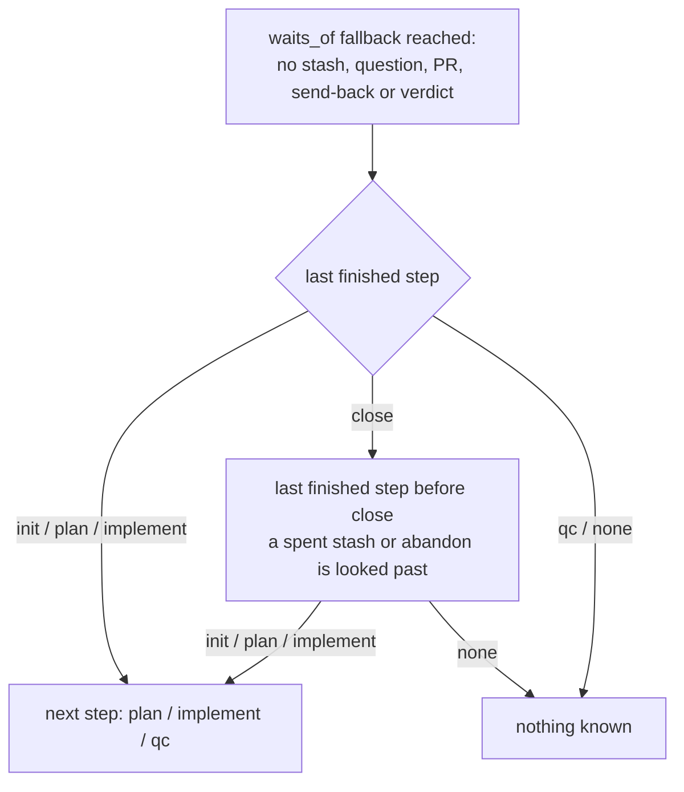

# Triage in-flight judging follow-ups (#122) Implementation Plan

> **For agentic workers:** REQUIRED SUB-SKILL: Use superpowers:subagent-driven-development (recommended) or superpowers:executing-plans to implement this plan task-by-task. Steps use checkbox (`- [ ]`) syntax for tracking.

**Goal:** Fix the three behaviours of `/codeo:triage`'s in-flight judging from #103 that ask again or undo a choice (F14, F18, F19), and close its wording, documentation and robustness gaps (F13, F20-F23).

**Architecture:** One script fix and one skill rewrite, each test-first. `inflight.sh`'s `waits:` fallback looks past a spent stash or abandon to the step before it (F19). `skills/triage/SKILL.md` gives an unassigned workflow its own dateless fingerprint `unassigned:<N>` (F14), expects Backlog *or* Ready for a live abandon (F18), and says what *resume* names for every `waits:` value (F13). The two docs, the changelog and two `inflight.sh` robustness notes follow.

**Tech Stack:** bash; the `shell` suite (`bash tests/run.sh`, no single-test filter).

**Spec:** `.codeo/122/init.md` (`## Outcome`: the issue and its five acceptance criteria) and `.codeo/122/plan.md` (Q1-Q3, answered as recommended). The findings are in `.codeo/done/103/qc.md` on `origin/main`, rounds 2-3.

## File Structure

| File | Responsibility | Task |
|---|---|---|
| `scripts/inflight.sh` | `last_step` takes a step to skip; `waits_of`'s fallback uses it; `touched_of` and `close_send_back` robustness | 1, 2 |
| `tests/inflight.test.sh` | new cases for the resumed stash and abandon | 1 |
| `skills/triage/SKILL.md` | `unassigned:<N>`, the abandon row, *resume* wording | 3 |
| `tests/triage-skill.test.sh` | wording checks for the three skill changes | 3 |
| `docs/handoff.md`, `docs/skills.md` | what the script and the skill now do | 4 |
| `CHANGELOG.md` | one bullet under `## Unreleased` | 5 |



## Global Constraints

- **Q1 (answered):** a workflow raised because nobody is assigned carries the fingerprint `unassigned:<N>`, with no date; one raised for age keeps `parked:<N>:<touched date>`; one that is both carries both in its single question. A dismissal of the unassigned question holds across pushes.
- **Q2 (answered):** a live abandon expects Backlog **or** Ready. Ready is where *resume* puts the card before `/codeo:init` writes its resume line.
- **Q3 (answered):** only `waits:` looks past a spent stash or abandon. `step:` goes on printing `close (working)` and `--tsv` goes on printing `close`; neither changes.
- **No change to** `claim.sh`, `--tsv`, `--branches`, `--live`, the `waits:` priority order, or the `touched:` / `verdict:` lines.
- **Out of scope:** F15, F16, F17 and the findings #103's rounds fixed (issue's Out of Scope).
- **Documentation this change moves:** `docs/handoff.md` (*Who else is in flight*: the `waits:` values and their order), `docs/skills.md` (triage's *Reads and writes*: the `/codeo:close` case, the unassigned rule), `CHANGELOG.md` (one bullet, plus the `Shared state:` line for the new ledger fingerprint). `README.md` and `docs/dossier.md` move nothing. No wiki module is configured and no diagram in those pages changes.
- **Suite.** The `shell` suite has no `filter`, so a task's proof is its test file (`bash tests/run.sh <pattern>`, ending `all cases passed`); Task 5 runs the whole suite. No task carries `Needs lease:` or `Runs on:`: there is no shared environment, and every command runs in this checkout.
- **Invariants.** None configured.
- **Overlap.** #102 and #108 are at `init` with no footprint and no changed files. `CHANGELOG.md` is the file most likely to collide: Task 5 is last, runs `bash scripts/sync-main.sh` first, and keeps both sides on a conflict.

## Review Focus

- A stash that was resumed with `plan.md` already finished must read `/codeo:implement`, not `/codeo:plan` (Task 1).
- A `close.md` with a spent stash and no earlier finished step must stay `nothing known`, not crash or guess (Task 1).
- A *live* stash must still lead with `resume — …`; the new fallback must not reach it (Task 1, existing cases 34 and 55 keep passing).
- *Resume* wording must name something for `nothing known` as well as for the three other no-step values, or the F13 gap is only half closed (Task 3).
- The abandon row must not stop flagging `In review`, `In progress` or `Done` for a live abandon: only Ready is added (Task 3).

---

### Task 1: `waits:` looks past a spent stash or abandon (F19; criterion 3)

**Files:**
- Modify: `scripts/inflight.sh` — `last_step` (lines 77-87), the fallback `case` in `waits_of` (lines 280-285), and the `waits:` description in the header (line 22) and above `waits_of` (line 232)
- Test: `tests/inflight.test.sh`

**Interfaces:**
- Produces: `last_step <ref> <dir> [<skip>]` — as before, but a step named `<skip>` is not a candidate. Callers with two arguments are unchanged.
- Consumes: nothing from other tasks.

- [ ] **Step 1: Write the failing cases.** Append to `tests/inflight.test.sh` after the last `t_out` block and before the final `if ((failures))`. Create the stub issue files for 62-65 (`for n in 62 63 64 65; do printf '{"number":%s,"labels":[],"assignees":[]}' "$n" > "$stub_dir/GET_repos_o_n_issues_$n.json"; done`). Build four workflows on `w_origin` with `w_dossier` and `raw_dossier`, each `init.md` carrying a `## Log` line the resume reader counts (`- 2026-11-12 — resumed: by alice after the stash of 2026-11-10`, or `… after the abandon of 2026-11-10`) and each `close.md` a `### Round 1 — stashed` (or `— abandoned`) under `## Outcome`:

  | Issue | `init.md` outcome | `plan.md` | park | Expected `waits:` |
  |---|---|---|---|---|
  | 62 | `Started.` | none | stash, resumed | `/codeo:plan` |
  | 63 | `Started.` | `Done.` | stash, resumed | `/codeo:implement` |
  | 64 | `Started.` | none | abandon, resumed | `/codeo:plan` |
  | 65 | `_Pending — written at the hand-off._` | none | stash, resumed | `nothing known` |

  Then `git -C "$w_origin" checkout -q main`, `git -C "$w_clone" fetch -q`, `w_out=$(run_today "$w_clone")`, and:

  ```bash
  case_desc="waits_after_a_resumed_stash_in_planning"
  assert_contains "plan owed" "  waits:     /codeo:plan" "$(w_block 62)"
  assert_contains "step still says close" "  step:      close (working)" "$(w_block 62)"
  case_desc="waits_after_a_resumed_stash_with_a_plan"
  assert_contains "implement owed" "  waits:     /codeo:implement" "$(w_block 63)"
  case_desc="waits_after_a_resumed_abandon"
  assert_contains "plan owed" "  waits:     /codeo:plan" "$(w_block 64)"
  case_desc="waits_nothing_known_when_only_the_park_is_finished"
  assert_contains "line" "  waits:     nothing known" "$(w_block 65)"
  ```

- [ ] **Step 2: Run to verify it fails.** Run: `bash tests/run.sh inflight`. Expected: FAIL on `waits_after_a_resumed_stash_in_planning`, `…_with_a_plan` and `waits_after_a_resumed_abandon` (each `want substring [...] got [... nothing known ...]`); `waits_nothing_known_when_only_the_park_is_finished` already passes.

- [ ] **Step 3: Implement.** `last_step() ` gains `skip=${3:-}` and does not treat a step equal to `skip` as finished (`[[ $step == "$skip" ]] && continue` at the top of its loop). In `waits_of`, immediately before the final `case $step in`, add `if [[ $step == close ]]; then step=$(last_step "$sha" "$dir" close); fi` — by then no live stash, question, open PR, send-back or verdict applied, so a `close` outcome is a spent park. Update the header's `waits:` sentence ("with no verdict, the step after the last finished one, looking past a spent stash or abandon") and the comment above `waits_of`.

- [ ] **Step 4: Run to verify it passes.** Run: `bash tests/run.sh inflight`. Expected: `all cases passed`, including the existing cases 34, 35 and 55 (live stash and abandon still lead with `resume — …`).

- [ ] **Step 5: Commit.**

  ```bash
  git add scripts/inflight.sh tests/inflight.test.sh
  git commit -m "fix: inflight.sh's waits: looks past a spent stash or abandon (#122)"
  ```

### Task 2: `touched_of` and `close_send_back` say what they do (F22, F23)

**Files:**
- Modify: `scripts/inflight.sh` — `touched_of` (lines 96-113), the comment above `close_send_back` (lines 201-202)
- Test: `tests/inflight.test.sh` (existing `touched_*` cases, no new case)

**Interfaces:** `touched_of <sha> <dir>` keeps its output (`<date><TAB><source>` or nothing).

- [ ] **Step 1: Run the existing cases as the baseline.** Run: `bash tests/run.sh inflight`. Expected: `all cases passed`. This task changes no behaviour a test can reach: git's `%cs` always parses, so the early return of F22 cannot be exercised, and the refactor is proved by every `touched_*` case still passing.

- [ ] **Step 2: Implement F22.** `touched_of` starts with no best date. It reads the tip's `%cs` into a local, and only when `valid_date` accepts it sets `best_d` and `best_s="branch tip"`. Each dossier candidate wins when it parses and either `best_d` is empty or `[[ ! $d < $best_d ]]`. It prints the line only when `best_d` is non-empty (`if`, not `&&`, so `set -e` is not tripped). The header's "the line is left out when none does" now holds.

- [ ] **Step 3: Implement F23.** Extend the comment above `close_send_back` to say rounds are read only inside `## Outcome` and that `/^## Outcome/` is a prefix match, as in `last_qc_round`. No code change.

- [ ] **Step 4: Run to verify.** Run: `bash tests/run.sh inflight`. Expected: `all cases passed`.

- [ ] **Step 5: Commit.**

  ```bash
  git add scripts/inflight.sh
  git commit -m "refactor: touched_of reads the dossier dates without a valid tip date; note close_send_back's scope (#122)"
  ```

### Task 3: Triage's wording for the fingerprint, the abandon row and *resume* (F13, F14, F18; criteria 1, 2, 4)

**Files:**
- Modify: `skills/triage/SKILL.md` — fingerprint list (lines 75-76), parked-work bullet (lines 115-123), board table (line 134) and the sentence after it, the parked-work option (lines 253-256), step 5's **Resume** (lines 302-307)
- Test: `tests/triage-skill.test.sh`

**Interfaces:** produces the strings the checks below pin; Task 4's docs say the same things in their own words.

- [ ] **Step 1: Write the failing checks.** In `tests/triage-skill.test.sh`, before the final `if ((failures))`, **replace** the check `quiet resume names the owed step` (it pins the old wording) and add, each a `must_contain "<case>" '<string>'`:

  | Case | String |
  |---|---|
  | `unassigned fingerprint is listed` | `unassigned:<N>` and `board:<N>:<Status found>` adjacent on one line of the list, written as in Step 3 |
  | `unassigned fingerprint carries no date` | ``is `unassigned:<N>`, which carries no date`` |
  | `an unassigned dismissal holds across pushes` | `a dismissal of it holds across pushes` |
  | `both reasons, one question` | `carries both fingerprints in its one question` |
  | `a live abandon expects Backlog or Ready` | ``\| dossier at `.codeo/<N>/`, abandon live \| Backlog (`board.statuses.backlog`), or Ready (`board.statuses.ready`) \|`` |
  | `ready is not a mismatch for a live abandon` | `Ready is not a mismatch for a live abandon` |
  | `quiet resume names what waits shows` | ``names what its `waits:` line shows`` |
  | `resume for an engineer wait` | the text from `engineer — …` (backticks included) to `question numbers to answer`, as written in Step 3 |
  | `resume for a review wait` | the text from `review — dossier archived` (backticks included) to `awaiting review`, as written in Step 3 |
  | `resume for nothing known` | the text from `nothing known` (backticks included) to `quotes the `step:` line`, as written in Step 3 |


- [ ] **Step 2: Run to verify it fails.** Run: `bash tests/run.sh triage-skill`. Expected: FAIL on each of the ten cases (`no [<string>]`).

- [ ] **Step 3: Edit `skills/triage/SKILL.md`.** Exact copy:
  - **Fingerprint list:** `parked:<N>:<touched date>`, then on the next line `` `unassigned:<N>`, `board:<N>:<Status found>`. ``
  - **Parked-work bullet:** replace "A workflow whose `touched:` day count … until the workflow is touched again." with: ``A workflow whose `touched:` day count is more than the threshold is asked about as parked work, and so is one assigned to nobody: quote its `touched:` line and the threshold (`triage.parkedDays`), with its `waits:`, `verdict:` and `step:` lines. The age's fingerprint is `parked:<N>:<touched date>`, so a dismissal holds until the workflow is touched again and goes quiet again. No assignee's fingerprint is `unassigned:<N>`, which carries no date, so a dismissal of it holds across pushes. A workflow that is both carries both fingerprints in its one question.`` The sentences after it (within the threshold and assigned; `live:`) stay.
  - **Board table:** the abandon row becomes ``| dossier at `.codeo/<N>/`, abandon live | Backlog (`board.statuses.backlog`), or Ready (`board.statuses.ready`) |``. Before "A Status of `none` or `unset` is a mismatch." add: `An abandon stays live until `/codeo:init` writes its resume line, and *resume* sets Ready before that, so Ready is not a mismatch for a live abandon.`
  - **Parked-work option (step 4):** replace "for one raised only for its age, the step its `waits:` line shows, to run in that issue's checkout, with no card move" with "for any other, what its `waits:` line shows, as step 5's **Resume** says, with no card move".
  - **Step 5 Resume:** replace the sentence "For a workflow raised only for its age, *resume* names the step its `waits:` line shows, to run in that issue's checkout, and makes no card move." with: ``For a workflow with no live stash or abandon, whether raised for its age or for having no assignee, *resume* names what its `waits:` line shows, to be done in that issue's checkout, and makes no card move: a step (`/codeo:plan`, `/codeo:implement`, `/codeo:qc` or `/codeo:close`) is named as the command to run; `engineer — …` names the dossier files and question numbers to answer; `review — dossier archived` names the pull request awaiting review; `nothing known` names the checkout and quotes the `step:` line, and says no step can be named.`` "A script failure is reported and the resume still named." stays.

- [ ] **Step 4: Run to verify it passes.** Run: `bash tests/run.sh triage-skill`, then `bash tests/run.sh skills-lint`. Expected: both end `all cases passed`.

- [ ] **Step 5: Commit.**

  ```bash
  git add skills/triage/SKILL.md tests/triage-skill.test.sh
  git commit -m "fix: triage's unassigned fingerprint, abandon-at-Ready row and resume wording (#122)"
  ```

### Task 4: The two docs say what the script and the skill do (F20, F21, criterion 5)

**Files:**
- Modify: `docs/handoff.md` (*Who else is in flight*, lines 153-156), `docs/skills.md` (line 224)

**Interfaces:** consumes the behaviour of Tasks 1 and 3; no code.

- [ ] **Step 1: Confirm the gaps.** Run: `grep -c 'nothing known' docs/handoff.md; grep -c 'close.md. in that issue' docs/skills.md`. Expected: `0` and `0`.

- [ ] **Step 2: Edit `docs/handoff.md`.** Rewrite the `waits:` sentence in script order: a live stash or abandon first (`resume — …`), then open questions (`engineer — plan.md Q2`), then `review — dossier archived` once `close` has opened its pull request, then the step the workflow owes next — read from the rounds' send-back markers, qc's verdict and the last finished step, looking past a spent stash or abandon — and `nothing known` when none applies. Keep the sentences around it (`touched:`, `verdict:`, `--tsv`).

- [ ] **Step 3: Edit `docs/skills.md` line 224.** (a) After the `triage.parkedDays` sentence add: "A workflow assigned to nobody is asked about whatever its date, once: dismissing that question holds across pushes." (b) Replace "a mismatch is named, with its `board.sh set` command, and never fixed by triage" with "a mismatch is named, with its `board.sh set` command (or `/codeo:close` in that issue's checkout when there is no pull request or it was closed unmerged), and never fixed by triage; a live abandon is expected at Backlog or Ready."

- [ ] **Step 4: Prove it.** Run: `grep -c 'nothing known' docs/handoff.md; grep -c '/codeo:close` in that issue' docs/skills.md; bash tests/run.sh skills-doc`. Expected: `1`, `1` (each at least 1 and no more than the one sentence written), then `all cases passed`.

- [ ] **Step 5: Commit.**

  ```bash
  git add docs/handoff.md docs/skills.md
  git commit -m "docs: waits: values in handoff.md and triage's /codeo:close and unassigned cases in skills.md (#122)"
  ```

### Task 5: The changelog, then the whole suite

**Files:**
- Modify: `CHANGELOG.md` (`## Unreleased`)

- [ ] **Step 1: Sync.** Run: `bash scripts/sync-main.sh`. Expected: exit 0; on a conflict in `CHANGELOG.md` keep both sides.

- [ ] **Step 2: Add one bullet** under `## Unreleased`, after the existing bullets, naming: `inflight.sh` prints `/codeo:plan` (or the step before the park) as what a resumed stash or abandon waits on; triage asks about an unassigned workflow once (`unassigned:<N>`, no date) and a dismissal holds across pushes; a live abandon is expected at Backlog or Ready; *resume* names what `waits:` shows for every value; the two docs; `touched_of` and a comment (F22, F23); ending `(#122, #103's F13, F14, F18-F23)`. Append to the `Shared state:` line: "the triage ledger may hold `unassigned:<N>` rows (an older triage ignores them and asks about the workflow again at its next push)." `Config schema` and `Safe to bump mid-workflow` stay as they are.

- [ ] **Step 3: Prove it.** Run: `grep -c '#122' CHANGELOG.md`, then `bash tests/run.sh`. Expected: `1`, then `all cases passed`.

- [ ] **Step 4: Commit.**

  ```bash
  git add CHANGELOG.md
  git commit -m "docs: changelog for triage's in-flight judging follow-ups (#122)"
  ```

## Acceptance criteria → tasks

| Criterion | Task |
|---|---|
| Dismissing an unassigned workflow's question, then pushing, does not raise it again | 3 (`unassigned:<N>`), 4 |
| With a live abandon at Ready, no `board:<N>:Ready` question proposing `board.sh set <N> backlog` | 3 |
| `inflight.sh` on a resumed stash still planning prints `/codeo:plan` | 1 |
| *Resume*'s wording covers each `waits:` value that carries no step | 3 |
| `docs/handoff.md` lists `nothing known`; `docs/skills.md:224` describes the `/codeo:close` case | 4 |
