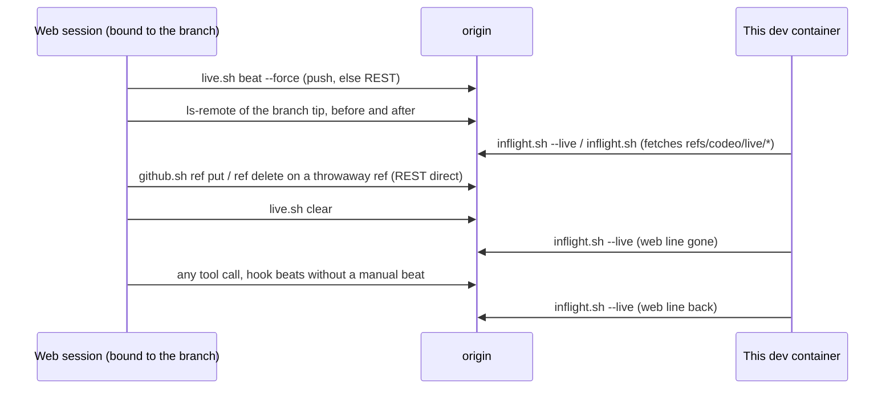

# Verify the live-session signal in a hosted web session — Implementation Plan

> **For agentic workers:** REQUIRED SUB-SKILL: Use superpowers:subagent-driven-development (recommended) or superpowers:executing-plans to implement this plan task-by-task. Steps use checkbox (`- [ ]`) syntax for tracking.

**Goal:** Run the live-session signal (#104) in a real hosted web session, record whether the push or the REST fallback carries it, which user it names, whether the branch tip stays put, whether it clears, and whether the installed hook fires on its own — and state #104's criterion "it works in a web session" as met or not met on that evidence.

**Architecture:** No product code changes. The web session (Claude Code on the web, bound to this branch by `scripts/lock.sh take web`) runs the branch's own `scripts/live.sh` and `scripts/github.sh`; this dev container is the "other clone" and reads the signal with `scripts/inflight.sh`. The record goes in `.codeo/112/implement.md` and a summary comment on #112; the documentation then states what was found.

**Tech Stack:** bash, git, `gh api` through `scripts/github.sh`. The `shell` suite (`bash tests/run.sh`) is the only suite.

**Spec:** none; the issue (#112) and `docs/plans/2026-11-15-live-session-signal.md` (Task 7) are the reference.

## Decisions

| Question | Decision | Rejected |
|---|---|---|
| Form of the check (Q2) | A written procedure the web session runs from one pasted prompt. Nothing ships in the plugin. | `scripts/live-check.sh` and a test: it would ship to every project for a check one maintainer runs. |
| REST fallback (Q3) | Exercised directly in the same run, with `github.sh ref put` and `ref delete` on a throwaway ref, so it is verified even when the push works. | Only when the push is refused: leaves the fallback unverified where it was built for. |
| Record (Q4) | Full output in `.codeo/112/implement.md`; a four-answer summary comment on #112. | Dossier only; comment only. |
| Documentation (Q5) | One passage in `docs/handoff.md` and a `CHANGELOG.md` bullet stating what was found. | No documentation change. |
| Plugin in the web session (Q1) | The environment setup script installs it. Which version it installs is a fact Task 1 records, and Task 5 branches on it. | Assuming v1.0.7: the setup script is outside this repository. |

## Global Constraints

- No invariants document and no shared environment are configured, so there is no invariant to check and no task carries `Needs lease:`. No `wiki` module and no `resources[]`.
- **Nothing the check finds is fixed here.** A refused push, a refused REST call, a wrong user label and a hook that does not fire are each filed as their own issue with `/codeo:issue` (Task 6) and named in the record. This is the issue's out-of-scope line.
- **The branch gains no commit from the signal.** The tip of `origin/feat/verify-live-session-signal-hosted` is read before and after the publish (Task 1) and from here (Task 2); the record says whether it moved.
- **Public repository.** The record quotes the signal's own fields (issue, login or `user.name`, machine label, host) and no email address. Output that contains one is trimmed before it is recorded.
- **Tasks 1, 3 and 5 run in the hosted web session, which only the engineer can open** (`Runs on: the engineer's host`). Its commands are Linux and neutral (no variable, substitution, glob, quote or `&&`; `env NAME=value command` sets a variable), so no shell question is needed. The tasks run in order: Task 2 must start within a minute of Task 1's publish for the age criterion, and Task 4 within a minute of Task 3's clear.
- **Documentation moved.** `docs/handoff.md` → *Parallel workflows* → *Who is working right now* (Task 7) and `CHANGELOG.md` (Task 7). `README.md`, `docs/dossier.md` and `docs/skills.md` do not move: no hook, script, skill or dossier convention changes. No `wiki` pages.
- **The `shell` suite has no `filter`**, so a documentation task's proof is the whole `bash tests/run.sh`, and a recording task, which has no suite, is proved by the command named in it.
- **This container is a second live session on #112** while the check runs (host `container`). `inflight.sh --live` lists both lines; the web one is the line whose host is `web`.

## File Structure

- Create: `docs/plans/2026-11-19-verify-live-signal-hosted-session-112.md` (this plan).
- Modify: `docs/handoff.md` (one passage), `CHANGELOG.md` (one bullet under `## Unreleased`).
- Write: `.codeo/112/implement.md` (the record). No script, hook, skill or test file changes.

## Review Focus

- **The user label.** The web session's `git config user.name` is probably the harness's identity. Task 1 records exactly what the signal names; Task 3 records whether `CODEO_GITHUB_LOGIN` changes it.
- **Which path carried the write.** `live.sh` does not say; `bash -x` shows whether `git push` succeeded or `github.sh ref put` ran. Task 1 records the trace lines that prove it.
- **The hook check is only valid after a `clear`.** Otherwise the earlier `beat` explains the signal. Task 5 clears first and reads from here.

---

### Task 1: Publish from the web session and record the baseline

Runs on: the engineer's host

**Files:** none; the output goes to the engineer's paste into the conversation, and Task 6 records it.

- [ ] **Step 1: Paste this prompt into a web session on this branch:** "Run these commands one at a time and print each command and its full output without editing it, then stop: `bash scripts/lock.sh take web`, `git branch --show-current`, `git config user.name`, `claude plugin list`, `git ls-remote origin refs/heads/feat/verify-live-session-signal-hosted`, `bash -x scripts/live.sh beat --force`, `bash scripts/live.sh fetch`, `bash scripts/live.sh list --tsv`, `git for-each-ref refs/codeo/live`, `git ls-remote origin refs/heads/feat/verify-live-session-signal-hosted`."
- [ ] **Step 2: Read the output for three facts.** (a) *Which path:* a `git push` line followed by no `github.sh` line means the push carried it; a failed `git push` followed by `github.sh ref put` means REST did; a `live: could not publish — <reason>` line means both were refused. (b) *The user:* the `user` column of `list --tsv`. (c) *The tip:* the two `ls-remote` lines carry the same sha.
- [ ] **Step 3: Proof of done.** The web session's `bash scripts/live.sh list --tsv` prints a line that starts `112`, has host `web` and a machine that starts `web-`; or the output shows the `live: could not publish` line, which is then the recorded result and sends the run to Task 6 with Tasks 2 to 5 recorded as "not reachable".

### Task 2: Read the signal from this container

**Files:** none.

- [ ] **Step 1:** Within a minute of Task 1, run `bash scripts/inflight.sh --live` here. Expected: a line with `112`, the user Task 1 recorded, `web-` and eight characters, `web`, and an age under 60.
- [ ] **Step 2:** Run `bash scripts/inflight.sh` and read #112's block. Expected: a `live:` line `<user> on web-<8> (web), <age> ago`.
- [ ] **Step 3:** Run `git ls-remote origin refs/heads/feat/verify-live-session-signal-hosted` here and compare it with Task 1's two lines. Expected: the same sha.
- [ ] **Step 4: Proof of done.** `bash scripts/inflight.sh --live` printed the `web` line and the sha in Step 3 equals Task 1's. If the age was 60 or more, ask for a new `bash scripts/live.sh beat --force` and repeat Step 1.

### Task 3: User override, REST fallback and clear in the web session

Runs on: the engineer's host

**Files:** none.

- [ ] **Step 1: Paste this prompt into the same web session:** "Run these commands one at a time and print each command and its full output without editing it, then stop: `env CODEO_GITHUB_LOGIN=kbajpai bash scripts/live.sh beat --force`, `bash scripts/live.sh fetch`, `bash scripts/live.sh list --tsv`, `bash scripts/github.sh ref put refs/codeo/live/112/rest-check .codeo/112/init.md`, `bash scripts/github.sh ref delete refs/codeo/live/112/rest-check`, `bash scripts/live.sh clear`, `bash scripts/live.sh fetch`, `bash scripts/live.sh list --tsv`."
- [ ] **Step 2: Read the output.** The first `list --tsv` shows the user after the override; the `ref put` prints a commit sha (REST allowed) or one `github:` line (refused, record its text); the last `list --tsv` prints no `web` line for 112.
- [ ] **Step 3: Proof of done.** The last `bash scripts/live.sh list --tsv` in the web session prints nothing for issue 112 with host `web`, and the `ref put` and `ref delete` outputs are in the paste.

### Task 4: Confirm the clear from this container

**Files:** none.

- [ ] **Step 1:** Within a minute of Task 3's `clear`, run `bash scripts/inflight.sh --live` here. Expected: no line whose host is `web` (this container's own `container` line for #112 may remain).
- [ ] **Step 2: Proof of done.** `bash scripts/inflight.sh --live` prints no line containing a tab and `web` for 112.

### Task 5: Does the installed hook publish by itself?

Runs on: the engineer's host

**Files:** none.

- [ ] **Step 1:** Read Task 1's `claude plugin list` line. If `codeo` is below v1.0.7 or absent, the hook cannot fire: record "the web session has codeo `<version>`, which does not carry the hook", skip to Step 4 and file the follow-up in Task 6.
- [ ] **Step 2: Paste this prompt into the same web session:** "Run `bash scripts/live.sh list --tsv`, then `git status`, and print both outputs." (The `clear` in Task 3 removed the throttle stamp, so the first prompt or tool call beats if the hook is installed.)
- [ ] **Step 3:** Within a minute, run `bash scripts/inflight.sh --live` here. Expected: a `web` line for 112 with an age under 60, with no manual `beat` having run since the `clear`.
- [ ] **Step 4: Proof of done.** The output of Step 3 is recorded as either the `web` line (the hook fires) or its absence (it does not, with the installed version from Step 1).

### Task 6: Record the result, file the findings and answer #104's criterion

**Files:**
- Write: `.codeo/112/implement.md` (by `/codeo:implement`, in its own format).

- [ ] **Step 1:** Write the commands and outputs of Tasks 1 to 5, quoted, under `.codeo/112/implement.md`, with one line each for the six acceptance criteria of #112 (`met`, `not met` and why, or `recorded and filed as #<N>`).
- [ ] **Step 2:** For each finding (push refused, REST refused, user not the engineer's login, hook absent or silent), file it with `/codeo:issue` and write its number beside the criterion. If both writes were refused, also write that #104's criterion "it works in a web session" is **not met**, with the refusal text, and file the design-change follow-up.
- [ ] **Step 3:** Post a summary comment on #112 with the four answers (path, user, tip unchanged, hook) and the dossier's path: write it to a file in the scratchpad and run `bash scripts/github.sh pr comment 112 <that file>`.
- [ ] **Step 4: Proof of done.** `bash scripts/github.sh pr comments 112` prints JSON that contains the comment's first line, and `.codeo/112/implement.md` names a result for each of the six criteria.

### Task 7: State what was found in the documentation

**Files:**
- Modify: `docs/handoff.md` (*Parallel workflows* → *Who is working right now*; the sentences "Where a push to that ref is refused it is written through the REST API, and where neither works nothing is published" and "On a public repository it names the GitHub login (else `git config user.name`…")
- Modify: `CHANGELOG.md` (one bullet under `## Unreleased`; `Shared state:` unchanged)

- [ ] **Step 1:** In `docs/handoff.md` replace the two statements with the facts Tasks 1 to 5 recorded, in the system's present tense: *a hosted web session publishes the signal by* `<the push | the REST write>`; *it names* `<the user Task 1 and Task 3 recorded, and that CODEO_GITHUB_LOGIN does or does not change it>`; *the installed hook* `<fires | does not fire in a web session whose plugin is older than v1.0.7>`. If both writes were refused, the passage says a web session publishes nothing and why. Keep every other sentence and the existing diagram as they are.
- [ ] **Step 2:** Add to `CHANGELOG.md` under `## Unreleased` a bullet stating the same result and ending `Nothing in scripts/, lib/, hooks/ or skills/ changes (#112).`
- [ ] **Step 3: Proof of done.** `bash tests/run.sh` prints `all cases passed`.
