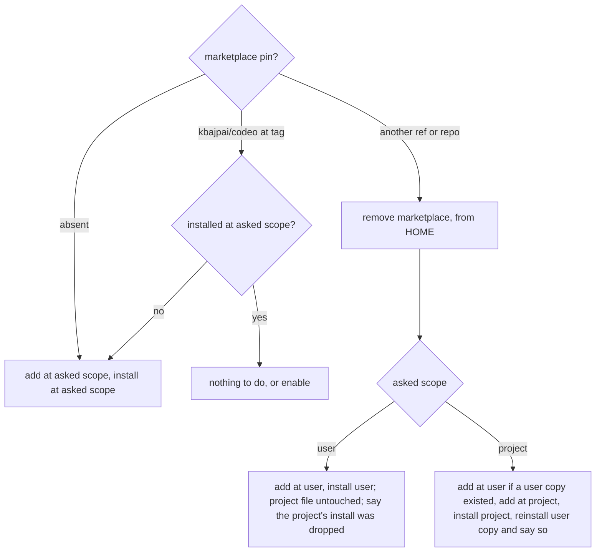

# One-Command Install, Round 2: Replace Touches Only the Asked Scope Implementation Plan

> **For agentic workers:** REQUIRED SUB-SKILL: Use superpowers:subagent-driven-development (recommended) or superpowers:executing-plans to implement this plan task-by-task. Steps use checkbox (`- [ ]`) syntax for tracking.

**Goal:** Close `/codeo:qc`'s round 1 for #151: a replace never writes a project's `.claude/settings.json` unless `--scope project` was asked, every touched scope is named, the README's *Uninstalling* and *Updating* sections say only what `claude` and the script really do, and the tests model a project's settings file.

**Architecture:** Changes stay inside the files round 1 added. `install.sh` decides "already installed" from the marketplace's pinned tag (one pin per machine is the fact everything else follows from), and `replace_codeo` reinstalls by the asked scope instead of "wherever it was". The test stub `claude` learns to write and strip settings files, which makes the README's JSON snippet and its output blocks checkable.

**Tech Stack:** bash 4.3+, jq, the `shell` suite (`bash tests/run.sh`), stub `claude`/`git`/`curl`; real `claude` 2.1.325 against a throwaway `CLAUDE_CONFIG_DIR` for captured README output.

**Spec:** `.codeo/151/qc.md` round 1 (F1-F9), `.codeo/151/plan.md` Q7, and `.codeo/151/init.md`'s criteria. The round-1 plan, `docs/plans/2026-11-21-install-one-command-151.md`, still binds wherever this one is silent.



## Global Constraints

- **Q7: only the asked scope writes a project's file.** A user-scope run never runs `claude` with `--scope project` and never changes `.claude/settings.json`. When this project had a project-scope install, the run prints `install: this project's own codeo (project scope, v1.0.6) is no longer installed on this machine; its .claude/settings.json was not changed`. A `--scope project` replace rewrites the project's pin and, when a user-scope copy existed, reinstalls it and prints `install: your user-scope codeo moved to v1.0.7 too: one machine holds one codeo version`.
- **The marketplace is declared wherever codeo is installed.** A user-scope install or reinstall runs `claude plugin marketplace add kbajpai/codeo@<tag>` (user); a project-scope one runs it with `--scope project`. Both are harmless when already declared (the real CLI answers `already on disk`, exit 0). The install path therefore always adds at the asked scope before installing.
- **F7: "already installed" goes by the pin.** codeo counts as installed at `<tag>` when `known_marketplaces.json` pins `kbajpai/codeo` at `<tag>` and the list has a `codeo@codeo` entry at the asked scope; the entry's `version` string is no longer compared. A pin at another ref or repo is the only replace trigger. The old label in `codeo vOLD -> vNEW` is the pin's ref (`someone/codeo@v1.0.7` for another repo, `unknown source` without a repo). "Latest" stays the highest `vX.Y.Z` tag.
- **`marketplace remove` always runs from `$HOME`** (round 1's fix wave; unchanged).
- **Failure lines (F6).** A failure of the first reinstall after the remove keeps `install: codeo is no longer installed: <claude line>; run this again`. A failure of a later one prints `install: codeo <tag> is installed at <done> scope but not at <s> scope: <claude line>; run this again with --scope <s>`. For a given tag, `git ls-remote` exit 2 is `release <tag> not found in kbajpai/codeo`; any other non-zero exit is `cannot read the releases: check the network and try again`.
- **README output is captured, never typed.** Every output block the README shows is re-captured from the finished script against real `claude` 2.1.325 with a throwaway `CLAUDE_CONFIG_DIR` and scratch repositories, and never the real configuration.
- **Left as round 1 has them, on purpose:** a successful `claude` call's output appears when the call ends, not as it streams; `claude_step`'s temporary files on Ctrl-C; `CODEO_TEST_BASH_VERSION` stays (the only way the suite can test the bash check); README samples name `v1.0.7`.
- **Criterion 6** (the trust prompt) stays the engineer's check at `/codeo:close` (`qc.md` Q2). No task here runs on the engineer's host; no `Runs on:` marker.
- **Documentation this change moves:** `README.md` (*Installing*, *Updating*, *Uninstalling*; Task 4) and the `CHANGELOG.md` bullet (Task 5). `CONTRIBUTING.md` and every page under `docs/` are unchanged. No wiki module, no invariants document, no shared environment, no exclusive resource.
- **Other workflows.** #149 and #138 also edit `CHANGELOG.md` (answered *proceed and coordinate* in `implement.md` Q1 and `qc.md` Q1): Task 5 edits only this branch's own bullet.
- **Proof of done:** the `shell` suite has no single-test filter, so each task's proof is `bash tests/run.sh` ending `all cases passed`, exit 0; red and green steps use `bash tests/run.sh install`.

## File Structure

| File | Responsibility |
|---|---|
| `install.sh` | pin-based installed check, `replace_codeo` by asked scope, failure lines (Tasks 2-3) |
| `tests/install.test.sh` | stub models settings files; new and changed cases (Tasks 1-4) |
| `README.md` | *Installing* output, *Updating*, *Uninstalling* (Task 4) |
| `CHANGELOG.md` | this branch's bullet reworded (Task 5) |

## Review Focus

- A user-scope run from a subdirectory of an older-pinned project: no `--scope project` call, the settings file byte-for-byte unchanged, the dropped-install line printed (Task 2).
- A list entry whose `version` differs from the pinned tag (a tag whose `plugin.json` was not bumped): re-running changes nothing (Task 2).
- A user-scope install on a machine where the marketplace is declared only by a project: the user add still runs, so user settings declare it (Task 2).
- The user-copy reinstall failing after the project one succeeded: the message names both scopes and the command to run (Task 3).
- A README output block whose `install:` lines no stubbed run produces fails the suite (Task 4).

---

### Task 1: The stub `claude` models settings files (F4)

**Files:** Modify `tests/install.test.sh`.

**Interfaces:**
- Produces: stub behaviour later tasks rely on. `plugin marketplace add <repo>[@<ref>] --scope project` writes `extraKnownMarketplaces.<name>.source` (`{source:"github", repo, ref?}`) into `$PWD/.claude/settings.json`, replacing an existing entry's ref; without `--scope` it writes the same into `$CLAUDE_CONFIG_DIR/settings.json`. `plugin install <id> --scope project` sets `enabledPlugins[<id>] = true` in `$PWD/.claude/settings.json`; `--scope user` in `$CLAUDE_CONFIG_DIR/settings.json`. `plugin marketplace remove codeo` strips `codeo` from `extraKnownMarketplaces` and `codeo@codeo` from `enabledPlugins` in `$CLAUDE_CONFIG_DIR/settings.json`, and in `$PWD/.claude/settings.json` when that file exists (what the real CLI does inside a project). Helper `readme_snippet` prints the README's first ```` ```json ```` block.

- [ ] **Step 1: Write failing tests** `t_project_scope_writes_the_readme_snippet` (a `--scope project` run in a scratch repository with tag `v1.0.7`: `jq -S . .claude/settings.json` equals `readme_snippet | jq -S .`), `t_user_scope_declares_in_user_settings` (after a fresh user run, `$CLAUDE_CONFIG_DIR/settings.json` has `extraKnownMarketplaces.codeo.source.ref == "v1.0.7"` and both `enabledPlugins`), `t_remove_from_home_leaves_project_settings` (a project-scope replace: the project file is only ever written by `--scope project` calls, checked by comparing the file before and after the stub's `remove` call through a `settings-at-remove` copy the stub saves).
- [ ] **Step 2: Run** `bash tests/run.sh install` — Expected: FAIL (the stub writes no settings file).
- [ ] **Step 3: Implement** the stub behaviour above; no change to `install.sh`.
- [ ] **Step 4: Proof** `bash tests/run.sh` — Expected: ends `all cases passed`, exit 0.
- [ ] **Step 5: Commit** `git add tests/install.test.sh && git commit -m "test(install): the claude stub models settings files (#151)"`

### Task 2: Replace by the asked scope; installed check by the pin (F1, F7)

**Files:** Modify `install.sh`, `tests/install.test.sh`.

**Interfaces:**
- Consumes: Task 1's stub; `marketplace_pin`, `installed_entry`, `claude_step`, `claude_at`, `pin_label`, `replace_failed`.
- Produces: `ensure_codeo` per Global Constraints (pin-based check; the install path always adds at the asked scope, then installs); `replace_codeo <old-label>`: remove from `$HOME`; then for asked scope `user`: add (user), install user, and the dropped-install line when a project entry for this project existed; for asked scope `project`: add (user) when a user entry existed, add `--scope project`, install project, then install user when a user entry existed, with the moved line. Output order: the `codeo vOLD -> vNEW (<scope> scope)` line, then the extra line.

- [ ] **Step 1: Write failing tests** (replacing `t_replace_reinstalls_where_it_was` and `t_replace_from_subdirectory_restores_the_project`, which assert the old behaviour): `t_user_replace_leaves_the_project_file` (user and this project at v1.0.6, plain run from `work/a/b`: no call contains `--scope project`; `.claude/settings.json` is byte-for-byte what it was; stdout has `install: this project's own codeo (project scope, v1.0.6) is no longer installed on this machine; its .claude/settings.json was not changed`; the user entry is at the new tag), `t_user_replace_without_project_install_says_nothing_more` (no such line), `t_project_replace_moves_the_user_copy` (user and project at v1.0.6, `--scope project`: calls in order `plugin marketplace remove codeo` (pwd `$HOME`), `plugin marketplace add kbajpai/codeo@v1.0.7` (pwd `$HOME`), `plugin marketplace add kbajpai/codeo@v1.0.7 --scope project` (pwd top), `plugin install codeo@codeo --scope project`, `plugin install codeo@codeo --scope user`; stdout has `install: codeo v1.0.6 -> v1.0.7 (project scope)` then `install: your user-scope codeo moved to v1.0.7 too: one machine holds one codeo version`; user settings declare codeo at v1.0.7), `t_project_replace_without_user_copy` (no user add, no user install, no moved line), `t_project_replace_from_subdirectory` (project calls run in the top level), `t_installed_check_goes_by_the_pin` (pin `kbajpai/codeo` at v1.0.7, list entry `version: "1.0.0"`: only `plugin list` calls, `nothing changed`), `t_user_install_declares_the_marketplace_when_only_a_project_declared_it` (pin at the tag, no user entry, user scope: `plugin marketplace add kbajpai/codeo@v1.0.7` is called before the install).
- [ ] **Step 2: Run** `bash tests/run.sh install` — Expected: FAIL.
- [ ] **Step 3: Implement** in `install.sh`; update the header comment and the comment above `replace_codeo`. Adjust any existing case whose expected calls gain the always-run add (list each in the report).
- [ ] **Step 4: Proof** `bash tests/run.sh` — Expected: ends `all cases passed`, exit 0.
- [ ] **Step 5: Commit** `git add install.sh tests/install.test.sh && git commit -m "fix(install): a replace writes only the asked scope's project file and names what else moved (#151)"`

### Task 3: Failure lines that say what is true (F6)

**Files:** Modify `install.sh`, `tests/install.test.sh`.

**Interfaces:**
- Consumes: Task 2's `replace_codeo`.
- Produces: the two messages in Global Constraints; `resolve_release`'s exit-code split for a given tag.

- [ ] **Step 1: Write failing tests** `t_replace_second_scope_failure_names_both` (`--scope project` replace with a user copy; the stub fails the user install only: exit 1, stderr `install: codeo v1.0.7 is installed at project scope but not at user scope: <the stub's line>; run this again with --scope user`, and no `no longer installed` line), `t_replace_first_failure_keeps_no_longer_installed` (the existing data-loss case, still exact), `t_given_tag_other_git_failure_is_cannot_read` (stub `ls-remote` exits 1 for a given tag: the `cannot read the releases` line; exit 2 stays `not found`).
- [ ] **Step 2: Run** `bash tests/run.sh install` — Expected: FAIL.
- [ ] **Step 3: Implement.**
- [ ] **Step 4: Proof** `bash tests/run.sh` — Expected: ends `all cases passed`, exit 0.
- [ ] **Step 5: Commit** `git add install.sh tests/install.test.sh && git commit -m "fix(install): failure lines name the scope that was not restored (#151)"`

### Task 4: README says only what happens (F2, F3, F5, F9)

**Files:** Modify `README.md`, `tests/install.test.sh`.

**Interfaces:**
- Consumes: Tasks 1-3's final messages and stub.
- Produces: test helper `readme_install_blocks` (each fenced block of `README.md` containing a line that starts `install: release`, reduced to its `install:` lines) and `scenario_lines <name>` (the `install:` lines of a stubbed run): `fresh-user`, `rerun-user`, `user-replace-down` (v1.0.7 → `--version v1.0.6`), `user-replace-up`, `fresh-project`, `rerun-project`, `user-replace-in-pinned-project`, `project-replace-with-user-copy`.

- [ ] **Step 1: Write failing test** `t_readme_install_blocks_match_the_script`: every block from `readme_install_blocks` equals the lines of at least one scenario; and every other README line that starts `install: ` (outside those blocks, backticks stripped) appears in the output of some scenario or of a stubbed failure run (`replace add fails`, `second scope fails`). Expected to fail until Step 3 because Task 2 changed and added lines.
- [ ] **Step 2: Capture** with real `claude` and a throwaway `CLAUDE_CONFIG_DIR` (scratch repositories; delete afterwards), recording command and output for `implement.md`: the eight scenarios above; `claude plugin uninstall codeo@codeo` in a project with only a project-scope install; `claude plugin uninstall codeo@codeo --scope project` and the project's `.claude/settings.json` after it; `claude plugin marketplace remove codeo` run from `$HOME` with codeo installed (the full output) and the same command run inside a project that declares codeo, with that project's `git status --short` and settings file after it.
- [ ] **Step 3: Rewrite the three sections from the captures.** *Installing*: any block Task 2 changed (the always-run add may add a `claude` line). *Updating*: what a replace does per Q7, with the two captured blocks (a user-scope update inside an older-pinned project; a `--scope project` update with a user copy), the sentence that one machine holds one codeo version, and the failure sentence quoting the script's real line (`…; run this again`, no "line to run again"). *Uninstalling*: the real error text for `uninstall` without `--scope project`; the complete `marketplace remove` output; and what each command does to a project's `.claude/settings.json` as captured (run `marketplace remove` from outside any project to leave a project's file alone; inside one it strips codeo from the file; `uninstall --scope project` removes `codeo@codeo` from the project's `enabledPlugins`). Present tense, no issue numbers, no test hooks.
- [ ] **Step 4: Run** `bash tests/run.sh install` — Expected: PASS, the round-1 README tests included.
- [ ] **Step 5: Proof** `bash tests/run.sh` — Expected: ends `all cases passed`, exit 0.
- [ ] **Step 6: Commit** `git add README.md tests/install.test.sh && git commit -m "docs: README uninstalling and updating match what claude and install.sh do (#151)"`

### Task 5: Changelog bullet (F8)

**Files:** Modify `CHANGELOG.md`.

- [ ] **Step 1: Reword this branch's bullet only** (the one naming `install.sh`): a replace removes the codeo marketplace, which uninstalls codeo at every scope on the machine; the asked scope is reinstalled, a user-scope copy is reinstalled by a `--scope project` run, a project's `.claude/settings.json` is written only by `--scope project`, and other projects' installs are offered again by their own settings. Add one clause: the shared state under `.codeo/` and the intake branch does not change. Touch no other line; the three header lines stay.
- [ ] **Step 2: Proof** `bash tests/run.sh` — Expected: ends `all cases passed`, exit 0; `git diff origin/main -- CHANGELOG.md` shows one added bullet and no other change.
- [ ] **Step 3: Commit** `git add CHANGELOG.md && git commit -m "docs: changelog says what a replace removes and reinstalls (#151)"`
