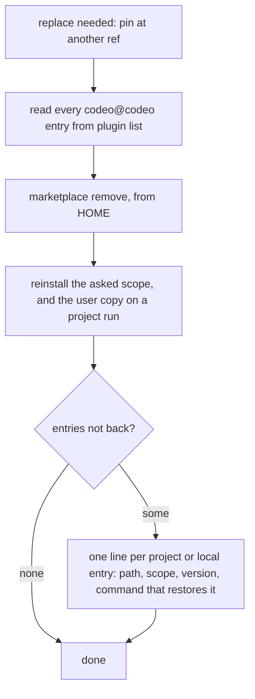

# One-Command Install, Round 3: Say What a Replace Drops Implementation Plan

> **For agentic workers:** REQUIRED SUB-SKILL: Use superpowers:subagent-driven-development (recommended) or superpowers:executing-plans to implement this plan task-by-task. Steps use checkbox (`- [ ]`) syntax for tracking.

**Goal:** Close `/codeo:qc`'s round 2 for #151: after a replace, the installer names every project whose codeo install it dropped and the command that restores it; the README and CHANGELOG stop claiming those installs are "offered again"; and the five small findings the engineer chose to fold in (F13, F14, F16, F17, F18) are fixed.

**Architecture:** One new step in `install.sh`'s `replace_codeo`: before the marketplace is removed, read every `codeo@codeo` entry from `claude plugin list --json`; after the reinstalls, print one line per entry that is not back. Everything else is small and local to `install.sh`, `tests/install.test.sh`, `README.md` and `CHANGELOG.md`.

**Tech Stack:** bash 4.3+, jq, the `shell` suite (`bash tests/run.sh`), the stub `claude`; real `claude` 2.1.325 against a throwaway `CLAUDE_CONFIG_DIR` for captured README output.

**Spec:** `.codeo/151/qc.md` round 2 (F10-F18) and its Q3, `.codeo/151/plan.md` Q7-Q9, `.codeo/151/init.md`'s criteria. The round-1 and round-2 plans still bind wherever this one is silent.

## Global Constraints

- **F10 (qc.md Q3): every dropped install is named.** After a replace, one line per `codeo@codeo` entry that was installed at project or local scope before the remove and is not reinstalled by this run, in this form:
  `install: codeo is no longer installed for <projectPath> (project scope, v1.0.6); its .claude/settings.json was not changed; run install.sh --scope project there to restore it`
  A local-scope entry reads `(local scope, vX)` and ends `; run claude plugin install codeo@codeo --scope local there to restore it`. This replaces round 2's single "this project's own codeo … is no longer installed" line: the current project is one of the entries, and gets the same line. A project-scope run reinstalls its own project, so that one is not named. The list is read before the remove (the remove empties it). Entries whose `projectPath` no longer exists on disk are still named. No dropped entry, no line.
- **The restore commands are checked, not assumed.** Task 4's captures run each printed command for real against the throwaway configuration and record that it restores the install; a command that does not is changed here, before the README quotes it.
- **F11: the "offered again" claim goes.** `README.md` (*Setting a project up*, *Updating*, *Uninstalling*) and the CHANGELOG bullet drop every sentence saying another project's install is offered again by its committed settings, and say what the installer prints and what the engineer does in that project instead. The CHANGELOG states the config schema, shared state and mid-workflow safety lines unchanged.
- **F16:** a replace that reinstalls a user-scope copy the engineer had disabled says so: `install: your user-scope codeo moved to <tag> too: one machine holds one codeo version (it was disabled; it is enabled now)`. Behaviour is unchanged; the line is true.
- **F17:** `CODEO_TEST_BASH_VERSION` is honoured only when it reads `<digits>.<digits>`; any other value is ignored and the real `BASH_VERSINFO` is used. The head (everything before `set -euo pipefail`) is checked by a test for bash-4-only syntax.
- **F18:** a line that is not JSON on stdout from `claude plugin list --json` (before or after the array) no longer aborts the run; the array is extracted and parsed. A list with no JSON at all still dies with `cannot read the installed plugins`.
- **F13:** *Uninstalling* says the bare `claude plugin uninstall codeo@codeo` in a project is refused only when codeo is installed there at project scope and nowhere at user scope; with a user-scope copy it uninstalls that copy. Quoted from a real capture.
- **F14:** *Your first workflow* names the dossier its quotes come from (`.codeo/done/<N>/…`, the archived issue the engineer's earlier answer picked), so a reader can open it.
- **F12 and F15 are accepted limits, documented (Q9).** *Troubleshooting* gets one entry: after hand-editing a project's pinned `ref`, run `claude plugin marketplace remove codeo`, then `install.sh --scope project` (the installer reads the machine's pin, not the project's file). *Installing* says the latest release is the highest `vX.Y.Z` tag. No installer change for either.
- **README output is captured, never typed**, and every `install:` line in it must be produced by some stubbed scenario (round 2's `t_readme_install_blocks_match_the_script` enforces it; the new lines get scenarios).
- **Left as before, on purpose:** the silent gap during a first install; `claude_step`'s temporary files on Ctrl-C; README samples naming `v1.0.7`.
- **Criterion 6** (the trust prompt) stays the engineer's check at `/codeo:close`. No task runs on the engineer's host; no `Runs on:` marker.
- **Documentation this change moves:** `README.md` (*Installing*, *Setting a project up*, *Your first workflow*, *Updating*, *Uninstalling*, *Troubleshooting*; Task 4) and the `CHANGELOG.md` bullet (Task 5). `CONTRIBUTING.md` and `docs/` are unchanged. No wiki module, no invariants document, no shared environment, no exclusive resource.
- **Other workflows.** #149 is merged; #138 also edits `CHANGELOG.md` (answered *proceed and coordinate*): Task 5 edits only this branch's own bullet.
- **Proof of done:** the `shell` suite has no single-test filter, so each task's proof is `bash tests/run.sh` ending `all cases passed`, exit 0; red and green steps use `bash tests/run.sh install`.

## File Structure

| File | Responsibility |
|---|---|
| `install.sh` | dropped-install lines, F16 wording, F17 guard, F18 extraction (Tasks 1-3) |
| `tests/install.test.sh` | stub lists several projects' installs; new and changed cases (Tasks 1-4) |
| `README.md` | the sections listed above (Task 4) |
| `CHANGELOG.md` | this branch's bullet (Task 5) |

## Review Focus

- A user-scope replace run from `~` with projects A and B installed: two lines, none for `~`, no `--scope project` call, both projects' settings files byte-for-byte unchanged (Task 1).
- A `--scope project` replace inside A with B also installed: B named, A not (Task 1).
- A project-scope entry for a deleted directory: named, no crash (Task 1).
- A bare re-run that replaces nothing prints no dropped-install line (Task 1).
- `claude plugin list --json` with a notice line before and after the JSON: the run succeeds (Task 3).

---

### Task 1: Name every dropped install (F10)

**Files:** Modify `install.sh`, `tests/install.test.sh`.

**Interfaces:**
- Consumes: the stub's `list.json` (entries with `projectPath`), `installed_entry`, `claude_at`, `replace_codeo`.
- Produces: `dropped_installs`, which prints one line per `codeo@codeo` entry with scope `project` or `local` from the pre-remove list, minus the current project's entry when `$scope` is `project`; `replace_codeo` takes that list before the remove and prints each line after its existing `codeo <old> -> <tag>` line (and the moved line, when printed). The old `proj_e` argument and its single line are removed.

- [ ] **Step 1: Write failing tests** (replacing `t_user_replace_leaves_the_project_file`'s and `t_user_replace_without_project_install_says_nothing_more`'s old line, keeping their other assertions): `t_user_replace_names_every_dropped_project` (user plus projects A and B at v1.0.6, plain run from `~`: stdout has the two F10 lines in list order, none for `~`; no call contains `--scope project`; both settings files unchanged), `t_user_replace_names_the_current_project_too` (run from inside A: A's line has the same form as B's), `t_project_replace_names_the_other_projects` (`--scope project` in A, B and a user copy: B named, A not, the moved line still printed before it), `t_dropped_local_entry_is_named_with_its_command`, `t_dropped_project_that_no_longer_exists_is_named`, `t_no_replace_no_dropped_lines` (a re-run and a fresh install print none).
- [ ] **Step 2: Run** `bash tests/run.sh install` — Expected: FAIL (the old line is printed only for the current project).
- [ ] **Step 3: Implement.** Update the header comment and the comment above `replace_codeo`. Remove the `proj_e` lookup in `ensure_codeo`.
- [ ] **Step 4: Proof** `bash tests/run.sh` — Expected: ends `all cases passed`, exit 0.
- [ ] **Step 5: Commit** `git add install.sh tests/install.test.sh && git commit -m "fix(install): a replace names every project install it dropped (#151)"`

### Task 2: A disabled user copy, and a numeric test hook (F16, F17)

**Files:** Modify `install.sh`, `tests/install.test.sh`.

- [ ] **Step 1: Write failing tests** `t_project_replace_says_the_disabled_user_copy_is_enabled` (user entry `enabled: false`: the moved line carries `(it was disabled; it is enabled now)`; an enabled one does not), `t_nonnumeric_test_bash_version_is_ignored` (`CODEO_TEST_BASH_VERSION=abc` and `4.x` and empty: the run behaves as the real bash, no jq or `[` error on stderr), `t_head_uses_no_bash4_syntax` (the text of `install.sh` before the line `set -euo pipefail` contains none of: `[[ -v`, `declare -A`, `local -A`, `${…,,}`, `${…^^}`, `mapfile`, `readarray`, `&>>`, `|&`, `coproc`, `[[ … =~`; the test names each pattern it greps).
- [ ] **Step 2: Run** `bash tests/run.sh install` — Expected: FAIL (the first and second; the third passes today and guards the head).
- [ ] **Step 3: Implement.** The numeric guard uses only `case` patterns bash 3.2 parses.
- [ ] **Step 4: Proof** `bash tests/run.sh` — Expected: ends `all cases passed`, exit 0.
- [ ] **Step 5: Commit** `git add install.sh tests/install.test.sh && git commit -m "fix(install): a disabled user copy is named; the test hook must be numeric (#151)"`

### Task 3: A notice around the plugin list (F18)

**Files:** Modify `install.sh`, `tests/install.test.sh`.

- [ ] **Step 1: Write failing tests** `t_list_with_a_notice_before_the_json`, `t_list_with_a_notice_after_the_json`, `t_list_compact_json_with_a_notice` (the stub prints a notice line around a one-line array), each ending `nothing changed` or `done` as the scenario implies, exit 0; `t_list_with_no_json_dies_cleanly` (stderr `install: cannot read the installed plugins (claude plugin list failed)`, no jq message).
- [ ] **Step 2: Run** `bash tests/run.sh install` — Expected: FAIL.
- [ ] **Step 3: Implement** in `installed_entry` (and any other `plugin list --json` reader): extract the array, then jq it. The extraction must handle both a multi-line array and a one-line one.
- [ ] **Step 4: Proof** `bash tests/run.sh` — Expected: ends `all cases passed`, exit 0.
- [ ] **Step 5: Commit** `git add install.sh tests/install.test.sh && git commit -m "fix(install): a notice around claude plugin list does not abort the run (#151)"`

### Task 4: README says what a replace drops (F11, F12, F13, F14, F15)

**Files:** Modify `README.md`, `tests/install.test.sh`.

**Interfaces:**
- Consumes: Tasks 1-3's final lines and the round-2 helpers `readme_install_blocks` and `scenario_lines`.
- Produces: new scenarios `user-replace-two-projects` and `project-replace-other-project`; `README.md` sections per Global Constraints.

- [ ] **Step 1: Write failing tests**: extend `scenario_lines` with the two scenarios; `t_readme_has_no_offered_again_claim` (`README.md` and `CHANGELOG.md` contain no `offered again` and no `are offered`); `t_readme_names_the_restore_command` (the README quotes the restore command line the script prints, found through `scenario_lines`). Existing `t_readme_install_blocks_match_the_script` stays and must fail until the blocks are re-captured.
- [ ] **Step 2: Capture** with real `claude` and a throwaway `CLAUDE_CONFIG_DIR` (scratch repositories, deleted afterwards), recording commands and output for `implement.md`: the two new scenarios; running each printed restore command in the dropped project and `claude plugin list --json` after it; a bare `claude plugin uninstall codeo@codeo` in a project with a project-scope install and a user-scope copy (the success output); the same with only the project-scope install (the refusal, again).
- [ ] **Step 3: Rewrite the sections from the captures.** *Setting a project up*, *Updating* and *Uninstalling*: delete the "offered again" sentences; say that a replace drops codeo from every project on the machine, show the captured lines, and give the restore command. *Uninstalling*: F13 as in Global Constraints. *Your first workflow*: F14. *Installing*: F15's sentence. *Troubleshooting*: F12's entry. Present tense, no issue numbers, no test hooks.
- [ ] **Step 4: Run** `bash tests/run.sh install` — Expected: PASS.
- [ ] **Step 5: Proof** `bash tests/run.sh` — Expected: ends `all cases passed`, exit 0.
- [ ] **Step 6: Commit** `git add README.md tests/install.test.sh && git commit -m "docs: README says what a replace drops and how to restore it (#151)"`

### Task 5: Changelog bullet (F11)

**Files:** Modify `CHANGELOG.md`.

- [ ] **Step 1: Reword this branch's bullet only**: remove "other projects' installs are offered again by their own settings"; say that a replace names each project install it dropped and the command that restores it. Touch no other line; the three header lines stay.
- [ ] **Step 2: Proof** `bash tests/run.sh` — Expected: ends `all cases passed`, exit 0; `git diff origin/main -- CHANGELOG.md` shows one added bullet and no other change.
- [ ] **Step 3: Commit** `git add CHANGELOG.md && git commit -m "docs: changelog says what a replace drops and how to restore it (#151)"`
