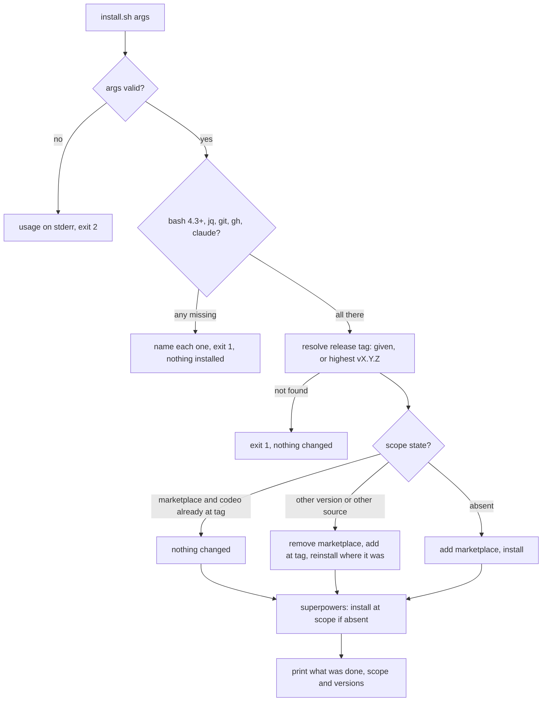

# One-Command Install and Adopter README Implementation Plan

> **For agentic workers:** REQUIRED SUB-SKILL: Use superpowers:subagent-driven-development (recommended) or superpowers:executing-plans to implement this plan task-by-task. Steps use checkbox (`- [ ]`) syntax for tracking.

**Goal:** One command installs codeo and `superpowers` on a machine, a project can offer the same install to its engineers through one committed file, and `README.md` documents installing, using, updating and removing codeo for developers who adopt it (#151).

**Architecture:** One new bash script, `install.sh` at the repository root, fetched from `main` with `curl … | bash`. It wraps `claude plugin marketplace add|remove` and `claude plugin install` (all idempotent when state already matches, as tried against Claude Code 2.1.325), reads what is installed from `claude plugin list --json`, and installs a release tag, never `main`. It checks its prerequisites first and installs no system package. The README is rewritten around it; the contributor material moves to `CONTRIBUTING.md`.

**Tech Stack:** bash 4.3+ (the prerequisite check itself parses on bash 3.2), jq, git, gh, `claude`; tests in `bash tests/run.sh` (the `shell` suite), against stub `claude`, `git` and `curl`.

**Spec:** `.codeo/151/init.md` (`## Outcome`: the ten acceptance criteria) and the answers to Q1-Q6 in `.codeo/151/plan.md`. No standing reference doc: `README.md` is the documentation.

## Global Constraints

- **Where it lives (Q1).** `install.sh` at the repository root; the README command is `curl -fsSL https://raw.githubusercontent.com/kbajpai/codeo/main/install.sh | bash`, and with options `… | bash -s -- --version v1.0.7 --scope project`. That URL works only once this branch merges, so the clean-machine evidence (Task 8) runs the file from the checkout, and the README test serves it from the checkout too.
- **Replace on a different version (Q2).** A run asking for a version other than the installed one (a given tag, or the latest release when none is given) checks the tag exists first, then `marketplace remove codeo` (which uninstalls codeo at every scope on the machine), `marketplace add`, and reinstalls codeo at user scope if it was there and at this project's scope if it was there, plus the requested scope. Other projects' project-scope installs are not reinstalled; their committed settings offer the install again when their folder is trusted. Printed as `codeo v1.0.6 -> v1.0.7`. The README's *Updating* is "run the install command again" and says to read the changelog's three lines (config schema, shared state, safe mid-workflow) first.
- **Project scope covers both plugins (Q3).** `--scope project` runs `marketplace add … --scope project` and `install … --scope project` for codeo (the marketplace pinned to the tag) and for `superpowers` (`obra/superpowers-marketplace`, not pinned), which writes the whole `extraKnownMarketplaces` and `enabledPlugins` snippet into the project's `.claude/settings.json`. The README's snippet is that file. It is tried to work when the codeo marketplace is already declared at user scope (the add answers `already on disk — declared in project settings`).
- **Documentation evidence (Q4).** The *first workflow* section is built from a finished issue's archived dossier under `.codeo/done/` (step, command, what it asks of the engineer, the file it leaves), with no output block for a slash command. Shell commands in the README show output captured from a real run in a scratch directory under an empty `CLAUDE_CONFIG_DIR`, failures included.
- **Clean-machine checks run in this issue's container (Q5).** `CLAUDE_CONFIG_DIR` is pointed at an empty directory; no task runs on the engineer's host, so no `Runs on:` marker and no shell question. Task 8's trust-prompt check is the engineer's, typed in the container's terminal (bash).
- **`CONTRIBUTING.md` at the root (Q6).** The sections *Tests*, *Checking a dossier* and *Replaying finished dossiers* move word for word, at the same heading level, and so does *Dev container*. The README keeps one line linking to the page.
- **Prerequisites.** bash 4.3 or later, jq, git, gh and `claude`, every missing or too-old one named in one run. gh must exist; being logged in is `/codeo:doctor`'s business. Nothing installs a system package or calls a package manager.
- **bash 3.2 parses the head of the script.** macOS's own bash is 3.2. The version check is the first command, in plain 3.2 syntax and ending in `exit`, so an old bash prints the message instead of a syntax error. No `[[ -v`, associative array, `${var,,}`, `mapfile` or `&>>` before it.
- **A pipe is stdin.** Run as `curl … | bash`, the script is bash's stdin, so every `claude`, `git` and `curl` call is given `</dev/null`.
- **Release choice.** A given version is `vX.Y.Z` (a bare `X.Y.Z` is accepted and written `vX.Y.Z`), checked with `git ls-remote --exit-code --tags https://github.com/kbajpai/codeo refs/tags/<tag>`. The latest is the highest `vX.Y.Z` of `git ls-remote --tags --refs … 'v*'`, sorted with `sort -t. -k1.2,1n -k2,2n -k3,3n` (no `sort -V`, which older macOS lacks). Offline, or no tag found, is exit 1 with nothing changed.
- **State is read, not assumed.** Installed plugins from `claude plugin list --json` (`id`, `version`, `scope`, `enabled`, `projectPath`), the marketplace's repo and ref from `${CLAUDE_CONFIG_DIR:-$HOME/.claude}/plugins/known_marketplaces.json` (a missing file is an empty list). A failing `plugin list` is exit 1, never "nothing installed". `claude` runs from the caller's directory for project scope and from `$HOME` for user scope.
- **Exit codes.** 0 done or nothing to do; 1 a prerequisite, release, state or `claude` failure; 2 a usage error (an unknown option, a missing or malformed value), before any command runs.
- **Output** is lines prefixed `install: `, one per step. A run that changed nothing says `install: nothing changed - …`; one that changed something ends with `install: done - codeo vX.Y.Z, <user|project> scope, superpowers X.Y.Z` and a line telling the engineer to restart sessions already open.
- **`superpowers`** is left alone when installed at the requested scope (from any marketplace, at any version); the README gives `claude plugin update superpowers@superpowers-marketplace` for it.
- **Not changed:** the skills and what they do, `scripts/`, `lib/`, `hooks/`, `.devcontainer/scripts/plugins.sh`, `docs/release-checklist.md`, the plugin's version scheme and `.claude/settings.json` (this repository's own).
- **Documentation this change moves:** `README.md` (rewritten, Task 6) and `CONTRIBUTING.md` (new, Task 6). `.devcontainer/README.md`, `.sbx/README.md`, `docs/` and the skills describe nothing about installing the plugin on an adopter's machine, so they are unchanged. No wiki module.
- **No invariants document, no shared environment, no exclusive resource:** no task carries `Needs lease:`.
- **CHANGELOG (Task 7).** One bullet under `## Unreleased`. Its header lines already read `Config schema: 1`, `Shared state: …` and `Safe to bump mid-workflow: yes`; this change adds files only, so they stay true and the bullet says so.
- **Proof of done.** The `shell` suite has no single-test filter, so a task's proof is `bash tests/run.sh`, which must end `all cases passed` and exit 0; red and green steps use `bash tests/run.sh install`, which runs only `tests/install.test.sh`. A documentation task is proved by the same run plus the check it names.

## File Structure

| File | Responsibility |
|---|---|
| `install.sh` (new, executable, `#!/usr/bin/env bash`) | the whole command |
| `tests/install.test.sh` (new) | one function per case, listed in a final `cases=( … )` array as in `tests/sandbox.test.sh`; stub `claude`, `git`, `curl` on `PATH` |
| `README.md` | rewritten for adopters (Task 6) |
| `CONTRIBUTING.md` (new) | *Dev container*, *Tests*, *Checking a dossier*, *Replaying finished dossiers* |
| `CHANGELOG.md` | one bullet (Task 7) |

## Review Focus

- `curl … | bash` where a command reads stdin: a stub `claude` that drains stdin must not cut the script short (Task 3 test).
- `--version 'v1.0.7;rm -rf x'`, `--version` with no value, an unknown option, `--scope team`: usage, exit 2, no command run (Task 1).
- Offline, or `git ls-remote` printing nothing: nothing is added, removed or installed, exit 1 (Task 2).
- `--scope project` outside a git repository, and from a subdirectory of one (Task 5).
- A marketplace `codeo` from another repository (a fork) is replaced like another version, and a missing `known_marketplaces.json` is a fresh machine (Tasks 3, 4).

---

### Task 1: Skeleton, options, prerequisites

**Files:** Create `install.sh`, `tests/install.test.sh`.

**Interfaces:**
- Produces: `say <text>` (stdout `install: <text>`); `die <text> [code]` (stderr, default 1); `usage` (stderr `install: usage: install.sh [--version vX.Y.Z] [--scope user|project]`, exit 2); option parse sets `want_version` (empty or `vX.Y.Z`) and `scope` (`user` default); `main "$@"`. Test hook: `CODEO_TEST_BASH_VERSION` (`<major>.<minor>`) replaces `BASH_VERSINFO` in the check, for the tests only, as `CODEO_PLUGINS_FILE` does in `doctor.sh`.
- Prerequisite lines, each on stderr: `install: bash 4.3 or later is required (found <v>)`, `install: jq is not installed`, `install: git is not installed`, `install: gh is not installed`, `install: claude (Claude Code) is not installed`, then `install: nothing was installed. Install the tools above with your system's package manager, then run this again.`, exit 1.
- Test scaffold (also used by Tasks 2-5): `in_setup`, a scratch directory with `bin/` first on `PATH` holding stub `claude`, `git` (handles `ls-remote` from `$STUB_DIR/tags`, `exec`s the real git otherwise), `gh`, and stubs for `apt-get`, `brew`, `dnf`, `pacman`, `sudo` that log any call; `claude`'s state lives in `$STUB_DIR` (`list.json`, `calls`) and `CLAUDE_CONFIG_DIR` points into the scratch directory.

- [ ] **Step 1: Write failing tests** in `tests/install.test.sh`: `t_no_args_ok_up_to_prereqs`, `t_unknown_option_usage`, `t_version_without_value_usage`, `t_bad_version_usage` (`--version 'v1.0.7;x'`, `--version latest`), `t_bad_scope_usage` (`--scope team`) — each exit 2 with the usage line and an empty `calls` log; `t_old_bash` (`CODEO_TEST_BASH_VERSION=3.2` → exit 1, stderr has `install: bash 4.3 or later is required (found 3.2)`, `calls` empty); `t_missing_each` (hide `jq`, `git`, `gh`, `claude` one at a time by building `PATH` without them → exactly that name reported); `t_all_missing_named_together` (all four plus old bash → five lines and the closing line in one run); `t_no_system_package_installed` (the package-manager stubs' log is empty in every prerequisite failure).
- [ ] **Step 2: Run** `bash tests/run.sh install` — Expected: FAIL (`install.sh` missing).
- [ ] **Step 3: Implement** the version check first (3.2 syntax, ends in `exit 1` when it fails), then the other four with `command -v`, collecting every failure before printing, then `usage`, option parsing and `main`. `--help` and `-h` print the usage line on stdout and exit 0.
- [ ] **Step 4: Proof** `bash tests/run.sh` — Expected: ends `all cases passed`, exit 0.
- [ ] **Step 5: Commit** `git add install.sh tests/install.test.sh && git commit -m "feat(install): install.sh options and prerequisite check (#151)"`

### Task 2: Release resolution

**Files:** Modify `install.sh`, `tests/install.test.sh`.

**Interfaces:**
- Consumes: Task 1's `say`, `die`, `want_version`, the scaffold's stub `git` serving `ls-remote` from `$STUB_DIR/tags` (lines `<sha>\trefs/tags/<tag>`).
- Produces: `resolve_release` — sets `tag` (`vX.Y.Z`); a given `1.0.7` becomes `v1.0.7`. Errors: `install: release <tag> not found in kbajpai/codeo` and `install: cannot read the latest release: check the network and try again`, both exit 1.

- [ ] **Step 1: Write failing tests** `t_latest_is_highest_release` (tags `v1.0.9`, `v1.0.10`, `v1.0.7`, `v2.0.0-rc1`, `nightly` → `v1.0.10`; the stub `git` logs the `ls-remote` arguments, which must name `https://github.com/kbajpai/codeo`), `t_given_tag_checked` (`--version v1.0.7` → an `ls-remote --exit-code --tags … refs/tags/v1.0.7` call), `t_bare_version_gets_v`, `t_missing_tag_stops` (exit 1, the `not found` line, no `claude` call), `t_offline_stops` (stub `git ls-remote` exits 128 → the `cannot read` line, no `claude` call), `t_no_tags_stops` (empty list).
- [ ] **Step 2: Run** `bash tests/run.sh install` — Expected: FAIL.
- [ ] **Step 3: Implement** `resolve_release` with `GIT_TERMINAL_PROMPT=0 timeout 20 git ls-remote … </dev/null`, called after the prerequisites and before any `claude` call.
- [ ] **Step 4: Proof** `bash tests/run.sh` — Expected: ends `all cases passed`, exit 0.
- [ ] **Step 5: Commit** `feat(install): resolve the release to install (#151)`

### Task 3: User-scope install, re-run, superpowers

**Files:** Modify `install.sh`, `tests/install.test.sh`.

**Interfaces:**
- Consumes: Task 2's `tag`; the stub `claude` (`plugin list --json`, `plugin marketplace add|remove`, `plugin install`, each appending its arguments to `calls`, `list.json` rewritten by `install`/`remove` like the real CLI).
- Produces: `installed_version <id> <scope>` (prints the version or nothing; a `--scope project` entry counts only when its `projectPath` is this project's top level); `marketplace_pin` (prints `<repo> <ref>` of the `codeo` entry in `known_marketplaces.json`, nothing when absent); `ensure_superpowers`; `ensure_codeo`; the final summary line. A `claude plugin list` failure is `install: cannot read the installed plugins (claude plugin list failed)`, exit 1.
- Output lines: `install: superpowers installed (<scope> scope)` / `install: superpowers already installed (<scope> scope), left alone`; `install: codeo <tag> installed (<scope> scope)` / `install: codeo <tag> already installed (<scope> scope)`; the summary lines from Global Constraints.

- [ ] **Step 1: Write failing tests** `t_fresh_user_install` (empty state: `calls` hold, in order, `plugin marketplace add obra/superpowers-marketplace`, `plugin install superpowers@superpowers-marketplace --scope user`, `plugin marketplace add kbajpai/codeo@<tag>`, `plugin install codeo@codeo --scope user`; stdout has `install: done - codeo v1.0.7, user scope, superpowers 7.0.2`), `t_rerun_changes_nothing` (state already at the tag: only `plugin list` calls, stdout `install: nothing changed - codeo v1.0.7, user scope, superpowers 7.0.2`), `t_default_scope_is_user` (the run says `user scope`), `t_given_tag_installed` (`--version v1.0.6` installs `kbajpai/codeo@v1.0.6`, version printed `v1.0.6`), `t_latest_installed_without_version`, `t_superpowers_from_other_marketplace_left_alone`, `t_missing_known_marketplaces_file_is_fresh`, `t_plugin_list_failure_stops`, `t_runs_from_a_pipe` (`cat install.sh | bash -s --` with a stub `claude` that runs `cat >/dev/null` on every call: exit 0 and every step done), `t_restart_hint_only_when_changed`.
- [ ] **Step 2: Run** `bash tests/run.sh install` — Expected: FAIL.
- [ ] **Step 3: Implement** the four functions and the summary. `ensure_codeo` is a no-op, saying so, when the pin is `kbajpai/codeo` at `<tag>` and `installed_version codeo@codeo <scope>` is `<tag>` without the `v`; otherwise it adds the marketplace when the pin is absent and installs when the scope lacks the plugin (Task 4 adds the replace path). Every `claude` call is `claude … </dev/null`.
- [ ] **Step 4: Proof** `bash tests/run.sh` — Expected: ends `all cases passed`, exit 0.
- [ ] **Step 5: Commit** `feat(install): install codeo and superpowers at user scope (#151)`

### Task 4: Replace another version or source

**Files:** Modify `install.sh`, `tests/install.test.sh`.

**Interfaces:**
- Consumes: Task 3's `marketplace_pin`, `installed_version`, `ensure_codeo`.
- Produces: the replace path inside `ensure_codeo`: runs when the pin's repo is not `kbajpai/codeo`, its ref is not `<tag>`, or the installed version differs. Order: record the scopes codeo was installed at (user; this project's), `plugin marketplace remove codeo`, `plugin marketplace add kbajpai/codeo@<tag>` (with `--scope project` when the scope asked for or recorded is project), `plugin install codeo@codeo --scope <s>` for each. A failure after the remove: `install: codeo is no longer installed: <the claude line>; run this again`, exit 1. Output `install: codeo v1.0.6 -> v1.0.7 (<scope> scope)`.

- [ ] **Step 1: Write failing tests** `t_replace_older` (state at v1.0.6 user: `calls` order is `plugin marketplace remove codeo`, `plugin marketplace add kbajpai/codeo@v1.0.7`, `plugin install codeo@codeo --scope user`; stdout `install: codeo v1.0.6 -> v1.0.7 (user scope)`), `t_replace_checks_tag_first` (a missing tag: no `remove`), `t_replace_reinstalls_where_it_was` (user and this project installed, user asked: both reinstalled), `t_replace_fork_marketplace` (pin repo `someone/codeo` at `v1.0.7`: replaced), `t_replace_failure_reported` (stub `marketplace add` fails after the remove: exit 1 and the `no longer installed` line), `t_downgrade_with_given_tag`.
- [ ] **Step 2: Run** `bash tests/run.sh install` — Expected: FAIL.
- [ ] **Step 3: Implement** the replace path; the ordering and the reinstall scopes are fixed above.
- [ ] **Step 4: Proof** `bash tests/run.sh` — Expected: ends `all cases passed`, exit 0.
- [ ] **Step 5: Commit** `feat(install): replace codeo at another version (#151)`

### Task 5: Project scope

**Files:** Modify `install.sh`, `tests/install.test.sh`.

**Interfaces:**
- Consumes: Tasks 3-4.
- Produces: `--scope project` handling: `git rev-parse --show-toplevel` of the caller's directory (not a repository: `install: project scope must run inside the project's git repository`, exit 1, before any `claude` call); `cd` to the top level; both plugins declared and installed with `--scope project`; summary says `project scope`.

- [ ] **Step 1: Write failing tests** `t_project_scope_installs_both` (`calls`: `plugin marketplace add obra/superpowers-marketplace --scope project`, `plugin install superpowers@superpowers-marketplace --scope project`, `plugin marketplace add kbajpai/codeo@<tag> --scope project`, `plugin install codeo@codeo --scope project`; stdout `… project scope …`), `t_project_scope_outside_repo`, `t_project_scope_from_subdirectory` (works, and `claude` ran in the top level), `t_project_rerun_changes_nothing`, `t_project_after_user_install` (user scope already at the tag: the codeo marketplace is added at project scope and the plugin installed at project scope, user left untouched), `t_other_projects_install_not_counted` (a `projectPath` elsewhere does not count as installed here).
- [ ] **Step 2: Run** `bash tests/run.sh install` — Expected: FAIL.
- [ ] **Step 3: Implement** the scope handling; the `--scope` flag goes on `marketplace add` and `install` and is omitted for user scope.
- [ ] **Step 4: Proof** `bash tests/run.sh` — Expected: ends `all cases passed`, exit 0.
- [ ] **Step 5: Commit** `feat(install): project scope declares both plugins (#151)`

### Task 6: README, `CONTRIBUTING.md`, and the tests that tie them to the script

**Files:** Modify `README.md`; create `CONTRIBUTING.md`; modify `tests/install.test.sh`.

**Interfaces:**
- Consumes: Tasks 1-5's real messages and the usage line.
- Produces: README headings, in this order, at `##`: `Requirements`, `Installing`, `Setting a project up`, `Your first workflow`, `The skills`, `Updating`, `Uninstalling`, `Troubleshooting`, `Contributing`; the intro above them says what codeo is (the existing sentence, kept). `CONTRIBUTING.md`: `# Contributing`, then `## Dev container`, `## Tests`, `## Checking a dossier`, `## Replaying finished dossiers`.

- [ ] **Step 1: Write failing tests** `t_readme_sections` (the nine headings exist in that order; `## Tests`, `## Checking a dossier`, `## Replaying finished dossiers` and `## Dev container` are absent), `t_contributing_sections` (the four headings exist), `t_readme_links_resolve` (every relative link target in `README.md` and `CONTRIBUTING.md` is an existing file), `t_readme_install_command_runs` (every README line that contains `install.sh` and starts with `curl -fsSL` is run through `bash -c` with a stub `curl` that serves the checkout's `install.sh` for `https://raw.githubusercontent.com/kbajpai/codeo/main/install.sh` and exits 22 for any other URL, under the Task 1 scaffold: each exits 0 and ends `install: done - …`; at least three such lines exist — plain, `--version`, `--scope project`), `t_readme_names_only_real_options` (each `--option` the README shows after `install.sh` appears in `install.sh --help` output).
- [ ] **Step 2: Run** `bash tests/run.sh install` — Expected: FAIL (headings missing, no `CONTRIBUTING.md`).
- [ ] **Step 3: Capture evidence** into `.codeo/151/implement.md` notes, in a scratch directory with an empty `CLAUDE_CONFIG_DIR` and a scratch git repository: `bash install.sh` (fresh), `bash install.sh` again, `bash install.sh --version v1.0.6`, `bash install.sh --scope project` (and `jq -S . .claude/settings.json`), `claude plugin list`, `claude plugin update codeo@codeo`, `claude plugin uninstall codeo@codeo`, `claude plugin marketplace remove codeo`, `bash scripts/setup.sh`, and `bash scripts/doctor.sh` once clean-ish and once with a failure per kind it can show without GitHub (no `.codeo/config.json`, a bad `schema`, no `superpowers`). The README quotes these outputs; no README output block is typed from memory.
- [ ] **Step 4: Write `CONTRIBUTING.md`.** Move the four sections from `README.md` word for word. *Dev container* keeps its link to `.devcontainer/README.md`; relative links in the moved text still resolve from the root.
- [ ] **Step 5: Rewrite `README.md`.** *Requirements*: bash 4.3+, jq, git, gh (with `gh project` GraphQL access for the board), `claude`; the script names any that is missing and installs none. *Installing*: the one command; the `--version` and `--scope` forms; what it prints; the project snippet (the file Step 3 captured, with `"ref": "v1.0.7"` and a note to use the newest release tag) and how a project pins a version. *Setting a project up*: `/codeo:setup` then `/codeo:doctor`, what each writes or checks. *Your first workflow*: the six steps in order from a finished issue's dossier under `.codeo/done/` (pick one with every file, such as `.codeo/done/145/`): the command, what it asks of the engineer, and the file it writes under `.codeo/<N>/`; no output block for a slash command. *The skills*: the existing table and overlay paragraph, kept. *Updating*: run the install command again; read the changelog's `Config schema`, `Shared state` and `Safe to bump mid-workflow` lines for every release between yours and the new one first; `claude plugin update superpowers@superpowers-marketplace`; restart open sessions; a project's pin is changed by editing `ref` in its `.claude/settings.json`. *Uninstalling*: the `claude plugin uninstall` and `marketplace remove` commands (and that remove uninstalls at every scope), what stays in a project (`.codeo/`, `.claude/settings.json`) and how to delete it. *Troubleshooting*: one entry per `/codeo:doctor` check, with the fix its own message gives, plus the `its source doesn't match its extraKnownMarketplaces entry` error from adding the marketplace at a second tag (run the install command, which replaces it). *Contributing*: one line linking `CONTRIBUTING.md`. Drop the old *Status* section's duplicate of the changelog advice (it moved to *Updating*).
- [ ] **Step 6: Run** `bash tests/run.sh install` — Expected: PASS. Then check the moved text is unchanged:
  `for h in 'Tests' 'Checking a dossier' 'Replaying finished dossiers'; do diff <(git show origin/main:README.md | awk -v h="## $h" '$0==h{p=1;print;next} /^## /{p=0} p') <(awk -v h="## $h" '$0==h{p=1;print;next} /^## /{p=0} p' CONTRIBUTING.md) || echo "MISMATCH $h"; done` — Expected: no output.
- [ ] **Step 7: Proof** `bash tests/run.sh` — Expected: ends `all cases passed`, exit 0.
- [ ] **Step 8: Commit** `git add README.md CONTRIBUTING.md tests/install.test.sh && git commit -m "docs: README for adopters, CONTRIBUTING for contributors (#151)"` (the evidence notes go in `implement.md`, which `/codeo:implement` commits).

### Task 7: Changelog

**Files:** Modify `CHANGELOG.md`.

- [ ] **Step 1: Write the bullet** under `## Unreleased`: `install.sh` (what it does, its two options, that it installs a release tag and replaces another version), the README rewrite, `CONTRIBUTING.md`, and that no script under `scripts/`, `lib/` or `hooks/` and no skill changes. The three header lines above it (`Config schema: 1`, `Shared state: …`, `Safe to bump mid-workflow: yes`) stay as they are: this change adds files only. Files outside every suite's `paths` (`install.sh`, `README.md`, `CONTRIBUTING.md`) already make `scope.sh` run every suite, so `.codeo/config.json` is not changed.
- [ ] **Step 2: Proof** `bash tests/run.sh` — Expected: ends `all cases passed`, exit 0; and `grep -c 'install.sh' CHANGELOG.md` prints at least 1.
- [ ] **Step 3: Commit** `git add CHANGELOG.md && git commit -m "docs: changelog for the install command (#151)"`

### Task 8: Clean-machine evidence for the two criteria stubs cannot show

**Files:** none changed; results go in `.codeo/151/implement.md` and the pull request.

Done by: the engineer, in this container's terminal (bash), for Step 2; Step 1 is the session's.

- [ ] **Step 1: One command on a machine with neither plugin.** `export CLAUDE_CONFIG_DIR=$(mktemp -d)`, then `cat install.sh | bash` (the pipe form of the README command, from the checkout), then `claude plugin list`. Expected: exit 0, `install: done - …`, and the list shows `codeo@codeo` and `superpowers@superpowers-marketplace` both `✔ enabled`. Run it a second time: `install: nothing changed - …`. Record both outputs.
- [ ] **Step 2: Claude Code offers the install when the folder is trusted.** In a new empty git repository, run `bash <checkout>/install.sh --scope project` against a second empty `CLAUDE_CONFIG_DIR` only to produce `.claude/settings.json`; compare it with the README's snippet: `diff <(jq -S . .claude/settings.json) <(jq -S . <the README snippet saved to a file>)` — Expected: no output. Then `rm -rf` the config directory, make a third empty one, start `claude` in that repository and trust the folder when asked. Expected: Claude Code offers to install the marketplace and plugins. Paste what it showed into the pull request. If it offers nothing, that is a finding for `/codeo:qc`, not a pass.
- [ ] **Step 3: Proof.** Both outputs and the offer, recorded; `bash tests/run.sh` ends `all cases passed`.
