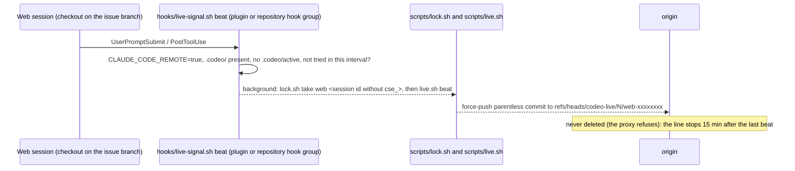

# Live-session signal in a hosted web session, round 2 — Implementation Plan

> **For agentic workers:** REQUIRED SUB-SKILL: Use superpowers:subagent-driven-development (recommended) or superpowers:executing-plans to implement this plan task-by-task. Steps use checkbox (`- [ ]`) syntax for tracking.

**Goal:** A hosted web session that starts on this branch publishes its signal from the first prompt on, with no manual step, naming the engineer's GitHub login or `unknown` and never the harness identity, and the documentation says which projects get that.

**Architecture:** The lock is taken by `hooks/live-signal.sh beat` itself, in the background, when `CLAUDE_CODE_REMOTE=true`, the project has a `.codeo/` directory and no `.codeo/active` exists, at most once per refresh interval; it runs `lock.sh take web <session id without cse_>` and then `live.sh beat`. The repository's own `SessionStart` group goes (a hosted run showed it leaving no lock at the start of a session). Because `hooks/hooks.json` runs the same script, a project that installs the plugin gets the lock and the beat too. For a web session the user chain ends at `unknown`: no `git config user.name`.

**Tech Stack:** bash, git, `jq`; the `shell` suite (`bash tests/run.sh`).

**Spec:** issue #138 (https://github.com/kbajpai/codeo/issues/138) and its acceptance criteria; `.codeo/138/qc.md` `### Round 1` (F1, F4, F11, F5, F7, F8, F10) and the answers to Q10 and `qc.md`'s Q1-Q4. This round adds to `docs/plans/2026-11-21-live-signal-web-session-138.md`, which stays as the record of what round 1 built.

## Decision record

| | |
|---|---|
| **Context** | A hosted run of round 1's build showed the prompt and tool-call hooks publishing once a lock exists, the `SessionStart` hook leaving no lock at the start of the session, and a web signal able to name `Claude`. |
| **Decision** | The beat hook takes the lock (Q10 a); drop the `SessionStart` group; the web user chain ends at `unknown` (`qc.md` Q2 b). |
| **Options rejected** | Keep the `SessionStart` group beside it (Q10 b: leaves `lock:` lines in the session's context); diagnose why `startup` did not run it first (Q10 c: another hosted run for no change in design). |
| **Trade-offs** | A lock taken from a prompt hook can check out the dossier branch mid-session, as `lock.sh take web` does at a start script; `lock.sh` refuses and takes no lock on a divergence or stale local branch. A web session in a codeo project with no dossier for its branch tries the lock once per refresh interval and fails quietly. |
| **Action items** | Tasks 1-6 below. |

## Global Constraints

- **No invariants document is configured** (`.invariants` is unset).
- The signal stays information only; `beat` and `clear` exit 0 whatever happens. The hook prints nothing, always exits 0 and never waits for the lock take or the push (both run detached, all streams closed), so it cannot fail or slow a prompt or a tool call.
- The new lock take runs only when `CLAUDE_CODE_REMOTE` is `true`, the project root has a `.codeo/` directory and `.codeo/active` is missing, and at most once per `CODEO_LIVE_REFRESH_SECONDS` (default 300) per checkout. Container and local sessions behave exactly as before.
- A web session's publish still writes only to `refs/heads/codeo-live/*`, never changes the feature branch's tip, and has no REST fallback (round 1's constraints stand).
- No email address appears in a signal. For a web session the user is `CODEO_GITHUB_LOGIN`, else `GET /user`, else the issue's first assignee, else `unknown`.
- **Order:** every task here is proved by the `shell` suite in the issue's own checkout; Task 6, the hosted-session check, needs the engineer's host and is last. No shared environment is configured, so no task carries a lease marker.
- **Documentation moved:** `docs/handoff.md` (*Who is working right now* and its diagram) and `CHANGELOG.md` (Tasks 4 and 5). No wiki module.
- Overlap with #149 (`docs/handoff.md`, `CHANGELOG.md`) and #151 (`CHANGELOG.md`) was answered *proceed and coordinate* (round 1's Q8, Q9): Tasks 4 and 5 run `bash scripts/sync-main.sh` first and keep both sides on a conflict.
- **Later work, not in this plan** (`qc.md` Q3 a): the fetch collision on equal machine labels, the leftover `codeo-live/*` branches, and the forked-session label. They are recorded in `implement.md` and `qc.md`.

## Review Focus

1. **A web session in a codeo project with no dossier for its branch** (on the base branch, say) must not run `lock.sh` on every tool call: once per interval, quietly (Task 2, `hook_tries_the_lock_once_per_refresh_interval`).
2. **A web session of a project that has the plugin but no `.codeo/`** must do nothing (Task 2, `hook_takes_no_lock_without_a_codeo_directory`).
3. **No session id** in the hook's environment gives a lock with `session: unknown` and a signal named from the hostname, not a failure (Task 2, `hook_without_a_session_id_takes_a_lock_with_session_unknown`).
4. **Container and local sessions** must see no new behaviour (Task 2, `hook_takes_no_lock_outside_a_web_session`, `hook_leaves_an_existing_lock_alone`).
5. **A web session with no login, no assignee and a harness `git config user.name`** must publish `unknown` (Task 1, `web_user_without_a_login_or_assignee_is_unknown`).

---

### Task 1: A web signal never names `git config user.name` (`scripts/live.sh`)

**Files:**
- Modify: `scripts/live.sh` (`user_label`; the header's `user:` line)
- Test: `tests/live.test.sh`

**Interfaces:**
- Produces: for `host` web the user is `$CODEO_GITHUB_LOGIN`, else `github.sh user login`, else `assignee_label`, else `unknown`; for any other host `git config user.name` stays the step before `unknown`.

- [ ] **Step 1: Write the failing test.** In `tests/live.test.sh` replace `web_user_without_an_assignee_falls_to_git_user_name` with `web_user_without_a_login_or_assignee_is_unknown`: a web lock, `STUB_USER_FAIL=1`, no `STUB_ASSIGNEE`, `git config user.name` set to `Claude` in the clone; assert the published message says `user: unknown`. Keep the container case (`user_falls_back_to_git_user_name_and_never_an_email`) as it is.
- [ ] **Step 2: Run to see it fail** — `bash tests/run.sh live.test`; expected: FAIL on the new case (`user: Claude`).
- [ ] **Step 3: Implement** in `user_label`: skip the `git config user.name` step when `$host` is `web`. Update the header's `user:` line to say so.
- [ ] **Step 4: Run to see it pass** — `bash tests/run.sh`; expected `all cases passed`.
- [ ] **Step 5: Commit** — `git add scripts/live.sh tests/live.test.sh` then `git commit -m "fix: a web session's signal never names git config user.name (#138)"`.

**Proof of done:** `bash tests/run.sh` prints `all cases passed`.

---

### Task 2: The beat hook takes the lock in a web session (`hooks/live-signal.sh`)

**Files:**
- Modify: `hooks/live-signal.sh` (and its header comment, every line at most 100 columns)
- Test: `tests/live-signal.test.sh`

**Interfaces:**
- Consumes: `scripts/lock.sh take web [session-id]`, `scripts/live.sh beat`, `CLAUDE_CODE_REMOTE`, `CLAUDE_CODE_REMOTE_SESSION_ID`, `CODEO_LIVE_REFRESH_SECONDS`.
- Produces: `live-signal.sh beat`, when `.codeo/active` is missing, `CLAUDE_CODE_REMOTE=true`, `<root>/.codeo` is a directory and the stamp `$(git rev-parse --git-path codeo-live-lock-try)` is missing or older than `${CODEO_LIVE_REFRESH_SECONDS:-300}` seconds: writes the stamp, then starts in the background with every stream closed `bash lock.sh take web "${CLAUDE_CODE_REMOTE_SESSION_ID#cse_}"` followed by `bash live.sh beat`. With a lock present it behaves as before; `clear` is unchanged and still needs a lock.

- [ ] **Step 1: Write the failing tests** in `tests/live-signal.test.sh`, using its scratch origin and clone, a clone that holds a live dossier `.codeo/104/init.md` (`| Branch | \`feat/x\` |`, committed and pushed as `settings_session_start_takes_the_lock_with_the_session_id` does today) and no `.codeo/active`, and the hook JSON `{"cwd": "<clone>"}`; `CODEO_MACHINE=testbox` is exported there, so the signal branch is `refs/heads/codeo-live/104/testbox`. Poll up to 10 s for an expected effect, and wait 2 s before asserting none. Cases:
  - `hook_takes_the_lock_in_a_web_session_when_none_exists`: `CLAUDE_CODE_REMOTE=true`, `CLAUDE_CODE_REMOTE_SESSION_ID=cse_abcdef0123456789`; assert the hook exits 0 with empty stdout and stderr, `.codeo/active` appears with `host:    web` and `session: abcdef0123456789`, and the web signal branch is published.
  - `hook_without_a_session_id_takes_a_lock_with_session_unknown`: the same with the id unset; assert `session: unknown` and a published signal.
  - `hook_takes_no_lock_outside_a_web_session`: `CLAUDE_CODE_REMOTE` unset; after 2 s no `.codeo/active`.
  - `hook_takes_no_lock_without_a_codeo_directory`: a clone with no `.codeo/` directory; after 2 s no `.codeo/` exists and the exit is 0.
  - `hook_leaves_an_existing_lock_alone` and `hook_tries_the_lock_once_per_refresh_interval`: run against a copy of the plugin whose `scripts/lock.sh` is a stub that appends each call to a log and takes no lock; with a lock present the log stays empty; with none, two hook calls inside one interval leave exactly one log line, and the stamp exists; with `CODEO_LIVE_REFRESH_SECONDS=0` a third call adds a second line.
- [ ] **Step 2: Run to see them fail** — `bash tests/run.sh live-signal`; expected: FAIL on the first, second and fifth cases (no lock taken).
- [ ] **Step 3: Implement** in `hooks/live-signal.sh`: replace the early `[[ -f $root/.codeo/active ]]` exit for `beat` with the condition under Produces; keep `clear` and the always-exit-0, print-nothing contract; update the header.
- [ ] **Step 4: Run to see them pass** — `bash tests/run.sh`; expected `all cases passed`.
- [ ] **Step 5: Commit** — `git add hooks/live-signal.sh tests/live-signal.test.sh` then `git commit -m "feat: the beat hook takes the lock in a web session (#138)"`.

**Proof of done:** `bash tests/run.sh` prints `all cases passed`.

---

### Task 3: The repository's hook groups (`.claude/settings.json`)

**Files:**
- Modify: `.claude/settings.json`
- Test: `tests/live-signal.test.sh`

- [ ] **Step 1: Write the failing tests.** In `tests/live-signal.test.sh`: change `settings_json_registers_the_web_session_hooks` so it asserts `SessionStart` holds only the `session-title.sh` group (no `lock.sh`), `UserPromptSubmit` and `PostToolUse` carry the gated `live-signal.sh" beat`, the gated commands number 2, and there is no `SessionEnd`; delete `settings_session_start_takes_the_lock_with_the_session_id` (Task 2 covers the lock); add `settings_beat_hook_takes_the_lock_and_publishes`: the registered `UserPromptSubmit` command run with `CLAUDE_CODE_REMOTE=true` and `CLAUDE_CODE_REMOTE_SESSION_ID=cse_abcdef0123456789` in a clone with a live dossier and no lock ends, within 10 s, with `.codeo/active` (`host:    web`) and the published branch.
- [ ] **Step 2: Run to see them fail** — `bash tests/run.sh live-signal`; expected: FAIL on the registration case (the `lock.sh` group is still there).
- [ ] **Step 3: Remove the `SessionStart` group that runs `lock.sh take web`** from `.claude/settings.json`; keep the `session-title.sh` groups and the two gated beat groups.
- [ ] **Step 4: Run to see them pass** — `bash tests/run.sh`; expected `all cases passed` (`tests/devcontainer.test.sh` reads this file too).
- [ ] **Step 5: Commit** — `git add .claude/settings.json tests/live-signal.test.sh` then `git commit -m "fix: drop the SessionStart lock group; the beat hook takes the lock (#138)"`.

**Proof of done:** `bash tests/run.sh` prints `all cases passed`.

---

### Task 4: `docs/handoff.md` — *Who is working right now*

**Files:**
- Modify: `docs/handoff.md` (the bullet and its `sequenceDiagram`)
- Test: `tests/live-signal.test.sh` (`docs_state_the_web_session_signal`)

**Documentation:** page `docs/handoff.md`, section *Parallel workflows → Who is working right now*. Afterwards it says, in the present tense with no issue numbers and no history: in a hosted web session the beat hook takes the lock itself when `CLAUDE_CODE_REMOTE` is `true`, the project has a `.codeo/` directory and there is no lock, at most once per refresh interval, with `lock.sh take web` and the session id without its `cse_` prefix, and that may check out the dossier branch; the hook comes from this repository's `.claude/settings.json` groups (this repository's own: another project adds the same two gated groups) or from the plugin, which cloud sessions do not install from `enabledPlugins`, so the environment's setup script installs it; either way nothing else is needed; the user is `CODEO_GITHUB_LOGIN`, else the login `GET /user` returns, else for a web session the issue's first assignee (who may not be the person at the keyboard), else for any other session `git config user.name`, else `unknown`, and `CODEO_GITHUB_LOGIN` is read first for the signal, where `github.sh` assignments try `GET /user` first; the diagram's flow is the one in this plan's diagram. Remove the sentences saying the repository's hooks take the lock at session start. Run `bash scripts/sync-main.sh` first; keep both sides on a conflict with #149.

- [ ] **Step 1: Extend the failing test** `docs_state_the_web_session_signal`: `docs/handoff.md` contains `takes the lock`, `first assignee` and `else \`unknown\``, and no longer contains `take the lock and beat`.
- [ ] **Step 2: Run to see it fail** — `bash tests/run.sh live-signal`; expected: FAIL on the new strings.
- [ ] **Step 3: Sync and edit** — `bash scripts/sync-main.sh`, then rewrite the section as above.
- [ ] **Step 4: Run to see it pass** — `bash tests/run.sh`; expected `all cases passed`.
- [ ] **Step 5: Commit** — `git add docs/handoff.md tests/live-signal.test.sh` then `git commit -m "docs: a web session's beat hook takes the lock; the user is never the harness (#138)"`.

**Proof of done:** `bash tests/run.sh` prints `all cases passed`.

---

### Task 5: `CHANGELOG.md`

**Files:**
- Modify: `CHANGELOG.md` (the one bullet under `## Unreleased` that ends `(#138)`)

**Documentation:** the bullet, in its own style, says what the build now does: the beat hook (this repository's gated groups, or the plugin) takes the lock in a web session on the first prompt and no `SessionStart` group is used, the user falls to `unknown` for a web session instead of `git config user.name`, and `CODEO_GITHUB_LOGIN` is read before `GET /user` for the signal. Run `bash scripts/sync-main.sh` first; keep every bullet on a conflict (#149, #151).

- [ ] **Step 1: Sync** — `bash scripts/sync-main.sh`; expected exit 0 or a conflict in `CHANGELOG.md` to resolve by keeping both sides.
- [ ] **Step 2: Edit the bullet.**
- [ ] **Step 3: Run the suite** — `bash tests/run.sh`; expected `all cases passed`.
- [ ] **Step 4: Commit** — `git add CHANGELOG.md` then `git commit -m "docs: changelog for the web-session lock and user fixes (#138)"`.

**Proof of done:** `bash tests/run.sh` prints `all cases passed`.

---

### Task 6: The hosted-session check, again

Runs on: the engineer's host

**Files:** none changed. The result goes in `.codeo/138/implement.md`.

Needs the branch pushed with Tasks 1-5.

- [ ] **Step 1: Start a new hosted session** on `kbajpai/codeo`, on `fix/live-session-signal-does-not`. Send `Run "git log --oneline -1" and show me the raw output.` and check it names this round's last commit.
- [ ] **Step 2: Send one ordinary prompt** (`say hello`) and then, as a separate message, `Run "cat .codeo/active" and show me the raw output.` Expected: the file exists with `host:    web` and `session:` followed by the session's id without `cse_`, with no manual `lock.sh` run.
- [ ] **Step 3: Check from this container** — `bash scripts/inflight.sh --live`; expected: a row `138`, `kbajpai`, `web-` plus 8 characters, `web`, an age under 900 seconds. Record the row and the session's output.
- [ ] **Step 4: Check the refresh** — after at least 5 minutes send any prompt and run `bash scripts/inflight.sh --live` again; expected: the age has dropped.
- [ ] **Step 5: Clean up** on the host: `git push origin --delete codeo-live/138/web-<8 characters>` for the branch the run created.
- [ ] **If a step fails,** record the output verbatim under `## Notes` and report it; the criteria it covers are then not met.

**Proof of done:** the row in step 3, the lock file in step 2 and the age change in step 4, pasted into the dossier.

---

## Self-review

- **Findings coverage.** F1: Task 1 (code, test) and Task 4 (docs). F4: Task 2 makes a plugin-only install work, Task 4 states what each project needs. F11: Tasks 2 and 3, checked in Task 6. F5: Task 2 (`hook_without_a_session_id_…`). F7, F8: Task 4's sentences. F9: gone with the `SessionStart` group (Task 3). F10: `tests/devcontainer.test.sh` is in the footprint; it needs no edit because its assertions still hold with the `SessionStart` group removed (the session-title group stays first of its event, every other hook stays gated).
- **Criteria coverage.** 4: Tasks 2, 3, 6. 5: Tasks 1, 4. 6: Task 4. 1: Task 6 again.
- **Types.** The stamp name `codeo-live-lock-try`, `CODEO_LIVE_REFRESH_SECONDS`, `CLAUDE_CODE_REMOTE_SESSION_ID#cse_` and the signal branch `refs/heads/codeo-live/104/testbox` are the same in every task that uses them.
