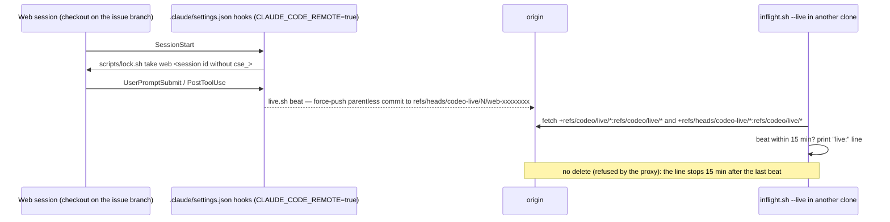

# Live-session signal in a hosted web session — Implementation Plan

> **For agentic workers:** REQUIRED SUB-SKILL: Use superpowers:subagent-driven-development (recommended) or superpowers:executing-plans to implement this plan task-by-task. Steps use checkbox (`- [ ]`) syntax for tracking.

**Goal:** A workflow bound to an issue in a hosted web session shows as live in `bash scripts/inflight.sh --live` on another clone, with the engineer's GitHub login and a `web-<8 characters>` machine, without a manual `beat` and without any write the proxy refused in #112.

**Architecture:** A web session publishes the same one-commit signal, but to `refs/heads/codeo-live/<issue>/<machine>` instead of `refs/codeo/live/…`, because the proxy accepts pushes to branches (create, and force-update, as probed in #138's Q5 and Q7) and refuses non-branch refs, branch deletion and `git/commits`. Readers fetch that namespace into the same local `refs/codeo/live/*`, so `list` and `inflight.sh` do not change. A web signal is never deleted: it expires after the TTL, as a crash's does. The trigger is a hook block in this repository's `.claude/settings.json` (cloud sessions do not install `enabledPlugins` plugins, but they run repository hooks), active only when `CLAUDE_CODE_REMOTE=true`.

**Tech Stack:** bash, git, `jq`; the `shell` suite (`bash tests/run.sh`).

**Spec:** issue #138 (https://github.com/kbajpai/codeo/issues/138), its acceptance criteria, and the decisions in `.codeo/138/plan.md` (Q1-Q9; archived to `.codeo/done/138/` at close). No separate reference doc: `docs/handoff.md` (*Who is working right now*) carries what outlives the work.

## Decision record

| | |
|---|---|
| **Context** | #112 found a web session publishes nothing: a push to `refs/codeo/live/*` and REST `git/commits` both returned 403, the plugin is not installed, and the labels were wrong. |
| **Decision** | Publish to a branch name; never delete it; trigger from the repository's own hooks; name the login from `CODEO_GITHUB_LOGIN`, else `GET /user`, else the issue's assignee, else `git config user.name`; build the machine from the session id with its `cse_` prefix removed. |
| **Options rejected** | *No signal from a web session* (Q1 b): leaves web sessions invisible. *Fast-forward chain of signal commits* (only needed if the force-push had been refused; it was accepted, Q7). *Plugin install from `enabledPlugins`* (cloud sessions do not install it). *Hook in the plugin only* (never present there). |
| **Trade-offs** | One extra branch per (issue, web session) stays on origin, because deletion is refused. Triage skips them (Task 3); removing them is later work (see Global Constraints). The assignee can be someone other than whoever is at the keyboard; `CODEO_GITHUB_LOGIN` overrides it. |
| **Action items** | Tasks 1-7 below. |

## Global Constraints

- **No invariants document is configured** (`.invariants` is unset), so there is nothing to check the plan against beyond the rules below.
- The signal stays information only: no script refuses or waits because a workflow is live. `beat` and `clear` still exit 0 whatever happens; a failure is one `live:` stderr line.
- A web session's publish writes only to `refs/heads/codeo-live/*`: never to `refs/codeo/live/*` and never through `github.sh ref put` (the two writes #112 saw refused). It never changes the feature branch's tip.
- No email address appears in a signal, as now. The commit identity stays `codeo-live <codeo-live@invalid>`.
- Container and local sessions keep publishing to `refs/codeo/live/*`, unchanged.
- The repository's hook block must do nothing outside a web session (`CLAUDE_CODE_REMOTE` not `true`), so the dev container, where the plugin's own hook fires, never beats twice.
- **Order:** every task here is proved by the `shell` suite in the issue's own checkout; Task 7, the only one that needs a hosted session, is last. No shared environment is configured, so no task carries a lease marker.
- **Documentation moved:** `docs/handoff.md` (*Who is working right now*, including its diagram) and `CHANGELOG.md` (Task 5 and 6). No wiki module. `README.md`, `docs/dossier.md` and `docs/skills.md` do not move.
- **Later work, not in this plan:** the signal branches a web session leaves on origin need removing by hand or by a later change; the plan records that under `## Notes` of the dossier as a promise with no issue number, for `/codeo:triage`, since `/codeo:issue` refuses in this container.
- Overlap, as answered: #149 (`docs/handoff.md`, `CHANGELOG.md`) and #151 (`CHANGELOG.md`): *proceed and coordinate*. Tasks 5 and 6 are last among the suite-proved tasks and run `bash scripts/sync-main.sh` first, keeping both sides on a conflict.

## Review Focus

Failure modes the issue implies; each has its test in the task that owns the code.

1. **Two web sessions on one issue** must not share a signal: distinct ids give distinct branches (Task 2, `web_machine_*`).
2. **A short or odd session id** (`cse_ab`, none at all) must still give a valid machine label (Task 2, `web_machine_short_id_and_none`).
3. **A container signal and a web signal for one issue** are both listed, and clearing the container one on origin prunes only it (Task 1, `fetch_maps_web_branches_to_signals`).
4. **The proxy refusing the force-push** must produce one `live:` line, exit 0 and no REST fallback (Task 1, `web_push_refused_warns_once_and_does_not_fall_back`).
5. **The dev container** must not beat twice: the repository's hooks are inert there (Task 4, `settings_hooks_do_nothing_outside_a_web_session`).

---

### Task 1: Publish, clear and fetch for a web session (`scripts/live.sh`)

**Files:**
- Modify: `scripts/live.sh` (`read_lock`, `beat`, `clear`, `fetch`, and the header comment)
- Test: `tests/live.test.sh`

**Interfaces:**
- Produces: a global `push_ref` set by `read_lock` beside `signal_ref`: `refs/heads/codeo-live/$issue/$machine` when `host` is `web`, else the value of `signal_ref`. `beat` pushes to `push_ref`; `fetch` and `list` keep using `refs/codeo/live/`.

- [ ] **Step 1: Write the failing tests** in `tests/live.test.sh`, beside the existing cases. Add a helper `heads() { git -C "$origin" for-each-ref --format='%(refname)' refs/heads/codeo-live/; }`. Cases, each starting `new_world; clone_with_lock 104 web abcdef0123456789`:
  - `web_beat_publishes_a_branch_not_a_live_ref`: `run beat --force`; assert exit 0, `refs` is empty, `heads` is `refs/heads/codeo-live/104/web-abcdef01`, `git -C "$origin" rev-parse refs/heads/feat/x` is the same before and after, and `$STUB_LOG` has no `ref put`.
  - `web_beat_replaces_its_branch_by_force`: two `run beat --force`; assert `git -C "$origin" rev-list --count refs/heads/codeo-live/104/web-abcdef01` is `1`.
  - `web_clear_deletes_nothing`: `beat --force`, then `run clear`; assert exit 0, `heads` still lists the branch, the stamp file is gone, and `$STUB_LOG` has no `ref delete`.
  - `fetch_maps_web_branches_to_signals`: publish a web signal for 104 and a container signal for 105 (second lock in the same world), `run fetch` from a second clone, assert `list --tsv` shows both (`104<TAB>alice<TAB>web-abcdef01<TAB>web<TAB>…` and `105<TAB>alice<TAB>codeo-105<TAB>container<TAB>…`); then delete the container signal on origin, fetch again, assert only 104 remains.
  - `web_push_refused_warns_once_and_does_not_fall_back`: a `pre-receive` hook in `$origin` that rejects `refs/heads/codeo-live/*`; `run beat --force`; assert exit 0, one stderr line starting `live: could not publish`, and `$STUB_LOG` has no `ref put`.

- [ ] **Step 2: Run to see them fail**

Run: `bash tests/run.sh live.test`
Expected: FAIL, naming `web_beat_publishes_a_branch_not_a_live_ref` (the signal lands in `refs/codeo/live/…`) and the other four cases.

- [ ] **Step 3: Implement** in `scripts/live.sh`: `read_lock` sets `push_ref` as above; `beat` pushes `"$sha:$push_ref"` and runs the `github.sh ref put` fallback only when `host` is not `web`; `clear` for `host` web removes the stamp and returns without any push; `fetch` runs `git fetch -q --prune origin '+refs/codeo/live/*:refs/codeo/live/*' '+refs/heads/codeo-live/*:refs/codeo/live/*'`. Update the header comment (`beat`, `clear`, `fetch`, Limits) to say a web session's signal is a branch that expires and is never deleted.

- [ ] **Step 4: Run to see them pass**

Run: `bash tests/run.sh`
Expected: `all cases passed`.

- [ ] **Step 5: Commit** — `git add scripts/live.sh tests/live.test.sh` then `git commit -m "feat: publish the live signal from a web session as a codeo-live branch (#138)"`.

**Proof of done:** `bash tests/run.sh` prints `all cases passed`.

---

### Task 2: Machine label and user for a web session (`scripts/live.sh`)

**Files:**
- Modify: `scripts/live.sh` (`machine_label`, `user_label`, a new `assignee_label`)
- Test: `tests/live.test.sh` (extend the stub's verbs and add cases)

**Interfaces:**
- Consumes: `push_ref`, `host`, `issue` from Task 1.
- Produces: `assignee_label() -> prints the first assignee login of $issue, or nothing`; the label of a web machine is `web-` plus the first 8 characters of the session id with a leading `cse_` or `session_` removed.

- [ ] **Step 1: Write the failing tests.** Extend the `github.sh` stub in `tests/live.test.sh` with `"issue view")` printing `{"assignees":["$STUB_ASSIGNEE"]}` when `STUB_ASSIGNEE` is set, else `{"assignees":[]}`. Cases, each reading the published commit message with `git -C "$origin" log -1 --format=%B <ref>`:
  - `web_machine_from_the_lock_session_strips_a_cse_prefix`: lock `session: cse_abcdef0123456789` → ref `…/web-abcdef01`, and the message says `machine: web-abcdef01`.
  - `web_machine_from_the_environment_when_the_lock_has_none`: lock `session: unknown`, `CLAUDE_CODE_REMOTE_SESSION_ID=cse_0123456789abcdef` → `…/web-01234567`.
  - `lock_session_wins_over_the_environment`: lock `abcdef0123456789`, environment `cse_ffffffffffff` → `web-abcdef01`.
  - `web_machine_short_id_and_none`: environment `cse_ab` → `web-ab`; lock `unknown` with no environment variable → the sanitised hostname, as today (`$host_label`).
  - `two_web_sessions_on_one_issue_publish_two_branches`: two locks with different ids, same origin → `heads` lists two branches.
  - `user_env_login_wins`: `CODEO_GITHUB_LOGIN=bob`, stub `user login` answering `alice` → `user: bob`.
  - `web_user_falls_back_to_the_assignee`: `STUB_USER_FAIL=1`, `STUB_ASSIGNEE=carol`, host `web` → `user: carol`; the same with host `container` → `git config user.name` (the assignee is used for web only).
  - `web_user_without_an_assignee_falls_to_git_user_name`: `STUB_USER_FAIL=1`, no assignee → `git config user.name`.

- [ ] **Step 2: Run to see them fail**

Run: `bash tests/run.sh live.test`
Expected: FAIL on the `cse_` and environment cases (labels `web-cse_abcd`, hostname) and on `user_env_login_wins` (`alice`).

- [ ] **Step 3: Implement** in `scripts/live.sh`: in `machine_label`'s web branch take the lock's `session`; when empty or `unknown`, take `${CLAUDE_CODE_REMOTE_SESSION_ID:-}`; remove a leading `cse_` or `session_`; use `web-${id:0:8}`; keep the hostname fallback. `user_label` order: `$CODEO_GITHUB_LOGIN`; `bounded bash "$github" user login`; for `host` web only, `assignee_label`; `git config user.name`; `unknown`. `assignee_label` runs `bounded bash "$github" issue view "$issue" | jq -r '.assignees[0] // empty'`, printing nothing on any failure. The result still goes through `clean`.

- [ ] **Step 4: Run to see them pass**

Run: `bash tests/run.sh`
Expected: `all cases passed`.

- [ ] **Step 5: Commit** — `git add scripts/live.sh tests/live.test.sh` then `git commit -m "feat: name a web session's signal by the login and a web-<id> machine (#138)"`.

**Proof of done:** `bash tests/run.sh` prints `all cases passed`.

---

### Task 3: Triage skips the signal branches (`skills/triage/SKILL.md`)

**Files:**
- Modify: `skills/triage/SKILL.md` (the bullet that lists branches on origin other than the base branch and `codeo/intake`)
- Test: `tests/triage-skill.test.sh`

- [ ] **Step 1: Write the failing test** — in `tests/triage-skill.test.sh`, beside the existing `must_contain` lines: `must_contain "signal branches are not parked work" 'codeo-live/'`.

- [ ] **Step 2: Run to see it fail**

Run: `bash tests/run.sh triage-skill`
Expected: FAIL: `signal branches are not parked work`.

- [ ] **Step 3: Edit the bullet** to read "Branches on origin other than the base branch, `codeo/intake` and the `codeo-live/` signal branches (a web session's live signal, which expires and is never a parked workflow), each looked up …". Change nothing else in the skill.

- [ ] **Step 4: Run to see it pass**

Run: `bash tests/run.sh`
Expected: `all cases passed` (the inventory and lint tests included).

- [ ] **Step 5: Commit** — `git add skills/triage/SKILL.md tests/triage-skill.test.sh` then `git commit -m "fix: triage ignores a web session's live-signal branches (#138)"`.

**Proof of done:** `bash tests/run.sh` prints `all cases passed`.

---

### Task 4: The repository's own hooks for a web session (`.claude/settings.json`)

**Files:**
- Modify: `.claude/settings.json`
- Test: `tests/live-signal.test.sh`

**Interfaces:**
- Consumes: `hooks/live-signal.sh beat`, `scripts/lock.sh take web <id>`, `CLAUDE_CODE_REMOTE`, `CLAUDE_CODE_REMOTE_SESSION_ID`, `CLAUDE_PROJECT_DIR`.
- Produces: three added hook entries, each a command of the form `[ "$CLAUDE_CODE_REMOTE" = true ] && … || true` and so inert outside a web session: `SessionStart` (matcher `startup|resume|fork`) runs `bash "${CLAUDE_PROJECT_DIR}/scripts/lock.sh" take web "${CLAUDE_CODE_REMOTE_SESSION_ID#cse_}"`; `UserPromptSubmit` and `PostToolUse` run `bash "${CLAUDE_PROJECT_DIR}/hooks/live-signal.sh" beat`. No `SessionEnd` entry: `clear` is a no-op for a web session. Existing `session-title.sh` entries stay as they are.

- [ ] **Step 1: Write the failing tests** in `tests/live-signal.test.sh` (it already builds a scratch origin and a clone holding a lock; `CODEO_MACHINE=testbox` is exported there, so the branch is `refs/heads/codeo-live/104/testbox`):
  - `settings_json_registers_the_web_session_hooks`: with `jq`, assert `.claude/settings.json` has a `SessionStart` command containing `lock.sh" take web`, and `UserPromptSubmit` and `PostToolUse` commands containing `live-signal.sh" beat`, each containing `CLAUDE_CODE_REMOTE`; and that the existing `session-title.sh` commands are still there.
  - `settings_hooks_do_nothing_outside_a_web_session`: extract the `PostToolUse` command, run it with `sh -c`, `CLAUDE_CODE_REMOTE` unset, `CLAUDE_PROJECT_DIR=$plugin_root`, the hook JSON `{"cwd":"<clone>"}` on stdin; assert exit 0 and, after a 2-second wait, no branch under `refs/heads/codeo-live/` on origin.
  - `settings_beat_hook_publishes_in_a_web_session`: the same with `CLAUDE_CODE_REMOTE=true` and the clone's lock `host: web`; assert `wait_for_ref`-style polling finds `refs/heads/codeo-live/104/testbox` on origin and the command exits 0.
  - `settings_session_start_takes_the_lock_with_the_session_id`: in a clone with a live dossier for the branch and no `.codeo/active`, run the `SessionStart` command with `CLAUDE_CODE_REMOTE=true` and `CLAUDE_CODE_REMOTE_SESSION_ID=cse_abcdef0123456789`; assert `.codeo/active` holds `host:    web` and `session: abcdef0123456789`; run it again with `CLAUDE_CODE_REMOTE` unset on a fresh clone and assert no `.codeo/active` appears.

- [ ] **Step 2: Run to see them fail**

Run: `bash tests/run.sh live-signal`
Expected: FAIL on `settings_json_registers_the_web_session_hooks` (no such commands) and the three behaviour cases.

- [ ] **Step 3: Add the three hook entries** to `.claude/settings.json` as described under Produces, keeping the file valid JSON and the two existing `session-title.sh` blocks intact.

- [ ] **Step 4: Run to see them pass**

Run: `bash tests/run.sh`
Expected: `all cases passed` (`tests/devcontainer.test.sh` reads this file too).

- [ ] **Step 5: Commit** — `git add .claude/settings.json tests/live-signal.test.sh` then `git commit -m "feat: this repository's hooks take the lock and beat in a web session (#138)"`.

**Proof of done:** `bash tests/run.sh` prints `all cases passed`.

---

### Task 5: `docs/handoff.md` — *Who is working right now*

**Files:**
- Modify: `docs/handoff.md` (the bullet *Who is working right now* and its `sequenceDiagram`)
- Test: `tests/live-signal.test.sh`

**Documentation:** page `docs/handoff.md`, section *Parallel workflows → Who is working right now*. Afterwards it says: a container or local session publishes `refs/codeo/live/<issue>/<machine>`; a hosted web session publishes `refs/heads/codeo-live/<issue>/<machine>`, because the proxy refuses a push to the first and accepts the second, and a REST write of the commit was refused; a web signal is never deleted (the proxy refuses branch deletions), so it only expires after the TTL, and the branch stays on origin until someone deletes it; the repository's own hooks (`.claude/settings.json`) take the lock and beat in a web session, and a project that only installs the plugin needs the environment's setup script to install it, since cloud sessions do not install `enabledPlugins`; the machine is `web-` plus the first 8 characters of the session id without its `cse_` prefix (the lock's `session`, else `CLAUDE_CODE_REMOTE_SESSION_ID`, else the hostname); the user is `CODEO_GITHUB_LOGIN`, else `GET /user`, else for a web session the issue's assignee, else `git config user.name`. Remove the sentences saying a web session publishes nothing and that the hook runs there only when the plugin is installed. The diagram gains the web path as in this plan's diagram. Run `bash scripts/sync-main.sh` first and keep both sides on a conflict with #149 (Q8).

- [ ] **Step 1: Write the failing test** — in `tests/live-signal.test.sh`, `docs_state_the_web_session_signal`: `docs/handoff.md` contains `refs/heads/codeo-live/`, `never deleted`, `CLAUDE_CODE_REMOTE_SESSION_ID` and `CODEO_GITHUB_LOGIN`, and no longer contains `so it publishes no signal`.
- [ ] **Step 2: Run to see it fail** — `bash tests/run.sh live-signal`; expected: FAIL on `docs_state_the_web_session_signal`. Also review the existing `docs_state_the_live_signal_limits` case and update its pinned wording if the rewrite moves it.
- [ ] **Step 3: Sync and edit** — `bash scripts/sync-main.sh`, then rewrite the section as above.
- [ ] **Step 4: Run to see it pass** — `bash tests/run.sh`; expected: `all cases passed`.
- [ ] **Step 5: Commit** — `git add docs/handoff.md tests/live-signal.test.sh` then `git commit -m "docs: a web session publishes the live signal as a codeo-live branch (#138)"`.

**Proof of done:** `bash tests/run.sh` prints `all cases passed`.

---

### Task 6: `CHANGELOG.md`

**Files:**
- Modify: `CHANGELOG.md` (`## Unreleased`, one bullet)

**Documentation:** one bullet, in the file's existing style, ending `(#138)`: a hosted web session now publishes the live signal as `refs/heads/codeo-live/<issue>/<machine>` (never deleted, expires), the repository's hooks take the lock and beat there, the login falls back to the issue's assignee, the machine is `web-<8 characters>`, triage ignores `codeo-live/` branches; no change to config schema or shared state. Run `bash scripts/sync-main.sh` first; on a conflict with #149 or #151 keep every bullet (Q8, Q9).

- [ ] **Step 1: Sync** — `bash scripts/sync-main.sh`; expected exit 0, or a conflict in `CHANGELOG.md` to resolve by keeping both sides.
- [ ] **Step 2: Add the bullet.**
- [ ] **Step 3: Run the suite** — `bash tests/run.sh` (the changelog test reads the whole file); expected: `all cases passed`.
- [ ] **Step 4: Commit** — `git add CHANGELOG.md` then `git commit -m "docs: changelog for the web-session live signal (#138)"`.

**Proof of done:** `bash tests/run.sh` prints `all cases passed`.

---

### Task 7: The hosted-session check

Runs on: the engineer's host

**Files:** none changed. The result is recorded in the dossier (`.codeo/138/implement.md`) as #112's run was.

Needs the branch pushed with Tasks 1-6. Everything here is one neutral command; the hosted session runs Linux, and the commands in steps 2 to 4 run in the issue's container.

- [ ] **Step 1: Start a hosted session** on `kbajpai/codeo` on this branch, and send one prompt of any kind (`say hello`). Nothing else: no manual `beat`.
- [ ] **Step 2: Fetch and list** — in this container run `bash scripts/inflight.sh --live`. Expected: a row for `138` with user `kbajpai`, a machine `web-` plus 8 characters, host `web`, and an age under 900 seconds. Record the row.
- [ ] **Step 3: Check the feature branch tip** — `git ls-remote origin refs/heads/fix/live-session-signal-does-not` before the prompt and after the beat: the id is unchanged by the signal (it moves only by this plan's own pushes).
- [ ] **Step 4: Check a second beat** — send another prompt after 5 minutes and run `bash scripts/inflight.sh --live` again; expected: the age drops (the force-push over the existing branch worked through the hook). Record both outputs, and delete `codeo-live/138/*` branches on GitHub afterwards.
- [ ] **If a step fails,** record the output verbatim under `## Notes` and report it; the criteria it covers are then not met, and the plan is sent back rather than the result smoothed over.

**Proof of done:** the row in step 2 and the age change in step 4, pasted into the dossier.

---

## Self-review

- **Criteria coverage.** 1 (shows live, or documented): Tasks 1, 2, 4, and checked in Task 7. 2 (no write that returned 403): Task 1 (`web_beat_publishes_a_branch_not_a_live_ref` asserts no `refs/codeo/live` and no `ref put`). 3 (feature tip unchanged): Task 1. 4 (no manual `beat`, trigger present in a web session): Task 4. 5 (login and `web-<8>`): Task 2. 6 (`docs/handoff.md`): Task 5. 7 (tests, with and without a session id): Tasks 1, 2 and 4.
- **Types.** `push_ref`, `assignee_label`, the `web-` label rule and `CLAUDE_CODE_REMOTE_SESSION_ID` are named the same in every task that uses them.
- **Unverified in the docs**, so recorded by Task 7 and not assumed: that `UserPromptSubmit` and `PostToolUse` hooks from `.claude/settings.json` fire in a cloud session, and that `SessionStart` runs `lock.sh take web` with a usable id.
