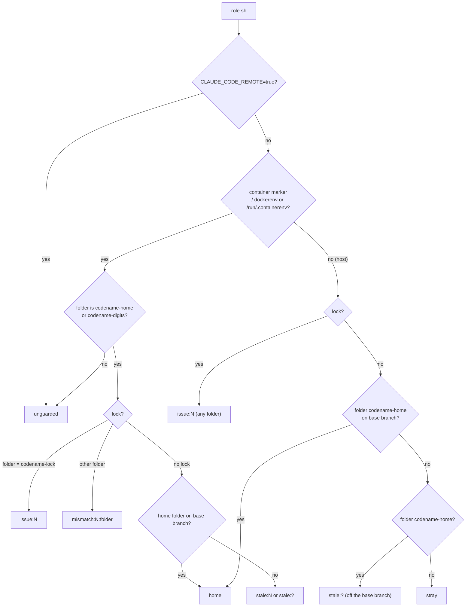
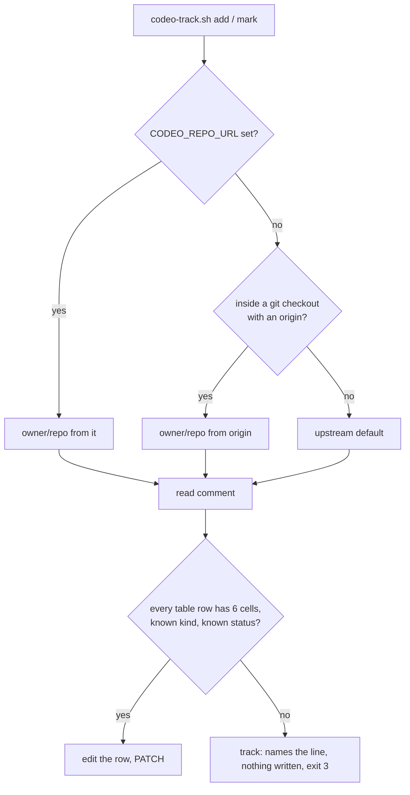

# Host home, strict role guard and issue tracking comment (#152) — Implementation Plan

> **For agentic workers:** REQUIRED SUB-SKILL: Use superpowers:subagent-driven-development (recommended) or superpowers:executing-plans to implement this plan task-by-task. Steps use checkbox (`- [ ]`) syntax for tracking.

**Goal:** The home role runs on the engineer's host as well as in `codeo-home`, a strict `role.sh` guard holds in both directions everywhere, and one edited tracking comment on each issue records its branch, containers, images, volumes and sandboxes (host, UTC times, removal) and warns before a second container is created.

**Architecture:** `role.sh` gains a host branch (no container marker): a lock makes the checkout `issue:<N>` in any folder, a `<codename>-home` clone on the base branch is `home`, anything else is the new role `stray`; the check table is made two-way (`home` runs only the home skills, `issue` only the lock skills). One new project script, `.devcontainer/codeo-track.sh`, owns the comment (marker, table, find-and-edit, fallback print, duplicate confirmation) and is called by `codeo-container.sh`, `codeo-sandbox.sh`, `codeo` (removal) and, through the project overlays, by `/codeo:init` (branch row) and `/codeo:close` (branch `deleted`). `/codeo:cleanup` now prints `codeo rm <N>` so the removal it prints is the one that records itself.

**Tech Stack:** bash (3.2-portable for `codeo-container.sh` and `codeo-track.sh`, 4.3 for the rest), `gh api` (REST, built-in `--jq`, no `jq` on the host), git; tests are `tests/*.test.sh` run by `bash tests/run.sh` (the `shell` suite, no single-test filter).

**Spec:** issue #152 (Key Requirements 1-3 and its acceptance criteria, in `.codeo/152/init.md`) and `.codeo/152/plan.md` Q1-Q6 (the engineer's decisions). No reference doc under `docs/`: the standing description lands in `README.md` and `.devcontainer/README.md` (Task 7).

## Global Constraints

- **Decisions, not to be reopened.** Q1 a container in an unshaped folder stays `unguarded` · Q2 on the host any checkout holding a lock is `issue:<N>` whatever its folder · Q3 one new `.devcontainer/codeo-track.sh`, `gh api` direct, branch row via the `init/host-workflow` overlay · Q4 the overlays print `codeo rm {N}` and `/codeo:close` marks the branch `deleted` itself · Q5 proceed and coordinate with #146 (`README.md`, `CHANGELOG.md`), `tests/install.test.sh` untouched · Q6 one pull request, guard first. Round 2: Q8-Q12 (see `## Round 2`).
- **Exemptions that stay:** `CLAUDE_CODE_REMOTE=true` (`unguarded`), and `doctor` / `setup` (outside the guard: `--check` exits 2).
- **Guard tables, exactly.** Home-only skills `issue init triage cleanup` run on `home` (and `unguarded`); lock skills `plan implement qc close` run on `issue:<N>` (and `unguarded`). Every other role refuses, one line, naming the role, the skill and where the skill does run. The refusal in each skill stays a `rule` that no words lift; the `role-guard` overlays are unchanged.
- **Tracking comment.** Hidden marker `<!-- codeo:tracking -->` on the first line; table header `| Kind | Name | Host | Status | Created (UTC) | Removed (UTC) |`; kinds `branch container image volume sandbox`; statuses `active removed deleted`; times `YYYY-MM-DDTHH:MM:SSZ`; Host is the host machine's `hostname` (never the container's own, which is its name), empty for `branch`. One comment per issue: found by its marker anywhere in a comment, edited with `PATCH`, created once. Text outside the table is kept; a comment with the marker but no recognisable table, or with a malformed row (not exactly six cells, an unknown kind or an unknown status), is reported and left untouched.
- **A failed record never fails a creation.** `gh` missing, unauthenticated or failing makes the tracker print one `track:` line naming the row to add by hand and exit 3; callers ignore its status.
- **Portability.** `codeo-container.sh` and `codeo-track.sh` stay bash 3.2 / macOS-portable: no `date -d`, `${v,,}`, `mapfile`, associative arrays, `grep -P`; the tracker is run as `"$BASH" "$track"` because `tests/cmd-mode.test.sh` runs the container script with a PATH holding only a stub `docker`.
- **codeo is project-agnostic in `skills/`, `scripts/`, `lib/`** (`tests/agnostic.test.sh` forbids three project-specific words only, but the existing convention keeps Docker out of `scripts/`): the Docker and tracker knowledge stays in `.devcontainer/`, `.sbx/` and `.codeo/overlays/`. The only generic change is `scripts/cleanup.sh` expanding `{N}` in `command:`.
- **Printed commands run in a bash shell on the host (Linux, macOS, or WSL2):** one line, no variables. `codeo rm 152` qualifies but needs `codeo`; the overlays print a `docker` fallback sentence beside it (round 2).
- **No `/codeo:cleanup` container command, no change to `.devcontainer/Dockerfile` or `devcontainer.json`, `codeo-home` and its files stay.**
- **Executable bits.** New scripts are committed `100755` (`tests/modes.test.sh`, `tests/devcontainer.test.sh`).
- **Invariants.** No invariants document is configured, so there is nothing to check this plan against. No shared environment, no `wiki` module and no `resources[]`: no task carries `Needs lease:`, and every task is proved in this checkout. No task runs on the engineer's host, so no `Runs on:` or `Shell:` marker; every command below is bash in this session's shell.
- **Documentation moved** (Task 7, and the overlay wording in Task 6): `README.md`, `.devcontainer/README.md`, `.sbx/README.md`, `CHANGELOG.md`, `docs/extension-points.md`. The Mermaid in the READMEs is the two diagrams below, redrawn to the final names.
- **Task proof.** The suite has no `filter`, so each task is proved by its own test file run alone, then the whole `test` command, both printing their last line `all cases passed` (a red-first step names its expected failure instead).

## Role decision (Task 1)



## Tracking (Tasks 2-6)

```mermaid
sequenceDiagram
    participant Init as /codeo:init (home)
    participant Host as codeo / codeo-container.sh / codeo-sandbox.sh (host)
    participant Trk as codeo-track.sh
    participant GH as issue #N comment
    Init->>Trk: add N branch <branch>
    Trk->>GH: find marker, else POST; else PATCH the table
    Host->>Trk: confirm N [--yes] [--local ...]
    Trk->>GH: read active rows
    Trk-->>Host: warn and ask (stop when non-interactive without --yes)
    Host->>Trk: add N container / image / volume / sandbox
    Note over Host,Trk: codeo rm N, or codeo-sandbox.sh end N, then
    Host->>Trk: mark N <kind> <name> removed
    Init->>Trk: (at /codeo:close) mark N branch <branch> deleted
```

## Review Focus

- A host clone named `codeo-home` that is **off the base branch** reads `stale:?` and `/codeo:init` is refused with "switch back to main"; the same folder **holding a lock** reads `issue:<N>` and `/codeo:plan` runs. Pinned in Task 1.
- A hosted web session whose workspace is a folder named `codeo-home` or `codeo-70`: `CLAUDE_CODE_REMOTE=true` wins, `unguarded`. A container in a folder named `codeo` stays `unguarded` (Q1). Pinned in Task 1.
- `gh` missing or failing, or a comment whose table is malformed: the creation goes on, the row is printed, an existing comment is not overwritten. Pinned in Task 2.
- A resume after a stash: `add` of a row that is already `active` is a no-op; a new `codeo-<N>` after the old one was removed appends a new row, so history stays. Pinned in Task 2.
- A non-interactive creation with an `active` row and no `--yes` stops with the warning; `shell` and `open` never warn; a row on another host says it is not proof. Pinned in Tasks 2-5.
- Two concurrent first creations of the comment can leave two; accepted, the tracker uses the first marker it finds. Noted in Task 2 and in the README.

---

### Task 1: The strict role guard, host included

**Files:**
- Modify: `.devcontainer/scripts/role.sh`
- Test: `tests/role.test.sh`

**Interfaces:**
- Consumes: `container-name.sh --codename|--docker`, `.codeo/config.json` `baseBranch`; test seams `CODEO_DOCKERENV`, `CODEO_CONTAINERENV`, `CLAUDE_CODE_REMOTE` as today.
- Produces: `role.sh [dir]` prints one of `unguarded | home | issue:<N> | stale:<N> | stale:? | mismatch:<N>:<folder> | stray`; `role.sh --check <skill> [dir]` exits 0 silent, or 1 with one line, or 2 (unknown skill, non-repository). Role logic is the flowchart above. `stray` means a host checkout that is neither home nor an issue's. A refusal line names the role, the skill and where it runs: home-only skills run in "a home checkout (the host clone named <codename>-home, or the home container)"; lock skills run in "an issue's checkout" (`issue #<N>'s container` where `<N>` is known).

- [ ] **Step 1: Write the failing tests** in `tests/role.test.sh` (the `mk`/`run`/`check_matrix` helpers stay; add a `host` mode that sets `dockerenv` to a missing path). Cases and exact assertions:
  - `host_home`: folder `codeo-home`, on `main`, no lock, no container marker → `home`; the run uses no `docker` (PATH holds no docker).
  - `host_home_off_base`: same off `main` → `stale:?`; `--check init` exits 1, line contains `switch back to main`.
  - `host_lock_any_folder`: folder `work-70` with lock `issue: 70` → `issue:70`; folder `codeo-home` with lock → `issue:70`.
  - `host_stray`: folder `scratch` (no lock) and folder `codeo-70` (no lock) → `stray`.
  - `remote_home_folder`: `CLAUDE_CODE_REMOTE=true`, folder `codeo-home` → `unguarded`.
  - `container_unshaped_stays_unguarded`: marker present, folders `codeo` and `other-70` → `unguarded` (replaces `other_folders_are_unguarded`' intent; it already holds).
  - `check_matrix` is rewritten two-way: `unguarded` allows all 8; `home` allows exactly `issue init triage cleanup` and refuses `plan implement qc close` (exit 1, one line, contains the role `home`, contains `an issue's checkout`); `issue:*` allows exactly the lock skills and refuses the home-only ones (line contains `a home checkout`); `stale:*`, `mismatch:*`, `stray` refuse all 8 (`stray`'s lines contain `stray` and `<codename>-home`). Run it for both the container variants and the host variants of each role; `doctor setup nonsense` still exit 2 with one `role:` line.
  - Update every existing needle `home container` → `home checkout`, and `run it in the home container` → `run it in a home checkout`; `no_dockerenv_is_unguarded` becomes `no_dockerenv_with_lock_is_issue` (folder `codeo-70`, lock 70 → `issue:70`).
- [ ] **Step 2: Run to verify failure.** `bash tests/role.test.sh` → FAIL at `host_home` (prints `unguarded`, expected `home`).
- [ ] **Step 3: Implement the role logic and table in `.devcontainer/scripts/role.sh`** as the flowchart: compute `in_container` from the two marker files; the unshaped-folder exemption applies only when `in_container`; the lock branch yields `issue:$lock` on the host regardless of folder; `home` requires `suffix == home` and the base branch; after that, `stale:<N>`/`stale:?` for containers and for a host `<codename>-home` off the base, else `stray`. Replace the allow table with the two-way one above. Keep the dossier-state wording for `stale:*` but swap its `the home container` phrase for `a home checkout`. Add a `stray` message: "this host checkout is neither the home clone (a folder named <codename>-home on <base>, holding no lock) nor an issue's (it holds no lock)". Update the header comment (roles, `--check` table; `unguarded` now means remote, or a container in an unshaped folder).
- [ ] **Step 4: Run to verify pass.** `bash tests/role.test.sh` → `all cases passed`; then `bash tests/role-guard.test.sh` and `bash tests/run.sh` → `all cases passed`.
- [ ] **Step 5: Commit** `feat(role): recognise a host home and guard both directions strictly (#152)` — staged by name: `.devcontainer/scripts/role.sh tests/role.test.sh`.

### Task 2: The tracker script

**Files:**
- Create: `.devcontainer/codeo-track.sh` (mode 100755, `#!/usr/bin/env bash`, bash 3.2)
- Test: `tests/track.test.sh` (new)

**Interfaces:**
- Consumes: `gh` on PATH (`gh api`, `--paginate`, `--jq`, `-F body=@file`, `-X PATCH`), `hostname`, `date`; env `CODEO_REPO_URL` (default `https://github.com/kbajpai/codeo.git`; owner/repo parsed from an `https://` or `git@` URL, `.git` optional), seams `CODEO_TRACK_HOST` (replaces `hostname`) and `CODEO_TRACK_NOW` (replaces `date -u +%Y-%m-%dT%H:%M:%SZ`).
- Produces:
  - `codeo-track.sh add <N> <kind> <name>`: append an `active` row (Host = this host, empty for `branch`; Created now) unless an `active` row with the same kind, name and host exists. Creates the comment (marker, a heading line, the table, one footer sentence) when none carries the marker; otherwise `PATCH`es it, rewriting only the table lines.
  - `codeo-track.sh mark <N> <kind> <name> removed|deleted`: set the matching `active` row(s) (same kind and name; same host except `branch`, any host) to the status with Removed now; `deleted` is valid for `branch` only. No match is a silent no-op.
  - `codeo-track.sh confirm <N> [--yes] [--local <text>]`: read the `active` `container`/`sandbox` rows of `<N>`; with none and no `--local` print nothing and exit 0. Otherwise print a warning naming each row's host, creation time and status plus `--local`'s text, saying "a row on another host is not proof the container still exists", then: `--yes` → exit 0; stdin a terminal → ask `Create another? [y/N]` and exit 0 only on `y`/`Y`; otherwise exit 1 with `pass --yes to go on`.
  - Exit codes: `add`/`mark` 0 recorded or nothing to do, 3 not recorded (after printing one `track:` line; for `add`, the line carries the full row `| <kind> | <name> | <host> | active | <created> | |` to add by hand; for a malformed table it names the comment id and says it was left untouched), 2 usage. `confirm` as above; when the comment cannot be read it prints `track: could not read the tracking comment for #<N>` and goes on (exit 0).

- [ ] **Step 1: Write the failing test** `tests/track.test.sh` with the stub-`gh` pattern of `tests/github.test.sh` (a `gh` first on PATH answering only `api`, fixtures keyed on method and path, a calls log, a `.fail` switch). Cases, each asserting calls logged and output:
  - `add_creates_once`: no comment → one `POST repos/acme/widgets/issues/152/comments` whose body starts with `<!-- codeo:tracking -->` and holds the header row and the row; a second `add` of the same row → no second POST, no PATCH.
  - `add_edits_existing`: a fixture comment (id 77) with the marker and a hand-written line above the table → `PATCH repos/acme/widgets/issues/comments/77` whose body keeps that line and now has the new row; no POST.
  - `host_and_times`: `CODEO_TRACK_HOST=box1`, `CODEO_TRACK_NOW=2026-11-22T10:00:00Z` → the row reads `| container | `codeo-152` | box1 | active | 2026-11-22T10:00:00Z | |`; the `branch` row has an empty Host.
  - `mark_removed`: container, image and volume rows `active` on box1 → `mark … removed` at `…T11:00:00Z` sets Status `removed` and Removed; a row on box2 is untouched; `mark branch … deleted` sets `deleted`; a second `add` after removal appends a new `active` row (history kept).
  - `gh_missing_and_failing`: no `gh` on PATH, and a `gh` that exits 1 → `add` prints one `track:` line containing the full row, exits 3, and the same for `mark`; nothing else on stdout.
  - `malformed_table`: marker but no header row → exit 3, no PATCH, line names comment 77.
  - `confirm_*`: no rows → silent exit 0; an active container row on box2 with `--yes` → warning with `box2`, its time and `active`, the sentence "not proof", exit 0; no tty and no `--yes` → exit 1 and `pass --yes`; `--local "a container codeo-152 exists here"` alone (no rows) → warning, exit 1 without `--yes`; with the comment unreadable → `could not read`, exit 0. The `y`/`N` prompt path is exercised with `script`-free stdin: the test runs the tracker with `CODEO_TRACK_TTY=1` (a seam that makes the tracker read the answer from stdin instead of requiring a terminal) and feeds `y` and `n`.
  - `values_with_pipe_refused`: a name containing `|` → exit 2.
- [ ] **Step 2: Run to verify failure.** `bash tests/track.test.sh` → FAIL `codeo-track.sh: No such file`.
- [ ] **Step 3: Implement `.devcontainer/codeo-track.sh`.** One function per command (`cmd_add`, `cmd_mark`, `cmd_confirm`) over small helpers: `repo_slug` (owner/repo from `CODEO_REPO_URL`), `find_comment <N>` (`gh api --paginate repos/<slug>/issues/<N>/comments --jq '.[] | select(.body | contains("<!-- codeo:tracking -->")) | .id'`, first id), `read_body <id>` (`gh api repos/<slug>/issues/comments/<id> --jq .body`), `rewrite_table <body-file> <rows-file>` (replace the contiguous `|` lines after the header, or report malformed), `now`, `this_host`. Bodies go through temp files and `-F body=@file`. Keep rows as plain `|`-joined lines; the table is parsed with `IFS='|' read`. A row is the tuple kind/name/host/status/created/removed.
- [ ] **Step 4: Run to verify pass.** `bash tests/track.test.sh` → `all cases passed`; `bash tests/modes.test.sh`; `bash tests/run.sh` → `all cases passed`.
- [ ] **Step 5: Commit** `feat(track): codeo-track.sh records an issue's branch, containers and removals in one edited comment (#152)` — `.devcontainer/codeo-track.sh tests/track.test.sh`.

### Task 3: `codeo-container.sh` records rows and warns before a duplicate

**Files:**
- Modify: `.devcontainer/codeo-container.sh`
- Test: `tests/cmd-mode.test.sh`

**Interfaces:**
- Consumes: Task 2's CLI. The script finds it as `${CODEO_TRACK:-<dir of this script>/codeo-track.sh}` (the `CODEO_TRACK` seam lets tests substitute a logging stub) and runs it as `"$BASH" "$track" …`; when the file is missing it prints `codeo-container: note: codeo-track.sh is not beside this script, so nothing was recorded on the issue (codeo update fetches it)` and goes on.
- Produces: `codeo-container.sh issue <N> <branch> [--rebuild] [--yes]` (flags in any order after the branch). A helper `track <args…>` that runs the tracker ignoring its status. Only containers named `codeo-<digits>` are tracked (never `codeo-home`).

- [ ] **Step 1: Write the failing tests** in `tests/cmd-mode.test.sh` (extend `cm_setup` with a stub tracker logging its argv to the calls file, selected by `CODEO_TRACK`; its `confirm` exit code is set by `STUB_CONFIRM_RC`). Cases:
  - `issue` on a missing container logs, in order: `confirm 152 --local …` is **not** passed a `--local` text (no local container), then after `docker run` the rows `add 152 image codeo-dev:codeo-152`, `add 152 container codeo-152`, `add 152 volume codeo-152` (the image row only when `docker build` ran).
  - `STUB_CONFIRM_RC=1` → the script exits 1 before `docker build` or `docker run` appear in the log.
  - `issue 152 <branch> --yes` passes `--yes` to `confirm`; `issue … --rebuild` over an existing container logs `mark 152 container codeo-152 removed`, `mark 152 image codeo-dev:codeo-152 removed` before the new `add` rows, and calls `confirm` with no `--local` (replacing its own container is not a duplicate).
  - an existing local container without `--rebuild` still dies with the "already exists" line, and first prints `codeo-container: warning: codeo-152 already exists on this host (running|stopped)`; no `confirm`, no `docker run`. (Decision to confirm at review: proceeding is impossible without removing or rebuilding, so this is a refusal, stricter than a confirmation.)
  - `home` and `shell` never call the tracker.
  - the tracker missing → the note above, creation continues; the portability scan in the file still passes.
- [ ] **Step 2: Run to verify failure.** `bash tests/cmd-mode.test.sh` → FAIL at the first new case (no tracker calls logged).
- [ ] **Step 3: Implement.** In `ensure_container` (called only for issue containers when the name matches `codeo-[0-9]*`): when the state is `missing` call `track_confirm "$n" "$yes"` first and exit 1 on a refusal; after `docker run` and the `chown`, `track add` the image (only if `docker build` ran in this call), container and volume rows. On `--rebuild` over an existing container, `track mark` the old container and image `removed` before recreating. Parse `--yes` in `cmd_issue`; update `usage`. Dates and hostnames come only from the tracker.
- [ ] **Step 4: Run to verify pass.** `bash tests/cmd-mode.test.sh` → `all cases passed`; `bash tests/run.sh` → `all cases passed`.
- [ ] **Step 5: Commit** `feat(container): record container, image and volume rows and warn before a duplicate (#152)` — `.devcontainer/codeo-container.sh tests/cmd-mode.test.sh`.

### Task 4: `codeo-sandbox.sh` records the sandbox and its end

**Files:**
- Modify: `.sbx/codeo-sandbox.sh`
- Test: `tests/sandbox.test.sh`

**Interfaces:**
- Consumes: Task 2's CLI, found and run exactly as in Task 3 (`CODEO_TRACK`, `"$BASH"`, same missing-file note with the `codeo-sandbox:` prefix).
- Produces: `codeo-sandbox.sh issue <N> <branch> [--yes]`; `end` marks the sandbox row `removed`.

- [ ] **Step 1: Write the failing tests** in `tests/sandbox.test.sh` using the existing stub `sbx` and a logging stub tracker: creating a missing sandbox (`sbx create` logged) calls `confirm 152 --yes?` first and then `add 152 sandbox codeo-152` after `sbx create` succeeds; `confirm` is called with `--local "a container codeo-152 exists on this host"` when the stub `docker ps -a` (stubbed only in that case) lists `codeo-152`; `STUB_CONFIRM_RC=1` → exit 1 with no `sbx create` logged; an existing sandbox (re-run `issue`) calls neither `confirm` nor `add`; `end` that succeeds logs `mark 152 sandbox codeo-152 removed` after `sbx rm --force`; `end` that refuses (unpushed work) logs no `mark`.
- [ ] **Step 2: Run to verify failure.** `bash tests/sandbox.test.sh` → FAIL at the first new case.
- [ ] **Step 3: Implement** in `ensure_sandbox` (the `missing` branch only) and `cmd_end` (after the `sbx rm --force` that succeeded); parse `--yes` in `cmd_issue` and update `usage`. The local-container check runs `docker ps -a --format '{{.Names}}'` only when `docker` is on PATH and ignores its failure.
- [ ] **Step 4: Run to verify pass.** `bash tests/sandbox.test.sh` → `all cases passed`; `bash tests/run.sh` → `all cases passed`.
- [ ] **Step 5: Commit** `feat(sandbox): record the sandbox row, warn before a duplicate, mark it removed at end (#152)` — `.sbx/codeo-sandbox.sh tests/sandbox.test.sh`.

### Task 5: The `codeo` command passes `--yes`, records removals and fetches the tracker

**Files:**
- Modify: `.devcontainer/codeo`
- Test: `tests/codeo-command.test.sh`

**Interfaces:**
- Consumes: Task 2's CLI; `codeo-container.sh issue … --yes` and `codeo-sandbox.sh issue … --yes` (Tasks 3-4).
- Produces: `codeo issue <N> [<branch>] [--rebuild] [--container|--sandbox] [--yes]`; `codeo rm` marks rows `removed`; `ensure_home` and `cmd_update` download `.devcontainer/codeo-track.sh` as a third script beside the other two (made executable, `#!` and non-empty checks as today). `codeo rm` finds the tracker in the home directory and, like the scripts, runs it with `"$BASH"` and ignores its status.

- [ ] **Step 1: Write the failing tests** in `tests/codeo-command.test.sh` (stub docker/sbx/curl and the stub `$CODEO_HOME` scripts as today, plus a stub `codeo-track.sh` there that logs argv): `codeo issue 152 b --yes` execs `codeo-container.sh issue 152 b --yes`; `--yes` is accepted with `--sandbox` and not by other commands (usage, exit 2, no call); a container `rm` that removes the container, volume and image logs `mark 152 container codeo-152 removed`, `mark 152 volume codeo-152 removed`, `mark 152 image codeo-dev:codeo-152 removed`; a refused `rm` (unsaved work) logs no `mark`; the "kept volume" case marks container and image only; a sandbox `rm` marks nothing in `codeo` (the script's `end` does); `ensure_home` with an empty home downloads three files and `update` replaces three (the curl stub logs `…/.devcontainer/codeo-track.sh`); usage and help list `--yes`.
- [ ] **Step 2: Run to verify failure.** `bash tests/codeo-command.test.sh` → FAIL at the `--yes` pass-through case.
- [ ] **Step 3: Implement** in `cmd_issue` (accept and forward `--yes`), `cmd_rm` (`track_mark` after each of the three removal branches that sets `removed_container`/`removed_volume`/`removed_image`), the two download loops, the usage text and `cmd_help`.
- [ ] **Step 4: Run to verify pass.** `bash tests/codeo-command.test.sh` → `all cases passed`; `bash tests/run.sh` → `all cases passed`.
- [ ] **Step 5: Commit** `feat(codeo): pass --yes, record removals, fetch the tracker (#152)` — `.devcontainer/codeo tests/codeo-command.test.sh`.

### Task 6: Cleanup prints `codeo rm`, and the overlays record the branch

**Files:**
- Modify: `scripts/cleanup.sh`, `docs/extension-points.md` (the `cleanup/removal-command` text), `.codeo/overlays/cleanup.md`, `.codeo/overlays/close.md`, `.codeo/overlays/init.md`; the skill text that names where a skill runs, only where `grep -rn "home container" skills/` shows a skill stating it (reword to "a home checkout"), without touching any `rule` marker text.
- Test: `tests/cleanup.test.sh`, `tests/cleanup-skill.test.sh`, `tests/close-removal.test.sh`, `tests/init-overlay.test.sh`

**Interfaces:**
- Consumes: Task 2's CLI path `.devcontainer/codeo-track.sh` (present in every clone); `codeo rm <N>` (Task 5).
- Produces: `cleanup.sh` expands `{N}` as well as `{name}` in the `command:` line (`docs/extension-points.md` says so); `.codeo/overlays/cleanup.md` `removal-command`: `name: codeo-{N}`, `pattern: ^codeo-[0-9]+$`, `command: codeo rm {N}`.

- [ ] **Step 1: Write the failing tests.** `tests/cleanup.test.sh`: an overlay with `command: remove {N} {name}` prints `remove 9 codeo-9`; the `name:`/`pattern:` refusal cases are unchanged. `tests/cleanup-skill.test.sh`: the overlay's command line is `codeo rm {N}` and its text no longer contains `docker rm`. `tests/close-removal.test.sh`: for a `volume:` lock matching `^codeo-[0-9]+$` and the lock's issue the overlay says to print `codeo rm <N>` (not a `docker` command) and keeps the rule that any other value prints no command and says to find it with `docker ps`; a `sandbox:` lock prints `codeo rm <N>` too; `/codeo:close`'s overlay says that, when the branch was deleted at step 14, it runs `bash .devcontainer/codeo-track.sh mark <N> branch <branch> deleted` from the project root, relays a `track:` line it prints and carries on. `tests/init-overlay.test.sh`: the overlay says that after the claim push it runs `bash .devcontainer/codeo-track.sh add <N> branch <branch>` (a resume runs it too and changes nothing), relays a `track:` line and carries on, and says this skill runs in a home checkout (the host clone named `codeo-home`, or the home container).
- [ ] **Step 2: Run to verify failure.** `bash tests/cleanup.test.sh` → FAIL (`{N}` left unexpanded in the printed command).
- [ ] **Step 3: Implement.** In `scripts/cleanup.sh` `name_proof`, expand `{N}` in `cmd` next to `{name}`. Rewrite the three overlays as above; in the overlays replace "the home container, `codeo-home`" with "a home checkout (the host clone named `codeo-home`, or the `codeo-home` container)" wherever it says where `triage`, `cleanup` or `init` run; keep every command single-line and PowerShell-safe. Update the doc paragraph for `removal-command`.
- [ ] **Step 4: Run to verify pass.** Each of the four test files alone, then `bash tests/skills.test.sh`, `bash tests/inventory.test.sh` (no rule text changed, so the pinned hash holds), and `bash tests/run.sh` → `all cases passed`.
- [ ] **Step 5: Commit** `feat(cleanup): print codeo rm, record the branch row and its deletion through the overlays (#152)` — the files above by name.

### Task 7: Documentation

**Files:**
- Modify: `README.md`, `.devcontainer/README.md`, `.sbx/README.md`, `CHANGELOG.md`
- Test: the suite (`tests/skills-doc.test.sh`, `tests/agnostic.test.sh`, and the README pins in `tests/install.test.sh` read it)

**Interfaces:**
- Consumes: the names and behaviour from Tasks 1-6.
- Produces: the documentation below. No behaviour.

- [ ] **Step 1: `README.md`** gains a section **The home checkout** (after `## Setting a project up`): what the home role is (`/codeo:issue`, `/codeo:init`, `/codeo:triage`, `/codeo:cleanup`) and that it runs on the host in a clone named `<codename>-home` on the base branch, or in `codeo-home` (still supported); installing it on the host: Claude Code, `gh` logged in with the scopes `/codeo:doctor` names, the codeo plugin (`install.sh`), and a git identity (`git config --global user.name` and `user.email`), clone and keep it current (`git pull` on the base branch); Linux, macOS (bash 4.3 for the `codeo` command; containers and the role guard run on stock bash 3.2) and Windows via WSL2 (run everything inside WSL, `codeo` and `gh` included); **the guard** (the role table: `home`, `issue:<N>`, `stray`, `stale`, `unguarded`, with what each runs and the one-line refusal) and that a hosted web session and `doctor`/`setup` are outside it; **the tracking comment** (a sample of the table, the marker, who writes which row, `removed`/`deleted`, what stays active, and the duplicate warning with `--yes`), including the two-first-creations race and the hand-edit/malformed-table rules.
- [ ] **Step 2: `.devcontainer/README.md`**: rewrite the `## Roles and the guard` table and the "unguarded" paragraph to the new roles and rules (host clones included, a container in an unshaped folder still `unguarded`); the `## Removing a finished container` section now prints and describes `codeo rm <N>` and says it updates the tracking comment; the `codeo` install section gains the `codeo-track.sh` file (the download line is replaced by `codeo update`, which fetches it) and `--yes`; one Mermaid diagram of the tracking flow (the sequence above, final names).
- [ ] **Step 3: `.sbx/README.md`**: `issue` records the sandbox row and warns about a duplicate (`--yes`), `end` marks it `removed`, the tracker file beside the script.
- [ ] **Step 4: `CHANGELOG.md`**: an `## Unreleased` section (above `## v1.0.8`) listing the guard change (hosts are no longer `unguarded`; `home` no longer runs the lock skills), the tracking comment, `codeo rm` in the printed removal, `--yes`, the new `codeo-track.sh` file (run `codeo update`), and the cleanup `{N}` expansion; with the fields the existing sections carry (`Config schema`, `Shared state`, `Safe to bump mid-workflow`). The #146 overlap means this edit is additive and placed so a rebase over its changes is mechanical.
- [ ] **Step 4b: link check.** From the repository root, `for l in $(grep -oE "\]\([^)#:]+" README.md | sed "s/](//"); do test -e "$l" || echo "missing $l"; done` prints nothing; and `grep -n unguarded README.md .devcontainer/README.md` shows only the corrected meaning.
- [ ] **Step 5: Run.** `bash tests/run.sh` → `all cases passed`.
- [ ] **Step 6: Commit** `docs: the host home, the strict guard and the issue tracking comment (#152)` — the four files by name.

---

## Self-review

- **Coverage.** AC1-3 → Task 1; AC4 → Tasks 2 and 6 (branch row, idempotent `add`); AC5 → Tasks 2-5; AC6 → Tasks 2, 4-6 (`removed`, `deleted`, unremoved stay `active`); AC7 → Tasks 2-5; AC8 → Task 2 (exit 3, printed row) and the callers' ignore; AC9 → Task 7; AC10 → every task's full-suite run.
- **Decisions to confirm at this gate** (my calls, not the engineer's): (a) the local-container case in `codeo-container.sh issue` stays a refusal with a warning, not a confirmation, because proceeding is impossible without removal or `--rebuild`; (b) one new role name, `stray`; (c) `--yes` as the flag; (d) a `stale`/`stray` host `codeo-<N>` clone without a lock is `stray`, with no finished-issue wording; (e) the `{N}` expansion in `scripts/cleanup.sh` is the one generic-layer change.

## Round 2 (send-back from `qc.md` round 1)

> **For agentic workers:** REQUIRED SUB-SKILL: Use superpowers:subagent-driven-development (recommended) or superpowers:executing-plans. Tasks 8-12 run after Tasks 1-7, which are built and stay as they are except where a task below says so. Same proof rule as before: the task's own test file run alone, then `bash tests/run.sh`, each ending `all cases passed`.

**Goal:** Close QC round 1's findings F1-F12: no false PowerShell claim and a removal route for engineers without `codeo`, a tracker that cannot comment on the wrong repository or rewrite a damaged table, and the smaller defects.

**Decisions (Q8-Q12, not to be reopened).**
- Q8 `codeo rm <N>` stays the printed command, with one fallback sentence beside it; the PowerShell claim is deleted everywhere.
- Q9 tracker repository: `CODEO_REPO_URL`, else the current checkout's `origin`, else `https://github.com/kbajpai/codeo.git`.
- Q10 a row is well-formed only with exactly six cells, a known kind and a known status; one bad row means nothing is written.
- Q11 the VS Code route records the branch row alone, and the docs say so.
- Q12 `codeo rm` of a container fetches a missing `codeo-track.sh` and never stops over it.



**Review Focus (round 2).** A fork whose `origin` is not upstream, with `CODEO_REPO_URL` unset · a row with five or eight cells, an unknown kind, or an unknown status in the middle of the table · `mark` for a row that is not there · `codeo rm` with `~/codeo` holding no tracker and no network · a rebuild of the container the row already shows · a sandbox refused at the duplicate prompt.

### Task 8: The tracker reads the right repository and refuses a damaged table (F2, F3, F6)

**Files:** Modify `.devcontainer/codeo-track.sh` (`repo_slug`, `parse_body`, `cmd_mark`, `cmd_confirm`), `tests/track.test.sh`.

**Interfaces:**
- Consumes: the seams `CODEO_REPO_URL`, `CODEO_TRACK_HOST`, `CODEO_TRACK_NOW`, `CODEO_TRACK_TTY`.
- Produces: unchanged commands and exit codes; `repo_slug` order as Q9; `parse_body` returns 2 and sets `bad_row` (`line <k>: <the line>`) for a malformed row; `mark` prints `track: no active <kind> <name> row on <host> in #<N>'s tracking comment; nothing changed` (exit 0) when nothing matched or no comment exists.

- [ ] **Step 1: failing tests** in `tests/track.test.sh`, names: `slug_from_origin` (`CODEO_REPO_URL` unset, a temp git repo with `origin` `git@github.com:someone/fork.git`, the `gh` stub sees `repos/someone/fork/...`), `slug_url_wins_over_origin`, `slug_default_outside_checkout` (run in a directory that is not a repository; stub sees `kbajpai/codeo`), `row_five_cells`, `row_eight_cells`, `row_unknown_kind`, `row_unknown_status` (each: `add` exits 3, prints one `track:` line naming the line number, and the stub saw no `PATCH`/`POST`), `confirm_reads_good_rows_before_a_bad_one`, `mark_miss_prints_a_note` (exit 0, the note, no write), `mark_without_comment_prints_a_note`.
- [ ] **Step 2:** `bash tests/track.test.sh` → the new cases FAIL (the default slug is used; the rows are rewritten; `mark` is silent).
- [ ] **Step 3:** implement. `repo_slug` tries `git remote get-url origin` with `git -C .` only when `CODEO_REPO_URL` is empty, parses it with the existing case statement, and falls through to the default when `git` or the remote is absent; a URL it cannot parse is still a `fail_record`. `parse_body` state 2 splits the line on `|` and requires `|` first and last, exactly six cells, `valid_kind` and a status in `active removed deleted` after `trim` (the name cell keeps its backtick stripping); anything else sets `bad_row` and returns 2, and `load` turns that into `fail_record "tracking comment <id> on #<N> has a malformed row (<bad_row>) and was left untouched; <hint>"`. `cmd_confirm` keeps the rows parsed before the bad one and carries on.
- [ ] **Step 4:** `bash tests/track.test.sh` → `all cases passed`; then `bash tests/run.sh` → `all cases passed`.
- [ ] **Step 5: commit** `fix(track): read the checkout's repository, refuse a malformed row, say when mark finds nothing (#152)`.

### Task 9: Container and sandbox scripts: rebuild, image row, sandbox order (F5, F7, F11)

**Files:** Modify `.devcontainer/codeo-container.sh` (`ensure_container`), `.sbx/codeo-sandbox.sh` (the `issue` path), `tests/cmd-mode.test.sh`, `tests/sandbox.test.sh`.

**Interfaces:** consumes the tracker's `confirm`, `add`, `mark`; produces no new options.

- [ ] **Step 1: failing tests**: `cmd-mode.test.sh` `rebuild_own_container_does_not_prompt` (an existing local `codeo-<N>` and an `active` row for it on this host; `issue <N> <branch> --rebuild` with no tty and no `--yes` goes ahead, the stub `docker` sees `rm -f` then `build`), `rebuild_leaves_the_image_row` (no `mark … image … removed` call; the container row is marked `removed` and a new one added), `rebuild_without_a_container_still_confirms`; `sandbox.test.sh` `refusal_leaves_no_clone` (`confirm` answers no: no `git clone` ran and no `codeo-<N>` directory exists).
- [ ] **Step 2:** run each file alone → the new cases FAIL.
- [ ] **Step 3:** in `ensure_container` call `track_confirm` only when the container is missing (`$state == missing`), drop the image `mark` on rebuild and keep the container's `mark`; in the sandbox `issue` path move `track_confirm` before the host clone (it needs only `<N>`), keeping the clone reuse as it is.
- [ ] **Step 4:** both test files, then `bash tests/run.sh` → `all cases passed`.
- [ ] **Step 5: commit** `fix(container,sandbox): no prompt for a rebuild, keep the image row, confirm before cloning (#152)`.

### Task 10: `codeo rm` fetches a missing tracker (F8)

**Files:** Modify `.devcontainer/codeo` (`cmd_rm` container path, one helper beside `ensure_home`), `tests/codeo-command.test.sh`.

**Interfaces:** produces `ensure_tracker`: downloads only `codeo-track.sh` into the home directory when it is missing, returns 0 whether or not that worked, never calls `die`.

- [ ] **Step 1: failing tests**: `rm_container_fetches_missing_tracker` (empty `CODEO_HOME`, a stub `curl` serving a script starting `#!`: after `codeo rm <N>` the tracker is there and the `mark` calls ran), `rm_container_tracker_download_fails_but_removes` (stub `curl` exits 22: the removal still succeeds, one `note:` line, exit 0), `rm_container_with_git_checkout_home_goes_ahead` (`CODEO_HOME` unset and `~/codeo` a git checkout: removal succeeds, nothing written there).
- [ ] **Step 2:** `bash tests/codeo-command.test.sh` → the new cases FAIL.
- [ ] **Step 3:** implement `ensure_tracker` using the same temporary-file-and-rename download as `ensure_home` for that one file, guarded so a `die` from `home_dir` in a subshell becomes a silent return; call it at the start of the container removal path and set the tracker path the marks use to the home copy when it now exists.
- [ ] **Step 4:** the test file, then `bash tests/run.sh` → `all cases passed`.
- [ ] **Step 5: commit** `fix(codeo): rm of a container fetches a missing tracker (#152)`.

### Task 11: A removal an engineer without `codeo` can run, and no PowerShell claim (F1)

**Files:** Modify `scripts/cleanup.sh`, `skills/cleanup/SKILL.md`, `.codeo/overlays/cleanup.md`, `.codeo/overlays/close.md`, `docs/extension-points.md`, `tests/cleanup.test.sh`, `tests/cleanup-skill.test.sh`, `tests/close-removal.test.sh`.

**Interfaces:**
- Consumes: the `removal-command` overlay body (`name:`, `pattern:`, `command:`).
- Produces: an optional fourth line `fallback: <text with {N} and {name}>`; `scripts/cleanup.sh` prints a fourth TAB field on every `proven` line, the expanded text or `-` when there is none; the skill prints it on the line under the command.

- [ ] **Step 1: failing tests**: `cleanup.test.sh` `fallback_expanded` (overlay with `fallback: docker rm -f {name}`; the proven line's fourth field is `docker rm -f codeo-7`), `fallback_absent_is_dash`, `failed_lines_unchanged`; `cleanup-skill.test.sh` the skill text names the fallback line; `close-removal.test.sh` neither `close.md` nor the README text contains `PowerShell` and each close case still prints `codeo rm <N>`.
- [ ] **Step 2:** run the three files → the new cases FAIL.
- [ ] **Step 3:** implement: `scripts/cleanup.sh` `name_proof` also reads `fallback` and expands `{N}`/`{name}`; `skills/cleanup/SKILL.md` prints the fourth field beneath each proven command when it is not `-`; `.codeo/overlays/cleanup.md` adds `fallback: if codeo is not installed on the host, run docker rm -f {name} and then docker volume rm {name}; the issue's rows stay active in its tracking comment until you mark them with bash .devcontainer/codeo-track.sh mark {N} container {name} removed (and the same for volume and image), and docker rm does not check for unpushed work`; `.codeo/overlays/close.md` gets the same sentence for the container case and `codeo rm <N>` is described as "run in a bash shell on the host (Linux, macOS, or WSL2 on Windows)"; the sentence "it runs unmodified in PowerShell and in bash" is deleted from `close.md`; `docs/extension-points.md` documents `fallback:`.
- [ ] **Step 4:** the three files, then `bash tests/run.sh` → `all cases passed`.
- [ ] **Step 5: commit** `fix(cleanup): print a docker fallback beside codeo rm, drop the PowerShell claim (#152)`.

### Task 12: Documentation corrections (F1, F4, F8, F9, F10, F12)

**Files:** Modify `README.md`, `.devcontainer/README.md`, `.sbx/README.md`, `CHANGELOG.md`, `.codeo/overlays/init.md`.

Each page says what the system does, in the present tense, no issue numbers:

- `.devcontainer/README.md`: the sentence that `codeo rm` runs in PowerShell is replaced by "in a bash shell on the host"; the download section tells the bare-script route to fetch `codeo-track.sh` beside `codeo-container.sh` (a second `curl` line) and says what is recorded without it; the tracking section states the repository order (`CODEO_REPO_URL`, the checkout's `origin`, the upstream default), that a table with a malformed row is reported and left untouched, that `mark` prints a note when no row matches, that `mark` changes only the rows of this host for non-branch kinds, and that the comment is found by its marker anywhere in a comment (not "its first line"); the home-directory paragraph says `rm` of a container reads `~/codeo` only to fetch a missing tracker and never stops over it.
- `README.md`: the macOS paragraph names `flock` with bash 4.3; the tracking paragraph says containers opened through VS Code's "Clone Repository in Named Container Volume" are not recorded beyond the branch row, and that the comment is found by its marker.
- `.codeo/overlays/init.md`: the VS Code hand-off says the same in one sentence.
- `.sbx/README.md`: the repository order sentence.
- `CHANGELOG.md` `## Unreleased`: the fallback line, the repository order, the malformed-row rule, `rm` fetching the tracker; the upgrade note stays "run `codeo update`".
- Proof: `bash tests/run.sh` → `all cases passed` (the READMEs are pinned by `tests/install.test.sh` headings and by the cases above), plus `grep -rn "PowerShell" README.md .devcontainer/README.md .codeo/overlays CHANGELOG.md` printing nothing about `codeo rm`.
- [ ] **Commit** `docs: removal fallback, repository order, malformed table, untracked VS Code route (#152)`.

