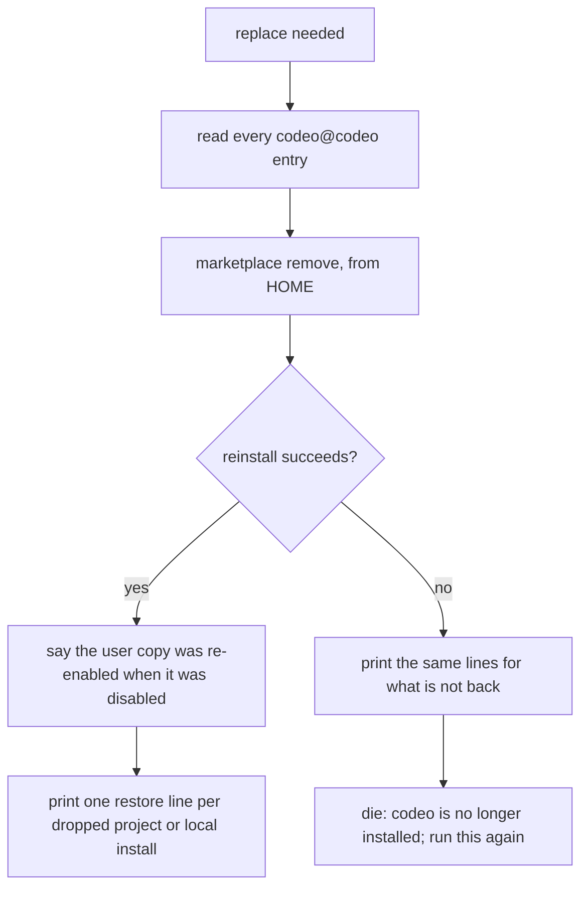

# One-Command Install, Round 4: A Restore Command That Does Not Replace Implementation Plan

> **For agentic workers:** REQUIRED SUB-SKILL: Use superpowers:subagent-driven-development (recommended) or superpowers:executing-plans to implement this plan task-by-task. Steps use checkbox (`- [ ]`) syntax for tracking.

**Goal:** Close `/codeo:qc`'s round 3 for #151: the command the installer prints to restore a dropped project install no longer starts another replace (F19, with F22), and the three small findings the engineer chose to fold in are fixed: dropped installs are named when a replace fails (F20), a user-scope replace says it re-enabled a disabled copy (F21), and a usage error exits 2 whatever else is missing (F23).

**Architecture:** Small, local changes to `install.sh`, `tests/install.test.sh`, `README.md` and `CHANGELOG.md`. The printed restore line for a project install becomes the same kind of command the local line already prints (`claude plugin install codeo@codeo --scope project`), which restores at the machine's version, changes no file and needs no `install.sh` on disk. The dropped-install lines move into a helper that the failure path can call too. Argument parsing moves into the bash-3.2-safe head, ahead of the prerequisite check.

**Tech Stack:** bash 4.3+ (the head: bash 3.2 syntax), jq, the `shell` suite (`bash tests/run.sh`), the stub `claude`; real `claude` 2.1.325 against a throwaway `HOME` and `CLAUDE_CONFIG_DIR` for captured README output.

**Spec:** `.codeo/151/qc.md` round 3 (F19-F23), `.codeo/151/plan.md` Q10-Q11 (answered as recommended), `.codeo/151/init.md`'s criteria. The round-1, round-2 and round-3 plans still bind wherever this one is silent.

## Global Constraints

- **F19 and F22 (qc.md round 3; plan.md Q10): the project restore line is `claude plugin install codeo@codeo --scope project`.** A dropped project-scope entry now reads
  `install: codeo is no longer installed for <projectPath> (project scope, v1.0.6); its .claude/settings.json was not changed; run claude plugin install codeo@codeo --scope project there to restore it`
  The local line is unchanged. Run in the project, the command restores codeo at the version the machine now holds, changes no file, and is not a replace, so it never moves the user's copy or drops another install. The project's committed `ref` is left as the team had it; moving the pin stays a deliberate `install.sh --scope project` run, which *Troubleshooting* already documents (Q9's accepted limit). The line names no `install.sh`, so it works for someone who installed with `curl … | bash`.
- **The restore command is verified for the case that matters.** Task 5's captures run the printed command for real in a project whose committed `ref` is older than the machine's version (the update case) and newer (the downgrade case), and record that `claude plugin list --json` then lists the project entry and `git status --short` is empty. A command that does not hold is changed here, before the README quotes it.
- **F20: the failure path names the dropped installs.** When a reinstall fails after the marketplace was removed, the installer prints the same dropped-install lines, then the existing `install: codeo is no longer installed: …; run this again` line (so the error is the last line, on stderr). The lines cover every project or local entry not back at that point: on a project-scope run that failed before its own project was reinstalled, the current project is named too; once it was reinstalled it is not. The README says the printed commands apply once the run again has finished, because they need the codeo marketplace. A run that fails before the remove prints no dropped line (nothing was dropped).
- **F21: a user-scope replace says it re-enabled a disabled copy.** The `install: codeo <old> -> <tag> (user scope)` line ends `(it was disabled; it is enabled now)` when the user copy had `enabled: false` before the replace, the same words the project-scope moved line uses. An enabled copy's line is unchanged.
- **F23: a usage error exits 2 and `--help` exits 0 whatever else is missing.** Argument parsing (`--help`, `--version`, `--scope`, the usage line and its messages) moves into the head, before the prerequisite check, written in bash-3.2-safe syntax only (regexes held in variables, `case` patterns, no `[[ -v`, associative arrays, `${x,,}`, `mapfile`). `t_head_uses_no_bash4_syntax` keeps guarding it. The header comment's exit-code line is true again. The later `parse_args` and `usage` definitions are removed, not duplicated.
- **README output is captured, never typed**, and every `install:` line in it must be produced by some stubbed scenario (`t_readme_install_blocks_match_the_script` enforces it); the new and changed lines get scenarios.
- **Left as before, on purpose:** F12 and F15 as documented in round 3; the silent gap during a first install; `claude_step`'s temporary files on Ctrl-C; README samples naming `v1.0.7`; the parked limits recorded in `implement.md` round 3 (a `[`-leading notice line, the symlinked checkout string compare, gaps in the head-syntax test's banned list, `vnull` for a missing `.version`).
- **Criterion 6** (the trust prompt) stays the engineer's check at `/codeo:close`. No task runs on the engineer's host; no `Runs on:` marker.
- **Documentation this change moves:** `README.md` (*Updating*, *Uninstalling*, *Troubleshooting*; Task 5) and the `CHANGELOG.md` bullet (Task 5). `CONTRIBUTING.md` and `docs/` are unchanged. No wiki module, no invariants document, no shared environment, no exclusive resource.
- **Other workflows.** #138 also edits `CHANGELOG.md` (answered *proceed and coordinate*): Task 5 edits only this branch's own bullet.
- **Proof of done:** the `shell` suite has no single-test filter, so each task's proof is `bash tests/run.sh` ending `all cases passed`, exit 0; red and green steps use `bash tests/run.sh install`. Run the suite in the foreground (a background job ignores SIGINT and fails the interrupt cases).

## File Structure

| File | Responsibility |
|---|---|
| `install.sh` | the restore line (Task 1), the user-scope disabled note (Task 2), dropped lines on the failure path (Task 3), argument parsing in the head (Task 4) |
| `tests/install.test.sh` | changed and new cases; the stub scenarios behind the README (Tasks 1-5) |
| `README.md` | *Updating*, *Uninstalling*, *Troubleshooting* (Task 5) |
| `CHANGELOG.md` | this branch's bullet (Task 5) |

## Review Focus

- After `install.sh --version v1.0.6` dropped a project, the printed command, run in that project, restores it at 1.0.6, leaves the user copy at 1.0.6 and drops nothing; `git status --short` is empty (Tasks 1 and 5).
- A project-scope replace that fails at the project's own `marketplace add` names the current project as dropped; one that fails only at the user copy's reinstall does not (Task 3).
- `install.sh --bogus` and `install.sh --help` with `jq` and `gh` absent: exit 2 and 0, no prerequisite lines (Task 4).
- A disabled user copy replaced at user scope: enabled afterwards, and the line says so (Task 2).

---

### Task 1: The restore command does not replace (F19, F22)

**Files:** Modify `install.sh`, `tests/install.test.sh`.

**Interfaces:**
- Consumes: `dropped_installs`'s `jq` filter (`install.sh`, the `else "run install.sh --scope project there to restore it"` branch); the test helper at `tests/install.test.sh:700-701` that builds the expected line.
- Produces: the project-scope dropped line ending `run claude plugin install codeo@codeo --scope project there to restore it`.

- [ ] **Step 1: Write the failing test.** Change the expected-line helper (`tests/install.test.sh:700`) so its project `tail` is `run claude plugin install codeo@codeo --scope project there to restore it`, and add `t_restore_line_is_not_a_replace`: a stubbed user-scope run with `--version` at an older tag drops project A, and the line for A contains `claude plugin install codeo@codeo --scope project` and does not contain `install.sh`. Register it in `cases`.
- [ ] **Step 2: Run** `bash tests/run.sh install` — Expected: FAIL (the helper's cases and the new case, the line still says `install.sh --scope project`; `t_readme_install_blocks_match_the_script` and `t_readme_names_the_restore_command` also go red until Task 5, as in round 3).
- [ ] **Step 3: Implement.** In `dropped_installs`, replace the project branch's `run install.sh --scope project there to restore it` with `run claude plugin install codeo@codeo --scope project there to restore it`. Update the comment above `dropped_installs` and the header comment, which still say "the command that restores it" generically (they stay true).
- [ ] **Step 4: Proof** `bash tests/run.sh install` — Expected: only `t_readme_install_blocks_match_the_script` and `t_readme_names_the_restore_command` fail (Task 5 re-captures the README); every other case passes.
- [ ] **Step 5: Commit** `git add install.sh tests/install.test.sh && git commit -m "fix(install): the restore command for a project install is not a replace (#151)"`

### Task 2: A disabled user copy at user scope (F21)

**Files:** Modify `install.sh`, `tests/install.test.sh`.

**Interfaces:**
- Consumes: `replace_codeo`'s `user_e` entry (`<version> <enabled> <id>`) and the `say "codeo $old -> $tag ($scope scope)"` line.
- Produces: the `(user scope)` line with the disabled suffix.

- [ ] **Step 1: Write the failing tests.** `t_user_replace_says_the_disabled_copy_is_enabled`: the stub's user entry has `enabled: false`; the run's line is `install: codeo v1.0.6 -> v1.0.7 (user scope) (it was disabled; it is enabled now)` (the exact old/new labels the existing user-scope replace test uses). `t_user_replace_of_an_enabled_copy_says_nothing_more`: with `enabled: true` the line is exactly as today. Register both.
- [ ] **Step 2: Run** `bash tests/run.sh install` — Expected: FAIL (the first).
- [ ] **Step 3: Implement.** In `replace_codeo`, when `$scope` is `user`, read `user_on` from `$user_e` before the remove and append ` (it was disabled; it is enabled now)` to the `codeo $old -> $tag (user scope)` line when it is `false`. Reuse the project-scope branch's `read -r _ user_on _ <<<"$user_e"` rather than a second parse.
- [ ] **Step 4: Proof** `bash tests/run.sh install` — Expected: only the two Task 1 README cases still fail; everything else passes.
- [ ] **Step 5: Commit** `git add install.sh tests/install.test.sh && git commit -m "fix(install): a user-scope replace says it re-enabled a disabled copy (#151)"`

### Task 3: The failure path names what was dropped (F20)

**Files:** Modify `install.sh`, `tests/install.test.sh`.

**Interfaces:**
- Consumes: `dropped_installs` (reads the list and filters the current project on a project-scope run), `replace_codeo`, `replace_failed <output> <user entry> <restored scopes> <failing scope>`.
- Produces: `dropped_installs` takes one argument, `skip_own` (`1`: leave out the current project's own project-scope entry, as today; `0`: keep it). `replace_codeo` calls it once, before the remove, with `1` on the success path's list and a second list with `0` for the failure path (both read before the remove, since it empties the list), and passes the failure list to `replace_failed` as a fifth argument. `replace_failed` prints it line by line with `say`, before its `die`; on a project-scope run whose project was already reinstalled (`$3` is `project`) the failure list is the `skip_own=1` one.

- [ ] **Step 1: Write the failing tests.** `t_replace_failure_names_the_dropped_installs` (user-scope run, project A installed, `marketplace add` fails after the remove): stdout holds A's dropped line, stderr ends `install: codeo is no longer installed: <the stub's failure line>; run this again`, exit 1. `t_project_replace_failure_names_the_current_project_too` (a `--scope project` run in A whose project-scope `marketplace add` fails, project B also installed): both A and B are named. `t_project_replace_failure_after_the_project_names_only_the_others` (the user copy's reinstall fails after A was reinstalled): only B is named. `t_failure_before_the_remove_names_nothing` (the `plugin list` call fails): no dropped line. Register all.
- [ ] **Step 2: Run** `bash tests/run.sh install` — Expected: FAIL (the first three).
- [ ] **Step 3: Implement** as under Interfaces. The dropped lines go to stdout (`say`), the die line to stderr as now, so the error stays the last line a terminal shows.
- [ ] **Step 4: Proof** `bash tests/run.sh install` — Expected: only the two Task 1 README cases still fail.
- [ ] **Step 5: Commit** `git add install.sh tests/install.test.sh && git commit -m "fix(install): a failed replace still names the installs it dropped (#151)"`

### Task 4: A usage error exits 2 whatever else is missing (F23)

**Files:** Modify `install.sh`, `tests/install.test.sh`.

**Interfaces:**
- Consumes: `usage_text`, `usage`, `parse_args`, `want_version` and `scope` (defined after `set -euo pipefail` today), the head's `missing` check.
- Produces: the same names defined in the head, bash-3.2-safe, called as `parse_args "$@"` before the prerequisite check; `main` no longer calls `parse_args`.

- [ ] **Step 1: Write the failing tests.** `t_usage_error_wins_over_a_missing_prerequisite` (`PATH` without `jq` and `gh`, `--bogus`): exit 2, stderr has `unknown option: --bogus` and the usage line, no `is not installed` line. `t_help_works_without_the_prerequisites` (same `PATH`, `--help`): exit 0, the usage line on stdout. `t_prerequisites_still_checked_after_good_arguments` (same `PATH`, `--scope user`): exit 1, names `jq` and `gh`. `t_head_uses_no_bash4_syntax` is unchanged and must still pass with the larger head. Register the three.
- [ ] **Step 2: Run** `bash tests/run.sh install` — Expected: FAIL (the first two).
- [ ] **Step 3: Implement.** Move `usage_text`, `want_version`, `scope`, `usage` and `parse_args` above the prerequisite check and call `parse_args "$@"` there. Write them in bash-3.2-safe syntax: the version regex goes in a variable (`re='^v?[0-9]+\.[0-9]+\.[0-9]+$'; [[ $2 =~ $re ]]`), no `local` outside a function, no `[[ -v`. `die` and `say` stay where they are (the head prints with `printf`). Delete the old definitions; update the header comment if it names the order.
- [ ] **Step 4: Proof** `bash tests/run.sh install` — Expected: only the two Task 1 README cases still fail.
- [ ] **Step 5: Commit** `git add install.sh tests/install.test.sh && git commit -m "fix(install): a usage error exits 2 before the prerequisite check (#151)"`

### Task 5: README and CHANGELOG say it (F19-F22)

**Files:** Modify `README.md`, `CHANGELOG.md`, `tests/install.test.sh`.

**Interfaces:**
- Consumes: Tasks 1-4's final lines; the helpers `readme_install_blocks` and `scenario_lines`; the existing scenarios `user-replace-two-projects` and `project-replace-other-project`.
- Produces: a stub scenario for a failed replace that names a dropped project and one for a disabled user copy replaced at user scope, so every new `install:` line in the README is produced by a scenario.

- [ ] **Step 1: Write the failing tests.** Add the two scenarios to `scenario_lines`; extend `t_readme_names_the_restore_command` to require `claude plugin install codeo@codeo --scope project` and forbid `install.sh --scope project there`; add `t_readme_restore_blocks_do_not_replace` (no README block after a dropped-install line runs the installer to restore it). Run `bash tests/run.sh install` — Expected: FAIL.
- [ ] **Step 2: Capture** with real `claude` and a throwaway `HOME` and `CLAUDE_CONFIG_DIR` (scratch git repositories, deleted afterwards), recording commands and output for `implement.md`: (a) a project pinned at `v1.0.7` with the machine downgraded to `v1.0.6` by a user-scope `--version v1.0.6` run, then the printed restore command in the project; (b) a project pinned at `v1.0.6` with the machine updated to `v1.0.7`, then the printed restore command in the project; for each, `claude plugin list --json` and `git status --short`; (c) a failed replace that names a dropped project (a wrapper that fails `plugin marketplace add`), then the re-run. A command that does not restore the install is a stop: report it in the outcome rather than document it.
- [ ] **Step 3: Rewrite from the captures.** *Updating*: the project restore block becomes the `claude plugin install codeo@codeo --scope project` run (no `curl | bash`, no settings change, `git status` clean); say the project's committed `ref` is unchanged and that moving the pin is a separate `install.sh --scope project` run; the two printed dropped lines in the sample blocks use the new form; one sentence on the failure path (the lines are printed before the error and apply once the run again has finished). *Uninstalling*: the sentence naming "a restore command for each" stays true; check it. *Troubleshooting*'s hand-edited-`ref` entry is unchanged. Re-capture the sample blocks whose lines changed.
- [ ] **Step 4: Reword this branch's `CHANGELOG.md` bullet only:** a replace names every project and local install it dropped with the command that restores it, a project install's restore command being `claude plugin install codeo@codeo --scope project`, which changes no file; it names them on a failed replace too. The header lines stay as they are. Nothing else in the file changes.
- [ ] **Step 5: Run** `bash tests/run.sh install` — Expected: PASS.
- [ ] **Step 6: Proof** `bash tests/run.sh` — Expected: ends `all cases passed`, exit 0; `git diff origin/main -- CHANGELOG.md` shows one added bullet and no removed line.
- [ ] **Step 7: Commit** `git add README.md CHANGELOG.md tests/install.test.sh && git commit -m "docs: README and changelog give a restore command that does not replace (#151)"`
