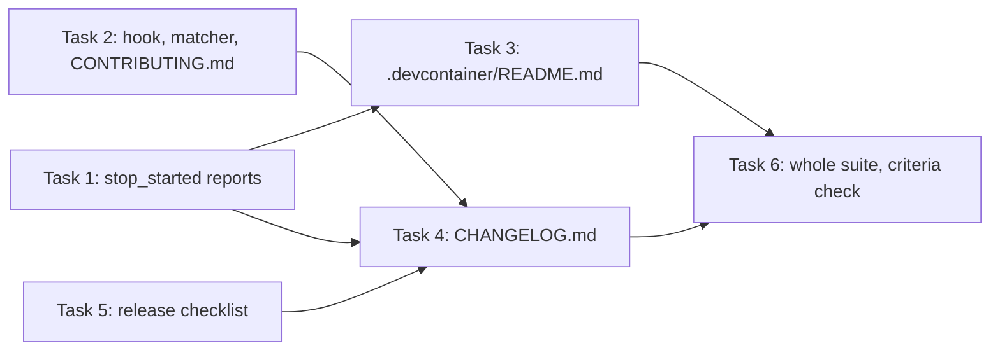

# Close the #161 leftovers (#173) Implementation Plan

> **For agentic workers:** REQUIRED SUB-SKILL: Use superpowers:subagent-driven-development (recommended) or superpowers:executing-plans to implement this plan task-by-task. Steps use checkbox (`- [ ]`) syntax for tracking.

**Goal:** Every statement #161 left in `docs/release-checklist.md`, `CHANGELOG.md` and `.devcontainer/README.md` is true on every path the code takes, a refused `codeo rm` says so when it cannot stop a container it started, and the `SessionStart` install hook is documented, tested and agrees with `install.sh`.

**Architecture:** Two small behaviour changes, each test-first, then the documentation that describes them. `stop_started` in `.devcontainer/codeo` prints one stderr line when `docker stop` fails. `.claude/hooks/session-start.sh` decides whether to skip from `claude plugin list --json`, as `install.sh` does, and its `SessionStart` group gains a matcher. The remaining tasks are wording, each checked against the code before it is written.

**Tech Stack:** bash, `jq`, the repository's `tests/*.test.sh` harness (`bash tests/run.sh`), Markdown and Mermaid.

**Spec:** `.codeo/173/init.md` (`## Outcome`: the eight acceptance criteria) and `.codeo/173/plan.md` (Q1-Q3 and their answers).

## Global Constraints

- Out of scope, from the issue: redesigning the `codeo rm` check or its restart; removing the hook.
- `codeo rm`'s exit statuses and its existing refusal lines do not change. The only new output is the line in Task 1.
- The exact new line is `codeo: could not stop codeo-<N> again; it is left running`, on stderr.
- The hook's matcher is exactly `startup|resume|fork`, the value the session-title group in the same file carries.
- Neither the hook's comment nor any page claims when `/codeo:*` commands load in a hosted session (Q3: not known). The README's sentence "Claude Code sessions that are already open need a restart to load the plugins" is not edited.
- Released changelog sections (`## v1.0.9`, `## v1.0.8`) are corrected in place and the correction is named under `## Unreleased`. The GitHub release notes and the tags are not touched.
- Line numbers in this plan are those of the branch at `ba13656`; find the text by its quoted words if they have moved.
- There is no invariants document, no shared environment and no `wiki` module: no task carries a lease marker, and every task runs in this checkout. No task runs on the engineer's host.
- Documentation the change moves: `.devcontainer/README.md` (Task 3), `CONTRIBUTING.md` (Task 2), `docs/release-checklist.md` (Task 5), `CHANGELOG.md` (Task 4). No page under `docs/` other than the checklist describes `stop_started` or the hook.
- Proof of done for every task is the `shell` suite, `bash tests/run.sh`, ending `all cases passed` (the suite has no single-test filter). `bash tests/run.sh <pattern>` runs one file while iterating.
- Commit after each task, staging the task's files by name.

## Review Focus

Conditions the issue implies that are most likely to bite, each pinned by a test in the task that owns the code:

1. `docker stop` fails after a *dirty* read as well as after a check that could not run: the line is printed on both refusals (Task 1).
2. `docker stop` succeeds, or the container was already running: the new line is never printed (Task 1).
3. `claude plugin list --json` prints notice lines around the array, or fails: the hook does not skip on text it could not parse; it runs `install.sh`, which reports the fault itself (Task 2).
4. A plugin is installed only at project scope, or installed and disabled: not a skip, because `install.sh` (user scope) would install or enable it (Task 2).
5. `CLAUDE_CODE_REMOTE` unset: the hook calls neither `claude` nor `install.sh` (Task 2).

## File Structure

| File | Change |
|---|---|
| `.devcontainer/codeo` | `stop_started` reports a failed stop; two comments |
| `tests/codeo-command.test.sh` | `stop_fail` in the docker stub; one new case |
| `.claude/hooks/session-start.sh` | skip check from `plugin list --json`; header comment |
| `.claude/settings.json` | `matcher` on the second `SessionStart` group |
| `tests/session-start-hook.test.sh` | new: the hook against a stub `claude` and a stub `install.sh` |
| `tests/live-signal.test.sh` | asserts the matcher |
| `CONTRIBUTING.md` | new `## Hosted sessions` section |
| `.devcontainer/README.md` | flowchart edges, node `Q`, two paragraphs |
| `CHANGELOG.md` | `## Unreleased` bullets; v1.0.9 #154 bullet; v1.0.8 `Shared state:` line |
| `docs/release-checklist.md` | step 6 |



---

### Task 1: `stop_started` reports a failed `docker stop`

**Files:**
- Modify: `.devcontainer/codeo:475-480` (`stop_started`), `:516-518` (the `container_check` header comment)
- Test: `tests/codeo-command.test.sh` (`rm_stubs` at `:860`, its comment at `:853-859`, the `cases` list near `:2245`)

**Interfaces:**
- Produces: the stderr line `codeo: could not stop codeo-<N> again; it is left running`, which Tasks 3 and 4 quote.

- [ ] **Step 1: Let the docker stub fail a stop.** In `rm_stubs`, add the arm `stop) [[ ! -e "$d/stop_fail" ]] || exit 1 ;;` beside `start)` and `restart)`, and add "docker stop fails when stop_fail exists" to the comment above `rm_stubs`.

- [ ] **Step 2: Write the failing test** `t_rm_reports_a_failed_stop`, after `t_rm_inspect_fails_stops_started_container`, and add it to `cases` after that name.

```bash
t_rm_reports_a_failed_stop() {
    local line='codeo: could not stop codeo-5 again; it is left running'
    # the check cannot run, the stop fails
    cm_setup "$current"
    rm_stubs
    echo exited >"$cm_dir/dstate"
    touch "$cm_dir/prfetch_fail" "$cm_dir/stop_fail"
    cm_run rm 5 --container
    expect_refused 'could not check'
    grep -q '^docker stop codeo-5' "$cm_dir/calls" || fail "cannot-check: no docker stop"
    [[ $(head -n 1 <<<"$cm_err") == "$line" ]] || fail "cannot-check: first stderr line: $cm_err"
    [[ -z "$cm_out" ]] || fail "cannot-check: stdout: $cm_out"
    # a dirty read, the stop fails
    cm_setup "$current-2"
    rm_stubs
    echo exited >"$cm_dir/dstate"
    touch "$cm_dir/inspect_fail" "$cm_dir/stop_fail"
    printf 'abc1234\n' >"$cm_dir/g_rev-list"
    cm_run rm 5
    expect_refused 'holds work that exists only there'
    [[ $(head -n 1 <<<"$cm_err") == "$line" ]] || fail "dirty: first stderr line: $cm_err"
    # the stop succeeds: no line
    cm_setup "$current-3"
    rm_stubs
    echo exited >"$cm_dir/dstate"
    touch "$cm_dir/prfetch_fail"
    cm_run rm 5 --container
    expect_refused 'could not check'
    ! grep -qF 'could not stop' <<<"$cm_err" || fail "stop ok: $cm_err"
    # a running container is never stopped, so nothing to report
    cm_setup "$current-4"
    rm_stubs
    touch "$cm_dir/prfetch_fail" "$cm_dir/stop_fail"
    cm_run rm 5 --container
    expect_refused 'could not check'
    ! grep -q '^docker stop' "$cm_dir/calls" || fail "running: stopped"
    ! grep -qF 'could not stop' <<<"$cm_err" || fail "running: $cm_err"
}
```

- [ ] **Step 3: Run it and see it fail.**

Run: `bash tests/run.sh codeo-command`
Expected: `=== FAIL: codeo-command.test.sh`, naming `t_rm_reports_a_failed_stop` with `cannot-check: first stderr line:`.

- [ ] **Step 4: Change `stop_started <name> <started>`** in `.devcontainer/codeo`. When `<started>` is non-zero and `docker stop "$1"` fails, print `codeo: could not stop $1 again; it is left running` to stderr; still return 0 in every case. It must write to stderr, never stdout: `cmd_rm` captures `container_check`'s stdout as the report. Rewrite the comment above it to "…so a refusal leaves it as found; a failing stop is reported on stderr and changes nothing else", and in the `container_check` header comment add "a stop that fails is reported" to the sentence "When it returns non-zero it stops again a container it knows it started".

- [ ] **Step 5: Proof of done.**

Run: `bash tests/run.sh`
Expected: last line `all cases passed`.

- [ ] **Step 6: Commit.**

```bash
git add .devcontainer/codeo tests/codeo-command.test.sh
git commit -m "fix(codeo): a refused codeo rm says when it cannot stop the container it started (#173)"
```

---

### Task 2: the install hook's skip check, its matcher and its page

**Files:**
- Modify: `.claude/hooks/session-start.sh`, `.claude/settings.json` (second `SessionStart` group), `tests/live-signal.test.sh:265`, `CONTRIBUTING.md`
- Create: `tests/session-start-hook.test.sh`

**Interfaces:**
- Consumes: `claude plugin list --json`, an array of `{id, version, scope, enabled, projectPath}`, possibly with notice lines before and after it (`install.sh:185-196` reads it the same way).
- Produces: the skip rule, which Task 4's changelog bullet states: skip only when `codeo@codeo` and some `superpowers@*` are each installed at user scope and not disabled.

- [ ] **Step 1: Write the failing test file** `tests/session-start-hook.test.sh`, in the style of `tests/live-signal.test.sh` (header comment, `set -euo pipefail`, `assert_eq`, a `case_desc` per case, a scratch directory removed on exit, `all cases passed` at the end, exit 1 on any failure). Its fixtures:
  - a scratch project directory used as `CLAUDE_PROJECT_DIR`, holding a stub `install.sh` that appends `ran` to `$STUB/install-calls`;
  - a stub `claude` first on `PATH` that appends its arguments to `$STUB/claude-calls` and, for `plugin list`, exits 1 when `$STUB/list-fail` exists, else prints `$STUB/list-pre` (when present), `$STUB/list.json`, then `$STUB/list-post` (when present);
  - `run_hook <remote>`: resets both call files and runs `bash .claude/hooks/session-start.sh` from the repository with `CLAUDE_CODE_REMOTE` set to `<remote>` or unset for `unset`; records the exit status.

  The cases, each asserting the exit status is 0 and whether `install.sh` ran (`yes`/`no`):

  | `case_desc` | `list.json` entries (`id` / `scope` / `enabled`) | install ran |
  |---|---|---|
  | `not_remote_does_nothing` (remote `unset`; also asserts `claude` was not called) | both, user, true | no |
  | `both_enabled_skips` | `codeo@codeo` user true; `superpowers@superpowers-marketplace` user true | no |
  | `superpowers_from_another_marketplace_skips` | `codeo@codeo` user true; `superpowers@elsewhere` user true | no |
  | `notices_around_the_list_still_skip` (`list-pre` = `Checking for updates`, `list-post` = `done`) | both, user, true | no |
  | `codeo_disabled_installs` | `codeo@codeo` user false; superpowers user true | yes |
  | `superpowers_disabled_installs` | `codeo@codeo` user true; superpowers user false | yes |
  | `codeo_missing_installs` | superpowers user true | yes |
  | `superpowers_missing_installs` | `codeo@codeo` user true | yes |
  | `project_scope_only_installs` | `codeo@codeo` project true; superpowers user true | yes |
  | `a_look_alike_id_does_not_count` | `codeo@codeo` user true; `superpowers-extras@x` user true | yes |
  | `list_failure_installs` (`list-fail`) | both, user, true | yes |
  | `unparsable_list_installs` (`list.json` = `not json`) | n/a | yes |

- [ ] **Step 2: Add the failing matcher assertion** in `tests/live-signal.test.sh`, after the `SessionStart groups` assertion at `:265`:

```bash
assert_eq "install hook matcher" 'startup|resume|fork' "$(jq -r '.hooks.SessionStart[1].matcher' "$s")"
```

- [ ] **Step 3: Run both and see them fail.**

Run: `bash tests/run.sh session-start-hook` then `bash tests/run.sh live-signal`
Expected: the first fails at least `superpowers_from_another_marketplace_skips` and `codeo_disabled_installs`; the second fails `install hook matcher: want [startup|resume|fork] got [null]`.

- [ ] **Step 4: Rewrite the skip check** in `.claude/hooks/session-start.sh`. Keep `set -euo pipefail`, the `CLAUDE_CODE_REMOTE` guard, the `cd`, and the final `bash install.sh`. Replace the two `grep`s with one test on `claude plugin list --json`: take the text from the first line that starts with `[`, read the first JSON array from it with `jq`, and skip (exit 0) only when it holds an entry with `.id == "codeo@codeo"` and an entry whose `.id` starts with `superpowers@`, each with `.scope == "user"` and `.enabled != false`. A failing `claude`, a missing `jq` or unparsable output is not a skip: fall through to `bash install.sh`. Replace the header comment with:

```bash
# Install the codeo and superpowers plugins in a cloud session when either is missing or disabled
# at user scope, by running install.sh. Cloud sessions only (CLAUDE_CODE_REMOTE=true); skipped when
# both are installed and enabled, read from `claude plugin list --json` as install.sh reads it.
# What the session then lists is described in CONTRIBUTING.md → Hosted sessions.
```

- [ ] **Step 5: Add the matcher.** In `.claude/settings.json`, give the second `SessionStart` group (the one whose command runs `.claude/hooks/session-start.sh`) `"matcher": "startup|resume|fork"` as its first key. Nothing else in the file changes.

- [ ] **Step 6: Document it.** Add `## Hosted sessions` to `CONTRIBUTING.md`, after `## Dev container`. It says, in the page's plain style:
  - this repository's `.claude/settings.json` runs `.claude/hooks/session-start.sh` at `SessionStart`, only in a hosted session (`CLAUDE_CODE_REMOTE=true`) and only when a session starts, resumes or forks, not on `clear` or `compact`;
  - the hook runs `install.sh` (the latest release, user scope) unless `codeo@codeo` and a `superpowers` plugin from any marketplace are both installed and enabled at user scope; a disabled one is enabled by `install.sh`;
  - a failed install does not stop the session (the command ends `|| true`) and is bounded at 300 seconds;
  - if `/codeo:*` commands are not listed after the hook ran, start a new session; link the README's sentence that sessions already open need a restart to load the plugins;
  - `tests/session-start-hook.test.sh` covers the skip rule.

- [ ] **Step 7: Proof of done.**

Run: `bash tests/run.sh`
Expected: last line `all cases passed`.

- [ ] **Step 8: Commit.**

```bash
git add .claude/hooks/session-start.sh .claude/settings.json tests/session-start-hook.test.sh tests/live-signal.test.sh CONTRIBUTING.md
git commit -m "fix: the hosted-session install hook skips as install.sh does and no longer runs on clear or compact (#173)"
```

---

### Task 3: `.devcontainer/README.md` holds when `docker ps -a` fails

**Files:**
- Modify: `.devcontainer/README.md:197` (paragraph "A container that was running is read a second time"), `:201` (paragraph "Before the check above reads or restarts anything"), `:209` and `:214-216` (flowchart)

**Interfaces:**
- Consumes: Task 1's line, quoted verbatim.

The code this text describes is `container_check` (`.devcontainer/codeo:522-551`): `started` is 1 only when `docker ps -a` worked and listed the container as not running; when the listing failed, `codeo` runs `docker start` anyway and `started` stays 0, so the container is treated exactly like one that was running (restarted and read twice, never stopped on a refusal).

- [ ] **Step 1: The paragraph at `:197`.** Replace its first sentence's subject "A container that was running" with "A container `codeo` does not know it started (one that was running, or any container when `docker ps -a` failed, because `codeo` then cannot tell)". Replace "A container that `codeo` started itself is read once." with "A container `codeo` knows it started is read once." Leave the rest of the paragraph.

- [ ] **Step 2: The paragraph at `:201`.** After "A container `codeo` knows it started for that read is stopped again, so the refusal leaves it as it found it", add that when that `docker stop` fails `codeo` prints `codeo: could not stop codeo-<N> again; it is left running` and the refusal is otherwise unchanged. Keep the parenthesis about a failed `docker ps -a`.

- [ ] **Step 3: The flowchart.** Change three edge labels and node `Q`, nothing else:
  - `"clean, started by codeo"` becomes `"clean, codeo knows it started it"`;
  - `"clean, was running, inspect failed, no --force: no restart"` becomes `"clean, not known to be started by codeo, inspect failed, no --force: no restart"`;
  - `"clean, was running, inspect ok or --force"` becomes `"clean, not known to be started by codeo, inspect ok or --force"`;
  - node `Q`'s parenthesis becomes `(a container codeo knows it started for the read is stopped again, or reported as left running when the stop fails)`.

- [ ] **Step 4: Check nothing else says it.**

Run: `grep -rn "was running\|started itself" .devcontainer/README.md README.md docs/*.md`
Expected: no line that describes `codeo rm`'s restart or stop. A hit about something else is left alone.

- [ ] **Step 5: Proof of done.**

Run: `bash tests/run.sh`
Expected: last line `all cases passed` (a test that pins the old wording is updated to the new wording, not deleted).

- [ ] **Step 6: Commit.**

```bash
git add .devcontainer/README.md
git commit -m "docs: the codeo rm flowchart and paragraphs hold when docker ps -a fails (#173)"
```

---

### Task 4: `CHANGELOG.md`

**Files:**
- Modify: `CHANGELOG.md` (`## Unreleased`; the #154 bullet under `## v1.0.9` at `:27`; the `Shared state:` line under `## v1.0.8` at `:33`)

**Interfaces:**
- Consumes: Task 1's line, Task 2's skip rule and matcher, Task 5's checklist change.

- [ ] **Step 1: The v1.0.9 #154 bullet.** Replace its first sentence, "A refused `codeo rm` stops a container it started for the read, after a failed `docker inspect` without `--force`.", with: "A refused `codeo rm` stops a container it knows it started for the read, after a failed `docker inspect` without `--force`; a container it started when `docker ps -a` failed is left running, and a failing `docker stop` was ignored until #173." The rest of the bullet stays.

- [ ] **Step 2: The v1.0.8 `Shared state:` line.** Replace the clause "`scripts/dossier-check.sh`, `scripts/inflight.sh` and `scripts/qc-verdict.sh` match `## Outcome` exactly, so `## Outcomes` and `## Outcome notes` no longer count" with: "`scripts/inflight.sh` and `scripts/qc-verdict.sh` match `## Outcome` exactly, so `## Outcomes` and `## Outcome notes` no longer count there, and `scripts/dossier-check.sh` does too, where `## Outcomes` never counted and `## Outcome notes` no longer does". Before writing it, confirm against the tag:

Run: `git show v1.0.7:scripts/dossier-check.sh | grep -n 'index($3, name " ")'` and `git show v1.0.7:scripts/inflight.sh scripts/qc-verdict.sh | grep -c '/^## Outcome/'`
Expected: one line from the first (the heading, or the heading plus a space, matched); a non-zero count from the second.

- [ ] **Step 3: `## Unreleased`.** Leave its three header lines as they are and add three bullets after the #171 bullet, each ending `(#173)`:
  - a refused `codeo rm` that cannot stop a container it started prints `codeo: could not stop codeo-<N> again; it is left running`; exit statuses and the other lines are unchanged;
  - this repository's hosted-session hook: `.claude/hooks/session-start.sh` runs `install.sh` at `SessionStart` in a hosted session when `codeo@codeo` or a `superpowers` plugin from any marketplace is missing or disabled at user scope; it was added with #161 without an entry; it now runs only on `startup`, `resume` and `fork`, and `CONTRIBUTING.md` describes it; adopters' projects are not affected;
  - corrections to text: the v1.0.9 #154 bullet and the v1.0.8 `Shared state:` line below were corrected, the `.devcontainer/README.md` removal flowchart and paragraphs hold when `docker ps -a` fails, and release checklist step 6 says which examples and stubs move.

- [ ] **Step 4: Proof of done.**

Run: `bash tests/run.sh`
Expected: last line `all cases passed`.

- [ ] **Step 5: Commit.**

```bash
git add CHANGELOG.md
git commit -m "docs: changelog entries for #173 and two corrected released entries"
```

---

### Task 5: release checklist step 6

**Files:**
- Modify: `docs/release-checklist.md:74-76` (the first sentence of step 6)

- [ ] **Step 1: Confirm the three groups** against the files as they stand (the release in them today is `v1.0.9`, the one before it `v1.0.8`):

Run: `grep -o "v[0-9][0-9.]*[-a-z0-9]*" tests/install.test.sh | sort | uniq -c` and `grep -n "v1\.0\.[0-9]" README.md`
Expected: in the test, `v1.0.9` (the latest release) and `v1.0.8` (an older release installed, pinned or asked for) in bulk, and a handful of `v1.0.5`, `v1.0.10`, `v1.0.9.1`, `v2.0.0-rc1`, `v9.9.9`, `v1.0`; in the README, `v1.0.9` in the transcripts, the `ref` and the `marketplace add` example, and `v1.0.8` in the `--version` example and on the left of `codeo v1.0.8 -> v1.0.9`. If a version appears in a role not listed here, put it in the group its role belongs to and say so in the commit message.

- [ ] **Step 2: Rewrite the sentence.** In place of "in the installer examples in `README.md` and in the stubs of `tests/install.test.sh`, which move to the latest release", step 6 says:
  - **move to the release being cut:** `.claude-plugin/plugin.json`'s version; in `README.md`, the installer transcripts, the `ref` in the settings example and the `marketplace add` example; in `tests/install.test.sh`, the stubs that stand for the latest release;
  - **move to the release before it:** in `README.md`, the `--version` example and the left side of the `codeo vA -> vB` replace line; in `tests/install.test.sh`, the stubs that stand for an older release that is installed, pinned or asked for;
  - **do not move:** the test's stubs that only order tags or are refused (`v1.0.5`, `v1.0.10`, `v1.0.9.1`, `v2.0.0-rc1`, `v9.9.9`, `v1.0`), unless the release being cut is one of them, in which case that stub takes the next higher version.

  Keep the parenthesis about `marketplace.json`, the `CHANGELOG.md` retitle and everything after it. A numbered step may hold a short list; keep the code blocks' indentation.

- [ ] **Step 3: Proof of done.**

Run: `bash tests/run.sh`
Expected: last line `all cases passed`.

- [ ] **Step 4: Commit.**

```bash
git add docs/release-checklist.md
git commit -m "docs: release checklist step 6 says which examples and stubs move (#173)"
```

---

### Task 6: the whole suite and the acceptance criteria

**Files:** none changed, unless a check below fails.

- [ ] **Step 1: Run the suite once more on the finished branch.**

Run: `bash tests/run.sh`
Expected: last line `all cases passed`. A failure is compared with the parent of Task 1's commit before it is called this change's.

- [ ] **Step 2: Check each acceptance criterion in `.codeo/173/init.md` against the diff**, in order: checklist step 6 (Task 5); the v1.0.8 line (Task 4 Step 2); the flowchart and paragraph (Task 3); the #154 bullet (Task 4 Step 1); the failed stop reported and pinned by `t_rm_reports_a_failed_stop` (Task 1); the hook's changelog bullet (Task 4 Step 3); the skip check and the matcher (Task 2 Steps 4-5); the comment and the README agree, since neither says when the commands load (Task 2 Steps 4 and 6).

Run: `grep -n "so /codeo" .claude/hooks/session-start.sh`
Expected: no output.
