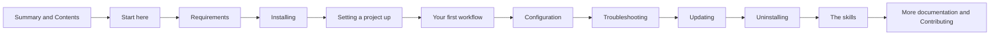

# Make the README a complete, easy-to-follow guide (#171) Implementation Plan

> **For agentic workers:** REQUIRED SUB-SKILL: Use superpowers:subagent-driven-development (recommended) or superpowers:executing-plans to implement this plan task-by-task. Steps use checkbox (`- [ ]`) syntax for tracking.

**Goal:** a first-time user in a new project can follow the root `README.md` from install to a merged pull request, find every `.codeo/config.json` key the plugin reads, and get unstuck from a role-guard refusal, a stuck or foreign lock, an interrupted step and a card that is not Ready; and every command, path and link the README names exists.

**Architecture:** documentation plus tests, no behavior change. A new guard test (`tests/readme.test.sh`, Task 1) fails first and goes green as the README is rewritten. Two blocks of reference detail move out so the README reads in order: the replace-and-restore text and its installer samples to `docs/updating.md` (Task 2, with `tests/install.test.sh` retargeted), and the home-checkout, guard and tracking-comment text to `docs/home-checkout.md` (Task 3). Tasks 4-8 rewrite the README section by section.

**Tech Stack:** Markdown, bash; the `shell` suite (`bash tests/run.sh`, or one file with `bash tests/run.sh <name>`, the name matched as a substring of the file name; the suite has no `filter`).

**Spec:** `.codeo/171/init.md` `## Outcome` (the issue's acceptance criteria) and `.codeo/171/plan.md` Q1-Q5, whose answers are the design. Reference doc: none.

## Global Constraints

- **Q1 (A):** `docs/updating.md` takes the update, replace, restore and failure walk-throughs with their captured installer output. `README.md` keeps the common path: the plain install with its output, the re-run output, `claude plugin list`, and the `--version` and `--scope project` forms with the project snippet (the first ```` ```json ```` block of the README, which `t_project_scope_writes_the_readme_snippet` reads, stays the project snippet).
- **Q2 (A):** `docs/home-checkout.md` takes *The home checkout*, *The guard* and *The tracking comment* word for word (including the role table and the tracking example); the README keeps a two-sentence summary and a link.
- **Q3 (A):** the README carries one *Configuration* table of every key the plugin reads, plus a starter example (what `/codeo:setup` writes) and a fuller one.
- **Q4 (A):** the role-guard entry opens by saying the guard is the project's own (this repository's `.codeo/overlays/<skill>.md` `role-guard` sections and `.devcontainer/scripts/role.sh`) and that a project set up with `/codeo:setup` has none, so is never refused. The adoption gap is a separate issue, promised in `plan.md`'s `## Notes`; this plan documents no adoption procedure.
- **Q5 (A):** the lock entry recommends only what the skills and `docs/handoff.md` say: run the step again, `/codeo:close` or `/codeo:close --stash`, `lock.sh take local`, never switch branches to make a lock true. It never says to delete `.codeo/active`.
- **Every command the README names is one the repo has.** A slash command is a directory under `skills/`; a path is a file or directory in the repository; a config key is read somewhere in `scripts/`, `lib/`, `hooks/`, `skills/` or `.devcontainer/` (the one exception, `stacks`, is written by `setup.sh` and is labelled as read by nothing). Task 1 checks this mechanically.
- **Plugin scripts are not typed by the reader.** `${CLAUDE_PLUGIN_ROOT}` is set only inside Claude Code, so the README says "run `/codeo:close`" and names `lock.sh take local` only as what the skill's own message tells the reader to do.
- **Worked example:** issue #143, archived at `.codeo/done/143/` (`init.md`, `plan.md`, `implement.md`, `qc.md`, `close.md`, `issue.md`).
- **Version tags in captured output stay v1.0.9**; the stubbed-run pins compare them. The release checklist bumps them.
- **Not changed:** how any script or skill behaves; `.devcontainer/README.md`; `docs/skills.md`; the `codeo` host command and macOS notes (#170); `docs/handoff.md:3` ("Seven pipeline skills", noted for its own issue).
- **A mutation is a proof.** Where a step says "mutate", change the file, run the stated command, see the stated failure, and revert with `git checkout -- <file>` straight after; no mutation is committed.
- **Documentation moves** (the plan changes documentation only, so each page is a task): `README.md` (Tasks 4-8), `docs/updating.md` (Task 2), `docs/home-checkout.md` (Task 3), `CHANGELOG.md` `## Unreleased` (Task 8). No page under `docs/` or the wiki describes behavior that changes; nothing links into a README section by anchor (checked: no `README.md#` anywhere).
- **No environment, no lease, no host tasks.** No shared environment, wiki module, invariants document or exclusive resource is configured; every task runs in this checkout and none carries `Needs lease:` or `Runs on:`.
- **Invariants:** none configured.
- **Footprint check (step 8):** `inflight.sh --except 171` lists #170 (`docs/docs-say-codeo-host-command`, step `init`, no footprint, nothing changed). The issue says #170 edits `README.md`; whoever merges second rebases the README, and the overlap is raised as a question once the footprint is committed, if `overlap.sh` prints it.

## Review Focus

- Task 1: the guard test is the only thing that checks criterion 6 mechanically; read its three scans (commands, paths, keys) for what they would miss (a path in a fenced example, a `<placeholder>`).
- Task 2: the install pins must still compare every output block that remains in the README *and* every block that moved; the count floor (at least 8) is over both files.
- Task 7: each troubleshooting entry's quoted line is copied from the script or skill that prints it (the plan lists where); none is invented.

---

## File Structure

| File | Change |
|---|---|
| `tests/readme.test.sh` | new: the README's structure, its named commands, paths and config keys |
| `docs/updating.md` | new: update, replace, restore and failure walk-throughs moved from the README |
| `docs/home-checkout.md` | new: home checkout, guard, tracking comment moved from the README |
| `tests/install.test.sh` | retarget the README pins at `README.md` plus `docs/updating.md`; new heading list |
| `README.md` | restructured: summary, contents, Start here, install, setup, six-step walk-through, configuration, troubleshooting, links |
| `CHANGELOG.md` | one `## Unreleased` line |

## Section order of the new README



`##` headings, in order (Task 8 writes this list into `t_readme_sections`): `Contents`, `Start here`, `Requirements`, `Installing`, `Setting a project up`, `Your first workflow`, `Configuration`, `Troubleshooting`, `Updating`, `Uninstalling`, `The skills`, `More documentation`, `Contributing`.

---

### Task 1: The README guard test, failing first

**Files:** Create `tests/readme.test.sh`.

It follows `tests/skills-doc.test.sh`'s conventions (header comment, `set -euo pipefail`, `repo=$(cd "$(dirname "${BASH_SOURCE[0]}")/.." && pwd)`, one `FAIL <check>: <detail>` line per problem, `all cases passed` and exit 0 otherwise), and checks the live `README.md` (and the two new docs pages once they exist):

- [ ] **Step 1: Write the checks.**
  - `commands`: every `/codeo:<name>` in the README (outside nothing; fenced blocks count) is a directory `skills/<name>/`.
  - `paths`: every backticked token that starts with `.codeo/`, `docs/`, `scripts/`, `tests/`, `hooks/`, `lib/`, `skills/` or `.devcontainer/` and has no `<`, `*`, `{` or space resolves to a file or directory (a trailing `/` allowed; a token with `<N>` is skipped).
  - `links`: every relative link `](path#anchor)` resolves to a file, and an `#anchor` into a repo file equals a GitHub slug of one of that file's headings (lower-case, punctuation dropped, spaces to hyphens, outside code fences).
  - `config-keys`: the *Configuration* table's first column is a list of dotted keys; each must appear in the test's own `known_keys` list, each in that list must appear in the table, and each key's last segment must be found by `grep -rqF` in `scripts lib hooks skills .devcontainer`, except `stacks`, which must be found in `scripts/setup.sh` and be labelled "read by nothing" in its row.
  - `sections`: the README's `##` headings equal the list above, in order; `## Contents` is followed by a list whose links name every other `##` heading.
  - `start-here`: the *Start here* section links `#installing`, `#setting-a-project-up` and `#your-first-workflow`.
  - `walkthrough`: *Your first workflow* has six `###` headings, one per `/codeo:issue`, `init`, `plan`, `implement`, `qc`, `close`, in that order.
  - `troubleshooting`: the *Troubleshooting* section has the four new entries, found by their bold lead words `A role-guard refusal`, `A lock that is stuck or not yours`, `A step that was interrupted`, `A card that is not Ready`, besides the existing doctor entries (`**config.**` … `**superpowers.**`).
- [ ] **Step 2: Run it and see it fail.** `bash tests/run.sh readme` → FAIL lines for `sections`, `start-here`, `walkthrough`, `config-keys` and `troubleshooting` (the current README has none of them); `commands`, `paths` and `links` may already pass.
- [ ] **Step 3: Mutation check.** Add a line `` `/codeo:nonesuch` `` and a line `` `docs/nonesuch.md` `` to `README.md`; `bash tests/run.sh readme` must print a `FAIL commands` and a `FAIL paths` line naming them; `git checkout -- README.md`.
- [ ] **Step 4: Commit** `test: add the README guard test (#171)` — left failing on the branch until Task 8; the commit message says so.

**Proof of done:** `bash tests/run.sh readme` exits 1 with a FAIL line for each of `sections`, `start-here`, `walkthrough`, `config-keys`, `troubleshooting`.

### Task 2: Move the update, replace and restore text to `docs/updating.md`

**Files:** Create `docs/updating.md`; modify `README.md`, `tests/install.test.sh`.

- [ ] **Step 1: Create `docs/updating.md`** with the heading `# Updating, replacing and restoring codeo` and a short intro. Move into it, unchanged, from the README's `## Updating`: the replace walk-through and its output, the project-and-local restore blocks, the `--scope project` replace output, the failure paragraph and the failed-run output, the CHANGELOG reading advice, the superpowers update block, and the pin paragraph; and, from `## Installing`, the `--version` output block (the downgrade) . Give it `##` headings: `Updating`, `What a replace drops`, `Restoring a project or local install`, `When an update fails`, `Updating superpowers`, `Moving a project's pin`.
- [ ] **Step 2: Leave in the README (for now)** a one-line pointer where the text was. Task 4 and Task 8 write the final README text.
- [ ] **Step 3: Retarget `tests/install.test.sh`.** `readme_install_blocks` and `readme_install_prose` read `README.md` and `docs/updating.md` together; `t_readme_names_the_restore_command`, `t_readme_restore_blocks_do_not_replace` and `t_readme_has_no_offered_again_claim` read both files; the count floor stays 8, over both; `t_readme_links_resolve` also reads `docs/updating.md`. Test names keep their `readme_` prefix, since the claims are about the README's family of install text.
- [ ] **Step 4: Mutate.** Change one output line in `docs/updating.md`; `bash tests/run.sh install` must fail with `README block matches no scenario`; `git checkout -- docs/updating.md`.
- [ ] **Step 5: Commit** `docs: move the update and restore walk-throughs to docs/updating.md (#171)`.

**Proof of done:** `bash tests/run.sh install` exits 0 (the install pins compare the blocks that moved).

### Task 3: Move the home checkout, guard and tracking comment to `docs/home-checkout.md`

**Files:** Create `docs/home-checkout.md`; modify `README.md`.

- [ ] **Step 1: Create `docs/home-checkout.md`** (`# The home checkout, the guard and the tracking comment`) with `##` headings `The home checkout`, `The guard`, `The tracking comment`, holding the README's `### The home checkout`, `#### The guard` and `#### The tracking comment` text unchanged, headings promoted one level.
- [ ] **Step 2: In the README,** replace those three blocks with a `### Running on the host` paragraph of two sentences and a link to `docs/home-checkout.md` and `.devcontainer/README.md`: that the home role runs `/codeo:issue`, `/codeo:init`, `/codeo:triage` and `/codeo:cleanup` in a clone named `<codename>-home`, and that a project with the project's own role guard refuses a skill outside its checkout.
- [ ] **Step 3: Commit** `docs: move the home checkout, guard and tracking comment to docs/home-checkout.md (#171)`.

**Proof of done:** `bash tests/run.sh install` exits 0 (`t_readme_links_resolve` resolves the new link) and `grep -c '^## ' docs/home-checkout.md` prints `3`.

### Task 4: README top — summary, contents, Start here, Requirements, Installing

**Files:** Modify `README.md`.

- [ ] **Step 1: Write the opening.** The title and summary stay (one paragraph, plus the SYSGO/GoCodeo disambiguation line); `## Contents` lists every `##` heading as `[Name](#anchor)`.
- [ ] **Step 2: `## Start here`.** Seven numbered steps, each a link: 1 install (`#installing`); 2 restart Claude Code; 3 set the project up with `/codeo:setup` and `/codeo:doctor` (`#setting-a-project-up`); 4 file an issue with `/codeo:issue`; 5 run the six steps (`#your-first-workflow`); 6 merge the pull request `/codeo:close` opens; 7 if something stops, `#troubleshooting`. Each step is one sentence and says what the reader will see.
- [ ] **Step 3: `## Requirements`** as it is, with the one-line statement that the five tools are checked by `install.sh` and by `/codeo:doctor`.
- [ ] **Step 4: `## Installing`.** The plain command first, its output, the re-run output, `claude plugin list`, then `### Options` (`--version`, `--scope project`, each a sentence, the project command, its output and the project snippet), then a pointer: "Updating, replacing and restoring are in [Updating](#updating)." The one-install-command, the user-scope default and "restart open Claude Code sessions" are the first three sentences.
- [ ] **Step 5: Commit** `docs: README summary, contents, Start here, Installing (#171)`.

**Proof of done:** `bash tests/run.sh install` exits 0, and `bash tests/run.sh readme` no longer prints a `FAIL start-here` line.

### Task 5: README — Setting a project up

**Files:** Modify `README.md`.

- [ ] **Step 1: Rewrite `## Setting a project up`** as three numbered steps the reader runs in the project's repository, in Claude Code: `/codeo:setup` (what it creates, with the starter `config.json` shown, and that it refuses to overwrite one), edit the file (a pointer to `#configuration` and the one thing most projects set first, `suites`), `/codeo:doctor` (its `ok`/`fail` output shown, and "run it again until it ends clean"), then commit `.codeo/` and `docs/plans/`. State what `/codeo:setup` leaves unset: `board`, `codename`, `plugin`, `models` and the rest are written by hand.
- [ ] **Step 2: Add `### Running on the host`** (Task 3's two sentences stay) and say that a project needs a GitHub repository whose `origin` points at it, and that a project board is optional.
- [ ] **Step 3: Commit** `docs: README Setting a project up (#171)`.

**Proof of done:** `bash tests/run.sh readme` prints no `FAIL commands` and no `FAIL paths` line, and `bash tests/run.sh install` exits 0.

### Task 6: README — Your first workflow

**Files:** Modify `README.md`.

- [ ] **Step 1: Replace the numbered list with six `###` sub-sections**, `### 1. /codeo:issue` … `### 6. /codeo:close`, in an introduction that names the example (#143, archived at `.codeo/done/143/`) and says each step owns one file under `.codeo/<N>/` that moves to `.codeo/done/<N>/` after the merge. Each sub-section is the same five facts: **Run** (the command and its argument form: `/codeo:issue <idea, bug, or problem to turn into an issue>`; `/codeo:init <number>`; `/codeo:plan [optional: which part of the locked issue to plan]`; `/codeo:implement [optional: plan path or slug]`; `/codeo:qc`; `/codeo:close [--stash]`), **It asks** (where: the conversation or the dossier file), **It writes** (the file, with the archived #143 file linked), **It commits** (the commit subject form, e.g. `docs(codeo): init dossier for #<N>`), and **Next** (the command the closing block names).
- [ ] **Step 2: A short *Where each step runs* paragraph:** `/codeo:issue` and `/codeo:init` run in a home checkout; `/codeo:plan`, `/codeo:implement`, `/codeo:qc` and `/codeo:close` run in the issue's checkout, which holds the lock; in a project with no role guard, `/codeo:init` switches this checkout to the issue's branch, takes the lock and hands off to `/codeo:plan` in the same session. And one paragraph on the **closing block** (format from `docs/handoff.md` `## Closing block`: `Done`, `Next goal`, `Steps`), "run the command in Steps 1", and on re-running an interrupted step.
- [ ] **Step 3: Mermaid.** A `flowchart LR` of the six commands with the three exits (`qc` back to `implement` or `plan`, `close` back through `implement` and `qc` on review feedback, `close --stash`/abandon).
- [ ] **Step 4: Commit** `docs: README Your first workflow, step by step (#171)`.

**Proof of done:** `bash tests/run.sh readme` prints no `FAIL walkthrough` line, and no `FAIL paths` line (the `.codeo/done/143/` links resolve).

### Task 7: README — Configuration and Troubleshooting

**Files:** Modify `README.md`; modify `tests/readme.test.sh` only if its `known_keys` list needs a key the table names.

- [ ] **Step 1: `## Configuration`.** An opening paragraph: the file is `.codeo/config.json`, shared by everyone on the project, three keys are required beyond `schema` (`repo.owner`, `repo.name`, `baseBranch`), everything else optional with a stated default, unknown keys are ignored without a message, and `/codeo:doctor` checks `schema`, `codename`, `board`, `issue.priority`, `ci.requiredChecks` and each suite's `build` and `test`, and nothing else. Then the table (key | required? | default | what it does) in five groups, keys in dotted form, one row each:
  - *Required:* `schema`, `repo.owner`, `repo.name`, `baseBranch`.
  - *Project and suites:* `codename`, `plugin.repo`, `plugin.ref`, `suites[].name`, `.paths`, `.build`, `.test`, `.filter`, `.parallel`, `skipGlobs`, `docsDir`, `plansDir`, `invariants`, `modules`, `labelTypes`, `stacks`.
  - *Board and issues:* `board.owner`, `board.gateProject`, `board.projects`, `board.statuses.backlog`/`ready`/`inProgress`/`inReview`/`done`, `issue.priority`, `triage.parkedDays`.
  - *Environment and leases:* `resources[].name`, `.paths`, `.parameterised`, `environment.resource`, `environment.hooks.start`/`preflight`/`activate`/`revoke`/`deploy`/`deployed`, `hooks.onLeaseChange`.
  - *Models and checks:* `models.subagent`, `models.reviewer`, `ci.requiredChecks`.
  Defaults are the ones the inventory found (`docsDir` `docs`, `plansDir` `docs/plans`, `models.subagent` `sonnet`, `models.reviewer` `opus`, `triage.parkedDays` `7`, `ci.requiredChecks` `tests` and `qc-verdict`, `board.statuses.*` `Backlog`/`Ready`/`In progress`/`In review`/`Done`, `labelTypes` `enhancement:feat, bug:fix, documentation:docs` with `chore` for the rest, `suites[].parallel` false, `modules` only `wiki` means anything). `stacks` says "written by `/codeo:setup --stack`; read by nothing". Two examples follow: the starter file `/codeo:setup` writes, and a fuller one (`codename`, a `shell`-style suite with `paths`, a `board`, `issue.priority`, `models`).
- [ ] **Step 2: `## Troubleshooting`** keeps every doctor entry (`config` … `superpowers`, the marketplace-source entry and the hand-edited-`ref` entry), reordered under two sub-headings, `### During a workflow` and `### Checks from /codeo:doctor`, and adds the four entries under the first, each as **Symptom**, **Cause**, **Fix**:
  - **A role-guard refusal.** First sentence: the guard is the project's own; a project set up with `/codeo:setup` has none. Symptom: one line starting `/codeo:<skill> can't run here:`, for example `/codeo:plan runs in an issue's checkout, but this checkout's role is home.` or, from `.devcontainer/scripts/role.sh`, `… is finished and this container is done (role stale:12) …`. Cause: the skill belongs in another checkout (the home skills in a home checkout, the four lock skills in the issue's). Fix: run it in the checkout the line names; nothing said in the session lifts a refusal; a `stale:` line says whether the workflow finished (`/codeo:cleanup` prints how to remove the container), was stashed (`/codeo:init #<N>` in a home checkout) or lost its lock (`bash .devcontainer/scripts/devcontainer-start.sh`); a clone named `<codename>-home` read as `stray` needs `jq` (see `docs/home-checkout.md`).
  - **A lock that is stuck or not yours.** Symptoms and fixes, from `docs/handoff.md` `## The lock`: no `.codeo/active` (the skill says to run `/codeo:init #<N>`); `branch` differs from `git branch --show-current` (a hard stop; switch back to the lock's branch yourself, or finish it there with `/codeo:close` or `/codeo:close --stash`; never edit the file to match); the lock names another issue than the one you asked for (finish or stash that one first, in its own checkout); `/codeo:init` refuses because a lock exists (run it in another checkout, or finish this one with `/codeo:close`); a `lock: TODO …` line (fix what it says, then take the lock again as the closing block says). It notes the file is local to one checkout (gitignored) and only `/codeo:close` removes it.
  - **A step that was interrupted.** Cause: a session ended, a push failed or an answer is still open. Fix: run the same command again; it reads the dossier and GitHub, not the conversation. An unanswered question is a `### Q<n>` in `.codeo/<N>/<step>.md` with an empty `**Answer:**`: write the answer there and run the command again. A failed push is loud, and the commit stays local until it lands. `/codeo:close` is safe to repeat at any point; `/codeo:init` after a half-finished run reports a leftover branch and how to remove it. `bash scripts/dossier-check.sh .codeo/<N>` (from a checkout of codeo) checks a dossier's shape.
  - **A card that is not Ready.** Symptom: `/codeo:init` stops and names what `board.sh status` printed: `none` (not on the board), `unset`, or a column before Ready. Cause: `/codeo:init` starts only an issue whose card is in the Ready column of the board's `board.gateProject`. Fix: `/codeo:triage` (its *mark Ready* moves the card), or move the card by hand, then `/codeo:init #<N>` again. `unavailable` in a hosted session is noted and goes on. A refused token: `gh auth refresh -s project`. A board with no Ready column: set `board.statuses.ready`.
- [ ] **Step 3: Commit** `docs: README Configuration and Troubleshooting (#171)`.

**Proof of done:** `bash tests/run.sh readme` prints no `FAIL config-keys` and no `FAIL troubleshooting` line.

### Task 8: README — the closing sections, the pins, the CHANGELOG and the full suite

**Files:** Modify `README.md`, `tests/install.test.sh`, `CHANGELOG.md`.

- [ ] **Step 1: `## Updating`** (the common path first: run the install command again; one output block; "restart"; `CHANGELOG.md` and its three lead lines; a link to `docs/updating.md` for replace, restore and failure), then `## Uninstalling` as it is, `## The skills` as it is, `## More documentation` (a list: `docs/skills.md`, `docs/extension-points.md`, `docs/dossier.md`, `docs/handoff.md`, `docs/home-checkout.md`, `docs/updating.md`, `.devcontainer/README.md`, `CHANGELOG.md`) and `## Contributing`.
- [ ] **Step 2: Update `t_readme_sections`** in `tests/install.test.sh` to the thirteen headings listed above, and its `for h in …` still-absent list to `'Tests' 'Checking a dossier' 'Replaying finished dossiers' 'Dev container'`.
- [ ] **Step 3: CHANGELOG.** Add one bullet under `## Unreleased`: the README is restructured (Start here, a step-by-step first workflow, a Configuration table of every key, troubleshooting for a role-guard refusal, a stuck or foreign lock, an interrupted step and a card that is not Ready); the update, replace and restore walk-throughs moved to `docs/updating.md` and the home-checkout, guard and tracking-comment text to `docs/home-checkout.md`; `tests/readme.test.sh` checks the commands, paths and config keys the README names. The `Config schema`/`Shared state`/`Safe to bump` lead lines of the unreleased entry are unchanged: nothing the plugin does changes.
- [ ] **Step 4: Read it through** as the first-time reader would, from `## Start here` down, following each link; fix any dead end.
- [ ] **Step 5: Run the whole suite.** `bash tests/run.sh`.
- [ ] **Step 6: Commit** `docs: README closing sections, section pins and CHANGELOG (#171)`.

**Proof of done:** `bash tests/run.sh` exits 0 and prints `all cases passed`.

---

## Self-review

- **Criterion 1** (summary, contents, start-here path): Task 4. **2** (separate install, update/replace/restore, uninstall; common install first): Tasks 2 and 4, 8. **3** (six steps with command, asks, file, next): Task 6. **4** (every key, optional marked, example): Task 7. **5** (four entries each with symptom, cause, fix, besides doctor's): Task 7. **6** (every command, path and link exists): Task 1 checks it, every later task keeps it green. **7** (`bash tests/run.sh` passes, pins updated): Tasks 2 and 8.
- **Placeholders:** none; every task names its files, its content and its proof.
- **Order:** Task 1 is red until Task 8, by design; Tasks 2-3 are green on their own (`install`), Tasks 4-7 each turn one named check green.

### Footprint

- files: README.md, docs/updating.md, docs/home-checkout.md, tests/install.test.sh, tests/readme.test.sh, CHANGELOG.md
- wiki: none
- exclusive: none
- sequenced: none
