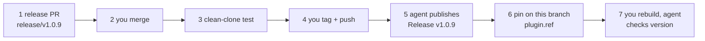

# Release v1.0.9 Implementation Plan

> **For agentic workers:** REQUIRED SUB-SKILL: Use superpowers:subagent-driven-development (recommended) or superpowers:executing-plans to implement this plan task-by-task. Steps use checkbox (`- [ ]`) syntax for tracking.

**Goal:** Ship codeo v1.0.9 from `main` as it stands (release PR, clean-clone test, tag, GitHub Release), then pin this project to v1.0.9 so its container and sessions run it.

**Architecture:** Two pull requests, as for v1.0.8. The release PR comes from its own branch `release/v1.0.9`, cut from `origin/main` in a git worktree: four files and no dossier, so the required `qc-verdict` check passes (it fails a head that carries a live dossier). This workflow branch carries the pin, the plan and the dossier, and `/codeo:close` opens its PR after the tag exists. Steps that are the engineer's (merges, tag push, container rebuild) are tasks that stop and wait.

**Tech Stack:** `git`, `gh`, `jq`, `sed`, `awk`, `bash tests/run.sh`, `claude plugin list`.

**Spec:** `.codeo/168/init.md` (`## Outcome`: the eight acceptance criteria); `docs/release-checklist.md` steps 6-8; `.codeo/168/plan.md` Q1-Q2.



## Global Constraints

- Release scope is `main` as it stands when the release PR is opened (`24577ac` at planning). #163 and #166 are closed and merged. Issues filed after #168 (#170, #171, #173) ship later.
- The release PR changes exactly four files: `.claude-plugin/plugin.json`, `CHANGELOG.md`, `README.md` and `tests/install.test.sh`. `.claude-plugin/marketplace.json` carries no version.
- `CHANGELOG.md` gets one edit and no other: line 3 `## Unreleased` becomes `## v1.0.9 — <date>`, the day the PR is opened (corrected before merge if it merges on a later day). The `Config schema: 1 (unchanged)`, `Shared state:` and `Safe to bump mid-workflow:` lines stay as written: they were checked at planning against the diff since `v1.0.8` of `scripts/cleanup.sh`, `scripts/inflight.sh` and `scripts/live.sh`. All 12 bullets are released as they stand. #161 (documentation only, not a gating issue) gets no bullet (plan Q2); #173 owns what its text still lacks.
- `README.md`'s examples move one version up: every `1.0.8` becomes `1.0.9` and every `1.0.7` becomes `1.0.8`. `tests/install.test.sh` takes the same substitution everywhere except inside the functions `t_latest_is_highest_release` and `t_latest_installed_without_version` (plan Q1): their stub tag lists already hold `v1.0.9`, so they stay as they are. Nothing else in either file changes. The substitution was dry-run at planning on `24577ac`: `bash tests/install.test.sh` ended `all cases passed`.
- The substitution never runs on `CHANGELOG.md`: its #163 bullet names `v1.0.8` and `v1.0.9` on purpose.
- The tag push, both PR merges and the container rebuild are the engineer's. The agent never merges or tags. The agent publishes the GitHub Release only after the engineer says the tag is pushed. A pushed tag is never moved.
- The tag is lightweight, as `docs/release-checklist.md` step 7 writes it and as `v1.0.5` to `v1.0.8` are: `git tag v1.0.9 <SHA>`.
- The pin moves only after the tag exists: `.devcontainer/scripts/plugins.sh` checks the pin on GitHub before replacing codeo.
- The GitHub Release follows checklist step 8: title `v1.0.9`, notes are the changelog section only, never `--generate-notes`.
- Tasks 2, 4 and 7 mark `Runs on: the engineer's host`; their commands are single commands a shell passes through unchanged (the lock's host is `container`).
- No shared environment, so no task carries `Needs lease:`. No invariants document, no `wiki` module, no exclusive resources, so nothing is leased. No other workflow is in flight.
- Documentation: the change moves one page, `README.md` (its installer examples, Task 1). No page under `docs/` describes a version or the pin as current. Changing the release checklist is out of scope (issue).
- `/codeo:close` opens one PR per workflow from this branch; the release PR is opened by `/codeo:implement` from `release/v1.0.9` and is a different head.

## Review Focus

- The release branch is cut from `origin/main`, not from this branch: a diff beyond the four files, or any `.codeo/` change, fails `qc-verdict` and drags a live dossier into `main`.
- The substitution order matters: `1.0.8` → `1.0.9` first, then `1.0.7` → `1.0.8`, in one `sed` call per file. The other order turns every version into `1.0.9`. The two stub functions are skipped by address; Task 1 Step 6 checks that both `refs/tags/v1.0.8` stubs survived.
- `main` may have moved between this plan and Task 1: Task 1 reads `## Unreleased` before editing, every bullet there ships, and the numbers here (line 3, line 5, 12 bullets) are re-read, not trusted.
- The clean-clone test must run at the merge commit, not at `main`'s tip if `main` moved after the merge.
- A lightweight tag has no `^{}` line in `git ls-remote --tags origin`: criterion 5 is read from the plain `refs/tags/v1.0.9` line.
- The Release notes file must not start with the heading and must not be generated: its first line is `Config schema: 1 (unchanged)`.
- A stale `CODEO_ROOT` or an old session: the version check runs in a session started after the rebuild, and `claude plugin list` may show a user-scope and a project-scope `codeo@codeo`; Task 7 records either one that is not 1.0.9.

---

### Task 1: Open the release PR from `release/v1.0.9`

**Files:**
- Modify: `.claude-plugin/plugin.json:3` (`version`)
- Modify: `CHANGELOG.md:3` (heading)
- Modify: `README.md` (version numbers in the installer examples)
- Modify: `tests/install.test.sh` (the same version numbers, outside the two ordering stubs)
- Worktree: `../codeo-168-release`, branch `release/v1.0.9` from `origin/main`

**Interfaces:**
- Produces: PR number `<RPR>` for Task 2, and the branch `release/v1.0.9` on origin.

- [ ] **Step 1: Cut the branch in a worktree**

Run: `git fetch origin && git worktree add -b release/v1.0.9 ../codeo-168-release origin/main && git -C ../codeo-168-release log --oneline -1`
Expected: the tip of `origin/main` (`24577ac`, or later if `main` moved). Every later step of this task runs in `../codeo-168-release`.

- [ ] **Step 2: Gate and criterion 2 check**

Run: `for i in 163 166; do gh issue view $i --json state -q .state; done` and `for i in 163 166; do awk '/^## v1.0.8/{exit} 1' CHANGELOG.md | grep -c "#$i"; done`
Expected: two lines `CLOSED`, then two counts each at least `1`. A different result stops the task: say which issue is open or missing a bullet.

- [ ] **Step 3: Run the failing check**

Run: `jq -e '.version == "1.0.9"' .claude-plugin/plugin.json; grep -c '^## v1.0.9 — ' CHANGELOG.md; grep -c '1\.0\.7' README.md`
Expected: FAIL: `false`, `0`, and a count above `0`.

- [ ] **Step 4: Edit `plugin.json` and `CHANGELOG.md`**

Set `version` to `"1.0.9"`. Read `sed -n 1,8p CHANGELOG.md` first, then retitle line 3 as `## v1.0.9 — 2026-11-25` (or the opening day, if later). Touch nothing else in the file.

- [ ] **Step 5: Move the README's and the install test's versions up**

Run:
```bash
sed -E -i 's/1\.0\.8/1.0.9/g; s/1\.0\.7/1.0.8/g' README.md
sed -E -i '/^t_latest_is_highest_release\(\)/,/^}/b; /^t_latest_installed_without_version\(\)/,/^}/b; s/1\.0\.8/1.0.9/g; s/1\.0\.7/1.0.8/g' tests/install.test.sh
```

- [ ] **Step 6: Run the checks and the suite**

Run:
```bash
jq -e '.version == "1.0.9"' .claude-plugin/plugin.json
grep -c '^## v1.0.9 — ' CHANGELOG.md; grep -c '^## Unreleased' CHANGELOG.md
sed -n 5p CHANGELOG.md
awk '/^## v1.0.9 /{f=1;next} /^## /{f=0} f && /^- /' CHANGELOG.md | grep -c .
awk '/^## v1.0.8 /{f=1;next} /^## /{f=0} f && /^- /' CHANGELOG.md | grep -c .
grep -c '1\.0\.7' README.md tests/install.test.sh
grep -c 'refs/tags/v1.0.8' tests/install.test.sh
git diff --name-only origin/main
bash tests/run.sh | tail -1
```
Expected, in order: `true`; `1`; `0`; `Config schema: 1 (unchanged)`; `12`; `13`; `README.md:0` and `tests/install.test.sh:0`; `2` (the two skipped stubs); exactly `.claude-plugin/plugin.json`, `CHANGELOG.md`, `README.md`, `tests/install.test.sh`; `all cases passed`. If `main` moved and added bullets, `12` is 12 plus those.

- [ ] **Step 7: Commit, push, open the PR**

```bash
git add .claude-plugin/plugin.json CHANGELOG.md README.md tests/install.test.sh
git commit -m "release: v1.0.9"   # trailers per the session's attribution
git push -u origin release/v1.0.9
gh pr create --base main --title "release: v1.0.9" --body-file <body>
```
Body, following the v1.0.8 release PR: patch release cut from `main` at its SHA; the four files and why each changes (version; heading; README examples moved to v1.0.9 with the test stubs they are compared with, the two ordering stubs left alone); config schema, shared state and safe-to-bump as the changelog's lines; one line naming what it carries (#152, #154, #157, #163, #166); "After merge: tag `v1.0.9` on the merge commit (the engineer's own action), then the GitHub Release; the pin is a second PR from `feat/release-v1-0-9-once` (#168)"; `Refs #168.`; the PR attribution footer.

Proof: `gh pr view <RPR> --json baseRefName,files --jq '[.baseRefName, ([.files[].path]|sort)]'` prints `["main",[".claude-plugin/plugin.json","CHANGELOG.md","README.md","tests/install.test.sh"]]`, and `gh pr checks <RPR>` shows `tests` and `qc-verdict` passing.

### Task 2: The engineer merges the release PR (wait)

Runs on: the engineer's host

**Interfaces:**
- Consumes: `<RPR>` from Task 1.
- Produces: `<SHA>`, the merge commit, for Tasks 3 and 4.

- [ ] **Step 1: Stop and say the PR is waiting for the engineer's merge.** The agent does not merge. If the heading's date is no longer the merge day, the agent corrects it on the release branch first.
- [ ] **Step 2: Once told it is merged, read the commit**

Run: `gh pr view <RPR> --json state,mergeCommit --jq '[.state, .mergeCommit.oid]'`
Expected: `["MERGED","<40-hex SHA>"]`. Record `<SHA>` in `implement.md`. Remove the worktree: `git worktree remove ../codeo-168-release`.

### Task 3: Clean-clone test of the merged commit (agent)

**Interfaces:**
- Consumes: `<SHA>`.
- Produces: the result line the engineer reads before tagging, and the clean clone Task 5 uses.

- [ ] **Step 1: Run it**

```bash
dir=$(mktemp -d) && git clone https://github.com/kbajpai/codeo.git "$dir" && cd "$dir" && git checkout --detach <SHA>
git rev-parse HEAD; jq -r .version .claude-plugin/plugin.json; bash tests/run.sh | tail -1
```
Expected: `<SHA>`, `1.0.9`, `all cases passed`. Record the SHA and the last line in `implement.md`. (No golden directory, so `tests/replay.test.sh` is not run.)

### Task 4: The engineer tags and pushes v1.0.9 (wait)

Runs on: the engineer's host

**Interfaces:**
- Consumes: `<SHA>` and Task 3's passing line.
- Produces: tag `v1.0.9` on origin, which Tasks 5 and 6 need.

- [ ] **Step 1: Give the engineer these three commands, one at a time, and stop.** Each is one command with nothing the shell rewrites:

```
git fetch origin
git tag v1.0.9 <SHA>
git push origin v1.0.9
```
- [ ] **Step 2: Once told it is pushed, prove criterion 5**

Run: `git ls-remote --tags origin v1.0.9`
Expected: `<SHA>	refs/tags/v1.0.9` (lightweight: no `^{}` line). If the line names another commit or the tag is missing, stop and say so; never move a pushed tag.

### Task 5: Publish the GitHub Release (agent, on the engineer's say-so)

**Interfaces:**
- Consumes: the tag from Task 4; `CHANGELOG.md` section `## v1.0.9` in Task 3's clean clone at `<SHA>`.
- Produces: Release `v1.0.9`.

- [ ] **Step 1: Failing check:** `gh release view v1.0.9` → `release not found`.
- [ ] **Step 2: Publish from the clean clone at `<SHA>`**

```bash
awk '/^## v1.0.9 /{f=1;next} /^## /{f=0} f && (n || NF){n=1; print}' CHANGELOG.md > <scratchpad>/notes-v1.0.9.md
gh release create v1.0.9 --verify-tag --title v1.0.9 --notes-file <scratchpad>/notes-v1.0.9.md
```
- [ ] **Step 3: Prove criterion 6**

Run: `gh release list --limit 3 && gh release view v1.0.9 --json tagName,name,isDraft,isPrerelease --jq '[.tagName,.name,.isDraft,.isPrerelease]' && gh release view v1.0.9 --json body --jq .body | head -1 && gh release view v1.0.9 --json body --jq .body | grep -c '^- '`
Expected: `v1.0.9` marked `Latest` above `v1.0.8`; `["v1.0.9","v1.0.9",false,false]`; the first line `Config schema: 1 (unchanged)` (the section, not a heading and no generated notes); `12`.

### Task 6: Pin this project to v1.0.9

**Files:**
- Modify: `.codeo/config.json:6` (`plugin.ref`)

**Interfaces:**
- Consumes: the tag from Task 4.

- [ ] **Step 1: Failing check:** `jq -e '.plugin.ref == "v1.0.9"' .codeo/config.json` → FAIL (ref is `v1.0.8`).
- [ ] **Step 2: Edit** `plugin.ref` to `"v1.0.9"`; nothing else in the file.
- [ ] **Step 3: Prove it**

Run: `jq -e '.plugin.ref == "v1.0.9"' .codeo/config.json && git ls-remote --exit-code origin refs/tags/v1.0.9 >/dev/null && bash tests/run.sh | tail -1`
Expected: `true`, then `all cases passed` (`tests/devcontainer.test.sh` accepts any well-formed ref). This branch does not carry the release commit, so the suite here runs `main` as of `24577ac` plus the pin.
- [ ] **Step 4: Commit** `.codeo/config.json`; `/codeo:close` opens this branch's PR. Criterion 7 is met when that PR merges.

### Task 7: Rebuild, then prove the container runs v1.0.9 (criterion 8)

Runs on: the engineer's host

- [ ] **Step 1: The engineer rebuilds or restarts the dev container, then starts a new Claude Code session.** The agent stops until told.
- [ ] **Step 2: Version**

Run: `claude plugin list`
Expected: `codeo@codeo` shows `Version: 1.0.9` for the user-scope entry. If a project-scope entry shows another version, record it as a finding in `implement.md`; do not edit `.claude/settings.json` to hide it.
