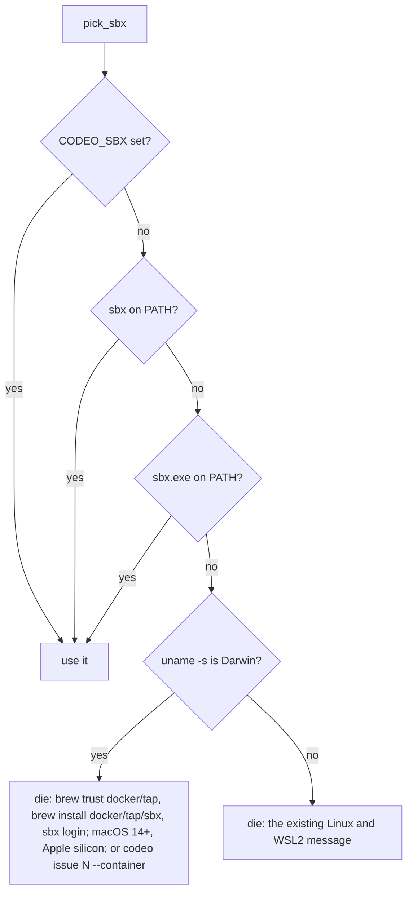

# Support the sbx issue sandbox on macOS (#176) Implementation Plan

> **For agentic workers:** REQUIRED SUB-SKILL: Use superpowers:subagent-driven-development (recommended) or superpowers:executing-plans to implement this plan task-by-task. Steps use checkbox (`- [ ]`) syntax for tracking.

**Goal:** `codeo issue <N> --sandbox`, `codeo shell`, `codeo open`, `codeo list` and `codeo rm` work for a sandbox on an Apple-silicon Mac on macOS 14 or later, the check is recorded, and no README or script comment says "never macOS".

**Architecture:** Docker's install page now lists macOS, so the work is a check plus small fixes, not a port. `.sbx/codeo-sandbox.sh` gains one helper, `host_is_macos`, and three macOS-only behaviours: a missing `sbx` names the Homebrew install, `git_is_usable` refuses the Command Line Tools stub as `codeo-container.sh` already does, and a missing `code` says how to put it on `PATH`. The docs name what a Mac needs. Two tasks run on the engineer's Mac over SSH: a preflight that stops the plan when the Mac is below Docker's minimum, and the full route, recorded as trial T14 in `docs/dev-environment-sbx-evaluation.md`. A failure T14 shows beyond these fixes comes back to `/codeo:plan` as a second round (Q1).

**Tech Stack:** bash (the script runs under 4.3 or later); Markdown; the bash suite `shell` (`bash tests/run.sh`).

**Spec:** `.codeo/176/init.md` (`## Outcome`: the seven acceptance criteria) and `.codeo/176/plan.md` (Q1-Q3, answered).

## Global Constraints

- **What Docker lists for macOS** (https://docs.docker.com/ai/sandboxes/install/, read 2026-11-25): "macOS Sonoma version 14 or later", "Apple silicon", no Docker Desktop, install `brew trust docker/tap` then `brew install docker/tap/sbx`, then `sbx login`. These exact strings are what the message and the README carry.
- **Host is a Mac over SSH** (Q2). The chip and macOS version are not known until Task 1. If Task 1 shows macOS below 14 or an Intel chip, stop and return to `/codeo:plan`: the plan becomes a one-line refusal naming `codeo issue <N> --container`, and Tasks 2-5 are rewritten.
- **Linux and WSL2 behaviour does not change.** The existing "sbx is not installed: install Docker Sandboxes (sbx), or from WSL2 make sbx.exe reachable on PATH" message stays word for word off macOS; `sbx.exe`, `git.exe` and `ssh.exe` handling is untouched.
- **No Linux-only command is added.** The script already calls only `date -u`, `head`, `tail`, `grep -c`, `tr` and `git`; nothing is added that macOS lacks. `flock` is `codeo`'s need, not the script's, and is already documented for macOS (`docs/home-checkout.md`).
- **Not done, on purpose:** a bash-version guard in the script (the README names bash 4.3 as `codeo` and `install.sh` do), a refusal on Intel Macs when `sbx` is present (`sbx` says so itself), and any `open -a` fallback for VS Code (untried).
- **Historical text stays:** `docs/plans/2026-11-17-sbx-issue-sandbox.md` says "never macOS" as a record of what was planned; the check in Task 4 covers READMEs, script comments and `docs/*.md`, not `docs/plans/`.
- **Page style:** present tense, no issue numbers in prose, as the existing pages are written. `CHANGELOG.md` takes one bullet under `## Unreleased`.
- **Documentation moved:** `.sbx/README.md` (*Prerequisites*, the sequence diagram's participant, a new macOS section), `.devcontainer/README.md` (the host sentence of *Installing the `codeo` command*), `docs/dev-environment-sbx-evaluation.md` (*Host*, trial T14, the status banner), `CHANGELOG.md`. The root `README.md` has no sandbox or macOS text since #171, and `docs/home-checkout.md`'s macOS paragraph does not mention sandboxes: both are unchanged, deliberately.
- **Invariants:** none configured. **Shared environment:** none; no task carries a lease marker. Tasks 2-4 run in this checkout; Tasks 1 and 5 run on the engineer's Mac.
- **Sandbox clones on the Mac** are made in `~/codeo` as for Linux; nothing about paths changes.

## Review Focus

- `CODEO_SBX` set on a Mac with no `sbx` on `PATH`: no macOS message, the named program is used (Task 2 test).
- `uname` missing or failing: treated as not macOS, the existing message (Task 2 test).
- `xcode-select` missing on a Mac: git is treated as unusable, so the identity falls back to `GIT_AUTHOR_*` (Task 3 test).
- A Mac whose `code` is not on `PATH`: one line saying how to fix it, not a "command not found" from bash (Task 3 test).
- A Mac on stock bash 3.2: documented only (Task 4); the script is not guarded.



---

## File Structure

| File | Change |
|---|---|
| `.sbx/codeo-sandbox.sh` | `host_is_macos` (new), `pick_sbx` (macOS message), `git_is_usable` (Command Line Tools check), `launch_code` (missing `code` on macOS), header comment |
| `tests/sandbox.test.sh` | a `uname` stub in `sb_setup`, helper `sb_macos`, seven new cases listed in `cases=( … )`, header comment |
| `.sbx/README.md` | *Prerequisites* line and macOS bullets, the sequence diagram's participant, new `## On macOS` section |
| `.devcontainer/README.md` | the host sentence of *Installing the `codeo` command* |
| `.devcontainer/codeo` | header comment only (`Needs bash 4.3 or later on Linux or macOS`) |
| `docs/dev-environment-sbx-evaluation.md` | *Host* gains a macOS part, new trial `T14`, status banner |
| `CHANGELOG.md` | one bullet under `## Unreleased` |

## Tasks

### Task 1: Preflight on the Mac

Runs on: the engineer's host

**Files:** none changed. The output is pasted into `.codeo/176/implement.md` under `## Where this stands` and is the source for Task 5's record.

**Interfaces:** Produces the Mac's `ProductVersion`, chip and bash version, which Tasks 4 and 5 quote.

- [ ] **Step 1: Run each command over SSH on the Mac and paste what it prints**, one command per line:

```
sw_vers
uname -m
bash --version
brew --version
brew trust docker/tap
brew install docker/tap/sbx
sbx version
sbx login
```

  `sbx login` opens a browser for Docker's sign-in; say what it printed and did over SSH (a URL, a code, or a failure).
- [ ] **Step 2: Stop here when the Mac is below Docker's minimum.** `sw_vers` must print a `ProductVersion` of 14 or later and `uname -m` must print `arm64`. Otherwise do not start Task 2: tell the engineer and return to `/codeo:plan`.
- **Proof of done:** `sw_vers` shows `ProductVersion:` 14 or higher, `uname -m` shows `arm64`, and `sbx version` prints a version. These are read from the pasted output; there is no repository test.

### Task 2: A missing `sbx` on macOS names where to get it

**Files:**
- Modify: `.sbx/codeo-sandbox.sh` (`pick_sbx`, new `host_is_macos` above it)
- Test: `tests/sandbox.test.sh`

**Interfaces:**
- Produces: `host_is_macos` — succeeds when `uname -s` prints `Darwin`, and fails when `uname` is missing or fails; Task 3 calls it. In the tests, `sb_macos` — makes the stub `uname` print `Darwin` for the current `sb_dir`.

- [ ] **Step 1: Write the failing tests.** In `sb_setup`, add a `uname` stub to the stub loop's directory: `uname -s` prints the contents of `$d/os`, other arguments run `/usr/bin/uname`; write `Linux` to `$sb_dir/os`. Add `sb_macos() { echo Darwin >"$sb_dir/os"; }`. Add these cases beside `no_sbx_is_one_line` and list them in `cases=( … )`:
  - `no_sbx_on_macos_names_the_brew_install`: `sb_setup nosbxmac`, `sb_macos`, remove the `sbx` and `sbx.exe` stubs, `sb_run open 1`. Assert `sb_rc == 1`; `$sb_err` is one line; it starts `codeo-sandbox: sbx is not installed`; it contains `brew install docker/tap/sbx`, `macOS 14`, `Apple silicon` and `codeo issue <N> --container`; it contains neither `WSL2` nor `sbx.exe`.
  - `no_sbx_off_macos_keeps_the_wsl2_message`: the same without `sb_macos`; `$sb_err` contains `from WSL2 make sbx.exe reachable on PATH`.
  - `codeo_sbx_on_macos_skips_the_message`: `sb_macos`, no `sbx` on `PATH`, `SB_SBX` set to a stub that answers `ls`; `sb_run open 1` exits 1 with `codeo-1 does not exist`, not `sbx is not installed`.
  - `a_failing_uname_is_not_macos`: replace the `uname` stub with `exit 1`; with no `sbx`, `$sb_err` contains `from WSL2 make sbx.exe`.
- [ ] **Step 2: Run them to see them fail.** Run: `bash tests/run.sh sandbox`. Expected: `FAIL no_sbx_on_macos_names_the_brew_install` (stderr lacks `brew install docker/tap/sbx`) and no other new failure.
- [ ] **Step 3: Implement** `host_is_macos() { [[ "$(uname -s 2>/dev/null || true)" == Darwin ]]; }` in `.sbx/codeo-sandbox.sh` and, in `pick_sbx`'s final `else`, call `die` with exactly: `sbx is not installed: on macOS 14 or later with Apple silicon, run "brew trust docker/tap" and "brew install docker/tap/sbx", then "sbx login"; or work the issue in a dev container with "codeo issue <N> --container"` when `host_is_macos`; otherwise the existing message. Update the comment above `pick_sbx` to say so.
- [ ] **Step 4: Run the suite.** Run: `bash tests/run.sh`. Expected: exit 0, no `=== FAIL` line.
- [ ] **Step 5: Commit** `.sbx/codeo-sandbox.sh` and `tests/sandbox.test.sh`: `feat: name where to get sbx on macOS (#176)`.

### Task 3: Git and VS Code on macOS

**Files:**
- Modify: `.sbx/codeo-sandbox.sh` (`git_is_usable`, `launch_code`)
- Test: `tests/sandbox.test.sh`

**Interfaces:**
- Consumes: `host_is_macos` (Task 2); `sb_macos`.
- Produces: `git_is_usable` that, on macOS, also needs `xcode-select -p` to succeed (as `.devcontainer/codeo-container.sh` does at its line 147); `launch_code` that, on macOS with no `code` and no `CODEO_CODE`, ends with one line.

- [ ] **Step 1: Write the failing tests** and list them in `cases=( … )`:
  - `issue_on_macos_without_command_line_tools_takes_the_identity_from_the_environment`: follows `issue_takes_the_identity_from_the_host_gitconfig` (same `HOME`, `GIT_CONFIG_GLOBAL` and `SB_REAL_GIT` setup, the file holding `Cfg Dev`), with `sb_macos`, a stub `xcode-select` that exits 1, and `GIT_AUTHOR_NAME='Env Dev'` `GIT_AUTHOR_EMAIL=env@x.test` set. Assert the `sbx exec` start line has `GIT_AUTHOR_NAME=Env Dev GIT_AUTHOR_EMAIL=env@x.test` and not `Cfg Dev`.
  - `issue_on_macos_with_command_line_tools_takes_the_identity_from_gitconfig`: the same with `xcode-select` exiting 0; the line has `Cfg Dev`.
  - `a_missing_xcode_select_on_macos_counts_as_no_git`: `sb_macos`, no `xcode-select` stub at all; the start line has the environment's names, as in the first case.
  - `open_on_macos_without_code_is_one_line`: from `open_writes_the_title_and_opens_the_clone_folder`, with `sb_macos` and the `code` stub removed. Assert `sb_rc == 1`; `$sb_err` is one line starting `codeo-sandbox: code is not on PATH`, and contains `Install 'code' command in PATH` and `CODEO_CODE`; `sb_calls` holds no `code` line.
  - `open_on_macos_with_code_launches_it`: the same with the `code` stub present; the last call is `code --folder-uri vscode-remote://ssh-remote+codeo-113.sbx/sandbox/clone`.
- [ ] **Step 2: Run them to see them fail.** Run: `bash tests/run.sh sandbox`. Expected: the first, third and fourth fail (Cfg Dev is used; stderr is bash's `command not found`); the second and fifth pass already.
- [ ] **Step 3: Implement** in `git_is_usable`: after the `command -v git` check, `if host_is_macos; then xcode-select -p >/dev/null 2>&1 || return 1; fi` (its comment already says "a Mac stub"). In `launch_code`, before the final `code --folder-uri`, when `host_is_macos` and `code` is not on `PATH`, `die` with: `code is not on PATH: in VS Code run "Shell Command: Install 'code' command in PATH", or set CODEO_CODE to the VS Code program`.
- [ ] **Step 4: Run the suite.** Run: `bash tests/run.sh`. Expected: exit 0, no `=== FAIL` line.
- [ ] **Step 5: Commit** both files: `feat: the sandbox script checks git and code on macOS (#176)`.

### Task 4: Say what macOS needs, and drop "never macOS"

**Files:**
- Modify: `.sbx/codeo-sandbox.sh` (header, lines 2-3), `.sbx/README.md`, `.devcontainer/README.md` (line 96), `.devcontainer/codeo` (header, line 4), `tests/sandbox.test.sh` (header, line 3), `CHANGELOG.md`
- Test: `tests/sandbox.test.sh`

**Interfaces:** none.

- [ ] **Step 1: Write the failing tests** (docs cases, named like the existing `docs_*`, listed in `cases=( … )`):
  - `docs_nothing_says_never_macos`: `grep -rIn 'never macOS'` over `README.md`, `.sbx`, `.devcontainer` and `docs/*.md` finds nothing (not `docs/plans/`).
  - `docs_nothing_says_a_sandbox_needs_linux_or_wsl2_only`: `.devcontainer/README.md` does not contain `a sandbox needs Linux or WSL2`.
  - `docs_sbx_readme_says_what_macos_needs`: `.sbx/README.md` contains `brew install docker/tap/sbx`, `Apple silicon`, `macOS 14`, `brew install bash` and the exact line `## On macOS`.
  - `docs_changelog_names_the_macos_sandbox`: `CHANGELOG.md` has a line matching `^- .*macOS.*sandbox.*\(#176`.
- [ ] **Step 2: Run them to see them fail.** Run: `bash tests/run.sh sandbox`. Expected: four `FAIL docs_…` lines.
- [ ] **Step 3: Edit the documentation.**
  - `.sbx/codeo-sandbox.sh` header and `tests/sandbox.test.sh` line 3: "on a Linux, macOS or WSL2 host", with no "never macOS". `.devcontainer/codeo` line 4: "bash 4.3 or later on Linux or macOS".
  - `.sbx/README.md` *Prerequisites*: the first line becomes "The host is Linux, macOS or WSL2 with bash 4.3 or later, `git` and `curl`." and `sbx` v0.53.0's bullet says what macOS adds: macOS 14 (Sonoma) or later on Apple silicon (Intel Macs are not on Docker's list), `brew trust docker/tap` then `brew install docker/tap/sbx`, no Docker Desktop. The sequence diagram's participant becomes `Engineer (Linux, macOS or WSL2 bash)`.
  - `.sbx/README.md` gains `## On macOS`, after *Getting the script*: the stock bash is 3.2, so `brew install bash` and make it the first `bash` on `PATH`; `codeo` also needs `flock` (`brew install flock`, `.devcontainer/README.md` *Installing the `codeo` command*); `code` must be on `PATH` for `open` (VS Code's *Shell Command: Install 'code' command in PATH*), or `CODEO_CODE` names it; over SSH, `sbx login` opens a browser and `sbx secret set github --command 'gh auth token'` reads `gh`'s token, which may sit in the locked login keychain (link to `.devcontainer/README.md`'s *The keychain over SSH on macOS*); `codeo open` starts VS Code on the Mac itself. Mark each SSH statement the trial has not shown as untried; Task 5 replaces the marks with what it showed.
  - `.devcontainer/README.md` line 96: "a sandbox needs Linux, macOS or WSL2 (`.sbx/README.md`)".
  - `CHANGELOG.md` `## Unreleased`: one bullet beginning "The sbx issue sandbox runs on macOS 14 or later on Apple silicon", naming `.sbx/codeo-sandbox.sh` and ending `(#176)`.
- [ ] **Step 4: Run the suite.** Run: `bash tests/run.sh`. Expected: exit 0, no `=== FAIL` line.
- [ ] **Step 5: Commit** the changed files, then push the branch (Task 5 downloads the script from it): `docs: say what a sandbox needs on macOS and drop "never macOS" (#176)`.

### Task 5: The full route on the Mac, recorded

Runs on: the engineer's host

**Files:**
- Modify: `docs/dev-environment-sbx-evaluation.md` (*Host*, new trial `T14`, the status banner), `.sbx/README.md` (`## On macOS`, the untried marks)
- Test: `tests/sandbox.test.sh`

**Interfaces:** Consumes Task 1's output and the pushed branch from Task 4.

- [ ] **Step 1: Write the failing test** `docs_evaluation_page_records_the_macos_check` and list it in `cases=( … )`: `docs/dev-environment-sbx-evaluation.md` contains the line `**T14: sbx on macOS.**`, and contains `brew install docker/tap/sbx`, `sw_vers` and `Apple silicon`. Run: `bash tests/run.sh sandbox`. Expected: `FAIL docs_evaluation_page_records_the_macos_check`.
- [ ] **Step 2: Fetch the branch's scripts on the Mac**, then run the route over SSH, one command per line, pasting what each prints (the first replaces `~/codeo`'s scripts with this branch's):

```
env CODEO_RAW_URL=https://raw.githubusercontent.com/kbajpai/codeo/feat/176-support-sbx-issue-sandbox-macos codeo update
sbx secret set github --command "gh auth token"
sbx setup ssh
sbx policy allow network "*.gallery.vsassets.io,*.gallerycdn.vsassets.io"
codeo issue 176 --sandbox --yes
sbx exec codeo-176 cat .codeo/active
gh issue view 176 --comments
codeo list
codeo open 176
codeo rm 176
gh issue view 176 --comments
```

  `codeo open 176` starts VS Code on the Mac: say whether a window opened there, and run it at the Mac's screen if it did not over SSH. Before `codeo rm`, `codeo shell 176` is run once by the engineer at the Mac, and the shell closed.
- [ ] **Step 3: Write the record.** `T14` in *Trials*, in the form of T1-T13 (a one-line "Settles", the commands, "Expected", "Observed", "Differed from the plan"), holds what was pasted: the Mac's hardware and macOS version (Task 1), the install command, what `sbx login` did over SSH, whether `issue` started a sandbox, took the lock (`lock: took the lock for #176 …`) and added the `sandbox` row, whether `list` showed it, whether `open` and `shell` opened it, and whether `rm` removed it and marked the row `removed`. *Host* gains a macOS part answering "does `sbx` run here: yes, no or partly", with Docker's page and its read date. The status banner says T14 ran on macOS. In `.sbx/README.md`, replace each "untried" mark in `## On macOS` with what T14 showed.
- [ ] **Step 4: A failure is not fixed here.** When T14 shows a step failing that Tasks 2-3 do not cover, record it in T14 as it happened, say so in `implement.md`, and return to `/codeo:plan` for a second round instead of patching.
- [ ] **Step 5: Run the suite.** Run: `bash tests/run.sh`. Expected: exit 0, no `=== FAIL` line.
- [ ] **Step 6: Commit** `docs/dev-environment-sbx-evaluation.md`, `.sbx/README.md` and `tests/sandbox.test.sh`: `docs: record the sbx check on macOS (#176)`.
- **Proof of done:** `bash tests/run.sh` exits 0 with `docs_evaluation_page_records_the_macos_check` passing, and the pasted output shows `codeo rm 176` removing the sandbox and the second `gh issue view 176 --comments` showing the `sandbox` row as `removed`.

## Self-review

- **Spec coverage.** Criterion 1: Task 5 (T14, *Host*). 2 and 3: Task 5 runs them; Tasks 2-3 are what can be fixed before. 4: Global Constraints (no Linux-only command added), Task 4 names bash and `flock`. 5: Task 2. 6: Task 4. 7: every task ends on `bash tests/run.sh`.
- **Types.** `host_is_macos`, `sb_macos` and `sb_setup`'s `uname` stub are defined in Task 2 and used unchanged in Task 3.
- **Proportion.** Code is described by signature, message text and assertions; only the two messages are exact because tests and docs quote them.
