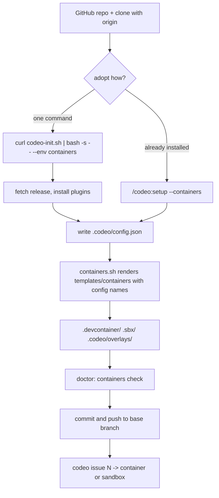

# Reusable container and sandbox setup (#190) Implementation Plan

> **For agentic workers:** REQUIRED SUB-SKILL: Use superpowers:subagent-driven-development (recommended) or superpowers:executing-plans to implement this plan task-by-task. Steps use checkbox (`- [ ]`) syntax for tracking.

**Goal:** A project that is not codeo, on any stack, adopts the dev container, the sbx sandbox, the `codeo` host command, the role guard and the host-workflow overlays with one re-runnable command, and codeo itself is the first project that uses the same templates.

**Architecture:** The first slice (`c361707`) is already on this branch: `templates/containers/` rendered by `scripts/containers.sh` from `.codeo/config.json` (`@CODENAME@`, `@REPO_SLUG@`), `setup.sh --codename/--containers`, the doctor `containers` check, and `scripts/codeo-init.sh`. This plan finishes it in four moves: the audit and the two names the slice left hardcoded (base branch, overlays); codeo's own seed files brought under the same equality test as its scripts; `codeo-init.sh` made runnable as a lone `curl | bash`; and the C# + Angular example, the documentation and the host runs that prove it.

**Tech Stack:** bash (hosts run it under 3.2 and later), jq, perl, Markdown, Mermaid, the bash suite `shell` (`bash tests/run.sh`); the example adds .NET, Angular, Docker and Kubernetes manifests, which this repository's own tests never run.

**Spec:** `.codeo/190/init.md` (`## Outcome`: the ten acceptance criteria) and `.codeo/190/plan.md` (Q1-Q7, answered), and the new reference page `docs/container-templates.md` (Task 8).

## Global Constraints

- **Audit decision, recorded by Task 1 and kept in `docs/container-templates.md`.** Where the project's own name belongs, a shipped file uses a placeholder: `@CODENAME@` (the config's `codename`, else the repository name), `@REPO_SLUG@` (`repo.owner/repo.name`), and, new in Task 1, `@BASE_BRANCH@` (`baseBranch`, else `main`). What stays literal on purpose: the `codeo` command and the `codeo-container.sh`, `codeo-sandbox.sh` and `codeo-track.sh` file names (they are the plugin's product names), the `CODEO_*` environment variables, `.codeo/`, and `kbajpai/codeo` where it names the plugin's own source (`install.sh`, and `codeo-init.sh`'s release fetch).
- **Two kinds of file, unchanged from the slice.** *Managed* (the scripts under `.devcontainer/` and `.sbx/`): rewritten by `containers.sh --force`, held equal to the templates by `containers.sh --check` and by `/codeo:doctor`. *Seed* (`Dockerfile`, `devcontainer.json`, `.sbx/claude-image`, and now `.codeo/overlays/*.md`): written only when absent, never overwritten, never checked by doctor.
- **Codeo's own files are rendered output.** After Tasks 2 and 3, `bash scripts/containers.sh --check` in this checkout passes, and a test also holds the seeds equal outside the parts a project owns (Task 3). Codeo's containers behave as before.
- **The shell suite has no `filter`.** A task's proof is `bash tests/run.sh <pattern>`: the suite's own test command narrowed to the test files whose names contain `<pattern>`, ending `all cases passed`. Task 13 runs the whole suite.
- **No network, Docker or sbx in the suite.** Tests use a stub `gh`, a local bare repository for release fetches, and stub `dotnet`, `npm` and `kubectl`. Everything that needs Docker is a host task at the end.
- **`codeo-init.sh` never creates a repository** and makes no `gh` call that writes (`tests/init.test.sh` already asserts this and keeps asserting it).
- **My call (check it while reviewing): the host run's doctor.** Criterion 7 says "a passing doctor". `/codeo:doctor`'s `ruleset` check reads the repository's own branch ruleset, which a new throwaway repository does not have and codeo never creates. The tests pass because `gh` is stubbed; the host run (Task 12) records the doctor output and accepts `fail ruleset` as the only failure. The README says so.
- **Documentation moved.** `README.md` (*Setting a project up*), `.devcontainer/README.md`, `.sbx/README.md`, `docs/home-checkout.md` (*Adopting the guard in your project*), `docs/skills.md` (`## setup`), the new `docs/container-templates.md`, and `CHANGELOG.md`. `docs/skills-inventory.md` lists the rules of the eight pipeline skills and `setup` has none, so it does not move; `tests/inventory.test.sh` stays unchanged and passing. Page style: present tense, no issue numbers in prose, as the existing pages are written.
- **Invariants:** none configured. **Shared environment:** none, so no task carries `Needs lease:`. Host tasks come last and carry `Runs on: the engineer's host`.
- **One pull request** from this branch (Q7).

## Review Focus

- A project whose base branch is `develop` or `master`: the `codeo` command's download URL and `codeo-container.sh`'s base ref follow `baseBranch` (Task 1 test).
- A codename that is also a prefix of another (`shop` and `shop-api`): no template substitution touches the longer name (Task 1 test).
- `containers.sh` run twice, and after the engineer edited a seed overlay: nothing is overwritten and the second run writes nothing (Task 2 test).
- `codeo-init.sh` run as a lone file or from a pipe, with no network and no terminal: it fetches the release or stops with one `init: fail` line, and never prompts on the script's own stdin (Task 4 tests).
- A repository owner or name that contains a dot or underscore: rendered unchanged in every URL and in the volume names (Task 1 test).

## File Structure

- Create `docs/container-templates.md` — the audit list, managed vs seed, how each name is derived.
- Create `templates/containers/.codeo/overlays/{issue,init,triage,cleanup,plan,implement,qc,close}.md` — codeo's overlays with placeholders.
- Modify `scripts/containers.sh` — `@BASE_BRANCH@`, overlay seeds.
- Modify `templates/containers/.devcontainer/{codeo,codeo-container.sh}`, `templates/containers/.sbx/codeo-sandbox.sh` — base branch placeholder.
- Modify `.codeo/overlays/*.md`, `.devcontainer/{codeo,codeo-container.sh}`, `.sbx/codeo-sandbox.sh`, `.devcontainer/Dockerfile`, `.devcontainer/devcontainer.json` — codeo's own files, kept equal to the render.
- Modify `scripts/codeo-init.sh`, `lib/prompt.sh` — the self-fetch and the terminal read.
- Create `examples/csharp-angular/**` — toolchain, API, Kubernetes manifests, suites, scripts.
- Modify `tests/containers.test.sh`, `tests/init.test.sh`, `tests/readme.test.sh`; create `tests/example.test.sh`.
- Modify the documents in *Documentation moved*.

---

### Task 1: The base branch and the audit

**Files:**
- Modify: `scripts/containers.sh`, `templates/containers/.devcontainer/codeo`, `templates/containers/.devcontainer/codeo-container.sh`, `templates/containers/.sbx/codeo-sandbox.sh`, and codeo's own copies of the three (rendered)
- Test: `tests/containers.test.sh`

**Interfaces:**
- Produces: placeholder `@BASE_BRANCH@`, filled by `render` from `baseBranch` (default `main`); the same `^[A-Za-z0-9][A-Za-z0-9._/-]*$` check as the other names.

- [ ] **Step 1: Audit.** Run `grep -rnE "kbajpai|codeo-|/main|=main|master" templates scripts/containers.sh scripts/codeo-init.sh lib .devcontainer/scripts` and classify each hit as *placeholder*, *intentional* (the Global Constraints list) or *to fix*. The only *to fix* findings expected are the literal `main` in the `codeo` command's raw URL (`templates/containers/.devcontainer/codeo:101`) and `base_ref=main` in `codeo-container.sh:19`; fix every other one the grep shows. Keep the classified list for Task 8.
- [ ] **Step 2: Write the failing tests** in `tests/containers.test.sh`: `a_base_branch_other_than_main_is_followed` (config `baseBranch: "develop"`; the rendered `.devcontainer/codeo` contains `raw.githubusercontent.com/acme-co/shop/develop`, `codeo-container.sh` has `base_ref=develop`, and neither contains `/main`); `a_prefix_codename_does_not_leak` (`codename: "shop"` beside owner `acme-co`, repo `shop-api`: `acme-co/shop-api` appears intact, no `shop-api-api`); `dots_in_owner_and_repo_survive` (owner `a.b`, repo `c_d`). Extend `no_shipped_file_names_codeo_where_the_project_belongs` to scan the whole rendered project, not only the files that exist today.
- [ ] **Step 3: Run** `bash tests/run.sh containers`. Expected: FAIL naming `a_base_branch_other_than_main_is_followed`.
- [ ] **Step 4: Implement** `@BASE_BRANCH@` in `render` and the three templates; read `baseBranch` with `codeo_cfg .baseBranch || echo main`; re-render codeo's own three managed files with `bash scripts/containers.sh --force`, and restore any seed it must not touch (`git status` shows only the three).
- [ ] **Step 5: Proof of done:** `bash tests/run.sh containers` → `all cases passed`; `bash scripts/containers.sh --check` → exit 0.
- [ ] **Step 6: Commit** `feat: render the base branch into the container templates (#190)`.

### Task 2: The overlays as seed templates

**Files:**
- Create: `templates/containers/.codeo/overlays/{issue,init,triage,cleanup,plan,implement,qc,close}.md`
- Modify: `scripts/containers.sh` (`is_seed`: `.codeo/overlays/*` is a seed), `.codeo/overlays/*.md` (only if the render differs)
- Test: `tests/containers.test.sh`

**Interfaces:**
- Consumes: Task 1's placeholders.
- Produces: eight seed templates; `containers.sh` writes `.codeo/overlays/<skill>.md` when absent.

- [ ] **Step 1: Failing tests:** `overlays_are_written_with_the_projects_names` (acme project: eight files exist; `init.md` contains `acme-<N>`, `https://github.com/acme-co/shop/tree/<branch>`, `acme-home`, and `cleanup.md` has `name: acme-{N}`, `pattern: ^acme-[0-9]+$` and `acme-dev:{name}`); `codeos_own_overlays_equal_the_render` (the eight files in this checkout equal the template rendered with codeo's config); `a_seed_overlay_is_never_overwritten` (edit `plan.md`, rerun with `--force`, edit survives); `doctor_passes_overlays_in_the_rendered_project` (doctor's `overlays` line is `ok`).
- [ ] **Step 2: Run** `bash tests/run.sh containers` → FAIL on the first test (no templates yet).
- [ ] **Step 3: Create the templates** by copying codeo's eight overlays and replacing `codeo-home`, `codeo-<N>`, `codeo-{N}`, `^codeo-[0-9]+$`, `codeo-dev:` and `https://github.com/kbajpai/codeo` with `@CODENAME@-…` and `https://github.com/@REPO_SLUG@`; the `codeo` command, `codeo rm`, `codeo-sandbox.sh` and `codeo-track.sh` stay.
- [ ] **Step 4: Update `is_seed`** to match `.codeo/overlays/*` as well as the three named files.
- [ ] **Step 5: Proof of done:** `bash tests/run.sh containers` → `all cases passed`; `bash tests/run.sh overlay` → `all cases passed` (the overlay and skill tests read these files); `bash scripts/doctor.sh` in this checkout prints `ok overlays`.
- [ ] **Step 6: Commit** `feat: write the project's overlays with the container files (#190)`.

### Task 3: Codeo's own seeds equal their templates

**Files:**
- Modify: `.devcontainer/Dockerfile`, `.devcontainer/devcontainer.json`, `tests/containers.test.sh` (and `tests/devcontainer.test.sh` only if it pins the apt line)

- [ ] **Step 1: Failing tests:** `codeos_dockerfile_equals_the_template_outside_the_toolchain_section` (both files with the lines from `# ---- Project toolchain` to `# ---- End project toolchain` removed are identical) and `codeos_devcontainer_json_equals_the_template_but_the_extensions` (`jq 'del(.customizations.vscode.extensions)'` of both is identical, and codeo's extensions are the template's plus `timonwong.shellcheck`).
- [ ] **Step 2: Run** `bash tests/run.sh containers` → FAIL on the Dockerfile test.
- [ ] **Step 3: Implement:** codeo's `Dockerfile` becomes the template, and its toolchain section holds the `shellcheck` install (`apt-get update && apt-get install -y --no-install-recommends shellcheck && rm -rf /var/lib/apt/lists/*`); the template's comment pointing at the example stays.
- [ ] **Step 4: Proof of done:** `bash tests/run.sh containers` and `bash tests/run.sh devcontainer` → `all cases passed`.
- [ ] **Step 5: Commit** `refactor: codeo's own Dockerfile is the template plus its toolchain (#190)`.

### Task 4: `codeo-init.sh` as a lone command

**Files:**
- Modify: `scripts/codeo-init.sh`, `lib/prompt.sh`
- Test: `tests/init.test.sh`

**Interfaces:**
- Produces: `CODEO_PLUGIN_URL` (default `https://github.com/${CODEO_PLUGIN_REPO:-kbajpai/codeo}.git`): where the lone script clones the release from. When `lib/prompt.sh` is not beside the script, it resolves the release (`--version`, else the highest `vX.Y.Z` from `git ls-remote --tags`), runs `git clone --depth 1 --branch <tag> "$CODEO_PLUGIN_URL" <tmp>` and `exec`s `<tmp>/scripts/codeo-init.sh "$@"`. `codeo_interactive` and `codeo_ask` read from `/dev/tty` when stdin is not a terminal and `/dev/tty` opens.

- [ ] **Step 1: Failing tests:** `a_lone_script_fetches_its_release` (copy only `scripts/codeo-init.sh` to a scratch directory; a local bare repository of this checkout tagged `v9.9.9` as `CODEO_PLUGIN_URL`; run with `--yes --skip-install` in a stub-`gh` clone; output has `init: ok preflight` and `init: ok config`); `a_lone_script_with_no_release_fails_in_one_line` (empty bare repository: exit 1, one `init: fail fetch:` line, nothing written); `a_pipe_without_a_terminal_takes_the_defaults` (stdin from a pipe, `setsid` so no controlling terminal: no prompt text on stdout, config written with the repository name as codename).
- [ ] **Step 2: Run** `bash tests/run.sh init` → FAIL (`lib/prompt.sh: No such file`).
- [ ] **Step 3: Implement** the fetch block before the `source` line, and the `/dev/tty` read in `lib/prompt.sh` (`codeo_interactive` is true when `/dev/tty` is readable and `CODEO_ASSUME_YES` is unset).
- [ ] **Step 4: Proof of done:** `bash tests/run.sh init` → `all cases passed`. The real `curl | bash` terminal case is proved in Task 12.
- [ ] **Step 5: Commit** `feat: codeo-init.sh fetches its own release when run alone (#190)`.

### Task 5: The setup skill's sentence

**Files:**
- Modify: `skills/setup/SKILL.md` (the description and the pass-through sentence, nothing else; already edited in `c361707`)
- Test: `tests/setup.test.sh`, `tests/skills.test.sh`

- [ ] **Step 1: Failing test** `setup_documents_codename_and_containers` in `tests/setup.test.sh`: `skills/setup/SKILL.md` names `--codename`, `--containers` and says setup never creates a repository.
- [ ] **Step 2: Run** `bash tests/run.sh setup` → expected PASS if the slice's wording holds; if it fails, fix the wording. `bash tests/run.sh skills` must also pass (frontmatter and precedence checks).
- [ ] **Step 3: Proof of done:** `bash tests/run.sh setup` and `bash tests/run.sh skills` → `all cases passed`; `git diff c361707^ -- skills/` shows only `skills/setup/SKILL.md`.
- [ ] **Step 4: Commit** only if a change was needed: `docs: setup skill names --codename and --containers (#190)`.

### Task 6: The example's toolchain, suites and API

**Files:**
- Create: `examples/csharp-angular/.devcontainer/Dockerfile` (the template with its toolchain section filled), `examples/csharp-angular/codeo-suites.json`, `examples/csharp-angular/api/{Api.csproj,Program.cs,Api.Tests/Api.Tests.csproj,Api.Tests/HealthTests.cs}`, `examples/csharp-angular/k8s/{kustomization.yaml,api.yaml,web.yaml}`, `examples/csharp-angular/scripts/run-suites.sh`
- Test: `tests/example.test.sh`

**Interfaces:**
- Produces: `codeo-suites.json`, a JSON array of three suites (`api`, `web`, `k8s`) in the config's own shape: `api` (`paths: ["api/**"]`, `build: dotnet build api`, `test: dotnet test api`), `web` (`paths: ["web/**"]`, `build: npm --prefix web run build`, `test: npm --prefix web test -- --watch=false --browsers=ChromeHeadless`), `k8s` (`paths: ["k8s/**"]`, `build: kubectl kustomize k8s`, `test: kubectl kustomize k8s`). `scripts/run-suites.sh` reads `.codeo/config.json` and runs every suite's build then test, stopping at the first failure, printing `suite: <name> ok|FAIL`.

- [ ] **Step 1: Failing tests** in `tests/example.test.sh`: `suites_merge_into_a_config_and_doctor_resolves_them` (merge `codeo-suites.json` into a scratch project's config, stub `dotnet`, `npm` and `kubectl` on `PATH`: doctor prints `ok suites: 3 suite(s)`); `the_dockerfile_extends_the_template_only_inside_its_section` (outside the toolchain markers it equals the template); `run_suites_stops_at_the_first_failure` (stub `dotnet` exiting 1: output has `suite: api FAIL`, no `suite: web`); `the_manifests_name_no_codeo_project` (no `kbajpai`, no `codeo-<N>`).
- [ ] **Step 2: Run** `bash tests/run.sh example` → FAIL (files missing).
- [ ] **Step 3: Implement.** The toolchain section installs, as root: the .NET 10 SDK (Microsoft's apt feed), Node 22 LTS (NodeSource), Chromium and `CHROME_BIN` for `ng test`, the Docker CLI and `kubectl` (no engine, no socket; Q2). The API is one minimal-API endpoint `GET /health` returning `{"status":"ok"}`, with one xunit test over `WebApplicationFactory`. The manifests are a Deployment and Service each for `api` and `web` plus a `kustomization.yaml`.
- [ ] **Step 4: Proof of done:** `bash tests/run.sh example` → `all cases passed`.
- [ ] **Step 5: Commit** `feat: C# + Angular example: toolchain, suites, API and manifests (#190)`.

### Task 7: The example's web app script

**Files:**
- Create: `examples/csharp-angular/scripts/generate-web.sh`, `examples/csharp-angular/web/.gitkeep`
- Test: `tests/example.test.sh`

**Interfaces:**
- Produces: `generate-web.sh`, run once by the engineer, which runs `npx --yes @angular/cli@<pinned major> new web --defaults --skip-git --skip-install --directory examples/csharp-angular/web` (the major is a variable at the top of the script) and prints `generated: examples/csharp-angular/web`.

- [ ] **Step 1: Failing test** `generate_web_names_a_pinned_cli_and_refuses_an_existing_app` (with a stub `npx` that records its arguments: the call contains `@angular/cli@` followed by digits; a second run with `web/angular.json` present exits 1 and runs nothing).
- [ ] **Step 2: Run** `bash tests/run.sh example` → FAIL.
- [ ] **Step 3: Implement** the script; the generated application is committed by the host task (Task 11), not here: this container has no Node.
- [ ] **Step 4: Proof of done:** `bash tests/run.sh example` → `all cases passed`.
- [ ] **Step 5: Commit** `feat: script that generates the example's Angular app (#190)`.

### Task 8: Documentation — `docs/container-templates.md`

**Files:**
- Create: `docs/container-templates.md`
- Modify: `tests/readme.test.sh` (read the new page in the paths and links checks)

- [ ] **Step 1: Write the page:** a status line and `## Contents`; *What is codeo's and what is yours* (Task 1's classified audit list as a table: file, what it held, now); *Managed and seed files*; *Where each name comes from* (a table: placeholder, config key, default, example); *Adding your toolchain* (the Dockerfile section, `suites`); and the Mermaid flow from this plan's header, redrawn for the page.
- [ ] **Step 2: Failing check:** add the page to `tests/readme.test.sh`'s file list; run `bash tests/readme.test.sh` → FAIL on the missing page before Step 1, PASS after it.
- [ ] **Step 3: Proof of done:** `bash tests/readme.test.sh` → `all cases passed`; `bash tests/run.sh agnostic` → `all cases passed`.
- [ ] **Step 4: Commit** `docs: the container templates reference and the audit (#190)`.

### Task 9: Documentation — root `README.md`

**Files:**
- Modify: `README.md` (*Setting a project up*, *Configuration* for `codename`, *More documentation*), `tests/readme.test.sh`

- [ ] **Step 1: Failing guard** `adoption-paths` in `tests/readme.test.sh`: *Setting a project up* has a `### Adopting codeo with containers` section naming both `scripts/codeo-init.sh` and `/codeo:setup --containers`, and links `docs/container-templates.md`.
- [ ] **Step 2: Write the section:** the prerequisites (the repository and `origin` exist, `gh` logged in, codeo creates no repository); path A, `curl -fsSL https://raw.githubusercontent.com/kbajpai/codeo/main/scripts/codeo-init.sh | bash -s -- --env containers`, with its `init:` transcript copied from the Task 12 run; path B, `/codeo:setup --containers` with its output; what is written (the file list); "commit `.devcontainer/`, `.sbx/` and `.codeo/` to your base branch: `codeo issue <N>` downloads its scripts from there"; the doctor `ruleset` note (Global Constraints).
- [ ] **Step 3: Proof of done:** `bash tests/readme.test.sh` → `all cases passed`. Transcripts are filled in from Task 12's evidence, so this task finishes after it (the checkbox for the transcript lines stays open until then).
- [ ] **Step 4: Commit** `docs: README describes both ways to adopt the containers (#190)`.

### Task 10: Documentation — the two container READMEs

**Files:**
- Modify: `.devcontainer/README.md` (a new `## Using this in another project`), `.sbx/README.md` (*Getting the script*, the image pin)

- [ ] **Step 1: Write:** `.devcontainer/README.md`: where the templates are, managed vs seed, `containers.sh --check/--force`, extending the Dockerfile's toolchain section, the `codeo` command's download base being `https://raw.githubusercontent.com/<owner>/<repo>/<base>`, and the example. `.sbx/README.md`: the download line for another project (its own raw URL), `CODEO_REPO_URL`, and the image pin as a seed.
- [ ] **Step 2: Proof of done:** `bash tests/readme.test.sh` and `bash tests/run.sh devcontainer` → `all cases passed`; every command the two pages show for another project is listed in Task 12's evidence with its result.
- [ ] **Step 3: Commit** `docs: the dev container and sandbox READMEs cover another project (#190)`.

### Task 11: Documentation — guard, setup skill page, changelog

**Files:**
- Modify: `docs/home-checkout.md` (*Adopting the guard in your project*: `setup --containers` now writes `role.sh` and the eight `role-guard` overlays; the "not shipped" sentence goes), `docs/skills.md` (`## setup`: the flags and the container files), `CHANGELOG.md` (one `## Unreleased` bullet; `Config schema: 1 (unchanged)`; `Shared state: none`)
- Test: `tests/readme.test.sh`

- [ ] **Step 1: Failing guard** `adopting-guard` already in `tests/readme.test.sh` must keep passing; add `adopting-guard-ships`: the page no longer says `role.sh` "is not shipped".
- [ ] **Step 2: Proof of done:** `bash tests/readme.test.sh` and `bash tests/run.sh skills-doc` → `all cases passed`.
- [ ] **Step 3: Commit** `docs: guard, setup and changelog describe the container setup (#190)`.

### Task 12: Host runs — the neutral image, the example, the wizard

**Runs on: the engineer's host**

**Files:**
- Create: `examples/csharp-angular/scripts/host-run.sh`
- Test: `tests/example.test.sh` (`host_run_refuses_without_docker_and_arguments`: with no `docker` on `PATH`, one `host-run: fail docker` line and exit 1; no argument, exit 2)

**Interfaces:**
- Produces: `host-run.sh <owner>/<repo>` — against the empty throwaway repository: clone it to a temporary directory; `docker build` the neutral template Dockerfile; copy the example in; run this checkout's `scripts/codeo-init.sh --yes --skip-install --env containers --codename shopdemo` with the example's suites; commit and push to the base branch; `bash .devcontainer/codeo-container.sh issue 1 <branch>`; then `docker exec shopdemo-1 bash scripts/run-suites.sh`; prints every step as `host-run: ok|FAIL <step>` and ends with the doctor output.

- [ ] **Step 1: Write the script and its refusal test; run** `bash tests/run.sh example` → `all cases passed` (in this container, no Docker needed).
- [ ] **Step 2: Host:** the engineer creates an empty GitHub repository (any owner) and runs `bash examples/csharp-angular/scripts/generate-web.sh`, commits the generated `web/` (this closes Task 7), then runs `bash examples/csharp-angular/scripts/host-run.sh <owner>/<repo>`, with their owner and repository.
- [ ] **Step 3: Proof of done:** the script's last lines are `host-run: ok issue container shopdemo-1 ran the suites api web k8s` and a doctor output whose only `fail` line, if any, is `ruleset`. The output is pasted into `implement.md`.
- [ ] **Step 4: Host: the wizard from a pipe.** In a fresh clone of the throwaway repository, in a terminal, the README's path A command; expected: it prompts on the terminal, ends `init: ok …` lines and exit 0. Pasted into `implement.md`, and into Task 9's transcript.
- [ ] **Step 5: Commit** `feat: host-run script for the container example (#190)`.

### Task 13: Host run — the sandbox, then the full suite

**Runs on: the engineer's host**

- [ ] **Step 1: Host:** in the throwaway repository's clone, `bash codeo-sandbox.sh issue 1 <branch>` (the file `codeo-init.sh` wrote under `.sbx/`), then `bash codeo-sandbox.sh shell 1`; inside it run `bash scripts/run-suites.sh`. Expected: `suite: api ok`, `suite: web ok`, `suite: k8s ok`. Then `bash codeo-sandbox.sh end 1`.
- [ ] **Step 2: Proof of done (host):** the three `suite: … ok` lines are pasted into `implement.md`; `/codeo:qc` reads them for criterion 4.
- [ ] **Step 3: Proof of done (this checkout):** `bash tests/run.sh` → `all cases passed`; `bash scripts/containers.sh --check` → exit 0; `bash scripts/doctor.sh` → no `fail` line.
- [ ] **Step 4: Commit** the pasted evidence only through `/codeo:implement`'s own dossier commit.

## Self-review

- **Criteria:** 1 → Tasks 1, 8; 2 → Tasks 2, 5 (the slice's `setup_writes_codename_and_containers_in_one_go` extended by Task 2); 3 → Tasks 1, 2; 4 → Tasks 6, 7, 12, 13; 5 → Tasks 9, 10, 12; 6 → Task 13; 7 → Tasks 4, 12; 8, 9 → already tested in `tests/init.test.sh` and kept; 10 → Tasks 1, 2, 3.
- **Documentation task coverage:** every page in *Documentation moved* has a task (8-11).
