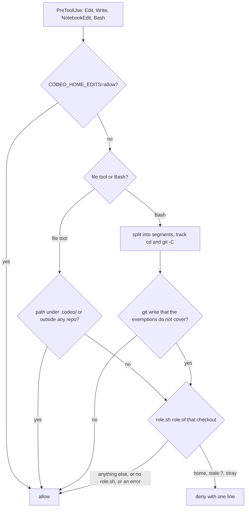

# Home-Checkout Edit Guard Implementation Plan (#192)

> **For agentic workers:** REQUIRED SUB-SKILL: Use superpowers:subagent-driven-development (recommended) or superpowers:executing-plans to implement this plan task-by-task. Steps use checkbox (`- [ ]`) syntax for tracking.

**Goal:** A plugin `PreToolUse` hook refuses project edits and git writes in a `home`, `stale:?` or `stray` checkout, with one line that says why and names the override.

**Architecture:** `hooks/home-guard.sh` reads the hook JSON, finds the checkout the call touches, asks that checkout's own `.devcontainer/scripts/role.sh` for its role (no copy of its logic), and denies when the role is guarded. The override is `CODEO_HOME_EDITS=allow` in Claude Code's own environment. Every error allows the call.

**Tech Stack:** bash (4.3+), `jq`, `git`; tests in the `shell` suite (`bash tests/run.sh`).

**Spec:** the issue (https://github.com/kbajpai/codeo/issues/192) and `.codeo/192/plan.md` (Q1-Q4 and `## Notes`). The plan's one reference-doc change is a new section of `docs/home-checkout.md` (Task 4).

## Global Constraints

- **Guarded roles:** `home`, `stale:?`, `stray`, as printed by `role.sh` with no `--check`. Never guarded: `issue:<N>`, `unguarded` (a hosted session, `CLAUDE_CODE_REMOTE=true`, included), `stale:<N>`, `mismatch:…`.
- **Built on `role.sh`, never a copy of it.** The hook runs `<checkout root>/.devcontainer/scripts/role.sh <root>` for the checkout the call touches. No such file means the project does not use the role: allow. `role.sh` itself is not changed.
- **Override:** the hook's own environment has `CODEO_HOME_EDITS=allow` exactly. Text in a tool call's command never counts. The guard never writes the override.
- **Fails open.** A missing `jq`, unreadable JSON, a missing or failing `role.sh`, or a path outside any repository prints nothing and exits 0.
- **Not guarded, so the home skills keep working:** any Edit, Write or NotebookEdit of a path under `<root>/.codeo/`; any path outside a git repository (the scratchpad); read-only git; `git worktree`, `fetch`, `pull`, `branch`, plain `checkout`/`switch`; `git add/rm/mv/restore` whose pathspecs are all under `.codeo/`; a `git commit` whose changed paths are all under `.codeo/`; and every script (`bash …/claim.sh`, `intake.sh`), because a script's own git calls are not visible to the hook. `/codeo:init` cuts its branch in a scratch worktree (a `stray` checkout) and commits `.codeo/` there, so these rules are what lets it run.
- **Refused Bash commands:** the segments that start with `git` and run `commit`, `push`, `merge`, `rebase`, `cherry-pick`, `revert`, `am`, `apply`, `reset`, `stash`, `tag`, `add`, `rm`, `mv`, `restore`, `checkout` with `-b`/`-B`/`--orphan`, `switch` with `-c`/`-C`/`--create`/`--force-create`/`--orphan`. A file changed by `sed -i`, redirection, `rm`, `cp` or `bash -c` is not caught (Q3).
- **The refusal** is one line (no newline in it) that contains the role, `/codeo:issue`, `codeo issue <N>` and `CODEO_HOME_EDITS=allow`; the exact text is `HOME_GUARD_REASON` in Task 1.
- **Invariants document:** none is configured for this project, so there is no invariant to check.
- **Environment lease:** the project has no shared environment, so no task carries `Needs lease:`; every task runs in this checkout. No task runs on the engineer's host.
- **Documentation:** the one page that moves is `docs/home-checkout.md` (Task 4); the README, `docs/handoff.md` and `.devcontainer/README.md` need no change (the README is mid-rewrite in #190, and the new section is reachable from the guard section it extends).
- **Reach:** the hook runs in a project once its pinned plugin carries it, so this repository's own home checkout is guarded after the next release and `chore: pin codeo` bump, not at the merge.

## Review Focus

- A path reached through a symlink, or a relative path, into the home checkout is still refused (Task 1).
- A new file in a directory that does not exist yet is refused: the nearest existing ancestor decides (Task 1).
- Text inside quotes is never read as a command: `git commit -m "a; git push"` and `echo "git push"` (Task 2).
- `git commit -a` with a modified tracked file outside `.codeo/` is refused although nothing is staged (Task 2).
- `CODEO_HOME_EDITS=allow git push`, typed inside the command, does not lift the guard (Task 2).
- A call judged by the checkout it addresses, not the session's: `git -C <issue clone> commit` run from home is allowed, `git -C <home> commit` run from an issue clone is refused (Task 2).



---

### Task 1: The guard for the file tools, the override and the fail-open rule

**Files:**
- Create: `hooks/home-guard.sh` (mode 755, like its siblings)
- Create: `tests/home-guard.test.sh`

**Interfaces:**
- Produces, in `hooks/home-guard.sh`:
  - the hook itself: stdin is the PreToolUse JSON (`cwd`, `tool_name`, `tool_input`), stdout is nothing (allow) or one `{"hookSpecificOutput":{"hookEventName":"PreToolUse","permissionDecision":"deny","permissionDecisionReason":<line>}}` object as `hooks/subagent-model.sh` prints, and the exit status is always 0;
  - `guarded_role <dir>`: prints the role and returns 0 when the checkout holding `<dir>` is guarded; returns 1 and prints nothing otherwise, including for a `<dir>` outside a repository, a root with no `.devcontainer/scripts/role.sh`, and any failure of that script;
  - `deny <role>`: prints the deny object whose reason is
    `HOME_GUARD_REASON` = `codeo: this checkout's role is <role>, so project changes are not made here. File the issue with /codeo:issue, start it with 'codeo issue <N>', and work in its checkout. To allow it for this session, start Claude Code with CODEO_HOME_EDITS=allow.`
- Produces, in `tests/home-guard.test.sh`: `clone <name> <folder> <branch> [lock]` (prints the scratch clone's path), `hook <json>` (prints the hook's stdout), `file_json <tool> <cwd> <path>`, `bash_json <cwd> <command>`, `decision <stdout>` (`allow` or `deny`). Task 2 and Task 3 add cases to the same file.

- [ ] **Step 1: Write the failing tests** in `tests/home-guard.test.sh`, in the style of `tests/subagent-model.test.sh` (a `failures` counter, `assert_eq`, `assert_contains`, a final `all cases passed`):
  - `clone` makes `<scratch>/<name>/<folder>` a git repository on `<branch>` (`git symbolic-ref HEAD`, as `tests/role.test.sh` does), copies `container-name.sh` and `role.sh` from `.devcontainer/scripts/` into the clone's `.devcontainer/scripts/`, writes `.codeo/config.json` as `{"codename":"codeo","baseBranch":"main"}`, writes `.codeo/active` as `issue: <lock>` when a lock is given, and makes one commit holding `src/a.txt`. `hook` runs `hooks/home-guard.sh` from the scratch root with `env -u CLAUDE_CODE_REMOTE -u CODEO_HOME_EDITS CODEO_DOCKERENV=<missing file> CODEO_CONTAINERENV=<missing file>`, so every case judges a host and none depends on this machine.
  - `file_tools_refused_in_guarded_roles`: for the three roles (`codeo-home` on `main` → `home`; `codeo-home` on `other` → `stale:?`; folder `elsewhere` on `main` with no lock → `stray`) and for each of `Edit`, `Write` (`file_path`) and `NotebookEdit` (`notebook_path`), a path `<clone>/src/a.txt` gives `decision` = `deny`; the reason contains the role, `/codeo:issue`, `codeo issue <N>` and `CODEO_HOME_EDITS=allow`, and has no newline.
  - `file_tools_allowed_elsewhere`: `allow` for the same calls in a clone with a lock (`issue:192`); with `CLAUDE_CODE_REMOTE=true` in home; for `<home>/.codeo/intake/new-x/issue.md`; for a path in a directory outside any repository; for a `cwd` outside any repository; and in a plain repository that has no `.devcontainer/scripts/role.sh`.
  - `file_tools_resolve_the_path`: `deny` for a new file `<home>/src/new/deep/f.txt` (its directories do not exist), for `src/a.txt` with `cwd` = home (relative), and for the same file through a symlink to the clone; `allow` for a `file_path` in the issue clone when `cwd` is home (the file's checkout decides, not `cwd`).
  - `override_and_fail_open`: with `CODEO_HOME_EDITS=allow` the home call is `allow`; with `CODEO_HOME_EDITS` set to `1`, `yes`, `deny` or empty it is still `deny`; with a `role.sh` that exits 3, or stdin that is not JSON, the output is empty and the exit status 0.

- [ ] **Step 2: Run the tests to verify they fail**

Run: `bash tests/run.sh home-guard`
Expected: FAIL — `hooks/home-guard.sh` does not exist (the cases print `FAIL:` lines and the run exits 1).

- [ ] **Step 3: Implement `hooks/home-guard.sh`** with the interfaces above, in the shape of `hooks/subagent-model.sh` and `hooks/live-signal.sh` (the project comes from the JSON's `cwd`, never the process's; no `set -e`, every failure swallowed). For a file tool, take `tool_input.file_path` (`notebook_path` for `NotebookEdit`), make it absolute against `cwd`, resolve its nearest existing ancestor with `pwd -P`, find that directory's repository root with `git -C <dir> rev-parse --show-toplevel`, and allow when there is none or when the path lies under `<root>/.codeo/`; otherwise ask `guarded_role "$root"` and `deny` on a hit. The override check comes first of all: `[[ ${CODEO_HOME_EDITS:-} == allow ]] && exit 0`. A tool other than `Edit`, `Write`, `NotebookEdit` or `Bash` is allowed. (`Bash` is Task 2.)

- [ ] **Step 4: Run the tests to verify they pass**

Run: `bash tests/run.sh home-guard`
Expected: `all cases passed`

- [ ] **Step 5: Proof of done**

Run: `bash tests/run.sh`
Expected: `all cases passed`

- [ ] **Step 6: Commit**

```bash
git add hooks/home-guard.sh tests/home-guard.test.sh
git commit -m "feat: refuse Edit, Write and NotebookEdit of project files in a home checkout (#192)"
```

---

### Task 2: The guard for git writes run through Bash

**Files:**
- Modify: `hooks/home-guard.sh`
- Test: `tests/home-guard.test.sh`

**Interfaces:**
- Consumes: Task 1's `guarded_role <dir>`, `deny <role>`, and the test helpers `clone`, `hook`, `bash_json`, `decision`.
- Produces, in `hooks/home-guard.sh`: `bash_guard <cwd> <command>`, which prints the deny object for the first refused segment and returns 0, or prints nothing and returns 1; `git_write_p <subcommand> <dir> <args…>`, which returns 0 when that git invocation is a write the exemptions in Global Constraints do not cover.

- [ ] **Step 1: Write the failing tests** (add to `tests/home-guard.test.sh`; each runs in `<home>` as `cwd`, with a modified-but-unstaged `src/a.txt` and a staged `src/b.txt` where a case needs one):
  - `bash_git_writes_refused_in_home`: `deny` for `git commit -m x` (with `src/b.txt` staged), `git push`, `git push origin main`, `git checkout -b feat/x`, `git switch -c feat/x`, `git add src/a.txt`, `git add -A`, `git add .`, `git stash`, `git reset --hard`, `git commit -a -m x` (unstaged change to `src/a.txt`), `git commit --amend -m x`, `git commit -m x -- src/a.txt`, `git -C <home> commit -m x`, `cd <home> && git push`, `echo hi && git push`, `ls | git push`, and `CODEO_HOME_EDITS=allow git push`.
  - `bash_allowed_in_home`: `allow` for `git status`, `git log --oneline`, `git diff`, `git fetch origin`, `git pull --ff-only`, `git worktree add <dir> -b b origin/main`, `git worktree remove <dir>`, `git branch -D b`, `git checkout main`, `git switch main`, `git add .codeo/192/init.md`, `git add ./.codeo/192/init.md .codeo/.gitignore`, `git commit -m x` with only `.codeo/192/init.md` staged, `bash scripts/claim.sh 1 b w`, `echo "git push"`, `git status && echo done`, and `git commit -m "a; git push"` with only `.codeo/` staged.
  - `bash_judged_by_the_checkout_it_addresses`: from `cwd` = home, `git -C <issue clone> commit -m x` and `cd <issue clone> && git push` are `allow`; from `cwd` = the issue clone, `git -C <home> commit -m x` is `deny`; in a scratch `git worktree` of home (role `stray`), `git -C <worktree> commit -m x` with only `.codeo/…` staged is `allow` and with `src/b.txt` staged is `deny`.
  - `bash_unguarded_roles`: the refused commands above are `allow` in `issue:192` and with `CLAUDE_CODE_REMOTE=true`, and the command `git push` run in a directory outside any repository is `allow`.

- [ ] **Step 2: Run the tests to verify they fail**

Run: `bash tests/run.sh home-guard`
Expected: FAIL — the new `bash_git_writes_refused_in_home` and `bash_judged_by_the_checkout_it_addresses` cases print `FAIL:` (the Bash tool is not yet inspected, so every command is allowed).

- [ ] **Step 3: Implement `bash_guard` and `git_write_p`** in `hooks/home-guard.sh`, wired for `tool_name` = `Bash` (`tool_input.command`). The algorithm, which is what the cases above pin:
  1. Blank out quoted text (`"…"` and `'…'` become `""` and `''`, across lines), then turn newlines, `&&`, `||`, `;`, `|` and `&` into segment breaks.
  2. Walk the segments holding a current directory (starts at `cwd`). Drop leading `NAME=value` words. A segment starting `cd <dir>` moves the current directory when `<dir>` exists, and is otherwise ignored. A segment whose first word is `git` is parsed: skip the global options (`-C <dir>` sets the directory for this segment only, relative to the current one; `-c <k=v>` and any other `-…` option are skipped), take the subcommand and its arguments. Every other segment is ignored.
  3. `git_write_p` decides by subcommand as the Global Constraints list says. `add`, `rm`, `mv` and `restore` are writes unless every non-option argument starts with `.codeo/` (after stripping `./`). `commit` is a write when it has `--amend`, `--only`/`-o` or a ` -- ` pathspec, or when any path in `git -C <dir> diff --cached --name-only` (plus `git -C <dir> diff --name-only` when the arguments include `-a`, `--all` or a short-option cluster containing `a`) lies outside `.codeo/`.
  4. For a refused git write, `guarded_role <dir>` (the segment's directory) decides, and `deny` prints for a guarded role. The first deny ends the hook.

- [ ] **Step 4: Run the tests to verify they pass**

Run: `bash tests/run.sh home-guard`
Expected: `all cases passed`

- [ ] **Step 5: Proof of done**

Run: `bash tests/run.sh`
Expected: `all cases passed`

- [ ] **Step 6: Commit**

```bash
git add hooks/home-guard.sh tests/home-guard.test.sh
git commit -m "feat: refuse git writes run through Bash in a home checkout (#192)"
```

---

### Task 3: Register the hook in the plugin

**Files:**
- Modify: `hooks/hooks.json` (the `description` and a second `PreToolUse` entry)
- Test: `tests/home-guard.test.sh`

**Interfaces:**
- Consumes: Task 1 and Task 2's `hooks/home-guard.sh`, and the test helpers.
- Produces: the `PreToolUse` entry with matcher `Edit|Write|NotebookEdit|Bash` and command `bash "${CLAUDE_PLUGIN_ROOT}/hooks/home-guard.sh"`.

- [ ] **Step 1: Write the failing test** `hooks_json_registers_the_guard` in `tests/home-guard.test.sh`: with `jq`, `hooks/hooks.json` has a `PreToolUse` entry whose `matcher` is `Edit|Write|NotebookEdit|Bash` and whose one hook's `command` is `bash "${CLAUDE_PLUGIN_ROOT}/hooks/home-guard.sh"`; the existing `Agent|Task` entry is still there; and running that command through `bash -c` with `CLAUDE_PLUGIN_ROOT` set to this repository, on the JSON of an `Edit` of `<home>/src/a.txt`, gives `deny`.

- [ ] **Step 2: Run the test to verify it fails**

Run: `bash tests/run.sh home-guard`
Expected: FAIL — `hooks_json_registers_the_guard` prints `FAIL:` (no such entry).

- [ ] **Step 3: Add the entry to `hooks/hooks.json`** after the `Agent|Task` entry, and extend its `description` with one clause saying a home checkout's project edits are refused unless `CODEO_HOME_EDITS=allow`. No `timeout` is needed.

- [ ] **Step 4: Run the test to verify it passes**

Run: `bash tests/run.sh home-guard`
Expected: `all cases passed`

- [ ] **Step 5: Proof of done**

Run: `bash tests/run.sh`
Expected: `all cases passed`

- [ ] **Step 6: Commit**

```bash
git add hooks/hooks.json tests/home-guard.test.sh
git commit -m "feat: register the home-checkout guard as a PreToolUse hook (#192)"
```

---

### Task 4: Document the edit guard

**Files:**
- Modify: `docs/home-checkout.md` (a new `## The edit guard` section between `## The guard` and `## Adopting the guard in your project`)
- Modify: `CHANGELOG.md` (the `## Unreleased` section)

**Interfaces:**
- Consumes: the behaviour pinned by Tasks 1-3.
- Produces: the page section `#the-edit-guard`; no other task depends on it.

- [ ] **Step 1: Write the section in `docs/home-checkout.md`.** It says, in this order:
  - what it is: a plugin hook (`hooks/home-guard.sh`, registered in `hooks/hooks.json`) that refuses a change to the project in a checkout whose role is `home`, `stale:?` or `stray`, so work goes through an issue: `/codeo:issue`, then `codeo issue <N>`, then work in that checkout;
  - what it refuses and what it allows, as the two lists in Global Constraints (Edit, Write and NotebookEdit of project files; the git writes by name), and that `/codeo:issue`, `/codeo:init`, `/codeo:triage` and `/codeo:cleanup` keep working, with the reason (`.codeo/` paths, scripts, and `/codeo:init`'s scratch worktree);
  - the override: start Claude Code with `CODEO_HOME_EDITS=allow` in the environment, or put it in the project's `.claude/settings.local.json` `env`; it lasts for the session started with it, the session cannot set it itself, and it applies only to the exact value `allow`;
  - the limits: a file changed through the shell (`sed -i`, redirection, `rm`, `cp`) or a nested shell (`bash -c`) is not seen, and a guard error allows the call; a clone of a project that has the role check, in a folder not named `<codename>-home`, reads as `stray` and is guarded; a project without `.devcontainer/scripts/role.sh`, and a hosted session, are never guarded;
  - when it takes effect: the guard comes with the plugin version that carries the hook, so a project has it after it updates and re-pins.
  - a Mermaid `flowchart` of the decision, the one in this plan. Its backticked paths must exist, so `tests/readme.test.sh` still passes.

- [ ] **Step 2: Add the changelog bullet** under a `## Unreleased` heading at the top of `CHANGELOG.md`, above `## v1.0.10` (the heading does not exist yet; `git show 86b030c:CHANGELOG.md | head -12` shows the form: the three header lines, then the bullets). The bullet says: a home, `stale:?` or `stray` checkout now refuses Edit, Write, NotebookEdit and git writes through Bash with one line, unless the session was started with `CODEO_HOME_EDITS=allow`; the home skills' `.codeo/` writes are unaffected; hosted sessions and projects without `.devcontainer/scripts/role.sh` are unaffected; `docs/home-checkout.md` has the section; and the guard comes with the next release (#192). `Config schema: 1 (unchanged)`, `Shared state: none`, `Safe to bump mid-workflow: yes`.

- [ ] **Step 3: Proof of done** — the documentation's links and paths resolve and nothing else broke:

Run: `bash tests/run.sh`
Expected: `all cases passed` (`tests/readme.test.sh` checks the page's paths and links).

- [ ] **Step 4: Commit**

```bash
git add docs/home-checkout.md CHANGELOG.md
git commit -m "docs: the home-checkout edit guard and its changelog entry (#192)"
```
