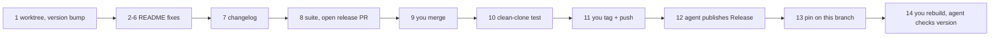

# Release v1.0.10 Implementation Plan

> **For agentic workers:** REQUIRED SUB-SKILL: Use superpowers:subagent-driven-development (recommended) or superpowers:executing-plans to implement this plan task-by-task. Steps use checkbox (`- [ ]`) syntax for tracking.

**Goal:** Ship codeo v1.0.10 from `main` as it stands, with `README.md` corrected and completed against the code (release PR, clean-clone test, tag, GitHub Release), then pin this project to v1.0.10 so its container and sessions run it.

**Architecture:** Two pull requests (Q3), as for v1.0.9. The release PR comes from `release/v1.0.10`, cut from `origin/main` in a git worktree: five files and no dossier, so the required `qc-verdict` check passes (it fails a head that carries a live dossier). This workflow branch carries the pin, the plan and the dossier, and `/codeo:close` opens its PR after the tag exists. Steps that are the engineer's (merges, tag push, container rebuild) are tasks that stop and wait.

**Tech Stack:** `git`, `gh`, `jq`, `sed`, `awk`, `bash tests/run.sh`, `bash tests/readme.test.sh`, `claude plugin list`.

**Spec:** `.codeo/182/init.md` (`## Outcome`: the nine acceptance criteria); `.codeo/182/plan.md` Q1-Q3 (the README audit is in `## Where this stands` and Q1); `docs/release-checklist.md` steps 6-8.



## Global Constraints

- Release scope is `main` as it stands when the release PR is opened (`89789dd` at planning). #173, #176, #177 and #179 are closed and merged (#184, #183, #186, #187). #181, #185, #188 and anything filed later ship later.
- The release PR changes exactly five files: `.claude-plugin/plugin.json`, `CHANGELOG.md`, `README.md`, `tests/install.test.sh` and `docs/updating.md`. `.claude-plugin/marketplace.json` carries no version. No `tests/readme.test.sh` change is planned: the new text is prose the test does not pin; it must still pass.
- **Version moves** (checklist step 6, dry-run at planning on `89789dd`: `tests/install.test.sh` and `tests/readme.test.sh` ended `all cases passed`). In `README.md`, `docs/updating.md` and `tests/install.test.sh`: every `1.0.9` becomes `1.0.10` and every `1.0.8` becomes `1.0.9`, in one `sed` call per file, in that order (the other order turns every version into `1.0.10`). Exceptions in `tests/install.test.sh`: skip `t_latest_installed_without_version` and `t_bad_version_usage` (their `v1.0.9`, `v1.0.9.1` and `v1.0.9;x` are ordering or refused stubs), and in `t_latest_is_highest_release` take only the stub `v1.0.10` to `v1.0.11` ("that stub takes the next higher version"; its `v1.0.9` and `v1.0.8` stay). The `1.0.9` in the comment and the default `version=1.0.9` near lines 46 and 185 of that file stand for the latest release, so they move.
- The substitution never runs on `CHANGELOG.md`: it names older versions on purpose.
- **README corrections (Q1: every mismatch and every omission).** Each edit below was found by comparing the README with the code and re-verified at planning; the implementer re-reads the cited code before writing, because line numbers drift. Corrections say what the code does and add no version number, so the substitution order does not matter for them. Edits keep the README's structure: the thirteen `##` headings, the three Troubleshooting `###` groups and the twelve doctor bold leads that `tests/readme.test.sh` pins.
- **Changelog (Q2).** `## Unreleased` becomes `## v1.0.10 — <date>` (the UTC date the release PR opens, `gh pr view --json createdAt`; corrected before merge if it merges on a later day). Its header lines stay unless the diff since `v1.0.9` of `scripts/`, `lib/` and `hooks/` says otherwise (re-read in Task 7: `Config schema: 1 (unchanged)`, `Shared state:`, `Safe to bump mid-workflow:`). Added bullets: #179, #170, and one for the README corrections.
- The tag push, both PR merges and the container rebuild are the engineer's. The agent never merges or tags, and publishes the GitHub Release only after the engineer says the tag is pushed. A pushed tag is never moved. The tag is lightweight: `git tag v1.0.10 <SHA>`.
- The pin moves only after the tag exists (`.devcontainer/scripts/plugins.sh` checks the pin on GitHub before replacing codeo). The Release follows checklist step 8: title `v1.0.10`, notes the changelog section only, never `--generate-notes`.
- Tasks 9, 11 and 14 mark `Runs on: the engineer's host`; their commands are single commands a shell passes through unchanged (the lock's host is `container`).
- No shared environment (so no `Needs lease:`), no invariants document, no `wiki` module, no exclusive resources, and no other workflow in flight: nothing is leased and no overlap was found.
- Documentation: the change moves `README.md` (Tasks 2-6) and `docs/updating.md` (version numbers only); it moves no other page. Changing the release checklist is out of scope (issue).
- `/codeo:close` opens one PR per workflow from this branch; the release PR is opened by `/codeo:implement` from `release/v1.0.10` and is a different head.

## Review Focus

- The release branch is cut from `origin/main`, not from this branch: a diff beyond the five files, or any `.codeo/` change, fails `qc-verdict` and drags a live dossier into `main`.
- Substitution order, and the three skipped stubs: Task 1 checks that `v1.0.9.1`, `v1.0.9;x` and the two `refs/tags/v1.0.9` stubs of the skipped functions survived.
- A README edit must come from the code, not from this plan: each task names its evidence and the implementer reads it. A sentence the code contradicts is the failure this release exists to remove.
- `main` may move between this plan and Task 1: re-read `## Unreleased`, and re-run the README comparison for any file the new commits touched (`git diff --stat 89789dd origin/main`).
- The clean-clone test runs at the merge commit, not at `main`'s tip if `main` moved after the merge. A lightweight tag has no `^{}` line in `git ls-remote --tags origin`.
- The Release notes file must not start with the heading and must not be generated: its first line is `Config schema: 1 (unchanged)`.
- A stale `CODEO_ROOT` or an old session: the version check runs in a session started after the rebuild; `claude plugin list` may show a user-scope and a project-scope `codeo@codeo`, and Task 14 records any that is not 1.0.10.

---

### Task 1: Cut the release branch and move the versions

**Files:**
- Modify: `.claude-plugin/plugin.json:3`, `README.md`, `docs/updating.md`, `tests/install.test.sh` (version numbers only)
- Worktree: `../codeo-182-release`, branch `release/v1.0.10` from `origin/main`

**Interfaces:**
- Produces: the worktree and branch Tasks 2-8 edit; every later task runs in `../codeo-182-release`.

- [ ] **Step 1: Cut the branch.** Run: `git fetch origin && git worktree add -b release/v1.0.10 ../codeo-182-release origin/main && git -C ../codeo-182-release log --oneline -1`. Expected: the tip of `origin/main` (`89789dd`, or later if `main` moved).
- [ ] **Step 2: Gate check.** Run: `for i in 173 176 177 179; do gh issue view $i --json state -q .state; done`. Expected: four lines `CLOSED`. Anything else stops the task: say which issue is open.
- [ ] **Step 3: Failing check.** Run: `jq -e '.version == "1.0.10"' .claude-plugin/plugin.json; grep -c '1\.0\.8' README.md docs/updating.md tests/install.test.sh`. Expected: `false`, then three counts above `0`.
- [ ] **Step 4: Move the versions.** Run, in the worktree:
  ```bash
  sed -i 's/"version": "1.0.9"/"version": "1.0.10"/' .claude-plugin/plugin.json
  sed -E -i 's/1\.0\.9/1.0.10/g; s/1\.0\.8/1.0.9/g' README.md docs/updating.md
  sed -E -i '/^t_latest_is_highest_release\(\)/,/^}/{s/1\.0\.10/1.0.11/g;b}; /^t_latest_installed_without_version\(\)/,/^}/b; /^t_bad_version_usage\(\)/,/^}/b; s/1\.0\.9/1.0.10/g; s/1\.0\.8/1.0.9/g' tests/install.test.sh
  ```
- [ ] **Step 5: Proof.** Run: `jq -e '.version == "1.0.10"' .claude-plugin/plugin.json && grep -c '1\.0\.8' README.md docs/updating.md tests/install.test.sh; grep -c 'refs/tags/v1.0.9' tests/install.test.sh; grep -c 'v1.0.9.1\|v1.0.9;x' tests/install.test.sh; bash tests/install.test.sh | tail -1; bash tests/readme.test.sh | tail -1`. Expected: `true`; `README.md:0`, `docs/updating.md:0`, `tests/install.test.sh:0`; a count of at least `4` (the skipped functions' stubs and the ordering stubs); `2`; `all cases passed`; `all cases passed`.
- [ ] **Step 6: Commit** the four files: `git add .claude-plugin/plugin.json README.md docs/updating.md tests/install.test.sh && git commit -m "release: move the version examples to v1.0.10"` (trailers per the session's attribution). Do not push yet.

### Task 2: README, `/codeo:implement` and `/codeo:qc` (the two mismatches)

**Files:**
- Modify: `README.md`, *Your first workflow* steps 4 and 5 (`/codeo:implement`, `/codeo:qc`)

**Interfaces:**
- Evidence: `skills/implement/SKILL.md` step 2 (an uncommitted or only-staged plan is a stop: confirm with the engineer that it is final and offer to commit it), step 2a (`sync-main.sh`; `overlap.sh` hits become numbered questions in `implement.md`: proceed and coordinate / sequence after #M / re-scope), step 8 (the Outcome records what was built, the documentation pages changed, the build result, `Deployed revision:` and deviations from the plan); `skills/qc/SKILL.md` (round start with `sync-main.sh --abort-on-conflict`, overlap questions, around lines 77-84); `scripts/sync-main.sh`.

- [ ] **Step 1: Failing check.** Run: `grep -c 'sync-main' README.md; grep -c 'commit for each task' README.md`. Expected: `0`, then `1`.
- [ ] **Step 2: Correct `/codeo:implement`'s "It asks".** It asks in the dossier when the plan looks wrong or unclear or when another workflow overlaps (`overlap.sh`), and in the conversation when the plan is uncommitted or only staged (it offers to commit it). A design question still goes back to `/codeo:plan`.
- [ ] **Step 3: Correct "It writes" and "It commits".** The Outcome records what was built, the documentation pages changed, the build result and deviations from the plan; drop "the commit for each task". "It commits": a round starts by merging `origin/<base>` (`sync-main.sh`, a merge commit when the base moved), then one commit per task, then the dossier commit. Verify each claim in `scripts/sync-main.sh` before writing it.
- [ ] **Step 4: Add the same round-start sentence to `/codeo:qc`'s "It commits"**, and add that overlap with another workflow is a dossier question there too.
- [ ] **Step 5: Proof.** Run: `grep -c 'sync-main' README.md; grep -c 'commit for each task' README.md; bash tests/readme.test.sh | tail -1`. Expected: `2` (at least), `0`, `all cases passed`. Commit: `git add README.md && git commit -m "docs: correct the README's /codeo:implement step and say what a round starts with"`.

### Task 3: README, `/codeo:init`, `/codeo:plan` and `/codeo:close` (omissions)

**Files:**
- Modify: `README.md`, *Your first workflow* steps 2, 3 and 6

**Interfaces:**
- Evidence: `skills/init/SKILL.md` around lines 260-266 (adds the engineer as the issue's assignee; skips it when `gh` has no login and notes the skip in a Claim line of the Outcome); `skills/plan/SKILL.md` steps 5, 9 and 10 (a reference doc under `$DOCS` or both, a `.codeo/<N>/plan-draft.md` preview that is not committed and is deleted after approval, `intake.sh lease take` on each `exclusive` resource and a stop to wait, overlap questions against other workflows); `skills/close/SKILL.md` (board moves: In review when the PR opens, In progress on a send-back, Done once the merge is proved and the issue is closed, around lines 267-271, 405-410 and 497-503; on a `BEHIND` pull request `git merge --no-edit origin/<base>` and a push, around lines 353-373; comments on the pull request at a review return and at the merge; the `live.sh sweep` of `codeo-live/<issue>/*` branches; when the pull request is closed unmerged, the choice reopen, stash or abandon; overlap questions in `close.md`).

- [ ] **Step 1: Failing check.** Run: `grep -c 'assignee' README.md; grep -c 'plan-draft' README.md; grep -c 'overlap' README.md; grep -c 'In review' README.md`. Expected: `0`, `0`, `0`, `1`.
- [ ] **Step 2: `/codeo:init`:** add that it assigns you to the issue, and skips that when `gh` has no login.
- [ ] **Step 3: `/codeo:plan`:** add the preview file `.codeo/<N>/plan-draft.md` (uncommitted, deleted after approval), that the output can be a reference doc under `docs/` as well as, or instead of, a plan under `docs/plans/`, and that it compares its footprint with every other workflow in flight and stops with overlap questions in `plan.md` and, for an exclusive resource, takes its lease and waits when it is held.
- [ ] **Step 4: `/codeo:close`:** add the board moves (In review, In progress, Done), the merge of `origin/<base>` into a pull request that is behind, the comments it posts, the sweep of the issue's `codeo-live/<issue>/*` branches, and the closed-unmerged choice (reopen, stash or abandon); its questions are numbered in `close.md`.
- [ ] **Step 5: Proof.** Run: `grep -c 'assignee' README.md; grep -c 'plan-draft' README.md; grep -c 'overlap' README.md; grep -c 'In review' README.md; grep -c 'codeo-live' README.md; bash tests/readme.test.sh | tail -1`. Expected: at least `1`, `1`, `2`, `2`, `1`, then `all cases passed`. Commit: `git add README.md && git commit -m "docs: say what init, plan and close also do in the README's first workflow"`.

### Task 4: README, installing, setting up and `/codeo:doctor` (omissions)

**Files:**
- Modify: `README.md`, *Installing* (*Options*), *Setting a project up* (steps 1 and 3)

**Interfaces:**
- Evidence: `install.sh` header and lines 14-40 and 60-77 (`-h` and `--help` print the usage and exit 0; a usage error exits 2 after printing the reason and the usage line; `--scope` takes `user` or `project`; a missing prerequisite lists every missing tool and exits 1); `scripts/setup.sh` and `scripts/config.sh:24-26` and `lib/env.sh:95` (a `TODO-set-me` value makes `/codeo:doctor` fail `config` with `config.json: repo.owner is still TODO-set-me`, and `ruleset` is then skipped); `scripts/doctor.sh:127-148` (`priority-labels`, the twelfth check, printed only when `issue.priority` is `true`).

- [ ] **Step 1: Failing check.** Run: `grep -c -- '--help' README.md; grep -c 'priority-labels' README.md; grep -c 'still TODO-set-me' README.md`. Expected: `0`, `1`, `0`.
- [ ] **Step 2: Installing, Options:** one short paragraph or table row: `--help` prints the usage and exits 0; a wrong argument prints the usage line and exits 2; a missing prerequisite exits 1 after naming every missing tool; `--scope` is `user` or `project`.
- [ ] **Step 3: Setting a project up, step 1:** when `/codeo:setup` cannot read the owner, name or base branch it writes `TODO-set-me`, and `/codeo:doctor` then fails `config` (`repo.owner is still TODO-set-me`) and skips `ruleset` until you fix the file.
- [ ] **Step 4: Step 3 (doctor):** after the transcript note, say that a twelfth check, `priority-labels`, prints only when `issue.priority` is `true`, and link to its Troubleshooting entry.
- [ ] **Step 5: Proof.** Run: `grep -c -- '--help' README.md; grep -c 'priority-labels' README.md; grep -c 'still TODO-set-me' README.md; bash tests/readme.test.sh | tail -1`. Expected: at least `1`, `2`, `1`, then `all cases passed`. Commit: `git add README.md && git commit -m "docs: say what the installer's help and exit statuses are, and what a TODO-set-me value does"`.

### Task 5: README, Troubleshooting and the skills summary (omissions)

**Files:**
- Modify: `README.md`, Troubleshooting (*config* and *overlays* entries, the lock TODO list), *The skills* (the doctor summary)

**Interfaces:**
- Evidence: `scripts/config.sh:24-26` and `lib/env.sh:95` (`config.json: repo.owner|repo.name|baseBranch is still TODO-set-me`, `config.json: missing <key>`), `scripts/doctor.sh:141-142` (`ruleset: skipped: baseBranch is not set`); `scripts/doctor.sh:221` (`extension-point registry not readable: <path>`) and `:230` (`<file>: no extension points for skill <skill>`, an overlay file for a skill that has none, such as `setup` or `doctor`); `scripts/lock.sh:179` (`--sandbox needs a name of letters, digits, ., _ and -: the lock records a volume instead`, after which the lock carries a `volume:` line).

- [ ] **Step 1: Failing check.** Run: `grep -c 'no extension points for skill' README.md; grep -c 'extension-point registry' README.md; grep -c 'config.json: missing' README.md; grep -c 'needs a name of letters' README.md`. Expected: four `0`.
- [ ] **Step 2: *config* entry:** add the `TODO-set-me` and `missing <key>` failures and their remedy (fix the file), and that `ruleset` is then skipped.
- [ ] **Step 3: *overlays* entry:** add the two failures, a file for a skill with no extension points and an unreadable registry, with what to do.
- [ ] **Step 4: Lock TODOs:** add the `--sandbox` name TODO beside the volume TODO, with its fix.
- [ ] **Step 5: *The skills*:** the doctor summary names all twelve: add `codename` and `priority-labels`.
- [ ] **Step 6: Proof.** Run: the four greps of Step 1, then `awk '/checks the whole set-up/' README.md | grep -c 'codename'; bash tests/readme.test.sh | tail -1`. Expected: at least `1` each, `1`, `all cases passed`. Commit: `git add README.md && git commit -m "docs: add the config, overlays and lock failures the README left out"`.

### Task 6: README, the Configuration table (omissions)

**Files:**
- Modify: `README.md`, *Configuration* rows `resources[].paths` and `environment.hooks.start`

**Interfaces:**
- Evidence: `scripts/scope.sh:118-123` (with no suites configured it prints no `deploy=` line, and `skills/implement/SKILL.md` around line 240 and `skills/qc/SKILL.md` around line 99 then read the diff by hand); `skills/plan/SKILL.md` around line 245 (`exclusive:` never lists `environment.resource`, so for that resource the paths feed deploy detection only); `skills/qc/SKILL.md` around lines 337-343 and 380-387 (a holder's re-take and a `stopped` workload row from the `deployed` hook run `start`, `preflight` and `activate` again, so the hooks must tolerate a re-run).

- [ ] **Step 1: Failing check.** Run: `grep -c 'deploy=' README.md; grep -c 're-runs' README.md`. Expected: `0` and `0` (re-check `grep -c 're-run'` if the phrase already exists and pick a distinctive one).
- [ ] **Step 2: `resources[].paths`:** say that `/codeo:plan` fills `exclusive:` from them for every resource except `environment.resource`, whose paths only decide the `deploy=` line of `scope.sh`; and that with no suites configured there is no `deploy=` line and `/codeo:implement` and `/codeo:qc` read the diff themselves.
- [ ] **Step 3: `environment.hooks.start`:** add that `/codeo:qc` runs `start`, `preflight` and `activate` again on a re-take and runs `start` when `deployed` reports a stopped workload, so each hook must be safe to run twice.
- [ ] **Step 4: Proof.** Run: `grep -c 'deploy=' README.md; grep -c 're-runs' README.md; bash tests/readme.test.sh | tail -1`. Expected: at least `1`, `1`, `all cases passed`. Commit: `git add README.md && git commit -m "docs: say how resource paths and the start hook behave in the Configuration table"`.

### Task 7: Changelog (Q2)

**Files:**
- Modify: `CHANGELOG.md` (heading, three added bullets)

**Interfaces:**
- Evidence: `git log --oneline v1.0.9..origin/main`; `git diff --stat v1.0.9..origin/main -- scripts lib hooks` for the header lines; `.codeo/done/179/plan.md` `## Outcome` and `.codeo/done/170/plan.md` `## Outcome` for what #179 and #170 changed.

- [ ] **Step 1: Failing check.** Run: `grep -c '^## Unreleased' CHANGELOG.md; grep -c '#179' CHANGELOG.md; grep -c '#170' CHANGELOG.md`. Expected: `1`, `0`, `0`.
- [ ] **Step 2: Retitle** `## Unreleased` as `## v1.0.10 — <UTC date the release PR opens>`; re-read the three header lines against the diff since `v1.0.9` and change one only if the diff requires it.
- [ ] **Step 3: Add the bullets** beside the existing ones: #179 (the README wording, two test guards, `docs/home-checkout.md`'s *Adopting the guard in your project*, the handoff and role-guard docs; nothing the plugin does changes), #170 (the README and `.devcontainer/README.md` say the `codeo` host command installs separately and cover macOS `flock` and the keychain over SSH), and one for the README corrections of this release (the `/codeo:implement` step corrected; what the installer, doctor, the lock and the Configuration table do that it did not say; #182).
- [ ] **Step 4: Proof.** Run: `grep -c '^## Unreleased' CHANGELOG.md; grep -c '^## v1.0.10 — ' CHANGELOG.md; grep -c '#179' CHANGELOG.md; grep -c '#170' CHANGELOG.md; sed -n 5p CHANGELOG.md`. Expected: `0`, `1`, at least `1`, at least `1`, `Config schema: 1 (unchanged)`. Commit: `git add CHANGELOG.md && git commit -m "release: v1.0.10"`.

### Task 8: Run the whole suite and open the release PR

**Interfaces:**
- Produces: PR number `<RPR>` for Task 9, and the branch `release/v1.0.10` on origin.

- [ ] **Step 1: Run the checks.**
  ```bash
  git diff --name-only origin/main
  bash tests/run.sh | tail -1
  bash tests/readme.test.sh | tail -1
  ```
  Expected: exactly `.claude-plugin/plugin.json`, `CHANGELOG.md`, `README.md`, `docs/updating.md`, `tests/install.test.sh`; `all cases passed`; `all cases passed`. A sixth file, or a `.codeo/` path, stops the task.
- [ ] **Step 2: Push and open the PR.** `git push -u origin release/v1.0.10`, then `gh pr create --base main --title "release: v1.0.10" --body-file <body>`. Body, following the v1.0.9 release PR: patch release cut from `main` at its SHA; the five files and why each changes (version; heading and three bullets; README examples moved and the README corrected against the code; `docs/updating.md` examples moved; the install test's stubs moved, the three ordering and refused stubs left alone); config schema, shared state and safe-to-bump as the changelog's lines; what it carries (#170, #171, #173, #176, #177, #179); "After merge: tag `v1.0.10` on the merge commit (the engineer's own action), then the GitHub Release; the pin is a second PR from `feat/182-release-v1-0-10-once` (#182)"; `Refs #182.`; the PR attribution footer.
- [ ] **Step 3: Proof.** Run: `gh pr view <RPR> --json baseRefName,files --jq '[.baseRefName, ([.files[].path]|sort)]'` and `gh pr checks <RPR>`. Expected: `["main",[".claude-plugin/plugin.json","CHANGELOG.md","README.md","docs/updating.md","tests/install.test.sh"]]`, and `tests` and `qc-verdict` passing.

### Task 9: The engineer merges the release PR (wait)

Runs on: the engineer's host

**Interfaces:**
- Consumes: `<RPR>`. Produces: `<SHA>`, the merge commit.

- [ ] **Step 1: Stop and say the PR is waiting for your merge.** The agent does not merge. If the heading's date is no longer the merge day, the agent corrects it on the release branch first.
- [ ] **Step 2: Once told it is merged:** `gh pr view <RPR> --json state,mergeCommit --jq '[.state, .mergeCommit.oid]'`. Expected: `["MERGED","<40-hex SHA>"]`. Record `<SHA>` in `implement.md`. Remove the worktree: `git worktree remove ../codeo-182-release`.

### Task 10: Clean-clone test of the merged commit (agent)

**Interfaces:**
- Consumes: `<SHA>`. Produces: the result line you read before tagging, and the clean clone Task 12 uses.

- [ ] **Step 1: Run it.**
  ```bash
  dir=$(mktemp -d) && git clone https://github.com/kbajpai/codeo.git "$dir" && cd "$dir" && git checkout --detach <SHA>
  git rev-parse HEAD; jq -r .version .claude-plugin/plugin.json; bash tests/run.sh | tail -1
  ```
  Expected: `<SHA>`, `1.0.10`, `all cases passed`. Record the SHA and the last line in `implement.md`. (No golden directory, so `tests/replay.test.sh` is not run.)

### Task 11: The engineer tags and pushes v1.0.10 (wait)

Runs on: the engineer's host

**Interfaces:**
- Consumes: `<SHA>` and Task 10's passing line. Produces: tag `v1.0.10` on origin.

- [ ] **Step 1: Give the engineer these three commands, one at a time, and stop.** Each is one command a shell passes through unchanged:
  ```
  git fetch origin
  git tag v1.0.10 <SHA>
  git push origin v1.0.10
  ```
- [ ] **Step 2: Once told it is pushed, prove criterion 6.** Run: `git ls-remote --tags origin v1.0.10`. Expected: `<SHA>	refs/tags/v1.0.10` (lightweight: no `^{}` line). A different commit or a missing tag stops the task; a pushed tag is never moved.

### Task 12: Publish the GitHub Release (agent, on the engineer's say-so)

**Interfaces:**
- Consumes: the tag; `CHANGELOG.md`'s `## v1.0.10` section in Task 10's clean clone. Produces: Release `v1.0.10`.

- [ ] **Step 1: Failing check.** Run: `gh release view v1.0.10`. Expected: `release not found`.
- [ ] **Step 2: Publish from the clean clone at `<SHA>`.**
  ```bash
  awk '/^## v1.0.10 /{f=1;next} /^## /{f=0} f && (n || NF){n=1; print}' CHANGELOG.md > <scratchpad>/notes-v1.0.10.md
  gh release create v1.0.10 --verify-tag --title v1.0.10 --notes-file <scratchpad>/notes-v1.0.10.md
  ```
- [ ] **Step 3: Proof (criterion 7).** Run: `gh release list --limit 3 && gh release view v1.0.10 --json tagName,name,isDraft,isPrerelease --jq '[.tagName,.name,.isDraft,.isPrerelease]' && gh release view v1.0.10 --json body --jq .body | head -1`. Expected: `v1.0.10` marked `Latest` above `v1.0.9`; `["v1.0.10","v1.0.10",false,false]`; the first line `Config schema: 1 (unchanged)`.

### Task 13: Pin this project to v1.0.10

**Files:**
- Modify: `.codeo/config.json:6` (`plugin.ref`)

**Interfaces:**
- Consumes: the tag from Task 11.

- [ ] **Step 1: Failing check.** Run: `jq -e '.plugin.ref == "v1.0.10"' .codeo/config.json`. Expected: FAIL (the ref is `v1.0.9`).
- [ ] **Step 2: Edit** `plugin.ref` to `"v1.0.10"`; nothing else in the file.
- [ ] **Step 3: Proof.** Run: `jq -e '.plugin.ref == "v1.0.10"' .codeo/config.json && git ls-remote --exit-code origin refs/tags/v1.0.10 >/dev/null && bash tests/run.sh | tail -1`. Expected: `true`, then `all cases passed` (`tests/devcontainer.test.sh` accepts any well-formed ref).
- [ ] **Step 4: Commit** `.codeo/config.json`; `/codeo:close` opens this branch's PR. Criterion 8 is met when that PR merges.

### Task 14: Rebuild, then prove the container runs v1.0.10 (criterion 9)

Runs on: the engineer's host

- [ ] **Step 1: You rebuild or restart the dev container, then start a new Claude Code session.** The agent stops until told.
- [ ] **Step 2: Version.** Run: `claude plugin list`. Expected: `codeo@codeo` shows `Version: 1.0.10` for the user-scope entry. A project-scope entry that shows another version is recorded as a finding in `implement.md`; `.claude/settings.json` is not edited to hide it.
