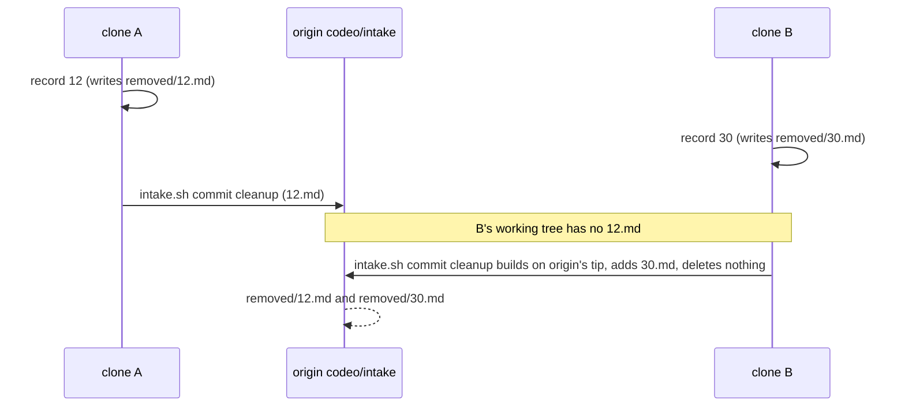

# Cleanup Removal Records — Round 2: A Commit That Never Deletes (#206)

> **For agentic workers:** REQUIRED SUB-SKILL: Use superpowers:subagent-driven-development (recommended) or superpowers:executing-plans to implement this plan task-by-task. Steps use checkbox (`- [ ]`) syntax for tracking.

**Goal:** Two engineers' removal records, and every other file under the intake branch, survive each other's commits whatever order the clones restore, record and push in; the placeholder check judges the text the script prints.

**Architecture:** Round 1 (`docs/plans/2026-11-27-cleanup-removal-records-206.md`, built and in this branch) assumed `intake.sh commit` only adds files. It does not: `build` runs `git add -f -- <dir>` on a tree read from origin's tip, and with git 2.x a directory pathspec also stages the deletion of every file under it that the committing clone's working tree lacks, so a commit replaces the directory with the clone's copy (`.codeo/206/qc.md` round 1, F1). Round 1 worked around it by having `cleanup.sh record` restore first, which narrows the window and does not close it. Round 2 fixes the cause: `build` adds with `--ignore-removal`, so a commit adds and updates files and deletes one only when `--drop` names it. `cleanup.sh record` then drops its restore call, and the placeholder check expands the overlay once with a sample issue number and looks at that text.

**Tech Stack:** bash (4.3+), `git`, `jq`; tests in the `shell` suite (`bash tests/run.sh`).

**Spec:** the issue (https://github.com/kbajpai/codeo/issues/206), `.codeo/206/plan.md` (Q10-Q12 and `## Notes`), and `.codeo/206/qc.md` round 1 (F1-F7). Round 1's plan stays as history.

## Global Constraints

- **The `intake.sh commit` change (Q10).** `build` in `scripts/intake.sh` adds the caller's paths with `git add -f --ignore-removal --`. Nothing else in `intake.sh` changes. A commit never deletes a file because the clone lacks it; the paths in the drop list (`--drop`, and the `lease release` and `stops waiting` removals, which already delete through `git rm` before the add) still go. The change covers every caller: dossiers, the triage ledger, the cleanup run records and the removal records. A file deleted from a working tree now stays on the intake branch until `--drop` or a hand edit of the branch removes it.
- **No undo command (Q11).** A recorded removal is corrected by deleting `.codeo/intake/cleanup/removed/<N>.md` from the intake branch and from every clone that holds a copy; a clone still holding it adds it back at its next `intake.sh commit cleanup`, and `record <N>` in it answers `already recorded`. The documentation says exactly that and no longer promises more.
- **The placeholder check looks at printed text (Q12).** Once, before any issue is listed and only with an overlay: expand `command:` and `fallback:` with `{N}` = `1` and `{name}` = the `name:` template expanded with `{N}` = `1`; refuse the run when either expanded text still matches `\{[A-Za-z0-9_]+\}`. The message stays `cleanup: the overlay's <key>: keeps a placeholder the script does not expand: <token>`, `<key>` being `command` or `fallback` and `<token>` the match in the expanded text (so `rm {{N}}` names `{1}`). `{{.Names}}` and `{a,b}` pass; `${HOME}` is refused. This project's overlay and the shipped template still print no brace.
- **`record` touches nothing on the intake branch.** It writes `.codeo/intake/cleanup/removed/<N>.md` in the working tree and reads origin's file names, as before; the `intake.sh restore cleanup` call and everything that says it restores are removed.
- **Wording fixes (F4-F7).** `skills/cleanup/SKILL.md` step 3's first paragraph no longer ends "Nothing else is written."; a `leftover` line "right after a proven line, a `failed name` line, or alone for an issue whose removal is recorded" (script header and skill step 1); the skill's Hand-off `Reads` names `origin/codeo/intake`'s `removed/` listing; the README's entry says a recorded issue that fails a proof is still listed.
- **Unchanged from round 1:** the record's shape and `cleanup.sh record`'s behaviour apart from the restore, the listing rule (a recorded issue hides only when every proof passes; `failed` lines and `leftover` lines stay), the stderr note, and the skill never building or running a command.
- **Invariants document:** none is configured for this project, so there is no invariant to check.
- **Environment lease:** no shared environment is configured, so no task carries `Needs lease:`; every task runs in this checkout. No task runs on the engineer's host.
- **Documentation.** Pages that move: `docs/skills.md` (`## cleanup`: the record paragraph), `docs/extension-points.md` (`cleanup/removal-command`: the refusal sentence), `README.md` (the `role stale` entry), `CHANGELOG.md` (the Unreleased bullet and the `Shared state:` line, which now also says `intake.sh commit` deletes only what `--drop` names). Task 4 first greps `docs/`, `README.md` and `.devcontainer/README.md` for any sentence that says `intake.sh commit` replaces or syncs a directory and fixes each it finds. No wiki module.
- **Parallel work:** #204, #195 and #188 stay as answered (`plan.md` Q6-Q9, `qc.md` Q1-Q2). None lists `scripts/intake.sh` or `tests/intake.test.sh`; `overlap.sh` runs after the footprint is committed.
- **Proof of done:** the `shell` suite has no `filter`, so each task's proof is the suite's `test` command, `bash tests/run.sh`, which prints `all cases passed`. While working, `bash tests/run.sh <name>` runs the matching test files.

## File Structure

| File | Change |
|---|---|
| `scripts/intake.sh` | `build` adds with `--ignore-removal`; the stale comment and the header say what `commit` does |
| `tests/intake.test.sh` | cases that pin it |
| `scripts/cleanup.sh` | placeholder check on expanded text; `record` loses its restore; header wording |
| `tests/cleanup.test.sh` | placeholder cases; the two-engineers test overlaps; the stale-clone case |
| `skills/cleanup/SKILL.md`, `docs/skills.md`, `docs/extension-points.md`, `README.md`, `CHANGELOG.md`, `tests/cleanup-skill.test.sh` | Task 4 |



---

### Task 1: `intake.sh commit` never deletes a file its clone lacks

**Files:**
- Modify: `scripts/intake.sh`
- Test: `tests/intake.test.sh`

- [ ] **Step 1: Write the failing tests** in `tests/intake.test.sh`, after the `commit_unions_the_triage_ledger…` case, using its helpers (`fresh_origin`, `clone_of`, `dossier`, `run`, `on_origin`, `show_origin`):
  - `commit_keeps_files_the_clone_lacks`: `o=$(fresh_origin)`; clones `a` and `b`; `dossier "$a" x/one.md …`, `run "$a" commit x "docs: a"`; then in `b` (which has not seen `one.md`) `dossier "$b" x/two.md …`, `run "$b" commit x "docs: b"`. `on_origin "$o"` lists both `.codeo/intake/x/one.md` and `.codeo/intake/x/two.md`. Before the change this fails: `one.md` is gone.
  - `commit_still_updates_a_changed_file`: `b` rewrites `x/two.md` and commits; origin's copy has the new text and `one.md` is still there.
  - `commit_drop_still_removes_the_named_directory`: the existing `commit_drop_removes_the_old_directory_in_the_same_commit` case already pins it; leave it as it is and name it in the report.
- [ ] **Step 2: Run the tests to verify they fail.**

Run: `bash tests/run.sh intake`
Expected: FAIL — `commit_keeps_files_the_clone_lacks` prints `FAIL:` with `one.md` missing from origin's listing.

- [ ] **Step 3: Implement.** In `scripts/intake.sh`, in `build` (`git add -f -- "$@"`), change it to `git add -f --ignore-removal -- "$@"` and replace the comment above it (`# -f: the intake directory is ignored on every other branch. No -A: a dossier absent from this clone is one it never restored, not one to delete.`) with `# -f: the intake directory is ignored on every other branch. --ignore-removal: a file absent from this clone is one it never restored, not one to delete; only <drop> removes. Without it a directory pathspec stages those deletions.` In the header, after the `commit and restore` paragraph's first sentence about what `commit` puts on the branch, add: `commit adds and updates files and deletes only what --drop names; a file missing from this clone is left on the branch.`
- [ ] **Step 4: Proof of done.**

Run: `bash tests/run.sh`
Expected: `all cases passed`

---

### Task 2: `record` drops its restore, and the two-engineers test overlaps

**Files:**
- Modify: `scripts/cleanup.sh`
- Test: `tests/cleanup.test.sh`

**Interfaces:**
- Consumes: Task 1's commit behaviour.
- Produces: `cleanup.sh record` with no `intake.sh` call. Its output and exit statuses do not change.

- [ ] **Step 1: Write the failing tests** in `tests/cleanup.test.sh`:
  - Rewrite `two engineers keep each other's records` so the two records overlap: clone A runs `record 12`; clone B, cloned before A commits, runs `record 30`; A then runs `intake.sh commit cleanup "x"`; B then runs the same commit. `git ls-tree -r --name-only origin/codeo/intake` lists `removed/12.md` and `removed/30.md`. This is the case round 1's test did not run.
  - Add `a clone that never restored does not delete records`: clone C, cloned after both are on origin, has only a dated run record `2026-11-27.md` in its working tree and runs `intake.sh commit cleanup "x"`; origin still lists both records and the dated file.
  - In `record is idempotent; a record already on origin keeps origin's content`, change the on-origin half back to what the plan intended: `record 12` prints `12<TAB>already recorded` and writes no local file (and rename the case `record is idempotent`).
- [ ] **Step 2: Run the tests to verify they fail.**

Run: `bash tests/run.sh cleanup`
Expected: FAIL — with `record`'s restore still in, the on-origin case finds a local file; the overlap and stale-clone cases already pass after Task 1, which is the point: the fix is in `intake.sh`.
- [ ] **Step 3: Implement.** In `scripts/cleanup.sh` delete the `intake.sh restore cleanup …` line in record mode and the comment above it, and from the header the line `It restores the intake branch's cleanup files first, because intake.sh commit replaces the directory.`
- [ ] **Step 4: Proof of done.**

Run: `bash tests/run.sh`
Expected: `all cases passed`

---

### Task 3: The placeholder check looks at the printed text

**Files:**
- Modify: `scripts/cleanup.sh`
- Test: `tests/cleanup.test.sh`

- [ ] **Step 1: Write the failing tests** in `tests/cleanup.test.sh`, beside the three placeholder cases (use `run_cleanup_rc`):
  - `a doubled brace around {N} is refused`: `command: rm {{N}}` ends the run with `cleanup: the overlay's command: keeps a placeholder the script does not expand: {1}` and `rc=1`.
  - `a placeholder in the name template is refused when the command prints it`: `name: x-{M}`, `pattern: ^x-.*$`, `command: rm {name}` ends the run naming `command` and `{M}`.
  - `a name template that no printed text uses is not refused`: the same name with `command: codeo rm {N}` prints the proven line.
  - `a brace expansion is not a placeholder`: `command: rm codeo-{1,2}` prints `12<TAB>proven<TAB>rm codeo-{1,2}<TAB>-`.
- [ ] **Step 2: Run the tests to verify they fail.**

Run: `bash tests/run.sh cleanup`
Expected: FAIL — the first two cases print a `proven` line today.
- [ ] **Step 3: Implement.** Replace the block that starts `# A placeholder the script does not expand` with:

```bash
# A placeholder the script does not expand would print as a command nobody can run. Expand the overlay once with a
# sample issue number and look at the text that would print.
if [[ -n $overlay ]]; then
    unknown='\{[A-Za-z0-9_]+\}'
    sample=$(overlay_value name)
    sample=${sample//\{N\}/1}
    for key in command fallback; do
        text=$(overlay_value "$key")
        text=${text//\{N\}/1}
        text=${text//\{name\}/"$sample"}
        [[ ! $text =~ $unknown ]] || die "the overlay's $key: keeps a placeholder the script does not expand: ${BASH_REMATCH[0]}"
    done
fi
```

  The name template is not checked on its own: it is refused only through a `command` or `fallback` that prints it (`{name}`), which is what the script prints. Update the header's overlay paragraph to say the check is on the expanded text.
- [ ] **Step 4: Proof of done.**

Run: `bash tests/run.sh`
Expected: `all cases passed`

---

### Task 4: The documentation and the wording fixes

**Files:**
- Modify: `skills/cleanup/SKILL.md`, `docs/skills.md`, `docs/extension-points.md`, `README.md`, `CHANGELOG.md`, `scripts/cleanup.sh` (header only)
- Test: `tests/cleanup-skill.test.sh`

- [ ] **Step 1: Write the failing pins** in `tests/cleanup-skill.test.sh`: step 3's first paragraph does not end `Nothing else is written.` while its second paragraph does end `Nothing else is written outside the run record and the removal records.`; the skill does not contain `restores origin's`; `docs/skills.md`'s cleanup section does not contain `restores origin's records first` and contains `adds it back`; the skill's Hand-off `Reads` names `codeo/intake`; `README.md` contains `still listed`.
- [ ] **Step 2: Run the pins to verify they fail.**

Run: `bash tests/run.sh cleanup-skill`
Expected: FAIL — each pin is missing today.
- [ ] **Step 3: Make the edits, each its own part:**
  - [ ] `skills/cleanup/SKILL.md`: step 3's first paragraph loses `Nothing else is written.`; the record paragraph loses `record restores origin's cleanup records itself` and ends `Nothing else is written outside the run record and the removal records.`; step 1's `leftover` sentence reads `right after its own, or alone when its removal is recorded`; the Hand-off `Reads` adds `and the removal records under `removed/` on `origin/codeo/intake``.
  - [ ] `scripts/cleanup.sh` header: the `leftover` line description reads `right after a proven line or a `failed name` line, or alone when the issue's removal is recorded`.
  - [ ] `docs/skills.md`, `## cleanup`: the record paragraph drops `restores origin's records first`; its last sentences read `There is no undo command: a wrong record is corrected by deleting .codeo/intake/cleanup/removed/<N>.md from the intake branch and from every clone that holds a copy, and a clone that still holds it adds it back at its next commit.`
  - [ ] `docs/extension-points.md`, `cleanup/removal-command`: the refusal sentence says the script expands the overlay once and refuses the run when the text it would print still holds a `{word}` token, with `{{N}}` and `${HOME}` as the two examples and `{{.Names}}` and `{a,b}` as printed as written.
  - [ ] `README.md`: the `role stale` entry reads `…records that so the next run does not list the issue again unless it fails a proof, in which case it is still listed`.
  - [ ] `CHANGELOG.md`, Unreleased: the `#206` bullet gains `intake.sh commit adds and updates files and deletes only what --drop names, so two clones' commits to the intake branch no longer delete each other's files`; the `Shared state:` line gains the same, and says an older `intake.sh` still replaces the directory.
  - [ ] Run `grep -rn "intake.sh commit" docs README.md .devcontainer/README.md` and fix any sentence that says `commit` replaces, mirrors or syncs a directory.
- [ ] **Step 4: Check links and paths, then the proof of done.**

Run: `bash tests/run.sh readme`
Expected: `all cases passed`

Run: `bash tests/run.sh`
Expected: `all cases passed`

---

## Review Focus

- A commit from a clone that lacks a file leaves it on the branch, and `--drop`, `lease release` and `stops waiting` still delete (Task 1; the lease tests in `tests/intake-lease.test.sh` must still pass).
- The overlapping two-engineers case runs the real `intake.sh commit` twice, with B's clone made before A's commit (Task 2).
- `{{N}}` is refused naming `{1}`; `{a,b}` and `{{.Names}}` pass; a name template is refused only through a command or fallback that prints it (Task 3).
- No page still says `record` restores, and none promises an undo (Task 4).
