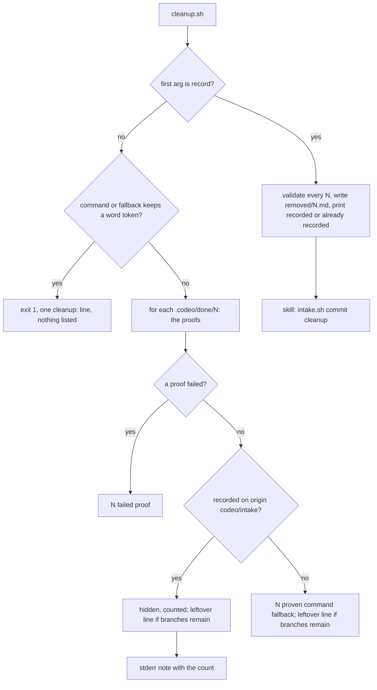

# Cleanup Removal Records and Placeholder Refusal Implementation Plan (#206)

> **For agentic workers:** REQUIRED SUB-SKILL: Use superpowers:subagent-driven-development (recommended) or superpowers:executing-plans to implement this plan task-by-task. Steps use checkbox (`- [ ]`) syntax for tracking.

**Goal:** `/codeo:cleanup` never prints a removal command with a placeholder left in it, and stops listing an issue whose removal the engineer recorded.

**Architecture:** `scripts/cleanup.sh` gains two things. First, a check, run once before any issue is listed, that `command:` and `fallback:` hold no `{word}` token after `{N}` and `{name}` are expanded; a hit exits 1 with one `cleanup:` line. Second, removal records: one file per issue, `.codeo/intake/cleanup/removed/<N>.md`, on the intake branch (`codeo/intake`). A new `cleanup.sh record <N>…` writes those files, `intake.sh commit cleanup` (which the skill already runs for its run record) pushes them, and a run reads the file names from `refs/remotes/origin/codeo/intake` after the fetch it already makes. A recorded issue whose proofs all pass prints no `proven` line; every other outcome prints as before.

**Tech Stack:** bash, `jq`, `git`; tests in the `shell` suite (`bash tests/run.sh`).

**Spec:** the issue (https://github.com/kbajpai/codeo/issues/206) and `.codeo/206/plan.md` (Q1-Q9 and `## Notes`). No separate reference doc: the behaviour lands in `docs/skills.md` and `docs/extension-points.md` (Task 5).

## Global Constraints

- **The first fault is already half fixed.** `cleanup.sh` has expanded `{N}` in `command:` since v1.0.9 (`scripts/cleanup.sh`, in `name_proof`). This plan adds the refusal of a placeholder the script does not expand (Q1) and pins this project's overlay and the shipped template as brace-free. It does not change which placeholders are expanded: `{N}` and `{name}`.
- **Refusal rule (Q1).** After removing `{N}` and `{name}`, the overlay's `command:` and `fallback:` must not match `\{[A-Za-z0-9_]+\}`. A match exits 1 with `cleanup: the overlay's <key>: keeps a placeholder the script does not expand: <token>` before anything is printed. `{{.Names}}` passes (a dot); `${HOME}` is refused.
- **Record shape (Q2).** `.codeo/intake/cleanup/removed/<N>.md`, body `issue:    #<N>` and `recorded: <YYYY-MM-DD>`. `intake.sh` is not changed: `intake.sh commit cleanup` builds on origin's tip and adds the files this clone has, so two engineers recording different issues both keep theirs, and the same issue recorded twice is one file.
- **Record command (Q3).** `cleanup.sh record <N>…` validates every number first (digits, no leading zero, a `.codeo/done/<N>` on `origin/<base>`) and writes nothing when any is wrong. It runs no proof and commits nothing. A number already recorded, here or on origin, prints `<N>` TAB `already recorded`; a new one prints `<N>` TAB `recorded`.
- **A record hides only a passing issue.** The proofs run for every issue, recorded or not. A recorded issue whose proof fails, or whose only failure is `name`, prints its `failed` line as before; a record never turns a failed proof into a pass (issue acceptance criteria 3 and 4 read together).
- **Leftover line (Q4).** A recorded issue that passes keeps its `leftover` line while its `codeo-live/<N>/…` branches are on origin.
- **The note (Q5).** When any recorded issue was hidden, the run ends with `cleanup: note: <k> issue(s) with a recorded removal are not listed` on stderr, exit 0; stdout keeps its format.
- **What a record means.** The engineer's statement that the container, volume and image were removed on every host that had them. Nothing verifies it, and there is no undo command: a wrong record is a file to delete from `codeo/intake` by hand. A record that was committed but not pushed is not read (the run reads origin's branch).
- **The skill still never builds or runs a command** (rules cleanup-02, cleanup-03, cleanup-04): it relays what `cleanup.sh` printed and runs `cleanup.sh record` and `intake.sh commit`, both scripts. No new rule marker is added, so `tests/inventory.test.sh` and `docs/skills-inventory.md` do not change.
- **Invariants document:** none is configured for this project, so there is no invariant to check.
- **Environment lease:** no shared environment is configured, so no task carries `Needs lease:`; every task runs in this checkout. No task runs on the engineer's host.
- **Documentation:** four pages move, each its own part of Task 5: the `## cleanup` section of `docs/skills.md`, the `cleanup/removal-command` section of `docs/extension-points.md`, the README's cleanup text, and `CHANGELOG.md`. `.devcontainer/README.md` and `docs/container-templates.md` describe what the overlay holds and what is listed, both unchanged; no wiki module.
- **Shared state:** the intake branch gains `.codeo/intake/cleanup/removed/`; `CHANGELOG.md`'s `Shared state:` line says so (an older `cleanup.sh` ignores the files and lists the issue again).
- **Parallel work:** #204 and #195 also edit `docs/skills.md`, `README.md` and `CHANGELOG.md` (Q8, Q9: proceed and coordinate). Task 5 edits only the cleanup sections and one Unreleased bullet, so a conflict is likely only in the Unreleased list.
- **Proof of done:** the `shell` suite has no `filter`, so a task's proof is the suite's `test` command, `bash tests/run.sh`, which prints `all cases passed`. While working, `bash tests/run.sh cleanup` runs the cleanup test files only.

## File Structure

| File | Change |
|---|---|
| `scripts/cleanup.sh` | header, argument parsing and `record` mode, placeholder check, read of the records, listing change, note |
| `skills/cleanup/SKILL.md` | step 1 relays the note, step 2's list-growth bullet, step 3 records removals |
| `docs/skills.md`, `docs/extension-points.md`, `README.md`, `CHANGELOG.md` | Task 5 |
| `tests/cleanup.test.sh` | cases for Tasks 1-3 |
| `tests/cleanup-skill.test.sh` | brace-free overlay and template, skill and README pins |



---

### Task 1: Refuse a placeholder the script does not expand

**Files:**
- Modify: `scripts/cleanup.sh`
- Test: `tests/cleanup.test.sh`, `tests/cleanup-skill.test.sh`

- [ ] **Step 1: Write the failing tests.** In `tests/cleanup.test.sh`, after the `{N} is expanded in the command as well as {name}` case, add a runner that keeps the exit status and four cases (each `setup_repo "12:$body"` and `fixture 12 closed 41 2026-01-01T00:00:00Z feat/12` first):
  - `run_cleanup_rc`: like `run_cleanup` but prints the output, then a last line `rc=<exit status>`.
  - `an unexpanded placeholder in the command stops the run`: overlay `name: codeo-{N}`, `pattern: ^codeo-[0-9]+$`, `command: codeo rm {M}`; output is exactly `cleanup: the overlay's command: keeps a placeholder the script does not expand: {M}` then `rc=1`; no `proven` line.
  - `an unexpanded placeholder in the fallback stops the run`: the same with `command: codeo rm {N}` and `fallback: run {issue}`; the message names `fallback:` and `{issue}`.
  - `a shell brace and a Go template are not placeholders`: `command: x {{.Names}}` prints `12<TAB>proven<TAB>x {{.Names}}<TAB>-`; `command: x ${HOME}` stops with `{HOME}` named.
  In `tests/cleanup-skill.test.sh`, in the check that runs the overlay (`out=$(run "$body")`), add `[[ $out != *'{'* && $out != *'}'* ]]` with the message `the overlay's printed line holds a brace`, and the same check for `templates/containers/.codeo/overlays/cleanup.md` with `@CODENAME@` replaced by `codeo` (read its `## removal-command` body the way `body` is read above).

- [ ] **Step 2: Run the tests to verify they fail.**

Run: `bash tests/run.sh cleanup`
Expected: FAIL — the two stop-the-run cases print `FAIL:` lines (the script prints a `proven` line with `{M}` in it today); the brace checks pass already.

- [ ] **Step 3: Implement.** In `scripts/cleanup.sh`, directly after the `overlay_value` function, add:

```bash
# A placeholder the script does not expand would print as a command nobody can run.
if [[ -n $overlay ]]; then
    unknown='\{[A-Za-z0-9_]+\}'
    for key in command fallback; do
        left=$(overlay_value "$key")
        left=${left//\{N\}/}
        left=${left//\{name\}/}
        [[ ! $left =~ $unknown ]] || die "the overlay's $key: keeps a placeholder the script does not expand: ${BASH_REMATCH[0]}"
    done
fi
```

  Update the header's overlay paragraph to say that `command:` and `fallback:` may hold only `{N}` and `{name}` and that any other `{word}` ends the run.

- [ ] **Step 4: Proof of done.**

Run: `bash tests/run.sh`
Expected: `all cases passed`

---

### Task 2: `cleanup.sh record <N>…`

**Files:**
- Modify: `scripts/cleanup.sh`
- Test: `tests/cleanup.test.sh`

**Interfaces:**
- Produces: `cleanup.sh record <N>…` — stdout one line per number, `<N>` TAB `recorded` or `<N>` TAB `already recorded`; exit 1 with a `cleanup:` line and no file written on a bad number, a number with no `.codeo/done/<N>` on `origin/<base>`, or no number. Writes `.codeo/intake/cleanup/removed/<N>.md` in the working tree, never commits. Task 3 reads the names this task writes.

- [ ] **Step 1: Write the failing tests** in `tests/cleanup.test.sh`:
  - `record writes one file per issue`: `setup_repo "12:$body" "30:$body"`; `record 12 30` prints `12<TAB>recorded` and `30<TAB>recorded`; `.codeo/intake/cleanup/removed/12.md` holds the lines `issue:    #12` and `recorded: ` followed by a date; nothing under `.codeo/done` or any other path changed.
  - `record refuses before writing`: `record 12 99` (99 has no done directory), `record 12 abc`, `record 012` and `record` each exit 1 with a `cleanup:` line, and `removed/12.md` does not exist.
  - `record is idempotent`: a second `record 12` prints `12<TAB>already recorded` and leaves the file as it was; a number whose file is already on origin's `codeo/intake` (use the `push_removed` helper from Task 3's tests, or `push_lease`'s way of building the branch) prints `already recorded` and writes no local file.
  - `record runs no container command and no proof`: the docker marker stays absent and no gh stub file is needed for the issue.

- [ ] **Step 2: Run the tests to verify they fail.**

Run: `bash tests/run.sh cleanup`
Expected: FAIL — `record` is read as an unknown argument today (the script takes none) and the cases print `FAIL:`.

- [ ] **Step 3: Implement.** In `scripts/cleanup.sh`:
  1. After `die()`, parse the arguments: `mode=list`; when `$1` is `record`, `mode=record`, `shift`, and `die "usage: cleanup.sh record <issue>…"` when no number follows; any other argument dies with `usage: cleanup.sh [record <issue>…]`.
  2. After `base_sha=…`, add `intake_ref=refs/remotes/origin/codeo/intake` (the name is `intake.sh`'s `branch`; say so in a comment), `removed_rel=$state_rel/intake/cleanup/removed`, and read the records once:

```bash
recorded=
if git rev-parse -q --verify "$intake_ref" >/dev/null; then
    recorded=$(git ls-tree --name-only "$intake_ref" -- "$removed_rel/" | sed -n 's|.*/\([0-9][0-9]*\)\.md$|\1|p')
fi
```
  3. Directly after that, and before the lease read, the record mode:

```bash
if [[ $mode == record ]]; then
    for n; do
        [[ $n =~ ^[1-9][0-9]*$ ]] || die "not an issue number: $n; nothing recorded"
        git cat-file -e "$base_sha:$state_rel/done/$n" 2>/dev/null || die "#$n has no $state_rel/done/$n on origin/$base; nothing recorded"
    done
    mkdir -p "$removed_rel"
    for n; do
        if grep -qxF "$n" <<<"$recorded" || [[ -e $removed_rel/$n.md ]]; then
            printf '%s\talready recorded\n' "$n"
            continue
        fi
        printf 'issue:    #%s\nrecorded: %s\n' "$n" "$(date -u +%F)" > "$removed_rel/$n.md"
        printf '%s\trecorded\n' "$n"
    done
    exit 0
fi
```
  4. Add to the header the usage `cleanup.sh record <N>…` and what it prints, and say that it writes and never commits.

- [ ] **Step 4: Proof of done.**

Run: `bash tests/run.sh`
Expected: `all cases passed`

---

### Task 3: Hide recorded issues that pass, and say how many

**Files:**
- Modify: `scripts/cleanup.sh`
- Test: `tests/cleanup.test.sh`

**Interfaces:**
- Consumes: `recorded` (Task 2), the list of issue numbers with a file under `removed/` on `origin/codeo/intake`.
- Produces: the listing rule in Global Constraints and the stderr note.

- [ ] **Step 1: Write the failing tests** in `tests/cleanup.test.sh`. First a helper `push_removed <N>…` modelled on `push_lease`: clone origin, check out `codeo/intake` (or an orphan when absent), write `.codeo/intake/cleanup/removed/<N>.md` for each, commit, push. Then cases, each with fixtures for 12 and 30 as in the existing `ascending N` case:
  - `a recorded issue that passes is not listed`: `push_removed 12`; stdout is only `30<TAB>proven<TAB>…`; stderr has `cleanup: note: 1 issue(s) with a recorded removal are not listed` (capture the two streams apart: `run_cleanup_split` returns stdout and stderr in two variables).
  - `a recorded issue whose proof fails is listed as not proven`: `push_removed 12` with issue 12 open prints `12<TAB>failed<TAB>issue`, and no note.
  - `a recorded issue whose only failure is name is listed as not proven`: overlay pattern that rejects the name; `12<TAB>failed<TAB>name`.
  - `a recorded issue keeps its leftover line`: add a `codeo-live/12/m` branch on origin (the existing leftover case shows how); stdout is the `12<TAB>leftover<TAB>git push origin --delete codeo-live/12/m` line alone, plus the note on stderr.
  - `a record for another issue hides nothing`: `push_removed 99` leaves 12 and 30 as before and prints no note.
  - `no intake branch: nothing is hidden`: the existing cases keep passing unchanged.
  - `two engineers keep each other's records`: clone A and clone B of the scratch origin; A runs `cleanup.sh record 12`, then `intake.sh commit cleanup "x"` (the scratch project needs the files `tests/intake.test.sh` sets up for `intake.sh`: follow its scratch layout); B, which fetched nothing since, runs `record 30` and the same commit. `git ls-tree -r --name-only origin/codeo/intake` lists both `12.md` and `30.md`.

- [ ] **Step 2: Run the tests to verify they fail.**

Run: `bash tests/run.sh cleanup`
Expected: FAIL — recorded issues are listed as `proven` today; the hide, leftover and note cases print `FAIL:`. The two-engineers case passes once Task 2 is in, which is the point: `intake.sh` needs no change.

- [ ] **Step 3: Implement.** Replace the body of the main loop's `if [[ $proof == ok ]]` branch, and add the counter and the note:

```bash
hidden=0
while IFS= read -r n; do
    proof=$(first_failed_proof "$n")
    if [[ $proof == ok ]]; then
        out=$(name_proof "$n")
        if [[ $out == name ]]; then
            printf '%s\tfailed\tname\n' "$n"
        elif grep -qxF "$n" <<<"$recorded"; then
            hidden=$((hidden + 1))
        elif [[ $out == - ]]; then
            printf '%s\tproven\t-\t-\n' "$n"
        else
            printf '%s\tproven\t%s\t%s\n' "$n" "$(head -n1 <<<"${out#cmd:}")" "$(tail -n1 <<<"$out")"
        fi
        leftover_proof "$n"
    else
        printf '%s\tfailed\t%s\n' "$n" "$proof"
    fi
done < <(…unchanged…)
if ((hidden)); then echo "cleanup: note: $hidden issue(s) with a recorded removal are not listed" >&2; fi
```

  The closing `if` (not `((hidden)) && …`) keeps the script's exit status 0 under `set -e` when nothing was hidden. Update the header: the proofs line `proven` now reads "and not recorded", the stderr note, and that a record never hides a failed proof.

- [ ] **Step 4: Proof of done.**

Run: `bash tests/run.sh`
Expected: `all cases passed`

---

### Task 4: The skill records removals and relays the note

**Files:**
- Modify: `skills/cleanup/SKILL.md`
- Test: `tests/cleanup-skill.test.sh`

- [ ] **Step 1: Write the failing tests** in `tests/cleanup-skill.test.sh`, each a `grep -qF … || check_fail`: the skill contains `cleanup.sh" record` and `removed/`; step 1 contains `cleanup: note:`; step 3 (taken with the same `awk` pattern the file uses for steps 2 and 4) contains `record <N>`, `the engineer's statement` and `intake.sh" commit cleanup`; step 2's list bullet still contains ``every issue under `.codeo/done/` `` and now says `until their removals are recorded`; the skill never contains `rm -f` or `docker` (the existing `docker` check stays); and `docs/skills.md`'s cleanup section contains `cleanup.sh record`.

- [ ] **Step 2: Run the tests to verify they fail.**

Run: `bash tests/run.sh cleanup-skill`
Expected: FAIL — the new needles are missing from the skill and `docs/skills.md`.

- [ ] **Step 3: Implement** in `skills/cleanup/SKILL.md`:
  - Step 1, after the lists: "A `cleanup: note:` line the script prints on stderr says how many recorded removals it left out; relay it under the lists as printed."
  - Step 2's list bullet: append "; it stops growing for an issue once its removal is recorded (step 3), and an issue the engineer recorded that now fails a proof is listed as not proven".
  - Step 3 keeps its first paragraph (the run record). Add a second: "**Record a removal the engineer says they did.** When the engineer names issues whose containers they removed on the host (`I removed 34 36`), or says they removed every proven one, in which case list the proven numbers back and run only for the ones they confirm, run `bash "${CLAUDE_PLUGIN_ROOT}/scripts/cleanup.sh" record <N>…` and relay its lines. Then commit with `bash "${CLAUDE_PLUGIN_ROOT}/scripts/intake.sh" commit cleanup "docs(codeo): cleanup removals recorded for #<N>…"`. A record is the engineer's statement; nothing here verifies that the container is gone, and the next run still proves every issue. Never record a number the engineer did not name."
  - Hand-off `Writes`: "— the run's record and the removal records under `removed/`".
  - Also update `description:` front matter only if a test pins it (it does not); leave it.

- [ ] **Step 4: Proof of done.**

Run: `bash tests/run.sh`
Expected: `all cases passed`

---

### Task 5: Documentation

**Files:**
- Modify: `docs/skills.md`, `docs/extension-points.md`, `README.md`, `CHANGELOG.md`
- Test: `tests/cleanup-skill.test.sh` (the `docs/skills.md` pin from Task 4, and one README pin added here)

Each page is its own part; what each must say afterwards:

- [ ] **`docs/skills.md`, `## cleanup`.** Purpose paragraph: a recorded issue whose proofs pass is not listed, a recorded issue that fails a proof is, and the run says on stderr how many it left out; the list's growth sentence says "until the removals are recorded". Reads and writes: reads `refs/remotes/origin/codeo/intake` for `removed/`; writes `.codeo/intake/cleanup/removed/<N>.md` through `cleanup.sh record` and `intake.sh`. A new sentence: how to record (`cleanup.sh record <N>…`, which the skill runs when the engineer names the issues), that a record is the engineer's statement, and that no undo command exists (delete the file from `codeo/intake`).
- [ ] **`docs/extension-points.md`, `cleanup/removal-command`.** In **Expected back**, add: `command:` and `fallback:` may hold only `{N}` and `{name}`; any other `{word}` token (`{M}`, `${HOME}`) makes the script stop with `cleanup:` and the token, and prints nothing. A Go template such as `{{.Names}}` is not a placeholder and is printed as written.
- [ ] **`README.md`.** The troubleshooting entry for `role stale:<N>` (`finished (…)`) gains "`/codeo:cleanup` prints how to remove the container and, once you say you removed it, records that so the next run does not list the issue again". The skills table row for `/codeo:cleanup` ends "…and runs nothing; tell it which removals you did and it stops listing them". Add one pin to `tests/cleanup-skill.test.sh`: README.md contains `records that so the next run`.
- [ ] **`CHANGELOG.md`, Unreleased.** One bullet: `/codeo:cleanup` stops with a `cleanup:` line when the overlay's `command:` or `fallback:` keeps a `{word}` placeholder the script does not expand, and can record that an issue's containers were removed (`cleanup.sh record <N>…`, then `intake.sh commit cleanup`), after which a run does not list that issue unless a proof fails; an older `cleanup.sh` ignores the records (#206). Change the section's `Shared state: none` line to name `.codeo/intake/cleanup/removed/<N>.md` on the intake branch, written by `cleanup.sh record` and read by `cleanup.sh`.

- [ ] **Step 1: Write the one README pin, run it, see it fail.**

Run: `bash tests/run.sh cleanup-skill`
Expected: FAIL — the README does not yet say it.

- [ ] **Step 2: Make the four edits above, then check the links and paths.**

Run: `bash tests/run.sh readme`
Expected: `all cases passed` (the README test resolves every backticked path and link; a new path in the README must exist).

- [ ] **Step 3: Proof of done.**

Run: `bash tests/run.sh`
Expected: `all cases passed`

---

## Review Focus

- `((hidden))` as the last statement would exit the script 1 under `set -e` when nothing was hidden (Task 3's `if` form avoids it).
- `record` validates every number before it writes any (Task 2's refusal case).
- A recorded issue with a failed proof still prints `failed`, and a recorded issue with leftover branches still prints its `leftover` line (Task 3).
- `{{.Names}}` is printed, `${HOME}` is refused (Task 1).
- The two-engineers case runs the real `intake.sh commit` twice against one origin (Task 3).
