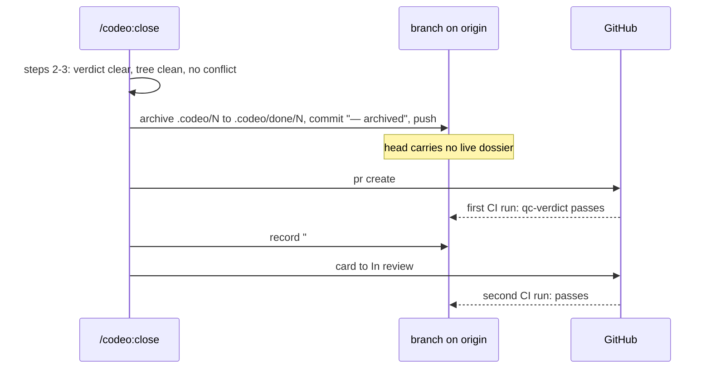

# Close: Archive Before Opening the PR Implementation Plan (#204)

> **For agentic workers:** REQUIRED SUB-SKILL: Use superpowers:subagent-driven-development (recommended) or superpowers:executing-plans to implement this plan task-by-task. Steps use checkbox (`- [ ]`) syntax for tracking.

**Goal:** `/codeo:close` archives the dossier and pushes it before it opens the pull request, so the first CI run on every pull request it opens passes `qc-verdict`; the pull request's number and URL are recorded in `.codeo/done/<N>/close.md` in a follow-up commit.

**Architecture:** Only `skills/close/SKILL.md`'s Phase 1 changes, plus the text that states the order. `scripts/qc-verdict.sh` and `scripts/dossier-check.sh` are not touched: an archive whose `close.md` has no `— pull request opened` round yet already passes both. A return from review and a send-back's un-archive are unchanged, so `qc-verdict` still fails until the dossier is archived again.

**Tech Stack:** Markdown skill text, bash (4.3+), tests in the `shell` suite (`bash tests/run.sh`).

**Spec:** the issue (https://github.com/kbajpai/codeo/issues/204) and `.codeo/204/plan.md` (Q1-Q2 and `## Notes`). No reference doc: the change is a reordering inside one skill.

## The new order

New Phase 1, with the step numbers it ends with (old numbers in brackets):

| New step | Does | Old |
|---|---|---|
| 2, 3 | verdict clear; tree clean and pushed; no conflict; overlap | 2, 3 |
| 4 | **Archive.** `mkdir -p .codeo/done`, `git mv .codeo/<N> .codeo/done/<N>`. A first open commits it alone, subject `docs(codeo): close dossier for #<N> — archived`, and pushes. A failed push is a stop: no pull request is opened on a head that still carries the live dossier. On a return from review the rename is only staged here and goes into step 7's single commit. | 6 |
| 5 | **Open the pull request** (skipped on a return from review). Title, body, template check, `pr create`. | 4 |
| 6 | **Record it** in `.codeo/done/<N>/close.md`; move the card. | 5 |
| 7 | **Commit and push the record**, `— PR #<pr>` (`— round <n>` on a return from review, which also carries the rename); the review-return comment. A failed push stays loud-but-kept. | 7 |

Phase detection (step 1) gains two rows and keeps the rest:

| What the facts say | Phase |
|---|---|
| No pull request, dossier at `.codeo/<N>/` | Phase 1 — archive, then open (as above) |
| **No pull request, dossier under `.codeo/done/<N>/` at `HEAD`** | **Phase 1, resumed after the archive push: skip step 4, run step 5 onward.** A conflict found at step 3 here un-archives in its own send-back commit, as step 11 does. |
| `state` open, dossier under `done/`, **no round in `close.md` records this pull request** | **resumed after `pr create`: skip steps 4-5; record it from step 1's lookup (step 6) and push (step 7).** Otherwise Phase 2 |
| `state` open, dossier at `.codeo/<N>/`, review round present | return from review (unchanged) |
| `state` open, dossier at `.codeo/<N>/`, no review round | first open resumed by an older plugin or a pull request opened by hand: step 5 skipped, steps 6, 4, 7 run in that order — kept as today |

## Global Constraints

- **Never open the pull request on a head that carries a live dossier.** Step 4's push lands before step 5 runs; a failed push stops the skill. This is the invariant the new rule `close-15` states.
- **Unchanged on purpose:** a send-back's `git mv .codeo/done/<N> .codeo/<N>` (step 11) and the `qc-verdict` fail-closed check on a live dossier, which is what keeps a pull request unmergeable while review work is in flight (acceptance criterion 3); `close.md`'s `— pull request opened` heading, its `#<number> <html_url>` line and the one-round rule (`dossier-check.sh finished-pr`); `cleanup.sh`, which reads that line from `done/<N>/close.md`.
- **A pull request now costs two CI runs, both green** (the archive commit's, then the record commit's). The record cannot ride in the first commit: the number does not exist until the pull request is opened.
- **Step numbers move.** `tests/close-skill.test.sh` selects steps by number, and the skill, `docs/` and the tests cite step numbers (`step 6`, `step 7`, `step 9's first check`). Task 2 renumbers every reference found by `grep -rn "step [0-9]" skills/close docs tests` and Task 1's tests are written against the new numbers.
- **Documentation:** the pages that move are `docs/dossier.md`, `docs/handoff.md`, `docs/skills.md`, `README.md`, and the wording in `skills/triage/SKILL.md` and `skills/init/SKILL.md` about a dossier under `done/` with no pull request (Task 5). No wiki module. No invariants document is configured, so there is no invariant to check. There is no shared environment, so no task carries `Needs lease:`; every task runs in this checkout and no task runs on the engineer's host.
- **Reach:** this repository runs the pinned plugin (v1.0.10), so the fix applies here after the next release and `chore: pin codeo` bump. #204's own pull request is opened by the old skill and its first run is red; the criterion is proved by tests (Q1).
- **Overlap with #195** (`skills/close/**`, `skills/init/**`, `tests/**`, `README.md`, `CHANGELOG.md`, four `docs/` pages): proceed and coordinate, #204 merging first (Q2). `tests/fixtures/skills-inventory.rules.sha256` is the file likely to conflict; whichever merges second regenerates it with `bash tests/inventory.test.sh --update`.

## File Structure

- `skills/close/SKILL.md` — Phase 1 steps 1, 3-7, the closing-block wording that names them, rule `close-15`.
- `tests/close-skill.test.sh` — new order pins; renumbered step selectors.
- `tests/qc-verdict.test.sh` — a replay of the two commits.
- `tests/role.test.sh` — an archived dossier with no pull request recorded.
- `tests/fixtures/dossiers/good-basic/close.md`, `tests/fixtures/golden/case-a/close.md` — log wording.
- `docs/skills-inventory.md`, `tests/fixtures/skills-inventory.rules.sha256` — rule `close-15`.
- `docs/dossier.md`, `docs/handoff.md`, `docs/skills.md`, `README.md`, `skills/triage/SKILL.md`, `skills/init/SKILL.md`, `CHANGELOG.md`.

---

### Task 1: Tests first

**Files:** modify `tests/close-skill.test.sh`, `tests/qc-verdict.test.sh`, `tests/role.test.sh`.

- [ ] **Step 1: Pin the new order in `tests/close-skill.test.sh`** (written against the table above). Using its `step_contains` / `step_order` / `text_order` helpers:
  - step 4 contains `git mv .codeo/<N> .codeo/done/<N>`, comes after `mkdir -p .codeo/done`, contains `— archived` and `a stop` for a failed push, and says the pull request is not opened on a live dossier;
  - step 5 contains `pr create`; step 6 contains `#<number> <html_url>`; step 7 contains `— PR #<pr>`;
  - the skill's text has `git push` of step 4 before `pr create` of step 5 (`text_order` over the Phase 1 section);
  - step 1's table contains the two new rows (`resumed after the archive push`, `no round in \`close.md\` records this pull request`);
  - rule marker `close-15` is present.
  Rename the existing selectors that name old steps 4-7 to the new numbers.
- [ ] **Step 2: Replay the two commits in `tests/qc-verdict.test.sh`** (new case, same helpers as its live-dossier case): a base with the live dossier; head 1 moves it to `done/7/` with a clear `qc.md` and a `close.md` with no `— pull request opened` round; head 2 adds that round and the `#<n> <url>` line. `qc-verdict.sh <base> <head1>` and `<base> <head2>` both exit 0 and print `round 1 clear`; head 0 (the live dossier) still exits 1 with `.codeo/7` named. This passes before and after the change: it pins the property the fix relies on.
- [ ] **Step 3: One case in `tests/role.test.sh`**: `stale_with` an archive `done/67/close.md` holding no `— pull request opened` round, base lacking the archive, gives `lost` (the interrupted-after-archive state).
- [ ] **Step 4: Check the failure first.**

**Proof of done:** `bash tests/close-skill.test.sh; echo "exit=$?"` → `exit=1`, with failures naming the new pins (`step 4 has no [— archived]`, `no step 7`-style messages, `close-15`); `bash tests/qc-verdict.test.sh && bash tests/role.test.sh` → exit 0, `all cases passed`.

### Task 2: Reorder Phase 1 in `skills/close/SKILL.md`

**Files:** modify `skills/close/SKILL.md`.

- [ ] **Step 1:** Reorder and renumber steps 4-7 as in the table; keep their text where it is unchanged. Step 4 absorbs old step 6 (including the `mkdir -p` sentence and the "reaches `<base>` with the merge" sentence), says the first open commits and pushes it alone as `docs(codeo): close dossier for #<N> — archived`, and a failed push is a stop. Step 5 is old step 4, minus "skip this on a return from review" now being the first sentence of the step. Step 6 is old step 5 and writes into `.codeo/done/<N>/close.md`. Step 7 is old step 7, commit subject unchanged; the return-from-review commit carries the rename and the record together.
- [ ] **Step 2:** Update step 1's table and the sentence after it (the open-pull-request, live-dossier row stays, for older plugins and hand-opened pull requests; add the two new rows and say which steps they skip). Update every other reference to the moved steps (`step 6`, `step 7`, `step 9's first check pushes it`, the `— archived` subject in step 9's "commits ahead are this skill's own" list: a `docs(codeo): close dossier for #<N>` commit touching only `.codeo/` already covers it).
- [ ] **Step 3:** Add `<!-- rule: close-15 -->` above step 4: "Archive and push before opening the pull request. The head the pull request opens on carries no live dossier, so the first `qc-verdict` run passes. A failed push stops the skill." Add `close-15` wording to the Hand-off "Writes" bullet only if it changes; it does not.
- [ ] **Step 4:** Step 8's report and the Tips paragraph name steps by number; renumber.

**Proof of done:** `bash tests/close-skill.test.sh; echo "exit=$?"` → `exit=0` and `all cases passed`; then `bash tests/run.sh` (the `shell` suite has no single-test filter) → exit 0.

### Task 3: Rule `close-15` in the inventory

**Files:** modify `docs/skills-inventory.md`, `tests/fixtures/skills-inventory.rules.sha256`.

- [ ] **Step 1:** Add `- [close-15] Archive and push the dossier before opening the pull request.` after `close-14`.
- [ ] **Step 2:** `bash tests/inventory.test.sh --update`, then check the diff is the one new hash line and nothing else.

**Proof of done:** `bash tests/inventory.test.sh && bash tests/skills.test.sh` → exit 0, `all cases passed`. (If #195 merges first and has already changed the file, run `--update` again after merging `main`.)

### Task 4: Fixtures and log wording

**Files:** modify `tests/fixtures/dossiers/good-basic/close.md`, `tests/fixtures/golden/case-a/close.md`.

- [ ] **Step 1:** Their `## Log` line `opened the pull request, dossier archived` becomes `archived the dossier, opened the pull request`. Round headings and the `#<n> <url>` line are unchanged (the `dossier-check` forms do not change). The other fixtures say only `opened the pull request` and stay.
- [ ] **Step 2:** The sed on `case-a/close.md` in `tests/replay.test.sh` strips the ` · cost: …` suffix; check it still matches.

**Proof of done:** `bash tests/dossier-check.test.sh && bash tests/replay.test.sh` → exit 0, `all cases passed`.

### Task 5: Documentation the change moves

**Files:** modify `docs/dossier.md`, `docs/handoff.md`, `docs/skills.md`, `README.md`, `skills/triage/SKILL.md`, `skills/init/SKILL.md`.

- [ ] **`docs/dossier.md`**, the paragraph after *The shape of a file* (`/codeo:close` moves an issue's directory…): say `close` archives and pushes the dossier before it opens the pull request, then records the pull request in `done/<N>/close.md` in a second commit, so the archive reaches the base branch with the merge and the first check run sees no live dossier. The *The pull request* bullet under *What a finished dossier looks like* stays; add that the round is written after the pull request exists, in the commit after the archive.
- [ ] **`docs/handoff.md`**, the `review — dossier archived` bullet: the archive can now exist before any pull request does (between close's archive push and `pr create`); say the line does not look for one (it already says so — keep it, drop "a pull request is usually open" for "a pull request is open unless close stopped between its two pushes"). The `qc-verdict` paragraph's "stays unmergeable until `/codeo:close` archives it again" stays.
- [ ] **`docs/skills.md`**, `## close`, *Purpose and triggers* and *Reads and writes*: order of the three steps, in one sentence each; the commit subjects `— archived` and `— PR #<pr>`.
- [ ] **`README.md`**, `### 6. /codeo:close`: *It writes* says it archives the dossier to `.codeo/done/<N>/` and pushes it before opening the pull request, so the first check passes; *It commits* lists `docs(codeo): close dossier for #<N> — archived` then `… — PR #<pr>`.
- [ ] **`skills/triage/SKILL.md`**, the board-mismatch table row `dossier at .codeo/done/<N>/, no pull request, or closed unmerged | none fits: always a mismatch`: add that a no-pull-request row is also what an interrupted close leaves between its archive push and `pr create`, so it is reported as an interrupted close to finish with `/codeo:close`, not as a mismatch to fix by hand. **`skills/init/SKILL.md`**, the `dir` is `.codeo/done/<N>` is step 3's `(PR open)` stop: say it also covers an archive pushed with no pull request yet. Both are wording only; if `tests/triage-skill.test.sh` or `tests/init-skill.test.sh` pin the changed sentence, update the pin in the same task.
- [ ] **Diagram:** the README has a flowchart ending `archived in .codeo/done/N` after a merge; it stays accurate. No other diagram changes. The order diagram above stays in this plan only.

**Proof of done:** `bash tests/run.sh` → exit 0 (it runs `readme.test.sh`, `skills-doc.test.sh`, `triage-skill.test.sh`, `init-skill.test.sh`).

### Task 6: Changelog

**Files:** modify `CHANGELOG.md`.

- [ ] **Step 1:** One bullet under `## Unreleased`: `/codeo:close` archives the dossier and pushes it before it opens the pull request and records the pull request in `.codeo/done/<N>/close.md` in a second commit, so the first CI run passes `qc-verdict`; two new interrupted-close cases in phase detection; the check, the dossier forms and the send-back's un-archive are unchanged; it applies to a project after its next plugin release and pin (#204). Keep the `Config schema: 1 (unchanged)`, `Shared state: none`, `Safe to bump mid-workflow: yes` header lines true: an in-flight workflow closed by an older plugin keeps working.

**Proof of done:** `bash tests/run.sh` → exit 0 (the full suite: no changelog-specific test exists, so the whole `shell` suite is the check).

---

## Review Focus

- **The two interruption points:** killed after the archive push and killed after `pr create`; step 1's rows must reach step 5 and step 6 respectively, and neither may open a second pull request or write a second `— pull request opened` round (`finished-pr`).
- **A conflict found on resume** (archive pushed, `main` moved): the send-back must un-archive in the same commit as the `— conflicts with <base>` round.
- **A return from review** is one commit carrying the rename and the record, as today; its run passes because the dossier is archived in it.
- **Renumbering:** no leftover `step 6`/`step 7` reference points at the wrong step.
- **Acceptance criteria** map: 1 → Tasks 1-2 (qc-verdict replay, order pins), 2 → Tasks 1-2 (step 6 records into `done/<N>/close.md`; `cleanup.sh` reads it), 3 → Task 2 (step 11 unchanged) and the live-dossier case already in `tests/qc-verdict.test.sh`, 4 → Tasks 1, 4, 5.
