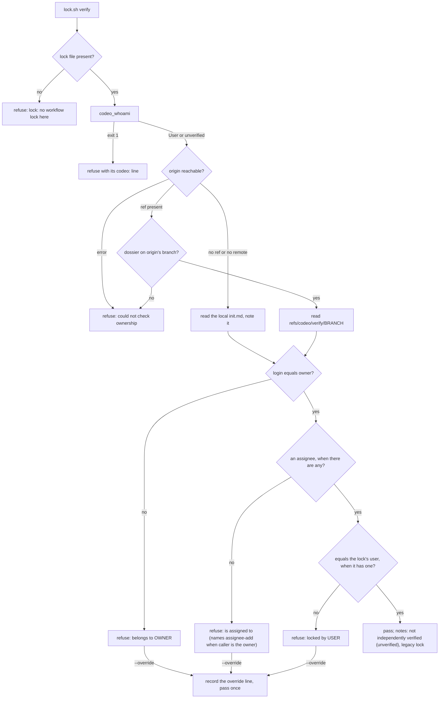

# Web-Session Ownership and QC Round 1 Fixes Implementation Plan (#195, round 2)

> **For agentic workers:** REQUIRED SUB-SKILL: Use superpowers:subagent-driven-development (recommended) or superpowers:executing-plans to implement this plan task-by-task. Steps use checkbox (`- [ ]`) syntax for tracking.

**Goal:** A hosted web session's `unverified` login is compared with the owner, the assignees and the lock's user exactly like a verified one, so a mismatch refuses there too; and the other findings of `qc.md` round 1 are fixed.

**Architecture:** `lock.sh`'s `check_owner` and `verify` lose their `unverified` special cases and keep only the "not independently verified" note. The pushed dossier is fetched into a private ref instead of `FETCH_HEAD`. `lib/identity.sh` learns a tolerant Owner row and a date helper. The `init` and `close` skills follow (compare an `unverified` login; a failed `assignee-add` is recorded; a legacy stash removes the caller), and the docs are corrected to what the code does.

**Tech Stack:** bash (4.3+), `jq`, `git`; tests in the `shell` suite (`bash tests/run.sh [name-substring]`).

**Spec:** the issue (https://github.com/kbajpai/codeo/issues/195); `.codeo/195/plan.md` (Q9-Q11 and `## Notes`, which replace Q2 and amend Q7); `.codeo/195/qc.md` round 1 (F1-F8). Round 1's plan (`docs/plans/2026-11-27-identify-acting-user-195.md`) stays as written: its tasks are built, and everything it did not name here is unchanged.

## Global Constraints

- **Q9 (a): one comparison for every login.** An `unverified` login (type from `codeo_whoami`, a web session with only `$CODEO_GITHUB_LOGIN`) goes through the same checks as a `User` login: the pushed owner (`belongs to`), the issue's assignees when there are any (`is assigned to`), and the lock's `user:` (`locked by`). A mismatch refuses, and the ownership refusals stay overridable by `--override "<words>"`. A match passes with the note `not independently verified: hosted web session`. The variable is therefore never trusted, only compared. The same rule runs in `take` (no lock on a mismatch).
- **Q10 (a): legacy stash.** When `lock.sh owner <N>` prints no owner and step 0's `verify` passed **without** `--override`, `close`'s stash and abandon remove the login `user whoami` prints; with an override they skip and say so. They never remove a login they did not verify.
- **Q11 (a): assignee loop.** When the caller is the recorded owner but not an assignee, `verify` refuses with a line that names the fix (`github.sh issue assignee-add <N> <login>`); `init` writes a failed `assignee-add` as a `## Notes` line of `init.md` in one follow-up commit, so the next step can see why.
- **Private ref (F5).** `check_owner` fetches `+refs/heads/<branch>:refs/codeo/verify/<branch>` (with `--no-write-fetch-head` when git supports it) and reads `refs/codeo/verify/<branch>`; it never reads `FETCH_HEAD`, which `live.sh beat` rewrites in the background. All other failure rules of round 1 stay (no `origin` remote or `ls-remote` exit 2 → the local dossier with a note; any other failure, or a branch with no dossier on origin, → "could not check", not overridable).
- **Owner parsing (F4, F6).** The Owner row accepts a backticked login and flexible whitespace (`` | Owner | `alice` | `` and `| Owner  | alice |`); the last resume line whose login the owner regex accepts still wins. The `last resumed <date>` in a refusal is the date of the line that set the owner, never of a legacy `by no login` line. The three `resume_re` copies (`claim.sh:101`, `lock.sh:44`, `.devcontainer/scripts/role.sh:122`) do not change.
- **Rules.** `init-11` and `close-16` change text (no new ids); the `want` map in `tests/inventory.test.sh` stays `[init]=11 [plan]=10 [implement]=11 [qc]=15 [close]=16`, and each task that rewords a rule regenerates the pin with `bash tests/inventory.test.sh --update` and commits `tests/fixtures/skills-inventory.rules.sha256` only if it changed.
- **Proof of done.** The `shell` suite has no single-test filter, so a task's proof is its own test file(s) through `bash tests/run.sh <name-substring>`, and the last task runs the whole `bash tests/run.sh`. `live.test.sh` (`hostname: command not found`) and `sandbox.test.sh` (`.sbx` gitignored) fail in this environment on `origin/main` too; with a `hostname` shim on `PATH`, `live` passes.
- **Invariants document:** none is configured, so there is no invariant to check. **Environment lease:** the project has no shared environment, so no task carries `Needs lease:`; every task runs in this checkout and none runs on the engineer's host.
- **Documentation:** the pages that move are `docs/handoff.md`, `docs/dossier.md`, `docs/skills.md`, `README.md` and `CHANGELOG.md` (Task 6, plus the rule text in Tasks 3-4).
- **Footprint:** unchanged in kind from round 1 (the branch's files, plus this plan); written at the hand-off.
- **Reach and cost:** the web hook (`hooks/live-signal.sh`, an 8 second bound) now makes the same `ls-remote`/`fetch`/`issue view` calls as other hosts when it takes a lock; a timeout there means no lock and a `TODO`. The changelog says so.

## Review Focus

- A web session whose variable names someone other than the pushed owner, or other than the assignee, is refused by `verify`, by `take` (no lock) and by `init`'s prose; with the override it passes once and records the line (Tasks 2, 3).
- A concurrent `git fetch` between `verify`'s fetch and its read cannot change what it reads (Task 2: a `git` stub that clobbers `FETCH_HEAD` right after the fetch).
- A dossier whose only resume line is a legacy `by no login after the stash of …` has no owner, and its refusal date is never taken from that line (Tasks 1, 2).
- A backticked Owner row or a padded one names the right owner; a wrong login still refuses (Task 1).
- A legacy stash removes the verified caller only when `verify` passed without an override (Task 4).
- The recorded owner who is not an assignee gets the line that names `assignee-add`, not "take it over" (Task 2).
- A wrapped `lease take … \ --override` in the `qc` skill is caught by its pin (Task 5).

---

### Task 1: `lib/identity.sh` — tolerant Owner row and the owner-date helper

**Files:**
- Modify: `lib/identity.sh` (`codeo_owner_of_init`; new `codeo_owner_date_of_init`; the header comment)
- Create: `tests/identity.test.sh`

**Interfaces:**
- Produces: `codeo_owner_of_init <file>` unchanged in contract (prints the owner login or nothing, exit 0) but the Owner row matches `^| *Owner *| *` + optional backticks + login + optional backticks + ` *|`; `codeo_owner_date_of_init <file>` — prints `YYYY-MM-DD` of the **last** `- <date> — resumed: by <login> after …` line whose login is accepted (a non-space token), nothing when the owner comes from the row or there is none; exit 0.
- Consumes: nothing from earlier tasks.

- [ ] **Step 1: Write the failing test** `tests/identity.test.sh` (own `assert_eq` helper like its neighbours; sources `lib/identity.sh`; prints `all cases passed`): plain row → `alice`; `` | Owner | `alice` | `` → `alice`; `| Owner  |   alice   |` → `alice`; two resume lines (`alice`, then `bob`) → `bob`; a resume line then an override line whose words imitate one → the real resume's login; `- 2026-01-02 — resumed: by no login after the stash of 2026-01-01` → no owner and no date; no file → nothing; `codeo_owner_date_of_init` of the two-resume file → the second line's date, of a row-only file → nothing, of the legacy `by no login` line → nothing.
- [ ] **Step 2: Run it to see it fail.** `bash tests/run.sh identity` — Expected: FAIL (`codeo_owner_date_of_init: command not found`, and the backticked row case).
- [ ] **Step 3: Implement** the row regex and `codeo_owner_date_of_init` (same anchored resume regex as the owner's, `tail -n1`, sed capture of the date).
- [ ] **Step 4: Run it to see it pass.** `bash tests/run.sh identity` — Expected: `all cases passed`; `bash tests/run.sh lock` still passes.
- [ ] **Step 5: Commit.** `git add lib/identity.sh tests/identity.test.sh` then `git commit -m "fix: the owner row tolerates backticks and spacing (#195)"`.

---

### Task 2: `lock.sh` — compare an `unverified` login, private ref, owner-date, assignee-add hint

**Files:**
- Modify: `scripts/lock.sh` (header comment; `check_owner` at ~85-150; the `unverified` branch of `verify` at ~200-205; the `take` call at ~359-363)
- Modify: `tests/lock-verify.test.sh`, `tests/lock.test.sh` (including the stub `git` in `stub_bin`)

**Interfaces:**
- Consumes: `codeo_owner_date_of_init` (Task 1); `codeo_whoami`'s `<login><TAB><type>`.
- Produces: `check_owner <issue> <branch> <login> <type>` — no early return for `unverified`; sets `note="not independently verified: hosted web session"` for that type and passes with it; refusals as in Global Constraints, in this order: owner, assignees, then (in `verify` only) the lock's `user:`. The assignees refusal reads `codeo: #<N> is assigned to <assignees>, not <login> — …`, and when `<login>` equals the recorded owner: `codeo: #<N> is assigned to <assignees>, not <login>, though you are its recorded owner — add yourself: github.sh issue assignee-add <N> <login>`.
- Produces: `verify` runs the same checks and the lock-user comparison for both types; a lock with no `user:` adds the note `legacy lock: no recorded user` for both. The `take` path calls `check_owner` unchanged.

- [ ] **Step 1: Write the failing tests.** In `tests/lock-verify.test.sh` (all with the existing helpers; `CLAUDE_CODE_REMOTE=true`, `GH_STUB_USER=FAIL`, `CODEO_GITHUB_LOGIN=<login>`):
  - `web, variable names someone other than the pushed owner` → exit 1, stderr contains `belongs to alice`, `you are mallory`; (replaces nothing: round 1's `web, variable only, lock user equal` keeps its expectation only where the variable equals the owner — change that case's pushed owner to the variable's login so it still passes with `not independently verified`).
  - `web, owner matches but the issue is assigned to someone else` → exit 1, `is assigned to`.
  - `web, owner and assignee match` → exit 0, stdout contains `not independently verified`.
  - `web, mismatch with --override` → exit 0, `init.md` gains one `override: mallory over alice: "…"` line.
  - `web, lock user differs` still refuses (`locked by`).
  - `recorded owner who is not an assignee` (verified login, owner `bob`, assignees `alice`) → exit 1, stderr contains `though you are its recorded owner` and `assignee-add`.
  - `FETCH_HEAD clobbered after the fetch` — add `GIT_STUB_AFTER_FETCH` to the `git` stub (a command it runs after every `git fetch`, e.g. `git fetch -q origin main` into the same repo so `FETCH_HEAD` points at `main`'s tip); with it set, `verify` as the owner still exits 0 and a stale checkout case (pushed resume line by bob) still refuses naming bob; assert `git rev-parse --verify refs/codeo/verify/feat/x` succeeds afterwards.
  - `refusal date`: a pushed dossier whose last resume line is `- 2026-01-02 — resumed: by no login after the stash of 2026-01-01` above an Owner row `alice` → `belongs to alice (claimed)`, no `last resumed`.
  In `tests/lock.test.sh`: `take, web, pushed owner differs` → no lock, `lock: TODO` containing `belongs to`.
- [ ] **Step 2: Run them to see them fail.** `bash tests/run.sh lock` — Expected: FAIL on the web-mismatch, recorded-owner, clobbered-`FETCH_HEAD` and refusal-date cases.
- [ ] **Step 3: Implement** in `scripts/lock.sh`: drop the `unverified` early return and the `unverified` branch of `verify` (keep the note); fetch `+refs/heads/$branch:refs/codeo/verify/$branch` with `--no-write-fetch-head` when `git fetch -h` lists it, and read that ref in the `for p in …` loop; take `date=` from `codeo_owner_date_of_init`; add the recorded-owner assignees line. Rewrite the header comments that still say an `unverified` login is never compared.
- [ ] **Step 4: Run them to see them pass.** `bash tests/run.sh lock` and `bash tests/run.sh live-signal` — Expected: `all cases passed` (the live-signal tests drive `take web`; if one now fails because its stub owner differs from the variable, set the dossier's owner to the variable's login, not the check).
- [ ] **Step 5: Commit.** `git add scripts/lock.sh tests/lock-verify.test.sh tests/lock.test.sh` then `git commit -m "fix: an unverified login is compared with the owner and assignees (#195)"`.

---

### Task 3: `init` skill — compare an `unverified` login; record a failed `assignee-add`

**Files:**
- Modify: `skills/init/SKILL.md` — rule `init-11` (~line 88-93), the step-3 note (~107), the step-6 exit-3 carve-out (~203-206), step 9's `assignee-add` paragraph (~313-318)
- Modify: `docs/skills-inventory.md` (the `init-11` bullet), `tests/fixtures/skills-inventory.rules.sha256`
- Modify: `tests/init-skill.test.sh`

**Interfaces:**
- Consumes: Task 2's behaviour (an `unverified` login is compared by `lock.sh take`/`verify`).
- Produces: `init-11` says an `unverified` login is recorded and compared like any other (assignee other than the login stops it unless the engineer's override is recorded; the lost-checkout resume needs the assignee to equal the login). Step 9: a failed `assignee-add` is written as `- <date> — assignee-add failed: <git/gh's message>` under `init.md`'s `## Notes` (created when absent, before `## Outcome`), committed alone, staged by name, subject `docs(codeo): init dossier for #<N> — assignee-add failed`, and pushed, and is also reported in the closing message.

- [ ] **Step 1: Write the failing assertions** in `tests/init-skill.test.sh`: the skill no longer contains `never compared with an assignee`, `skips only the assignee comparison`, or `(not for \`unverified\`)`; `init-11`'s paragraph contains `unverified` and `compared`; step 9 contains `assignee-add failed` and `## Notes`; the Claim-line absence pins from round 1 still hold.
- [ ] **Step 2: Run it to see it fail.** `bash tests/run.sh init-skill` — Expected: FAIL on the first new assertion.
- [ ] **Step 3: Edit** the four spots minimally, in the neighbouring style; update the `init-11` bullet in `docs/skills-inventory.md` to the new meaning; run `bash tests/inventory.test.sh --update` and commit the fixture if it changed.
- [ ] **Step 4: Run them to see them pass.** `bash tests/run.sh init`, `bash tests/run.sh inventory`, `bash tests/run.sh skills` — Expected: `all cases passed`.
- [ ] **Step 5: Commit.** `git add skills/init/SKILL.md docs/skills-inventory.md tests/inventory.test.sh tests/fixtures/skills-inventory.rules.sha256 tests/init-skill.test.sh` then `git commit -m "fix: init compares an unverified login and records a failed assignee-add (#195)"`.

---

### Task 4: `close` skill — a legacy stash removes the verified caller

**Files:**
- Modify: `skills/close/SKILL.md` (rule `close-16`, the stash bullet at ~651-655; abandon inherits it)
- Modify: `docs/skills-inventory.md` (`close-16`), `tests/fixtures/skills-inventory.rules.sha256`
- Modify: `tests/close-skill.test.sh`

**Interfaces:**
- Consumes: `lock.sh owner <N>`; `github.sh user whoami`; `github.sh issue assignee-remove <N> <login>`.
- Produces: `close-16`: take the owner from `lock.sh owner <N>` and remove that login; when it prints no owner and step 0's `verify` passed without an override, remove the login `user whoami` prints; when an override was used and no owner is printed, skip the call and say so; never remove a login that was not verified.

- [ ] **Step 1: Write the failing assertions** in `tests/close-skill.test.sh` (stash section): contains `lock.sh" owner <N>`, `user whoami`, `without an override` (or the exact wording you choose, pinned once), still contains `assignee-remove <N> <owner>` and `Never remove`.
- [ ] **Step 2: Run it to see it fail.** `bash tests/run.sh close-skill` — Expected: FAIL on the new wording.
- [ ] **Step 3: Edit** the rule and the inventory bullet; `bash tests/inventory.test.sh --update`; commit the fixture if it changed.
- [ ] **Step 4: Run them to see them pass.** `bash tests/run.sh close`, `bash tests/run.sh inventory`, `bash tests/run.sh skills` — Expected: `all cases passed`.
- [ ] **Step 5: Commit.** `git add skills/close/SKILL.md docs/skills-inventory.md tests/fixtures/skills-inventory.rules.sha256 tests/close-skill.test.sh` then `git commit -m "fix: stashing a legacy workflow removes the verified caller (#195)"`.

---

### Task 5: Test-pin gaps (F8)

**Files:**
- Modify: `tests/lock.test.sh` (the `take, unresolved login` case at ~641), `tests/qc-skill.test.sh` (the `--override` pin at ~124-127)

**Interfaces:** consumes nothing new; produces stronger pins.

- [ ] **Step 1: Write the failing test.** In `tests/qc-skill.test.sh`, factor the pin into a function `override_on_lease_take <text>` (fails when `--override` appears on a `lease take` line **or on either of the next two lines**) and add two cases that run it on strings: a wrapped `lease take … \` + `--override "x"` → detected; the real skill text → clean. In `tests/lock.test.sh` export `CODEO_GITHUB_LOGIN=eve` (with no `CLAUDE_CODE_REMOTE`) in `take, unresolved login` and assert the lock is still not taken.
- [ ] **Step 2: Run it to see it fail.** `bash tests/run.sh qc-skill` — Expected: FAIL (the old pin misses the wrapped string).
- [ ] **Step 3: Implement** the helper and use it for the real-text assertion.
- [ ] **Step 4: Run them to see them pass.** `bash tests/run.sh qc-skill` and `bash tests/run.sh lock` — Expected: `all cases passed`.
- [ ] **Step 5: Commit.** `git add tests/qc-skill.test.sh tests/lock.test.sh` then `git commit -m "test: pin a wrapped lease-take override and the variable on take (#195)"`.

---

### Task 6: Documentation

**Files:**
- Modify: `docs/handoff.md` — "The lock": the passage that says the variable "never satisfies `lock.sh verify`" (it is compared, never trusted: it can only refuse; a match passes with the "not independently verified" note); the `verify` flowchart replaced by this plan's; the quoted refusal forms `(claimed)` / `(last resumed <date>)` and the recorded-owner `assignee-add` line; the pushed copy is read from a private ref
- Modify: `docs/dossier.md` — the Owner row accepts backticks; the `## Notes` line for a failed `assignee-add`
- Modify: `docs/skills.md` — the `init` entry (web login compared; failed `assignee-add` recorded) and the `close` entry (legacy stash)
- Modify: `README.md` — "must also be among the issue's assignees **when it has any**"; the web-session sentence; Troubleshooting's lock entry (the `assignee-add` line)
- Modify: `CHANGELOG.md` — extend the existing #195 bullet (no second bullet): web sessions are compared too; `take` in the web hook makes network calls and a timeout means no lock; a legacy workflow's stash removes the verified caller; `Safe to bump mid-workflow` judged again in one sentence
- Test: `tests/readme.test.sh`, `tests/skills-doc.test.sh`

**Interfaces:** consumes the final behaviour of Tasks 1-5; describes what the system does, present tense, no issue numbers except the changelog bullet's trailing `(#195)`.

- [ ] **Step 1: Write the failing assertions.** `tests/readme.test.sh`: the README contains `when it has any` and its Troubleshooting lock entry names `assignee-add`; `tests/skills-doc.test.sh`: `docs/handoff.md` no longer contains `never satisfies`, contains `refs/codeo/verify`, and its flowchart contains `lock file present?`; `docs/skills.md`'s `close` section mentions `user whoami`.
- [ ] **Step 2: Run them to see them fail.** `bash tests/run.sh readme` and `bash tests/run.sh skills-doc` — Expected: FAIL.
- [ ] **Step 3: Write the pages.** Every refusal string quoted must match `scripts/lock.sh` exactly; every path-shaped backticked word in the README must resolve; the Mermaid block must be valid (quote labels with special characters).
- [ ] **Step 4: Run the whole suite.** `bash tests/run.sh` — Expected: only `live.test.sh` (`hostname: command not found`) and `sandbox.test.sh` (`.sbx` ignored) fail, as on `origin/main`; with a `hostname` shim on `PATH`, `bash tests/run.sh live` prints `all cases passed`.
- [ ] **Step 5: Commit.** `git add docs/handoff.md docs/dossier.md docs/skills.md README.md CHANGELOG.md tests/readme.test.sh tests/skills-doc.test.sh` then `git commit -m "docs: web-session ownership, legacy stash and refusal forms (#195)"`.

---

## Self-review

- **Spec coverage:** F1 → Tasks 2, 3, 6 (Q9); F2 → Task 4 (Q10); F3 → Tasks 2, 3 (Q11); F4 → Tasks 1, 2, 6; F5 → Task 2; F6 → Task 1; F7 → Task 6; F8 → Task 5. Acceptance criteria 5-6 (B refused, stale checkout refused) are now covered on web by Task 2's tests.
- **Not in this plan:** lease ownership (separate issue); the cosmetic wraps and test-polish minors the whole-branch review deferred.
- **Names:** `codeo_owner_date_of_init`, `refs/codeo/verify/<branch>`, `GIT_STUB_AFTER_FETCH`, the refusal strings and the rule ids are spelled the same in every task.
