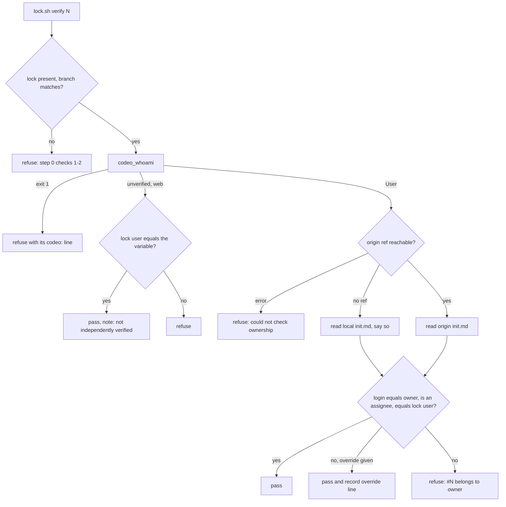

# Strict Identity and Ownership Verification Implementation Plan (#195)

> **For agentic workers:** REQUIRED SUB-SKILL: Use superpowers:subagent-driven-development (recommended) or superpowers:executing-plans to implement this plan task-by-task. Steps use checkbox (`- [ ]`) syntax for tracking.

**Goal:** `init`, `lock take` and claim refuse an unresolvable or Bot login outside a hosted web session; the login is recorded in `init.md`, the lock and the live signal; and `plan`, `implement`, `qc` and `close` verify by script that the person running them owns the workflow, with a recorded, per-call override.

**Architecture:** One new library, `lib/identity.sh`, owns "who is acting" (`codeo_whoami`) and "who owns this dossier" (`codeo_owner_of_init`); `github.sh user whoami` is its CLI face and the lenient `user login` stays for labels. `lock.sh` gains `verify` and `owner`, and `take` calls the same owner check before it writes a lock that now carries a `user:` line. The skills call `lock.sh verify` at step 0 and `close`'s stash/abandon removes the recorded owner explicitly.

**Tech Stack:** bash (4.3+), `jq`, `git`, `gh api`; tests in the `shell` suite (`bash tests/run.sh [name-substring]`).

**Spec:** the issue (https://github.com/kbajpai/codeo/issues/195) and `.codeo/195/plan.md` (Q1-Q8 with their answers, and `## Notes`). The plan's reference-doc changes are in `docs/handoff.md`, `docs/dossier.md` and `docs/skills.md` (Task 8).

## Global Constraints

- **Strict identity (Q1, Q3).** `codeo_whoami` prints `<login><TAB><type>` and exits 0 only when `gh api user` answers with `.type == "User"` (type `User`), or — in a hosted web session only (`CLAUDE_CODE_REMOTE=true`) — when `GET /user` is refused and `$CODEO_GITHUB_LOGIN` is set (type `unverified`). Anything else exits 1 with stdout empty and one `codeo:` line on stderr: an unresolved login, or a login whose `.type` is not `User` (a Bot, an Organization, anything else).
- **`$CODEO_GITHUB_LOGIN` is honoured only in a web session**, by both `codeo_whoami` and the lenient `github.sh user login`, and never satisfies an ownership check: a web session whose type is `unverified` is compared only against the lock's own `user:` line (Q2), never against assignees or the pushed owner, and `verify` says so.
- **Recorded forms (Q4).** `init.md`'s header table gains `| Owner | <login> |` (after `| Branch |`); the lock gains `user:    <login>` after `host:`; the live signal keeps its `user:` field, fed by the lenient resolver. The resume line keeps its form (`resumed: by <login> after …`), so the three copies of `resume_re` (`claim.sh:101`, `lock.sh:32`, `.devcontainer/scripts/role.sh:122`) do not change. A lock without `user:` is legacy: `verify` falls back to assignees and the pushed dossier and says so.
- **Owner (Q5).** The owner is the login on the **last** `resumed: by <login> after` line of the pushed `.codeo/<N>/init.md` (or `.codeo/done/<N>/init.md` when `close` has archived it), else its `| Owner |` row. The pushed copy is read from `origin/<branch>`; `git ls-remote --exit-code origin refs/heads/<branch>` exit 2 (no such ref) falls back to the local `init.md` and says so, any other failure to reach `origin` fails closed. The current login must equal the owner, be among the issue's assignees when there are any, and equal the lock's `user:` when it has one.
- **Refusal form.** One stderr line, `codeo: #<N> belongs to <owner> (last resumed <date>, or "claimed <date>") — you are <login>; …`, exit 1. The exact strings are in Task 4.
- **Override (Q6).** `lock.sh verify --override "<words>"` passes one call that would otherwise refuse and appends `- <date> — override: <login> over <owner>: "<words>"` to the local `.codeo/<N>/init.md` `## Notes` (created before `## Outcome` when absent), printing the line. It is judged again at the next step; a takeover that should last goes through `/codeo:init`'s resume path, which writes the resume line. Role-guard refusals keep having no override (`plan-09`, `implement-10`, `qc-14`, `close-14`).
- **`take` keeps its never-fails contract:** a refusal (login or owner) takes no lock and prints one `lock: TODO — …` line on stderr, exit 0.
- **Stash/abandon (Q7).** `close` runs step 0's `verify` first like every step; it then removes the recorded owner (`lock.sh owner <N>`) with `github.sh issue assignee-remove <N> <owner>`. `github.sh issue assignee-remove` stops defaulting to the current login and errors when the login argument is missing.
- **One PR (Q8), identity first (Tasks 1-3, 5-6), ownership after (Tasks 4, 7).** Any prefix of the tasks builds and passes the suite.
- **Proof of done.** The `shell` suite has no single-test filter, so a task's proof is its own test file through the suite's own runner, `bash tests/run.sh <name-substring>` (a substring of the test file's name), and the last task runs the whole `bash tests/run.sh`. A task that adds or rewords a skill rule also runs `bash tests/inventory.test.sh --update` and commits `tests/fixtures/skills-inventory.rules.sha256`.
- **New rule ids:** `init-11`, `plan-10`, `implement-11`, `qc-15`, `close-15`, `close-16` (the `want` map in `tests/inventory.test.sh` becomes `[init]=11 [plan]=10 [implement]=11 [qc]=15 [close]=16`).
- **Invariants document:** none is configured for this project, so there is no invariant to check.
- **Environment lease:** the project has no shared environment, so no task carries `Needs lease:`; every task runs in this checkout. No task runs on the engineer's host.
- **Documentation:** the pages that move are `docs/handoff.md`, `docs/dossier.md`, `docs/skills.md`, `docs/skills-inventory.md`, `README.md` and `CHANGELOG.md` (Task 8, plus the inventory edits in Tasks 5-7).
- **Reach:** the new checks run in a project once its pinned plugin carries them (the next release and `chore: pin codeo`), not at the merge.

## Review Focus

- `CLAUDE_CODE_REMOTE=true` with `CODEO_GITHUB_LOGIN` set and `GET /user` failing yields type `unverified` and is **not** compared with assignees; the same variable set outside a web session is ignored by both `whoami` and `user login` (Tasks 1, 4).
- A login that ends `[bot]` or whose `.type` is `Bot` is refused even when the API call otherwise succeeds (Task 1).
- B on A's branch is refused at `verify` for every step, and A's own stale checkout — A's login against a pushed resume line naming B — is refused too (Task 4).
- A missing `origin` ref (the branch was never pushed) is not a fetch failure; a fetch that errors fails closed (Task 4).
- An override on a call that would have passed records nothing; an empty override string is refused, not recorded (Task 4).
- A pre-change lock (no `user:`) and a pre-change `init.md` (no Owner row) still verify, by assignees and resume line, with a legacy note (Task 4).
- `assignee-remove` with no login argument fails instead of removing the caller (Task 2).

---

### Task 1: `lib/identity.sh`, `github.sh user whoami`, and web-only variable fallback

**Files:**
- Create: `lib/identity.sh`
- Modify: `scripts/github.sh` (`user_login()` at 31-45, the `user)` case at 159-163, the header verb list)
- Modify: `tests/github.test.sh` (the three `user login` cases at 269-293)

**Interfaces:**
- Produces, in `lib/identity.sh`: `codeo_is_web_session` (exit 0 when `${CLAUDE_CODE_REMOTE:-} == true`); `codeo_whoami` (stdout `<login><TAB><type>` exit 0, or stdout empty, exit 1 and one stderr line starting `codeo:`) (`codeo_owner_of_init` is added to the same file in Task 4).
- Produces: `github.sh user whoami` — runs `codeo_whoami` and passes its stdout, stderr and exit through; `github.sh user login` unchanged in output, but its `$CODEO_GITHUB_LOGIN` fallback runs only when `codeo_is_web_session`.
- Consumes: nothing from earlier tasks.

- [ ] **Step 1: Write the failing tests** in `tests/github.test.sh`, each as a `case_desc=` block like its neighbours. Fixtures are written with `write_fixture GET "user"`; the stub already honours `mark_fail`.
  - `user whoami (User)`: fixture `{"login":"kbajpai","type":"User"}` → exit 0, stdout `kbajpai<TAB>User`.
  - `user whoami (Bot)`: `{"login":"acme-bot[bot]","type":"Bot"}` → exit 1, stdout empty, stderr contains `acme-bot[bot]` and `Bot`.
  - `user whoami (Organization)`: type `Organization` → exit 1.
  - `user whoami (GET /user 403s, CODEO_GITHUB_LOGIN set, not a web session)`: `mark_fail GET "user"`, variable exported, `CLAUDE_CODE_REMOTE` unset → exit 1, stdout empty, stderr contains `CODEO_GITHUB_LOGIN`.
  - `user whoami (GET /user 403s, web session)`: same with `CLAUDE_CODE_REMOTE=true` → exit 0, stdout `someone<TAB>unverified`.
  - `user whoami (GET /user 403s, web session, no variable)`: exit 1.
  - Change the existing `user login (… CODEO_GITHUB_LOGIN set)` case to export `CLAUDE_CODE_REMOTE=true`, and add `user login (… variable set, not a web session)`: exit 1, stdout empty.
  - Add `unset CLAUDE_CODE_REMOTE` beside the existing `unset GH_TOKEN CODEO_GITHUB_LOGIN` at line 11.

- [ ] **Step 2: Run it to see it fail.** Run `bash tests/run.sh github`. Expected: FAIL, `unknown user subcommand: whoami`.

- [ ] **Step 3: Implement `lib/identity.sh`.** `codeo_whoami` calls `gh api user -q '[.login,.type]|@tsv'`; on success it refuses a type other than `User`, on failure it falls to the web-only branch above. The Bot message is `codeo: <login> is a <type> account, not a person: sign in with your own GitHub login`; the unresolved message is `codeo: cannot tell who you are: GET /user was refused, and $CODEO_GITHUB_LOGIN counts only in a hosted web session`. Then source it from `scripts/github.sh`, route `user whoami` to `codeo_whoami`, and gate `user_login()`'s variable branch on `codeo_is_web_session`. Add `user whoami` to the header's verb list.

- [ ] **Step 4: Run it to see it pass.** Run `bash tests/run.sh github`. Expected: `all cases passed`.

- [ ] **Step 5: Commit.** `git add lib/identity.sh scripts/github.sh tests/github.test.sh` then `git commit -m "feat: resolve the acting user strictly (#195)"`.

---

### Task 2: `assignee-remove` requires a login

**Files:**
- Modify: `scripts/github.sh` (`assignee-remove` at ~109)
- Modify: `tests/github.test.sh` (the `issue assignee-remove 85 kbajpai` case at 169-174)

**Interfaces:**
- Produces: `github.sh issue assignee-remove <N> <login>`; a missing `<login>` exits 1 with `github: issue assignee-remove needs the login to remove` and makes no API call.
- Consumes: nothing from earlier tasks.

- [ ] **Step 1: Write the failing test** `issue assignee-remove 85 (no login)`: exit 1, stderr contains `needs the login`, and `$calls_log` has no `DELETE`.
- [ ] **Step 2: Run it to see it fail.** `bash tests/run.sh github`. Expected: FAIL, the call went out.
- [ ] **Step 3: Implement** `login=${2:?…}`-style check replacing `${2:-$(user_login)}` for `assignee-remove` only; `assignee-add` keeps its default.
- [ ] **Step 4: Run it to see it pass.** `bash tests/run.sh github`. Expected: `all cases passed`. `tests/close-skill.test.sh` pins the stash prose and is updated in Task 7, not here.
- [ ] **Step 5: Commit.** `git add scripts/github.sh tests/github.test.sh` then `git commit -m "fix: assignee-remove never defaults to the caller (#195)"`.

---

### Task 3: `claim.sh --resume-line` refuses an empty login

**Files:**
- Modify: `scripts/claim.sh` (`--resume-line` at 252-267, its header comment)
- Modify: `tests/claim.test.sh`

**Interfaces:**
- Produces: `claim.sh --resume-line <issue> <branch> <repo> <login>`; `<login>` is required, a missing or empty one exits 1 with `claim: --resume-line needs the acting login (a resume line never says "no login")`. Output otherwise unchanged.
- Consumes: nothing from earlier tasks.

- [ ] **Step 1: Write the failing tests** next to the existing `--resume-line` cases: `--resume-line with no login` and `… with an empty login` → exit 1, stdout empty, stderr contains `needs the acting login`; and the existing case with a login still prints `resumed: by alice after`. Delete any case asserting the literal `no login`.
- [ ] **Step 2: Run it to see it fail.** `bash tests/run.sh claim`. Expected: FAIL, exit 0 with `no login` printed.
- [ ] **Step 3: Implement** the guard before the `printf` at line 267 and drop the `${login:-no login}` default.
- [ ] **Step 4: Run it to see it pass.** `bash tests/run.sh claim`. Expected: `all cases passed`.
- [ ] **Step 5: Commit.** `git add scripts/claim.sh tests/claim.test.sh` then `git commit -m "feat: a resume line always names the acting login (#195)"`.

---

### Task 4: `lock.sh` records `user:`, refuses in `take`, and gains `verify` and `owner`

**Files:**
- Modify: `lib/identity.sh` (add `codeo_owner_of_init`)
- Modify: `scripts/lock.sh` (header comment, `take` at 62-199 — the lock write at 171-192, a new `check_owner`, `verify`, `owner`; the `case` at 201-204)
- Modify: `tests/lock.test.sh` (add a stub `gh` to `stub_bin`, and cases for `user:` and the `take` refusals)
- Create: `tests/lock-verify.test.sh`

**Interfaces:**
- Consumes: `codeo_whoami`, `codeo_is_web_session` (Task 1); the `| Owner |` row and resume-line forms from Global Constraints.
- Produces: `codeo_owner_of_init <file>` — prints the owner login; last `resumed: by <login> after ` line wins, else the `| Owner | <login> |` row, else prints nothing.
- Produces: `lock.sh verify [--override "<words>"]` — exit 0 prints `lock: verified #<N> as <login>` (plus `… (not independently verified: hosted web session)` or `… (legacy lock: no recorded user)` when they apply); exit 1 prints the one refusal line. `lock.sh owner [<N>]` — prints the owner login or nothing, exit 0 (exit 1 when there is no lock and no `<N>`).
- Produces: refusal lines — `codeo: #<N> belongs to <owner> (<last resumed <date> | claimed <date>>) — you are <login>; ask them, or take it over with /codeo:init #<N>` · `codeo: #<N> is assigned to <a, b>, not <login> — …` · `codeo: this checkout was locked by <user>, you are <login> — …` · `codeo: could not check who owns #<N>: cannot reach origin` · `codeo: --override needs the engineer's words`.
- `take` writes `user:    <login>` after `host:` only for a verified login; for type `unverified` it writes `user:    <login>` too.

- [ ] **Step 1: Write the failing tests.** In `tests/lock.test.sh`, add to `stub_bin` a `gh` stub that answers `gh api user` from `$GH_STUB_USER` (JSON, or `FAIL` to exit 1) and `gh api repos/*/issues/*` from `$GH_STUB_ASSIGNEES` (applying `-q` with `jq`, as `tests/github.test.sh`'s stub does), and give scratch repos a `.codeo/config.json`. Cases:
  - `take, container, matching branch` now also asserts `user:    alice` in the lock.
  - `take, unresolved login (GET /user fails, not web)` → no lock written, stderr contains `lock: TODO` and `cannot tell who you are`.
  - `take, Bot login` → no lock, stderr contains `Bot`.
  - `take, web session, variable only` → lock written with `user:` and the variable's login.
  - `take, branch owned by someone else (pushed init.md Owner bob, current alice)` → no lock, stderr contains `belongs to bob`.
  In `tests/lock-verify.test.sh` (own harness, same `assert_*` helpers as `tests/lock.test.sh`; scratch repo with an `origin`, a lock, an `init.md` with an Owner row, the `gh` stub), `verify` cases:
  - `owner runs verify` → exit 0, stdout `verified #38 as alice`.
  - `B on A's branch` → exit 1, one stderr line, contains `belongs to alice`, `you are bob`.
  - `A's stale checkout after B resumed` — pushed `init.md` ends `- 2026-11-27 — resumed: by bob after the stash of 2026-11-26`, current alice, lock `user: alice` → exit 1, contains `belongs to bob`.
  - `assigned to someone else` → exit 1, contains `is assigned to`.
  - `lock user differs` → exit 1, contains `locked by`.
  - `web, variable only, lock user equal` → exit 0, stdout contains `not independently verified`; `… lock user differs` → exit 1.
  - `origin unreachable` (origin path removed) → exit 1, contains `could not check`; `branch never pushed` (no origin ref) → exit 0, stdout contains `local`.
  - `legacy lock and dossier` (no `user:`, no Owner row, assignees contain alice) → exit 0, stdout contains `legacy`.
  - `override on a refusal` → exit 0, local `init.md` gains one `## Notes` line `override: bob over alice: "taking over while she is out"` (created before `## Outcome` when `## Notes` is absent), stdout prints that line; run again without `--override` → exit 1.
  - `override that was not needed` → exit 0, `init.md` unchanged. `--override ""` → exit 1, contains `needs the engineer's words`, `init.md` unchanged.
  - `owner prints the recorded owner` after a resume line; `owner` with no recorded owner prints nothing, exit 0.
- [ ] **Step 2: Run them to see them fail.** `bash tests/run.sh lock`. Expected: FAIL, `usage: lock.sh take …` for `verify`, and no `user:` line in the lock.
- [ ] **Step 3: Implement `codeo_owner_of_init` in `lib/identity.sh`**, then in `scripts/lock.sh` a function `check_owner <issue> <branch> <login> <type>` returning 0, or 1 with the one refusal line in `$refusal`: it reads the pushed `init.md` per Global Constraints → Owner, compares per the flowchart, and leaves the override to `verify`. `take` calls `codeo_whoami` first (TODO and no lock on failure) and `check_owner` after it has found the issue (TODO and no lock on refusal), and writes the `user:` line. `verify` reads `.codeo/active`, runs `codeo_whoami`, `check_owner` plus the lock's `user:` comparison, and applies `--override`. Assignees come from `bash "$CODEO_PLUGIN_ROOT/scripts/github.sh" issue view <N>`; its failure is "could not check", like an unreachable origin.
- [ ] **Step 4: Run them to see them pass.** `bash tests/run.sh lock`. Expected: `all cases passed` for `lock.test.sh` and `lock-verify.test.sh`. Also `bash tests/run.sh devcontainer` still passes (the start script calls `lock.sh take`; if its stub environment now lacks a login, give that test the same `gh` stub rather than loosening `take`).
- [ ] **Step 5: Commit.** `git add lib/identity.sh scripts/lock.sh tests/lock.test.sh tests/lock-verify.test.sh` (and `tests/devcontainer.test.sh` if touched) then `git commit -m "feat: lock.sh records the user and verifies ownership (#195)"`.

---

### Task 5: The live signal takes its user from the strict-ordered resolver

**Files:**
- Modify: `scripts/live.sh` (`user_label()` at 156-163, the header note at 74)
- Modify: `tests/live.test.sh` (the stub at 29-60, the case at ~700), `tests/live-signal.test.sh` (line 20 and ~183)

**Interfaces:**
- Consumes: the lenient `github.sh user login` with its web-only variable fallback (Task 1).
- Produces: `user_label` no longer reads `$CODEO_GITHUB_LOGIN` itself; the order is `github.sh user login`, then (web) first assignee, then (non-web) `git config user.name`, then `unknown`.

- [ ] **Step 1: Write the failing tests.** In `tests/live.test.sh`: `CODEO_GITHUB_LOGIN=bob` with the stub's `user login` answering `alice` and no web session → the signal's `user:` line is `alice` (today `bob`); a case asserting `user: alice` is what the signal carries for a normal run (the acceptance criterion's "live signal" leg). Update `tests/live-signal.test.sh` where it relied on the variable to name the user, setting `CLAUDE_CODE_REMOTE=true` or a `gh` stub as the case needs.
- [ ] **Step 2: Run them to see them fail.** `bash tests/run.sh live`. Expected: FAIL, `user: bob`.
- [ ] **Step 3: Implement** by deleting the `name=${CODEO_GITHUB_LOGIN:-}` first branch of `user_label` and rewriting the header comment at line 74.
- [ ] **Step 4: Run them to see them pass.** `bash tests/run.sh live`. Expected: `all cases passed` (matches `live.test.sh` and `live-signal.test.sh`).
- [ ] **Step 5: Commit.** `git add scripts/live.sh tests/live.test.sh tests/live-signal.test.sh` then `git commit -m "fix: the live signal never trusts the variable outside a web session (#195)"`.

---

### Task 6: `init` refuses an unresolved or Bot login and records the Owner

**Files:**
- Modify: `skills/init/SKILL.md` — step 3's "Check nobody else has it" (lines ~85-100), the resume path (~196-254), the fresh path (~290-312), and the dossier header table the step writes
- Modify: `docs/skills-inventory.md` (rule `init-11`), `tests/inventory.test.sh` (`[init]=11`), `tests/fixtures/skills-inventory.rules.sha256`
- Modify: `tests/init-skill.test.sh`

**Interfaces:**
- Consumes: `github.sh user whoami` (Task 1), `claim.sh --resume-line` with a required login (Task 3), `lock.sh take`'s refusal (Task 4).
- Produces: rule `init-11` — `init` runs `bash "${CLAUDE_PLUGIN_ROOT}/scripts/github.sh" user whoami` before any claim; on exit 1 it prints that one `codeo:` line and stops, with no skipped assignee check anywhere; its login goes into `init.md`'s `| Owner |` row, `claim.sh --resume-line`'s last argument and `assignee-add`.

- [ ] **Step 1: Write the failing tests** in `tests/init-skill.test.sh` using its `section_contains` helpers: step 3 names `user whoami` and says to stop on its failure; the prose no longer contains `no login to` or `say so and continue`; the dossier header the skill writes contains `| Owner |`; the resume instruction passes the whoami login to `--resume-line`; marker `init-11` is present.
- [ ] **Step 2: Run it to see it fail.** `bash tests/run.sh init-skill`. Expected: FAIL on the first new assertion.
- [ ] **Step 3: Edit the skill.** Replace every `user login` and "when it prints nothing, skip" branch in `skills/init/SKILL.md` with the `user whoami` form, add the `<!-- rule: init-11 -->` paragraph, add the Owner row to the table the step writes, and say that a `unverified` login (web) is recorded but never compared with an assignee. Add the rule to `docs/skills-inventory.md`, update the `want` map, run `bash tests/inventory.test.sh --update`.
- [ ] **Step 4: Run it to see it pass.** `bash tests/run.sh init` and `bash tests/run.sh inventory`. Expected: `all cases passed`. Then `bash tests/run.sh dossier-check` still passes with the extra table row (fix its fixture, not the checker, if it fails).
- [ ] **Step 5: Commit.** `git add skills/init docs/skills-inventory.md tests/inventory.test.sh tests/fixtures/skills-inventory.rules.sha256 tests/init-skill.test.sh` then `git commit -m "feat: init resolves the user strictly and records the owner (#195)"`.

---

### Task 7: Step 0 verifies ownership in `plan`, `implement`, `qc`, `close`; stash removes the owner

**Files:**
- Modify: `skills/plan/SKILL.md` (step 0, ~61-68), `skills/implement/SKILL.md` (~49-56), `skills/qc/SKILL.md` (~56-63), `skills/close/SKILL.md` (step 0 at ~74-82; the stash list at ~636-652, which abandon reuses)
- Modify: `docs/skills-inventory.md` (`plan-10`, `implement-11`, `qc-15`, `close-15`, `close-16`), `tests/inventory.test.sh`, `tests/fixtures/skills-inventory.rules.sha256`
- Modify: `tests/plan-skill.test.sh`, `tests/implement-skill.test.sh`, `tests/qc-skill.test.sh`, `tests/close-skill.test.sh` (including the pin at ~351)

**Interfaces:**
- Consumes: `lock.sh verify [--override "<words>"]` and `lock.sh owner` (Task 4), `github.sh issue assignee-remove <N> <login>` (Task 2).
- Produces: in each of the four skills one rule paragraph after the lock checks — run `bash "${CLAUDE_PLUGIN_ROOT}/scripts/lock.sh" verify`; on exit 1 print its one line and stop; pass `--override "<the engineer's exact words>"` only when the engineer has said in so many words to take the workflow over, never inferred (`close-15` adds that `close` records the override line in its dossier commit). `close-16`: the stash/abandon removes `lock.sh owner <N>`'s login with `assignee-remove <N> <owner>`; with no owner printed it skips the call and says so; it never removes the caller.

- [ ] **Step 1: Write the failing tests** in each `*-skill.test.sh`: step 0 contains `lock.sh" verify`, says to stop on exit 1 and print its line, names `--override`, and carries its rule marker; `close-skill.test.sh`'s stash section contains `lock.sh" owner` and `assignee-remove <N> <owner>`, and no longer pins `user login`.
- [ ] **Step 2: Run them to see them fail.** `bash tests/run.sh skill`. Expected: FAIL in each of the four.
- [ ] **Step 3: Edit the four skills, the inventory and the hash** as in Task 6. Reword only what the new assertions need, because the other `*-skill` tests pin phrases.
- [ ] **Step 4: Run them to see them pass.** `bash tests/run.sh skill`, `bash tests/run.sh inventory`, `bash tests/run.sh skills`. Expected: `all cases passed`.
- [ ] **Step 5: Commit.** `git add skills docs/skills-inventory.md tests/inventory.test.sh tests/fixtures/skills-inventory.rules.sha256 tests` then `git commit -m "feat: every step verifies ownership; stash removes the owner (#195)"`.

---

### Task 8: Documentation and the changelog

**Files:**
- Modify: `docs/handoff.md` — "The lock": the lock sample gains `user:    alice`, the checks become four (a fourth: **Not the owner?**), the `user` chain at 195-206 becomes the new order with the web-only variable, and a Mermaid flowchart (the one in this plan's Review Focus) shows `verify`; "Closing block" needs no change
- Modify: `docs/dossier.md` — the `init.md` header table with `| Owner |`, the `override:` line under `## Notes`, and the resume line's login being required
- Modify: `docs/skills.md` — the `init` and `close` entries
- Modify: `README.md` — step 2 (`/codeo:init`) and Troubleshooting → "A lock that is stuck or not yours"
- Modify: `CHANGELOG.md` — one bullet under `## Unreleased`; the `Shared state:` line names the `| Owner |` row, the lock's `user:` line and the `override:` Notes line
- Test: `tests/readme.test.sh`, `tests/skills-doc.test.sh`

**Interfaces:**
- Consumes: the final names from Tasks 1-7; documents what the system does and links here for the why.

- [ ] **Step 1: Write the failing check.** Add to `tests/skills-doc.test.sh` assertions that `docs/skills.md`'s `init` section mentions `user whoami` and its `close` section mentions `lock.sh verify`; to `tests/readme.test.sh` that the Troubleshooting entry mentions `--override`.
- [ ] **Step 2: Run it to see it fail.** `bash tests/run.sh doc`. Expected: FAIL.
- [ ] **Step 3: Write the pages.** Every path-shaped backticked word in the README must resolve (`tests/readme.test.sh` checks).
- [ ] **Step 4: Run the whole suite.** `bash tests/run.sh`. Expected: every file `all cases passed`, exit 0.
- [ ] **Step 5: Commit.** `git add docs/handoff.md docs/dossier.md docs/skills.md README.md CHANGELOG.md tests` then `git commit -m "docs: strict identity and ownership verification (#195)"`.

---

## Self-review

- **Spec coverage:** identity refusals (AC 1-2) Tasks 1, 3, 4, 6; recording (AC 3) Tasks 4, 5, 6; non-owner steps and the stale checkout (AC 5-6) Task 4 and 7; override once and recorded (AC 7) Task 4; stash by a non-owner (AC 8) Tasks 2, 7; tests per case (AC 4, 9) in every task.
- **Not in this plan:** lease ownership (separate issue); `.devcontainer/scripts/role.sh`'s `resume_re` is untouched.
- **Names:** `codeo_whoami`, `codeo_is_web_session`, `codeo_owner_of_init`, `lock.sh verify|owner`, `github.sh user whoami`, rule ids and the `| Owner |` row are spelled the same in every task.
