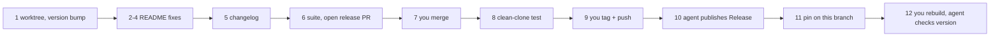

# Release v1.0.11 Implementation Plan

> **For agentic workers:** REQUIRED SUB-SKILL: Use superpowers:subagent-driven-development (recommended) or superpowers:executing-plans to implement this plan task-by-task. Steps use checkbox (`- [ ]`) syntax for tracking.

**Goal:** Ship codeo v1.0.11 from `main` as it stands, with `README.md` corrected against the code (release PR, clean-clone test, tag, GitHub Release), then pin this project to v1.0.11 so its container and sessions run it.

**Architecture:** Two pull requests, as for v1.0.10. The release PR comes from `release/v1.0.11`, cut from `origin/main` in a git worktree: five files and no dossier, so the required `qc-verdict` check passes (it fails a head that carries a live dossier). This workflow branch carries the pin, the plan and the dossier, and `/codeo:close` opens its PR after the tag exists. Steps that are the engineer's (merges, tag push, container rebuild) are tasks that stop and wait.

**Tech Stack:** `git`, `gh`, `jq`, `sed`, `awk`, `bash tests/run.sh`, `bash tests/readme.test.sh`, `bash tests/install.test.sh`, `claude plugin list`.

**Spec:** `.codeo/213/init.md` (`## Outcome`: the seven acceptance criteria); `.codeo/213/plan.md` Q1-Q2 and `## Where this stands` (the eight mismatches M1-M8); `docs/release-checklist.md` steps 6-8.



## Global Constraints

- Release scope is `main` as it stands when the release PR is opened (`3857710` at planning, 8 commits past `v1.0.10`: #191, #202, #203, #208, #211, #210, #212, #209). #205, #207 and anything filed later ship later (issue, out of scope).
- The release PR changes exactly five files: `.claude-plugin/plugin.json`, `CHANGELOG.md`, `README.md`, `docs/updating.md` and `tests/install.test.sh`. `.claude-plugin/marketplace.json` carries no version. No `tests/readme.test.sh` change is planned; it must still pass (it pins README headings and some leads, and has grown since v1.0.10).
- **Version moves** (checklist step 6; dry-run at planning on `3857710` in a scratch worktree: `bash tests/install.test.sh` and `bash tests/readme.test.sh` ended `all cases passed`). In `README.md` and `docs/updating.md`: every `1.0.10` becomes `1.0.11`, then every `1.0.9` becomes `1.0.10`, in one `sed` call per file, in that order (the other order turns every version into `1.0.11`). In `tests/install.test.sh` the same two substitutions, except: skip `t_latest_installed_without_version` and `t_bad_version_usage` (their `v1.0.8`/`v1.0.9`, `v1.0.9.1` and `v1.0.9;x` are ordering or refused stubs), and inside `t_latest_is_highest_release` take only the stub `v1.0.11` to `v1.0.12` ("that stub takes the next higher version"; its `v1.0.9` and `v1.0.8` stay). Five `1.0.9` remain in that file afterwards, all in the skipped functions. `docs/dev-environment-sbx-evaluation.md:522` is a historical transcript and stays.
- The substitution never runs on `CHANGELOG.md`: it names older versions on purpose.
- **README corrections (Q1: the eight mismatches M1-M8 and the omissions the unreleased work introduced; the older omissions are not fixed).** Each edit was found by comparing the README with the code and re-read at planning; the implementer re-reads the cited code before writing, because line numbers drift (the README was 721 lines at planning, and the lines below are the ones it then had). Corrections say what the code does and add no version number. Edits keep the README's structure: the `##` headings, the Troubleshooting `###` groups and the doctor bold leads that `tests/readme.test.sh` pins.
- **Changelog (Q2).** `## Unreleased` becomes `## v1.0.11 — <UTC date the release PR opens>` (`gh pr view --json createdAt`; corrected before merge if it merges on a later day). Its three header lines stay unless the diff since `v1.0.10` of `scripts/`, `lib/` and `hooks/` says otherwise (re-read in Task 5). A one-line #211 bullet is added, and #192's and #204's bullets are reworded to the released state.
- The tag push, both PR merges and the container rebuild are the engineer's. The agent never merges or tags, and publishes the GitHub Release only after the engineer says the tag is pushed. A pushed tag is never moved. The tag is lightweight: `git tag v1.0.11 <SHA>`.
- The pin moves only after the tag exists (`.devcontainer/scripts/plugins.sh` checks the pin on GitHub before replacing codeo). The Release follows checklist step 8: title `v1.0.11`, notes the changelog section only, never `--generate-notes`.
- Tasks 7, 9 and 12 mark `Runs on: the engineer's host`; their commands are single commands a shell passes through unchanged (the lock's host is `container`).
- No shared environment (so no `Needs lease:`), no invariants document, no `wiki` module, no exclusive resources, and no other workflow in flight: nothing is leased and no overlap was found.
- Documentation: the change moves `README.md` (Tasks 2-4) and `docs/updating.md` (version numbers only); it moves no other page. Changing the release checklist is out of scope (issue). No code changes, so no code test is written; every README task is proved by the `grep` checks it names and by `bash tests/readme.test.sh`.
- `/codeo:close` opens one PR per workflow from this branch; the release PR is opened by `/codeo:implement` from `release/v1.0.11` and is a different head.

## Review Focus

- The release branch is cut from `origin/main`, not from this branch: a diff beyond the five files, or any `.codeo/` change, fails `qc-verdict` and drags a live dossier into `main`.
- Substitution order, and the skipped stubs: Task 1 checks that `v1.0.9.1`, `v1.0.9;x` and the stubs of the two skipped functions survived, and that the ordering stub is `v1.0.12`.
- A README edit must come from the code, not from this plan: each task names its evidence and the implementer reads it. A sentence the code contradicts is the failure this release exists to remove. M2 (`ruleset`) was read from the agent's citation only; Task 2 re-reads `scripts/doctor.sh` first.
- `main` may move between this plan and Task 1: re-read `## Unreleased`, and re-run the README comparison for any file the new commits touched (`git diff --stat 3857710 origin/main`).
- The clean-clone test runs at the merge commit, not at `main`'s tip if `main` moved after the merge. A lightweight tag has no `^{}` line in `git ls-remote --tags origin`.
- The Release notes file must not start with the heading and must not be generated: its first line is `Config schema: 1 (unchanged)` unless Task 5 changed it.
- The two reworded changelog bullets must read correctly in a section that is already released; the #211 bullet must match what `9b11696` changed.
- A stale `CODEO_ROOT` or an old session: the version check runs in a session started after the rebuild; `claude plugin list` may show a user-scope and a project-scope `codeo@codeo`, and Task 12 records any that is not 1.0.11.

---

### Task 1: Cut the release branch and move the versions

**Files:**
- Modify: `.claude-plugin/plugin.json:3`, `README.md`, `docs/updating.md`, `tests/install.test.sh` (version numbers only)
- Worktree: `../codeo-213-release`, branch `release/v1.0.11` from `origin/main`

**Interfaces:**
- Produces: the worktree and branch Tasks 2-6 edit; every later task runs in `../codeo-213-release`.

- [ ] **Step 1: Cut the branch.** Run: `git fetch origin && git worktree add -b release/v1.0.11 ../codeo-213-release origin/main && git -C ../codeo-213-release log --oneline -1`. Expected: the tip of `origin/main` (`3857710`, or later if `main` moved).
- [ ] **Step 2: Failing check.** Run, in the worktree: `jq -e '.version == "1.0.11"' .claude-plugin/plugin.json; grep -c '1\.0\.9' README.md docs/updating.md tests/install.test.sh`. Expected: `false`, then three counts above `0`.
- [ ] **Step 3: Move the versions.** Run, in the worktree:
  ```bash
  sed -i 's/"version": "1.0.10"/"version": "1.0.11"/' .claude-plugin/plugin.json
  sed -E -i 's/1\.0\.10/1.0.11/g; s/1\.0\.9/1.0.10/g' README.md docs/updating.md
  sed -E -i '/^t_latest_is_highest_release\(\)/,/^}/{s/1\.0\.11/1.0.12/g;b}; /^t_latest_installed_without_version\(\)/,/^}/b; /^t_bad_version_usage\(\)/,/^}/b; s/1\.0\.10/1.0.11/g; s/1\.0\.9/1.0.10/g' tests/install.test.sh
  ```
- [ ] **Step 4: Proof.** Run: `jq -e '.version == "1.0.11"' .claude-plugin/plugin.json && grep -c '1\.0\.9' README.md docs/updating.md; grep -c 'v1.0.9.1\|v1.0.9;x' tests/install.test.sh; grep -c 'refs/tags/v1.0.12' tests/install.test.sh; bash tests/install.test.sh | tail -1; bash tests/readme.test.sh | tail -1`. Expected: `true`; `README.md:0`, `docs/updating.md:0`; a count of at least `2`; `1`; `all cases passed`; `all cases passed`.
- [ ] **Step 5: Commit** the four files: `git add .claude-plugin/plugin.json README.md docs/updating.md tests/install.test.sh && git commit -m "release: move the version examples to v1.0.11"` (trailers per the session's attribution). Do not push yet.

### Task 2: README, installing and setting up (M1-M4)

**Files:**
- Modify: `README.md`, *Requirements* (the `install.sh` paragraph, line 38), *Setting a project up* step 1 (lines 173 and 206)

**Interfaces:**
- Evidence: `scripts/doctor.sh` (`report ok deps "jq, git, bash …"`; the `ruleset` block, which prints `fail ruleset: skipped: baseBranch is not set` or `skipped: config is unusable` and sets exit 1); `scripts/setup.sh` header (line 19: refuses an existing `config.json` "unless --containers is the only option besides --codename"), `write_pin` and the `codename` write; README line 288 already describes `/codeo:setup --containers`.

- [ ] **Step 1: Failing check.** Run: `grep -c 'bash, `jq`, `git` and `gh`' README.md; grep -c 'ruleset` is skipped' README.md; grep -c 'refuses to overwrite a `config.json` that exists\.' README.md; grep -c 'setup leaves them out' README.md`. Expected: four `1`.
- [ ] **Step 2: M1.** `/codeo:doctor` checks bash, `jq` and `git`; its `gh-auth` check covers `gh`. Say that, and keep "never runs `claude`".
- [ ] **Step 3: M2 and M3.** `ruleset` is *reported as failing* with `skipped: …` (re-read `scripts/doctor.sh` first and quote its words), not skipped silently. The refusal to overwrite holds unless `--containers` is the only option besides `--codename`, which runs on an existing config and adds a missing `codename` and `plugin` pin; point at the *Adopting codeo with containers* section.
- [ ] **Step 4: M4.** Line 206: `board`, `models` and everything else optional are written by hand; `/codeo:setup --codename <name>` also writes `codename`, `--containers` writes `codename` and the `plugin` pin, and `--stack <name>` writes `stacks`. Setup step 1's option list names `--codename` and `--containers` beside `--stack`, with the codename rule (2-30 characters of lower-case letters, digits and single hyphens; `scripts/setup.sh`).
- [ ] **Step 5: Proof.** Run: the four greps of Step 1, then `grep -c -- '--codename' README.md; bash tests/readme.test.sh | tail -1`. Expected: `0`, `0`, `0`, `0`, at least `3`, `all cases passed`. Commit: `git add README.md && git commit -m "docs: correct what doctor's deps and ruleset checks and setup's refusals and writes do in the README"`.

### Task 3: README, init's assignment failure and the skills summary (M5, M8)

**Files:**
- Modify: `README.md`, *Your first workflow* step 2 (`/codeo:init`, "It writes"), *The skills* (the opening paragraph, line 686)

**Interfaces:**
- Evidence: `skills/init/SKILL.md` step 9 and step 6.5 (an `assignee-add failed` line under `## Notes`, its own commit `docs(codeo): init dossier for #<N> — assignee-add failed`, pushed, and reported); `docs/skills.md` (the `/codeo:issue` section: `.codeo/intake/<N>/issue.md`, committed only to the intake branch).

- [ ] **Step 1: Failing check.** Run: `grep -c 'nothing else is recorded' README.md; grep -c 'each owning one dossier file under' README.md`. Expected: `1`, `1`.
- [ ] **Step 2: M5.** "It writes" says a failed assignment is recorded as an `assignee-add failed` line under `## Notes`, in its own pushed commit, and reported in the closing message; the claim still stands on the pushed branch. Keep it consistent with the "It checks who you are" bullet above it.
- [ ] **Step 3: M8.** *The skills* says each pipeline skill after `issue` owns one dossier file under `.codeo/<issue>/`, and that `issue` keeps its dossier on the intake branch (`.codeo/intake/<N>/issue.md`) until `/codeo:init` adopts it.
- [ ] **Step 4: Proof.** Run: `grep -c 'nothing else is recorded' README.md; grep -c 'each owning one dossier file under' README.md; grep -c 'intake' README.md; bash tests/readme.test.sh | tail -1`. Expected: `0`, `0`, at least `2`, `all cases passed`. Commit: `git add README.md && git commit -m "docs: say what a failed assignment records and where issue keeps its dossier"`.

### Task 4: README, the edit guard, the identity and cleanup refusals (M6, M7 and the unreleased omissions)

**Files:**
- Modify: `README.md`, *Running on the host* (line 234), Troubleshooting (*A role-guard refusal*, line 495-499, the lock entry near line 511, a *cleanup* line), *Your first workflow* step 6 (the stash)

**Interfaces:**
- Evidence: `hooks/home-guard.sh` header and `deny` (the one-line refusal: "codeo: this checkout's role is <role>, so project changes are not made here. File the issue with /codeo:issue, start it with 'codeo issue <N>', and work in its checkout. To allow it for this session, start Claude Code with CODEO_HOME_EDITS=allow."), `hooks/hooks.json`, `docs/home-checkout.md` ("The edit guard": refused, allowed, `CODEO_HOME_EDITS=allow` lasts for the session started with it); `.devcontainer/scripts/role.sh` line 68 (`mismatch:<N>:<folder>`) and `scripts/containers.sh` (it installs `role.sh` and the role-guard overlays); `lib/identity.sh` (`<login> is a Bot account, not a person…`, `cannot tell who you are…`) and `scripts/lock.sh` (`take` turns them into `lock: TODO — no lock taken: …`, and refuses with `#N belongs to …` or `is assigned to …`); `skills/close/SKILL.md` (a stash and an abandon remove the recorded owner from the assignees); `scripts/cleanup.sh:121` (`the overlay's <key>: keeps a placeholder the script does not expand: {word}`).

- [ ] **Step 1: Failing check.** Run: `grep -c 'CODEO_HOME_EDITS' README.md; grep -c 'is a Bot account' README.md; grep -c 'does not expand' README.md; grep -c 'never refused' README.md; grep -c 'mismatch' README.md`. Expected: `0`, `0`, `0`, `1`, `0`.
- [ ] **Step 2: M6 and the guard (#192).** *A role-guard refusal* no longer says a `/codeo:setup` project is never refused: `/codeo:setup --containers` installs the guard, a plain `/codeo:setup` project has none. Add the edit guard: in a checkout whose role is `home`, `stale:?` or `stray`, the plugin's `hooks/home-guard.sh` refuses Edit, Write, NotebookEdit and git writes through Bash with one line, and the way out is `/codeo:issue`, `codeo issue <N>`, then the issue's checkout; `CODEO_HOME_EDITS=allow` at session start switches it off for that session; `.codeo/` writes are exempt. Link `docs/home-checkout.md#the-edit-guard`. *Running on the host* gets one sentence and the same link.
- [ ] **Step 3: M7.** The *Symptom* bullet names the third form: in a container locked for another issue the line says the folder is a `mismatch` for that issue (read the line `role.sh` prints at its last `echo` and quote its words).
- [ ] **Step 4: Identity (#195).** In the lock entry: `/codeo:init` and `lock.sh take` stop with `<login> is a Bot account, not a person` or `cannot tell who you are` when `github.sh user whoami` fails, and `take` then prints `lock: TODO — no lock taken: …`; the remedy is to sign in with your own GitHub login (`gh auth login`), and in a hosted web session `CODEO_GITHUB_LOGIN` counts only there. In *Your first workflow* step 6, a stash or an abandon removes you from the issue's assignees.
- [ ] **Step 5: Cleanup (#206).** One Troubleshooting line: `/codeo:cleanup` stops with `keeps a placeholder the script does not expand: {word}` when the overlay's `command:` or `fallback:` uses a `{word}` it cannot fill; fix the overlay.
- [ ] **Step 6: Proof.** Run: the five greps of Step 1, then `bash tests/readme.test.sh | tail -1`. Expected: at least `2`, `1`, `1`, `0`, at least `1`, then `all cases passed`. Commit: `git add README.md && git commit -m "docs: add the edit guard, the identity refusals and cleanup's placeholder stop to the README, and correct what a setup project has"`.

### Task 5: Changelog (Q2)

**Files:**
- Modify: `CHANGELOG.md` (heading, one added bullet, two reworded)

**Interfaces:**
- Evidence: `git log --oneline v1.0.10..origin/main`; `git diff --stat v1.0.10..origin/main -- scripts lib hooks` for the header lines; `git show 9b11696 --stat` and `.github/workflows/` for what #211 changed (`tests/run.sh`'s `CODEO_TEST_JOBS`, the workflow's `concurrency`).

- [ ] **Step 1: Failing check.** Run: `grep -c '^## Unreleased' CHANGELOG.md; grep -c '#211' CHANGELOG.md; grep -c 'comes with the next release' CHANGELOG.md; grep -c 'with its next plugin release and pin' CHANGELOG.md`. Expected: `1`, `0`, `1`, `1`.
- [ ] **Step 2: Retitle** `## Unreleased` as `## v1.0.11 — <UTC date the release PR opens>`; re-read the three header lines against the diff since `v1.0.10` and change one only if the diff requires it (`Shared state:` already names the `| Owner |` row, `user:`, `override:` and the cleanup records).
- [ ] **Step 3: Reword** #192's "The guard comes with the next release (#192)." to say it ships in this release, and #204's "It reaches a project with its next plugin release and pin" to say it reaches a project with this release and its pin. Add one bullet for #211, ending `Nothing the plugin does changes (#211).`
- [ ] **Step 4: Proof.** Run: `grep -c '^## Unreleased' CHANGELOG.md; grep -c '^## v1.0.11 — ' CHANGELOG.md; grep -c '#211' CHANGELOG.md; grep -c 'next release\|next plugin release' CHANGELOG.md; sed -n 5p CHANGELOG.md`. Expected: `0`, `1`, `1`, `0`, `Config schema: 1 (unchanged)`. Commit: `git add CHANGELOG.md && git commit -m "release: v1.0.11"`.

### Task 6: Run the whole suite and open the release PR

**Interfaces:**
- Produces: PR number `<RPR>` for Task 7, and the branch `release/v1.0.11` on origin.

- [ ] **Step 1: Run the checks.**
  ```bash
  git diff --name-only origin/main
  bash tests/run.sh | tail -1
  bash tests/readme.test.sh | tail -1
  ```
  Expected: exactly `.claude-plugin/plugin.json`, `CHANGELOG.md`, `README.md`, `docs/updating.md`, `tests/install.test.sh`; `all cases passed`; `all cases passed`. A sixth file, or a `.codeo/` path, stops the task.
- [ ] **Step 2: Push and open the PR.** `git push -u origin release/v1.0.11`, then `gh pr create --base main --title "release: v1.0.11" --body-file <body>`. Body, following the v1.0.10 release PR: patch release cut from `main` at its SHA; the five files and why each changes; config schema, shared state and safe-to-bump as the changelog's lines; what it carries (#188, #190, #192, #195, #204, #206, #211); "After merge: tag `v1.0.11` on the merge commit (the engineer's own action), then the GitHub Release; the pin is a second PR from `feat/213-release-v1-0-11-main` (#213)"; `Refs #213.`; the PR attribution footer.
- [ ] **Step 3: Proof.** Run: `gh pr view <RPR> --json baseRefName,files --jq '[.baseRefName, ([.files[].path]|sort)]'` and `gh pr checks <RPR>`. Expected: `["main",[".claude-plugin/plugin.json","CHANGELOG.md","README.md","docs/updating.md","tests/install.test.sh"]]`, and `tests` and `qc-verdict` passing.

### Task 7: The engineer merges the release PR (wait)

Runs on: the engineer's host

**Interfaces:**
- Consumes: `<RPR>`. Produces: `<SHA>`, the merge commit.

- [ ] **Step 1: Stop and say the PR is waiting for your merge.** The agent does not merge. If the heading's date is no longer the merge day, the agent corrects it on the release branch first.
- [ ] **Step 2: Once told it is merged:** `gh pr view <RPR> --json state,mergeCommit --jq '[.state, .mergeCommit.oid]'`. Expected: `["MERGED","<40-hex SHA>"]`. Record `<SHA>` in `implement.md`. Remove the worktree: `git worktree remove ../codeo-213-release`.

### Task 8: Clean-clone test of the merged commit (agent)

**Interfaces:**
- Consumes: `<SHA>`. Produces: the result line you read before tagging, and the clean clone Task 10 uses.

- [ ] **Step 1: Run it.**
  ```bash
  dir=$(mktemp -d) && git clone https://github.com/kbajpai/codeo.git "$dir" && cd "$dir" && git checkout --detach <SHA>
  git rev-parse HEAD; jq -r .version .claude-plugin/plugin.json; bash tests/run.sh | tail -1
  ```
  Expected: `<SHA>`, `1.0.11`, `all cases passed`. Record the SHA and the last line in `implement.md`. (No golden directory, so `tests/replay.test.sh` is not run.)

### Task 9: The engineer tags and pushes v1.0.11 (wait)

Runs on: the engineer's host

**Interfaces:**
- Consumes: `<SHA>` and Task 8's passing line. Produces: tag `v1.0.11` on origin.

- [ ] **Step 1: Give the engineer these three commands, one at a time, and stop.** Each is one command a shell passes through unchanged:
  ```
  git fetch origin
  git tag v1.0.11 <SHA>
  git push origin v1.0.11
  ```
- [ ] **Step 2: Once told it is pushed, prove criterion 4.** Run: `git ls-remote --tags origin v1.0.11`. Expected: `<SHA>	refs/tags/v1.0.11` (lightweight: no `^{}` line). A different commit or a missing tag stops the task; a pushed tag is never moved.

### Task 10: Publish the GitHub Release (agent, on the engineer's say-so)

**Interfaces:**
- Consumes: the tag; `CHANGELOG.md`'s `## v1.0.11` section in Task 8's clean clone. Produces: Release `v1.0.11`.

- [ ] **Step 1: Failing check.** Run: `gh release view v1.0.11`. Expected: `release not found`.
- [ ] **Step 2: Publish from the clean clone at `<SHA>`.**
  ```bash
  awk '/^## v1.0.11 /{f=1;next} /^## /{f=0} f && (n || NF){n=1; print}' CHANGELOG.md > <scratchpad>/notes-v1.0.11.md
  gh release create v1.0.11 --verify-tag --title v1.0.11 --notes-file <scratchpad>/notes-v1.0.11.md
  ```
- [ ] **Step 3: Proof (criterion 5).** Run: `gh release list --limit 3 && gh release view v1.0.11 --json tagName,name,isDraft,isPrerelease --jq '[.tagName,.name,.isDraft,.isPrerelease]' && gh release view v1.0.11 --json body --jq .body | head -1`. Expected: `v1.0.11` marked `Latest` above `v1.0.10`; `["v1.0.11","v1.0.11",false,false]`; the first line `Config schema: 1 (unchanged)`.

### Task 11: Pin this project to v1.0.11

**Files:**
- Modify: `.codeo/config.json:6` (`plugin.ref`)

**Interfaces:**
- Consumes: the tag from Task 9.

- [ ] **Step 1: Failing check.** Run: `jq -e '.plugin.ref == "v1.0.11"' .codeo/config.json`. Expected: FAIL (the ref is `v1.0.10`).
- [ ] **Step 2: Edit** `plugin.ref` to `"v1.0.11"`; nothing else in the file.
- [ ] **Step 3: Proof.** Run: `jq -e '.plugin.ref == "v1.0.11"' .codeo/config.json && git ls-remote --exit-code origin refs/tags/v1.0.11 >/dev/null && bash tests/run.sh | tail -1`. Expected: `true`, then `all cases passed` (`tests/devcontainer.test.sh` accepts any well-formed ref).
- [ ] **Step 4: Commit** `.codeo/config.json`; `/codeo:close` opens this branch's PR. Criterion 6 is met when that PR merges.

### Task 12: Rebuild, then prove the container runs v1.0.11 (criterion 7)

Runs on: the engineer's host

- [ ] **Step 1: You rebuild or restart the dev container, then start a new Claude Code session.** The agent stops until told.
- [ ] **Step 2: Version.** Run: `claude plugin list`. Expected: `codeo@codeo` shows `Version: 1.0.11` for the user-scope entry. A project-scope entry that shows another version is recorded as a finding in `implement.md`; `.claude/settings.json` is not edited to hide it.
